# 第9章 组合机构

**【概述】**

◎由于现代机械工程对机械运动形式、运动规律和动力性能等方面要求的多样化和复杂性，使得仅采用某种基本机构往往不能很好地满足设计要求。由多种基本机构组合而成的组合机构，往往能汇集各种机构的优点于一体，不仅能满足多种设计要求，而且能综合应用和发挥各种基本机构的特点，并实现较为复杂的协调动作，所以组合机构应用越来越广。本章主要介绍组合机构的组合方式及特点、常用的组合机构种类及其特点。

◎通过本章的学习，要求了解联动凸轮组合机构、凸轮-齿轮组合机构、凸轮-连杆组合机构、齿轮-连杆组合机构、连杆-连杆组合机构的工作原理、工作特点、适用场合，以及在设计和使用中一些需要注意的问题；目的在于开阔视野，扩大思路，以增强技术创新能力。组合机构的设计计算除要用到基本机构的特性外，还要用到相对运动原理、速度瞬心及瞬心线的特性和一些几何曲线的特性。

## 9.1 机构的组合方式及类型

前面介绍的连杆机构、凸轮机构、齿轮机构、间歇运动机构等都是机械中的基本机构，其应用很广，但随着生产过程机械化、自动化的发展，对机构输出的运动形式和动力特性提出了更高的要求，而单一的基本机构具有一定的局限性，使得仅采用某种基本机构往往不能很好地满足设计要求。

机构的组合原理是指将几个基本机构按一定的原则或规律组合成一个较复杂的机构，这种机构一般有两种形式：一种是几种基本机构融合成性能更加完善、运动形式更加多样化的新机构，被称为组合机构；另一种则是几种基本机构组合在一起，组合体的各基本机构保持各自特性，但需要各个机构的运动或动作协调配合，以实现组合的目的，这种形式被称为机构的组合。

机构的组合方式可划分为以下4种：串联式机构组合，并联式机构组合，复合式机构组合，叠加式机构组合。采用上述机构组合方式，能将有限的几种基本机构组合成多种多样的满足各种运动和工艺要求的机构系统，它们已广泛地应用在机械制造、纺织、印刷和轻工机械中。

组合机构一般不是将几个基本机构简单地串联起来，而是一种较复杂的组合。它是用一种或一种以上的机构来约束或影响另一单自由度或多自由度机构的封闭式机构，或者是几种基本机构互相协调配合组成的机构系统。可以是不同类型基本机构的组合，如凸轮-齿轮机构、凸轮-连杆机构和齿轮-连杆机构等；也可以是同类基本机构的组合，如联动凸轮机构、连杆-连杆机构等。通常，由不同类型的基本机构所组成的组合机构用得最多，因为它更有利于充分发挥各基本机构的特长和克服各基本机构固有的局限性。

组合机构按其组成的结构形式可分为串联式(图9-18、图9-21及图9-24所示机构)、并联式(图9-3、图9-17、图9-19所示机构及图9-25中所示冲压机构)、封闭式(图9-1、图9-4、图9-5、图9-8、图9-13、图9-14及图9-16所示机构)和装载式四种基本类型。串联式组合机构由基本机构串联而成, 它的特点是前一个基本机构的输出构件是后一个基本机构的原动件。并联式组合机构是由 $n$ 个自由度为1的基本机构的输出件与一个自由度为 $n$ 的基本机构的运动输入构件分别固联而成。封闭式组合机构是利用自由度为1的基本机构去封闭一个多自由度的基本机构而成。装载式组合机构则是将基本机构装载于另一基本机构的运动构件上而成。

组合机构往往能汇集各种基本机构的优点于一体，不仅能满足多种设计要求，而且能综合应用和发挥各种基本机构的特点，多用来实现一些特殊的运动轨迹或获得特殊的运动规律，所以其应用越来越广泛，越来越受到重视。

## 9.2 组合机构的设计

在组合机构中，自由度大于 1 的基本机构称为基础机构，而约束(或封闭)多自由度基础机构的机构称为附加机构。

组合机构的运动特性主要决定于它的结构形式。对组合机构的分析，首先分析其组成，然后分析其所组成的各个基本机构的运动关系，最后将不同的组合形式联系起来获得一个新的运动关系。对组合机构的设计，则根据工作情况对输出构件的运动要求设计基本机构。

在单自由度机构的串联式组合机构中，各基本机构运动参数间关系简单，各机构仍保持相对独立，其分析和综合的方法均比较简单。其分析的顺序是先分析运动已知的基本机构，再分析与其串联的下一个基本机构。而其设计(综合)的次序则刚好反过来，即先根据工作情况对输出构件的运动要求设计后一个基本机构，然后再设计前一个基本机构。由于各种基本机构的分析和设计方法在前面各章中已作过较详细的研究，故在本章不再赘述。

采用并联、封闭和装载等方式构成的组合机构，由于各组合机构具有各自特有的型综合、尺寸综合和分析设计方法，对组合机构的分析与综合尚欠深入，特别是综合方面没有完整的指导性原则和设计理论，更多的只能借助于经验或线图。但用相同组合方式组合而成的组合机构，具有相类似的分析和设计方法。

并联式组合机构的特点为: 原动件的运动同时输入给 $n$ 个单自由度的基本机构, 而这些基本机构的输出运动又同时输入给一个自由度为 $n$ 的基本机构, 再合成为一个运动输出, 通常 $n = 2$ 。其设计步骤为: 首先根据工作要求所要实现的运动规律或轨迹, 选择合适的多自由度基本机构; 然后分析该机构输出运动与输入运动之间的关系; 最后根据该多自由度机构的特点, 选择和设计合适的单自由度基本机构。

封闭式组合机构设计的特点为：原动件的运动，一方面直接传给自由度为2的基础机构(通常采用自由度为 2 的基础机构), 另一方面又通过一个单自由度的附加机构传给该双自由度的基础机构, 该机构将这两个输入运动合成为一个输出运动。其设计步骤为: 首先根据工作要求, 选择合适的 2 自由度基础机构; 然后给定该基础机构一个原动件的运动规律, 并使该机构的从动件按照工作要求所要实现的运动规律或轨迹运动, 从而找出上述给定运动规律的原动件和另一原动件之间的运动关系; 最后按此运动关系设计单自由度的附加机构, 即可得到满足工作要求的组合机构。

装载式组合机构又要根据情况分两种情况处理，其分析和设计方法可以参考以上三种，这里就不叙述了，有兴趣者可查阅有关文献。

总之，由于组合机构的结构较复杂，各机构运动参数间关系牵连较多，设计方法相对比较复杂，设计计算亦烦琐，这也就增加了对它研究的困难。以往对于组合机构的综合，多半停留在具体机构的具体分析阶段，对组合机构的设计常根据其运动特性及压力角和传动角进行。但压力角和传动角作为衡量机构传动质量指标有一定局限性，近年来，提出以机构效率为基础的机构传动质量指标来设计各种组合机构的新概念。对组合机构的分析及设计有待进一步研究。随着电子计算机和现代设计方法的发展，极大地推动了组合机构的研究。下面介绍工程技术中常用的组合机构的种类及相关问题。

## 9.3 联动凸轮组合机构

在许多自动机和自动机床中，为了实现预定的运动轨迹，常采用由两个凸轮机构组成的所谓联动凸轮组合机构。如图 9-1 所示即为一联动凸轮机构，它

由两个固接的盘形凸轮组合而成，在两个从动件上分别加上两个滑块，再用铰链连接这两个滑块。这种组合机构通过两凸轮的相互协调配合，可控制 M 点在 x 和 y 方向的运动，从而能精确实现预定轨迹 $y = y(x)$ 。

设计这种机构时，应首先根据所要求的轨迹 $y = y(x)$ ，分别在 $O\theta x$ 、 $O\theta y$ 坐标系中将 M 点的给定运动轨迹分解成 x 和 y 两坐标上的位置函数 $x = x(\theta)$ 和 $y = y(\theta)$ （图 9-1，图中轨迹上有 9 个时间等分点，由于凸轮轴做等角速度转动，故两相邻等分点间的时间所对应的凸轮转角 $\theta$ 为 $40^{\circ}$ ），然后就可按一般凸轮机构的设计方法分别设计出两凸轮的轮廓曲线。

下面介绍联动凸轮机构的两个应用实例。

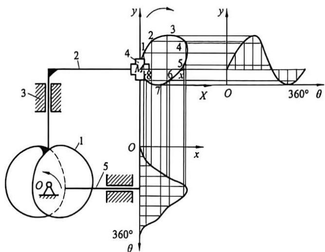

图9-1 联动凸轮机构及其运动组合
{: .figure-caption }

如图 9-2 所示为某种小型电影放映机抓片机构，它是由盘形凸轮与端面凸轮机构组合而成的。在此机构中，主动轴上固装有圆柱凸轮 1 和盘形凸轮 2。当主动轴转动时，由于两凸轮的联合作用，使构件 3 一方面上下往复运动，另一方面又沿凸轮轴线移动，其结果使抓片

爪按轨迹 K 运动，从而达到间歇抓片的目的。

如图 9-3 所示为圆珠笔芯装配线上的自动送料机构, 要求输送轨迹为矩形 $K$ 。原动件的输入轴上分别安装有两个凸轮, 其中端面凸轮 1 及推杆 4 控制托架 3 (平底从动件) 左右往复移动; 盘形凸轮 2 控制托架 3 上下运动, 从而将圆珠笔芯 5 (被输送的物料) 抬起和放下。上述两运动的合成, 使被输送的物料 5 随托架 3 沿轨迹 $K$ 运动, 以完成圆珠笔芯的向前间歇送进。由图可见, 每个凸轮机构各自使从动件完成一个方向的运动, 因此其设计和单个凸轮机构的设计方法相同, 只需注意两个凸轮机构工作协调问题。

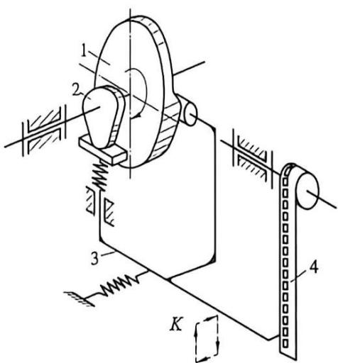

图9-2 小型电影放映机抓片机构
{: .figure-caption }

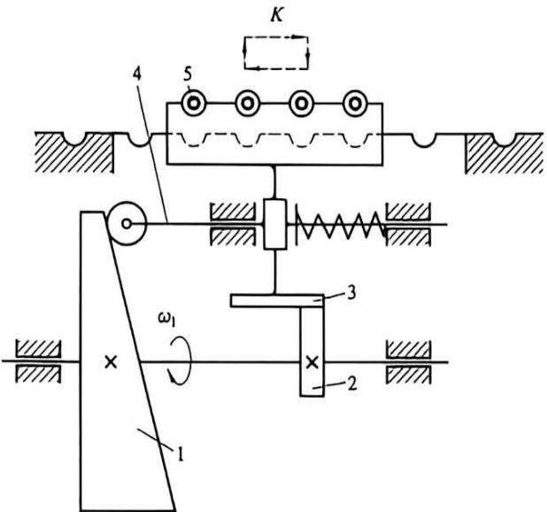

图9-3 圆珠笔芯装配线上矩形轨迹自动送料机构
{: .figure-caption }

## 9.4 凸轮-齿轮组合机构

应用凸轮-齿轮组合机构可使从动件实现多种复杂的运动规律。例如，可使从动件具有任意停歇时间的间歇运动；当输入轴做等速转动时，输出轴可按一定的规律作周期性的增速、减速、反转和步进运动，以及实现机械传动校正装置中所要求的一些特殊规律的补偿运动等。

如图 9-4 所示的凸轮-齿轮组合机构，它常用于齿轮加工机床中的误差校正机构。在此机构中，蜗杆 1 主动，如果出于制造等原因，实际蜗轮副存在误差，使得从动件蜗轮 2 的实际

转角与理论转角之间有误差，其运动输出精度达不到要求，则可根据输出的误差，计算出与蜗轮2固装在同一轴上的凸轮2'的轮廓曲线。当此凸轮2'与蜗轮2一起转动时，将推动推杆3移动，而推杆3上齿条又推动齿轮4转动，齿轮4的转动则又通过差动机构K使蜗杆1得到一附加转动，从而使蜗轮2的输出运动得到校正。

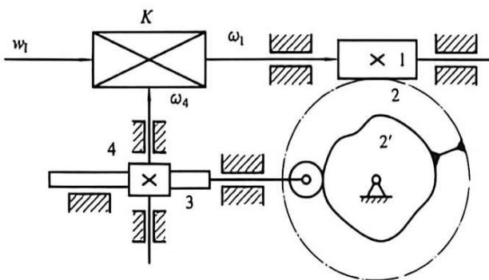

图9-4 误差校正机构
{: .figure-caption }

如图 9-5 所示为由简单差动轮系和凸轮相组合而形成的凸轮-齿轮组合机构。行星架 H 为主动件，太阳轮 1 为从动件，凸轮 3 为机架，滚子 4 铰接在行星齿轮 2 上并嵌在凸轮槽中。当行星架 H 等速回转时，凸轮槽迫使行星轮 2 与行星架 H 之间产生一定的相对运动（图 9-5 中所示的 $\varphi_{2}^{\mathrm{H}}$ 角），从而使从动轮 1 实现所需的运动规律。

设计这种组合机构时, 首先应根据从动件 1 的运动要求 (即其与主动件 H 的运动关系), 求得行星轮 2 相对于行星架 $\mathrm{H}$ 的运动关系, 确定轮系的齿数, 然后按摆动推杆盘形凸轮机构凸轮轮廓曲线的设计方法设计凸轮轮廓曲线。在这里行星架 $\mathrm{H}$ 相当于凸轮机构的机架, 而 ${O}_{2}B$ 为推杆, 又由于凸轮 3 是不动的, 所以行星架 $\mathrm{H}$ 的运动就相当于反转运动。又由周转轮系传动比的公式可得各轮转角的关系可得摆动推杆的预期运动, 据此可设计出凸轮轮廓曲线。

如图 9-6 所示是凸轮-齿轮组合机构的另一应用实例。主动蜗杆 1 一方面做等速转动，另一方面又受凸轮 2 的控制做轴向往复移动，适当选取凸轮的轮廓曲线，可使蜗轮 3 得到预期的运动规律。该机构可用作传动系统中的周期性的补偿装置。

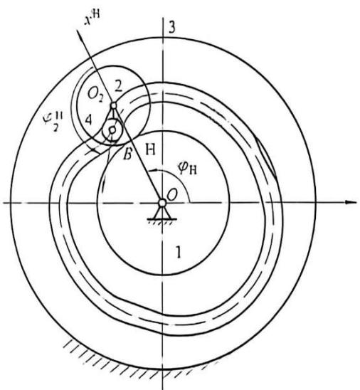

图9-5 实现预定运动规律的凸轮-齿轮组合机构
{: .figure-caption }

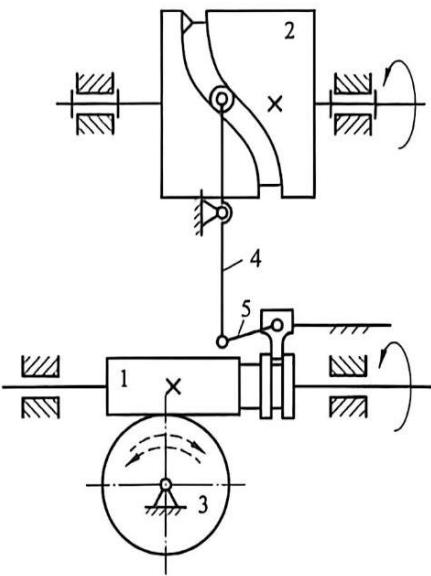

图9-6 凸轮-齿轮组合机构
{: .figure-caption }

## 9.5 凸轮-连杆组合机构

凸轮-连杆组合机构的形式很多。这类组合机构多是由自由度为2的连杆机构和自由度为1的凸轮机构组合而成，原动件的运动一方面直接传给一个2

自由度基本机构(连杆机构), 另一方面传给一个单自由度基本机构(凸轮机构), 转换运动后再传给该两自由度基本机构, 而后者将这两个输入运动合成为一个输出运动。利用这类组合机构可以实现多种预定的运动规律和运动轨迹, 因此在工程实际中得到了广泛应用。

如图 9-7 所示为能实现预定运动规律的几种简单的凸轮-连杆组合机构。图 9-7(a) (b) 所示的凸轮-连杆组合机构, 实际相当于连架杆长度可变的四杆机构; 而图 9-7(c) 所示机构, 则相当于连杆长度(即 $\overline{BD}$ ) 可变的曲柄滑块机构。这些机构, 是用一个固定的凸轮高

副约束 C 点的运动, 实质上是利用凸轮机构来封闭具有 2 自由度的五杆机构。设计这种组合机构, 关键在于根据从动件的预期运动要求, 先确定连杆机构, 然后适当地设计凸轮的轮廓曲线。该机构广泛应用于纺织机械和印刷机械中。

如图 9-8(a) 所示凸轮-连杆组合机构由单自由度凸轮机构 1'-4-5 和 2 自由度五杆机构 1-2-3-4-5 组合而成。原动凸轮 1' 和曲柄 1 固连，构件 4 是两个基本机构的公共构件。当原动凸轮 1' 转动时，从动件 4 移动，凸轮 1' 和构件 4 同时给五杆机构输入一个转动和一个移动，故此五杆机构有确定运动。这时构件 2 或 3 上任一点（例如转动副中心 C 点）便能实现比四杆机构的连杆曲线更为复杂的轨迹（如曲线 S）。

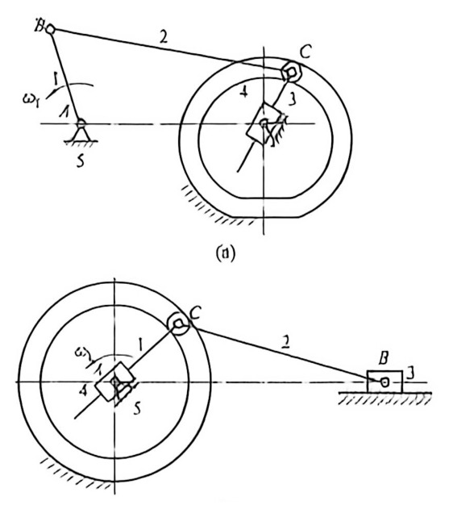

在设计此机构时，先作出轨迹曲线 S，并根据机构的总体布局，选定曲柄转轴 A 与预定轨迹曲线 S 之间的相对位置；然后，在曲线 S 上找出与转轴 A 之间的最近点 $C'$ 和最远点 $C''$ ，即可得到构件 1 与 2 长度的差与和，选定构件 1、2 的尺寸；接下来，由于构件 4

的导路通过凸轮轴心, 为了保证 $CD$ 杆与导路有交点, 必须使 $l_{\mathrm{CD}}$ 大于轨迹 $S$ 上各点到导路的最大距离 $h_{\max}$ , 由此选定构件 3 的尺寸; 最后, 根据主动件 1 等速回转时, 连杆 2 上点 $C$ 的轨迹曲线 $S$ , 可求得当主动件 $AB$ 在一系列转角位置 $\varphi_{1}$ 时, 滑块 $D$ 的一系列对应位置 $s_{\mathrm{D}}$ (这时构件 4 的运动即完全确定), 于是可绘制构件 4 相对于构件 1 的位移线图 $s_{\mathrm{D}}(\varphi_{1})[\text {图 }9-8(\mathrm {c})]$ , 根据结构选定凸轮基圆半径, 按照位移线图 $s_{\mathrm{D}}(\varphi_{1})$ 设计出与构件 1 固连的凸轮轮廓曲线。设计步骤参看图 9-8(b)。

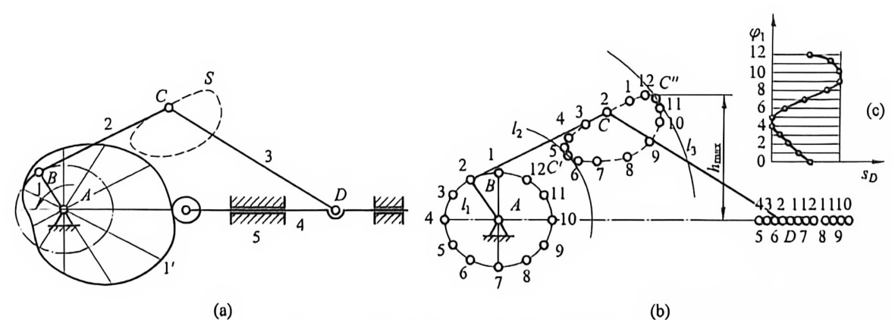

图9-8 凸轮-连杆组合机构及其设计
{: .figure-caption }

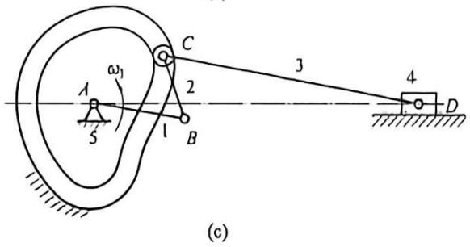

图9-7 凸轮-连杆组合机构
{: .figure-caption }

如图 9-9 所示为用于封罐机上的凸轮-连杆组合机构。当原动件 1 转动时，固定凸轮 5 的轮槽 4 控制从动件 2 的端点 C 沿接合缝（图中点画线）运动，从而达到将罐头筒封口的要求。改变凸轮轮廓曲线，可以达到对不同筒形罐头封口的目的。

如图 9-10 所示为饼干、香烟等包装机的推包机构中所采用的凸轮-连杆组合机构。其推包头 $T$ 可按点画线所示轨迹运动，从而达到推包的目的。

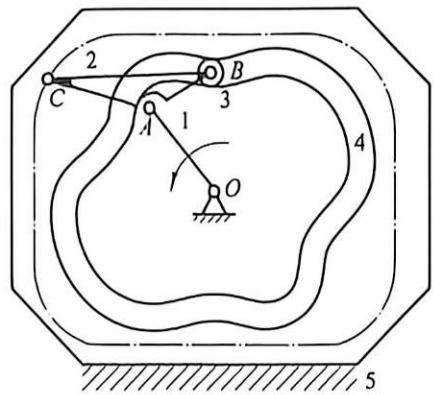

图9-9 封罐机中的凸轮-连杆组合机构
{: .figure-caption }

如图 9-11 所示为压砖成型机构中所采用的

凸轮-连杆组合机构。当曲柄1回转时，由于固定槽凸轮9的约束，使上、下冲头5、6按“冲压”“静止不动”“复位”等运动要求运动，从而使工件7(耐火砖)冲压成型。

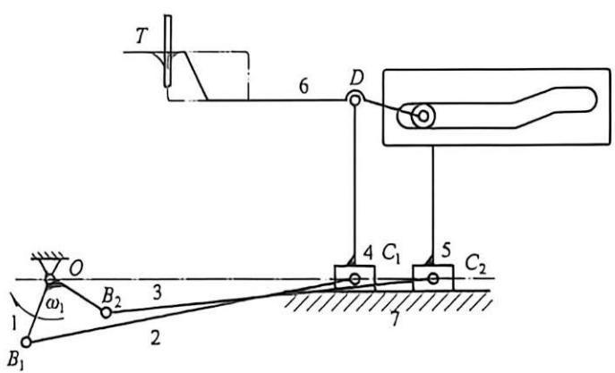

图9-10 推包机构中的凸轮-连杆组合机构
{: .figure-caption }

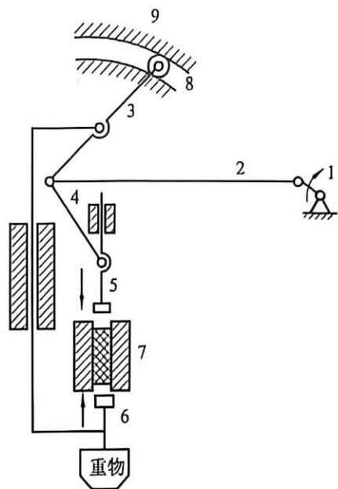

图9-11 压砖成型机构
{: .figure-caption }

## 9.6 齿轮-连杆组合机构

齿轮-连杆机构是应用最广泛的一种组合机构, 这类组合机构多以自由度为 2 的差动轮系为基础机构, 以自由度为 1 的连杆机构为附加机构组合而成。它能实现较复杂的运动规律和轨迹, 且制造方便。

如图 9-12 所示为一典型的齿轮-连杆组合机构。其基础机构为自由度为 2 的差动轮系（由齿轮 5、2' 和行星架 1 组成），其附加机构为四杆机构（由构件 1、2、3、4 组成）。行星齿轮 2' 与连杆 2 固联，而太阳轮 5 空套在曲柄 1 的轴上，且曲柄 1 同时充当差动轮系的行星架。当主动曲柄 1 以等角速度 $\omega_{1}$ 回转时，从动杆 2、3 做变速运动，从动齿轮 5 也做变速运动。由周转轮系传动比计算公式得：

$$
i _ {5 2 ^ {\prime}} ^ {1} = \left(\omega_ {5} - \omega_ {1}\right) / \left(\omega_ {2 ^ {\prime}} - \omega_ {1}\right) = \left(\omega_ {5} - \omega_ {1}\right) / \left(\omega_ {2} - \omega_ {1}\right) = - z _ {2 ^ {\prime}} / z _ {5}\tag{9-1}
$$

则

$$
\omega_ {s} = \left(1 - i _ {s 2 ^ {\cdot}} ^ {1}\right) \omega_ {1} + i _ {s 2 ^ {\cdot}} ^ {1} \omega_ {2}
$$

式中： $\omega_{2}$ 为连杆 2 的角速度，其值随四杆机构的运动作周期性变化。

(9-2)

由式(9-2)可知，从动件5的角速度 $\omega_{5}$ 由两部分组成：一为等角速度部分 $\omega_{1}(z_{5} + z_{2^{\prime}}) / z_{5}$ ；二为作周期性变化的角速度部分 $-\omega_{2}z_{2^{\prime}} / z_{5}$ 。显然，改变四杆机构各杆的尺寸，或改变两齿轮的齿数，可使从动轮5获得各种不同的运动规律。在设计这种组合机构时，可先根据实际情况初步选定机构中各参数的值，然后进行运动分析，当不

满足预期的运动规律时，可对机构的某些参数进行适当调整。

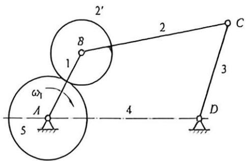

图9-12 齿轮-连杆组合机构
{: .figure-caption }

如图 9-13 所示为滑块可作长时间近似停歇的行星齿轮-连杆机构。当输入构件行星架 1 转动，且固定内齿轮 5 与行星齿轮 2 的齿数比满足 $z_{5}/z_{2}=3$ 时，则与齿轮 5 相啮合的行星齿轮 2 节圆上点 B 的轨迹为三段近似圆弧的内摆线，其圆弧的半径近似等于 $8r_{2}(r_{2}$ 为齿轮 2 的节圆半径）。若取连杆 3 的长度等于该圆弧的半径，则当 B 点在 $\widehat{ab}$ 段上运动，并且滑块 4 与连杆 3 的铰接点 C 近似位于圆心位置时，则滑块 4 处于长时间停歇状态（当行星架转动一转时，滑块有三分之一处于停歇状态）。在这类组合机构中，当两齿轮 2、5 为外啮合时，则 B 点轨迹为外摆线；当两齿轮为内啮合时，则 B 点轨迹为内摆线。通过改变构件 3 与齿轮 2 的铰接点 B 的位置及机构中两齿轮的传动比可以得到各种不同形状的内、外摆线和从动件传动函数。

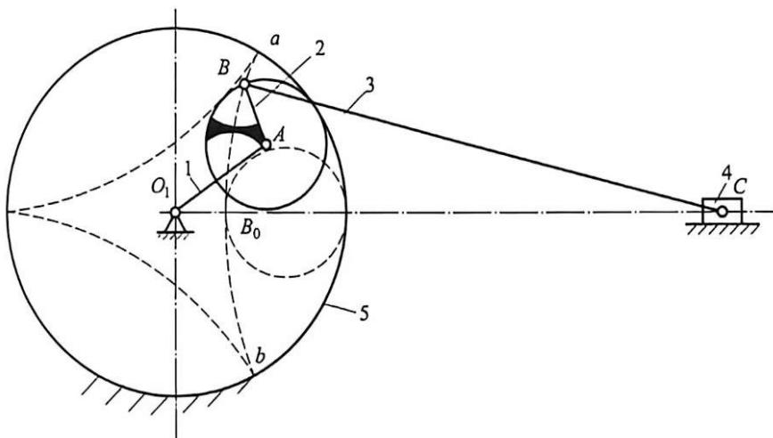

图9-13 具有近似停歇往复运动的行星齿轮-连杆机构
{: .figure-caption }

这种机构组合的设计问题主要是如何确定运动轨迹的问题。行星轮上各点在其运动过程中可描绘出各种各样的摆线，利用这些摆线中的部分线段近似为圆弧或直线的特点，可以串联后置子机构，使输出构件实现运动的停歇。在机构组合中，输入构件的运动是通过各基本机构依次传递给输出构件的。根据这个特点，在进行运动分析时，可以从已知运动规律的第一个基本机构开始，按照运动的传递路线顺序解决的方法，求得最后一个基本机构的输出

运动。

自动机的物料间歇送进中，如冲床的间歇送料机构、轧钢厂成品冷却车间的钢材送进机构、糖果包装机的走纸和送糖条等机构需要实现短暂停歇的间歇运动，图9-14所示齿轮-连杆组合机构就可实现。组合机构中的原动件1做等速转动，输出齿轮5能实现短暂停歇的变速运动。此外，冲压零件、剪断纸和切断都只需短暂停歇一小段时间便能完成，而这又是其他间歇运动机构难以实现的。另外，在车床中还利用它的短暂停歇使切削刀具进进停停，以保证断屑。

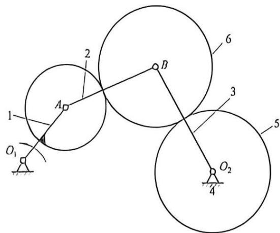

图9-14 实现短暂停歇的齿轮-连杆组合机构
{: .figure-caption }

如图 9-15 所示齿轮-连杆机构可以实现大行程, 常用于印刷机械中。图中齿轮 5 空套于 $B$ 点的销轴上, 它与两个齿轮同时啮合, 在上方的齿条能作水平方向的移动, 在下方的齿条与机架固连。显然构件 1 转一圈, 滑块 3 做往复移动一次, 其行程为 $2l_{0A}$ , 而齿条 6 的行程为其一倍。

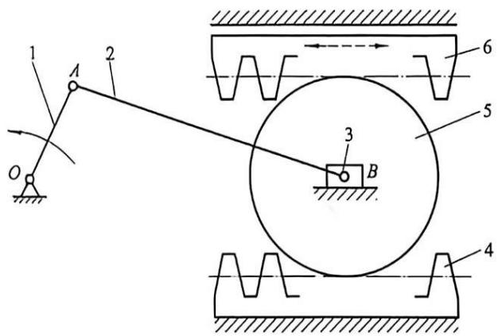

图9-15 行程放大的齿轮-连杆机构
{: .figure-caption }

采用图 9-16 所示的齿轮-五杆机构可实现预定的轨迹。改变杆 1 和杆 4 的相对相位角、传动比以及各杆的相对尺寸等，就可以得到不同的连杆曲线，其连杆曲线的丰富程度远非四杆机构的连杆曲线所能达到。

如图 9-17 所示为轧钢机轧辊驱动装置中所采用的齿轮-连杆机构。主动轮 1 同时带动齿轮 2 和 3 转动, 连杆上的 $M$ 点 (轮辊中心) 实现如图 9-17 所示的复杂轨迹 (类似椭圆), 以此来调节轧辊的开口度, 以便不同尺寸的钢坯顺利咬入轧辊中。对此轨迹的要求为: 轧辊与钢坯开始接触点的咬入角 $\alpha$ 宜小, 以减轻送料辊的载荷; 直线段宜长, 以提高轧制的质量。调节两曲柄 $A B$ 和 $D E$ 的相位角, 可方便地改变 $M$ 点的轨迹, 以满足轧制生产中不同的工艺要求。

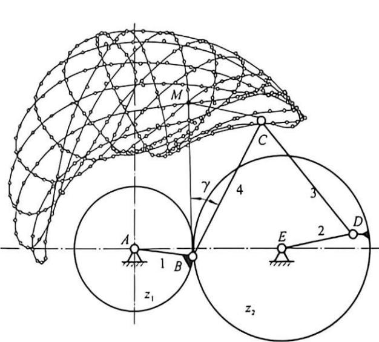

图9-16 实现预定轨迹的齿轮-连杆组合机构
{: .figure-caption }

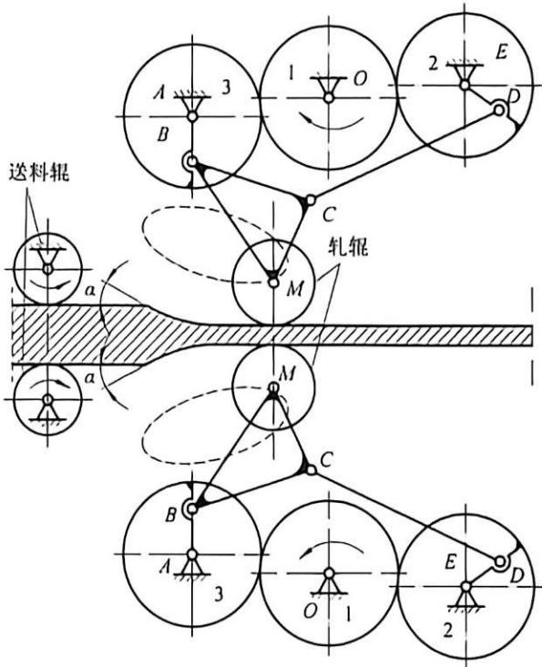

图9-17 轧钢机中的齿轮-连杆组合机构
{: .figure-caption }

## 9.7 连杆-连杆组合机构

连杆-连杆组合机构应用也很广泛, 且其结构及制造简单。这类组合机构可以实现复杂的运动规律和运动轨迹, 如从动件近似停歇、近似等速运动、在极端位置的两次折返; 还可满足从动件行程速度变化系数 $K$ 的需要, 以及可用于增程、增力的机构中。

如图 9-18 所示的机构中, 当曲柄摇杆机构的曲柄 1 做一次整周转动时, 其摇杆 3 做往复摆动。当构件 3 的 $C$ 点从 $C_{0}$ 摆到 $C_{2}$ 再回到 $C_{4}$ 时, 输出构件滑块 5 的运动如图 9-18(b) 所示, 两次通过极端位置 $C_{\mathrm{e}}$ , 实现两次折返。这种性质被用于肥皂打印机构, 连续打印两次以获得清晰痕迹, 它还被用于制耐火砖、陶瓷铺面砖等的机器中。

图9-19是钉扣机的针杆传动机构，由曲柄滑块机构和摆动导杆机构并联组合而成，原动件分别为曲柄1和曲柄6，从动件3可以实现平面复杂运动以完成钉扣动作。该机构为具有2自由度的机构，因此必须有两个输入构件其运动才能确定。设计时，两个主动件的运动一定要协调配合，要按照输出构件的复合的运动要求绘制运动循环图，再按照运动循环图确定两个主动构件的初始位置。

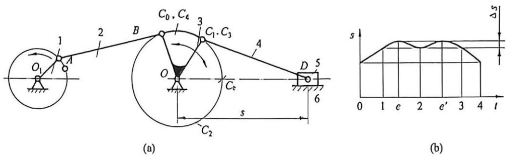

图9-18 实现两次折返的连杆-连杆机构
{: .figure-caption }

如图 9-20 所示为丝织机的开口机构，两个摇杆滑块机构并联组合，共同连接于曲柄摇杆机构上。当主动构件曲柄 1 转动时，通过摇杆 3 将运动传给两个摇杆滑块机构，使两个从动件滑块 5 和 7 实现上下往复移动，完成丝织机的开口动作。

如图 9-21 所示是由转动导杆与曲柄滑块串联而成的机构，滑块可实现近似等速运动。它应用于简易牛头刨床、插床和小型冲床中。

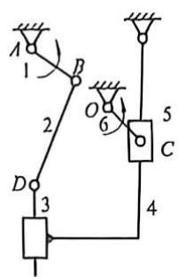

图9-19 钉扣机针杆传动机构
{: .figure-caption }

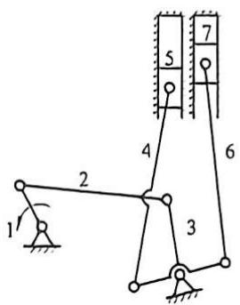

图9-20 丝织机的开口机构
{: .figure-caption }

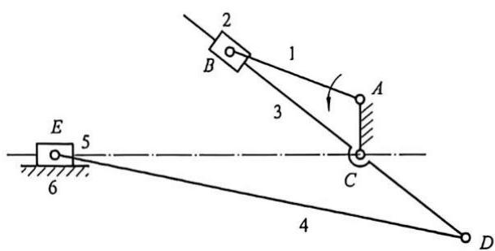

图9-21 转动导杆与曲柄滑块组合机构
{: .figure-caption }

## 9.8 组合机构应用举例

组合机构能实现比基本机构更为复杂的传动和引导功能。其设计步骤一般为：首先选定能实现相应运动要求的组合机构的类型，然后根据所要求的传动函数或轨迹确定机构的尺度。下面介绍一些组合机构的应用。

如图 9-22(a) 所示的钢板输送机构是以双自由度的差动轮系 2-3-4-H-6

[图 9-22(b)]作为基础机构、两个单自由度的机构——定轴轮系 1-2-6[图 9-22(c)]和曲柄摇杆机构 1'-5-H-6[图 9-22(d)]作为附加机构组合成的齿轮-连杆组合机构。原动件齿轮 1 与曲柄 1'(杆 AB)固连在同一轴上，摇杆 CD 与差动轮系的行星架 H 固连在同一轴上。原动齿轮的运动 $\omega_{1}$ 同时传给两个附加机构, 并分别转换成两个输出运动 $\omega_{2}$ 和 $\omega_{\mathrm{H}}$ 。将附加机构的输出构件 2 和 H(即摇杆 CD) 接入基础机构, 使基础机构获得两个所需的输入运动 $\omega_{2}$ 和 $\omega_{\mathrm{H}}$ , 从而合成为一个输出运动 $\omega_{3}$ 。该机构是用两个并列的单自由度基本机构封闭了 2 自由度差动轮系。当原动件 1(1') 做匀速转动时, 由齿轮 1 带动的大阳轮 2 做匀速转动, 而由四杆机构带动的行星架 H(摇杆 DE) 却做变速摆动, 因此, 输出构件内齿轮 4(送料辊) 做变速转动, 即做有短暂停歇的送进运动, 以满足钢板传送的需要。在该机构中, 当内齿轮 4 将钢板输送到所要求的长度后做瞬时停歇, 以等待配套的剪切机把钢板剪断(图中未表示出), 其周期为原动件回转一周的时间。

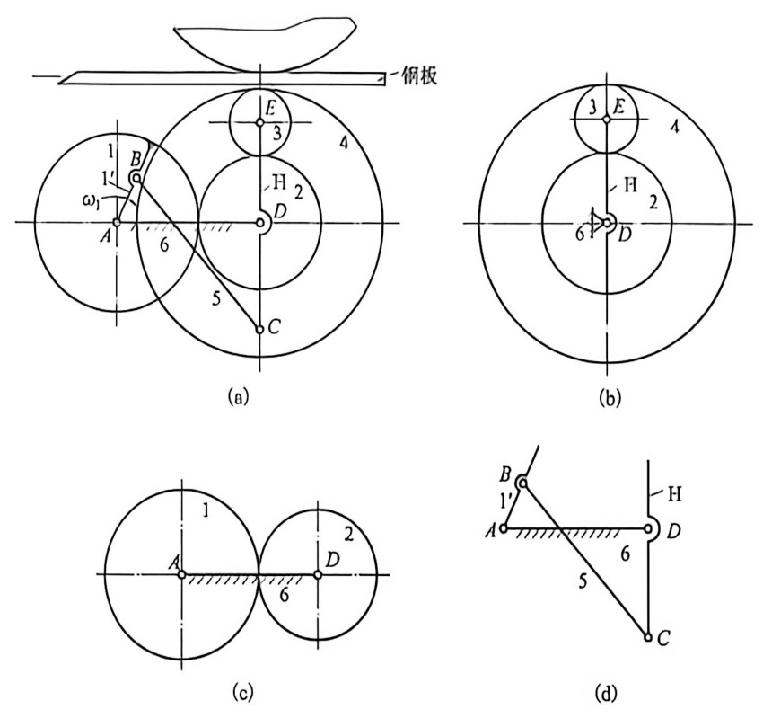

图9-22 组合机构应用实例一——钢板输送机及其组成
{: .figure-caption }

(a)钢板输送机；(b)差动轮系；(c)定轴轮系；(d)曲柄摇杆机构。

设计时首先确定齿轮 1、4 和 2、3 的齿数；然后为满足各种工艺和结构条件设计铰链四杆机构。机构有关参数确定后，可用运动分析的方法校核该组合机构是否满足工作要求。

如图 9-23 所示为用于需复杂轨迹的平板印刷机上的吸纸机构的示意图。该凸轮-连杆组合机构由自由度为 2 的五杆机构 1-2-3-4-6(基础机构)和两个自由度为 1 的摆动从动件盘形凸轮机构 5-4-6(附加机构 1)、5'-1-6(附加机构 2)并联组合而成。两个弹簧起力封闭作用。两个盘形凸轮 5、5'固结在同一个转轴上，当其转动时分别带动从动件 4、1 给五杆机构两个输入，使连杆 2 获得一个确定的输出，从而使固连在连杆 2 上的吸纸盘 K 点实现预定的轨迹，以完成吸纸和送进等动作。

图 9-24 是用于冲压机床上的自动送料机构。它是由三个单自由度的基本机构——曲柄滑块机构[图 9-24(b)]、摆动从动件移动凸轮机构[图 9-24(c)]和摇杆滑块机构[图 9-24(d)]串联而成。主动曲柄 1 的转动(转角 $\varphi_{1}$ )通过曲柄滑块机构的输出构件 3 的移动(位移

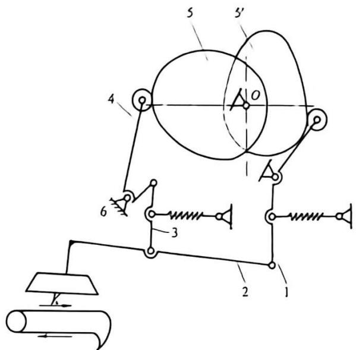

图9-23 组合机构应用实例二——吸纸机构
{: .figure-caption }

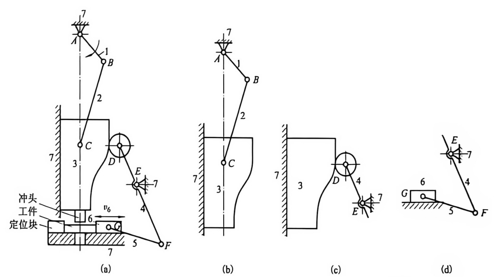

图 9-24 组合机构应用实例三——自动送料冲压机构及其组成
{: .figure-caption }

(a) 自动送料冲压机构；(b) 曲柄滑块机构；(c) 凸轮机构；(d) 摇杆滑块机构。

$S_{3}$ ，再通过摆动从动件移动凸轮机构的输出构件4的往复摆动(摆转角 $\varphi_{4}$ )，最后通过摇杆滑块机构的输出构件滑块6得到所需的往复移动(位移 $S_{6}$ )。

如图 9-25 所示为设计冲制薄壁零件冲床的冲压机构(齿轮-连杆组合机构)与其配合的送料机构(凸轮-连杆组合机构)的一个方案。冲床的工艺动作要求上模(滑块)先以比较大的速度接近坯料, 然后以匀速进行拉延成型工件, 之后, 下模继续下行将成品推出型腔, 最后快速返回。上模退出下模以后, 送料机构从侧面将坯料送至待加工位置, 完成一个工作循环。

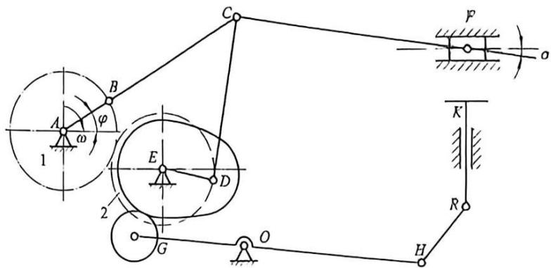

图9-25 组合机构应用实例四——冲压机构及送料机构
{: .figure-caption }

该方案中冲压机构采用了2自由度的双曲柄七杆机构，用齿轮副将其封闭为一个自由度机构。恰当地选择点 $C$ 的轨迹和确定构件尺寸，可保证机构具有急回运动和工作段近于匀速的特性，并使压力角 $\alpha$ 尽可能小。送料机构是由凸轮机构和连杆机构串联组成的，以便实现工件间歇送进。送料机构的凸轮轴通过齿轮机构与曲柄轴相连。按机构运动循环图可确定凸轮推程运动角和从动件的运动规律。

## 本章思维导图

## 思考题与练习题

1. 常用的组合机构有哪几种？它们各有何特点？

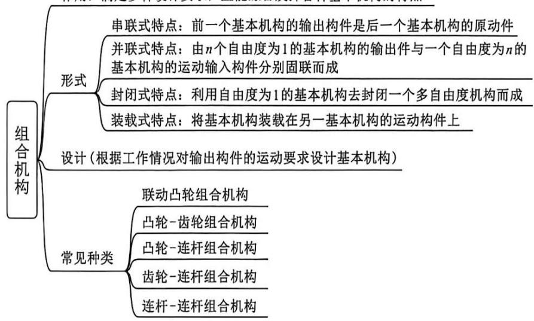

2. 如图 9-26 所示的联动凸轮组合机构中(尺寸和位置如图所示), 它由两组径向凸轮机构组合而成。在此机构中, 利用凸轮 $A$ 及 $B$ 的协调配合, 控制 $E$ 点 $x$ 及 $y$ 方向的运动, 使其准确地实现预定的轨迹 $y = y(x)$ (“ $R$ ”字形)。试说明该机构中的凸轮 $A$ 和凸轮 $B$ 的轮廓曲线

设计的方法和步骤。

3. 如图 9-27 所示的凸轮-连杆组合机构中(尺寸和位置如图所示)，拟使 C 点的运动轨迹为图示 abca 曲线。试说明该机构中的凸轮 1 和凸轮 2 的轮廓曲线设计的方法和步骤。

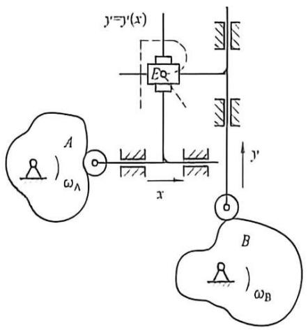

图9-26 联动凸轮组合机构
{: .figure-caption }

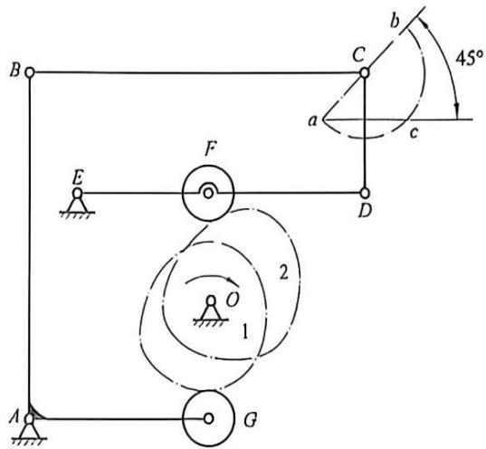

图9-27 凸轮-连杆组合机构
{: .figure-caption }

4. 如图 9-28 所示的齿轮-连杆组合机构中, 齿轮 $a$ 与曲柄 1 固连, 齿轮 $b$ 和 $c$ 分别活套在轴 $C$ 和 $D$ 上。试证明齿轮 $c$ 的角速度 $\omega_{\mathrm{c}}$ 与曲柄 1、连杆 2、摇杆 3 的角速度 $\omega_{1} 、 \omega_{2} 、 \omega_{3}$ 之间的关系为

$$
\omega_ {c} = \omega_ {3} (r _ {b} + r _ {c}) / r _ {c} - \omega_ {2} (r _ {n} + r _ {b}) / r _ {c} + \omega_ {1} r _ {n} / r _ {c}
$$

5. 如图 9-29 所示的机构中, 曲柄 1 为主动件, 内齿轮 5 为输出构件。已知齿轮 2、5 的齿数分别为 $z_{2} 、 z_{5}$ , 曲柄长度为 $l_{1}$ , 连杆长度为 $l_{2}$ 。试写出输出构件齿轮 5 的角速度与主动件曲柄 1 的角速度之间的关系。

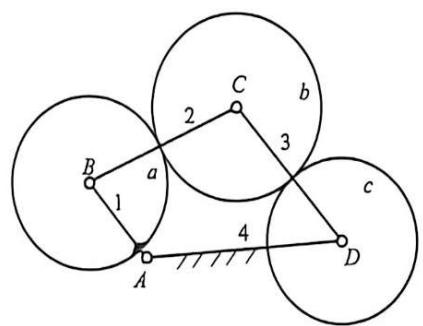

图9-28 齿轮-连杆组合机构
{: .figure-caption }

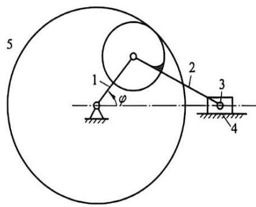

图9-29 机构
{: .figure-caption }

6. 如图 9-30 所示刻字、成形机构为凸轮-连杆机构, 试分析该组合机构的组合方式, 并指出其基础机构和附加机构。若工作要求从动件上点 $M$ 实现给定的运动轨迹 $m m$ , 试设计该组合机构。

7. 试设计一机构，使该机构中某构件的轨迹如图 9-31 所示。

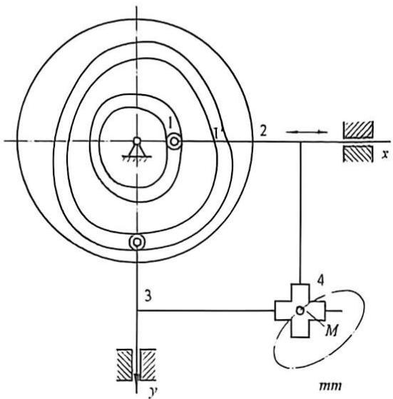

图9-30 凸轮-连杆组合机构
{: .figure-caption }

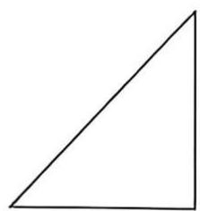

图9-31 轨迹
{: .figure-caption }
