# 第10章 开式链机构及工业机器人

**【概述】**

◎机器人技术及其产品发展很快，已成为柔性制造系统、自动化工厂、计算机集成制造系统的自动化工具。机器人操作机机构一般是具有多个自由度的开式链机构。本章介绍开式链机构的主要特点及功能、工业机器人操作机机构的类型、工业机器人操作机机构的设计、开式链机构正向和反向运动学分析的基本思路和方法。

◎通过本章的学习，要求掌握开式链机构的主要特点和功能；了解工业机器人操作机的分类及操作机的自由度；了解平面关节型操作机正向和反向运动学分析的基本思路和方法。

## 10.1 开式链机构与工业机器人

### 10.1.1 开式链机构及其特点

开式链机构是由开式运动链所组成的机构（图 10-1），开式运动链的自由度较闭式运动链多，因此要使其成为具有确定运动的机构，就需要更多的原动机；开式运动链中的末端构件的运动，与闭式运动链中任何构件的运动相比，更为任意和复杂多样。因此开式链机构具有运动灵活、复杂多样但需要多个驱动源且运动分析复杂的特点。利用开式运动链的特点，结合伺服控制和计算机，开式链机构在各种机器人工程中得到了广泛的应用。

2020 年新冠疫情暴发期间，我国研究人员开发了一款咽拭子采样机器人(图 10-2)，可替代医护人员完成咽拭子采样、样品保存液回收、病毒消杀等功能，为科学地应对疫情传播风险提供了有力保障。

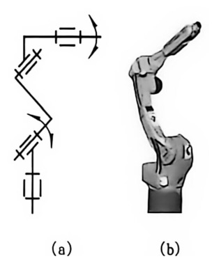

图10-1 开式运动链及开式链机构
{: .figure-caption }

(a)开式运动链；(b)开式链机构。

图10-2 某款咽拭子采样机器人
{: .figure-caption }

### 10.1.2 机器人及其分类、应用和发展

#### 1. 机器人及其分类

机器人是一种自动控制下通过编程可完成某些操作或移动作业的装置，它是一种灵活的、具有多目的、用途的自动化系统，易于调整以完成各种不同的劳动作业和智能动作，其中包括在变化之中及没有事先说明的情况下的作业。

机器人并不是在简单意义上代替人工的劳动，而是综合了人的特长和机器特长的一种拟人的机械电子装置，既有人对环境状态的快速反应和分析判断能力，又有机器可长时间持续工作、精确度高、抗恶劣环境的能力，从某种意义上说它也是机器进化过程的产物，它是工业及非产业界的重要生产和服务性设备，也是先进制造技术领域不可缺少的自动化设备。

关于机器人如何分类, 国际上没有制定统一的标准, 有的按负载重量分, 有的按控制方式分, 有的按自由度分, 有的按结构分, 有的按应用领域分。

我国的机器人专家从应用环境出发，将机器人分为两大类，即工业机器人和特种机器人。所谓工业机器人就是面向工业领域的多自由度机器人。而特种机器人则是除工业机器人之外的，用于非制造业并服务于人类的各种先进机器人，包括服务机器人、水下机器人、娱乐机器人、军用机器人、农业机器人、机器人化机器等。在特种机器人中，有些分支发展很快，有独立成体系的趋势，如服务机器人、水下机器人、军用机器人、微操作机器人等。

工业机器人是机器人的一个重要分支，它的特点是可通过编程完成各种预期的作业任务，在构造和性能上兼有人和机器人各自的优点，尤其是体现了人的智能和适应性，机器作业的准确性和在各种环境中完成作业的能力。因而在国民经济各个领域中具有广阔的应用前景。

#### 2. 机器人的应用和发展

经过几十年的发展,工业机器人已在越来越多的领域得到了应用。在制造业中,尤其是在汽车产业中,工业机器人得到了广泛的应用。如在毛坯制造(冲压、压铸、锻造等)、机械加工、焊接、热处理、表面涂覆、上下料、装配、检测及仓库堆垛等作业中,机器人已逐步取代了人工作业。

进入 21 世纪之后，随着人口红利的逐渐消失，促进了我国机器人技术和产业迅速发展，据权威数据，2013 年，中国首次超越日本，成为世界上机器人产能和销售第一的国家，此后的差距迅速扩大，到 2022 年，中国机器人的新增数量已经是第二名的 2 倍以上。而且随着工业机器人向更深、更广方向发展及机器人智能化水平的提高，机器人的应用范围还在不断地扩大，已从汽车制造业推广到其他制造业，进而推广到诸如采矿机器人、建筑业机器人及水电系统维护维修机器人等各种非制造行业。此外，在国防军事、医疗卫生、生活服务等领域机器人的应用也越来越多，如无人侦察机（飞行器）、警备机器人、医疗机器人、家政服务机器人等均有应用实例。机器人正在为提高人类的生活质量发挥着重要的作用。

机器人技术涉及力学、机械学、电气液压技术、自控技术、传感技术和计算机等学科领域，是一门跨学科综合技术。从机构学的角度分析，工业机器人的机械结构一般采用由一系列连杆通过运动副串联起来的开式运动链。机器人机构学乃是机器人的主要基础理论和关键技术，也是现代机械原理研究的主要内容。

机器人领域发展近几年有如下几个趋势：

(1) 工业机器人性能不断提高(高速度、高精度、高可靠性、便于操作和维修)，而单机价格不断下降。

(2)机械结构向模块化、可重构化发展。例如关节模块中的伺服电机、减速机、检测系统三位一体化；由关节模块、连杆模块用重组方式构造机器人整机；国外已有模块化装配机器人产品问世。

(3)工业机器人控制系统向基于 PC 机的开放型控制器方向发展, 便于标准化、网络化; 器件集成度提高, 控制柜日渐小巧, 且采用模块化结构; 大大提高了系统的可靠性、易操作性和可维修性。

(4)机器人中的传感器日益重要、除采用传统的位置、速度、加速度等传感器外，装配、焊接机器人还应用了视觉、力觉等传感器，而遥控机器人则采用视觉、声觉、力觉、触觉等多传感器的融合技术来进行环境建模及决策控制；多传感器融合配置技术在产品化系统中已有成熟应用。

(5) 虚拟现实技术在机器人中的作用已从仿真、预演发展到用于过程控制，如使遥控机器人操作者产生置身于远端作业环境中的感觉来操纵机器人。

(6)当代遥控机器人系统的发展特点不是追求全自治系统，而是致力于操作者与机器人的人机交互控制，即遥控加局部自主系统构成完整的监控遥控操作系统，使智能机器人走出实验室，进入实用化阶段。美国发射到火星上的“索杰纳”机器人就是这种系统成功应用的最著名实例。

(7)仿生机器人层出不穷。物竞天择, 适者生存, 经过了亿万年的自然进化, 每一种生物都形成了自己独特的运动方式和适应环境生存的超强能力, 从而构成了大自然中丰富多彩的生物多样性。随着新型驱动技术的突破, 以假乱真模仿各种生物运动的仿生机器人应运而生, 而且迅速成为机器人研究领域新的热点。

## 10.2 工业机器人操作机分类及其自由度

### 10.2.1 工业机器人的组成

工业机器人通常由执行机构、驱动-传动系统、控制系统及智能系统四部分组成。

执行机构是机器人赖以完成各种作业的主体部分，通常由开式链机构组成。

驱动-传动机构由驱动器和传动机构组成。传动有机械式、电气式、液压式、气动式和复合式等，而驱动器有步进电机、伺服电机、液压马达和液压缸等。

控制系统一般由控制计算机和伺服控制装置组成。前者的作用是发出指令协调各有关驱动器之间的运动，同时要完成编程、示教、再现及与其他环境状况(传感器信号)、工艺要求、外部相关设备之间的信息传递和协调工作。而后者是控制各关节驱动器使各部分能按预定的运动规律运动。

智能系统则由感知系统和分析决策系统组成，它分别由传感器及软件来实现。

### 10.2.2 工业机器人操作机及其组成

工业机器人的操作机(操作器)即机器人的执行机构部分, 是机器人握持工具或工件, 完成各种运动和操作任务的机械部分。如图 10-3 所示, 操作机机构一般采用由一系列连杆通过运动副串联起来的开式运动链, 连接两连杆的运动副称为关节。鉴于结构上的原因, 其运动副通常只用转动副和移动副两类。以转动副相连的关节称为转动关节(简记为 R), 以移动副相连的关节则称为移动关节(简记为 P), 每个关节上配有相应的驱动器。一般说来, 运动链的自由度和手部(末端执行器)运动的自由度在数量上是相等的。这种机构组成形式, 可以使机器人的手部以任意姿态达到机器人工作空间中的任意点。

如图 10-3 所示为操作机的组成，它主要是由机身(腰部)、臂部、腕部和手部组成。机座是用来支持手臂并安装驱动装置等部件的，在机器人中相对固定，有固定式机座和移动式机座，移动式机座下部的行走机构可以是滚轮或履带，步行机器人的行走机构多为连杆机构。连接机座和臂部的部分为腰部，通常做回转运动(腰关节)。臂部(包括大臂和小臂)是操作机的主要执行部件，其作用是支撑腕部和手部，并带动它们在空间运动，从而使手部按一定的运动轨迹由某一位置达到另一指定位置。大臂与腰部形成肩关节，大臂与小臂形成肘关节，臂部与腰部一起确定手部在空间中的位置，故称之为位置机构或手臂机构。腕部是连接臂部和手部的部件，其作用主要是改变和调整手部在空间的方位，从而使手爪中所握持的工具或工件取得某一指定的姿态，故又称为姿态机

构。手部又称末端执行器，是操作机直接执行操作的装置，其作用是握持工件或抓取工件，其上可安装夹持器、工具、传感器等。夹持器分为机械夹紧、磁力夹紧、液压张紧和真空抽吸四种。该操作机可实现腰回转、肩旋转、肘旋转、腕摆转、腕俯仰及腕回转六个独立运动，从而使机器人末端执行器实现空间任意位置和姿态。

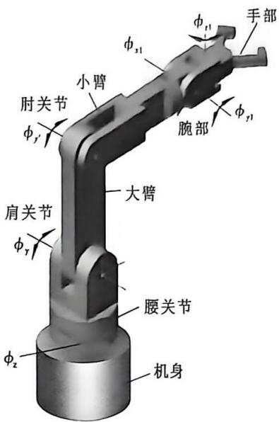

图10-3 操作机的组成
{: .figure-caption }

### 10.2.3 工业机器人操作机的结构分类

操作机机构中，凡独立驱动的关节称为主动关节，反之为从动关节。在操作机中主动关节的数目应等于操作机的自由度。手臂运动通常称为操作机的主运动，工业机器人也常按手臂运动的坐标形式和形态来进行分类。有以下四种类型(图 10-4):

(1) 直角坐标型 [图 10-4(a)]：又称为直移型，具有三个移动关节 (PPP)，可使臂部产生三个互相垂直的独立位移 (臂部伸缩、升降和平移运动)。

直角坐标型的优点是定位精度高，空间轨迹易求解，计算机控制简单；缺点是操作机本身所占空间尺寸大，相对工作范围小，操作灵活性较差，运动速度较低。

(2)圆柱坐标型[图 10-4(b)]：又称为回转型，具有两个移动关节和一个转动关节

（PPR），即臂部除具有伸缩和升降自由度外，还有一水平回转的自由度。

圆柱坐标型的优点是所占的空间尺寸较小，相对工作范围较大，结构简单，手部可获得较高的速度。这是应用最广泛的一种类型。其缺点是手部外伸离中心轴愈远，其切向线位移分辨精度愈低。

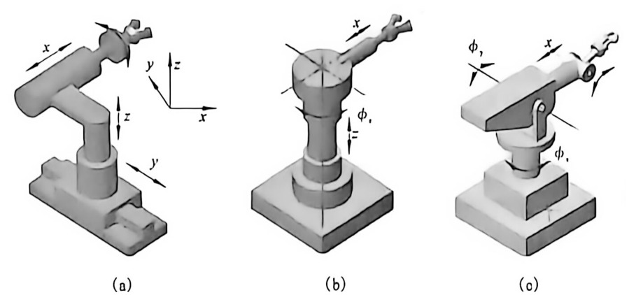

图10-4 操作机类型
{: .figure-caption }

(o)

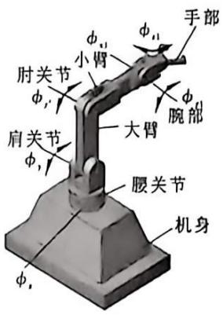

(d)

(3) 球坐标型 [图 10-4(c)]：又称为俯仰型，具有两个转动关节和一个移动关节 (RRP)，即臂部除具有伸缩和水平回转的自由度外，还有一俯仰运动自由度。

球坐标型的优点是结构紧凑，所占空间尺寸小。

(4)关节型[图 10-4(d)]：又称为屈伸型，有三个转动关节(RRR)。其臂部由大臂和小臂组成，大臂与机身之间以肩关节相连，大臂与小臂之间以肘关节相连。大臂具有水平回转和俯仰两个自由度，小臂相对于大臂还有一个俯仰自由度。从形态上看，小臂相对于大臂做屈伸运动。

关节型的优点是结构紧凑，所占空间尺寸小，相对工作空间大等，还能绕过机座周围的一些障碍物，应用较多；缺点是运动直观性更差，驱动控制比较复杂。

除上述四种基本形式外，还有各种复合坐标型。

### 10.2.4 操作机的自由度

操作机的自由度是指在确定操作机所有构件的位置时所必须给定的独立运动参数的数目。操作机的主运动链通常是一个装在固定机架上的开式运动链。为了驱动方便，每一个关节位置都是由单个变量来规定的，因此，每个关节具有一个自由度，故操作机的自由度数目等于操作机中各运动部件自由度的总和。

操作机的自由度计算公式：

$$
F = 6 n - \sum_ {i = 1} ^ {5} i p _ {i} = \sum_ {i = 1} ^ {5} f _ {i} p _ {i}
$$

式中：F 为操作机的自由度；n 为操作机的活动构件的数目；i 为 i 级运动副的约束数； $p_{i}$ 为操作机的 i 级运动副的数目； $f_{i}$ 为操作机中第 i 个运动部件的自由度。

自由度是反映操作机的通用性和适应性的一项重要指标。目前一般通用工业机器人大多为5个自由度左右，已能满足多种作业的要求。

如图 10-3 所示的机器人操作机中，其臂部有 3 个关节，故臂部有 3 个自由度：绕腰关节转动的自由度 $\varphi_{z}$ ，绕肩关节运动的自由度 $\varphi_{y}$ ，绕肘关节摆动的自由度 $\varphi_{y}'$ 。其腕部有 3 个关节，故腕部也具有 3 个自由度：绕自身旋转的自由度 $\varphi_{x1}$ ，上下摆动的自由度 $\varphi_{y1}$ ，左右摆动的自由度 $\varphi_{z1}$ 。因此，整个操作机具有 6 个自由度。自由度较多，就更能接近人手的动作功能，通用性更好，但结构也更复杂。

一般来说，操作机手部在空间的位置和运动范围主要取决于臂部的自由度，因此臂部的运动称为操作机的主运动，臂部各关节称为操作机的基本关节。

1. 臂部自由度组合及运动图形

(1) 直线运动，图 10-5 所示。

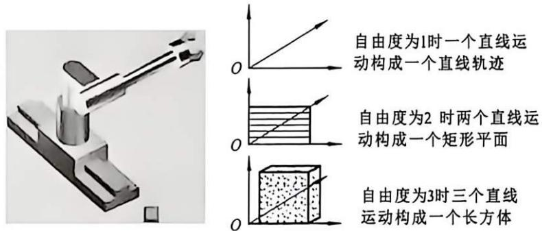

图10-5 直线运动
{: .figure-caption }

(2) 回转运动，图 10-6 所示。

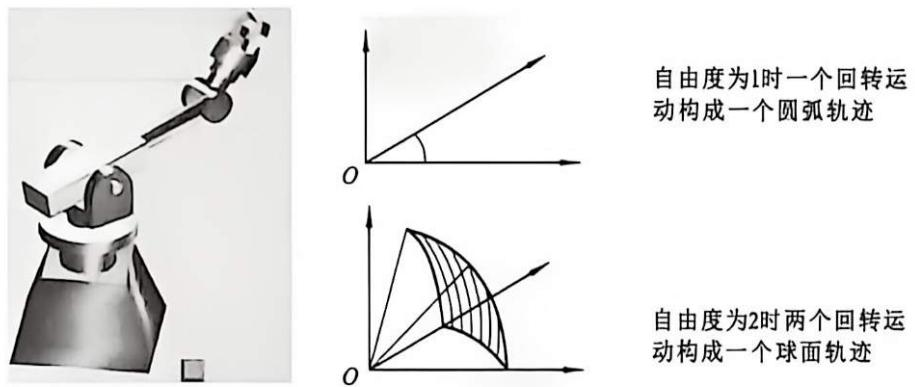

自由度为1时一个回转运动构成一个圆弧轨迹

图10-6 回转运动
{: .figure-caption }

(3) 直线运动与回转运动，图 10-7 所示。

由以上臂部自由度组合及运动图形可知，为了使操作机手部能够达到空间任一指定位置，通用的空间机器人操作机的臂部应至少具有3个自由度；为了使操作机的手部能够到达平面中任一指定位置，通用的平面机器人操作机的臂部应至少具有2个自由度。表10-1列出了臂部各运动自由度及对应的动作。

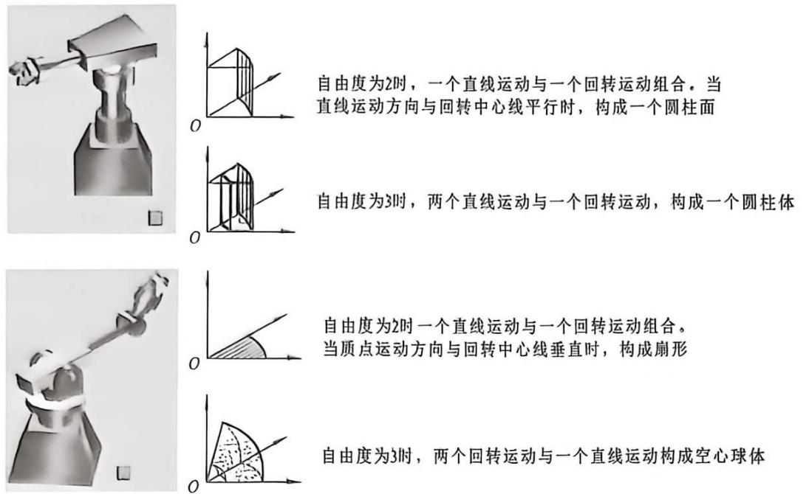

图10-7 直线运动与回转运动
{: .figure-caption }

表 10-1 臂部各运动自由度及对应的动作

<table><tr><td colspan="2">移动自由度</td><td colspan="2">回转自由度</td></tr><tr><td>x</td><td>前后伸缩</td><td> \(\varphi_x\) </td><td>一般不用(由手腕运动代替)</td></tr><tr><td>y</td><td>左右移动</td><td> \(\varphi_y\) </td><td>上下俯仰</td></tr><tr><td>x</td><td>上下移动(升降)</td><td> \(\varphi_z\) </td><td>左右摆动</td></tr></table>

#### 2. 腕部自由度

腕部自由度主要用来调整手部在空间的姿态。为了使手爪在空间取得任意的姿态，在通用的空间机器人操作器中其腕部应至少有3个自由度。一般情况下，这3个关节为轴线相互垂直的转动关节(图10-3)。同样，为了使手爪在平面中能取得任意要求的姿态，在通用的平面机器人操作器中其腕部应至少有1个转动关节。表10-2列出了腕部各运动自由度及对应的动作。

表 10-2 腕部各运动自由度及对应的动作

<table><tr><td colspan="2">移动自由度</td><td colspan="2">回转自由度</td></tr><tr><td>x</td><td>不用</td><td> \(\varphi_{x1}\) </td><td>自身旋转</td></tr><tr><td>x</td><td>横向移动</td><td> \(\varphi_{y1}\) </td><td>上下摆动</td></tr><tr><td>z</td><td>纵向移动(只用其中之一且很少使用)</td><td> \(\varphi_{z1}\) </td><td>左右摆动</td></tr></table>

手部的动作主要是开闭，用来夹持工件或工具。由于其运动并不改变工件或工具在空间的位置和姿态，故其运动的自由度一般不计入操作器的自由度数目中。

#### 3. 冗余自由度

当在工作区间有障碍物时，为了使机器人操作机具有必要的机动性，以便机器人的手臂能够绕过障碍进入难以到达的地方，要求操作机设计时具有冗余自由度，如图10-8所示，操作机的自由度大于6时，手爪可绕过障碍到达一定的位置。

由以上分析可知, 通用的空间机器人操作器的自由度大于等于 6(位置 3 个, 姿态 3 个), 其中为了使手爪能够在三维空间中取得任意指定的姿态, 至少要有 3 个转动关节;

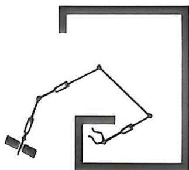

图10-8 冗余自由度
{: .figure-caption }

同样，通用的平面机器人操作器的自由度大于等于3（位置2个，姿态1个），其中为了使手爪能够在二维平面中取得任意指定的姿态，至少要有1个转动关节。也就是说，仅仅用移动关节来建立通用的空间或平面机器人是不可能的。

## 10.3 工业机器人操作机机构的设计

由前所述, 从机器人完成作业的方式来看, 操作机是由手臂机构(即位置机构)、手腕机构(即姿态机构)及末端执行器等组成的机构。对于要完成空间任意位姿进行作业的多关节操作机, 需要具有 6 个自由度, 而对于要回避障碍进行作业的操作机, 其自由度则需大于 6。

### 10.3.1 操作机手臂机构的设计

手臂机构一般具有 2\~3 个自由度(当操作机需要回避障碍进行作业时, 其自由度可大于 3), 可实现回转、俯仰、升降或伸缩三种运动形式。

首先，要确定操作机手臂机构的结构形式。通常根据其将完成的作业任务所需要的自由度数、运动形式、承受的载荷和运动精度要求等因素来确定。

其次，是确定手臂机构的尺寸，即确定出其手臂的长度及手臂关节的转角范围。

最后，在确定操作机的结构形式及尺寸时，还必须考虑到手臂关节的驱动是由驱动器和传动系统来完成的，因此手臂部件自身质量较大，而且还要承受手腕、末端执行器和工件的重量，以及在运动中产生的动载荷；也要考虑到其对操作机手臂运动响应的速度，运动精度及运动刚度的影响等。

### 10.3.2 操作机手腕机构的设计

操作机的手腕机构一般为 1\~3 个自由度, 要求可实现回转、偏转或摆转和俯仰三种运动形式。

首先, 要确定手腕机构的自由度及其结构形式。手腕自由度愈多, 各关节的运动角范围愈大, 其动作的灵活性愈高, 对作业适应能力愈强。但会使其机构复杂运动控制难度加大, 故一般手腕机构的自由度为 $1 \sim 2$ 即能满足作业要求, 通用性强的自由度可为 3 。而某些专业工业机器人的手腕则可视其作业实际需要可减少自由度数, 甚至可以不要手腕。

其次，在作手腕机构的运动设计时，要注意大、小手臂的关节转角对末端操作器的俯仰角均可能产生诱导运动。

最后，手腕机构的设计还要注意减轻手臂的载荷，应力求手腕部件的结构紧凑，减小其质量和体积，以利于手腕驱动传动装置的布置和提高手腕动作的精确性。

### 10.3.3 末端执行器的设计

机器人的末端执行器是直接执行作业任务的装置，通常末端执行器的结构和尺寸都是根据不同作业任务要求专门设计的，从而形成了多种多样的结构形式。

根据其用途和结构的不同可分为机械式夹持器、吸附式执行器和专用工具(如焊枪、喷嘴、电磨头等)三类。按其手爪的运动方式又可分为平移型和回转型。按其夹持方式又可分为外夹式和内撑式。此外，按驱动方式则有电动、液压和气动三种。

进行末端执行器的设计时，首先，根据不同作业任务的要求确定其类型和机构形式及尺寸；其次，要满足足够的加持力和所需要的夹持位置精度；最后，应尽可能使其结构简单、紧凑、质量轻，以减轻手臂的负荷。

## 10.4 开式链机构的运动分析方法

### 10.4.1 开式链机构运动分析研究的主要问题

开式链机构运动分析研究的主要问题，包括两个方面。

1. 正向运动学问题(直接问题)

如图 10-9 所示，给出操作机的一组关节参数 $\theta_{1}$ 、 $\theta_{2}$ 、 $\theta_{3}$ ，确定其末端执行器的位置和姿态 x、y、 $\varphi$ ，可获得一组唯一确定的解。

#### 2. 反向运动学问题(间接问题)

如图 10-9 所示，给出末端执行器的位置和姿态 x、y、 $\varphi$ ，求关节参数 $\theta_{1}$ 、 $\theta_{2}$ 、 $\theta_{3}$ 。

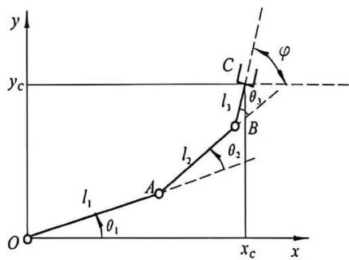

对于工作所要求的末端执行器的一个给定位置和姿态，确定一组关节参数，使末端执行器到图10-9 正反向运动学问题

达和取得规定的位置和姿态, 有解的存在性(解的存在与否表明其操作器是否能到达和取得所要求的位置和姿态)和多重解(对应于工作所要求的末端执行器的一个给定位置和姿态, 可能存在着多组关节参数, 每一组关节参数都可以使末端执行器到达和取得这一规定的位置和姿态)的问题。

### 10.4.2 平面两连杆关节型操作机正向运动学分析

在正向运动学问题中，如图10-10所示，已知的是平面两连杆关节型操作机各关节的位置坐标 $\theta_{1}$ 、 $\theta_{2}$ 和其各阶导数 $\dot{\theta}_{1}$ 、 $\dot{\theta}_{2}$ （关节速度）和 $\ddot{\theta}_{1}$ 、 $\ddot{\theta}_{2}$ （关节加速度），需要求解操作器臂端 $B$ 点的位置 $x_{\mathrm{B}}$ 、 $y_{\mathrm{B}}$ 、 $\varphi$ 、速度 $\dot{x}_{\mathrm{B}}$ 、 $\dot{y}_{\mathrm{B}}$ 和加速度 $\ddot{x}_{\mathrm{B}}$ 、 $\ddot{y}_{\mathrm{B}}$ 。

(1) 位置分析。

在图 10-10 中，操作机臂端 B 点的位置，可以用矢量 OB 或 B 点的直角坐标 $x_{B}$ 、 $y_{B}$ 表示，即

$$
\left[ \begin{array}{l} x _ {\mathrm{B}} \\ y _ {\mathrm{B}} \end{array} \right] = \left[ \begin{array}{l} l _ {1} \cos \theta_ {1} + l _ {2} \cos (\theta_ {1} + \theta_ {2}) \\ l _ {1} \sin \theta_ {1} + l _ {2} \sin (\theta_ {1} + \theta_ {2}) \end{array} \right]\tag{10-1}
$$

而固连在臂末端的末端执行器的姿态角 $\varphi$ ，可以用连杆 AB 在直角坐标系中的方位来表示，即

$$
\varphi = \theta_ {1} + \theta_ {2}\tag{10-2}
$$

(2)速度分析。

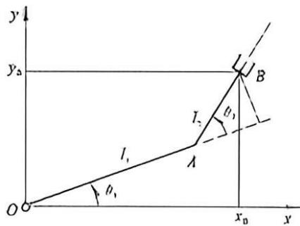

图10-10 正向运动学分析
{: .figure-caption }

将位移方程式(10-1)对时间求导, 即可以得到 $B$ 点的速度求解。

$$
\begin{array}{r l} \left[ \begin{array}{l} \dot {x} _ {\mathrm{B}} \\ \dot {y} _ {\mathrm{B}} \end{array} \right] & = \left[ \begin{array}{l} - l _ {1} \dot {\theta} _ {1} \sin \theta_ {1} - l _ {2} (\dot {\theta} _ {1} + \dot {\theta} _ {2}) \sin (\theta_ {1} + \theta_ {2}) \\ l _ {1} \dot {\theta} _ {1} \cos \theta_ {1} + l _ {2} (\dot {\theta} _ {1} + \dot {\theta} _ {2}) \cos (\theta_ {1} + \theta_ {2}) \end{array} \right] \\ & = \left[ \begin{array}{l l} - l _ {1} \sin \theta_ {1} - l _ {2} \sin (\theta_ {1} + \theta_ {2}) & - l _ {2} \sin (\theta_ {1} + \theta_ {2}) \\ l _ {1} \cos \theta_ {1} + l _ {2} \cos (\theta_ {1} + \theta_ {2}) & l _ {2} \cos (\theta_ {1} + \theta_ {2}) \end{array} \right] \left[ \begin{array}{l} \dot {\theta} _ {1} \\ \dot {\theta} _ {2} \end{array} \right] = J \left[ \begin{array}{l} \dot {\theta} _ {1} \\ \dot {\theta} _ {2} \end{array} \right] \end{array}\tag{10-3}
$$

式中：矩阵 $J$ 为

$$
J = \left[ \begin{array}{l l} - l _ {1} \sin \theta_ {1} - l _ {2} \sin \left(\theta_ {1} + \theta_ {2}\right) & - l _ {2} \sin \left(\theta_ {1} + \theta_ {2}\right) \\ l _ {1} \cos \theta_ {1} + l _ {2} \cos \left(\theta_ {1} + \theta_ {2}\right) & l _ {2} \cos \left(\theta_ {1} + \theta_ {2}\right) \end{array} \right] = \left[ \begin{array}{l l} \frac {\partial x}{\partial \theta_ {1}} & \frac {\partial x}{\partial \theta_ {2}} \\ \frac {\partial y}{\partial \theta_ {1}} & \frac {\partial y}{\partial \theta_ {2}} \end{array} \right]\tag{10-4}
$$

J 称为操作机的雅可比矩阵。操作机的雅可比矩阵是关节速度和操作机臂端的直角坐标速度之间的转换矩阵。

操作机臂端 B 点的加速度可通过对速度方程式两边对时间再次求导得到，此处不再赘述。

### 10.4.3 平面两连杆关节型操作器反向运动学分析

在反向运动学问题中，如图10-11所示，已知操作机末端执行器的位置 $x_{\mathrm{B}}$ 、 $y_{\mathrm{B}}$ 、速度 $\dot{x}_{\mathrm{B}}$ 、 $\dot{y}_{\mathrm{B}}$ 和加速度 $\ddot{x}_{\mathrm{B}}$ 、 $\ddot{y}_{\mathrm{B}}$ ，需要求解操作机各关节的位置参数 $\theta_{1}$ 、 $\theta_{2}$ 、运动参数 $\dot{\theta}_1$ 、 $\dot{\theta}_2$ （关节速度）和 $\ddot{\theta}_1$ 、 $\ddot{\theta}_2$ （关节加速度）。

(1) 位置分析。

操作机臂末端的位置坐标为 $x_{B}$ 、 $y_{B}$ ，则由式(10-1)可得：

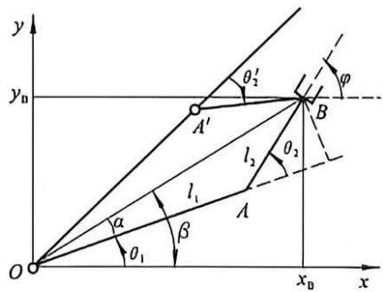

图10-11 反向运动学分析
{: .figure-caption }

$$
\begin{array}{r l} x _ {\mathrm{B}} ^ {2} + y _ {\mathrm{B}} ^ {2} & = \left[ l _ {1} \cos \theta_ {1} + l _ {2} \cos (\theta_ {1} + \theta_ {2}) \right] ^ {2} + \left[ l _ {1} \sin \theta_ {1} + l _ {2} \sin (\theta_ {1} + \theta_ {2}) \right] ^ {2} \\ & = l _ {1} ^ {2} + l _ {2} ^ {2} + 2 l _ {1} l _ {2} \cos \theta_ {2} \end{array}
$$

由此可得:

$$
\cos \theta_ {2} = \frac {x _ {\mathrm{B}} ^ {2} + y _ {\mathrm{B}} ^ {2} - l _ {1} ^ {2} - l _ {2} ^ {2}}{2 l _ {1} l _ {2}} \qquad \cos \theta_ {2} \in [ - 1, + 1 ]\tag{10-5}
$$

如果不满足约束条件，说明给定的臂端目标位置过远，已超出了该操作机的工作空间。如果所给定的目标点在操作机的工作空间内，则可以得到：

$$
\sin \theta_ {2} = \pm \sqrt {1 - \cos^ {2} \theta}\tag{10-6}
$$

则

$$
\theta_ {2} = \arctan \frac {\sin \theta_ {2}}{\cos \theta_ {2}}\tag{10-7}
$$

这里，在求 $\theta_{2}$ 时，采用了同时确定所求关节角的正弦和余弦，然后求这两个变量反正切的方法，这样既可保证求出所有的解，又保证了求出的角度在正确的象限内。

式(10-7)有两个解，它们大小相等，正负号相反，这说明到达所给定的目标点的构型有两个，一个如图10-11中的实线所示( $\theta_{2}$ 为正，肘向上)，另一个如图10-11中的虚线所示( $\theta_{2}$ 为负，肘向下)。需要指出的是，在两自由度平面关节型操作机的情况下，这两组解所对应的末端执行器的姿态是不同的。

关节角 $\theta_{2}$ 求出后，即可以进一步求解关节角 $\theta_{1}$ 。由图 10-10 可知：

$$
\beta = \arctan \frac {y _ {\mathrm{B}}}{x _ {\mathrm{B}}}\tag{10-8}
$$

$\beta$ 角可在任一象限内，它取决于 $x_{\mathrm{B}}$ 、 $y_{\mathrm{B}}$ 的符号。

而 $\alpha$ 角可通过余弦定理求得：

$$
l _ {2} ^ {2} = x _ {\mathrm{B}} ^ {2} + y _ {\mathrm{B}} ^ {2} + l _ {1} ^ {2} - 2 \sqrt {x _ {\mathrm{B}} ^ {2} + y _ {\mathrm{B}} ^ {2}} \cos \alpha
$$

故

$$
\alpha = \arccos \frac {x _ {\mathrm{B}} ^ {2} + y _ {\mathrm{B}} ^ {2} + l _ {1} ^ {2} - l _ {2} ^ {2}}{2 l _ {1} \sqrt {x _ {\mathrm{B}} ^ {2} + y _ {\mathrm{B}} ^ {2}}} \quad 0 ^ {\circ} \leqslant \alpha \leqslant 1 8 0 ^ {\circ}\tag{10-9}
$$

则

$$
\theta_ {2} = \beta + \alpha
$$

式中： $\theta_{2}<0$ 时，取“+”； $\theta_{2}>0$ 时，取“-”。

(10-10)

(2)速度分析。

可通过将式(10-3)两边同乘以一个 $J^{-1}$ (雅可比矩阵的逆矩阵)来求解反向运动学的速度问题, 即

$$
\left[ \begin{array}{l} \dot {\theta} _ {1} \\ \dot {\theta} _ {2} \end{array} \right] = J ^ {- 1} \left[ \begin{array}{c} \dot {x} _ {\mathrm{B}} \\ \cdot \\ y _ {\mathrm{B}} \end{array} \right]\tag{10-11}
$$

该式表明：操作器各关节的速度，可通过其雅可比矩阵的逆矩阵和给定的操作器臂端的直角坐标系中的速度求得。

当已知操作机臂末端在直角坐标系中的速度, 利用上式来求解各关节速度时, 首先需要判断其雅可比矩阵是否可以求逆。而一个矩阵有逆的充要条件是其行列式的值不为零。由式 (10-4) 可知, 其雅可比矩阵的行列式的值为:

$$
\begin{array}{l} \left| J \right| = - l _ {1} l _ {2} \sin \theta \cos \left(\theta_ {1} + \theta_ {2}\right) - l _ {2} ^ {2} \sin \left(\theta_ {1} + \theta_ {2}\right) \cos \left(\theta_ {1} + \theta_ {2}\right) + \\ l _ {1} l _ {2} \cos \theta_ {1} \sin \left(\theta_ {1} + \theta_ {2}\right) + l _ {2} ^ {2} \sin \left(\theta_ {1} + \theta_ {2}\right) \cos \left(\theta_ {1} + \theta_ {2}\right) = l _ {1} l _ {2} \sin \theta_ {2} \end{array}\tag{10-12}
$$

所以, 当 $\theta_{2} = 0^{\circ}$ 或 $\theta_{2} = 180^{\circ}$ 时, $|J| = 0$ , $J^{-1}$ 不存在。从物理意义上讲, 当 $\theta_{2} = 0^{\circ}$ 时, 两连杆伸直共线; 当 $\theta_{2} = 180^{\circ}$ 时, 两连杆重叠共线, 在这两种情况下, 臂末端只能沿着垂直于手臂的方向运动, 而不能沿着连杆 $AB$ 的方向运动, 这意味着在该操作机工作空间的边界上, 操作机将不再是一个2自由度的操作机，而变成了仅1自由度的操作机。这样的位置称为操作器的奇异位置。在奇异位置，有限的关节速度不可能使臂末端获得规定的速度（类似于曲柄滑块机构的“死点”位置）。

为了进一步了解奇异位置的特点，下面分析关节速度求解的一般表达式。

$$
\begin{array}{r l r} & {\text {因} J ^ {- 1} = \frac {1}{l _ {1} l _ {2} \sin \theta_ {2}} \left[ \begin{array}{l l} {l _ {2} \cos (\theta_ {1} + \theta_ {2})} & {l _ {2} \sin (\theta_ {1} + \theta_ {2})} \\ {- l _ {1} \cos \theta_ {1} - l _ {2} \cos (\theta_ {1} + \theta_ {2})} & {- l _ {1} \sin \theta_ {1} - l _ {2} \sin (\theta_ {1} + \theta_ {2})} \end{array} \right]} \\ & {\text {故} \left[ \begin{array}{l} {\theta_ {1}} \\ {\theta_ {2}} \end{array} \right] = J ^ {- 1} \left[ \begin{array}{l} {\dot {x} _ {\mathrm{B}}} \\ {\dot {y} _ {\mathrm{B}}} \end{array} \right]} \\ & {\qquad = \frac {1}{l _ {1} l _ {2} \sin \theta_ {2}} \left[ \begin{array}{l l} {l _ {2} \cos (\theta_ {1} + \theta_ {2})} & {l _ {2} \sin (\theta_ {1} + \theta_ {2})} \\ {- l _ {1} \cos \theta_ {1} - l _ {3} \cos (\theta_ {1} + \theta_ {2})} & {- l _ {1} \sin \theta_ {1} - l _ {2} \sin (\theta_ {1} + \theta_ {2})} \end{array} \right] \left[ \begin{array}{l} {\dot {x} _ {\mathrm{B}}} \\ {\dot {y} _ {\mathrm{B}}} \end{array} \right]} \end{array}\tag{10-13}
$$

该式表明：在奇异位置，为了使臂末端具有规定的速度，要求关节速度必须达到无穷大。在奇异位置附近，为了使臂末端具有规定的速度，需要有限的但非常高的关节速度 $\dot{\theta}_{1}$ 、 $\dot{\theta}_{2}$ （正比于 $\frac{1}{\sin \theta_{2}}$ ）。

### 10.4.4 平面两连杆关节型操作机工作空间分析

工作空间，即操作机的工作范围，指在机器人运动过程中，其操作机臂端所能到达的全部点所构成的空间，通常以手腕中心点在操作机运动时所占有的体积来表示，其形状和大小反映了机器人的工作能力。操作机的工作空间有可到达的工作空间和灵活的工作空间之分。

可到达的工作空间指的是机器人末端执行器至少可在一个方位上能到达的空间范围。

灵活的工作空间指的是机器人末端执行器在所有方位均能到达的空间范围。

上述平面两连杆关节型操作机的工作空间可以用下式描述：

$$
\left| l _ {1} - l _ {2} \right| \leqslant \sqrt {x _ {\mathrm{B}} ^ {2} + y _ {\mathrm{B}} ^ {2}} \leqslant \left(l _ {1} + l _ {2}\right)\tag{10-14}
$$

其工作空间为一圆环面积, 该圆环的中心同固定铰链点 $O$ 重合。圆环的内半径和外半径分别为 $|l_{1} - l_{2}|$ 和 $l_{1} + l_{2}$ , 如图 10-12(a) 所示。在该工作空间内的每一点, 末端执行器可取得两个可能的姿态; 而在工作空间边界上的每一点, 末端执行器只能有一个可能的姿态。因此, 该工作空间为操作机可到达的工作空间。

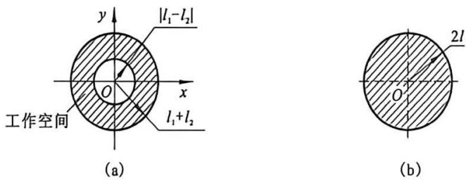

图10-12 平面两连杆关节型操作机的工作空间
{: .figure-caption }

若对于给定的 $l_{1}+l_{2}$ ，设计时取 $l_{1}=l_{2}=l$ ，即让两连杆等长，则此时工作空间可用下式表示。

$$
0 \leqslant \sqrt {x _ {\mathrm{B}} ^ {2} + y _ {\mathrm{B}} ^ {2}} \leqslant 2 l\tag{10- 15}
$$

即工作空间为一圆面积。如图 10-12(b) 所示，在圆心点，末端执行器可取得任意姿态。

## 10.5 工业机器人的选型原则

### 10.5.1 中国机器人产业发展历程和现状

中国机器人产业从上世纪中后期开始起步，在经历了70年代萌芽期，80年代开发期，90年代应用期三个打基础阶段之后，到2000年代进入了持续高速发展期。2013年我国的工业机器人产能和销量一举超越日本成为全球第一。到2022年，中国机器人年增长量已经达到第二名日本的2倍以上。目前国内从事机器人研发和生产的企业有数千家之多，工业机器人已经成为一类标准化、系列化的通用自动化装备。对于绝大多数机器人应用企业和机械工程师而言，其实并不需要自己去设计、研发机器人，更多的是根据行业特点和企业自身情况来选用成熟可靠的现有市售机器人产品。因此，对机器人本体进行符合使用条件的选型，是机械设计工程师的基本技能之一，而机器人末端执行器则往往针对不同的行业特点及使用环境进行具体设计定制。

### 10.5.2 选型原则

对于机器人本体的选型，主要考虑因素包括作业类型、有效负载、工作空间、运转速度、惯量与制动、定位精度、自由度、本体质量、防护等级等九个方面的原则综合考虑。

(1)作业类型要与机器人用途相匹配。

此原则的含义是选择专用机器人来完成专项作业。一件商品从最初的原材料变成具有特定形状和功能的商品，一般需要经过数十道加工成型工艺及半成品物料在不同机台之间的流转、常用工序包括原材料切割、机加、焊接、打磨、涂胶、装配、喷漆、包装、码垛、搬运等，每种不同的作业工艺对机器人的运动要求是不同的，而工业机器人往往都是根据特定的工艺要求量身定制的。例如，焊接机器人分为弧焊机器人和点焊机器人，两者在焊接原理、工艺参数、焊枪结构、运动轨迹、姿态控制、焊机类型、送丝机构等方面完全不同，它们不能相互替代。换句话说，当工件采用点焊工艺成型时，就只能选择点焊机器人而不能选择弧焊机器人。当然，更不可以选用搬运机器人来完成焊接作业。由此可知，选购的机器人用来做什么工作才是决定机器人种类选型的首要条件。

以搬运机器人为例，如果作业过程只是拾取+转运+放置的简单动作，则平面关节型的Scara机器人是不错的选择；如果想将一条皮带输送线上的小型物品快速转运到另外一条输送线上，则Delta型蜘蛛机器人则是最好的选择；如果你想让机器人在工人旁边一起工作，则具有全身触觉感知的协作机器人无疑是你最佳的选择对象。

(2)有效负载。

有效负载是指机器人可以携带的最大负荷，在机器人选型时，要求实际负载不得超过机器人的有效负载。目前市售的通用型搬运机器人的有效载荷从 $3 \mathrm{~kg}$ 到 $1300 \mathrm{~kg}$ 不等。需要特别指出的是，对于搬运和装配机器人而言，往往需要根据抓取对象设计特定的夹持器，此时，夹持器的质量也属于载荷，因此，需按照夹持器质量+实际载荷<机器人有效载荷的原则选型。另外特别需要注意的是机器人的负载曲线，在工作空间范围的不同距离位置，实际负载

能力会有差异。

(3) 可达工作空间。

所谓可达工作空间即机器人在不同位置时末端夹持器所能到达的最远位置点及最近位置点的集合，这些点的集合构成了一个由若干曲面拼接而成的包容封闭空间，机器人使用手册都会给出相应机器人的可达工作空间的三视图。在评估目标应用场合的时候，应该了解机器人需要到达的最大距离和最小距离，选型时应保证被加持对象的初始位置和终止位置必须完全位于机器人的可达工作空间之内，否则就完成不了特定的作业任务。

(4) 最大运转速度。

机器人的最大速度与应用场合密切相关，机器人规格表列明了该型号机器人最大速度。考虑到机器人从一个位置点运动到另一个位置点存在加、减速的过程，故机器人实际运行的速度将在0到最大速度之间。机器人在工程上的应用往往不是单独使用，而是与物流输送线及自动加工机床等组成一条按节拍循环动作的自动化生产流水线。循环周期时间是指完成一件特定作业所需要的全部时间，往往以秒计，循环周期是自动化流水线生产的重要参数。在设计自动化流水线控制系统时，一个完整的循环周期被分割成若干个时间片段，自动化流水线各部分的作业动作必须在规定的时间片段内完成，这就要求所选择机器人的最大速度必须能满足作业时间要求。

(5)转动惯量与制动器。

机器人各关节的运动都存在着加速与减速的过程，因此，各关节运动都存在角加速度，从而导致产生惯性力矩，惯性力矩与转动惯量成正比。一方面，惯性力矩会影响机器人运动的准确性，要想在工作区间确保机器人可重复的精确位置，就需要配置足够数量的制动器，以便机器人到位时及时刹车，停在准确位置。另一方面，为了保证机器人在意外停电时能及时停住，避免因惯性力矩造成运动过冲而发生意外安全风险，故机器人的关节轴也必须配置足够的制动器。每个机器人制造商都会提供他们的机器人的转动惯量和制动系统的相关信息，有些机器人对所有的轴配备制动器，而有的机器人不是所有的轴都配置制动器。故在机器人选型时要根据作业精度要求及安全性要求选择足够数量的制动器。机器人的另外一个重要参数是关节输出扭矩，不同轴上的扭矩可能不一样。例如，如果作业动作需要一定量的扭矩才能正确完成工作，故需要检查核实某些关节轴上的最大扭矩是否满足适用要求。如果选型不正确，机器人则可能由于过载而宕机。

(6)重复定位精度。

这个参数的选择也取决于应用场景。重复定位精度是机器人在完成每一次运动循环后，到达同一位置的精确度/差异度。一般而言，工业上常用的搬运机器人可以达到±0.5 mm以内的重复定位精度，而精密装配机器人的重复定位精度甚至可以达到±0.05 mm以内。

如果机器人用于制造电路板，你就需要一台超高重复精度的装配机器人。如果所应用精度要求不高，那么机器人的重复定位精度也可以不用那么高。精度在2D视图中通常用“±”表示。实际上，由于机器人并不是线性的，其可以在公差半径内的任何位置。

(7) 自由度(轴数)。

机器人的自由度等同于其运动轴的数量，所需机器人轴数通常取决于具体的应用场景。如果只是进行一些简单的应用，例如在传送带之间完成拾取—放置物料的搬运作业，那么4自由度的机器人就足够了。如果机器人需要在一个狭小的空间内工作，而且机械臂需要扭曲反转，更为灵活的6轴或者7轴的机器人则是最佳选择。工程上往往也存在着“一机多用”应用场景，想让一台机器人完成多项复杂的作业。这时，应该按照最复杂的作业项来决定机器人的轴数，否则会出现“轴”到用时方恨少的窘境。通常，机器人轴数选择原则是够用即可，轴数少了，无法完成指定任务，轴数过多会造成自由度冗余，不仅造成金钱浪费，因为机器人的采购价格直接取决于其运动轴的数量，而且还会造成使用浪费，因为一台6轴机器人如果只需要其中的4轴，你还是得为剩下的2轴进行编程。

(8)机器人本体质量。

机器人本体质量对于设计机器人应用单元也是一个重要的参数。在有效载荷相同的前提下，不同商家同类机器人的本体质量肯定是不一样的，建议优先选择本体质量轻的产品。因为一般情况下，工业机器人需要安装在定制的工作台甚至轨道上，就需要知道它的质量并设计与之匹配的支撑。此时，机器人自身越重，在运动过程中产生的惯性力和惯性力矩也就越大，系统产生振动的可能性也就越大，为了避免振动的产生，安装机器人的支撑结构也就越笨重。

(9) 防护等级。

防护等级是机器人选型的重要依据之一，具体取决于机器人的应用场景所需要的防护等级。很显然，诸如在工业品制造、食品加工、易燃易爆品生产、潮湿水雾等环境中，其所需的机器人防护等级各有不同。例如，面粉加工厂或者棉纺加工企业中大气环境存在大量的可燃性粉尘，则需要有防爆等级的机器人。防护等级有相应的国家标准和规范，需要严格按照相应的标准和规范进行选型。通常制造商会根据机器人工作的环境不同而为同型号的机器人提供不同的防护等级。

## 10.6 开式链机构应用举例

用机构学的观点观察分析自然界中的所有脊椎动物，如哺乳纲、爬行纲、鱼纲、灵长目、节肢动物昆虫等，它们的身体及肢体，无一例外都进化出了结构精巧的开式链机构。因此，开式链机构成为仿生机器人研究领域的首选并在工程实际中得到了广泛应用。图 10-13\~图 10-18 所列分别为仿哺乳动物的多足步

行机器人、仿生鱼类的水下机器人、仿生鸟类的扑翼飞行机器人、仿生蛇类游移的机器人、仿生昆虫的机器人、仿生壁虎的爬壁机器人，给这些仿生机器人装上摄像头和各种传感器及操作器等各类有效载荷，就能构建满足人类多样化需求的应用场景。仿生机器人的最高境界是仿人形机器人，如图10-19\~图10-21所示。目前的人形机器人不仅具有模仿人体四肢的运动功能，能代替人类完成大部分手工作业，而且有的人形家政服务机器人还具有100多种喜怒哀乐的人脸表情，能陪伴主人聊天和完成家政服务工作。

图10-13 机器小狗
{: .figure-caption }

图10-14 仿生鱼
{: .figure-caption }

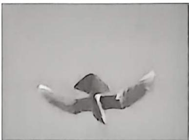

图10-15 仿生鸟Smart
{: .figure-caption }

图10-16 仿生机器蛇
{: .figure-caption }

图10-17 仿生蜘蛛
{: .figure-caption }

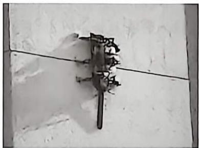

图10-18 仿生壁虎
{: .figure-caption }

图10-19 美女机器人
{: .figure-caption }

图10-20 波士顿动力出品人形机器人
{: .figure-caption }

图10-21 自己造自己的特斯拉“阿特拉斯” 人形机器人亮相
{: .figure-caption }

本章思维导图

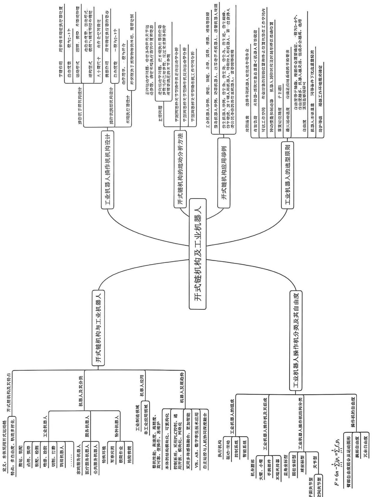

## 思考题与练习题

1. 开式链机构的主要特点是什么？为什么机器人操作机多选用开式链机构的形式？

2. 工业机器人一般由哪几部分组成？

3. 什么是机器人操作机？它一般由哪几部分组成？各部分有什么作用？

4. 什么是机器人的自由度、冗余自由度？设计机器人冗余自由度的目的是什么？

5. 操作机按结构分为哪几类？各有什么特点？

6. 开式链机构运动分析的正向运动学问题是什么？反向运动学问题是什么？

7. 什么是雅可比矩阵？它有什么用途？

8. 机器人工作空间的含义是什么？

9. 如图 10-22 所示为一机器人的操作机轴测简图，已知其结构尺寸及运动关节参数如图所示，试绘制该机器人操作机的机构简图。

10. 如图 10-23 所示为一偏置式手腕机构，已知机构的各圆锥齿轮的齿数及各输入轴的运动转角如图所示。现要求：

(1)试计算该手腕机构的自由度，并说明该机构是否具有确定的运动。

(2)试分析该手腕机构的结构,说明它是如何实现腕部的回转运动( $\varphi$ )、俯仰运动( $\beta$ )和手爪的回转运动( $\theta$ )的,并确定它们与输入运动参数的关系式。

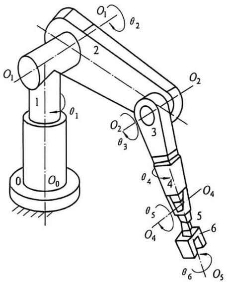

图10-22 机器人操作机轴测简图
{: .figure-caption }

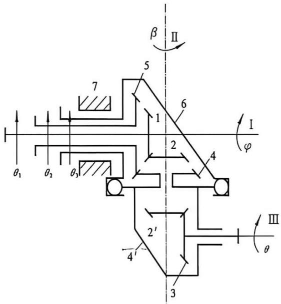

图10-23 偏置式手腕机构
{: .figure-caption }
