# 第11章 平面机构的力分析

**【概述】**

◎作用在机械上的力，是影响机械的运动和动力性能的重要参数，也是计算构件横截面尺寸的重要依据，所以设计机械时必须对机构的受力情况进行分析。本章先介绍机构力分析的任务、目的和方法，然后讲解构件惯性力的确定，机械中的摩擦，考虑摩擦和不考虑摩擦时机构的受力分析方法。

◎通过本章的学习要求了解机构的受力分析方法，构件惯性力的确定，机械中摩擦力的确定。

## 11.1 机构力分析的任务、目的和方法

### 11.1.1 作用在机械上力的类型及其特点

由牛顿经典力学可知，力是改变物体运动状态的唯一原因，当然也是改变机械系统运动状态的唯一原因。在原动件的运动通过传动系统变换成执行机构作业动作的同时，原动件提供的动力也通过运动副元素的彼此接触，通过传动系统依次传递给最终从动件而完成有用功。因此，当机械运转时，组成机械的各构件必然受到各种力的作用，其中包括：

(1)重力——源于地球引力, 对于工作在地球或近地空间的机械装备而言, 重力总是存在的; 对于具体的构件而言, 重力是一个常量, 而重力的方向总是指向地球中心。

(2) 原动力——由原动机输出的机械力或力矩的总称, 常见的原动力有旋转电机产生的转矩、内燃机输出的扭矩、直线电机产生的牵引力、流体推动活塞产生的推力、压电陶瓷产生的材料膨胀力等。原动力是促使机械运转的根本原因, 原动力的方向总是与力的作用点速度方向成锐角, 因而总是做正功。

(3)生产阻力——完成作业工艺过程中改变工作对象的形状、位置或运动状态所必须克服的阻力。例如，机床切削金属时，刀刃强迫材料发生塑性变形遇到的阻力、起重机起吊重物需克服的地球引力、车辆启动加速过程中的地面摩擦力和风的阻力等。

(4) 摩擦力——直接接触的运动副元素在外力作用下, 产生相对滑动时接触部位所产生的摩擦力, 由库仑定律可知, 摩擦力的大小取决于接触表面的正压力和摩擦系数, 而摩擦系数取值与两运动副元素材料类型和润滑状态有关。

(5)介质阻力——在大气、水、工业液体等流体介质中工作的机械, 当接触表面与流体介质产生相对运动时所受到的阻力。介质阻力与流体的黏度成正比, 流体越黏稠, 阻力越大。

(6)惯性力——构件做变速运动时产生的附加力，由牛顿定律可知，惯性力与构件质量和加速度有关，而惯性力矩则与构件的转动惯量和角加速度有关，一般情况下，惯性力的大小和方向作周期性循环变化。

(7) 运动副反力——构件在传递运动的同时，也通过运动副元素的彼此接触产生力的传递。运动副反力是一对大小相等、方向相反的平衡力，分别作用在相邻的两构件上。对于整台机械而言，运动副反力是内力；而对于单个构件而言，运动副反力是外力。

上述各种力按其所起的作用又可以划分为驱动力和阻抗力两大类。凡是促使机械做加速运动的力称为驱动力，其特征是驱动力与作用点的速度方向相同或成锐角，其所做的功为正功，称为驱动功或输入功；而迫使机械做减速运动的力称为阻抗力，其特征是阻抗力与作用点的速度方向相反或成钝角，其所做的功为负功，称为阻抗功。

阻抗力又可分为以下两种：

(1)有效阻力, 即工作阻力。有效阻力是机械在工作过程中为了改变工作物的外形、位置或状态受到的生产阻力, 例如机床的切削阻力、起重机的载重等。克服有效阻力完成的功称为有效功或输出功。

(2)有害阻力。有害阻力是机械在工作过程中受到的非生产阻力，例如摩擦力是机械中主要的有害阻力，此外还有介质阻力等。克服有害阻力所做的功纯粹是浪费能量。克服有害阻力所做的功称为损失功。

值得注意的是，“有害”这个词都带有一定主观色彩，实际上工程中，不存在只有害而无用的力，比如摩擦力，虽然它所做的功导致了能量损失，但摩擦力本身并不“有害”，相反，在特定场合下，摩擦力必不可少，比如车辆行驶过程中，必须有车轮和地面之间的摩擦力才能完成行驶的动作。

对于某一种具体的力而言，究竟是驱动力还是阻抗力，要看它在机械运转过程中各阶段所起的作用。例如，当机械的重心远离地心时，重力是阻力，它做负功；而当重心靠近地心时，重力又成为驱动力，此时它做正功。再比如，大多数情况下，摩擦力是一种阻抗力，但在带传动中，又要靠摩擦力带动从动带轮旋转，并驱动其他构件运动，此时，摩擦力又成为了驱动力。对于惯性力而言，也有类似的情况，机械做加速运动时，惯性力是阻抗力；而当机械做减速运动时，惯性力又变成了驱动力。

### 11.1.2 机构力分析的任务和目的

机械的运动是在上述各种力综合作用下的结果，所谓对机构进行力分析，就是要在要求机械实现预定运动和已知构件长度尺寸的条件下，求出其中的未知力。具体而言，主要包括以下两个方面。

#### 1. 确定机构中各运动副中的反力

运动副中的总反力可分解为运动副两元素间的正压力和由其产生的摩擦力两部分。因为对单个构件而言，运动副反力是外力，其大小和性质对于计算分析机构中各零件的强度、运动副的磨损、机械的效率，进行轴承选型设计、机械振动分析、原动机的选型和功率计算，以及判断机械是否因发生自锁而卡死等，都是必须要事先确定的重要数据。

#### 2. 确定应加于机械上的平衡力或平衡力矩

平衡力或平衡力矩是指机械在已知外力作用下，为了使机构按设计的运动规律运动，必须加在机械上的未知外力或力矩。要计算机械工作所需功率，必须先求平衡力。在已知原动机功率的前提下，也可以根据平衡力和平衡力矩确定机械正常工作时的最大工作阻力。

### 11.1.3 机构力分析的方法

作机构力分析时，静力分析是基本方法。对于低速机械，或质量很小的中速机械，其运动构件的动载荷不大，惯性力很小，可以忽略不计。这样不计动载荷仅考虑静载荷的计算方法称为静力计算方法。静力计算方法对高速机械并不适用。对于高速机械，其运动构件的动载荷很大，有时大大超过其他静载荷。这时作机构力分析，必须同时考虑静载荷和动载荷，即进行动力分析，这样的计算方法称为动力计算方法。

在动力计算方法中，如前所述，构件所受的惯性力和其他力组成一个平衡力系，此时运动的机构就可以认为处于动力静平衡状态，可以用静力分析的方法进行分析和计算，即进行动态静力分析，这种动力计算方法称为动态静力计算。

要对机械进行动态静力分析，要求出各构件的惯性力。但如果是设计新机械，其构件尺寸还未确定，则无法确定其惯性力。这时，一般先按照设计条件，参考经验值给出各构件初步的结构尺寸，计算质量和转动惯量等参数，据此进行动态静力分析。根据计算结果对构件和零件进行强度和刚度校核，再据此修正构件的结构尺寸。之后根据需要重复上述动态静力分析、强度和刚度校核、结构尺寸修正，直到确定合理尺寸为止。

机构力分析的方法有图解法和解析法两种，本章将主要介绍图解法。

## 11.2 构件惯性力的确定

确定构件惯性力有一般力学方法和质量代换法。

### 11.2.1 一般力学方法

就平面机构而言，所有构件的运动都属于绕定轴转动、做往复移动、做平面运动三种形式之一。

设构件惯性力用 $F_{1}$ 表示，惯性力矩用 $M_{1}$ 表示，它与各构件的质量 $m_{1}(kg)$ 、绕过质心轴的转动惯量 $J_{\mathrm{si}}(\mathrm{kg}\cdot\mathrm{m}^{2})$ 、质心 $S_{i}$ 的加速度 $a_{\mathrm{si}}(\mathrm{m}/\mathrm{s}^{2})$ 、构件的角加速度 $a_{i}(\mathrm{rad}/\mathrm{s}^{2})$ 等有关。

#### 1. 绕定轴转动的构件

对于绕定轴转动的构件，其惯性力和惯性力矩有两种情况。

(1) 绕通过质心的定轴转动的构件。

齿轮、飞轮等一般绕其质心做定轴转动。这类构件因为其质心的加速度为零，其惯性力也为零。如果是变速转动，将产生一个惯性力矩 $M_{\mathrm{li}} = -J_{\mathrm{ni}} a_{i}$ ，式中负号表示 $M_{ll}$ 的方向与角加速度 $a_{i}$ 方向相反。

(2) 绕不通过质心的定轴转动的构件。

如果旋转轴不通过质心，如图11-1所示曲柄AB，当曲柄AB做变速转动，其上作用有惯性力 $F_{11}=-m_{1}a_{s1}$ 及惯性力矩 $M_{11}=-J_{s1}a_{1}$ ，两者可简化为一个不通过质心的总惯性力 $F_{11}^{\prime}$ 。

设其质心 $S_{1}$ 的加速度为 $a_{n1}$ ，则 $a_{n1} = a_{n1}^{n} + a_{n1}^{l}$ 。

如果曲柄 AB 做等速转动，则仅有一个离心惯性力 $F_{11} = -m_{1} a_{n1}^{n}$ 。

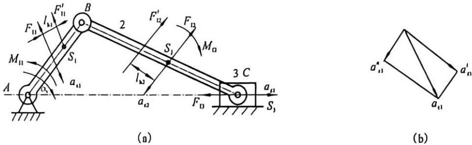

图11-1 构件惯性力的确定
{: .figure-caption }

(a)曲柄滑块机构的惯性力；(b)曲柄AB质心加速度 $a_{s1}$ 的分解。

#### 2. 做往复移动的构件

做往复移动的构件如果做匀速运动，其惯性力和惯性力矩均为零。如果做变速直线运动，如图11-1(a)中的滑块3，因为没有角加速度，所以没有惯性力矩，只有一个加在其质心上的惯性力 $F_{13}=-m_{3}a_{s3}$ 。内燃机的活塞和刨床的刨头等都属于这种构件。

#### 3. 做平面(复合)运动的构件

由理论力学可知, 对于做平面复合运动的构件, 如图 11-1(a) 所示曲柄滑块机构中的连杆 $BC$ , 它的全部惯性力可以简化为一个加于构件质心 $S_{2}$ 的惯性力 $F_{12}$ 和一个惯性力矩 $M_{12}$ :

$$
F _ {1 2} = - m _ {2} a _ {s 2}\tag{11-1}
$$

$$
M _ {1 2} = - J _ {s 2} \alpha_ {2}\tag{11-2}
$$

为了分析方便, 上述惯性力 $F_{12}$ 和惯性力矩 $M_{12}$ 又可以用一个大小等于 $F_{12}$ , 作用线由质心 $S_{2}$ 偏移一段距离 $l_{12}$ 的总惯性力 $F_{12}^{\prime}$ 来代替, 其中 $l_{12}$ 的值为:

$$
l _ {1 2} = M _ {1 2} / F _ {1 2}\tag{11-3}
$$

且 $F_{12}^{\prime}$ 对质心 $S_{2}$ 之矩的方向与 $a_{2}$ 的方向相反。

### 11.2.2 质量代换法

如上所述，用一般力学方法确定构件惯性力时，需要事先求出构件质心的加速度 $a_{si}$ 及构件绕质心 $S_{i}$ 的角加速度 $a_{i}$ ，而机构在运动过程中，只有少数形状规则且做定轴转动的构件其质心有可能在转动中心，大多数构件的质心相对于机架的位置总是在不断变化。因此，构件的质心位置难以精确测定，且求解各构件质心加速度比较烦琐。为了简化计算，可以设想将构件的质量 $m_{i}$ 按一定条件用集中在构件上某几个选定点上的集中质量来代替，这样只需求出这些集中质量的惯性力就可以了，而无须求惯性力矩。这种按一定条件，假想将构件的质量用集中在某几个选定点上的集中质量来代换的方法称为质量代换法，选定点是代换点，假想的集中质量称为代换质量。

为了使代换前后产生的惯性力和惯性力矩保持不变，进行质量代换应满足以下条件：

(1)代换前后构件的质量不变。

(2)代换前后构件的质心位置不变。

(3)代换前后构件对质心轴的转动惯量不变。

满足条件(1)、(2)的代换, 其惯性力不变。这种代换原构件和代换系统的静力效应完全相同, 称为静代换。满足上述三个条件的代换, 其惯性力和惯性力矩都不变, 代换前后系统的动力效应完全相同, 称为动代换。

工程计算中最常见的是用两个或三个代换质量进行代换，用两个代换质量的最多。下面介绍用两个代换质量的代换法。

如图 11-2 所示，以连杆 BC 为例，设用通过质心 $S_{2}$ 的直线上 B、K 两点的代换质量 $m_{B}$ 、 $m_{K}$ 来进行质量代换。根据上述三个条件，可以列出下列方程式：

$$
\left\{ \begin{array}{l} m _ {\mathrm{B}} + m _ {\mathrm{K}} = m _ {2} \\ m _ {\mathrm{B}} b = m _ {\mathrm{K}} k \\ m _ {\mathrm{B}} b ^ {2} + m _ {\mathrm{K}} k ^ {2} = J _ {\kappa 2} \end{array} \right.
$$

解得：

$$
\left\{ \begin{array}{l} k = J _ {\mathrm{n2}} / (m _ {2} b) \\ m _ {\mathrm{B}} = m _ {2} k / (b + k) \\ m _ {\mathrm{K}} = m _ {2} b / (b + k) \end{array} \right.
$$

可见，当代换点 $B$ 确定后， $K$ 点的位置随之而定，即两个代换点不能同时随意选择。满足这三个

图11-2 质量代换法
{: .figure-caption }

条件的代换称为动代换，代换前后构件的惯性力和惯性力矩都不变。

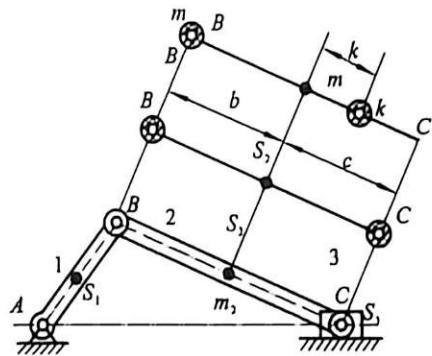

为了计算方便, 工程上常采用静代换。根据静代换的要求, 取 $B 、 C$ 为代换点, 可以列出下列方程式:

$$
\left\{ \begin{array}{l} m _ {\mathrm{B}} + m _ {\mathrm{C}} = m _ {2} \\ m _ {\mathrm{B}} b = m _ {\mathrm{C}} c \end{array} \right.\tag{11-4}
$$

解得：

$$
\begin{array}{l} m _ {\mathrm{B}} = m _ {2} c / (b + c) \\ m _ {\mathrm{C}} = m _ {2} b / (b + c) \end{array}\tag{11-5}
$$

这时两个代换点 B、C 可以同时任意选择，这就方便了工程计算。但是，使用静代换，由于不满足条件(3)， $m_{B}$ 和 $m_{C}$ 对质心的转动惯量与原构件对质心的转动惯量有一定误差。此误差对一般不是很精确的计算是允许的。因此，静代换在工程中得到了比动代换更广泛的应用。

## 11.3 机械中的摩擦及运动副中摩擦力的确定

摩擦现象与人类生活联系极为紧密，因此，中西方古人对摩擦都有着一定认识。类人猿从摩擦生热中得到启示，学会了用火，这是从猿进化为人的关键；古埃及人使用圆木运送巨型石块用于建造金字塔，实际上利用了滚动摩擦远比滑动摩擦小的科学原理；春秋末年齐国人的著作《考工记》中论述了轮子的滚动问题，提到“欲其微至也，无可取之，取诸圜也”，实际上就是讨论滚动摩擦与轮子半径的关系。1781年，库仑得出结论：摩擦力的方向总是与接触表面间的相对运动速度的方向相反，该结论至今仍广泛适用。

本书主要讨论运动副中的摩擦力。

在机械运动中，由于运动副组成元素间存在正压力和相对运动，运动副中必然存在摩擦力。运动副中的摩擦力是一种主要的有害阻力，它消耗了能量，使零件发热、磨损，从而降低机械精度，使机械运转不灵活，缩短机械寿命。如果润滑情况恶化，机械会卡死。但在某些情况下摩擦力做有效功，如利用摩擦进行传动的机械如带传动、摩擦轮传动、离合器等，利用摩擦进行制动的制动器等，如果摩擦力不够大，机械将不能完成工作。因此，必须对运动副中的摩擦进行分析，减少其不利影响。

对于低副，两运动副元素之间通常是滑动，这时产生滑动摩擦力；对于高副，两运动副元素之间通常是滚动兼滑动，将产生滚动摩擦力和滑动摩擦力。由于滚动摩擦一般比滑动摩擦小得多，所以对机械进行力分析时通常只考虑滑动摩擦。下面分别对低副中的移动副、螺旋副和转动副，以及平面高副中的摩擦加以分析。

### 11.3.1 移动副中摩擦力的确定

如图 11-3 所示，滑块 1 放在平台 2 上，G 和 F 分别为作用在滑块上的铅垂载荷和水平推力，滑块在力 F 作用下运动或具有运动的趋势； $N_{21}$ 是平台对滑块的法向反力，摩擦力 $F_{21}$ 的方向与滑块运动的方向或运动趋势的方向相反。 $N_{21}$ 和 $F_{21}$ 都是平台对滑块的反力，可以合为一个总反力 $F_{R21}$ ， $F_{R21}$ 的方向与滑块运动或运动趋势的方向成一钝角 $90^{\circ} + \varphi$ 。

根据库仑摩擦定律, 摩擦力随外力增大而增大, 但有一极大值, 当水平推力 F 大于此值时, 滑块开始向右运动。摩擦力 $F_{21}$ 的值为:

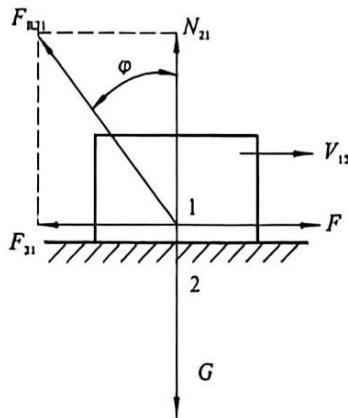

图11-3 移动副
{: .figure-caption }

$$
F _ {2 1} = f N _ {2 1}\tag{11-6}
$$

进而有：

$$
f = F _ {2 1} / N _ {2 1} = \tan \varphi\tag{11-7}
$$

式中：f 为摩擦系数（与运动副材料和润滑情况有关）； $\varphi$ 为摩擦角。

当滑块在平台上的不同方向运动时，如接触表面的材质和状态各处相同，则合力 $F_{R21}$ 的轨迹为一圆锥体的表面，此圆锥称为摩擦锥，如图11-4所示。可见移动副中总反力恒切于摩擦锥。

由式(11-6)可知，当摩擦系数f一定时，摩擦力 $F_{21}$ 取决于法向反力 $N_{21}$ 。而G一定时，法向反力 $N_{21}$ 的大小又取决于移动副元素的接触形状。

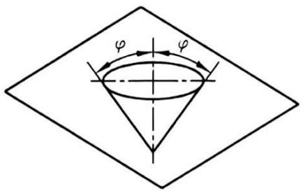

图11-4 摩擦锥
{: .figure-caption }

图 11-3 中，滑块与平台沿平面接触，则 $N_{21} = -G$ ，所以
{: .figure-caption }

$$
F _ {2 1} = f N _ {2 1} = f G\tag{11-8}
$$

图11-5中，两构件沿V形槽面呈楔形接触，经推导可得 $N_{21} = G / (\sin \theta)$ ，进而有：

槽面摩擦
(a)
图11-7 斜面滑块机构力分析
(b)

图11-6中，两构件沿一半圆柱面接触，此时接触面各点处的法向反力方向为圆柱面的半径方向，接触面各处法向反力的矢量和与铅垂载荷 $G$ 平衡，有 $N_{21} = \sum \Delta N_{21} = -G$ ，法向反力的代数和为 $N_{21}^{\prime} = \sum |\Delta N_{21}| = kG > |N_{21}|$ ，其中 $k = 1-$

$\pi/2$ ，为与接触情况有关的系数。根据理论分析和实验测量，可知当两接触面为点、线接触时， $k=1$ ；当两接触面沿整个半圆周均匀接触时， $k=\pi/2$ ；其余情况下 $1\leqslant k\leqslant\pi/2$ 。则

$$
F _ {2 1} = f N _ {2 1} ^ {\prime} = f \cdot k G = f _ {v} G\tag{11-10}
$$

式中： $f_{v}$ 为当量摩擦系数。

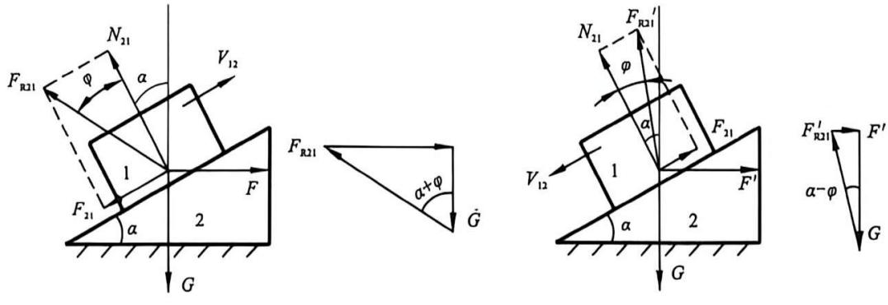

综上所述，移动副中滑块所受摩擦力的大小可以统一表示为

$$
F _ {2 1} = f N _ {2 1} = f _ {\mathrm{v}} G\tag{11-11}
$$

式中： $f_{v}$ 为当量摩擦系数。对于平面接触、楔形接触、半圆柱面接触三种情况，分别有 $f_{v}=f$ 、 $f_{v}=f/\sin\theta$ 、 $f_{v}=kf(k=1-\pi/2)$ 。

引入当量摩擦系数以后，在计算运动副中的滑动摩擦力时，不管运动副两元素的几何形状如何，均可根据实际情况选用合适的当量摩擦系数，以单一平面接触来进行计算。

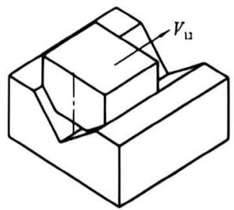

图11-5 楔面摩擦
{: .figure-caption }

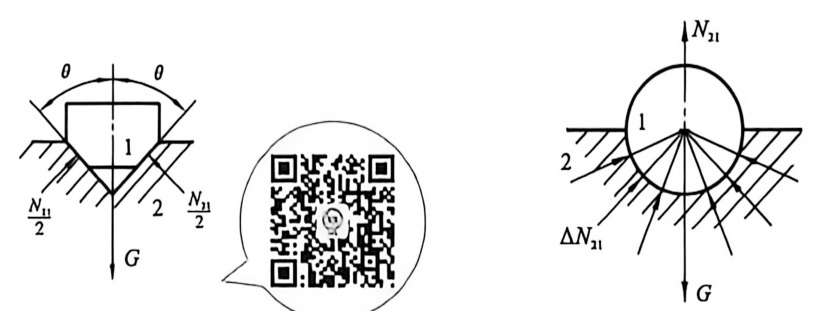

图11-6 半圆柱面摩擦
{: .figure-caption }

以下举例说明力分析方法。如图 11-7 所示，滑块 1 置于升角为 $\alpha$ 的斜面 2 上，滑块受到重力 G 的作用。求图 11-7(a) 中使滑块沿斜面匀速上升时所需的水平驱动力 F。

在求解时, 应先根据上述方法作出总反力 $F_{\mathrm{R} 21}$ 的方向, 再根据滑块的力平衡条件 $F + F_{\mathrm{R} 21} + G = 0$ , 作图可得:

$$
F = G \cdot \tan (\alpha + \varphi)\tag{11-12}
$$

若要滑块沿斜面匀速下滑，做出总反力 $F_{\mathrm{[02]}}$ 的方向后，再根据滑块的力平衡条件，如图11-7(b)可求得：

$$
F ^ {\prime} = G \cdot \tan (\alpha - \varphi)\tag{11-13}
$$

需注意, 滑块下滑过程中重力 $G$ 是驱动力, 当 $\alpha > \varphi$ 时, $F'$ 是正值, 是阻止滑块加速下滑的阻抗力; 当 $\alpha < \varphi$ 时, $F'$ 是负值, 方向与图示方向相反, 是驱动力, 其作用是促使滑块沿斜面等速下滑。

### 11.3.2 螺旋副中摩擦力的确定

螺旋副是最典型的空间运动副。如图11-8所示，1为螺杆，2为螺母，其上作用有垂直外载荷 $G$ 。假定螺母与螺杆间的作用力都集中作用在其中径 $d_{2}$ 的圆柱面上。将螺杆沿中径 $d_{2}$ 的圆柱面展开，则其螺纹将展成一个斜面，该斜面的升角 $\alpha$ 即为螺杆在中径 $d_{2}$ 上的螺纹导程角。有：

$$
\tan \alpha = l / (\pi d _ {2}) = z P / (\pi d _ {2})
$$

(11-14)

式中：l 为螺纹导程；z 为螺纹头数；P 为螺距。

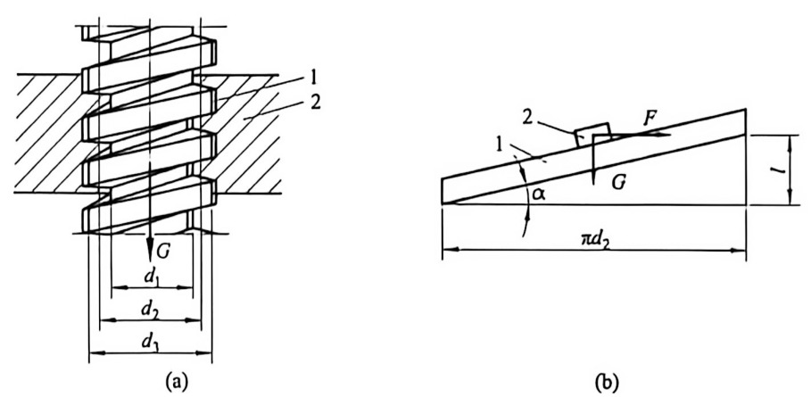

图11-8 螺旋副及其斜面移动副
{: .figure-caption }

假定螺母与螺杆间的作用力集中作用在一小段螺纹上，这样就可把对螺旋副中摩擦的研究简化为对滑块与斜面形成的移动副中摩擦的研究。

在螺母 2 上加一个力 F 拧紧螺母, 使螺母旋转并逆着力 G 的方向匀速向上运动。直接引用斜面摩擦的结论, 力 F 是螺纹拧紧时必须施加在中径处的圆周力, 为:

$$
F = G \cdot \tan (\alpha + \varphi)\tag{11-15}
$$

力 $F$ 所产生的拧紧所需力矩 $M$ 为：

$$
M = F \frac {d _ {2}}{2} = \frac {d _ {2}}{2} G \cdot \tan (\alpha + \varphi)\tag{11-16}
$$

如果螺母顺着力 G 的方向匀速向下运动, 相当于拧松螺母, 同理可求得应加于螺纹中径处的圆周力为:

$$
F ^ {\prime} = G \cdot \tan (\alpha - \varphi)\tag{11-17}
$$

故拧松螺母所需要的力矩 $M'$ 为：

$$
M ^ {\prime} = F ^ {\prime} \frac {d _ {2}}{2} = \frac {d _ {2}}{2} G \cdot \tan (\alpha - \varphi)\tag{11-18}
$$

应当注意, 根据式(11-18), 当 $\alpha > \varphi$ 时, $M'$ 是正值, 其方向与螺母旋转方向相反, 是一个阻抗力矩, 其作用是阻止螺母加速松退; 当 $\alpha < \varphi$ 时, $M'$ 是负值, 其方向与螺母旋转方向相同, 成为放松螺母所需外加的驱动力矩。

非矩形螺纹中的摩擦分析与上述类似。如图11-9所示， $\beta$ 为牙形半角。引入当量摩擦系数 $f_{\mathrm{v}} = f / \cos \beta$ 和当量摩擦角 $\varphi_{\mathrm{v}} = \arctan f_{\mathrm{v}}$ ，可直接引用矩形螺纹的结论，得到非矩形螺纹螺旋副在拧紧和拧松螺母时所需要的力矩，分别为：

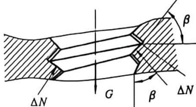

图11-9 非矩形螺纹螺旋副
{: .figure-caption }

$$
M = \frac {d _ {2}}{2} G \cdot \tan (\alpha + \varphi_ {\mathrm{v}})\tag{11-19}
$$

$$
M ^ {\prime} = \frac {d _ {2}}{2} G \cdot \tan (\alpha - \varphi_ {\mathrm{v}})\tag{11-20}
$$

### 11.3.3 转动副中摩擦力的确定

#### 1. 轴颈摩擦

如图 11-10 所示, 机械中最常见的转动副是轴和轴承构成的转动副。轴颈在轴承中回转时, 由于两者接触面间受到径向载荷的作用, 所以接触面间必然产生摩擦力来阻止回转。

如图 11-11 所示，设轴颈在轴承中匀速转动，轴颈受到驱动力矩 $M_{d}$ 、径向载荷 G 和轴承的总反力 $F_{R21}$ 作用。根据式 (11-10)，轴承对轴颈的摩擦力 $F_{21}=f_{v}G$ ，其中当量摩擦系数 $f_{v}=kf(k=1-\pi/2)$ ，对于配合紧密且未经跑合的转动副 k 取较大值如 $\pi/2$ ，而对于有较大间隙的转动副 k 则取较小值。则摩擦力 $F_{21}$ 对轴颈形成的摩擦力矩 $M_{f}$ 为：

$$
M _ {\mathrm{f}} = F _ {2 1} r = f _ {\mathrm{v}} G r\tag{11-21}
$$

式中：r 为轴颈半径，mm。

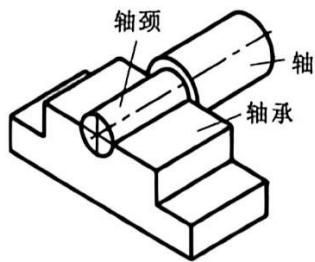

图11-10 转动副
{: .figure-caption }

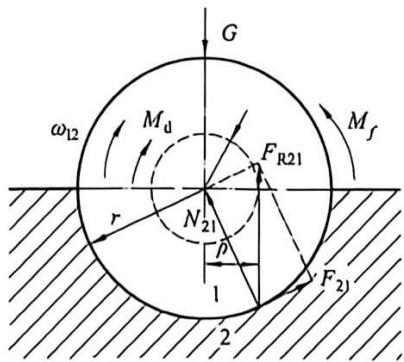

图11-11 转动副中的摩擦力
{: .figure-caption }

根据轴颈受力平衡，G 和 $F_{R21}$ 必然大小相等而方向相反，即 $F_{R21} = -G$ ，总反力 $F_{R21}$ 对轴颈中心的力矩 $M_{d} = -F_{R21}\rho = -M_{f}$ ，则有：

$$
M _ {\mathrm{f}} = F _ {2 1} r = f N _ {2 1} r = f _ {\mathrm{v}} r G = G \rho\tag{11-22}
$$

故

$$
\rho = \int_ {\mathrm{v}} r\tag{11-23}
$$

式中： $\rho$ 为总反力 $F_{R21}$ 偏离径向载荷 G 的距离。上式表明 $\rho$ 的值只取决于轴颈半径 r 和当量摩擦系数 $f_{v}$ 。对于一个具体的轴颈， $\rho$ 为一定值。以轴颈中心为圆心， $\rho$ 为半径所作的圆称为摩擦圆。利用摩擦圆可以帮助确定总反力 $F_{R21}$ 的位置。总反力 $F_{R21}$ 的方向与外载荷 G 的方向相反，相切于摩擦圆，并且由于总反力 $F_{R21}$ 的作用总是阻止相对运动，故总反力 $F_{R21}$ 对轴颈中心的力矩方向与 $\omega_{12}$ 相反。

在对机械进行受力分析时，运动副中总反力的判定准则为：

(1)由力的平衡条件, 初步确定总反力 $F_{[121]}$ 的方向(受拉或受压)。

(2)对移动副而言,总反力 $F_{\mathrm{II} 21}$ 恒切于摩擦锥;对于转动副,总反力 $F_{\mathrm{II} 21}$ 恒切于摩擦圆。

(3) 对移动副而言, 总反力 $F_{\mathrm{R} 21}$ 与 $\nu_{12}$ 的夹角为 $(90 + \varphi)$ ; 对于转动副, 摩擦力 $F_{21}$ 对轴颈形成的摩擦力矩, $M_{\mathrm{f}}$ 的方向与 $\omega_{12}$ 相反。

#### 2. 轴端摩擦

如图 11-12 所示, 轴 1 的轴端与承受轴向载荷的止推轴承 2 构成转动副。当轴端 1 在止推轴承 2 上旋转时, 在载荷 $G$ 作用下产生摩擦力矩 $M_{\mathrm{f}}$ , 取环形面积 $d_{\mathrm{s}} = 2 \pi \rho d_{\mathrm{p}}$ , 设 $d_{\mathrm{s}}$ 上压强为 $p$ , 则总摩擦力矩为:

$$
M _ {\mathrm{f}} = \int_ {r} ^ {R} \rho f p \mathrm{d} s = 2 \pi f \int_ {r} ^ {R} p \rho^ {2} \mathrm{d} \rho\tag{11-24}
$$

对于新轴端, 或很少相对转动的轴端和轴承, 可以认为它们各处接触紧密程度相同, 即压强 $p$ 为一常数, $p = G / \pi (R^2 - r^2)$ , 则式(11-24)可写为:

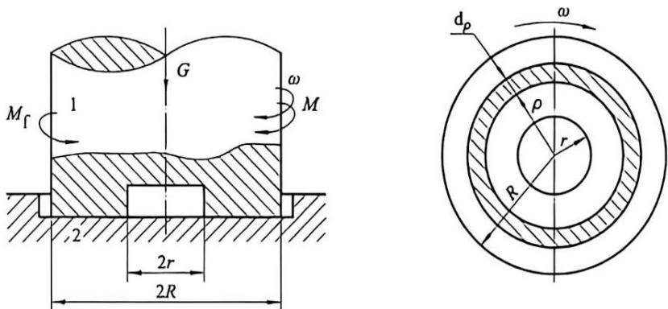

图11-12 轴端摩擦
{: .figure-caption }

$$
\begin{array}{r l} M _ {t} & = 2 \pi f p \int_ {r} ^ {R} \rho^ {2} \mathrm{d} \rho = \frac {2}{3} \pi f p (R ^ {3} - r ^ {3}) \\ & = \frac {2}{3} f G \left(\frac {R ^ {3} - r ^ {3}}{R ^ {2} - r ^ {2}}\right) \end{array}\tag{11-25}
$$

而对于经过跑合的轴端和轴承，可以认为它们接触各处的磨损基本相同，即压强 p 的分布近似符合 $p\rho=$ 常数的规律。可得：

$$
M _ {t} = 2 \pi f p \rho \int_ {r} ^ {R} p \mathrm{d} \rho = \pi f p \rho (R ^ {2} - r ^ {2})
$$

此时

$$
G = \int_ {r} ^ {R} p \mathrm{d} s = 2 \pi p \rho (R - r)
$$

所以

$$
M _ {f} = f G (R + r) / 2\tag{11-26}
$$

根据 $pp =$ 常数，可知轴端中心部分的压强高，容易压溃，所以载荷较大的轴端一般都做成中空状。

## 11.4 不考虑摩擦时机构的力分析

有了计算构件惯性力的方法，将构件所受的惯性力和其他力组成一个平衡力系，就可以用动态静力分析的方法，确定各运动副中的反力，并计算应加于整个机构上的平衡力或平衡力矩。运动副中的反力在整个机构中属于内力，因此需要将整个机构分解为若干构件组，按力平衡条件加以分析。为了达到力平衡，构件组必须满足静定条件，即构件组中未知力的数目应等于能列出的力平衡方程的数目。

### 11.4.1 构件组的静定条件

构件组能否满足静定条件与构件组中运动副的类型、数目和构件数有关。当不考虑摩擦时，如图11-13(a)所示，转动副中的反力 $R$ 通过转动副中心，大小和方向未知。如图11-13(b)中所示，移动副中反力 $R$ 与移动副导路的法线方向平行，作用点位置和大小未知。如图11-13(c)中所示，平面高副两元素间反力 $R$ 通过接触点，垂直接触点公切线，仅大小未知。所以，如果构件组中有 $p_{\mathrm{L}}$ 个低副、 $p_{\mathrm{H}}$ 个高副、 $n$ 个构件，则各运动副中的反力共有 $(2p_{\mathrm{L}} + p_{\mathrm{H}})$ 个未知，而对每个构件可以列出3个独立的力平衡方程，因此构件组的静定条件为：

$$
3 n = 2 p _ {\mathrm{L}} + p _ {\mathrm{H}}\tag{11-27}
$$

满足上式的杆组，其自由度为零，这样的杆组称为基本杆组。基本杆组都满足静定条件，因此所有的基本杆组都是静定杆组。

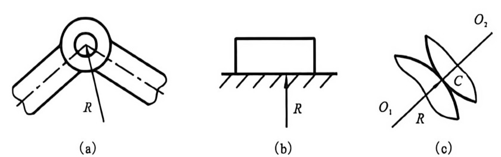

图11-13 运动副中的反力
{: .figure-caption }

### 11.4.2 用图解法作机构的动态静力分析

作机构的动态静力分析时，首先计算各构件的惯性力，然后确定机构动态静力分析中的起始构件，根据基本杆组列力平衡方程，从外力全部已知的杆组开始进行计算，逐步推算到未知平衡力作用的构件。

例 11-1 在图 11-14(a) 中的曲柄滑块机构, 已知各构件的尺寸 ${l}_{\mathrm{{AB}}}$ 、 ${l}_{\mathrm{{BC}}}$ 、 ${l}_{\mathrm{{BS2}}}$ , 曲柄每分钟转数 $n_{1}$ ，活塞质量 $m_{3}$ ，连杆质量 $m_{2}$ ，连杆对其质心 $S_{2}$ 的转动惯量 $J_{S2}$ 。试确定连杆和活塞的惯性力。

(a)

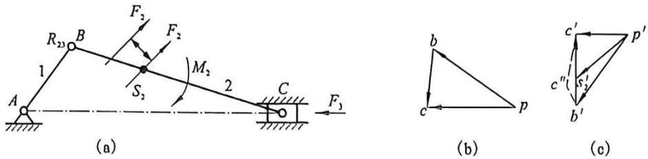

图11-14 曲柄滑块机构的惯性力
{: .figure-caption }

解：

$$
\omega_ {1} = 2 \pi n _ {1} / 6 0 = \pi n _ {1} / 3 0
$$

选定 $\mu_{v}$ 及 $\mu_{0}$ 作出速度多边形及加速度多边形，如图 11-14(b)、(c) 所示。

$a_{c}=\mu_{n}\overline{p^{\prime}c},\quad a_{s}=\mu_{n}\overline{p^{\prime}s_{2}^{\prime}},\quad a_{2}=a_{CB}^{\prime}/l_{CB}=\mu_{n}\overline{c^{\prime\prime}c^{\prime}}/l_{CB}(rad/s^{2})$ 方向逆时针；

活塞惯性力 $F_{3}=-m_{3}a_{c}$ 方向与 $\overline{p^{\prime}c^{\prime}}$ 相反；

连杆惯性力 $F_{2}=-m_{2}a_{s}$ 方向与 $\overline{p's_{2}'}$ 相反；

连杆惯性力矩 $M_{2}=-\alpha J_{s2}$ 方向与 $\alpha$ 相反。

## 11.5 考虑摩擦时机构的受力分析

掌握了运动副中的摩擦分析方法后，就不难在考虑摩擦的条件下对机构进行力分析。如下例所示。

例 11-2 如图 11-15 所示的曲柄滑块机构中, 已知构件尺寸、材料、运动副半径, 水平阻力 $F_{\mathrm{r}}$ , 求平衡力 $F_{\mathrm{b}}$ 的大小 (不计重力和惯性力)。

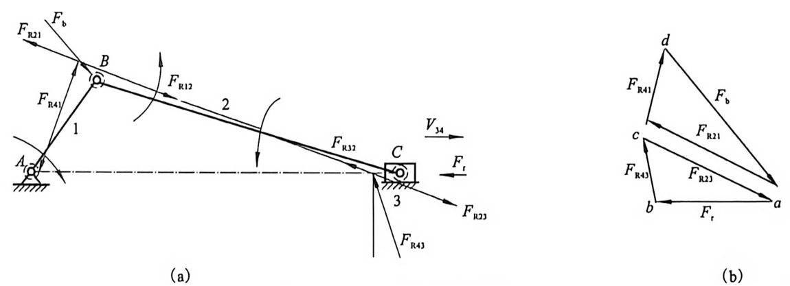

图11-15 运动副中的反力
{: .figure-caption }

(b)

解：(1)对机构进行运动分析，根据已知条件作摩擦圆。

(2)作二力杆运动副反力的作用线。

(3) 列力平衡向量方程。

从图 11-15(b) 上量得:

$$
\begin{array}{r l} & \boldsymbol {F} _ {\mathrm{R43}} + \boldsymbol {F} _ {\mathrm{R23}} + \boldsymbol {F} _ {\mathrm{r}} = 0 \\ & \boldsymbol {F} _ {\mathrm{R41}} + \boldsymbol {F} _ {\mathrm{R21}} + \boldsymbol {F} _ {\mathrm{b}} = 0 \\ & F _ {\mathrm{b}} = F _ {\mathrm{r}} (a d / a b) \end{array}
$$

## 思考题与练习题

1. 作用在机械系统上的内力和外力各有哪些？

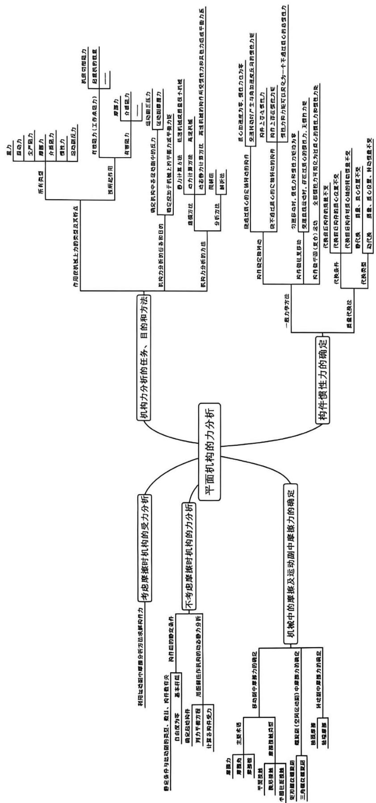

2. 什么是惯性力？什么是平衡力和平衡力矩？

3.驱动力和阻抗力有何区别？能否举例说明？

4. 进行机构力分析的任务和目的是什么？

5. 何谓机构的动态静力分析？

6. 如何确定做平面复合运动的构件的惯性力？

7. 什么是质量代换法？其目的是什么？静代换与动代换的区别是什么？

8. 转动副中轴承对轴颈的总反力始终与摩擦圆相切，对吗？

9.为什么要引入当量摩擦系数？它与实际摩擦系数有什么关系？

10. 基本杆组都是满足静定条件的吗？为什么？如果基本杆组上作用有未知外力，杆组是否还是静定的？

11. 作机构的动态静力分析的一般步骤是什么？

12. 如图 11-16 所示的机构中, 已知各构件的尺寸及机构的位置, 各转动副处的摩擦圆半径、移动副及凸轮高副处的摩擦角 $\varphi$ , 凸轮为主动件, 顺时针转动, 作用在构件 4 上的工件阻力 $Q$ 的大小。试求图示位置:

(1) 各运动副的反力；

(2)需旋加于凸轮1上的驱动力矩 $M_{1}$ 。

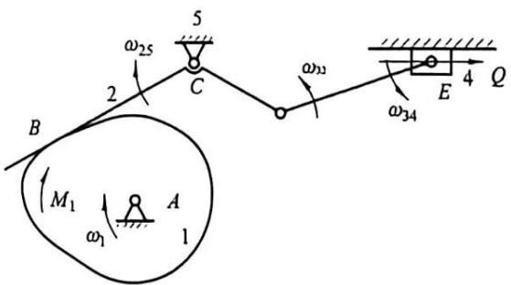

图11-16 凸轮连杆机构考虑摩擦时的力分析
{: .figure-caption }

13. 如图 11-17 所示为按 $\mu_{\mathrm{L}} = 0.001 \mathrm{~m} / \mathrm{mm}$ 画的机构运动简图, 滑块 3 为原动件, 驱动力 $P = 80 \mathrm{~N}$ 。各转动副处的摩擦圆如图所示, 滑块与导路之间的摩擦角 $\varphi = 20^{\circ}$ , 试求在图示位置, 构件 $AB$ 上所能克服的阻力矩 $M_{Q}$ 的大小和方向。

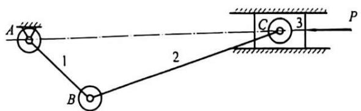

图11-17 机构运动简图
{: .figure-caption }

14. 如图 11-18 所示为按 $\mu_{1}=0.001\ m/mm$ 绘制的机构运动简图。已知圆盘 1 与杠杆 2 接触处的摩擦角 $\varphi=30^{\circ}$ ，各转动副处的摩擦圆如图所示，悬挂点 $D$ 处的摩擦忽略不计。设重物 $Q=150\ N$ ，试求出在图示位置时，需加在偏心圆盘上的驱动力矩 $M_{1}$ 的大小。

15. 如图 11-19 所示为尖底直动从动件偏心圆凸轮机构。给定: $r = 125 \mathrm{~mm}, O A = 50 \mathrm{~mm}, \varphi = 30^{\circ}, l = 100 \mathrm{~mm}, h = 80 \mathrm{~mm}$ , 工作阻力 $F_{t} = 1000 \mathrm{~N}$ , 各运动副接触面的摩擦系数 $f = 0.1$ , 凸轮轴颈的摩擦圆半径 $p = 10 \mathrm{~mm}$ 。设不计凸轮与从动轮的重力和惯性力, 试确定加于凸轮轴上的平衡力矩 (驱动力矩) $M_{0}$ 。

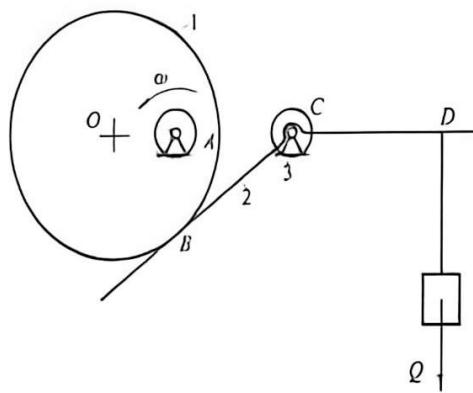

图11-18 机构运动简图
{: .figure-caption }

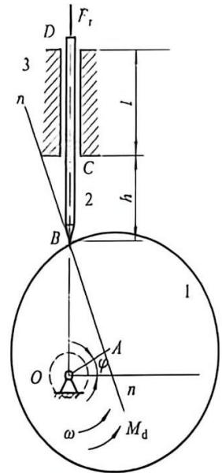

图11-19 尖底直动从动件偏心圆凸轮机构
{: .figure-caption }
