# 第12章 机械的效率和自锁

**【概述】**

◎本章主要介绍机械效率的概念及其计算、机械的自锁现象和自馈条件的确定。

◎通过本章的学习，要求：建立正确、全面的机械效率的概念；掌握简单机械的机械效率的求解方法；了解自锁的概念和自锁的条件；掌握确定自锁条件的方法。

## 12.1 机械的效率

机械效率是反映机械性能优劣的重要标志之一。效率高意味着对功的利用率高，在做功过程中损失的能量少，可以节约能源，减小成本；从更大的角度来看，提高效率也意味着碳排放的减少，对于我国实现“双碳”目标有着重要意义。

### 12.1.1 机械效率的表达形式

我们知道，作用在机械上的力可分为驱动力、生产阻力和有害阻力三种。通常把驱动力所做的功称为驱动功(输入功)，克服生产阻力所做的功称为有效功(输出功)，而克服有害阻力所做的功称为损耗功。

机械在稳定运转时期，输入功等于输出功与损耗功之和，即

$$
W _ {\mathrm{d}} = W _ {\mathrm{r}} + W _ {\mathrm{f}}\tag{12-1}
$$

式中： $W_{d}$ 、 $W_{r}$ 、 $W_{f}$ 分别为输入功、输出功、损耗功。输出功和输入功的比值称为机械效率，它反映了输入功在机械中的有效利用程度，通常以 $\eta$ 表示。

(1) 效率以功或功率的形式来表达。

根据机械效率的定义，

$$
\eta = \frac {W _ {\mathrm{r}}}{W _ {\mathrm{d}}} = \frac {W _ {\mathrm{d}} - W _ {\mathrm{f}}}{W _ {\mathrm{d}}} = 1 - \frac {W _ {\mathrm{f}}}{W _ {\mathrm{d}}}\tag{12-2}
$$

将式(12-1)和式(12-2)分别除以做功的时间, 得:

$$
P _ {\mathrm{d}} = P _ {\mathrm{r}} + P _ {\mathrm{f}}\tag{12-3}
$$

$$
\eta = \frac {P _ {\mathrm{r}}}{P _ {\mathrm{d}}} = 1 - \frac {P _ {\mathrm{f}}}{P _ {\mathrm{d}}}\tag{12-4}
$$

式中： $P_{d}$ 、 $P_{r}$ 和 $P_{f}$ 分别为输入功率、输出功率和损耗功率。

因为损耗功 $W_{1}$ 或损耗功率 $P_{1}$ 不可能为零，所以由式(12-2)和式(12-4)可知机械的效率总是小于1的。且 $W_{1}$ 或 $P_{1}$ 越大，机械的效率越低。因此在设计机械时，为了使其具有较高的机械效率，应尽量减少机械中的损耗，主要是减少摩擦损耗。

(2) 效率以力和力矩的形式来表达。

机械的效率也可用力或力矩之比值的形式来表达，图12-1为一机械传动装置示意图，设 $F$ 为驱动力， $G$ 为生产阻力， $v_{\mathrm{f}}$ 和 $v_{\mathrm{C}}$ 分别为 $F$ 和 $G$ 的作用点沿该力作用线方向的分速度，根据式(12-4)可得：

$$
\eta = \frac {P _ {\mathrm{i}}}{P _ {\mathrm{d}}} = \frac {G v _ {\mathrm{c}}}{F v _ {\mathrm{j}}}\tag{12-5}
$$

假设在该机械中不存在摩擦，则此机械称为理想机械。这时为克服同样的生产阻力 $G$ ，其所需的驱动力 $F_{0}$ 称图12-1 机械传动装置示意图

为理想驱动力，显然 $F_{0} < F_{0}$ 。对于理想机械，其效率 $\eta_0$ 应等于1，即

$$
\eta_ {0} = \frac {G v _ {\mathrm{G}}}{F _ {0} v _ {\mathrm{F}}} = 1\tag{12-6}
$$

将其代入式(12-5)，得：

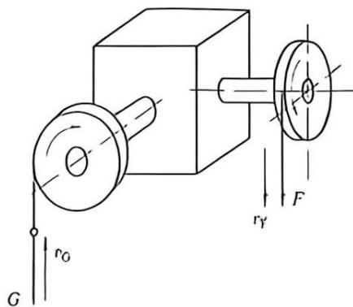

$$
\eta = \frac {F _ {0} v _ {\mathrm{F}}}{F v _ {\mathrm{F}}} = \frac {F _ {0}}{F}\tag{12-7}
$$

上式表明, 对于等速运转的机械, 其机械效率等于不计摩擦时克服生产阻力所需的理想驱动力 $F_{0}$ 与克服同样生产阻力(包括克服摩擦力)时该机械实际所需的驱动力 $F(F$ 与 $F_{0}$ 的作用方向线相同)之比。

按上述方法，还可推出以力矩形式表示的机械效率公式，即

$$
\eta = \frac {M _ {0}}{M}\tag{12-8}
$$

式中： $M_{0}$ 和 M 分别表示为了克服同样生产阻力所需的理想驱动力矩和实际驱动力矩。

从另一角度分析, 假想没有摩擦和 $F$ 不变, 可以推出:

$$
\eta = \frac {G v _ {\mathrm{G}}}{F v _ {\mathrm{F}}} = \frac {G v _ {\mathrm{G}}}{G _ {0} v _ {\mathrm{G}}} = \frac {G}{G _ {0}}\tag{12-9}
$$

上式表明，对于等速运转的机械，其机械效率等于实际生产阻力 G 与理想生产阻力之比。

同理，有下式成立：

$$
\eta = \frac {M _ {\mathrm{C}}}{M _ {\mathrm{C} _ {0}}}\tag{12-10}
$$

式中： $M_{G}$ 和 $M_{G_{0}}$ 分别表示在同样驱动力情况下，机械所能克服的实际生产阻力矩和理想生产阻力矩。

综上所述，可得：

$$
\eta = \frac {\text {理想驱动力}}{\text {实际驱动力}} = \frac {\text {理想驱动力矩}}{\text {实际驱动力矩}} = \frac {\text {实际生产阻力}}{\text {理想生产阻力}} = \frac {\text {实际生产阻力矩}}{\text {理想生产阻力矩}}\tag{12-11}
$$

例12-1 试计算斜面机构和螺旋机构的效率。

解：(1) 如图 12-2 所示，滑块沿斜面上升为正行程，其机械效率为

$$
\eta = \frac {F _ {0}}{F}
$$

式中：理想驱动力 $F_{0}=G\tan\alpha$ ，可令实际驱动力 $F=G\tan(\alpha+\varphi)$ 中的摩擦角 $\varphi=0$ 求得。

从而得到：

$$
\eta = \frac {\tan \alpha}{\tan (\alpha + \varphi)}
$$

如图 12-3 所示滑块沿斜面下滑为反行程，此时 G 为驱动力，其效率为：

$$
\eta^ {\prime} = \frac {G _ {0}}{G}
$$

式中：理想驱动力 $G_0 = \frac{F'}{\tan\alpha}$ ，可令 $G = \frac{F'}{\tan(\alpha - \varphi)}$ 中的摩擦角 $\varphi = 0$ 求得。

从而得到:

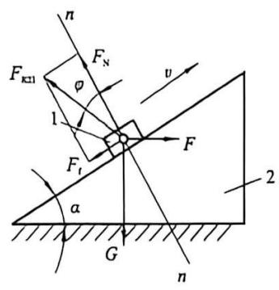

$$
\eta^ {\prime} = \frac {\tan (\alpha - \varphi)}{\tan \alpha}
$$

(a)
(b)

(2)如图12-4所示,矩形螺旋拧紧时为正行程传动,拧紧螺母所需的驱动力矩为

$$
M = \frac {F d _ {2}}{2} = \frac {G d _ {2} \tan (\alpha + \varphi)}{2}
$$

理想驱动力矩 $M_{0}=\frac{Gd_{2}\tan\alpha}{2}$ ，可令上式中摩擦角 $\varphi=0$ 求得。

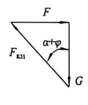

图12-2 滑块沿斜面上升示意图
{: .figure-caption }

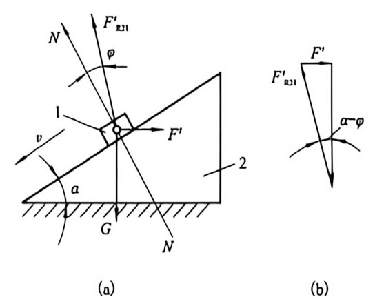

图12-3 滑块沿斜面下滑示意图
{: .figure-caption }

从而求得：

$$
\eta = \frac {\tan \alpha}{\tan (\alpha + \varphi)}
$$

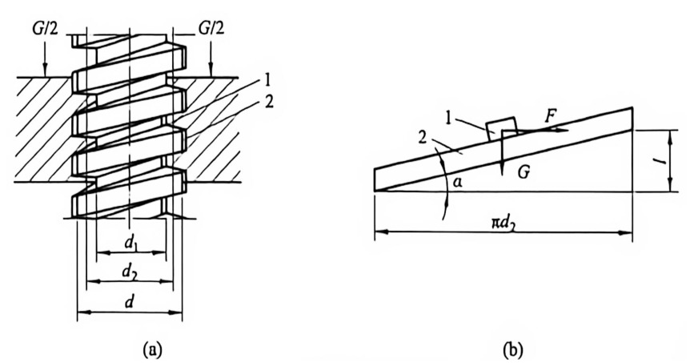

图12-4 矩形螺旋拧紧示意图
{: .figure-caption }

矩形螺旋拧松时为反行程, 若 $\alpha > \varphi$ , 则此时的实际阻力矩为:

$$
M ^ {\prime} = \frac {G d _ {2} \tan (\alpha - \varphi)}{2}
$$

理想的阻力矩 $M_0' = \frac{Gd_2\tan\alpha}{2}$ ，可令上式中的摩擦角 $\varphi = 0$ 求得。

从而可由式(12-11)求得:

$$
\eta^ {\prime} = \frac {\tan (\alpha - \varphi)}{\tan \alpha}
$$

同理, 若为非矩形螺旋, 则正行程的效率为 $\eta = \frac{\tan \alpha}{\tan (\alpha + \varphi_{\mathrm{v}})}$ , 反行程的效率为 $\eta' = \frac{\tan (\alpha - \varphi_{\mathrm{r}})}{\tan \alpha}$ 。

上述机械效率及其计算主要是指一个机构或一台机器的效率。因为各种机械大都是由一些常用机构组合而成的，而这些常用机构的效率已通过实践积累了一定的资料(表 12-1)。在已知各机构的机械效率后，就可通过计算来确定整个机器(或机组)的效率。下面分三种常见情况来进行讨论。

表 12-1 简单传动机构和运动副的效率

<table><tr><td>名称</td><td>传动形式</td><td>效率值</td><td>备注</td></tr><tr><td rowspan="5">圆柱齿轮传动</td><td>6~7级精度齿轮传动</td><td>0.98~0.99</td><td>良好跑合、稀油润滑</td></tr><tr><td>8级精度齿轮传动</td><td>0.97</td><td>稀油润滑</td></tr><tr><td>9级精度齿轮传动</td><td>0.96</td><td>稀油润滑</td></tr><tr><td>切制齿、开式齿轮传动</td><td>0.94~0.96</td><td>干油润滑</td></tr><tr><td>铸造齿、开式齿轮传动</td><td>0.90~0.93</td><td></td></tr><tr><td rowspan="4">圆锥齿轮传动</td><td>6~7级精度齿轮传动</td><td>0.97~0.98</td><td>良好跑合、稀油润滑</td></tr><tr><td>8级精度齿轮传动</td><td>0.94~0.97</td><td>稀油润滑</td></tr><tr><td>切制齿、开式齿轮传动</td><td>0.92~0.95</td><td>干油润滑</td></tr><tr><td>铸造齿、开式齿轮传动</td><td>0.88~0.92</td><td></td></tr><tr><td rowspan="5">蜗杆传动</td><td>自锁蜗杆</td><td>0.40~0.45</td><td rowspan="5">润滑良好</td></tr><tr><td>单头蜗杆</td><td>0.70~0.75</td></tr><tr><td>双头蜗杆</td><td>0.75~0.82</td></tr><tr><td>三头和四头蜗杆</td><td>0.80~0.92</td></tr><tr><td>圆弧面蜗杆</td><td>0.85~0.95</td></tr></table>

续表12-1

<table><tr><td>名称</td><td>传动形式</td><td>效率值</td><td>备注</td></tr><tr><td>带传动</td><td>平带传动V带传动</td><td>0.90-0.980.94-0.96</td><td></td></tr><tr><td>链传动</td><td>套筒滚子链无声链</td><td>0.960.97</td><td>润滑良好</td></tr><tr><td>摩擦轮传动</td><td>平摩擦轮传动槽摩擦轮传动</td><td>0.85-0.920.88-0.90</td><td></td></tr><tr><td>滑动轴承</td><td></td><td>0.940.970.99</td><td>润滑不良润滑正常液体润滑</td></tr><tr><td>滚动轴承</td><td>球轴承滚子轴承</td><td>0.990.98</td><td>稀油润滑稀油润滑</td></tr><tr><td>螺旋传动</td><td>滑动螺旋滚动螺旋</td><td>0.30-0.800.85-0.95</td><td></td></tr></table>

### 12.1.2 机械系统的机械效率

机构或机器连接组合的方式一般有串联、并联和混联三种，故机械系统的机械效率也有三种不同的计算方法。

(1) 串联。

如图 12-5 所示为由 k 台机器串联组成的机械系统。设系统的输入功率为 $P_{d}$ ，各机器的效率分别为 $\eta_{1}, \eta_{2}, \cdots, \eta_{k}, P_{k}$ 为系统的输出功率，这种串联机组功率传递的特点是前一机器的输出功率为后一机器的输入功率。则系统的总效率 $\eta$ 为：

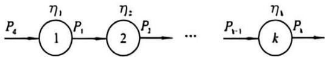

图12-5 串联机器示意图
{: .figure-caption }

$$
\eta = \frac {P _ {\mathrm{k}}}{P _ {\mathrm{d}}} = \frac {P _ {1} P _ {2}}{P _ {\mathrm{d}} P _ {1}} \dots \frac {P _ {\mathrm{k}}}{P _ {\mathrm{k-1}}} = \eta_ {1} \eta_ {2} \dots \eta_ {\mathrm{k}}\tag{12-12}
$$

此式表明，串联系统的总效率等于组成该系统的各个机器的效率的连乘积。由于 $\eta_{1}, \eta_{2}, \cdots, \eta_{k}$ 均小于 1，故串联机器的数目越多，机械效率也越低。

(2) 并联。

如图 12-6 所示为由 k 台机器互相并联组成的机械系统。设各机器的效率分别为 $\eta_{1}, \eta_{2}, \cdots, \eta_{k}$ ，输入功率分别为 $P_{1}, P_{2}, \cdots, P_{k}$ ，则各台机器的输出功率分别为

$P_{1}\eta_{1}, P_{2}\eta_{2}, \cdots, P_{k}\eta_{k}$ 。这种并联机组的特点是，机组的输入功率为各机器的输入功率之和，而其输出功率为各机器的输出功率之和。于是，并联机组的机械效率应为：

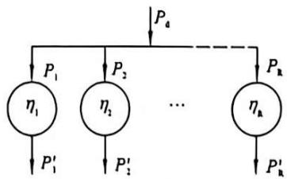

图12-6 并联机器示意图
{: .figure-caption }

$$
\eta = \frac {\sum P _ {\mathrm{ri}}}{\sum P _ {\mathrm{di}}} = \frac {P _ {1} \eta_ {1} + P _ {2} \eta_ {2} + \cdots + P _ {k} \eta_ {k}}{P _ {1} + P _ {2} + \cdots + P _ {k}}\tag{12-13}
$$

上式表明，并联系统的总效率 $\eta$ 不仅与各机器的效率有关，而且与各机器所传递的功率有关。设 $\eta_{max}$ 和 $\eta_{min}$ 为各个机器的效率中的最大值和最小值，则 $\eta_{min}<\eta<\eta_{max}$ 。

若各台机器的输入功率均相等，即 $P_{1}=P_{2}=\cdots=P_{k}$ ，则

$$
\begin{array}{r l} \eta & = \frac {P _ {1} \eta_ {1} + P _ {2} \eta_ {2} + \cdots + P _ {k} \eta_ {k}}{P _ {1} + P _ {2} + \cdots + P _ {k}} \\ & = \frac {\left(\eta_ {1} + \eta_ {2} + \cdots + \eta_ {k}\right) P _ {1}}{k P _ {1}} \\ & = \left(\eta_ {1} + \eta_ {2} + \dots + \eta_ {k}\right) / k \end{array}\tag{12-14}
$$

上式表明，当并联系统中各台机器的输入功率均相等时，其总效率等于各台机器效率的平均值。

若各台机器的效率均相等，即 $\eta_{1}=\eta_{2}=\cdots=\eta_{k}$ ，则

$$
\begin{array}{r l} \eta & = \frac {P _ {1} \eta_ {1} + P _ {2} \eta_ {2} + \cdots + P _ {k} \eta_ {k}}{P _ {1} + P _ {2} + \cdots + P _ {k}} \\ & = \frac {\eta_ {1} (P _ {1} + P _ {2} + \cdots + P _ {k})}{P _ {1} + P _ {2} + \cdots + P _ {k}} \\ & = \eta_ {1} (= \eta_ {2} = \dots = \eta_ {k}) \end{array}\tag{12-15}
$$

上式表明，当各台机器的效率均相等时，并联机械系统的总效率等于任一台机器的效率。

(3) 混联。

如图 12-7 所示为兼有串联和并联的混联式机械系统, 其总效率的求法根据其具体组合方式而定。可先将输入功至输出功的路线弄清, 然后分别按各部分的连接方式, 参照式 (12-12) 和式 (12-13) 推导出总效率的计算公式。如图 12-7 所示, 若系统串联部分的效率为 $\eta'$ , 并联部分的效率为 $\eta''$ , 则系统的总效率应为:

$$
\eta = \eta^ {\prime} \eta^ {\prime \prime}\tag{12-16}
$$

## 12.2 提高机械效率的途径

机械运转过程中影响其效率的主要原因为机械中的损耗，而损耗大多是由摩擦引起的。因此，要提高机械的效率就必须采取措施减小机械中的摩擦，通常可以从三个方面加以考虑，即设计、制造和使用维护。而设计方面主要可以采取以下措施：

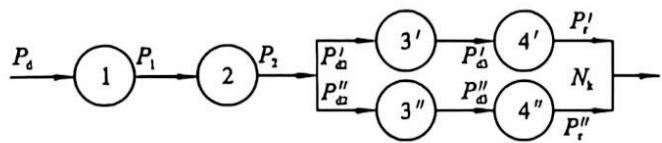

图12-7 混联机器示意图
{: .figure-caption }

(1)使机械系统尽量简化, 尽量采用最简单的机构来满足工作要求, 使功率传递通过的运动副数目尽可能地少。

(2)选择合适的运动副形式。如转动副易保证运动副元素的配合精度, 效率高; 而移动

副不易保证配合精度，效率相对较低而且容易发生自锁或楔紧。

(3) 在满足强度、刚度等要求的情况下, 不要过多增大构件尺寸, 如轴颈尺寸增加时会使该轴颈的摩擦力矩增加, 机械容易发生自锁。

(4) 设法减少运动副中的摩擦。如在传递动力的场合尽量选用矩形螺纹或牙形半角小的梯形或锯齿形螺纹；用平面摩擦代替槽面摩擦；用滚动摩擦代替滑动摩擦。选用适当的润滑剂及润滑装置进行润滑，改善润滑能有效提高发动机的机械效率。合理选用运动副元素的材料等。

(5) 改善机械的平衡, 从而减少机械中因惯性力所引起的动压力, 可以提高机械的效率。

## 12.3 摩擦在机械中的应用

机械中的摩擦虽然对机械的工作有许多不利的影响，但在某些方面也有其有利的一面。工程实际中不少机械正是利用摩擦来工作的。常见的应用摩擦的机构有以下几种。

(1) 摩擦带传动机构。

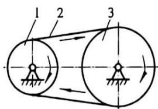

1—主动轮；2—环形带；3—从动轮。

带传动可分为摩擦传动型和啮合传动型两大类。其中摩擦传动型(图 12-8)由主动轮 1、从动轮 3 和张图12-8 带传动机构运动示意图

紧在两轮上的环形带2所组成。它利用带与带轮之间的摩擦力传递运动和动力。

(2) 摩擦离合器。

离合器和联轴器一样是机械传动中常用的部件，主要用来连接轴与轴（或连接轴与其他回转零件），以传递运动与转矩。其种类很多，摩擦离合器是其中一种，最简单的是单片摩擦离合器，如图 12-9(a) 所示。在传递大扭矩时可采用多盘摩擦离合器，如图 12-9(b) 所示。

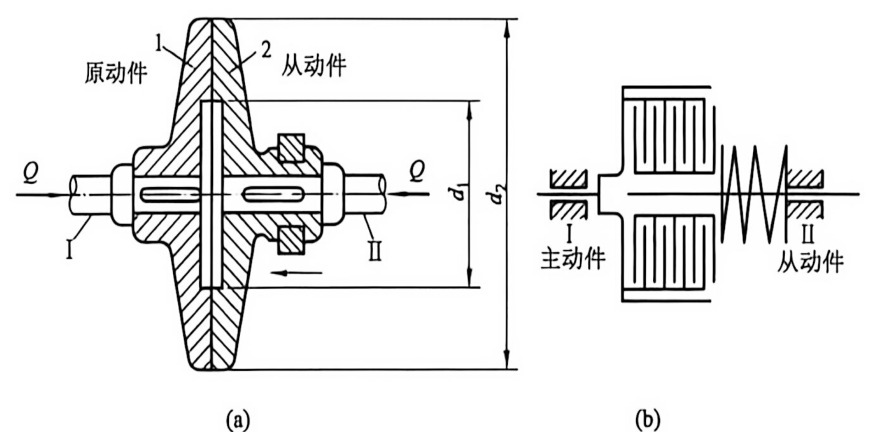

图12-9 摩擦离合器
{: .figure-caption }

(b)

(3) 摩擦制动器。

制动器是利用摩擦副中产生的摩擦力矩来实现制动作用，或者利用制动力与重力的平衡，使机器运转速度保持恒定。摩擦制动器广泛应用于机械制动中，常用的有带式（图12-10）和块式（图12-11）制动器。

(4) 摩擦连接。

在日常生活及工程实际中，螺纹连接应用非常普遍。为了保证其可靠性，通常采用较小的升角，且使升角小于摩擦角，而且还采用三角螺纹增大摩擦力，提高自锁性。

摩擦在生产实际中的应用还有很多，如偏心夹具（图12-12）、夹钳式握持器（图12-13）、斜面压榨机（图12-14）等。

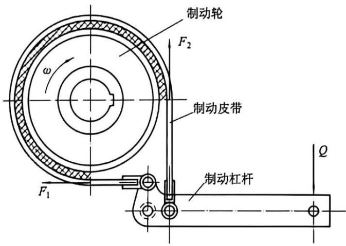

图12-10 带式制动器
{: .figure-caption }

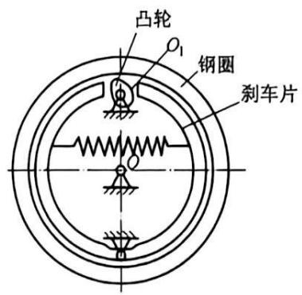

图12-11 块式制动器
{: .figure-caption }

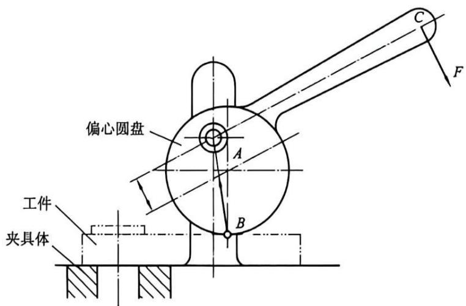

图12-12 偏心夹具
{: .figure-caption }

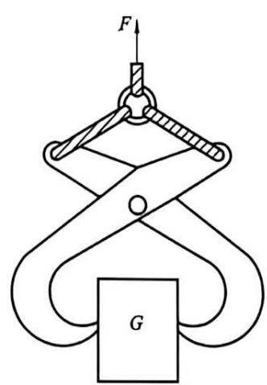

图12-13 夹钳式握持器
{: .figure-caption }

## 12.4 机械的自锁

有些机械，就其结构情况分析，只要加上足够大的驱动力，按常理就应该能够沿着有效驱动力作用的方向运动，而实际上由于摩擦的存在，却会出现无论这个驱动力如何增大，也无法使它运动的现

象，这种现象称为机械的自锁。

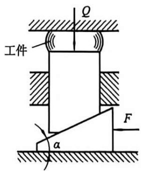

图12-14 斜面压榨机
{: .figure-caption }

自锁现象在机械工程中具有十分重要的意义。一方面，当设计机械时，为使机械能够实现预期的运动，必须避免机械在所需的运动方向发生自锁；另一方面，有些机械的工作又需要具有自锁的特性。例如，图12-15所示的手摇螺旋千斤顶，转动手柄6将物体4举起后，应保证无论物体4的质量多大，都不能驱动螺母5反转，致使物体4自行降落下来。即要求该千斤顶在物体4的重力作用下，必须具有自锁性。自锁的实例在机械工程中有很多，螺纹连接靠的就是自锁性。下面就来讨论自锁的问题。

(1) 移动副的自锁。

如图 12-16 所示的移动副中，设 F 为作用于滑块 1 上的驱动力，它与接触面的法线 nn 间的夹角为 $\beta$ （称为传动角），而摩擦角为 $\varphi$ 。将力 F 分解为沿接触面切向的两个分力 $F_{1}$ 、 $F_{2}$ 。 $F_{1}=F\sin\beta=F_{2}\tan\beta$ 是推动滑块 1 运动的有效分力；而 $F_{2}$ 只能使滑块压向平台 2，其所能引起的最大摩擦力为 $F_{fmn}=F_{0}\tan\varphi$ ，所以，当 $\beta\leqslant\varphi$ 时，有

$$
F _ {1} \leqslant F _ {\text { 国   网 }}
$$

即在 $\beta \leqslant \varphi$ 的情况下，不管驱动力 F 如何增大（方向保持不变），驱动力的有效分力 $F_{t}$ 总小于驱动力本身所能引起的最大摩擦力，因而总不能推动滑块 1 运动，这就是自锁现象。

因此，在移动副中，如果作用于滑块上的驱动力作用在其摩擦角之内（即 $\beta \leqslant \varphi$ ）则发生自锁，这就是移动副发生自锁的条件。

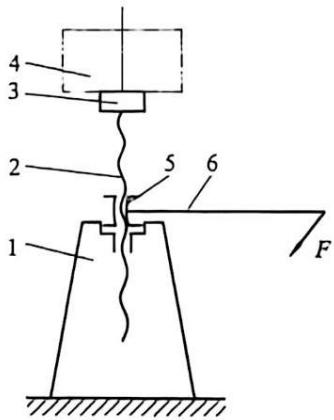

图12-15 手摇螺旋千斤顶
{: .figure-caption }

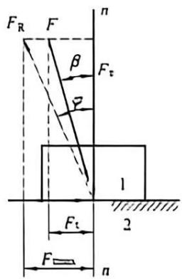

图12-16 移动副示意图
{: .figure-caption }

(2)转动副的自锁。

如图 12-17 所示的转动副中，设作用在轴颈上的外载荷为一单力 F，当力 F 的作用线在摩擦圆之内时（即 $a \leqslant \rho$ ），因它对轴颈中心的力矩 $M_{d}$ 始终小于它本身引起的最大摩擦力矩 $M_{f} = F_{R} \rho = F \rho$ ，所以力 F 任意增大（力臂 a 保持不变），都不能驱使轴颈转动，也即产生了自锁。

因此，转动副发生自锁的条件为：作用在轴颈上的驱动力为单力 F，且作用于摩擦圆之内，即 $a \leqslant \rho$ 。

上面是单个运动副发生自锁的条件。这种方法用于只有一个驱动力，且几何关系比较简单的情况。对于一台机械来说，某一运动副自锁，则该机械也会发生

自锁。

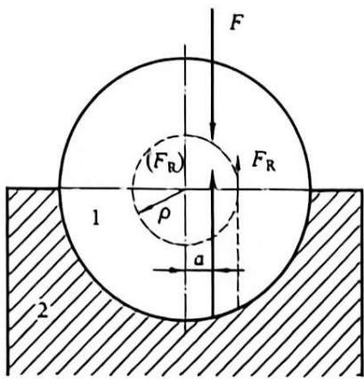

图12-17 转动副示意图
{: .figure-caption }

(3)对于受力状态或几何关系较复杂的机构, 还可根据如下条件来判断机械是否发生自锁。

由于当机械自锁时，机械已不能运动，所以这时它所能克服的生产阻力 $G \leqslant 0$ 。故可利用当驱动力任意增大时生产阻力 $G \leqslant 0$ 是否成立来判断机械是否自锁。

此外，当机械发生自锁时，驱动力所做的功 $W_{d}$ 总不足以克服其所能引起的最大损失功 $W_{f}$ ，根据式(12-2)可知，这时 $\eta \leqslant 0$ 。所以，当驱动力任意增大恒有 $\eta \leqslant 0$ 时，机械将发生自锁。但注意此时 $\eta$ 已没有通常效率的意义。

机械通常可以有正行程和反行程，它们的机械效率一般并不相等。在设计机械时，应使其正行程的机械效率大于零，而反行程的效率则根据使用场合既可使其大于零也可使其小于零。反行程效率小于零的机械在反行程中会发生自锁，因而可以防止机械自发倒转或松脱。在反行程能自锁的机械，称为自锁机械，它常用于各种夹具、螺栓连接、楔连接、起重装置和压榨机等机械上。但具有自锁性的机械在正行程中效率一般都很低，因此在传递动力时，只宜用于传递功率较小的场合。对于传递功率较大的机械，常采用其他装置来防止其倒转或松脱，以不致影响其正行程的机械效率。

例 12-2 图 12-18(a) 所示的斜面压榨机中, 滑块 2 上作用一主动力 F 推动滑块 1 并夹紧工件 4。设工件所需的夹紧力为 G, 各接触面的摩擦系数均为 f。若希望此机构在 F 撤去后不致使工件自动松脱, 试分析其自锁条件。

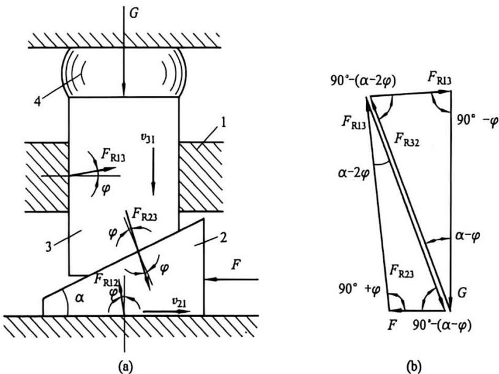

图12-18 斜面压榨机受力分析
{: .figure-caption }

解：先求出当 G 为驱动力时，该机械的阻抗力 F。

根据各接触面间的相对运动, 作出两滑块所受的总反力, 如图 12-18(a) 所示。

分别取滑块 2 和 3 为分离体，列出力平衡方程式 $F_{R32} + F_{R12} + F = 0$ 及 $F_{R13} + F_{R23} + G = 0$ ，作出力多边形，如图 12-18(b) 所示。由正弦定律可得：

$$
F = F _ {\mathrm{R32}} \sin (\alpha - 2 \varphi) / \cos \varphi\tag{a}
$$

$$
G = F _ {\mathrm{R23}} \cos (\alpha - 2 \varphi) / \cos \varphi\tag{b}
$$

又因 $F_{\mathrm{R32}} = F_{\mathrm{R23}}$ ，故可得 $F = G\tan (\alpha -2\varphi)$ ，令 $F\leqslant 0$ ，得：

$$
\begin{array}{c} \tan (\alpha - 2 \varphi) \leqslant 0 \\ \text {即} \quad \alpha \leqslant 2 \varphi \end{array}
$$

此即为斜面压榨机反行程(G为驱动力时)的自锁条件。

例 12-3 在如图 12-19 所示的偏心夹具中, 1 为夹具体, 2 为工件, 3 为偏心圆盘。当用力 F 压下手柄时, 即能将工件夹紧, 以便对工件加工。为了当作用在手柄上的力 F 去掉后,夹具不致自动松开, 则需要该夹具具有自锁性。图中, A 为偏心圆盘的几何中心, 偏心圆盘的外径为 D, 偏心距为 e, 偏心圆盘轴颈的摩擦圆半径为 $\rho$ 。试求该夹具体的自锁条件。

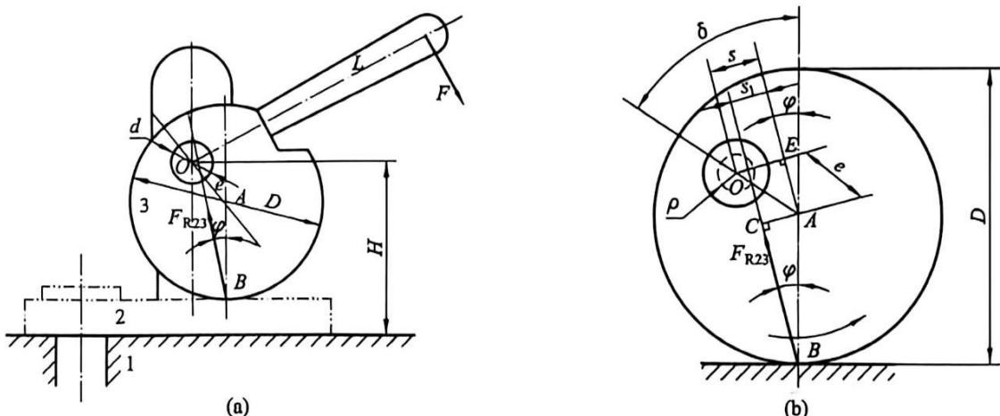

图12-19 偏心夹具
{: .figure-caption }

解：为使图形清晰，将偏心圆盘放大，如图12-19(b)所示，图中虚线小圆为轴颈的摩擦圆。当作用在手柄上的力去掉后，偏心盘有沿逆时钟方向转动放松的趋势，由此可定出总反力 $F_{R23}$ 的方位，如图所示。分别过点O、A作 $F_{R23}$ 的平行线。要偏心夹具反行程自锁，总反力 $F_{R23}$ 应穿过摩擦圆，即应满足：

$$
s - s _ {1} \leqslant \rho\tag{a}
$$

由直角三角形 $ABC$ 及 $\triangle OAE$ 可求得:

$$
s _ {1} = \overline {{{A C}}} = (D \sin \varphi) / 2\tag{b}
$$

$$
s = \overline {{{O E}}} = e \sin (\delta - \varphi)\tag{c}
$$

式中： $\delta$ 为楔紧角，将式(b)、式(c)代入式(a)，可得：

$$
e \sin (\delta - \varphi) - (D \sin \varphi) / 2 \leqslant \rho\tag{12-17}
$$

这就是偏心夹具的自锁条件。

例 12-4 如图 12-15 所示螺旋千斤顶在物体 4 的重力作用下, 应具有自锁性, 试求其自锁条件。

解: 螺旋千斤顶在物体 4 的重力作用下运动时的阻抗力矩 $M'$ 可按例 12-1 计算, 即

$$
M ^ {\prime} = \frac {G d _ {2} \tan (\alpha - \varphi)}{2}
$$

令 $M' \leqslant 0$ (驱动力 G 为任意值)，求得：

$\tan(\alpha-\varphi_{v})\leqslant0$ 即 $\alpha\leqslant\varphi_{v}$

此即螺旋千斤顶在物体 4 的重力作用下的自锁条件。

(4) 自锁在其他方面的应用。

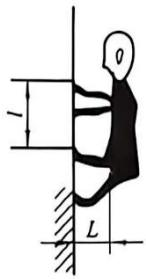

自锁现象在其他方面也有广泛应用，如图12-20所示杂技演员爬杆时为了防止下滑，即需要满足自锁条件 $l < 2fL$ ，为此杂技演员的手脚应放得很近以使 $l$ 减小，而身体重心尽量外移，以增大 $L$ ，从而避免下滑。

1<2∫L

必须注意, 机械是否自锁, 需要通过求解自锁条件来判断。一个自锁机构, 只是对于满足自锁条件的驱动力在一

图12-20 杂技演员爬杆示意图
{: .figure-caption }

定运动方向上的自锁；而对于其他外力，或在其他运动方向上则不一定自锁。因此，谈到自锁时，一定要说明是对哪个力，在哪个方向上自锁。

在设计机械时，由于未能很好地考虑机械的自锁问题而失败的事例时有发生。

本章思维导图

## 思考题与练习题

1. 何谓机构的动态静力分析？用解析法对机构进行动态静力分析的步骤如何？

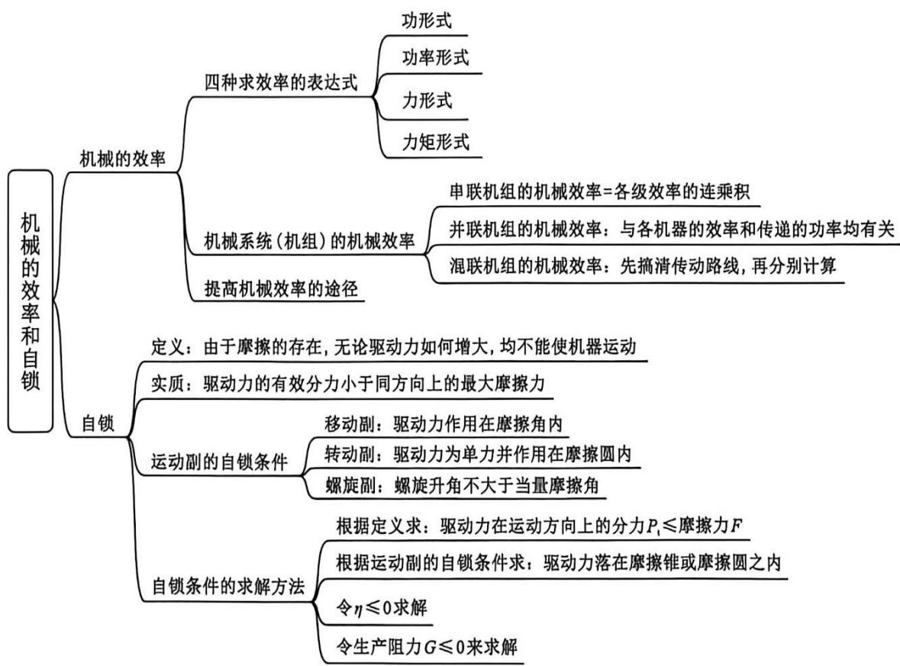

2. 什么是当量摩擦因数？引入当量摩擦因数的目的是什么？

3. 什么是摩擦角？如何利用摩擦角来确定移动副中总反力作用线的位置？

4.为什么要研究机械中的摩擦？机械中的摩擦是否一定是有害的？

5. 判断下述各小题的正确性。

(1) 自锁机械根本不能运动。 （）

(2)在转动副中,无论什么情况,总反力始终应与摩擦圆相切。 (   )

(3)机械中采用环形轴端支承的原因是避免轴端中心压强过大。 （）

(4)对于反行程自锁的机构，其正行程的效率一般小于50%。 （）

6. 机械正反行程的效率是否相同？其自锁条件是否相同？原因何在？

7. 当作用在转动副中轴颈上的外力为一单力, 并分别作用在其摩擦圆之内、之外或相切时, 轴颈将做何种运动? 当作用在转动副中轴颈上的外力为一力偶矩时, 也会发生自锁吗?

8. 眼镜用小螺钉(M1×0.25)与其他尺寸螺钉(M1×1.25)相比, 为什么更容易发生自动松脱现象(螺纹中径=螺纹大径-0.65×螺距)?

9. 通过对串联机组及并联机组的效率计算，对设计机械传动系统有何启示？

10. 对于图 12-21 所示四杆机构, 设 $P$ 为主动力, $Q$ 为工作阻力, 各移动副处的摩擦角为 $\varphi$ , 各活动构件的质量忽略不计。

(1)试建立 $P$ 与 $Q$ 之间的关系；

(2) 求正、反行程的效率;

(3) 正行程不自锁而反行程自锁时 $\alpha$ 、 $\beta$ 的取值范围；

(4)如果 $\alpha < 2\beta$ 且 $\beta > 90^{\circ} - 2\varphi$ , 则正行程是否自锁? 为什么?

11. 如图 12-22 所示螺旋顶升机构中, 转动手轮 $H$ , 通过方牙螺杆 2 使楔块 3 向左移动, 提升滑块 4 上的重物 $Q$ 。已知: $Q = 20 \mathrm{kN}$ , 楔块倾角 $\alpha = 15^{\circ}$ , 各接触面间的摩擦系数 $f = 0.15$ , 方牙螺杆 2 的螺距为 $6 \mathrm{~mm}$ , 是双头螺杆, 螺纹中径 $d_{2} = 25 \mathrm{~mm}$ , 不计凸缘处 (螺杆 2 与楔块 3 之间) 摩擦, 求提升重物 $Q$ 时, 需要加在手轮上的力矩和该机构的效率。

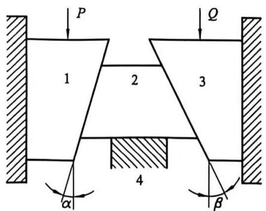

图12-21 四杆机构
{: .figure-caption }

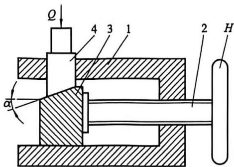

图12-2 螺旋顶升机构
{: .figure-caption }

12. 如图 12-23 所示为带式输送机, 由电动机 1 经平带传动及一个两级齿轮减速器带动输送带 8。设已知输送带 8 所需的曳引力 $F$ 为 $5500 \mathrm{~N}$ , 运送速度 $v$ 为 $1.2 \mathrm{~m} / \mathrm{s}$ 。平带传动 (包括轴承) 的效率 $\eta_{1} = 0.95$ , 每对齿轮 (包括其轴承) 的效率 $\eta_{2} = 0.97$ , 输送带 8 的效率 $\eta_{3} = 0.92$ (包括其支承和联轴器)。试求该机组总效率和所需电动机功率。

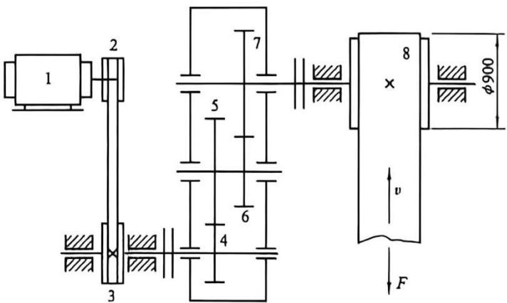

图12-23 带式输送机
{: .figure-caption }

13. 如图 12-24 所示传动装置, 电动机通过带传动及圆锥、圆柱齿轮传动带动工作机 $A$ 和 $B$ 。设每对齿轮的效率 $\eta_{1} = 0.97$ (包括轴承的效率在内), 带传动的效率 $\eta_{2} = 0.92$ , 工作机 $A 、 B$ 的功率分别为 $P_{\mathrm{A}} = 5 \mathrm{kW} 、 P_{\mathrm{B}} = 1 \mathrm{kW}$ , 效率分别为 $\eta_{\mathrm{A}} = 0.8 、 \eta_{\mathrm{B}} = 0.5$ , 试求电动机所需的功率。

14. 如图 12-25 所示为一钢链抓取器，求其能抓取钢锭的自锁条件。设抓取器与钢锭之间的摩擦系数为 $f$ ，忽略各转动副之间的摩擦及抓取器各构件的自重。

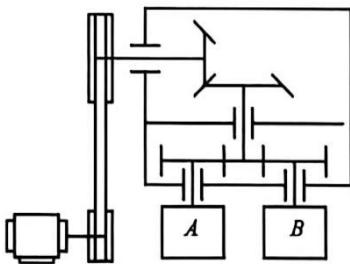

图12-24 传动装置
{: .figure-caption }

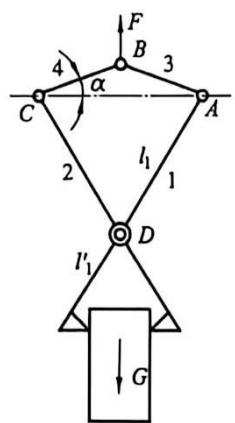

图12-25 钢链抓取器
{: .figure-caption }

15. 如图 12-26 所示的矩形螺纹千斤顶, 已知螺纹的大径 $d = {24}\mathrm{\;{mm}}$ ,小径 ${d}_{1} = {20}\mathrm{\;{mm}}$ ,导程 $l = 4\mathrm{\;{mm}}$ ；顶头环形摩擦面的外径 $D = {50}\mathrm{\;{mm}}$ ,内径 ${D}_{1} = {42}\mathrm{\;{mm}}$ ,手柄长度 $L = {300}\mathrm{\;{mm}}$ ,所有摩擦面的摩擦系数均为 $f = {0.1}$ 。试求：

(1)该千斤顶的效率；

(2) 若作用在手柄上的驱动力 $F_{d}=100\ N$ ，求千斤顶所能举起的重量 Q。

16. 如图 12-27 所示的偏心夹具中, 设已知夹具中心高 $H = 100 \mathrm{~mm}$ , 偏心圆盘外径 $D = 120 \mathrm{~mm}$ , 偏心距 $e = 15 \mathrm{~mm}$ , 轴颈摩擦圆半径 $\rho = 5 \mathrm{~mm}$ , 摩擦系数 $f = 0.15$ 。求所能夹持的工件的最大、最小厚度 $h_{\max} 、 h_{\min}$ 。

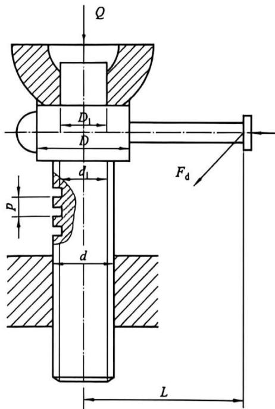

图12-26 矩形螺纹千斤顶
{: .figure-caption }

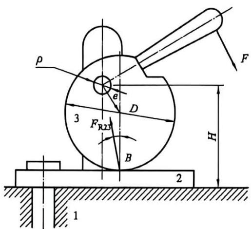

图12-27 偏心夹具
{: .figure-caption }
