# 第13章 机械的平衡

**【概述】**

◎本章主要介绍机械平衡的目的及内容，重点是刚性转子静、动平衡的原理和计算方法。

◎学习本章的主要目的是使学生了解机械运转时构件惯性力造成的危害，以及消除、减小这种危害的措施和方法；掌握刚性转子静、动平衡的原理和计算方法。

## 13.1 机械平衡的目的及内容

### 13.1.1 机械平衡的目的

机械中绕某一固定轴线回转的构件称为转子。当转子质心与回转轴的距离为 e 时，离心惯性力为 $F = m e \omega^{2}$ 。

如图 13-1 所示一转子，已知质量为 G=10 N，重心与回转轴线的距离为 e=1 mm，转速为 n=3000 r/min，可求出离心惯性力 $F=ma=Ge\omega^{2}/g=10\times10^{-3}(2\pi\times3000/60)^{2}/9.8=100\ N$ ，为自重的 10 倍。转子支承处的动反力也是静止状态时的 10 倍。而若转速增加一倍，离心力和动反力都增大到 4 倍。由此可知，不平衡

所产生的惯性力对机械运转有很大的影响，尤其在高速机械及精密机械中，必须高度重视。

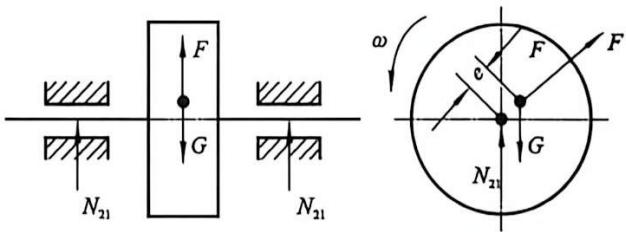

图13-1 不平衡转子的离心惯性力
{: .figure-caption }

机械在工作过程中，由于这些运动构件的惯性力大小和方向都是变化的，必将对运动副产生动载荷，从而导致一系列不良后果：①增加运动副的摩擦，降低机械的使用寿命；②产生有害的振动，使机械的工作性能恶化；③降低机械效率和使用寿命。

为了完全地或部分地消除惯性力的不良影响，必须研究机械中惯性力的变化规律，设法将构件的不平衡惯性力加以消除或减小，这就是机械平衡的目的。我们通常在机构的运动设计完成之后进行平衡这种动力学设计。

需要指出的是, 机械的不平衡同样具有两面性, 一方面, 多数机械需要减少不平衡问题, 另一方面, 有一些机械却是利用构件产生的不平衡惯性力所引起的振动来工作的, 如按摩机、振实机、振动打桩机、蛙式打夯机等。对于这类机械, 则是如何合理利用不平衡惯性力的问题。

### 13.1.2 机械平衡的内容

机械平衡的目的

在机械中，由于各构件的结构及运动形式不同，其所产生的惯性力和平衡方法也不同。据此，机械的平衡问题可分为以下两类。

#### 1. 转子的平衡

当转子的质量分布不均匀，或制造误差造成质心与回转轴线不重合时，在转动过程中，将产生离心惯性力。这类构件的惯性力可以用在构件上增加或除去部分质量的方法得以平衡。这类转子又分为刚性转子和挠性转子两种情况。

(1) 刚性转子的平衡。

在机械中，当转子的转速较低(低于一阶临界转速)、共振转速较高而且其刚性较好，运转过程中轴线产生弹性变形很小可忽略不计时，这类转子称为刚性转子。刚性转子的平衡原理基于理论力学中的力系平衡理论。如果只要求其惯性力达到平衡，则称之为转子的静平衡；如果不仅要求其惯性力达到平衡，而且还要求惯性力引起的力矩也达到平衡，则称之为转子的动平衡。刚性转子的平衡原理和方法是本章要介绍的主要内容。

数值等于转子的固有频率——临界转速(critical speed)。

转动件转子在运转中都会发生振动, 转子的振幅随转速的增大而增大, 到某一转速时振幅达到最大值(也就是平常所说的共振), 超过这一转速后振幅随转速的增大逐渐减小, 且稳定于某一范围内。这一转子振幅最大的转速称为转子的临界转速。这个转速等于转子的固有频率, 当转速继续增大, 接近 2 倍固有频率时振幅又会增大, 当转速等于 2 倍固有频率时称为二阶(级)临界转速, 依此类推有三阶、四阶等。

为保证系统正常工作或避免系统因振动被破坏，转动系统的转子工作转速应尽可能避开临界转速，若无法避开，则应采取特殊防振措施。

(2)挠性转子的平衡。

在机械中还有一类转子，如航空涡轮发动机、汽轮机、发电机等中的大型转子，它们工作转速很高(高于一阶临界转速)、质量和跨度很大、径向尺寸较小，运转过程中，在离心惯性力的作用下轴线产生明显的弯曲变形，被称为挠性转子。由于挠性转子在运转过程中会产生较大的弯曲变形，且由此所产生的离心惯性力也随之明显增大，所以解决挠性转子平衡问题的难度将会大大增加。关于挠性转子的平衡，属于专门学科研究的问题，故本章不再涉及。

#### 2. 机构的平衡

机构中做往复移动或平面复合运动的构件，其所产生的惯性力无法通过调整其构件质量的大小或改变构件质量分布状态的方法在该构件上平衡，而必须就整个机构加以研究。设法使各运动构件惯性力的合力和合力偶得到完全的或部分的平衡，以消除或降低其不良影响。由于惯性力的合力和合力偶最终均由机械的基础所承受，故又称这类平衡问题为机构在机架上的平衡。

## 13.2 刚性转子的平衡设计

在转子的设计过程中，尤其是在对高速转子或精密转子进行结构设计时，必须对其进行平衡计算，以检查其惯性力和惯性力矩是否平衡。若不平衡，则需要在结构上采取措施消除或减少不平衡惯性力的影响，这一过程称为转子的平衡设计。

刚性转子案例

### 13.2.1 刚性转子的静平衡设计

对于轴向尺寸较小的盘状转子(转子直径 D 与其轴向宽度 b 之比 D/b>5)，如齿轮、盘形凸轮、砂轮、带轮、链轮及叶轮等构件，可近似地认为其不平衡质量分布在同一回转平面内。在此情况下，若其质心不在回转轴线上，则当其转动时，其偏心质量就会产生离心惯性力，从而在转动副中引起附加动压力。所谓刚性转子的静平衡，就是利用在刚性转子上加、减平衡质量的方法，使其质心移到回转轴线上，从而使转子的惯性力得以平衡(即惯性力之和为零)的一种平衡措施。

为了消除惯性力的不利影响，设计时需先根据转子结构定出偏心质量的大

小和方位，然后计算出为平衡偏心质量所需添加的平衡质量的大小及方位，最后在转子设计图上加上该平衡质量，以使设计出来的转子从理论上达到静平衡，这一过程称为转子的静平衡设计。下面介绍静平衡设计的方法。

设有一风扇扇叶，在同一回转平面内具有偏心质量 $m_{1}$ 、 $m_{2}$ 、 $m_{3}$ ，从转动中心到各偏心质量中心的向径分别为 $r_{1}$ 、 $r_{2}$ 、 $r_{3}$ ，如图 13-2 所示。当此扇叶以等角速度回转时，各偏心质量所产生的离心惯性力分别为：

$$
\left\{ \begin{array}{l} F _ {1} = m _ {1} \omega^ {2} \boldsymbol {r} _ {1} \\ F _ {2} = m _ {2} \omega^ {2} \boldsymbol {r} _ {2} \\ F _ {3} = m _ {3} \omega^ {2} \boldsymbol {r} _ {3} \end{array} \right.\tag{13- 1}
$$

为平衡这些离心惯性力，可在此平面内加上平衡质量 $m_{b}$ ，使它所产生的离心惯性力 $F_{b}$

与 $F_{1}, F_{2}, F_{3}$ 相平衡，即

$$
\begin{array}{r l} & F _ {\mathrm{b}} + F _ {1} + F _ {2} + F _ {3} = 0 \\ & F _ {\mathrm{b}} = m _ {\mathrm{b}} \omega^ {2} r _ {\mathrm{b}} \end{array}\tag{13-2}
$$

式中： $r_{b}$ 为从转动中心到平衡质量的向径，故得

$$
m _ {\mathrm{b}} \omega^ {2} r _ {\mathrm{b}} + m _ {1} \omega^ {2} r _ {1} + m _ {2} \omega^ {2} r _ {2} + m _ {3} \omega^ {2} r _ {3} = 0
$$

消去 $\omega^{2}$ 后得:

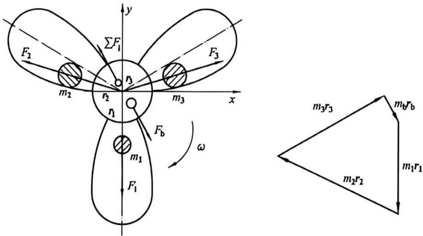

图13-2 静平衡设计
{: .figure-caption }

$$
m _ {\mathrm{b}} \boldsymbol {r} _ {\mathrm{b}} + m _ {1} \boldsymbol {r} _ {1} + m _ {2} \boldsymbol {r} _ {2} + m _ {3} \boldsymbol {r} _ {3} = 0\tag{13-3}
$$

如果有若干个偏心质量 $m_{1}$ ，从转动中心到偏心质量中心的向径为 $\pmb{r}_{i}$ ，则：

$$
m _ {\mathrm{b}} \boldsymbol {r} _ {\mathrm{b}} + \sum m _ {i} \boldsymbol {r} _ {i} = 0\tag{13-4}
$$

式中： $m_{i}r_{i}$ 称为质径积 $(i=1,2,3,\cdots)$ ，即转子上各个离心惯性力的相对大小和方位。式(13-4)说明，刚性转子静平衡条件为各不平衡质量质径积的矢量和等于零。而且，不论它有多少个偏心质量，只需要适当地加上一个平衡质量即可获得平衡。至于质径积 $m_{b}r_{b}$ 的大小和方位，既可用图解法的矢量多边形(图13-2)来求得，也可用解析法求解。具体方法如下：

将式(13-4)向 x、y 轴投影可得：

$$
\left\{ \begin{array}{l} m _ {\mathrm{b}} \boldsymbol {r} _ {\mathrm{b}} \cos \theta + \sum m _ {i} \boldsymbol {r} _ {i} \cos \theta_ {i} = 0 \\ m _ {\mathrm{b}} \boldsymbol {r} _ {\mathrm{b}} \sin \theta + \sum m _ {i} \boldsymbol {r} _ {i} \sin \theta_ {i} = 0 \end{array} \right.\tag{13-5}
$$

则所加平衡质量的质径积大小为：

$$
m _ {\mathrm{b}} \boldsymbol {r} _ {\mathrm{b}} = \sqrt {\left(\sum m _ {i} \boldsymbol {r} _ {i} \cos \theta\right) ^ {2} + \left(\sum m _ {i} \boldsymbol {r} _ {i} \sin \theta_ {i}\right) ^ {2}}\tag{13-6}
$$

式中： $\theta$ 为各偏心质量与 x 轴的夹角。

当转子结构确定后，取合适的 $r_{b}$ ，则平衡质量 $m_{b}$ 的大小也就能计算出来了。

而安装方向即相位角为：

$$
\theta_ {\mathrm{b}} = \arctan \left[ \frac {\sum (- m _ {i} r _ {i} \sin \theta_ {i})}{\sum (- m _ {i} r _ {i} \cos \theta)} \right]\tag{13-7}
$$

需要注意的是， $\theta_{b}$ 所在象限由上式中分子、分母的正、负号来确定。

在实际工作中，为了使设计出来的转子质量不至过大，应尽量将 $r_b$ 选大些，而 $m_b$ 则小些。另外，若转子的结构不允许在向径 $r_b$ 的方向上加平衡质量，也可在向径 $r_b$ 的相反方向上去掉一些质量来平衡。

从理论上讲, 对于偏心质量分布在多个运动平面内的转子, 对每一个平面按静平衡的方法来处理(加、减质量), 就可以达到平衡。但问题是有时实际结

构不允许在偏心质量所在平面内安装平衡配重，也不允许去掉不平衡质量（如凸轮轴、曲轴、电机转子等）。解决问题的唯一办法就是将平衡配重分配到另外两个平面内。对此，运用理论力学中将一个力分解为两个平行力的原理，是十分简便的。

设有一曲轴(图 13-3)，连杆颈的偏心质量为 m，引起的惯性力为 $F_{b}$ ，需通过增加配重 $m_{b}$ 来进行平衡，但零件结构上不允许在同一径向平面内添加质量，所以只有将 $m_{b}$ 分解到平面 I、II 内，为 $m_{b1}$ 、 $m_{b2}$ ，产生离心惯性力 $F_{b1}$ 、 $F_{b2}$ 来与 $F_{b}$ 平衡。

由理论力学基本原理可知：

$$
\left\{ \begin{array}{l} F _ {\mathrm{bI}} + F _ {\mathrm{bII}} = F _ {\mathrm{b}} \\ F _ {\mathrm{bI}} \cdot L = F _ {\mathrm{b}} \cdot l _ {1} \end{array} \right.
$$

$$
F _ {\mathrm{bl}} = \frac {l _ {1}}{L} F _ {\mathrm{b}} \quad F _ {\mathrm{bII}} = \frac {L - l _ {1}}{L} F _ {\mathrm{b}}\tag{13-8}
$$

可得:

$$
\left\{ \begin{array}{l} m _ {\mathrm{bI}} \boldsymbol {r} _ {\mathrm{bI}} = \frac {l _ {1}}{L} m _ {\mathrm{b}} \boldsymbol {r} _ {\mathrm{b}} \\ m _ {\mathrm{bII}} \boldsymbol {r} _ {\mathrm{bII}} = \frac {L - l _ {1}}{L} m _ {\mathrm{b}} \boldsymbol {r} _ {\mathrm{b}} \end{array} \right.
$$

若取： $r_{bI}=r_{bII}=r_{b}$ ，则有：

$$
\left\{ \begin{array}{l} m _ {\mathrm{b} 1} = \frac {l _ {1}}{L} m _ {\mathrm{b}} \\ m _ {\mathrm{b} \text { ll }} = \frac {L - l _ {1}}{L} m _ {\mathrm{b}} \end{array} \right.
$$

由此可知，某一回转平面内的不平衡质量，可以在两个任选的回转平面内进行平衡。

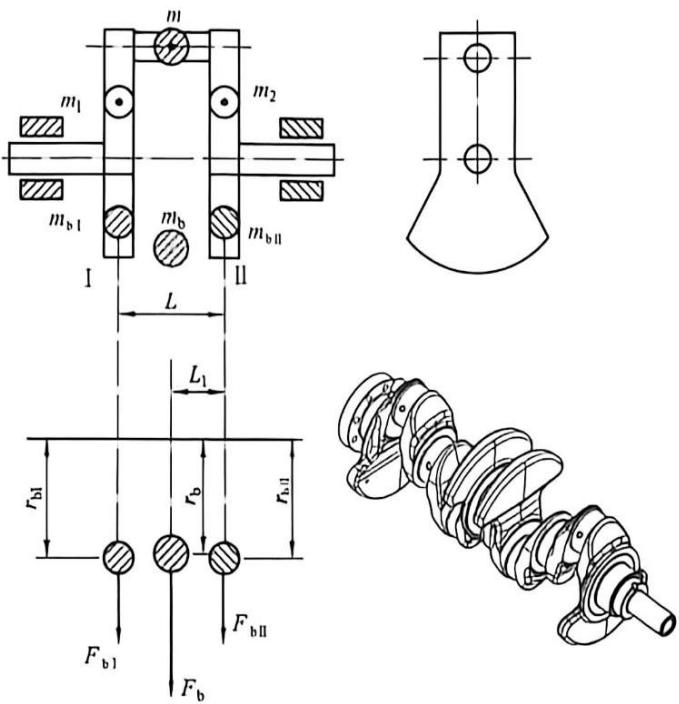

图13-3 曲轴惯性力的分解
{: .figure-caption }

### 13.2.2 刚性转子的动平衡设计

对于轴向尺寸较大的转子 $(D/b \leqslant 5)$ ，如曲轴、汽轮机转子等构件，由于其轴向宽度较

平面内。在这种情况下，即使转子的质心 S 在回转轴线上（图 13-4），但由于各偏心质量所产生的离心惯性力不在同一回转平面内，离心惯性力将形成一个不汇交空间力系，故不能按静平衡处理。这种不平衡只有在转子运动的情况下才能显示出来，故称为动不平衡。而刚性转子的动平衡，就是要平衡各偏心质量产生的惯性力和由惯性力产生的惯性力矩。

为了消除转子动不平衡现象，在设计时应先根据其结构确定出在各个不同的回转平面内的偏心质量的大小和位置，然后再计算出为使该转子

达到动平衡在平衡平面上所应加的平衡质量的数量、大小及方位，并将这些平衡质量加于该转子上，以使设计的转子在理论上达到动平衡。其具体计算方法如下。

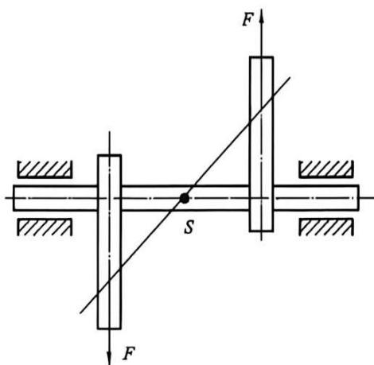

图13-4 静平衡但动不平衡的转子
{: .figure-caption }

如图 13-5(a) 所示的长转子, 其偏心质量 $m_{1} 、 m_{2}$ 及 $m_{3}$ 分别位于平面 1、2 及 3 内, 各质心的向径为 $\boldsymbol{r}_{1} 、 \boldsymbol{r}_{2}$ 及 $\boldsymbol{r}_{3}$ , 方位如图所示。当转子以等角速度 $\omega$ 回转时, 它们产生的惯性力 $F_{1} 、 F_{2}$ 及 $F_{3}$ 将形成一个空间力系。

由理论力学可知, 一个力可以分解为两个与它相平行的分力。因此, 可根据该转子的结构, 选定两个垂直于转子轴线的平衡平面 (或校正平面) I、II 作为安装平衡质量的平面, 并将上述的各个离心惯性力 $F$ 分解到平面 I 及 II 内, 即将 $F_{1} 、 F_{2} 、 F_{3}$ 分解为 $F_{1}^{\prime} 、 F_{2}^{\prime} 、 F_{3}^{\prime}$ (在平面 I 内) 和 $F_{1}^{\prime\prime}$ 、 $F_{2}^{\prime\prime}$ 、 $F_{3}^{\prime\prime}$ (在平面 II 内)。这样，就把空间力系的平衡问题转化为两个平面上的汇交力系的平衡问题。显然，只要在平面 I 及 II 内适当地各加一个平衡质量，使两平衡平面内的惯性力之和都为零，这个构件才会完全平衡。

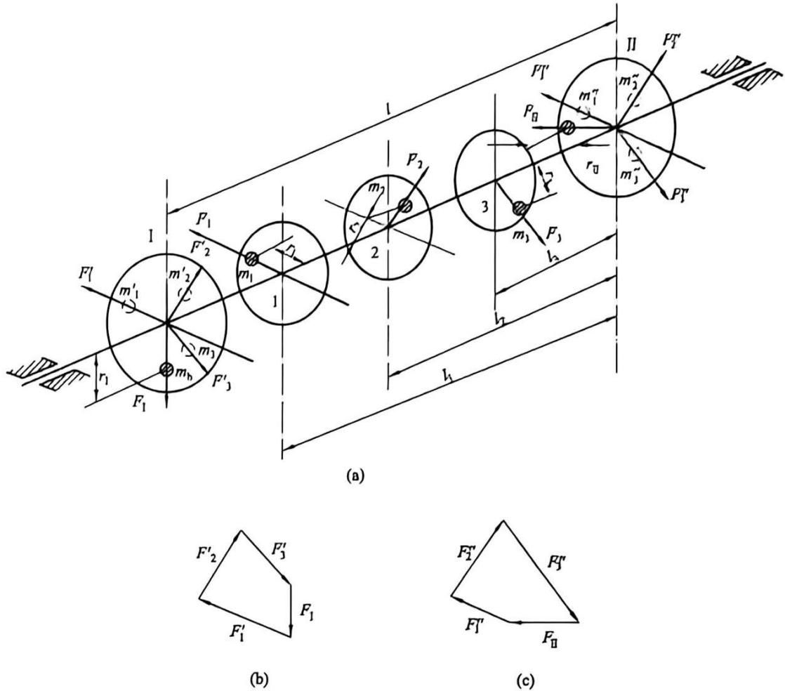

图13-5 转子的动平衡
{: .figure-caption }

两个平衡平面Ⅰ及Ⅱ内的平衡质量 $m_{1}$ 及 $m_{Ⅱ}$ 的大小及方位的确定，与前述静平衡计算方法完全相同。例如，就平衡平面Ⅰ而言，平衡条件为：

$$
F _ {1} ^ {\prime} + F _ {2} ^ {\prime} + F _ {3} ^ {\prime} + F _ {1} = 0\tag{13-9}
$$

式中： $F_{1}$ 为平衡质量 $m_{1}$ 产生的离心惯性力，而各力的大小根据式(13-8)可知

$$
\left\{ \begin{array}{l} F _ {1} ^ {\prime} = F _ {1} \frac {l _ {1}}{l} = m _ {1} r _ {1} \omega^ {2} \frac {l _ {1}}{l} \\ F _ {2} ^ {\prime} = F _ {2} \frac {l _ {2}}{l} = m _ {2} r _ {2} \omega^ {2} \frac {l _ {2}}{l} \\ F _ {3} ^ {\prime} = F _ {3} \frac {l _ {3}}{l} = m _ {3} r _ {3} \omega^ {2} \frac {l _ {3}}{l} \\ F _ {1} = m _ {1} \omega^ {2} r _ {1} \end{array} \right.\tag{13-10}
$$

选定比例尺 $\mu$ ，按向径 $r_{1}$ 、 $r_{2}$ 、 $r_{3}$ 的方向作平衡平面 I 的离心惯性力封闭矢量图 [图 13-5(b)]，可求得平衡质量 $m_{1}$ 产生的离心惯性力 $F_{1}$ 的大小。适当选定 $r_{1}$ 后，即可由式(13-10)求出不平衡质量 $m_{1}$ 的大小。而平衡质量的方位，则在该向径 $r_{1}$ 的方向上。同理，在平衡平面Ⅱ内也可以求出平衡质量 $m_{Ⅱ}$ 的大小和方位[图 13-5(c)]。

由以上分析的结果可知，动平衡的条件：当转子转动时，转子上分布在不同平面内的各个质量所产生的空间离心惯性力系的合力及合力矩均为零。而且，对于任何动不平衡的刚性转子，无论其不平衡质量分布在几个不同的回转平面内，只需要在任选的两个平衡平面内分别加上平衡质量或除去相应的不平衡质量，即可得到完全平衡。另外，由于动平衡同时满足静平衡条件，所以经过动平衡的转子一定是静平衡的；反之，经过静平衡的转子则不一定是动平衡的。

## 13.3 刚性转子的平衡试验

虽然经过平衡设计的刚性转子从理论上说是完全平衡的，但是实际在运转时转子还是会出现不平衡现象。这是由材质不均匀、加工制造或装配误差，以

及工作时磨损变形等造成的，这种不平衡现象在设计阶段是无法确定和消除的，只有通过试验的方法来对刚性转子做测定及校正。

### 13.3.1 刚性转子的静平衡试验

对于径宽比 $D / b \geqslant 5$ 的刚性转子，可进行静平衡试验。静平衡试验设备比较简单，一般采用带有两根平行导轨的静平衡架，为减少轴颈与导轨之间的摩擦，导轨的端口形状常作成刀刃状和圆弧状。图13-6为静平衡试验设备示意图。

试验时先调整好两导轨的水平状态，然后把转子放到轨道上让其轻轻转动。如果转子不平衡，则偏心引起的重力矩将使转子在轨道上滚动。当转子停止时，转子质心 S 必处于轴心正下方。这时，在轴心的正上方任意半径处加一平衡质量，再轻轻拨动转子。反复试验，不断调整平衡质量，直到转子能在任何位

置保持静止，说明转子的重心与其回转轴线趋于重合，即完成转子静平衡试验。

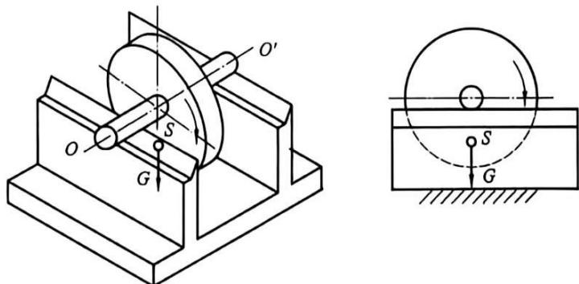

图13-6 导轨式静平衡架
{: .figure-caption }

### 13.3.2 刚性转子的动平衡试验

对于径宽比 D/b<5 的刚性转子，需进行动平衡试验，即通过测量回转件旋转时自身或支承的振动来测定回转件的不平衡程度并进行校正。和动平衡设计相同，动平衡试验也需两个平衡平面。

动平衡试验要在专门的动平衡机上进行。动平衡机的用途是确定加在两个平衡平面上平衡质量的大小及方位。根据动平衡机中回转件支承刚性的大小，可将动平衡机分为软支承和硬支承动平衡机两类。当平衡时回转件的回转角速度 $\omega$ 高于回转件及其支承系统的固有频率 $\omega_{c}$ (通常设计成 $\omega > 2\omega_{c}$ ) 时，称为软支承(或弹性支承)动平衡机。当平衡时回转件的回转角速度 $\omega$ 低于回转件及其支承系统的固有频率 $\omega_{c}$ (通常设计成 $\omega < 0.3\omega_{c}$ ) 时，称为硬支承(或刚性支承)动平衡机。

具体动平衡机的类型和规格很多。早期的产品结构、原理较简单，灵敏度和精度较低，现代工业生产使用的动平衡机灵敏度、平衡精度及自动化程度均较高，通常包括驱动系统、支承系统和测量系统三大部分。它的工作原理是通过测振传感器将转子转动所产生惯性力所引起的振动信号转化为电信号，再通过电子线路处理和放大，最后用电子仪器显示出被试转子的不平衡质径积的大过电子线路处理和放大，最后用电子仪器显示出被试转子的不平衡质径积的大小和方位。

如图 13-7 所示为一种动平衡机的工作原理示意图。它通过平衡机主轴箱端部的小发电机信号作为转速信号和相位基准信号，经处理成为方波或脉冲信号，来使计算机的 PIO 口触发中断，使计算机开始和终止计数，可测出转子旋转周期。由测振传感器拾取的振动信号经过滤波和放大，输入 A/D 转换器，再输入计算机，由信号处理软件进行数据采集和解算，可得出两个平衡平面上所需添加平衡质量的大小和相位。

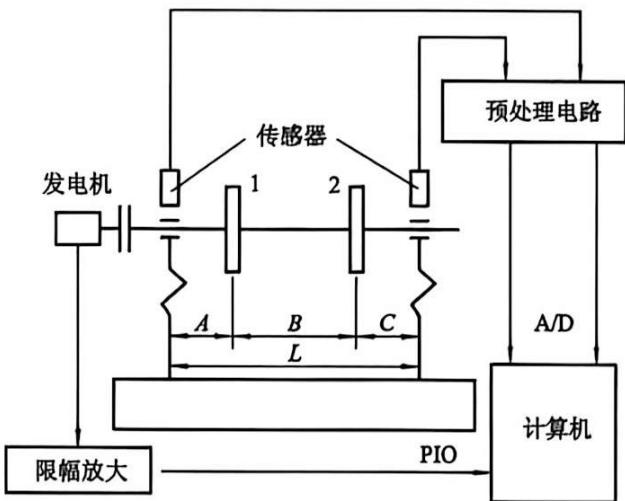

图13-7 动平衡机的工作原理示意图
{: .figure-caption }

## 13.4 转子的许用不平衡量

### 13.4.1 转子不平衡量的表示方法

转子不平衡量有两种表示法：一是用转子不平衡质径积 $m_{j}r_{j}$ （单位为 $\mathbf{g} \cdot \mathbf{mm}$ ）表示，另一是用转子不平衡偏心距 $e$ （单位为 $\mu \mathrm{m}$ ）表示。对于质量为 $m$ 的转子，两者的关系为：

$$
e = \frac {m _ {\mathrm{j}} r _ {\mathrm{j}}}{m}\tag{13-11}
$$

对于相同质量的转子, 质径积的大小直接反映不平衡量的大小。但是, 若质径积相同而质量不同, 则转子的不平衡程度也不相同。故可用转子的偏心距表示单位质量的不平衡量。

### 13.4.2 转子的许用不平衡量和平衡品质

转子要完全平衡是不可能的, 实际上, 也不必过高要求转子的平衡精度, 只要满足实际工作要求即可。为此, 对不同工作条件下的转子规定了不同的许用不平衡质径积 $[mr]$ 或许用偏心距 $[v]$ 。

转子平衡状态的优良程度称为平衡品质。转子运转时，其由于不平衡所产生的惯性力与转速有关，故工程上常用 $\omega$ 来表示转子的平衡品质，国际标准化组织以 $\Lambda=\frac{[e]\omega}{1000}$ （单位为 mm/s）作为判定平衡品质的等级标准， $\omega$ 为转子的工作转速（单位为 rad/s）。表 13-1 列出了各种典型刚性转子的平衡品质等级，设计时供参考使用。

表 13-1 各种典型刚性转子的平衡品质等级

<table><tr><td>品质等级</td><td> \(A=\frac{\lfloor r\rfloor\omega }{1000}/(\text{mm}\cdot \text{s}^{-1})\) </td><td>回转件类型示例</td></tr><tr><td>G4000</td><td>4000</td><td>刚性安装的具有奇数气缸的低速 \(^1\) 船用柴油机曲轴部件 \(^2\) </td></tr><tr><td>G1600</td><td>1600</td><td>刚性安装的大型两冲程发动机曲轴部件</td></tr><tr><td>G630</td><td>630</td><td>刚性安装的大型四冲程发动机曲轴部件;弹性安装的船用柴油机曲轴部件</td></tr><tr><td>G250</td><td>250</td><td>刚性安装的高速 \(^1\) 四缸柴油机曲轴部件</td></tr><tr><td>G100</td><td>100</td><td>六缸和六缸以上高速柴油机曲轴部件;汽车、机车用发动机整机</td></tr><tr><td>G40</td><td>40</td><td>汽车轮、轮缘、轮组、传动轴;弹性安装的六缸和六缸以上高速四冲程发动机曲轴部件;汽车、机车用发动机曲轴部件</td></tr><tr><td>G16</td><td>16</td><td>特殊要求的传动轴(螺旋桨轴、万向节轴);破碎机械和农业机械的零部件;汽车和机车用发动机特殊部件;特殊要求的六缸和六缸以上发动机的曲轴部件</td></tr><tr><td>G6.3</td><td>6.3</td><td>作业机械的回转零件,船用主汽轮机的齿轮;风扇;航空燃气轮机转子部件;泵的叶轮;离心机的鼓轮,机床及一般机械的回转零、部件;普通电机转子;特殊要求的发动机回转零、部件</td></tr><tr><td>G2.5</td><td>2.5</td><td>燃气轮机和汽轮机的转子部件;刚性汽轮发电机转子;透干压缩机转子;机床主轴和驱动部件;特殊要求的大型和中型电机转子;小型电机转子;透平驱动泵</td></tr><tr><td>G1.0</td><td>1.0</td><td>磁带记录仪及录音机驱动部件;磨床驱动部件;特殊要求的微型电机转子</td></tr><tr><td>G0.4</td><td>0.4</td><td>精密磨床的主轴、砂轮盘及电机转子;陀螺仪</td></tr></table>

注：①国际标准，低速柴油机的活塞速度小于9 m/s，高速柴油机的活塞速度大于9 m/s。
②曲轴部件是指包括曲轴、飞轮、离合器、带轮等的组合件。

在采用表 13-1 的推荐数值时，应注意下列不同的情况：

(1)对于质量为 m 的静不平衡转子，许用不平衡量取用表中计算出的值，为 $[mr] = m[e] = 1000 \, Am/\omega$ 。

(2)对于动不平衡的转子, 由表求出许用偏心距 $[e]$ , 并根据式 $[e] = \frac{[mr]}{m}$ 求出许用不平衡质径积 $[mr] = [e]m$ 后, 应将其分配到两个平衡平面上。如图13-8所示, 两个平衡平面的许用不平衡质径积可按下式求得:

$$
[ m r ] _ {1} = \frac {[ m r ] b}{a + b}\tag{13-12}
$$

$$
[ m r ] _ {\Pi} = \frac {[ m r ] a}{a + b}\tag{13-13}
$$

式中：a 和 b 分别为平衡平面Ⅰ及Ⅱ至转子质心的距离。

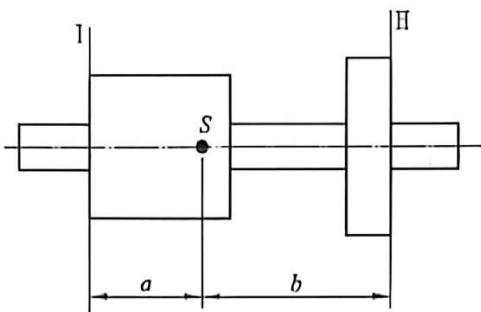

图13-8 许用不平衡质径积的分配
{: .figure-caption }

## 13.5 平面机构的平衡设计

在一般的平面机构中总是存在着做往复运动或平面复合运动的构件，例如缝纫机针杆刺布机构、汽油发动机活塞-连杆机构等。这些构件的总惯性力和总惯性力矩并不能像刚性转子那样由构件本身来平衡，而必须对整个机构进行平衡。

### 13.5.1 平面机构惯性力的平衡条件

设机构中活动构件的质量为 $m$ ，机构质心 $S$ 的加速度为 $a_{s}$ ，则机构作用于机架上的总惯性力 $F = -ma_{s}$ ，由于 $m$ 不可能为零，所以欲使总惯性力平衡即 $F = 0$ ，必须使 $a_{s} = 0$ ，也就是说机构的质心 $S$ 应做等速直线运动或静止不动。然而，由于机构的运动是周期性的，其质心不可能总是做等速直线运动，因此欲使 $a_{s} = 0$ ，唯一可能的方法是使机构的质心静止不动。根据这个推断，在对机构进行平衡时，可通过对构件进行合理布置、增加平衡质量或加平衡机构等方法使机构的质心 $S$ 落在或尽量靠近机架并且固定不动。

### 13.5.2 机构惯性力的完全平衡

#### 1. 加平衡质量法

如图 13-9 所示的铰链四杆机构中，设活动构件 1、2、3 的质量分别为 $m_{1} 、 m_{2} 、 m_{3}$ ，质心分别位于 $S_{1} 、 S_{2} 、 S_{3}$ 。

为了进行完全平衡, 对构件 2 的质量 $m_{2}$ 按照质量替代原理用分别集中于 $B 、 C$ 两点的两个质量 $m_{2 \mathrm{~B}} 、 m_{2 \mathrm{C}}$ 替代, 得到:

$$
m _ {2 0} = \frac {l _ {\mathrm{CS} _ {2}}}{l _ {\mathrm{NC}}} m _ {2}\tag{13-14}
$$

$$
m _ {\text { 乙 }} = \frac {l _ {\pi s _ {2}}}{l _ {\pi c}} m _ {2}\tag{13-15}
$$

而对构件1，在其延长线上加一平衡质量 $m'$ 来平衡其上的集中质量 $m_{20}$ 和 $m_{1}$ ，使构件1的质心移到固定轴A处。因为欲使构件1的质心移到A，就必须使

$$
m _ {2 \mathrm{B}} l _ {\mathrm{AD}} + m _ {1} l _ {\mathrm{AS} _ {1}} = m ^ {\prime} r ^ {\prime}\tag{13-16}
$$

由此可得:

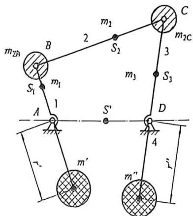

图 13-9 铰链四杆机构惯性力的完全平衡
{: .figure-caption }

$$
m ^ {\prime} = \frac {m _ {2 \mathrm{n}} l _ {\mathrm{AN}} + m _ {1} l _ {\mathrm{AS} _ {1}}}{r ^ {\prime}}\tag{13-17}
$$

同理，可在构件3的延长线上加一平衡质量 $m''$ ，使其质心移到固定轴D处，而平衡质量 $m''$ 为：

$$
m ^ {\prime \prime} = \frac {m _ {2 C} l _ {C D} + m _ {3} l _ {D S _ {3}}}{r ^ {\prime \prime}}\tag{13-18}
$$

在加上平衡质量 $m'$ 和 $m''$ 以后，则可认为整个机构的质量可用位于 A、D 两点的两个质量替代：

$$
m _ {\Lambda} = m _ {2 \mathrm{B}} + m _ {1} + m ^ {\prime}\tag{13-19}
$$

$$
m _ {\mathrm{D}} = m _ {2 \mathrm{C}} + m _ {3} + m ^ {\prime \prime}\tag{13-20}
$$

因而机构的总质心 $S'$ 位于 $AD$ 线上一固定点不动, 其加速度 $a_{s'} = 0$ , 所以机构的惯性力得到了平衡。

运用同样的方法, 可以对图 13-10 所示的曲柄滑块机构进行平衡, 即增加平衡质量 $m'$ 、 $m''$ 后, 使机构的总质心移到固定轴 $A$ 处。而平衡质量 $m'$ 及 $m''$ 可由下式求得:

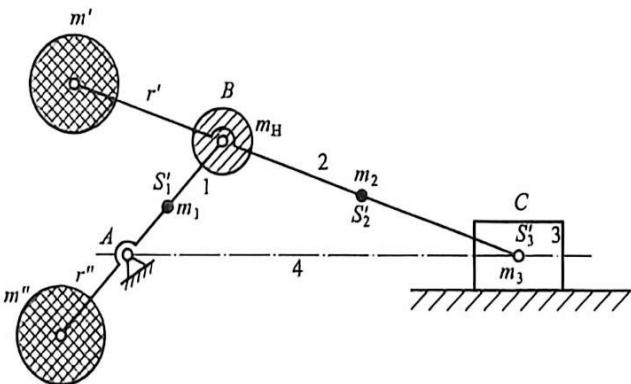

图13-10 曲柄滑块机构惯性力的完全平衡
{: .figure-caption }

$$
m ^ {\prime} = \frac {m _ {2} l _ {\mathrm{BS} _ {2} ^ {\prime}} + m _ {3} l _ {\mathrm{BS} _ {3} ^ {\prime}}}{r ^ {\prime}}
$$

$$
m ^ {\prime \prime} = \frac {(m ^ {\prime} + m _ {2} + m _ {3}) l _ {x B} + m ; l _ {x S _ {1}}}{r ^ {\prime \prime}}\tag{13-21}
$$

#### 2. 对称布置法

如图 13-11 所示的机构, 由于机构左、右两部分相对于 $A$ 点完全对称, 故在运动过程中其总质心将保持不动, 从而惯性力在轴承 $A$ 处所引起的动压力完全得到平衡。可见, 利用对称机构可得到很好的平衡效果, 但这会使机构的体积大大增加, 且结构更加复杂化。

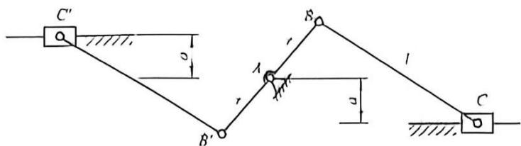

图13-11 完全对称布置机构
{: .figure-caption }

### 13.5.3 机构惯性力的部分平衡

上面所讨论的机构平衡方法，从理论上说，机构的总惯性力得到了完全平衡，但也会带来严重的问题，比如机构的质量大大增加、平衡质量安装在连杆上极为不便等。因此，在工程上通常不会追求这种不必要的完全平衡，而是采用部分平衡的方法，虽然达不到完全平衡，但较为便利，且能够满足工程需求。

部分平衡是指只平衡掉机构总惯性力中的一部分。常用方法有以下几种。

#### 1. 附加平衡质量法

如图 13-12 所示的曲柄滑块机构进行部分平衡时, 先运用质量替代原理, 将连杆的质量 $m_{2}$ 分别用集中于点 $B 、 C$ 两点的质量 $m_{2 \mathrm{~B}} 、 m_{2 \mathrm{C}}$ 替换; 将曲柄 1 的质量 $m_{1}$ 用分别集中于点 $B 、 A$ 两点的质量 $m_{1 \mathrm{~B}} 、 m_{1 \mathrm{~A}}$ 替换; 滑块 3 的质量集中在 $C$ 点。显然, 机构产生的惯性力只有两部分, 即集中在点 $B$ 的质量 $(m_{\mathrm{B}} = m_{2 \mathrm{~B}} + m_{1 \mathrm{~B}})$ 所产生的离心惯性力 $F_{\mathrm{B}}$ 和集中于点 $C$ 的质量 $(m_{\mathrm{C}} = m_{2 \mathrm{C}} + m_{3})$ 所产生的往复惯性力 $F_{\mathrm{C}}$ 。对于曲柄上的惯性力 $F_{\mathrm{B}}$ , 只要在其延长线上加一平衡质量 $m^{\prime}$ , 即满足以下关系式即可。

$$
m ^ {\prime} r = m _ {B} l _ {A B}\tag{13-22}
$$

而对于往复惯性力 $F_{\mathrm{C}}$ ，因其大小随曲柄转角 $\varphi$ 的变化而不同，其平衡问题就不像平衡离心惯性力 $F_{\mathrm{B}}$ 那么简单了。

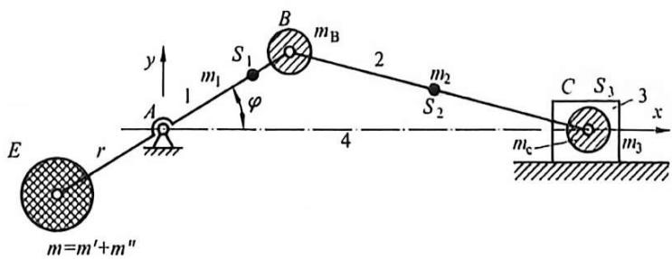

图13-12 曲柄滑块机构惯性力部分平衡
{: .figure-caption }

由机构的运动分析得到的点 C 的加速度方程式, 将其用级数法展开, 并取前两项得:

$$
a _ {\mathrm{C}} = - \omega^ {2} l _ {\mathrm{AB}} \cos \varphi - \frac {\omega^ {2} l _ {\mathrm{AB}} ^ {2}}{l _ {\mathrm{BC}}} \cos 2 \varphi\tag{13-23}
$$

式中： $\varphi$ 为原动件 1 的转角。

所以集中质量 $m_{c}$ 所产生的往复惯性力为：

$$
F _ {\mathrm{C}} = - m _ {\mathrm{C}} a _ {\mathrm{C}} \approx m _ {\mathrm{C}} \omega^ {2} l _ {\mathrm{AB}} \cos \varphi + m _ {\mathrm{C}} \omega^ {2} \frac {l _ {\mathrm{AB}} ^ {2}}{l _ {\mathrm{BC}}} \cos 2 \varphi\tag{13-24}
$$

由此式可见， $F_{C}$ 有两部分，即第一级惯性力 $m_{C}\omega^{2}l_{AB}\cos\varphi$ 和第二级惯性力 $m_{C}\omega^{2}\frac{l_{AB}^{2}}{l_{BC}}\cos2\varphi$ 。在舍去的部分中，还有更高级的惯性力。但是，由于第二级和第二级以上的各级惯性力均较第一级惯性力小得多，所以通常只考虑第一级惯性力，即取：

$$
F _ {\mathrm{c}} = m _ {\mathrm{c}} \omega^ {2} l _ {\mathrm{AB}} \cos \varphi\tag{13-25}
$$

为了平衡惯性力 $F_{c}$ ，可以在曲柄的延长线上(E处)再加上一平衡质量 $m''$ ，且使：

$$
m ^ {\prime \prime} r = m _ {C} l _ {A B}\tag{13-26}
$$

此平衡质量 $m$ 所产生的离心惯性力在 $x, y$ 方向的分力分别为：

$$
\left\{ \begin{array}{l} F _ {x} = - m ^ {\prime \prime} \omega^ {2} r \cos \varphi \\ F _ {y} = - m ^ {\prime \prime} \omega^ {2} r \sin \varphi \end{array} \right.\tag{13-27}
$$

由于 $m''r=m_{C}l_{AB}$ ，故知 $F_{x}=-F_{C}$ ，即 $F_{x}$ 可将 $m_{C}$ 所产生的一阶往复惯性力平衡。但又多出一个新的不平衡惯性力 $F_{y}$ ，它对机构的工作也很不利。为此取：

$$
F _ {\mathrm{x}} = - \left(\frac {1}{3} \sim \frac {1}{2}\right) F _ {\mathrm{c}}\tag{13-28}
$$

即

$$
m ^ {\prime \prime} r = \left(\frac {1}{3} \sim \frac {1}{2}\right) m _ {\mathrm{C}} l _ {\mathrm{AB}}\tag{13-29}
$$

即只平衡往复惯性力 $F_{c}$ 的一部分。这样，既可以减少往复惯性力 $F_{c}$ ，又使垂直方向产生的新的不平衡惯性力 $F_{y}$ 不至于太大。一般来说，这对机械的工作较为有利，且结构设计上也较为简便。在一些农业机械的设计中，就常采用这种近似的平衡方法。

综上所述, 若要用附加平衡质量法来部分平衡曲柄滑块机构的惯性力, 只要在曲柄延长

线上加平衡质量 $m=m'+m''=\frac{m_{B}l_{AB}+\left(\frac{1}{3}\sim\frac{1}{2}\right)m_{C}l_{AB}}{r}$ 即可。

#### 2. 近似对称布置法

如图 13-13 所示机构中, 当曲柄 $AB$ 转动时, 滑块 $C$ 和 $C'$ 的加速度方向相反, 它们的惯性力方向也相反, 故可以相互抵消。但由于运动规律不完全相同, 所以只能部分平衡。

如图 13-14 所示的机构中, 当曲柄 $AB$ 转动时, 两连杆 $BC 、 B^{\prime} C^{\prime}$ 和摇杆 $CD 、 C^{\prime} D$ 的惯性力也可以部分抵消。

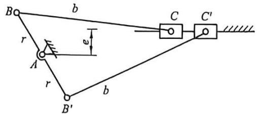

图13-13 曲柄滑块机构近似对称布置法
{: .figure-caption }

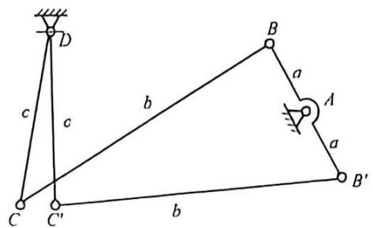

图13-14 曲柄摇杆机构近似对称布置法
{: .figure-caption }

#### 3. 利用弹簧平衡

如图13-15所示，通过合理选择弹簧的刚度系数 $k$ 和弹簧的安装位置，可以使连杆 $BC$ 的惯性力得到部分平衡。

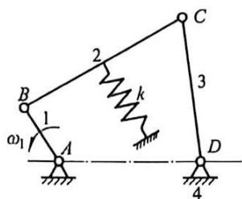

图13-15 利用弹簧进行机构平衡
{: .figure-caption }

以上我们介绍了平衡机构惯性力的各种方法，需要注意的是，除了惯性力以外，惯性力矩的周期性变化也会引起机构相对机架的振动。由于在惯性力的平衡过程中没有考虑惯性力矩的影响，所以也可能出现此情况，即经过惯性力平衡后，附加了平衡质量，惯性力矩反而更大。

在进行机构形式设计时，一定要分析具体机构的受力情况，根据不同的机构类型选择适当的平衡方式。在尽量消除或减少机构的总惯性力和惯性力矩的同时，还应使机构的结构简单紧凑、尺寸较小，从而使整个机械具有良好的动力学特性。

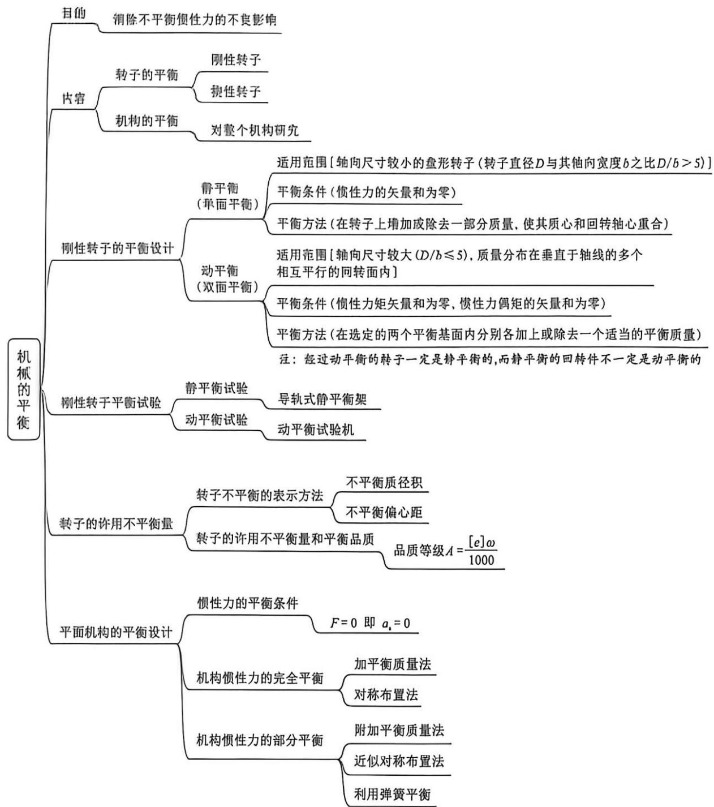

## 思考题与练习题

1. 造成机械不平衡的原因有哪些？机械平衡的目的是什么？

2. 机械平衡分哪几类？刚性转子与挠性转子如何定义？

3. 机械平衡的方法有哪些？它们的目的分别是什么？

4. 刚性转子的平衡设计有几种？它们各需要满足的条件是什么？

5.为什么要规定许用不平衡量？许用不平衡量的表示方法有哪些？

6. 什么是平面机构的完全平衡法？它的优、缺点各是什么？

7. 什么是机构的部分平衡法？

8. 在图 13-16 所示的盘形转子中，在同一回转平面内有四个偏心质量，其大小及回转半径分别为 $m_{1} = 8 \text{ kg}$ ， $r_{1} = 100 \text{ mm}$ ； $m_{2} = 5 \text{ kg}$ ， $r_{2} = 100 \text{ mm}$ ； $m_{3} = 8 \text{ kg}$ ， $r_{3} = 150 \text{ mm}$ ； $m_{4} = 3 \text{ kg}$ ， $r_{4} = 200 \text{ mm}$ ；方位如图所示。又设平衡质量 $m_{\text{b}}$ 的回转半径 $r_{\text{b}} = 200 \text{ mm}$ 。试求平衡质量 $m_{\text{b}}$ 的大小及方位。

9. 如图 13-17 所示的转子中，各不平衡质量的大小与方位分别为： $m_{1}=3\ kg,\ r_{1}=80\ mm,\ \theta_{1}=30^{\circ};\ m_{2}=2\ kg,\ r_{2}=80\ mm,\ \theta_{2}=120^{\circ};\ m_{3}=2\ kg,\ r_{3}=60\ mm,\ \theta_{3}=225^{\circ}$ 。求在 r=50 mm 处应加的配重质量和方位。

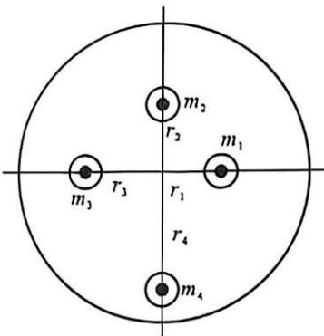

图13-16 盘形转子
{: .figure-caption }

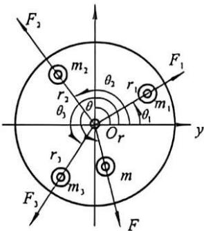

图13-17 转子
{: .figure-caption }

10. 有一转子如图 13-18 所示, 已知各偏心质量 $m_{1} = 1 \mathrm{~kg}, m_{2} = 0.5 \mathrm{~kg}, m_{3} = 1.8 \mathrm{~kg}, m_{4} = 1.5 \mathrm{~kg}$ ; 它们的回转半径分别为 $r_{1} = 400 \mathrm{~mm}, r_{2} = r_{4} = 300 \mathrm{~mm}, r_{3} = 200 \mathrm{~mm}$ ; 又知各偏心质量所在的回转平面间的距离为 $l_{12} = l_{23} = l_{24} = 200 \mathrm{~mm}$ ; 各偏心质量间的方位角为 $\alpha_{12} = 120^{\circ}, \alpha_{23} = 60^{\circ}, \alpha_{34} = 90^{\circ}, \alpha_{1} = 30^{\circ}$ 。若置于平衡平面 I 及 II 中的平衡质量 $m_{\mathrm{b}}^{\prime}$ 及 $m_{\mathrm{b}}^{\prime \prime}$ 的回转半径为 $400 \mathrm{~mm}$ , 试求 $m_{\mathrm{b}}^{\prime}$ 及 $m_{\mathrm{b}}^{\prime \prime}$ 的大小和方位。

11. 如图 13-19 所示为一滚筒, 在轴上装有带轮。现已测知带轮有一偏心质量 $m_{1} = 1 \mathrm{~kg}$ ; 另外, 根据该滚筒的结构, 已知其具有两个偏心质量 $m_{2} = 3 \mathrm{~kg}, m_{3} = 4 \mathrm{~kg}$ , 各偏心质量的位置如图 (单位为 $\mathrm{mm}$ ) 。若将平衡基面选在滚筒的两端面, 两平衡基面中平衡质量的回转直径为 $400 \mathrm{~mm}$ , 试求两平衡质量的大小和方向。

12. 如图 13-20 所示的 3 根曲轴结构中，已知 $m_{1}=m_{2}=m_{3}=m_{4}=m$ ， $r_{1}=r_{2}=r_{3}=r_{4}=r$ ， $l_{12}=l_{23}=l_{34}=l$ ，且曲柄位于过回转曲线的同一平面中，试判断哪根曲轴已达到静平衡设计的要求，

哪根曲轴已达到动平衡设计的要求。

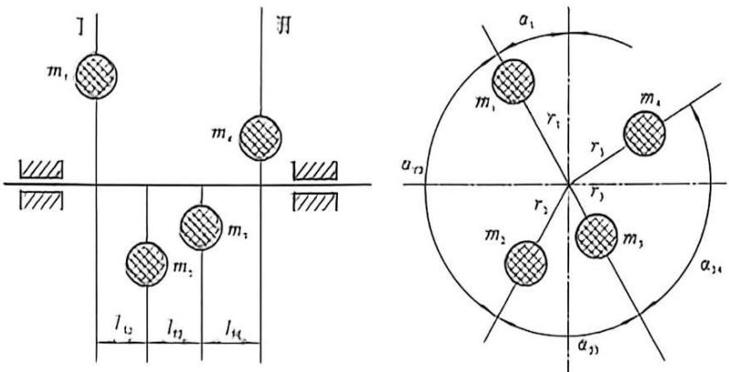

图13-18 转子
{: .figure-caption }

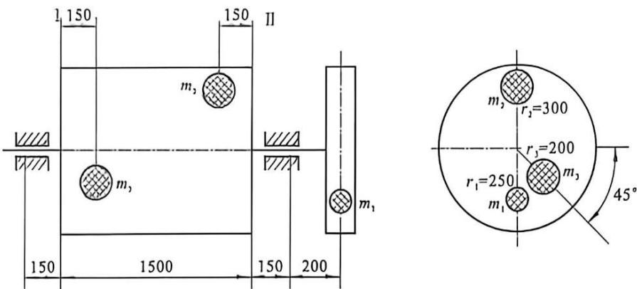

图13-19 滚筒
{: .figure-caption }

13. 四杆机构（图 13-21）中 $AB = 100 \mathrm{~mm}$ , $BC = 400 \mathrm{~mm}$ , $CD = 300 \mathrm{~mm}$ , $AD = 500 \mathrm{~mm}$ , $AS_{1} = 40 \mathrm{~mm}$ , $BS_{2} = 200 \mathrm{~mm}$ , $CS_{3} = 100 \mathrm{~mm}$ , $m_{1} = 1 \mathrm{~kg}$ , $m_{2} = 2 \mathrm{~kg}$ , $m_{3} = 1.8 \mathrm{~kg}$ , 试在 $AB$ 、 $CD$ 杆上加平衡质量来实现机构惯性力的完全平衡。

14. 如图 13-22 所示曲柄滑块机构中各构件尺寸为 $l_{\mathrm{AB}} = 200 \mathrm{~mm}$ , $l_{\mathrm{BC}} = 500 \mathrm{~mm}$ , 滑块 $C$ 的质量为 $20 - 1000 \mathrm{~kg}$ , 且忽略曲柄 $AB$ 及连杆 $BC$ 的质量。试问:

(1) 如曲柄 AB 处于低转速状态下工作, 且 C 处质量较小时, 应如何考虑平衡措施?

(2)如曲柄 $AB$ 处于较高转速状态下工作, 且 $C$ 处质量较大时, 又应如何考虑平衡措施?

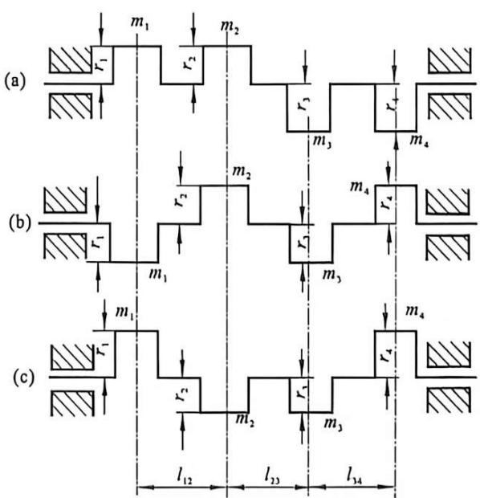

题图13-20 3根曲轴结构
{: .figure-caption }

(3)有没有办法使此机构达到完全平衡?

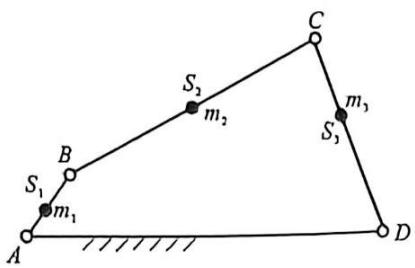

图13-21 四杆机构
{: .figure-caption }

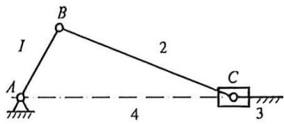

图13-22 曲柄滑块机构
{: .figure-caption }

15. 在图 13-23 所示的曲柄滑块机构中, $S_{1} 、 S_{2}$ 和 $S_{3}$ 为曲柄、连杆和滑块的质心。已知各构件的尺寸和质量如下: $l_{\mathrm{AB}} = 100 \mathrm{~mm}, l_{\mathrm{BC}} = 500 \mathrm{~mm}, l_{\mathrm{AS}_{1}} = 70 \mathrm{~mm}, l_{\mathrm{BS}_{2}} = 200 \mathrm{~mm}, m_{1} = 10 \mathrm{~kg}, m_{2} = 50 \mathrm{~kg}, m_{3} = 120 \mathrm{~kg}$ 。欲在曲柄 $AB$ 上加一平衡质量 $m$ 来平衡该机构的惯性力，问：

(1)m 应加于曲柄 AB 的什么方向上?

(2) 将 $m$ 加于 $C'$ 处, 且 $l_{\mathrm{AC}'} = 100 \mathrm{~mm}$ , $m$ 为多少?

(3)此时可否全部平衡掉机构的惯性力?

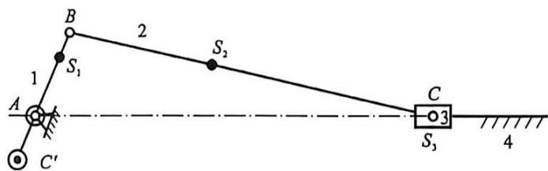

图13-23 曲柄滑块机构
{: .figure-caption }
