# 第14章 机械的运转及其速度波动的调节

**【概述】**

◎本章主要介绍机械系统真实运动规律的求解方法，基于等效力学模型的单自由度机械系统动力学分析，机械运转过程中速度波动产生的原因及相应的调节方法，并重点介绍飞轮转动惯量的计算方法及飞轮的设计。

◎通过本章的学习，要求了解机械系统运动规律的求解方法，机械系统等效力学模型的动力学分析，机械运转过程中速度波动产生的原因及调节方法，掌握飞轮的设计及计算。

## 14.1 概述

机械系统一般主要由原动机、传动机构和执行机构组成。在对机构进行运动或力分析研究时，一般假定原动件的运动规律为已知，且做等速运动。然而，机械在实际工作中，机械原动件的运动规律是由作用在机械上的外力、各构件质量及其转动惯量、原动件位置等因素所决定的。因而在一般情况下，原动件的速度并不恒定。只有确定了原动件的真实运动规律后，才能应用前述分析方法求解出机构中其他构件的运动规律与受力状况。研究机械系统的真实运动规律，对于设计机械，特别是高速、重载、高精度及高自动化的机械具有十分重要的意义。所以，分析在外力作用下机械的运转过程及特征，建立机械系统的等效动力学模型和机械运动方程并求解，得出机械原动件的真实运动规律，是本章研究的主要内容之一。

机械运转过程中，外力的变化会引起机械速度的波动，速度波动会导致运动副中产生附加的动压力，并导致机械振动和噪声，从而降低机械的使用寿命、效率与工作质量。另外，外力的突然减小或增大，可能发生飞车或停车事故。所以，研究速度波动产生的原因，掌握通过合理设计来调节速度波动的方法，以便设法将机械运转速度的波动程度限制在许可范围之内，是本章研究的又一主要内容。

## 14.2 机械的运转过程及作用力

### 14.2.1 机械运转过程的三个阶段

由能量守恒定律可知，当机械运动时，在任一时间间隔内，外力所做的功应等于机械系

统的动能增量，即

$$
W _ {\mathrm{d}} - W _ {\mathrm{r}} - W _ {\mathrm{f}} = E _ {2} - E _ {1} = \Delta E\tag{14-1}
$$

式中： $W_{d}$ 、 $W_{r}$ 、 $W_{f}$ 分别为驱动功（输入功）、输出功、损耗功； $\Delta E$ 为该时间间隔内的功能增量。

机械从开始运转到结束运转的整个过程, 通常包含三个阶段(图 14-1), 即启动阶段、稳定运转阶段和停车阶段。

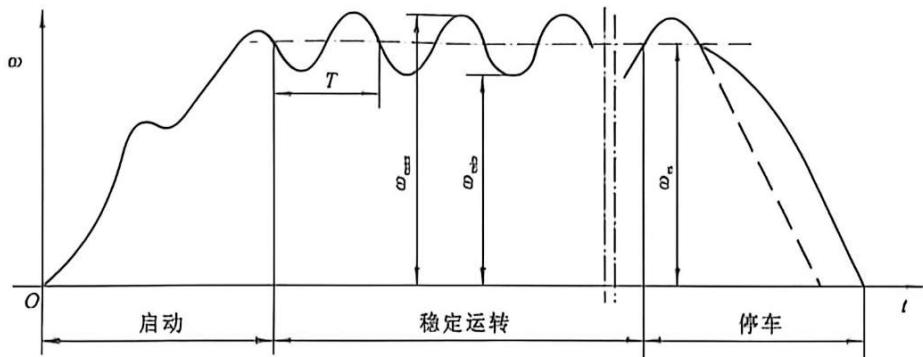

图14-1 机械运转过程的三个阶段
{: .figure-caption }

(1) 启动阶段 (starting period of machinery)。

机械原动件的速度从零逐渐上升到开始稳定的过程称为启动阶段。该阶段的特点为机械的驱动功 $W_{d}$ 大于输出功 $W_{r}$ 与损耗功 $W_{f}$ 之和，出现盈功，机械的动能增加，即

$$
W _ {\mathrm{d}} - W _ {\mathrm{r}} - W _ {\mathrm{f}} = \Delta E > 0
$$

(2) 稳定运转阶段(steady motion period of machinery)。

机械原动件保持匀速或在正常工作速度的平均值上、下作周期性速度波动。在该阶段的任一运动循环周期 T 内有：

$$
W _ {\mathrm{d}} - W _ {\mathrm{r}} - W _ {\mathrm{f}} = \Delta E = 0
$$

机械在稳定运转阶段的特点为:

①匀速稳定运转: $\omega =$ 常数。只有在特殊情况下, 原动件才做等角速度运动, 如图 14-2 所示。

②周期变速稳定运转： $\omega(t)=\omega(t+T_{p})$ ，原动件将围绕某一平均角速度 $\omega_{m}$ 作周期性波动，如图 14-1 所示。

③非周期变速稳定运转，如图14-3所示。非周期速度波动大多是由外力发生突变造成的。

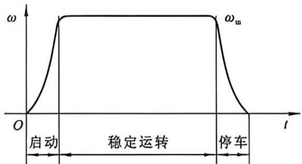

图14-2 匀速稳定运转
{: .figure-caption }

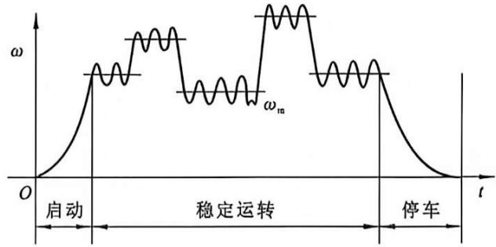

图14-3 非周期变速稳定运转
{: .figure-caption }

(3)停车阶段。

原动件速度从正常工作速度值下降到零的阶段。该阶段的特点为 $W_{d}=0, \Delta E=0-W_{r}-W_{f}<0$ ，出现亏功，机械的动能减小。在一般情况下，停车阶段的工作阻力也不再做功。为缩短停车时间，可设置制动器，如图 14-1 中的虚线所示。

### 14.2.2 作用在机械上的力

机械总是在外力的作用下进行工作。若不考虑内力，即各构件的重力、惯性力与运动副中的摩擦力，则作用在机械上的力可分为驱动力和生产阻力。

(1)驱动力。

驱动力是指驱动原动件运动的力，其变化规律取决于原动机的机械特性。如蒸汽机、内燃机等原动机输出的驱动力是活塞位置的函数，电动机输出的驱动力矩是转子角速度的函数。

力(或力矩)与运动参数(位移、速度、时间等)之间的关系称为机械特性(mechanical behavior)。如图 14-4 所示为交流异步电动机的机械特性曲线。

当用解析法研究机械在外力作用下的运动时，原动机发出的驱动力必须以解析式表示。为此，可以将原动机的机械特性曲线作如下线性处理。例如图14-4中的BC曲线部分，可以近似地以通过N点和C点的直线代替。N点的

转矩 $M_{\mathrm{n}}$ 为电动机的额定转矩, 它所对应的角速度 $\omega_{\mathrm{n}}$ 为电动机的额定角速度。 $C$ 点对应的角速度 $\omega_{0}$ 为同步角速度, 这时电动机的转矩为 0 。此直线上任意一点所确定的驱动力矩 $M_{\mathrm{d}}$ 可由下式表示。

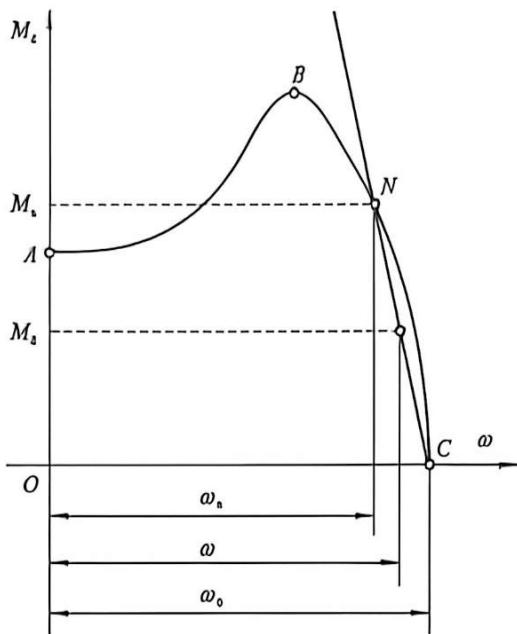

图14-4 交流异步电动机的机械特性曲线
{: .figure-caption }

$$
M _ {\mathrm{d}} = \frac {M _ {\mathrm{n}} (\omega_ {0} - \omega)}{\omega_ {0} - \omega_ {\mathrm{n}}}\tag{14-2}
$$

式中： $M_{n}$ 、 $\omega_{n}$ 、 $\omega_{0}$ 可从电机产品目录中查出。

(2) 生产阻力。

生产阻力是指机械工作时需克服的工作负荷，它由机械的工作特点决定。机械的生产阻力可能是常数(如车床)，可能是执行机构位置的函数(如曲柄压力机)，可能是机构速度的函数(如鼓风机)，也可能是时间的函数(如球磨机)。

驱动力和生产阻力的确定，涉及许多专门知识。本章在讨论机械在外力作用下的运动问题时，假定外力为已知的。

## 14.3 机械系统等效动力学模型

### 14.3.1 等效动力学模型的建立

研究机械系统的真实运动规律，必须首先建立外力与运动参数(位移、速度、时间等)之间的函数关系式，这种函数关系式称为机械系统的动力学方程。机械是由机构组成的多构件复杂系统，自由度越多，其动力学方程式越复杂，一般难以用解析法求得显式解，常需采用数值法近似求解。但是，对于单自由度的机械系统，描述其运动仅需一个独立参数(即一个广义坐标)，无论其组成如何复杂，均可将单自由度机械简化为一个等效构件的运动来处理。建立最简单的等效动力学模型(equivalent dynamic models)，将使研究机械真实运动的问题大大简化。

为了使等效构件的运动与机械中该构件的真实运动一致，根据质点动能定理，将作用于机械系统上的所有外力和外力矩、所有构件的转动惯量和质量，都向等效构件转化。转化原理是使该系统转化前后的动力学效果保持不变，即等效构件的质量 $m_{\mathrm{e}}$ 或转动惯量 $J_{\mathrm{e}}$ 所具有的动能，应等于整个系统的总动能；等效构件上的等效力 $F_{\mathrm{e}}$ 、等效力矩 $M_{\mathrm{e}}$ 所做的功或所产生的功率，应等于整个系统的所有力和力矩所做的功或所产生的功率之和。满足这两个条件，就可以将等效构件作为该系统的等效动力模型。图14-5分别为转动构件和移动构件为等效构件的等效动力学模型，图中 $J_{\mathrm{e}}$ 、 $m_{\mathrm{e}}$ 分别表示等效转动惯量、等效质量， $M_{\mathrm{e}}$ 、 $F_{\mathrm{e}}$ 分别表示等效力矩、等效力。

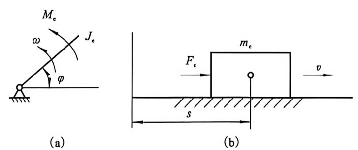

图14-5 等效动力模型
{: .figure-caption }

### 14.3.2 等效量的计算

#### 1. 等效质量和等效转动惯量

设单自由度机械系统中各运动构件的质量为 $m_{i}(i=1,2,\cdots,n)$ ，其质心 $S_{i}$ 的速度为 $v_{si}$ ；各运动构件对其质心轴线的转动惯量为 $J_{j}(j=1,2,\cdots,m)$ ，角速度为 $\omega_{j}$ ，根据能量守恒并按等效质量 $m_{c}$ 和等效转动惯量 $J_{c}$ 的等效条件，有：

(1) 等效构件为移动构件时，由于 $\frac{1}{2} m_{\mathrm{o}}v^{2} = \frac{1}{2}\sum_{i=1}^{n}m_{i}v_{\mathrm{bi}}^{2} + \frac{1}{2}\sum_{j=1}^{m}J_{sj}\omega_{j}^{2}$ ，则

$$
m _ {\mathrm{c}} = \sum_ {i = 1} ^ {m} m _ {i} \left(\frac {v _ {\mathrm{si}}}{v}\right) ^ {2} + \sum_ {j = 1} ^ {m} J _ {\mathrm{sj}} \left(\frac {\omega_ {j}}{v}\right) ^ {2}\tag{14-3a}
$$

(2) 等效构件为转动构件时，由于 $\frac{1}{2} J_{\mathrm{e}} \omega^{2} = \frac{1}{2} \sum_{i=0}^{n} m_{i} v_{ci}^{2} + \frac{1}{2} \sum_{j=1}^{n} J_{ij} \omega_{j}^{2}$ ，则

$$
J _ {t} = \sum_ {i = 1} ^ {n} m _ {i} \left(\frac {v _ {i i}}{\omega}\right) ^ {2} + \sum_ {j = 1} ^ {n} J _ {i j} \left(\frac {\omega_ {j}}{\omega}\right) ^ {2}\tag{14-3b}
$$

因此，等效质量与等效转动惯量不仅与机械系统中各活动构件的质量、转动惯量有关，而且与等效构件的速比有关，但与系统的真实运动无关。因此，可在机械真实运动未知的情况下求得其等效质量和等效转动惯量。

#### 2. 等效力和等效力矩

设作用在机械上的外力为 $F_{i}(i=1,2,\cdots,n)$ ， $F_{i}$ 作用点的速度为 $v_{i}$ ， $F_{i}$ 的方向和 $v_{i}$ 的方向间夹角为 $\theta_{i}$ ，作用在机械中的外力矩为 $M_{j}(j=1,2,\cdots,m)$ ，受力矩 $M_{j}$ 作用的构件 j 的角速度为 $\omega_{j}$ 。根据等效力 $F_{r}$ 或力矩 $M_{r}$ ，所产生的功率等于作用在机械上所有力或力矩所产生的功率，有：

(1) 等效构件为移动构件时，由于 $F_{\mathrm{e}}v = \sum_{i=1}^{n} F_{i}v_{i}\cos \theta_{i} + \sum_{j=1}^{m} \pm M_{j}\omega_{j}$ ，则

$$
F _ {\mathrm{c}} = \sum_ {i = 1} ^ {n} F _ {i} \frac {v _ {i} \cos \theta_ {i}}{v} + \sum_ {j = 1} ^ {m} \pm M _ {j} \frac {\omega_ {j}}{v}\tag{14-4a}
$$

(2) 等效构件为转动构件时，由于 $M_{\mathrm{e}} \omega = \sum_{i=1}^{n} F_{i} v_{i} \cos \theta_{i} + \sum_{j=1}^{m} \pm M_{j} \omega_{j}$ ，则

$$
M _ {r} = \sum_ {i = 1} ^ {n} F _ {i} \frac {v _ {i} \cos \theta_ {i}}{\omega} + \sum_ {j = 1} ^ {m} \pm M _ {j} \frac {\omega_ {j}}{\omega}\tag{14-4b}
$$

式中：“±”的选取取决于作用在构件j上的力矩 $M_{j}$ 与该构件的角速度 $\omega_{j}$ 转向是否相同，相同时取“+”，相反时取“-”。

由上式可知，影响等效力和等效力矩的因素较多，除了等效构件的位置之外，尚有外力 $F_{i}$ 和外力矩 $M_{j}$ ，它们在机械系统中可能是等效构件的运动参数 $\varphi$ 、 $\omega$ 及时间t的函数，即

$$
\begin{array}{l} F = F (\varphi , \omega , t) \\ M = M (\varphi , \omega , t) \end{array}
$$

例 14-1 如图 14-6 所示曲柄滑块机构中，已知各构件角速度 $(\omega_{1}、\omega_{2})$ 、质量 $(m_{2}、m_{3})$ 、质心位置 $(s_{2})$ 、质心速度 $(v_{3})$ 、转动惯量 $(J_{1}、J_{s2})$ 、驱动力矩 $M_{1}$ 、阻力 $F_{3}$ 。试建立该机构的等效力学模型，并计算等效量。

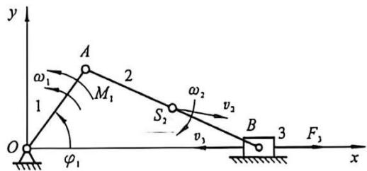

图14-6 曲柄滑块机构
{: .figure-caption }

解：外力对系统所做的功为

$$
\mathrm{d} W = N \mathrm{d} t = \left(M _ {1} \omega_ {1} - F _ {3} v _ {3}\right) \mathrm{d} t
$$

该系统在外力作用下的动能增量为：

$$
\mathrm{d} E = \mathrm{d} \left(\frac {1}{2} J _ {1} \omega_ {1} ^ {2} + \frac {1}{2} J _ {\mathrm{s} 2} \omega_ {2} ^ {2} + \frac {1}{2} m _ {2} v _ {\mathrm{s} 2} ^ {2} + \frac {1}{2} m _ {3} v _ {3} ^ {2}\right)
$$

由于 $\mathrm{d}E = \mathrm{d}W$ ，则有：

$$
\mathrm{d} \left(\frac {1}{2} J _ {1} \omega_ {1} ^ {2} + \frac {1}{2} J _ {n 2} \omega_ {2} ^ {2} + \frac {1}{2} m _ {2} v _ {k 2} ^ {2} + \frac {1}{2} m _ {3} v _ {3} ^ {2}\right) = (M _ {1} \omega_ {1} - F _ {3} v _ {3}) \mathrm{d} t\tag{1}
$$

若以转动件 1 为等效构件, 并将式(1)改写为:

$$
\mathrm{d} \left\{\frac {\omega_ {1} ^ {2}}{2} \left[ J _ {1} + J _ {k 2} \left(\frac {\omega_ {2}}{\omega_ {1}}\right) ^ {2} + m _ {2} \left(\frac {v _ {k 2}}{\omega_ {1}}\right) ^ {2} + m _ {3} \left(\frac {v _ {3}}{\omega_ {1}}\right) ^ {2} \right] \right\} = \left[ M _ {1} - F _ {3} \left(\frac {v _ {3}}{\omega_ {1}}\right) \right] \omega_ {1} \mathrm{d} t
$$

则该系统的等效力学模型如图 14-7 所示。其中：

等效转动惯量为：

$$
J _ {v} (\varphi_ {1}) = J _ {1} + J _ {u 2} \left(\omega_ {2} / \omega_ {1}\right) ^ {2} + m _ {2} \left(v _ {k 2} / \omega_ {1}\right) ^ {2} + m _ {3} \left(v _ {3} / \omega_ {1}\right) ^ {2}
$$

等效力矩为：

$$
M _ {o} (\varphi_ {1}, \omega_ {1}, t) = M _ {1} = F _ {3} (v _ {3} / \omega_ {1})
$$

系统的动力学方程式为：

$$
\mathrm{d} \left[ J _ {\mathrm{c}} (\varphi_ {1}) \omega_ {1} ^ {2} / 2 \right] = M _ {\mathrm{c}} (\varphi_ {1}, \omega_ {1}, t) \omega_ {1} \mathrm{d} t
$$

若以移动构件 3 为等效构件, 并将式(1)改写为:

$$
\mathrm{d} \left\{\frac {v _ {3} ^ {2}}{2} \left[ J _ {1} \left(\frac {\omega_ {1}}{v _ {3}}\right) ^ {2} + J _ {\mathrm{a} 2} \left(\frac {\omega_ {2}}{v _ {3}}\right) ^ {2} + m _ {2} \left(\frac {v _ {s 2}}{v _ {3}}\right) ^ {2} + m _ {3} \right] \right\} = \left(M _ {1} \frac {\omega_ {1}}{v _ {3}} - F _ {3}\right) v _ {3} \mathrm{d} t
$$

则该系统的等效力学模型如图 14-18 所示。其中：

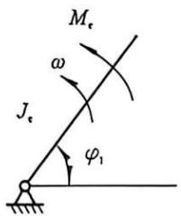

图14-7 转动件为等效构件
{: .figure-caption }

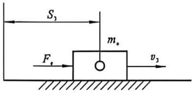

图14-8 移动件为等效构件
{: .figure-caption }

等效质量为：

$$
m _ {\mathrm{c}} (s _ {3}) = J _ {1} \left(\omega_ {1} / v _ {3}\right) ^ {2} + J _ {\mathrm{s} 2} \left(\omega_ {2} / v _ {3}\right) ^ {2} + m _ {2} \left(v _ {\mathrm{s} 2} / v _ {3}\right) ^ {2} + m _ {3}
$$

等效力为：

$$
F _ {3} (s _ {3}, v _ {3}, t) = M _ {1} (\omega_ {1} / v _ {3}) - F _ {3}
$$

系统的动力学方程式为：

$$
\mathrm{d} \left[ m _ {\mathrm{c}} (s _ {3}) v _ {3} ^ {2} / 2 \right] = F _ {\mathrm{c}} (s _ {3}, v _ {3}, t) v _ {3} \mathrm{d} t
$$

下一节将以等效力或力矩是机构位置的函数，即 $F = F(\varphi)$ ， $M = M(\varphi)$ 的情况，介绍机械系统真实运动的求解方法。

## 14.4 机械运动方程式的建立及求解

### 14.4.1 机械运动方程式的建立

机械的真实运动可通过建立等效构件的运动方程式求解，常用机械系统运动方程式有以下两种形式。

#### 1. 能量形式的运动方程式

根据动能定量，在一定的时间间隔内，机械系统所有驱动力和阻力所做的功的总和 $\Delta W$ 应等于系统具有的动能的增量 $\Delta E$ ，即 $\Delta W = \Delta E$ 。

设等效构件为转动构件, 若等效构件由位置 1 运动到位置 2 (其转角由 $\varphi_{1}$ 到 $\varphi_{2}$ ) 时, 其角速度由 $\omega_{1}$ 变为 $\omega_{2}$ , 则上式可写为:

$$
\int_ {\varphi_ {1}} ^ {\varphi_ {2}} M _ {r} \mathrm{d} \varphi = \frac {1}{2} J _ {e 2} \omega_ {2} ^ {2} - \frac {1}{2} J _ {e 1} \omega_ {1} ^ {2}\tag{14-5}
$$

式中： $J_{e1}$ 、 $J_{e2}$ 分别为对应位置1、位置2的等效转动惯量。

同理，若等效构件为移动构件，可得：

$$
\int_ {s _ {1}} ^ {s _ {2}} F _ {\mathrm{e}} \mathrm{d} s = \frac {1}{2} m _ {c 2} v _ {2} ^ {2} - \frac {1}{2} m _ {c 1} v _ {1} ^ {2}\tag{14-6}
$$

式中： $s_{1}$ 、 $s_{2}$ 与 $m_{e1}$ 、 $m_{e2}$ 分别表示位置 1 与位置 2 的等效构件的位移、等效质量。

上面两式为能量积分形式的等效构件运动方程式。

#### 2. 力矩形式的运动方程式

将式(14-4)写成微分形式，即

式中 $\mathrm{d}W = M_{\mathrm{c}}\mathrm{d}\varphi ,\mathrm{d}E = \mathrm{d}\left(\frac{1}{2} J_{\mathrm{c}}\omega^{2}\right)$

$$
\mathrm{d} W = \mathrm{d} E
$$

故 $M_{\mathrm{e}}\mathrm{d}\varphi = \frac{1}{2}\mathrm{d}(J_{\mathrm{e}}\omega^{2})$

或

因 $\omega \frac{\mathrm{d}\omega}{\mathrm{d}\varphi} = \frac{\mathrm{d}\varphi}{\mathrm{d}t}\frac{\mathrm{d}\omega}{\mathrm{d}\varphi} = \frac{\mathrm{d}\omega}{\mathrm{d}t}$

故 $M_{\mathrm{c}} = \frac{\omega^{2}}{2}\frac{\mathrm{d}J_{\mathrm{c}}}{\mathrm{d}\varphi} + J_{\mathrm{c}}\frac{\mathrm{d}\omega}{\mathrm{d}t}$

(14-7)

同理，若等效构件为移动构件，则可得：

$$
F _ {\mathrm{e}} = \frac {v ^ {2}}{2} \frac {\mathrm{d} m _ {\mathrm{e}}}{\mathrm{d} s} + m _ {\mathrm{e}} \frac {\mathrm{d} v}{\mathrm{d} t}\tag{14-8}
$$

机械运动方程式建立后，便可求解外力作用下机械系统的真实运动规律，即可求出等效构件的运动参数 $\omega$ 或 v 的运动规律。由于不同的机械系统是由不同的原动机与执行机构组合而成的，因此等效量可能是位置、速度或时间的函数。此外，等效力矩可以用函数形式表示，也可以用曲线或数值表格表示。因此，运动方程式的求解方法也不尽相同，一般有解析法、数值计算法等。

### 14.4.2 机械运动方程式的求解

现以绕定轴转动的等效构件为研究对象，讨论等效力矩为等效构件位置函数的情况下机械运动方程的求解。

#### 1. 等效构件角速度的确定

按等效力矩 $M(\varphi)$ 求等效构件角位移自 $\varphi_{0}$ 至 $\varphi$ 的所做的功 W(称其为盈亏功，W>0 称为

盈功， $W<0$ 称为亏功），其值为：

$$
W = \int_ {\varphi_ {0}} ^ {\varphi} M (\varphi) \mathrm{d} \varphi
$$

等效构件角速度 $\omega$ 由式(14-5)求得:

$$
\omega = \sqrt {\frac {J _ {0} \omega_ {0} ^ {2}}{J (\varphi)} + \frac {2 W}{J (\varphi)}}\tag{14-9}
$$

从机械运动时算起， $\varphi_{0}=0,\omega_{0}=0$ ，则得：

$$
\omega = \sqrt {\frac {2 W}{J (\varphi)}}\tag{14-10}
$$

式中： $J_{0}=J(\varphi_{0})$ 。

#### 2. 等效构件角加速度的确定

等效构件的角加速度为：

$$
\alpha = \frac {\mathrm{d} \omega}{\mathrm{d} t} = \frac {\mathrm{d} \omega}{\mathrm{d} \varphi} \frac {\mathrm{d} \varphi}{\mathrm{d} t} = \omega \frac {\mathrm{d} \omega}{\mathrm{d} \varphi}\tag{14-11}
$$

式中： $d\omega/d\varphi$ 由式(14-9)对 $\varphi$ 求导确定。

#### 3. 机械运动时间的确定

由 $\omega = \frac{\mathrm{d}\varphi}{\mathrm{d}t}$ ，得

$$
\int_ {t _ {0}} ^ {t} \mathrm{d} t = \int_ {\varphi_ {0}} ^ {\varphi} \frac {1}{\omega (\varphi)} \mathrm{d} \varphi
$$

则

$$
t = t _ {0} + \int_ {\varphi_ {0}} ^ {\varphi} \frac {1}{\omega (\varphi)} \mathrm{d} \varphi
$$

如从机械启动时算起， $t_{0}=0$ ，则

$$
t = \int_ {\varphi_ {0}} ^ {\varphi} \frac {1}{\omega (\varphi)} \mathrm{d} \varphi\tag{14-12}
$$

以上介绍的方法仅限于可以用积分函数形式写出解析式的情况，对于等效力矩不能用简单、易于积分的函数形式写出的情况，则需用数值计算法求解。

例 14-2 如图 14-9 所示, 某机器由电机 A 驱动, 经一级带传动和两级齿轮传动, 传动主轴 $O_{4}$ 。在轴 $O_{2}$ 处安装制动器 B。已知 $n_{1} = 1000 \mathrm{r} / \mathrm{min}$ , $D_{1} = 100 \mathrm{~mm}$ , $D_{2} = 200 \mathrm{~mm}$ , $z_{2} = 25$ , $z_{3} = 50$ , $z_{3}^{\prime} = 25$ , $z_{4} = 50$ ；各轴系的转动惯量为 $J_{1} = 0.12 \mathrm{~kg} \cdot \mathrm{m}^{2}$ , $J_{2} = 0.52 \mathrm{~kg} \cdot \mathrm{m}^{2}$ , $J_{3} = 0.36 \mathrm{~kg} \cdot \mathrm{m}^{2}$ , $J_{4} = 0.3 \mathrm{~kg} \cdot \mathrm{m}^{2}$ 。要求切断电源后 2 s 时, 利用制动器 B 将该传动系统刹住, 求加于轴 $O_{2}$ 上的制动力矩 $M_{r}$ 。

解：(1)因制动器 B 装于 $Q_{2}$ 上，故选该轴系为等效构件，其角速度 $\omega_{2}$ 为

$$
\omega_ {2} = \frac {\pi n _ {1} D _ {1}}{3 0 D _ {2}} = \frac {\pi \times 1 0 0 0 \times 1 0 0}{3 0 \times 2 0} = 5 2. 3 6 \mathrm{rad/s}
$$

(2) 求等效转动惯量 $J_{c}$ :

$$
\begin{array}{r l} J _ {\mathrm{e}} & = J _ {1} \left(\frac {\omega_ {1}}{\omega_ {2}}\right) ^ {2} + J _ {2} + J _ {3} \left(\frac {\omega_ {3}}{\omega_ {2}}\right) ^ {2} + J _ {4} \left(\frac {\omega_ {4}}{\omega_ {2}}\right) ^ {2} = J _ {1} \left(\frac {D _ {2}}{D _ {1}}\right) ^ {2} + J _ {2} + J _ {3} \left(\frac {z _ {2}}{z _ {3}}\right) ^ {2} + J _ {4} \left(\frac {z _ {2} z _ {3} ^ {\prime}}{z _ {3} z _ {4}}\right) ^ {2} \\ & = 0. 1 2 \left(\frac {2 0 0}{1 0 0}\right) + 0. 5 2 + 0. 3 6 \times \left(\frac {2 5}{5 0}\right) ^ {2} + 0. 3 \times \left(\frac {2 5 \times 2 5}{5 0 \times 5 0}\right) ^ {2} = 1. 0 8 9 \mathrm{kg} \cdot \mathrm{m} ^ {2} \end{array}
$$

(3) 求制动力矩: 等效构件的角加速度为

$$
o _ {2} = 0 - \frac {\omega_ {2}}{t} = \frac {5 2 . 3 6}{2} = - 2 6. 1 8 \mathrm {rad/ s^ {2}}
$$

则制动力矩为：

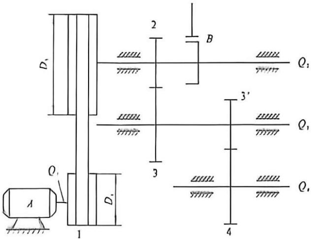

图14-9 变速箱齿轮传动机构
{: .figure-caption }

$$
M _ {,} = J _ {,} \mid \alpha_ {2} \mid = 1. 0 8 9 \times 2 6. 1 8 = 2 8. 5 1 \mathrm{N} \cdot \mathrm{m}
$$

## 14.5 机械周期性速度波动及其调节方法

### 1. 产生周期性波动的原因

在稳定运转状态下，若机械系统的运转速度呈现周期性的波动，则其等效转动惯量与等效力矩均应为等效构件角位移 $\varphi$ 的周期性函数，即 $J_{\mathrm{c}}(\varphi)$ 与 $M_{\mathrm{cd}}(\varphi)$ 、 $M_{\mathrm{cr}}(\varphi)$ 。

如图 14-10(n) 所示为某一机械在稳定运转过程中, 其等效构件在一个周期 $\varphi_{\mathrm{T}}$ 中所受等效驱动力矩 $M_{\mathrm{cl}}(\varphi)$ 与等效阻抗力矩 $M_{\mathrm{cr}}(\varphi)$ 的变化曲线。当等效构件从起始位置 $\varphi_{\mathrm{a}}$ 转过角 $\varphi$ 时, 等效驱动力矩与等效阻抗力矩所做功之差为:

$$
\Delta W = \int_ {\varphi_ {a}} ^ {\varphi} (M _ {e d} - M _ {e r}) d \varphi\tag{14-13}
$$

式中： $\Delta W$ 为盈亏功。 $\Delta W>0$ 时，为盈功，用“+”表示； $\Delta W<0$ 时，为亏功，用“-”表示。

机械系统动能的增量 $\Delta E$ 与 $\Delta W$ 相等，即

$$
\Delta E = \Delta W = J (\varphi) \omega^ {2} / 2 - J _ {\mathrm{a}} \omega_ {\mathrm{a}} ^ {2} / 2\tag{14-14}
$$

由上式得出机械系统动能变化曲线如图 14-10(b) 所示。

如果在等效力矩和等效转动惯量变化的公共周期内，即图14-10中对应于等效构件转角从 $\varphi_{\mathrm{a}}$ 到 $\varphi_{\mathrm{b}}$ 的一段，驱动功等于阻抗功，即“+”面积之和与“-”面积之和相等，则机械系统动能的增量等于零。因而等效构件的角速度也将恢复到起始位置的数值，等效构件的角速度在稳定运转过程中将呈现周期性的波动。

### 2. 速度波动的衡量指标——速度不均匀系数

设一个周期 $\varphi_{\mathrm{T}}$ 内，等效构件角速度的变化如图14-11所示，则其平均角速度 $\omega_{\mathrm{m}}$ 为：

$$
\omega_ {m} = \frac {1}{\varphi_ {T}} \int_ {0} ^ {\varphi_ {T}} \omega (\varphi) \mathrm{d} \varphi\tag{14-15}
$$

通常 $\omega(\varphi)$ 很难用解析式表示, 若 $\omega$ 变化不大, 常以最大角速度 $\omega_{max}$ 、最小角速度 $\omega_{min}$ 的算术平均值计算平均角速度, 即

$$
\omega = \frac {1}{2} \left(\omega_ {\max} + \omega_ {\min}\right)\tag{14-16}
$$

机械的速度波动程度可用角速度的变化量与平均角速度的比值来反映，该比值称为速度不均匀系数，通常以 $\delta$ 表示，即

$$
\delta = \frac {\omega_ {\max} - \omega_ {\min}}{\omega_ {m}}\tag{14-17}
$$

由上两式得:

$$
\omega_ {\max} ^ {2} - \omega_ {\min} ^ {2} = 2 \omega_ {\mathrm{m}} ^ {2} \delta
$$

(14-18)

图14-10 周期性速度波动的等效力矩与功能增量
{: .figure-caption }

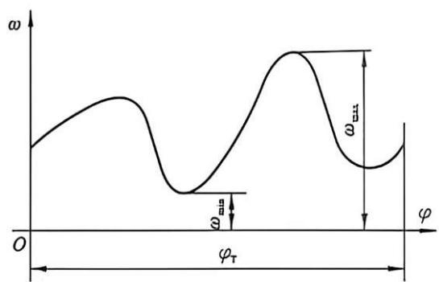

图14-11 等效构件角速度变化曲线
{: .figure-caption }

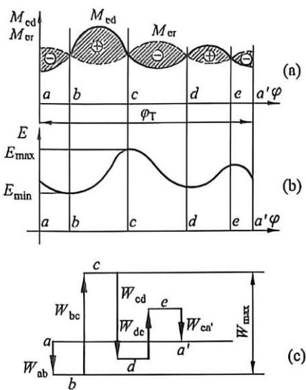

不同类型的机械, 对速度不均匀系数 $\delta$ 大小的要求是不同的。表 14-1 中列出了一些常用机械速度不均匀系数的许用值 $[\delta]$ , 供设计时参考。因此, 设计机械时, 其速度不均匀系数应不超过许用值, 即

$$
\delta \leqslant [ \delta ]\tag{14-19}
$$

表 14-1 速度不均匀系数的许用值 $\left\lbrack  \delta \right\rbrack$

<table><tr><td>机械的名称</td><td>[δ]</td><td>机械的名称</td><td>[δ]</td></tr><tr><td>碎石机</td><td>1/5~1/20</td><td>水泵、鼓风机</td><td>1/30~1/50</td></tr><tr><td>冲床、剪床</td><td>1/7~1/10</td><td>造纸机、织布机</td><td>1/40~1/50</td></tr><tr><td>轧压机</td><td>1/10~1/25</td><td>纺纱机</td><td>1/60~1/100</td></tr><tr><td>汽车、拖拉机</td><td>1/20~1/60</td><td>直流发电机</td><td>1/100~1/200</td></tr><tr><td>金属切削机床</td><td>1/30~1/40</td><td>交流发电机</td><td>1/200~1/300</td></tr></table>

### 3. 周期性速度波动的调节

机械运转周期性速度波动的调节，其目的是减小速度波动的幅度，控制速度不均匀系数不超过许用值 $[\delta]$ 。调节的方法是在机器中安装一个具有很大转动惯量的回转件，称其为飞轮。因飞轮的转动惯量很大，故其动能为机械动能的主要部分。为简化计算，设忽略机械中除飞轮以外其他构件的功能，则有：

$$
\Delta W _ {\text { mice }} = \Delta E _ {\text { mice }} = \frac {1}{2} J _ {\mathrm{r}} (\omega_ {\text { mice }} ^ {2} - \omega_ {\text { mth }} ^ {2})\tag{14-20}
$$

将式(14-18)代入式(14-20)，考虑式(14-19)，得：

$$
J _ {r} = \frac {\Delta W _ {\max}}{[ \delta ] \omega_ {m} ^ {2}} = \frac {9 0 0 \Delta W _ {\max}}{[ \delta ] n _ {m} ^ {2} \pi^ {2}}\tag{14-21}
$$

式中： $J_{1}$ 为飞轮转动惯量； $[\delta]$ 为速度不均匀系数的许用值（表14-1）； $n_{m}$ 为安装飞轮轴的平均速度，r/min； $\Delta W_{max}$ 为在最大角速度与最小角速度之间的盈亏功，即最大盈亏功。

计算飞轮的转动惯量必须确定最大盈亏功 $\Delta W_{\mathrm{max}}$ 。现以图14-10为例介绍利用能量指示图确定最大盈亏功 $\Delta W_{\mathrm{max}}$ 的方法。如图14-10(c)所示，取任意点 $a$ 作起点，按一定的比例用向量线段依次表示相应位置 $M_{\mathrm{ed}}$ 与 $M_{\mathrm{re}}$ 之间所包围的面积 $W_{\mathrm{ab}}$ 、 $W_{\mathrm{be}}$ 、 $W_{\mathrm{cd}}$ 、 $W_{\mathrm{de}}$ 和 $W_{\mathrm{ea}}$ 的大小和正负。盈功为正，其箭头向上；亏功为负，其箭头向下。由于一个运动循环的起始位置与终止位置的动能相等，所以能量指示图的首尾应在同一水平线上，即形成封闭的台阶形折线。由图中可看出位置点 $b$ 处动能最小，位置点 $c$ 处动能最大，而图中折线的最高点与最低点的距离就代表了最大盈亏功 $\Delta W_{\mathrm{max}}$ 的大小。

由式(14-21)知， $J_{\mathrm{F}}$ 与 $\omega_{\mathrm{m}}^{2}$ 成反比，这表明飞轮宜安装在角速度较高的轴上，这样可减少飞轮转动惯量，缩小体积，减轻质量，降低材料成本。

飞轮之所以能调速，是利用了它的储能作用。由于飞轮具有很大的转动惯量，因此要使其转速发生变化，就需要较大的能量，当机械出现盈功时，飞轮轴的角速度只作微小的上升，即可将多余的能量吸收储存起来；当机械出现亏功时，机械运转速度减慢，飞轮又可将储存的能量释放，以弥补能量的不足，而其角速度只作小幅度的下降。另外，一些机械（如锻压机）在一个工作周期中，工作时间很短，而峰值载荷很大，可以利用飞轮在非工作时间储存的动能来帮助克服尖峰载荷，从而可以选用较小功率的原动机来拖动，进而达到减少投资及降低能耗的目的。

此外, 有些能量回收系统 (kinetic energy retrieval system) 也基于飞轮, 即 flywheel-based kinetic energy retrieval system (KERS), 这种系统利用飞轮在高速时储存能量、低速时释放能量的特点, 实现能量回收, 能够大幅降低机械的能耗, 实现节能减排的目的。

有没有可能完全消除机械系统的速度波动呢？从式(14-21)来看，若要不均匀系数为0，则需要飞轮的转动惯量趋于无穷大，这显然不可能，也没必要，或者说，如要实现很小的不均匀系数，需要付出巨大代价；因此在进行速度波动调节时，完全不需要追求过小的不均匀系数，只需要满足使用要求即可。

例 14-3 已知某机械一个稳定运动循环内的等效驱动力矩 $M_{d}$ 为常数，等效阻力矩 $M_{r}$ 变化曲线如图 14-12 所示，等效构件的平均角速度 $\omega_{m}=25\ rad/s$ ，不均匀系数 $\delta=0.05$ ，求飞轮的转动惯量 $J_{F}$ 。

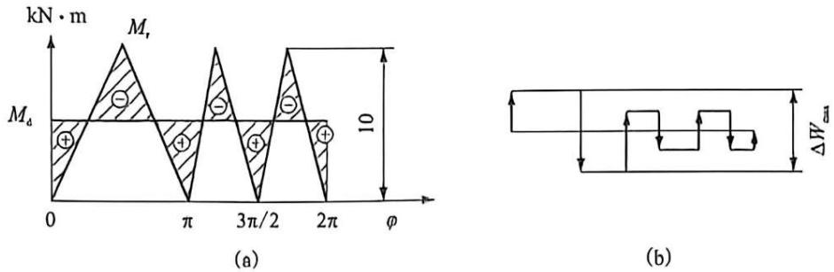

图14-12 等效力矩图和能量指示图
{: .figure-caption }

解：(1) 求 $M_{d}$

因为在一个循环内， $M_{d}$ 和 $M_{r}$ 所作的功相等，于是：

$$
M _ {\mathrm{d}} = \frac {1}{2 \pi} \int_ {0} ^ {2 \pi} M _ {\mathrm{r}} \mathrm{d} \varphi = \frac {1}{2 \pi} \left[ \frac {1}{2} \cdot \pi \cdot 1 0 + 2 \left(\frac {1}{2} \cdot \frac {\pi}{2} \cdot 1 0\right) \right] = 5
$$

代表 $M_{d}$ 的直线如图 14-12(a) 所示。

(2) 求 $\Delta W_{\mathrm{max}}$

各阴影三角形的面积分别如下：

<table><tr><td>区间</td><td>0~π/4</td><td>π/4~3π/4</td><td>3π/4~9π/8</td><td>9π/8~11π/8</td><td>11π/8~13π/8</td><td>13π/8~15π/8</td><td>15π/8~2π</td></tr><tr><td>面积</td><td>10π/16</td><td>-10π/8</td><td>15π/16</td><td>-5π/8</td><td>10π/16</td><td>-5π/8</td><td>5π/16</td></tr></table>

由能量指示图 14-12(b)，得：

$$
\Delta W _ {\max} = 1 0 \pi / 8 = 3. 9 3 \mathrm{KN} \cdot \mathrm{m}
$$

(3) 飞轮的转动惯量 $J_{\mathrm{F}}$

$$
J _ {\mathrm{F}} = \Delta W _ {\max} / [ \delta ] \omega_ {\mathrm{m}} ^ {2} = 3. 9 3 \times 1 0 / (0. 0 5 \times 2 5 ^ {2}) = 1 2 6 \mathrm{kg} \cdot \mathrm{m} ^ {2}
$$

### 4. 飞轮尺寸的确定

飞轮按构造可分为轮形和盘形两种，工程上以轮形使用最广泛。

(1)轮形飞轮。

轮形飞轮具有轮缘、轮毂和轮辐三部分，如图14-13所示。由于轮辐和轮毂的转动惯量比轮缘小得多，故通常可不予考虑。设 $m_{1}$ 为飞轮轮缘的质量， $D_{1}$ 和 $D_{2}$ 分别为轮缘的外径和内径， $D$ 为平均直径，宽度为 $b$ ，轮缘厚度为 $h$ ，则飞轮的转动惯量 $J_{\mathrm{F}}$ 近似为：

$$
J _ {\mathrm{F}} = \frac {m _ {1}}{2} \left[ \frac {D _ {1} ^ {2} + D _ {2} ^ {2}}{4} \right] = \frac {m _ {1}}{4} (D ^ {2} + h ^ {2})\tag{14-22}
$$

又因轮缘厚度与平均直径相比较其值一般很小，故可近似认为轮缘的质量集中在某平均直径 D 上，由此得：

或

$$
J _ {\mathrm{F}} = \frac {m _ {1} D ^ {2}}{4}
$$

$$
m _ {7} D ^ {7} = 4 J _ {3}\tag{14-23}
$$

式中： $m_{1}D^{2}$ 称为飞轮矩或飞轮特性，单位为 $kg\cdot tn^{2}$ 。平均直径D的选择，一方面应考虑飞轮在机器中的容许安装位置，另一方面则必须限制其圆周速度v应小于工程上规定的许用值 $[r]$ （表14-2），以免飞轮轮缘因离心惯性力过大而破裂。

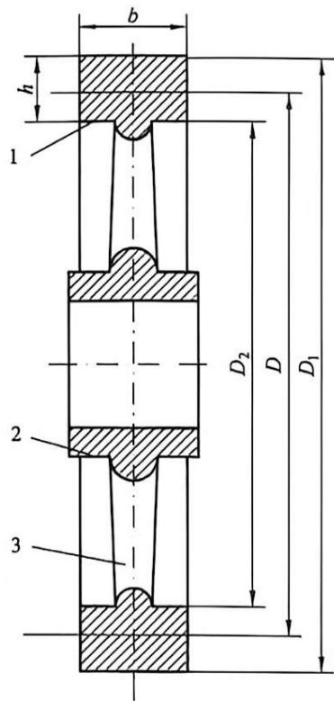

1—轮缘；2—轮毂；3—轮辐。

图14-13 轮形飞轮几何尺寸设计
{: .figure-caption }

由于

$$
\begin{array}{r l} v & = \pi D n / 6 0 <   [ v ] \\ & D <   6 0 [ v ] / \pi n \end{array}\tag{14-24}
$$

当选定飞轮的平均直径 D 之后，即可求得飞轮轮缘的质量 $m_{1}$ 。

表 14-2 工程上规定的圆周速度许用值 $\left\lbrack  v\right\rbrack$

<table><tr><td colspan="2">铸铁制飞轮</td><td colspan="2">钢制飞轮</td></tr><tr><td>轮缘轮辐整铸</td><td>30-50 m/s</td><td>轮缘轮辐整铸</td><td>60-140 m/s</td></tr><tr><td rowspan="2">轮缘轮辐分铸</td><td rowspan="2">55-145 m/s</td><td>整铸盘形飞轮</td><td>90-170 m/s</td></tr><tr><td>轧钢制盘形飞轮</td><td>100-120 m/s</td></tr></table>

设轮缘的材料密度为 $p(\mathrm{kg}/\mathrm{m}^{3})$ ，则

$$
m _ {1} = \pi D h b \rho
$$

或

$$
h b = m _ {1} / \pi D \rho\tag{14-25}
$$

对较大的飞轮，取 $h = 1.5b$ ；对较小的飞轮，取 $h \approx 2b$ 。当选定飞轮的轮缘厚度 $h$ 或宽度 $b$ 之后，另一参数即可求得。

(2) 盘形飞轮。

盘形飞轮为一带轴的实心圆盘，如图 14-14 所示。

设 m、D 和 b 分别为飞轮的质量、外径和宽度，则该飞轮的转动惯量 $J_{r}$ 为：

$$
J _ {\mathrm{r}} = \frac {m}{2} \left(\frac {D}{2}\right) ^ {2} = \frac {m D ^ {2}}{8}
$$

则其飞轮矩为 $mD^{2}=8J_{1}$

(14-26)

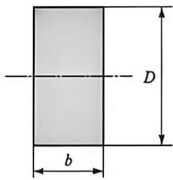

$$
m = V \rho = \pi D ^ {2} b \rho / 4
$$

图14-14 盘形飞轮几何尺寸
{: .figure-caption }

能超过安全值 $v_{max}$ ，推荐铸铁飞轮 $v_{max} \leqslant 36 \, m/s$ ，铸钢飞轮 $v_{max} \leqslant 50 \, m/s$ 。当选定飞轮的材料和直径 D 之后，即可求得飞轮宽度 b。

$$
b = \frac {4 m}{\pi D ^ {2} \rho}\tag{14-27}
$$

## 14.6 机械的非周期性速度波动及其调节

如果机械在运转过程中，等效力矩 $M_{o}=M_{cd}-M_{cr}$ 的变化是非周期性的，则机械运转的速度将出现非周期性的波动，从而破坏机械的稳定运转状态。若长时间内 $M_{cd}>M_{cr}$ ，则机械越转越快，甚至可能会出现“飞车”现象，从而使机械遭到破坏；反之，若 $M_{cd}<M_{cr}$ ，则机械会越转越慢，最后将停止不动。为了避免以上两种情况的发生，必须对这种非周期性的速度波动进行调节，以使机械重新恢复稳定运转。为此需要设法使等效驱动力矩与等效工作阻力矩恢复平衡关系。

对于非周期性速度波动, 安装飞轮并不能达到调节非周期速度波动的目的, 因为飞轮的作用只是“吸收”和“释放”能量, 而不能创造能量, 也不能消耗能量。非周期速度波动的调节问题可分为以下两种情况。

若等效驱动力矩 $M_{ed}$ 是等效构件角速度 $\omega$ 的函数，且随着 $\omega$ 的增大而减小，则该机械系统具有自动调节非周期速度波动的能力。以电动机为原动件的机械，一般都具有较好的自调性。

对于没有自调性或自调性较差的机械系统(如以蒸汽机、内燃机或汽轮机为原动机的机械系统)，则必须安装调速器以调节可能出现的非周期速度波动。

机械式离心调速器的工作原理如图 14-15 所示。当工作负荷减小时，机械系统的主轴 $\omega_{1}$ 转速升高，调速器中心轴的转速 $\omega_{2}$ 也将随之升高。此时，由于离心力的作用，两重球将随之飞起，带动滑块及滚子上升，并通过连杆机构关小节流阀，以减少进入原动机的工作介质（燃气、燃油等）。其调节结果是令系统的输入功与输出功相等，从而使机械在略高的转速下重新达到稳态。反之，机械可在略低的转速下重新达到稳定运动。因此，从本质上讲，调速器是一种反馈控制机构。

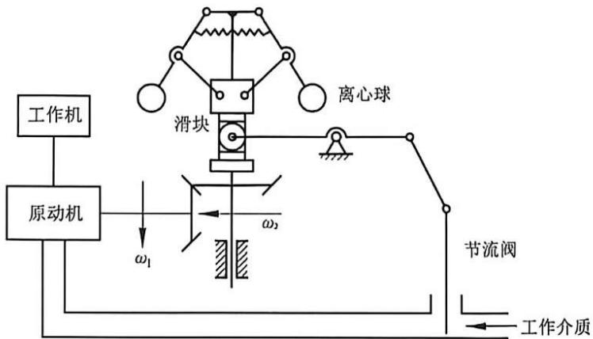

图14-15 机械式离心调速器工作原理图
{: .figure-caption }

## 本章思维导图

## 思考题与练习题

1. 说明机械的运转过程及运转过程中的力学特性。

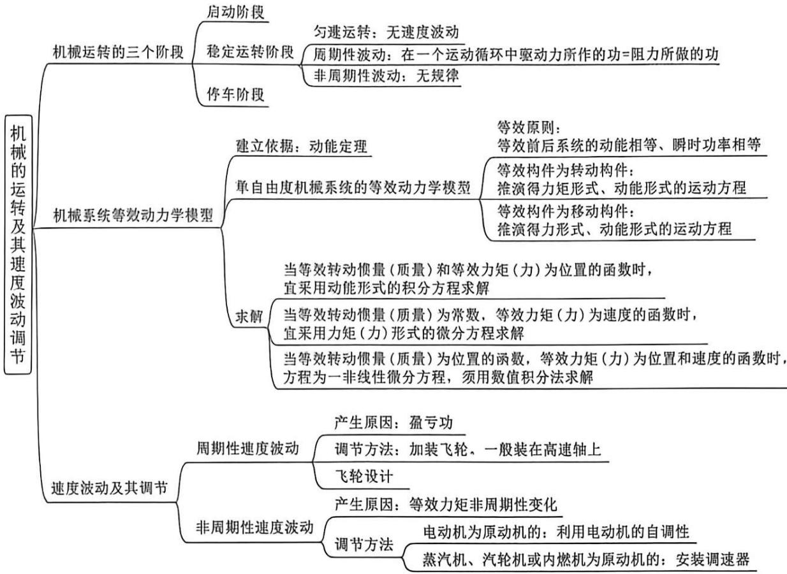

2. 等效转动惯量和等效力矩各自的等效条件是什么？

3. 在什么情况下机械才会做周期性速度波动？速度波动有何危害？如何调节？

4. 试说明飞轮在调速的同时还能起到节约能源的作用。

5. 说明离心调速器的工作原理。

6. 如图 14-16 所示的行星轮系中，已知各轮的齿数 $z_1 = z_{2'} = 20$ ， $z_2 = z_3 = 40$ ；各构件的质心均在其几何轴线上，且 $J_1 = 0.01 \, \text{kg} \cdot \text{m}^2$ ， $J_2 = 0.04 \, \text{kg} \cdot \text{m}^2$ ， $J_2' = 0.01 \, \text{kg} \cdot \text{m}^2$ ， $J_\text{H} = 0.18 \, \text{kg} \cdot \text{m}^2$ ；行星轮的质量 $m_2 = 2 \, \text{kg}$ ， $m_{2'} = 4 \, \text{kg}$ ，模数均为 $m = 10 \, \text{mm}$ ，作用在行星架 $H$ 上的力矩 $M_\text{H} = 60 \, \text{N} \cdot \text{m}$ 。求在等效构件 1 上的等效力矩 $M_\text{e}$ 和等效转动惯量 $J_\text{o}$ 。

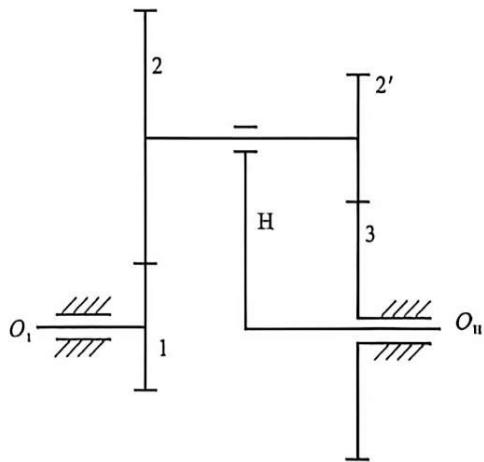

题图14-16 行星轮系
{: .figure-caption }

7. 已知某机械一个稳定运动循环内的等效阻力矩 $M_{r}$ 如图 14-17 所示，等效驱动力矩 $M_{d}$ 为常数，等效构件的最大、最小角速度分别为 $\omega_{max}=200\ rad/s$ 、 $\omega_{min}=180\ rad/s$ 。

试求：(1)等效驱动力矩 $M_{d}$ ;

(2) 运转的速度不均匀系数 $\delta$ ;

(3) 当要求 $\delta$ 在 0.05 范围内，且不计其余构件的转动惯量时，应装在等效构件上的飞轮的转动惯量 $J_{F}$ 。

8. 如图 14-18 所示发动机机构中，以曲柄为等效构件。作用在滑块上的驱动力 $F_{3} = 1000 \mathrm{~N}$ ，作用在曲柄上的工作阻力矩 $M_{1} = 900 \mathrm{~N} \cdot \mathrm{m}$ 。曲柄 $AB$ 长为 $l_{1} = 0.1 \mathrm{~m}, \varphi_{1} = 90^{\circ}$ ，滑块质量为 $m_{3} = 10 \mathrm{~kg}$ ，其余构件质量或转动惯量忽略不计。试求曲柄开始回转时的角加速度。

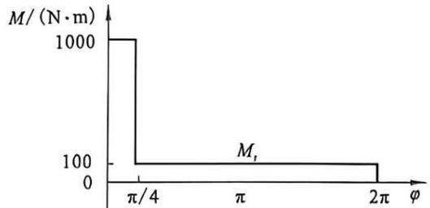

图14-17 某机械一个稳定运动循环内的等效阻力矩
{: .figure-caption }

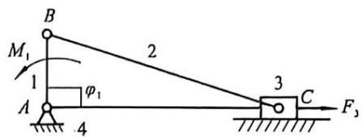

图14-18 发动机机构
{: .figure-caption }

9. 某机器主轴上的等效力矩和等效转动惯量的变化规律如图 14-19 所示, 试求:

(1) 判断该机器能否作周期性的变速稳定运转，并说明理由；

(2) 在运动周期的初始位置时, $\varphi_0 = 0$ , $\dot{\varphi}_0 = 100 \mathrm{rad} / \mathrm{s}$ , 求角速度 $\omega_{\max} 、 \omega_{\min}$ 及其对应的转角位置。

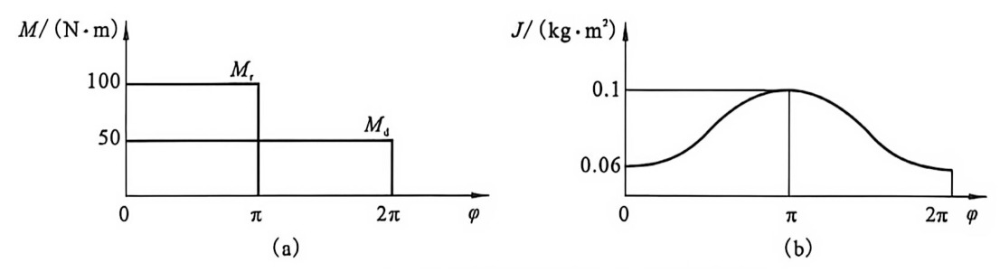

题图14-19 某机器主轴的等效力矩和等效转动惯量
{: .figure-caption }

10. 在电动机驱动的剪床中，已知作用在剪床主轴上的阻力矩 $M_{r}$ 的变化规律如图 14-20 所示。设驱动力矩 $M_{d}$ 等于常数，剪床主轴转速为 60 r/min，机械运转不均匀系数 $\delta = 0.15$ 。求：(1) 驱动力矩 $M_{d}$ 的数值；(2) 安装在主轴上的飞轮转动惯量。

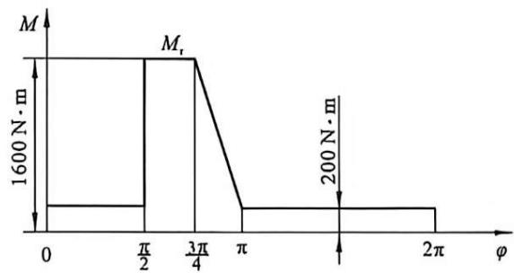

题图14-20 剪床主轴的阻力矩
{: .figure-caption }
