# 第15章 机械系统的方案设计

**【概述】**

◎本章主要介绍机械系统方案设计的基本内容，包括机械执行系统、传动系统的方案设计及原动机的选择，机构组合协调运动设计，常用机构的类型、特点及选用等。

◎通过本章的学习，要求：了解机械系统设计的整个过程，明确机械系统总体方案设计阶段的设计目的及工作内容，了解机械系统总体方案设计中应具有的现代设计观念及机械现代设计和创新设计的特点，逐步学会在机械执行系统、传动系统的方案设计和原动机选择过程中，正确灵活运用这些设计思想；了解机械执行系统方案设计的过程和具体设计内容，学会根据机械预期实现的功能要求，进行功能原理设计的创新构思，学会根据工作原理提出的工艺动作要求，创造性地构思出合适的运动规律；了解执行系统协调设计的目的和原则，掌握机械运动循环图的绘制方法。

## 15.1 机械系统方案设计的一般流程

### 15.1.1 机械产品设计的一般过程

机械系统主要是由原动机、执行系统、传动系统和控制系统组成。

机械产品设计是指通过分析、综合与创新获得满足某些特定要求和功能的机械系统。设计过程大致要经过表 15-1 所示的四个阶段。

表 15-1 机械产品设计的一般过程

<table><tr><td>阶段</td><td>内容</td><td>应完成的工作</td></tr><tr><td>初期规划设计阶段</td><td>1选题2调研和预测3可行性论证4确定设计任务</td><td>1调研报告2产品开发可行性论证报告3设计任务书</td></tr></table>

续表15-1

<table><tr><td>阶段</td><td>内容</td><td>应完成的工作</td></tr><tr><td>总体方案设计阶段</td><td>1功能原理构思2方案拟定3方案评价4方案决案</td><td>1机械系统运动简介2方案设计说明书</td></tr><tr><td>结构技术设计阶段</td><td>1结构方案设计2造型设计3结构设计4材料选用5设计图绘制</td><td>1设计图纸2设计计算说明书</td></tr><tr><td>生产施工设计阶段</td><td>1工艺设计2工装设计3施工设计</td><td>1工艺流程图2工装设计图3基础安装图4使用说明书</td></tr></table>

### 15.1.2 机械系统方案设计的一般步骤

机械系统方案设计正确和合理与否，对提高机械产品的性能和质量，降低制造成本与维护费用等影响很大。机械系统的方案设计是一项极富创造性的活动，要求设计者善于运用已有知识和实践经验，广泛收集、了解国内外有关信息，充分发挥创造性思维和想象力，充分应用各种知识和技巧，以设计出新颖、灵巧、高效、节能、环保的机械系统。

此外，在设计时不仅要关注产品的技术性能和经济指标，还应该注意产品是否符合国家法律、法规的要求；在方案评价时，不仅要对评价对象进行可行性分析和评估，还应对评价对象在技术性、经济性和社会性等方面存在的问题。

机械系统方案设计一般按下述步骤进行。

(1) 拟定机械系统的功能原理。

根据机械系统的总功能要求，运用物理学、化学、生物学等方面的知识，光、机、电、液相结合拟定出满足机械系统总功能的工作原理和技术手段，确定出机械所要实现的工艺动作。

(2)确定传动系统的传动方案。

传动系统是把原动机的动力和运动传递给执行系统的中间装置，它的主要功能是变速、改变运动形式、传递动力。

(3) 确定执行系统的工作方案。

执行系统包括机械的执行机构和执行构件。其目的是利用机械来改变作业对象的性质、状态、形状和位置，或对作业对象进行检测、度量等，以进行生产或达到其他预定的要求。执行系统位于机械系统的末端，直接与作业对象接触，是机械系统的输出部分。

(4)机构的选型、组合和变异。

根据传动系统，执行系统运动和动力学功能要求，选择能实现这些功能的机构类型，必要时应对已有机构进行变异，创造出新型机构，并对所选机构进行组合，形成满足运动和功能要求的机械系统方案，绘制系统的传动示意图。

(5)系统中机构和构件运动协调性设计。

根据执行构件和原动机的运动参数，以及各执行构件运动的协调性要求，确定出构件的运动尺寸，绘制机械系统的机构运动简图。

(6)方案分析和评审。

机械系统设计中，同一功能要求可以采用不同的工作原理，实现同一工作原理可以选择不同的运动规律，同一种运动规律可以选择不同形式的机构。因此在机械系统设计时，应拟定多种不同方案，全面考察各方案是否满足机械的运动和动力要求，是否具有良好的工作性、动力性、结构紧凑性等。

## 15.2 机械执行系统的功能原理设计

执行系统是机械系统中的重要组成部分，是直接完成机械系统预期工作任务的部分。

执行系统由一个或多个执行机构组成。执行构件是执行机构的输出构件，其数量及运动形式、运动规律和传动特性等要求，决定了整个执行系统的结构方案。

机械执行系统的功能原理设计就是根据机械系统预期实现的功能，考虑选择何种工作原理来实现。采用不同的工作原理设计出的机械，其性能、结构、工作品质、适用场合等都会有很大的差异。因此必须根据机械的具体工作要求，如强度、精度、寿命、效率、产量、成本、环保等诸多因素综合考虑确定。同时在满足要求的前提下尽可能多采用几个方案。

在进行机械系统的功能原理设计时首先应明确机器的总功能，然后进行功能分解，使其成为一系列独立的工艺动作。为了使设计对象满足总功能需要，可运用各种科学原理，如物理学、化学、生物学的成就，创造出新的机械产品。不要把思路局限在某一领域内，要拓宽到光、机、电、液各相关领域。例如要实现“洁衣”的功能，可采用化学溶剂吸收污物的“干洗”办法，也可采用水洗衣（机械搅拌方法、超声波振荡）。采用机械搅拌还可分为波轮（旋涡）搅拌式、摆动式或滚筒式拍洗等方式。

一台新机器，功能原理设计方案拟定从质的方面决定了机器的技术水平、工作质量、结构形式和成本。在设计过程中要多借助现代设计技术手段创造新的机械产品。例如，自动麻将机的设计最难解决的问题是保证砌墩时每块牌正面朝下。但采用铁磁吸铁的原理，就能很好地解决这个问题，而且非常可靠。

在拟定机械系统的功能原理方案时，思路要开阔，考虑各种完成机械功能的可能性，能用最简单的方法实现同一功能的方案才是最佳方案。如某按摩椅为实现按摩动作，采用图15-1所示的原理方案，在一回转轴上倾斜安装两个偏心轮就完成了按摩的主要动作，其构思非常巧妙。因其质量中心和回转中心不重合，故有振动按摩作用。因为倾斜安装偏心轮，故有向人体推压、向下推拉及横向扩展的按摩作用。至于按摩部位和按摩轻重则被按摩人自动控制。如此设计结构简单合理，造价低廉，才能被一般消费者所接受。

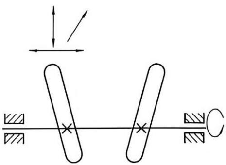

图15-1 按摩轮
{: .figure-caption }

机械执行系统的功能原理设计是把机械的功能目标转为工艺动作的过程，是在功能分析的基础上创新构思，优化筛选工艺动作的过程。对于复杂的运动可采取先分解再合成的方法。机械最容易实现的运动形式是转动和直线移动，因此，对于复杂的运动形式不要一味强行思索，要考虑机械的运动特性。

插齿机工作时, 插刀的基本动作有切削、展成、让刀, 可以看出插刀的运动方式比较复杂。若一味强行思索, 很难构思出一个单一机构完成这样复杂的工艺动作。但若将复杂的动作进行分解, 切削由移动来实现, 展成由转动来实现, 让刀由间歇运动来实现, 然后再将各动作进行协调配合。如转动和移动的同时实现可以利用插刀轴的导向滑键, 即插刀轴可以沿轴孔相对移动, 同时又因键的联结随蜗轮一起转动。关于让刀的间歇运动, 可以设计成刀与刀架一起动作的结构。但必须注意切削与让刀的动作在时间上的协调, 否则会产生干涉 (图 15-2)。

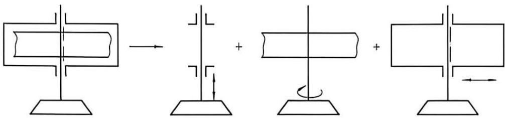

图15-2 插刀复合运动的分解
{: .figure-caption }

在进行功能原理设计时，除了认真分析机械的功能目标，详细了解各种技术原理与操作方法之外，还需要在思维方式上进行各种努力，要放开思路、大胆设想，尽可能多提出一些原理方案，然后再去粗取精。

(1) 定向思维或逻辑思维。

这种思维主要体现在规律性、可搜索性。例如在确定工作原理时就可根据机械产品具体功能目标的特点进行定向思维。如果功能目标是改变物料的形状，则可采用机械加工成形，如切削、冲压、钻磨等；也可采用无切削成形，如铸造、挤压、粉末冶金等。而切削又有车、铣、刨等，挤压又分螺旋挤压、合模挤压等。

例如，功能目标提出要加工一个齿轮，并规定了齿轮的材料、规格及精度要求等。经分析明确了这是属于改变物料形状中制品成形的问题，若沿着机械加工的思路构思，就可以拟定出铣制的工作原理；若沿着无切削的思路构思，则可拟定出粉末冶金、铸造等工作原理。而铣制的工作原理又有滚铣和插铣等。

(2) 多向思维或灵感思维。

这种思维具有突发性、偶然性、独创性与模糊性，它可从不同方向或不同角度，依据所具备的知识、经验和方法，通过丰富的想象和直觉，甚至突发灵感而产生的新设想、新概念、新方案。这种思维方式可先不要考虑机械的效益，也不要顾虑各方面的压力，可以异想天开。

例如，螺旋机构可作为螺旋压力机或螺旋千斤顶，利用它的自锁性，还可以用于连接；由于其既旋转又移动，以及螺旋面间有空隙的特点，还可以用于物料的推进和挤压，因此就有了各种螺旋挤出机与螺杆泵；由于旋向和转向对其移动方向的影响，还可作为螺旋差动机构和微动机构。

(3) 联想思维或形象思维。

这种思维具有形象性、运动性、概括性与创造性。在创新设计中的运用主要体现在观察和联想，与人的感官对外界的体验和反应密切相关。

通过已有机械产品的启发、类比、联想、综合或改进，拟定一个新的工作原理。还可以通过对日常生活中各种现象的观察及受自然界中各种动作的启发产生联想，进而创新。例如，观察水烧开时的蒸汽顶开水壶盖而展开联想，发明了蒸汽机；观察蓬草由风吹而转动，联想到轮，再由轮联想到车轮；利用血液的流动机理设计了液态物质输送的引导机构；通过螺旋传动的微动原理的联想而设计了千分尺；用于传动的齿轮也可用在联轴器和齿轮泵上。

## 15.3 常用机构的类型、特点及选用

组成机器的基本单元是机构，简单的机器至少有一个机构，而较复杂机器可能包含有多个机构，同一用途的机器可以由不同的机构来实现。

### 15.3.1 机构的基本功能

机械的功能是指机械实现运动变换和完成某种功用的能力，机械的基本功能是：

(1) 实现运动形式变换。

①实现转动←→转动，如齿轮机构、带传动机构、双曲柄机构等。

②实现转动←→摆动，如曲柄摇杆机构、摆动导杆机构、摆动从动件凸轮机构等。

③实现转动←→移动，如曲柄滑块机构、齿轮齿条机构、螺旋机构、移动从动件凸轮机构等。

④实现转动←→单向间歇运动，如槽轮机构、不完全齿轮机构、凸轮间歇运动机构等。

⑤实现摆动←→单向间歇运动，如齿式棘轮机构、摩擦式棘轮机械等。

(2) 实现运动速度的变换。

如齿轮机构的增速和减速。

(3) 实现运动方向的变换。

如齿轮机构、蜗杆传动、圆锥齿轮传动的轴线可以分别为平行、相错、相交，故能变换运动方向。

(4) 进行运动合成和分解。

如差动轮系和多自由度机构，可实现运动的合成和分解。

(5) 实现某些特殊功能。

如增力、扩大行程、微动、急回特性、定位等某些特殊功能。

### 15.3.2 常用机构的类型、特点

表 15-2 列出了常用机构的类型及其特性。

表 15-2 常用机构的运动及动力特性

<table><tr><td>机构类型</td><td>运动及动力特性</td></tr><tr><td>连杆机构</td><td>可以输出转动、移动、摆动,可以实现一定轨迹和位置要求;经机构串接还可以实现停歇、逆转和变速功能;利用死点可用于夹紧、自锁装置;由于运动副为面接触,故承载能力大;但平衡困难,不宜用于高速</td></tr><tr><td>凸轮机构</td><td>可以输出任意运动规律的移动、摆动但行程不大;若凸轮固定,从动件做复合运动,则从动件可以实现任意运动轨迹;由于运动副为高副(滚滑副),又靠力或形状封闭运动副,故不适用于重载</td></tr><tr><td>齿轮机构</td><td>圆形齿轮实现定传动比传动,非圆形齿轮实现变传动比传动;功率和转速范围都很大;传动比准确可靠</td></tr><tr><td>螺旋机构</td><td>输出移动或转动,还可以实现微动、增力、定位等功能;工作平稳,精度高,但效率低,易磨损</td></tr><tr><td>棘轮机构</td><td>输出间歇运动,并且行程可调;但工作时冲击、噪声较大,只适用于低速、轻载</td></tr><tr><td>槽轮机构</td><td>输出间歇运动,转位平稳;有柔性冲击,不适用于高速</td></tr><tr><td>柔性件机构</td><td>常见的柔性件有带、链、绳;通常柔性件机构传递均速转动;当轮为非圆形时,可实现非均速运动,还可实现多轴同步运动;利用柔性件可以实现大距离往复运动、实现运动轨迹等。柔性件具有吸振特点、无噪声、传动平稳、过载打滑,但传动比不精确</td></tr><tr><td>电气机构</td><td>用于传动和控制,电、磁元件在机构中作为中间媒介,可使机构快速启动和停止,实现驱动、传动、测量、控制、记录等功能</td></tr><tr><td>液、气动机构</td><td>常用于驱动机构、压力机构、阻尼机构、阀等;利用流体流量的变化可改变速度,利用流体的压缩性可吸振、缓冲、阻尼,利用承压面的大小可改变力的大小</td></tr></table>

在进行机构选型时要注意下列问题：

(1) 按拟定的工作原理进行机构选型时, 应尽量满足或接近功能目标。满足动作要求实现某种运动形式的机构类型很多, 可多选几个, 再进行比较, 保留性能好的, 淘汰不理想的。

例如, 若要求执行构件完成精确而连续的位移规律, 可选用的机构类型很多, 有连杆机构、凸轮机构、气动机构等。但经比较分析后, 最理想的还是凸轮机构, 因它可以确保准确的位移规律, 并且结构简单。采用连杆机构则结构稍复杂, 若采用液压或气动机构来完成精确的位移规律不太妥当, 因为液体或气体的泄漏, 以及环境温度的变化均会影响其运动的准确性。液、气动机构最适合用于始、末位置要求准确, 而中间其他位置不需要准确定位的情况。

(2)机构选型时应力求其结构简单。机构结构简单主要体现在运动链要短，构件和运动副数目要少，机构尺寸要适度，布局要紧凑。坚持这个原则，可使材料耗费少，成本低；运动副数目少，运动链短，机构在传递运动时累积的误差也少，有利于提高机构的运动精度和机械的效率。

(3)机构选型要注意选择加工制造简单、容易保证较高配合精度的机构。在平面机构中，低副机构比高副机构容易制造；在低副机构中，转动副比移动副容易保证配合精度。

(4)优先选用基本机构。基本机构结构简单，设计方案技术成熟，故在满足功能要求的条件下，应优先选用基本机构。

(5)机构选型时要能保证机构高速运转时动力特性良好。动力特性良好主要体现在要保证机械运转时的动平衡，使机械系统的振动降低到最低水平。因此高速运转机构尽量不采用杆式机构，若功能要求必须采用则应采用多套机构合理布置的平衡方法来达到平衡。

若采用凸轮机构，为改善其动力特性，在选择从动件运动规律时，其加速度与速度曲线应尽量连续，避免刚性和柔性冲击。同时，应尽量减小加速度的最大值，以降低惯性力；应尽量增大从动件固定导路的长度，缩短从动件在固定导路外伸出的长度。

(6)机构的选型也须注意机械效益和机械效率问题。机械效益是衡量机构省力程度的一个重要标志，机构的传动角越大，压力角越小，机械效益越高，选型时可采用最大传动角的机构以减小输入轴上的扭矩。

机械效率取决于组成机械各个机构的效率，在机械中包含有效率较低的机构时，就会使机械的总效率降低。系统中各个运动链传递的功率往往相差很大，有些运动链的功率占系统总功率的很大部分，而有些辅助运动链传递功率很小。在选择传动方式时，对于传递功率大的运动链，则应对传动方式的效率予以足够重视；对传递功率很小的运动链，在选择传动方式时，可主要着眼于其他方面的要求，而将传动效率的高低放在次要的地位。

机构选型也要考虑动力源的形式。若有液、气源时可利用液、气动机构，以简化机构结构，也便于调节速度；若采用电动机，则要考虑机构的原动件应为连续转动的构件。

## 15.4 机械执行系统的运动规律设计

### 15.4.1 运动方案设计的主要内容和过程

执行系统运动方案设计，是在产品规划明确拟定了其功能目标后进行的。其过程如图 15-3 所示。

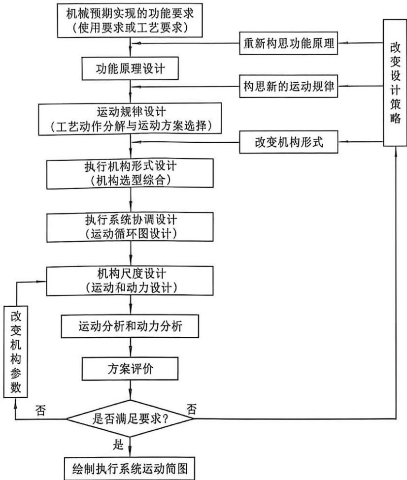

图15-3 机械执行系统设计程序
{: .figure-caption }

### 15.4.2 执行构件的运动形式

(3)曲线运动

(执行构件上某点特)缝纫机的送布牙运动

定的曲线轨迹运动 电影放映机抓片机构中的抓片运动

(4) 刚体导引运动

非连架杆执行构件

造型机工作台的翻转运动

实现若干位置的运动

热处理炉的炉门启闭运动

折叠椅的折叠运动

### 15.4.3 实现执行构件各种运动形式的常用机构

摩擦传动机构

(带传动

摩擦轮传动(图 15-4)

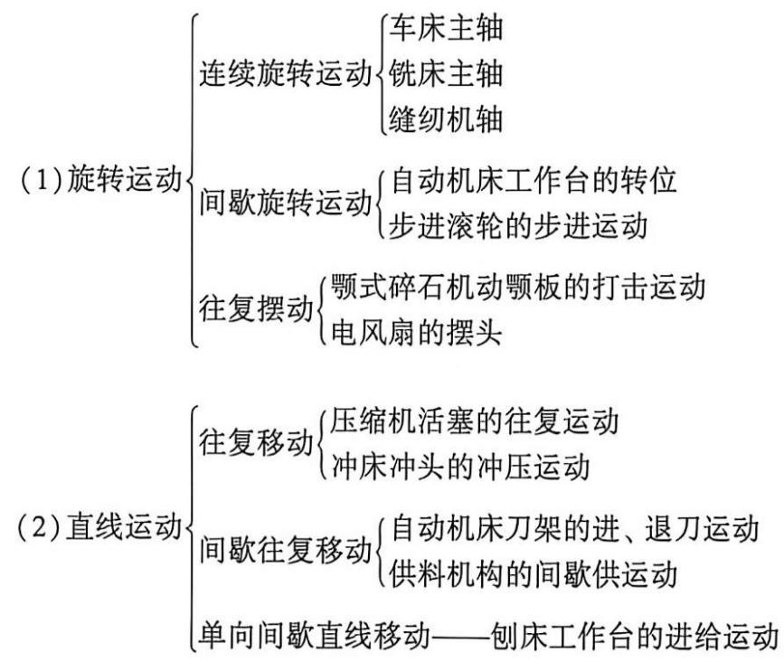

(1) 实现连续旋转运动的机构

齿轮传动

啮合传动机构

蜗杆传动

链传动

连杆机构

双曲柄机构

平行四边形机构

槽轮机构——适用于转角固定的转位运动

棘轮机构——每次转角小,或转角大小可调的低速场合

(2) 实现间歇旋转运动的机构

不完全齿轮机构——大转角且速度不高的场合

凸轮式间歇运动机构——运动平稳、分度、定位准确，但制造困难、高精度定位、高速场合

齿轮-连杆机构——特殊要求的输送机构

曲柄滑块机构

连杆机构

正弦机构

正切机构

(3) 实现往复移

六连杆机构

动、往复摆动运动的机构凸轮机构

螺旋机构

齿轮齿条机构

组合机构

液压缸、气缸

连杆机构(图 15-5)

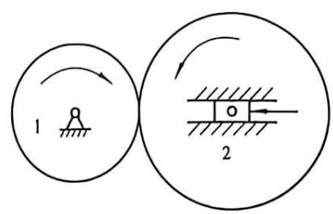

图15-4 摩擦轮传动
{: .figure-caption }

(4)再现轨迹的机构。

凸轮-连杆组合机构(图 15-6)

齿轮-连杆组合机构(图 15-7)

联动凸轮机构(图 15-8)

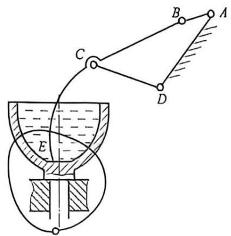

图15-5 搅拌机构
{: .figure-caption }

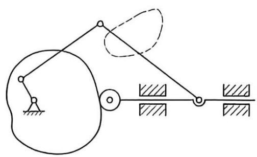

图15-6 凸轮-连杆组合机构
{: .figure-caption }

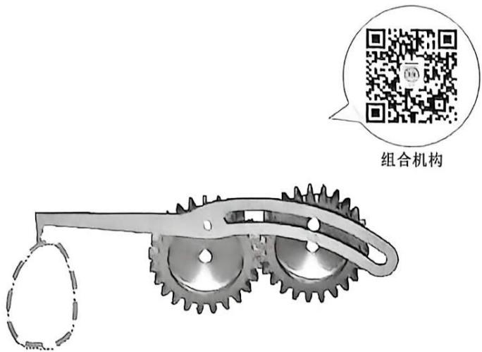

图15-7 齿轮-连杆组合机构
{: .figure-caption }

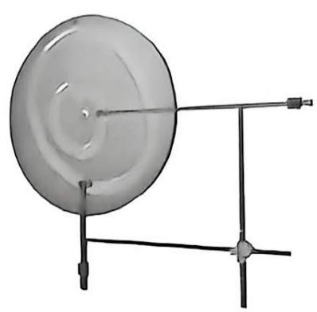

图15-8 联动凸轮机构
{: .figure-caption }

一般而言,除了凸轮机构能实现精确的曲线轨迹之外,其他机构都只能近似实现预定的曲线轨迹。

## 15.5 机构组合协调运动设计

单一的基本机构往往由于其本身所固有的局限性而无法满足多方面的要求。为了满足新的更高的要求，人们尝试将各种基本机构进行适当的组合，使各基本机构既能发挥其特长，又能避免其本身固有的局限性，从而形成结构简单、设计方便、性能优良的机构系统，以满足生产中所提出的多种要求和提高生产自动化的程度。

### 15.5.1 执行机构的运动协调设计

为了使各执行机构的执行动作按工艺动作过程要求进行有序的、相互协调配合的动作，执行机构的运动协调设计应满足以下要求。

①执行机构中的执行构件的动作必须满足工艺要求。

②执行机构中的执行构件的动作保证空间同步。

③为提高机器生产率，应使各执行机构的动作周期尽量重合。

④一个执行机构动作结束到另一个执行机构动作起始点之间应有适当间隔，避免发生干涉。

执行机构的运动协调设计可以从以下几个方面来阐述。

(1) 各执行机构的动作在时间上协调配合。

如图 15-9 所示的粉料压片机。根据生产工艺路线方案，此粉料压片机必须实现以下 5 个动作：

①移动料斗至模具的型腔上方准备将粉料装入型腔，同时将已经成形的药片推出。

②料斗振动，将料斗内粉料筛入型腔。

③下冲头下沉至一定深度。

④上冲头向下，下冲头向上，将粉料加压并保压一段时间，使药片成形较好，以防止上冲头向下压制时将型腔内粉料扑出。

⑤上冲头快速退出，下冲头随着将已经成型的工件——药片推出型腔，完成压片工艺过程。

(2) 各执行机构的动作在空间上协调配合。

(3) 各执行机构运动速度的协调配合。

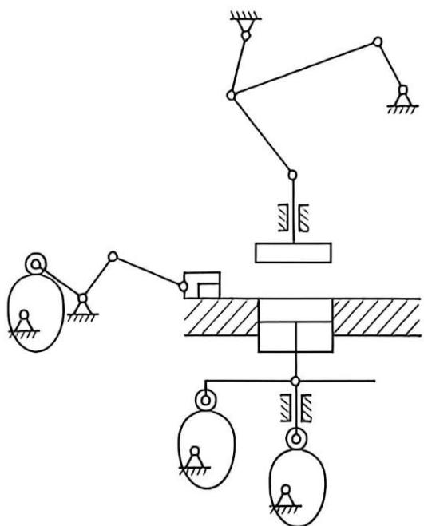

图15-9 粉料压片机的组合方式
{: .figure-caption }

有些机械要求执行构件运动之间必须保持严格的速比关系，例如滚齿或插齿机按范成法加工齿轮时，刀具和齿坯的范成运动必须保持某一预定的转速比。

(4) 多个执行机构完成一个执行动作时, 其执行机构运动的协调配合。

如图 15-10 所示的纸钣冲孔机机构，它在完成冲孔这一工艺动作时，要求由两个执行机构的组合运动来实现。一是曲柄摇杆机构中摇杆（打击钣）的上下摆动，带动安装在它上面的滑块（冲头）也做上下摆动。二是电磁铁动作，装有衔铁的曲柄在电磁吸力的作用下做往复摆动，带动滑块（冲头）沿打击钣上的导路做往复移动。显然这两个机构的运动必须精确协调配合。

### 15.5.2 机械运动循环图设计

用于描述各执行构件运动间相互协调配合的图称为机械运动循环图。由于机械在主轴或分配轴转动一图15-10 纸钣冲孔机机构系统

周或若干周内完成一个运动循环，故机械运动循环图以主轴或分配轴的转角为坐标来编制。

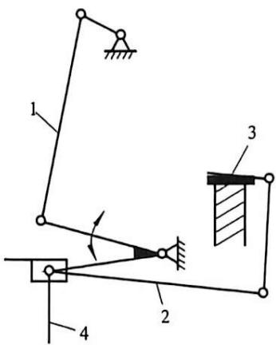

1—曲柄摇杆机构；2—滑块机构；3—电磁；4—冲针。

机械运动循环图的功能是保证各执行构件的动作相互协调，紧密配合使机械顺利实现预期的工艺动作。此外，该图为进一步设计各执行机构的运动尺寸提供重要依据，为机械系统的调试提供依据。

(1)机械运动循环图的类型。

机械运动循环图又称机械工作循环图、分为三种形式。

①直线式运动循环图(即矩形运动循环图)，如表1-1、表1-2及图15-11所示。

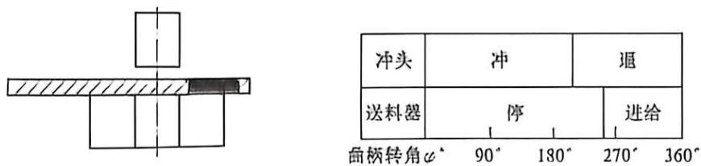

图15-11 直线式运动循环图
{: .figure-caption }

②圆周式工作循环图(图 15-12)，为单缸四冲程内燃机的工作循环图。它以曲轴作为定标件，曲轴每转两周为一个工作循环。

③直角坐标式运动循环图，如图 15-13 所示。饼干包装机工作循环图中，横轴表示定标件的转角，纵轴表示执行构件的转角。

(2)机械运动循环图的设计要点。

①以工艺过程开始点作为机器工作循环的起始点，并确定开始工作的那个执行机构在工作循环图上的机构运动循环图，其他执行机构则按工艺动作顺序先后列出。

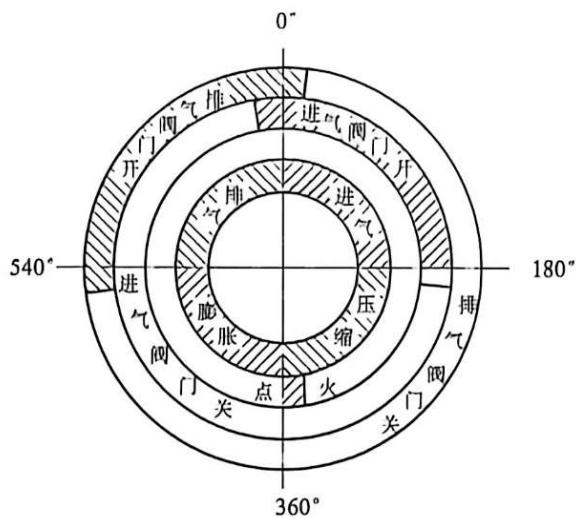

图15-12 单缸四冲程内燃机的工作循环图
{: .figure-caption }

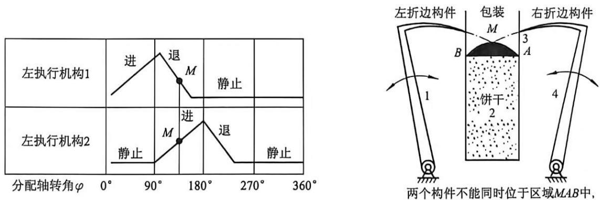

图15-13 直角坐标式运动循环图
{: .figure-caption }

②不在分配轴上的控制构件(一般是凸轮)，应将其动作所对应的中心角换算成分配轴相应的转角。

③尽量使各执行机构的动作重合，以便缩短机器工作循环的周期，提高生产率。

④按顺序先后进行工作的执行构件, 要求它们前一执行构件的工作行程结束之时, 与后一执行构件的工作行程开始之时, 应有一定的时间间隔和空间裕量, 以防止两个机构在动作

衔接处发生干涉。

⑤在不影响工艺动作要求和生产率的条件下，应尽可能使各执行机构工作行程所对应的中心角增大些，以便减小速度和冲击等。

(3)机械运动循环图的设计步骤与方法。

①确定执行机构的运动循环时间 $T_{1}$ 。

②确定组成执行构件运动循环的各个区段。

③初步绘制执行机构的执行构件的运动循环图。

④进行各执行机构的协调设计。

⑤在完成执行机构的设计后对初步绘制的运动循环图进行修改。

## 15.6 机械传动系统方案设计和原动机选择

### 15.6.1 传动系统的作用及其设计过程

传动系统位于原动机和执行系统之间，将原动机的运动和动力传递给执行系统，进行功率传递，使执行机构能克服阻力做功；实现增速、减速或变速传动；变换运动形式；进行运动的合成和分解；实现分路传动和较远距离传动；实现某些操纵控制功能（如启动、离合、制动、换向……）等。

传动系统方案设计时首先应完成执行系统的方案设计和原动机的选型，即根据执行机构所需要的运动和动力条件及原动机的类型和性能参数进行传动系统的方案设计。

传动系统设计过程：

(1) 确定传动系统的总传动比。

(2)选择传动类型。根据设计任务书中所规定的功能要求,执行系统对动力、传动比或速度变化的要求及原动机的工作特性,选择合适的传动装置类型。

(3) 拟定传动链的布置方案。即根据空间位置、运动和动力传递路线及所选传动装置的传动特点和适用条件，合理拟定传动路线，安排各传动机构的先后顺序，以完成从原动机到各执行机构之间的传动系统的总体布置方案。

(4) 分配传动比。即根据传动系统的组成方案, 将总传动比合理分配至各级传动机构, 表 15-3 所列为各种传动机构合理的传动比。

表 15-3 几种传动机构常用圆周速比、单级传动比和传递的最大功率的概值

<table><tr><td>传动机构种类</td><td>平带</td><td>V带</td><td>同步带</td><td>摩擦轮</td><td>齿轮</td><td>螺杆</td><td>链</td></tr><tr><td>圆周速度/(m·s-1)</td><td>5~25(30)</td><td>5~30</td><td>≤50</td><td>≤15~25</td><td>≤15~120</td><td>≤15~35</td><td>≤15~40</td></tr><tr><td>传动比</td><td>≤5</td><td>≤8~15</td><td>≤10</td><td>≤7~10</td><td>≤4~8(20)</td><td>≤80</td><td>≤6~10</td></tr><tr><td>最大功率/kW</td><td>2000</td><td>750~1200</td><td>500</td><td>150~250</td><td>50000</td><td>550</td><td>3750</td></tr></table>

(5)确定各级传动机构的基本参数和主要几何尺寸, 计算传动系统的各项运动学和动力学参数, 为各级传动机构的结构设计、强度计算和传动系统方案评价提供依据和指标。

(6)绘制传动系统运动简图。

### 15.6.2 传动类型的选择

#### 1. 传动的类型和特点

(1) 机械传动。利用机构所实现的传动称为机械传动。其优点是工作稳定、可靠，对环境的干扰不敏感；缺点是响应速度较慢、控制欠灵活。

(2) 液压、液力传动。利用液压泵、阀、执行器等液压元器件实现的传动称为液压传动；液力传动则是利用叶轮通过液体的动能变化来传递能量。

液压、液力传动的主要优点是速度、扭矩和功率均可连续调节；调速范围大，能迅速换向和变速；传递功率大；结构简单，易实现系列化、标准化，使用寿命长；易实现远距离控制、动作快速；能实现过载保护。其缺点主要是传动效率低，不如机械传动精确；制造、安装精度要求高；对油液质量和密封性要求高。

(3)气压传动。以压缩空气为工作介质的传动称为气压传动。

气压传动的优点是易快速实现往复移动、摆动和高速转动，调速方便；气压元件结构简单，适合标准化、系列化，易制造、易操纵，可直接用气压信号实现系统控制，完成复杂动作；管路压力损失小，适于远距离输送；与液压传动相比，经济且不易污染环境，安全、能适应恶劣的工作环境。其缺点是传动效率低；因压力不能太高，故不能传递大功率；因空气的可压缩性，故载荷变化时，传递运动不太平稳，排气噪声大。

#### 2. 根据传动比的变化分

(1)定传动比传动。输入与输出转速对应, 适用于执行机构的工况固定, 或其工况与原动机对应变化的场合。

(2)变传动比有级变速传动。一个输入转速可对应于若干个输出转速，适用于原动机工况固定，而执行机构有若干种工况的场合，或用于扩大原动机的调速范围。

(3) 变传动比无级变速传动。一个输入转速对应于某一范围内无限多个输出转速，适用于执行机构工况很多或最佳工况不明确的情况。

(4) 变传动比周期性变速传动。输出角速度是输入角速度的周期性函数，以实现函数传动或改善动力特性。

### 15.6.3 原动机的类型和特点

#### 1. 动力电动机

不同类型的电动机具有不同的结构形式和特性，可满足不同的工作环境和机械不同的负载特性要求，分为交流电动机和直流电动机两大类。

主要优点：驱动效率高，有良好的调速性能，可远距离控制，启动、制动、反向调速都易控制，与传动系统或工作机械连接方便，作为一般传动，电动机的功率范围很广。

主要缺点：必须有电源。

#### 2. 控制电动机(伺服电动机)

伺服电动机是指能精密控制系统位置和角度的一类电动机。它体积小、质量轻；具有宽广而平滑的调速范围和快速响应能力，其理想的机械特性和调节特性均为直线。伺服电动机广泛应用于工业控制、军事、航空航天等领域，如数控机床、工业机器人、火炮随动系统中。

#### 3. 内燃机

(1) 分类。

按燃料种类分：柴油机、汽油机和煤油机。

按工作循环中的冲程数分：四冲程和二冲程内燃机。

按气缸数目分：单缸和多缸内燃机。

按主要机构的运动形式分：往复活塞式和旋转活塞式。

(2)优缺点。

优点：功率范围宽、操作简便、启动迅速；适用于工作环境无电源的场合，多用于工程机械、农业机械、船舶、车辆等。

缺点：对燃油的要求高，排气污染环境、噪声大、结构复杂。

#### 4. 薱压马达

液压马达又称为油马达，它是把液压能转变为机械能的动力装置。

#### 5. 气动马达

气动马达是以压缩空气为动力，将气压能转变为机械能的动力装置。其优点为工作介质为空气，故容易获取且成本低廉；易远距离输送，排入大气也无污染；能适应恶劣环境；动作迅速、反应快。其缺点为工作稳定性差、噪声大，输出转矩不大，只适用于小型轻载的工作机械。

### 15.6.4 原动机的选择

#### 1. 选择原则

(1) 考虑工作机械的负载特性、工作制度、启动和制动的频繁程度。

(2) 考虑原动机本身的机械特性能否与工作机械的负载特性(包括功率、转矩、转速等)相匹配, 能否与工作机械的调速范围、工作的平稳性等相适应。

(3) 考虑机械系统整体结构布置的需要。

(4) 考虑经济性，包括原动机的原始购置费用、运行费用和维修费用等。

#### 2. 原动机类型的选择

若工作机械要求有较高的驱动效率和较高的运动精度，应选用电动机。电动机的类型和型号较多，并具有各种特性，可满足不同类型工作机械的要求。

在相同功率下，要求外形尺寸尽可能小、质量尽可能轻时，宜选用液压马达。

要求易控制、响应快、灵敏度高时，宜采用液压马达或气动马达。

要求在易燃、易爆、多尘、振动大等恶劣环境中工作时，宜采用气动马达。

要求对工作环境不造成污染，宜选用电动机或气动马达。

要求启动迅速、便于移动或在野外作业场地工作时，宜选用内燃机。

要求负载转矩大，转速低的工作机械或要求简化传动系统的减速装置，需要原动机与执行机构直接连接时，宜选用低速液压马达。

#### 3. 原动机转速的选择

原动机的额定转速一般是直接根据工作机械的要求而选择的，但需考虑：

(1) 原动机本身的综合因素。例如，对于电动机来说，在额定功率相同的情况下，额定转速越高的电动机尺寸越小，质量越轻，价格也低，即高速电动机反而经济。

(2) 若原动机的转速选得过高, 势必增加传动系统的传动比, 从而导致传动系统的结构复杂。

## 15.7 机械系统方案设计举例

为加深对前述内容的理解, 本节给出了有关机械系统方案设计的两个典型案例, 以了解在设计机械系统时应考虑的一些问题及设计的简要过程。

假设要设计一台专用自动钻床，要求其能同时加工图 15-14 所示零件上的 3 个直径为 $8 \mathrm{~mm}$ 的孔，并能自动送料。

### 1. 确定工作原理

设计要求钻孔，故工作原理就是利用钻头与工件间的相对回转和进给移动切除孔中的材料，如图15-15所示。钻孔加工的运动方案有如下三种：第一种运动方案是钻头既做回转切削运动，又做轴向进给运动，而放置工件的工作台则静止不动，如图15-15(a)所示；第二种运动方案是钻头只做回转切削运动，而工作台连同工件做轴向进给运动，如图15-15(b)所示；第三种运动方案是工件做回转运动，钻头做轴向进给运动，如图15-15(c)所示。一般钻床多采用第一种方案，但对于现在要设计的多头专用自动钻床(配置3个钻头)来说，因工件很小，工作台很轻，移动工作台比同时移动3个钻头简单，故采用第二种运动方案较合理。

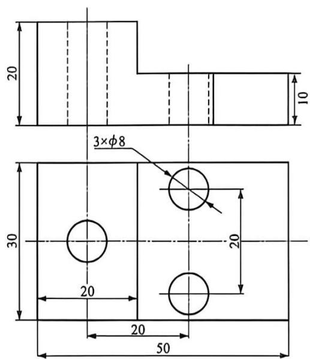

图15-14 钻孔零件
{: .figure-caption }

(b)

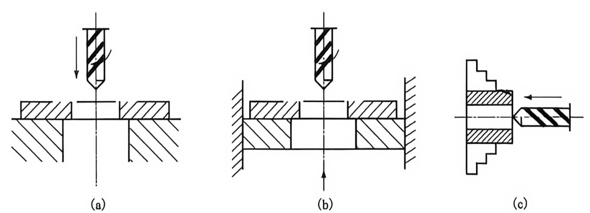

图15-15 工作原理示意
{: .figure-caption }

对送料方案, 可以采用送料杆从工件料仓推送工件的方式, 送料工艺动作过程如图 15-16 所示。

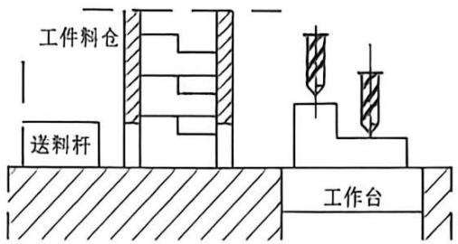

图15-16 送料工艺动作过程
{: .figure-caption }

### 2. 执行构件运动设计

由所确定的运动方案可知, 共有三个执行机构, 即钻头、工作台和送料杆。其工艺动作过程如下: 送料杆从工件料仓里推出一个待加工工件, 并将已加工好的工件从工作台上的夹具中顶出, 使待加工工件被夹具(图中未画出)定位并夹紧在工作台上, 送料杆退回。工作台带着工件向上快速靠近回转的钻头, 然后慢速工进, 钻孔结束后, 又带着工件快速退回, 等待更换工件并完成下一个工作循环。

由上述内容可知，钻头的运动形式为连续回转，其转速 $n_{\mathrm{c}}(\mathrm{r / min})$ 可由下式确定：

$$
n _ {\mathrm{c}} = 1 0 0 0 v / (\pi d)\tag{15-1}
$$

式中：d 为钻头直径(mm)；v 为切削速度(m/min)。由金属切削手册可知，当工件材料为 45 钢、孔径为 8 mm 时：

$$
n _ {\mathrm{c}} = 1 0 0 0 \times 1 2. 5 / (\pi \times 8) \approx 5 0 0 (\mathrm{r/min})
$$

在本例中，工作台做上下往复直线运动。根据加工要求，工作台连同工件应先快速趋近钻头，然后改用工作进给速度先钻削凸台上的一个孔。待钻到一定深度时，3个钻头才同时钻削，此时因为切削阻力较单孔钻削时大得多，所以进给速度应比单孔钻削小一些。在钻削完毕后，工作台应快速退回。由此可见，对工作台的运动要求是较复杂的。设工作台一个工作循环所需的时间为 $T_{f}$ ，其由五部分组成，即

$$
T _ {1} = t _ {1} + t _ {2} + t _ {3} + t _ {4} + t _ {5}\tag{15-2}
$$

式中: $t_{1}$ 为单孔钻削所需时间, 可根据进给量和单孔钻削深度来计算。设单孔钻削时每转的进给量 $s_{1}=0.2 \mathrm{~mm} / \mathrm{r}$ , 单孔钻削深度为 $10 \mathrm{~mm}$ , 并考虑 $3 \mathrm{~mm}$ 的提前工作量, 可求得单孔钻削时间为:

$$
t _ {1} = (1 0 + 3) / \left(s _ {1} n _ {\mathrm{c}}\right) = (0. 2 \times 5 0 0) = 0. 1 3 (\min) = 7. 8 (s)
$$

$t_{2}$ 为三孔同时钻削的时间，设钻头进给量 $s_{2}=0.16\ mm/r$ ，钻削深度为 10 mm，并考虑钻头越程 3 mm，则可得三孔同时钻削所需的时间，即

$$
t _ {2} = (1 0 + 3) / \left(s _ {2} n _ {\mathrm{c}}\right) = 1 3 / (0. 1 6 \times 5 0 0) = 0. 1 6 3 (\min) = 9. 8 (s)
$$

$t_{3}$ 和 $t_{4}$ 分别为快速趋近和快速退回所用时间，选取 $t_{3}=1.5\ s,\ t_{4}=2.5\ s;\ t_{5}$ 为工作台停歇等待更换工件的时间，选取 $t_{5}=3\ s$ 。

由此可知，工作台完成一个工作循环所需的时间为：

$$
T _ {f} = 7. 8 + 9. 8 + 1. 5 + 2. 5 + 3 = 2 4. 6 (s)
$$

工作台每分钟的工作循环数为：

$$
n _ {\mathrm{f}} = 6 0 / T _ {\mathrm{f}} = 2. 4 4
$$

送料杆运动形式为左右往复直线运动，其一个工作循环所需的时间 $T_{\mathrm{s}}$ ，与工作台的一个工作循环所需的时间相同，即 $T_{\mathrm{s}} = 24.6 \mathrm{~s}_{\circ}$

工作台的行程为

$$
H _ {t} = h _ {0} + h _ {1} + h _ {2}\tag{15-3}
$$

式中： $h_{0}$ 为工作台快速趋近钻头的运动距离； $h_{1}$ 和 $h_{2}$ 分别为单孔和三孔的钻削深度。选取 $h=15\ mm,\ h_{1}=h_{2}=13\ mm$ ，则 $H_{f}=41\ mm$ 。送料杆的行程 $H_{a}=100\ mm$ （取工件长的2倍）。

送料杆的运动与工作台的运动必须协调，而钻头回转与送料杆和工作台的运动是相互独立的，其机械系统运动循环图如图 15-17 所示，以凸轮轴为定标件。

<table><tr><td>送料杆</td><td>送料</td><td colspan="5">静止</td><td>送料</td></tr><tr><td>工作台</td><td colspan="2">停止</td><td>快进</td><td>单孔钻</td><td>三孔钻</td><td colspan="2">快退</td></tr><tr><td colspan="8">凸轮轴转角: 0° 90° 180° 270° 360°</td></tr></table>

图15-17 送料杆与工作台的协调运动机械系统运动循环图
{: .figure-caption }

### 3. 原动机的选择

根据机床的工作要求, 确定原动机的类型为交流异步感应电动机。考虑到钻头的转速较高, 选用同步转速为 $1500 \mathrm{r} / \mathrm{min}$ 的交流异步感应电动机, 其额定转速 $n_{0} = 1440 \mathrm{r} / \mathrm{min}$ 。

此外，为了减少原动机的数量，可将三个执行机构的运动链并联，用同一电动机驱动。切削运动链的总传动比为：

$$
i _ {\mathrm{c}} = n _ {n} / n _ {\mathrm{o}} = 1 4 4 0 / 5 0 0 = 2. 8 8
$$

进给运动链的总传动比与送料运动链的总传动比相等，即

$$
i _ {\mathrm{c}} = i _ {\mathrm{s}} = n _ {\mathrm{a}} / n _ {\mathrm{f}} = 1 4 4 0 / 2. 4 4 = 5 6 3
$$

### 4. 机构类型的选择

(1) 切削运动链的设计。

设计切削运动链时应满足下列各元功能：

①钻头做连续回转运动，运动链总传动比为 2.88。在这种情况下，无须运动形式的变换，但要求减速。

②3 个钻头应同向回转，并且各个钻头之间的距离很小。在这种情况下，要求运动链具有运动分解功能，其尺寸有严格的限制。

③电动机轴一般为水平方向放置，与钻头回转轴线方向不一致。在这种情况下，要求运动链具有改变运动轴线方向的功能。

④电动机与钻头之间有较大的传动距离。在这种情况下，要求运动链能做远距离传动。根据上述各个功能要求，进行机构类型的选择。能实现减速的传动有齿轮传动、链传动和带传动等，考虑到传动距离较远和速度较高等因素，决定采用 V 带传动，以实现减速和远距离传动的功能。能够实现变换运动轴线方向的传动有圆锥齿轮传动、交错轴斜齿轮传动和蜗杆传动等，考虑到两轴垂直相交且传动比较小，决定采用圆锥齿轮传动，以实现变换运动轴线方向的功能。

为使 3 个钻头同向回转, 可采用由 1 个中心齿轮带动周围 3 个从动齿轮的定轴轮系。由于结构尺寸的限制，3个从动齿轮轴线间的距离远大于3个钻头间的距离。为了将3个从动齿轮的回转运动传递给3个钻头，可采用双万向联轴节或钢丝软轴。将上述所选机构适当组合后，即可形成钻削运动链。

(2) 进给运动链的设计。

进给运动链应满足下列各元功能：

①工作台做上下往复直线运动，运动规律较为复杂，并且行程不大。

②进给运动链应能实现很大的减速比，但进给力不需要太大。

③因进给运动的方向和位置与电动机不一致，故应实现回转轴线方向和空间位置的变化。

由功能①可知，采用直动推杆盘形凸轮作为执行机构较为合理，减速换向可采用蜗杆传动，为达到很大的减速比和变换空间位置，在蜗杆传动之前可串联带传动。

(3) 送料运动链的设计。

送料运动链的功能要求与进给运动链基本相同，只是往复运动的方向为水平，并且运动行程较大。又因其减速比与进给运动链相同，故可由进给运动链中的蜗轮轴带动。由于送料运动规律较为复杂，故宜采用凸轮机构；又因为其行程大，所以要采用平面连杆机构等进行行程的放大。

### 5. 机构的组合

将切削运动链、进给运动链和送料运动链进行组合即可形成三头自动钻床的机械系统方案，如图 15-18 所示。

图中 1 为电动机，2 为 V 带传动，其减速比为 2.88；3 也为 V 带传动，其传动比为 1，作用是加大运动传递距离；4 为圆锥齿轮传动，其传动比为 1，作用是变换运动方向；5 为齿轮传动，传动比也为 1，作用是进行分支传动；6 为双万向联轴节，作用是改变轴间距；8 为另一路的 V 带传动，其传动比为 3；9 为蜗杆传动，其传动比为 $563/(2.88 \times 3) = 65$ ；10 为直动推杆凸轮机构，其作用是实现工作台 11 的运动要求；12 为摆动推杆凸轮机构，其作用是实现送料杆 14 的运动要求；15 为待加工工作。

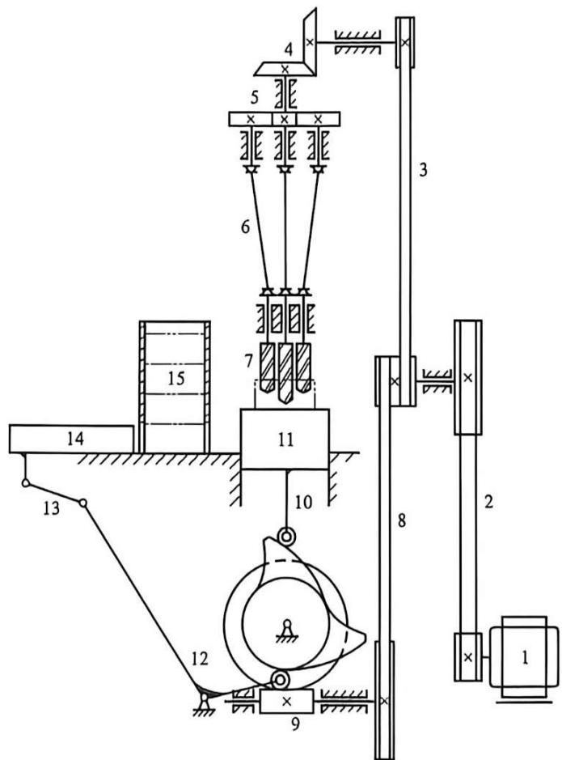

图15-18 三头自动钻床机械系统
{: .figure-caption }

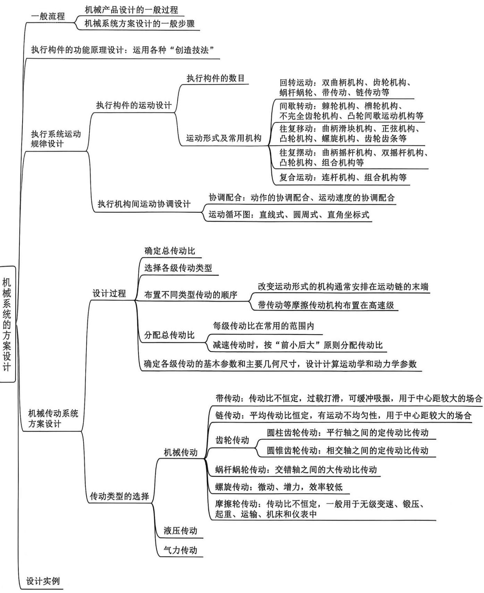

## 思考题与练习题

1. 机械系统有何特性？试述机械系统的设计过程。

2. 机械系统由几个子系统组成？它们之间有何关系？

3. 机械系统运动方案设计一般需经过哪些主要步骤？方案设计中是否机构愈复杂，构件数目愈多愈好？机电一体化系统由哪几部分组成？各部分有何作用？

4. 机构组合的目的是什么？有哪几种组合方式？机构运动循环图是根据什么原则制定的？

5. 齿轮传动比的分配应注意什么？变位齿轮设计有哪些主要步骤？什么条件下才采用变位齿轮？变位系数是如何选取的？齿轮机构是高副接触，为什么可以传递较大的动力？

6. 请构思出能自动摘棉花的机器、能收割甘蔗的机器(含去叶)及水果自动削皮机的运动方案。
