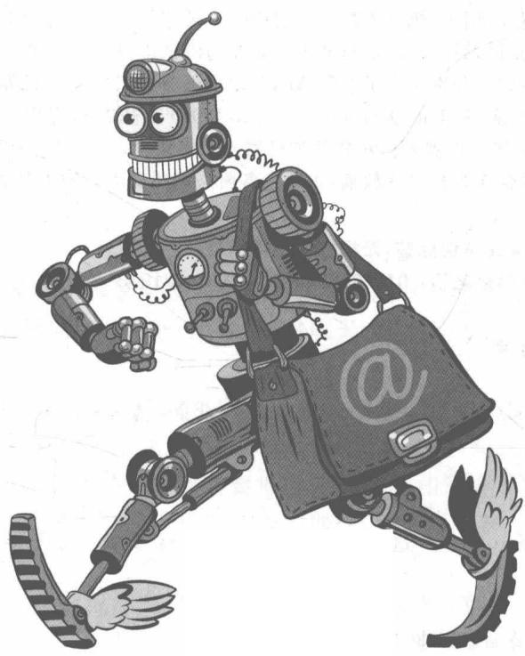

# 前置内容

Robot Simulation and Programming

## 机器人仿真 写 编程技术

杨辰光 李智军 许扬◎编著
Yang Chenguang Li Zhijun Xu Yang

Robot Simulation and Programming

## 机器人仿真 写 编程技术

杨辰光 李智军 许扬◎编著
Yang Chenguang Li Zhijun Xu Yang

清華大學出版社

北京

## 内容简介

在机器人的科研与工业应用中,机器人仿真与编程技术发挥着无可替代的作用,因为它一方面能够对机器人控制算法进行检验测试,另一方面给机器人的研发与测试提供一个无风险且稳定的平台。

本书主要内容分为三部分，分别介绍了基于 MATLAB 机器人工具箱的机器人仿真、3 款常用的机器人仿真软件、机器人操作系统（Robot Operating System, ROS）的基础和应用。本书所使用的工具包括 MATLAB、Simulink、3 款常用的机器人仿真软件和机器人操作系统。

本书配套资源丰富，适合作为教材或教辅，也适合各阶层的机器人开发人员和机器人爱好者阅读。

本书封面贴有清华大学出版社防伪标签，无标签者不得销售。

版权所有，侵权必究。侵权举报电话：010-62782989 13701121933

图书在版编目(CIP)数据

机器人仿真与编程技术/杨辰光，李智军，许扬编著.一北京：清华大学出版社，2018

(清华开发者书库)

ISBN 978-7-302-49048-7

I. ①机… II. ①杨… ②李… ③许… III. ①机器人—仿真设计 ②机器人—程序设计 IV. ①TP242

中国版本图书馆 CIP 数据核字(2017)第 295510 号

责任编辑：曾珊

封面设计：李召霞

责任校对：李建庄

责任印制：李红英

出版发行：清华大学出版社

网址：<http://www.tup.com.cn>，<http://www.wqbook.com>

地址：北京清华大学学研大厦A座 邮编：100084

社总机：010-62770175

邮购：010-62786544

投稿与读者服务：010-62776969，c-service@tup.tsinghua.edu.cn

质量反馈：010-62772015，zhiliang@tup.tsinghua.edu.cn

课件下载：<http://www.tup.com.cn,010-62795954>

印装者：三河市君旺印务有限公司

经销：全国新华书店

开 本：186mm×240mm 印 张：42.5

字 数：949 千字

版次：2018年2月第1版

印次：2018年2月第1次印刷

印数：1～1500

定 价：138.00 元

产品编号：074129-01

## 前言 PREFACE

机器人技术是衡量一个国家科技创新和高端制造业水平的重要标志。随着机器人技术的快速发展，它的应用领域涉及工业、服务、航空航天、军事等方面，因此需要一批熟练掌握机器人技术的创新型人才。

传统的机器人教材大多侧重于对机器人学理论知识的探讨，往往涉及比较多的矩阵理论、控制理论的知识，对于读者来说比较抽象。另一方面，这些知识面难以培养读者的动手能力，难以取得良好的实践效果。因此需要将理论与实践相结合。本书将机器人学的理论和应用相结合，一方面概要地介绍了机器人学的理论，另一方面着力于介绍机器人的仿真和编程技术。

在机器人的科研与工业应用中，机器人仿真与编程技术发挥着无可替代的作用，这是因为它一方面能够对机器人控制算法进行检验测试，另一方面给机器人的研发与测试提供一个无风险且稳定的平台。本书所使用的工具包括 MATLAB/Simulink、3 款常用的机器人仿真软件和机器人操作系统（Robot Operating System, ROS）。这些工具一方面可以用于将机器人学的理论知识进行实际验证与研究，另一方面用于对机器人进行设计、仿真与测试。同时，这些工具大多具有开源的特点，而且它们相互之间有方便快捷的接口，能够发挥各自的优势，实现更强大的仿真、编程功能。如今，这些仿真工具都已广泛应用于机器人设计、研发和科学研究等方面，尤其是机器人操作系统，成为机器人领域越来越重要的应用系统。

本书的内容主要分为三篇,第一篇介绍了基于 MATLAB 机器人工具箱的机器人仿真,第二篇介绍了 3 款常用的机器人仿真软件,第三篇介绍了机器人操作系统的基础和应用。

在第一篇中,从机器人学的理论入手,讲述了机器人学中的数学基础、机器人运动学、机器人动力学、机器人控制和轨迹。然后针对每一部分理论内容,介绍了如何使用 MATLAB 机器人工具箱去解决相关的问题。最后,以作者的一些科研成果作为实例,介绍了 MATLAB 机器人工具箱在科研中的应用。

在第二篇中,介绍了3款机器人仿真软件：V-REP、Gazebo和OpenRAVE。它们作为机器人的仿真工具,能够对机器人及其工作平台进行3D建模和3D渲染,搭建与现实类似的机器人模型,并具备丰富的物理引擎,能够对机器人在虚拟的物理条件下的运动进行仿真。

在第三篇中,主要介绍了机器人操作系统。ROS 是一个适用于机器人的开源的操作系统。它提供了操作系统应有的服务,包括硬件抽象、底层设备控制、常用函数的实现、进程间消息传递，以及包管理。它也提供用于获取、编译、编写和跨计算机运行代码所需的工具和库函数。这部分主要讲述了ROS的概念、应用和相关的基础，然后以Baxter机器人为应用对象，介绍了ROS在机器人中的相关编程技术。

本书适用于高校的教师作为教材或教辅，同时适合各层次的机器人开发人员和机器人爱好者阅读。教师在以本书作为教材时，可以利用本书提供的工具，布置一些能够锻炼学生动手能力、激励学生创新思维的课程作业。初学机器人学的学生在阅读本书时，可以参考一些对于机器人学理论介绍更全面的书籍，同时要利用好本书介绍的工具，去动手搭建机器人模型或编写相关代码。

在本书的编写过程中得到了编者所在实验室曾超、罗晶、王行健、彭光柱、吴怀炜、陈垂泽、陈雄君、叶宇航、王尊冉、黄典业、梁聪垣等的支持和帮助，编者在此表示谢意。

由于编者水平有限,对于书中存在的欠缺之处,敬请读者批评指正。

作者

2017年11月

## 学习说明

由于本书所涉及的工具较多,而且它们之间独立性强,在学习上的关联性不大。在这里,我们分别对每一篇的内容进行梳理,并给出一些学习建议。

第一篇 介绍了机器人学中的数学基础、机器人运动学、机器人动力学、机器人控制和轨迹，并介绍了如何用 MATLAB 机器人工具箱进行相关问题的仿真。建议读者在学习该部分时，应具备一定的机器人学基础，对本章出现的例子要亲自动手实践，并尝试使用机器人工具箱去解决实际科研或工作项目中的问题。

第二篇 介绍了三种机器人仿真软件。因为三种软件都是国外开源的机器人仿真软件，所涉及的界面都为英文。读者在阅读本篇内容中，应根据书中介绍的方法，动手去搭建一些机器人模型，并进行编程仿真。此外，本书的内容参考了软件用户手册的部分内容，读者也可参考文中提供的参考文献书目，进行更深入的学习与研究。在这里，因为 V-REP 相对简单友好，建议初学者使用这款开源、免费的机器人仿真软件练习编程。

第三篇 介绍了机器人操作系统的基础与应用。读者在进行本部分内容的学习时，应亲手去安装虚拟机、Linux 系统和机器人操作系统。此外，可以结合 ROS 的网站（详见 <http://wiki.ros.org/cn/ROS/Tutorials）>，对 ROS 的基础进行全面的学习。此外，这一部分介绍了 ROS 在 Baxter 机器人的 3 个实例，这一部分适合研究生进行学习探究。有条件的读者可以根据本书提供的程序代码，对这本部分例子进行实现，并进行深入的研究。

## 常用符号列表

<table><tr><td>符号</td><td>描述</td></tr><tr><td> \(P\) </td><td>三维空间中的一个点</td></tr><tr><td> \(R\) </td><td>正交旋转矩阵, \(3\times3\) 的矩阵</td></tr><tr><td> \(T\) </td><td>齐次变换矩阵, \(4\times4\) 的矩阵</td></tr><tr><td> \(a_{i-1}\) </td><td>连杆长度</td></tr><tr><td> \(\alpha_{i-1}\) </td><td>连杆转角</td></tr><tr><td> \(d_i\) </td><td>连杆偏距</td></tr><tr><td> \(\theta_i\) </td><td>关节角</td></tr><tr><td> \(\sigma_i\) </td><td>关节类型,1表示移动关节,0表示转动关节</td></tr><tr><td> \(v\) </td><td>速度向量</td></tr><tr><td> \(w\) </td><td>角速度向量</td></tr><tr><td> \(J\) </td><td>雅克比矩阵</td></tr><tr><td> \(\tau\) </td><td>力矩</td></tr><tr><td> \(f\) </td><td>力</td></tr><tr><td> \(I\) </td><td>惯性张量</td></tr><tr><td> \(m_i\) </td><td>连杆 \(i\) 的质量</td></tr><tr><td> \(k_i\) </td><td>连杆 \(i\) 的动能</td></tr><tr><td> \(u_i\) </td><td>连杆 \(i\) 的势能</td></tr><tr><td> \(M(q)\) </td><td>惯性矩阵</td></tr><tr><td> \(C(q,\dot{q})\) </td><td>科里奥利矩阵</td></tr><tr><td> \(G(q)\) </td><td>重力矩阵</td></tr><tr><td> \(F(\dot{q})\) </td><td>摩擦力矩</td></tr><tr><td> \(B\) </td><td>黏性摩擦系数</td></tr><tr><td> \(J_m\) </td><td>电机总惯性</td></tr><tr><td> \(\tau_c\) </td><td>库仑摩擦力矩</td></tr></table>

## 目录 CONTENTS

## 第一篇 基于 MATLAB 工具箱的机器人仿真

第1章 机器人学与 MATLAB 机器人工具箱 …… 3
1.1 MATLAB 机器人工具有箱的下载与安装 …… 3
1.2 机器人学的数学基础 …… 5
1.2.1 三维空间中的位置与姿态 …… 5
1.2.2 坐标变换 …… 9
1.2.3 姿态的其他表示方法 …… 16
1.2.4 具体例子的应用 …… 22
1.3 机器人运动学 …… 24
1.3.1 机械臂及运动学 …… 24
1.3.2 DH 参数法 …… 25
1.3.3 机器人正运动学 …… 28
1.3.4 机器人逆运动学 …… 33
1.3.5 机器人的瞬态运动学 …… 38
1.3.6 具体例子的应用 …… 43
1.3.7 机器人工具箱的 Link 类 …… 45
1.3.8 机器人工具箱的 SerialLink 类 1 …… 48
1.4 机器人动力学 …… 53
1.4.1 机器人动力学概述 …… 53
1.4.2 机器人动力学方程的建立方法 …… 53
1.4.3 状态空间方程 …… 57
1.4.4 正向动力学 …… 62
1.4.5 机器人工具箱的 SerialLink 类 2 …… 64
1.5 机器人的运动轨迹 …… 66
1.5.1 运动轨迹问题 …… 66
1.5.2 关节空间的规划方法 …… 66
1.6 机械臂关节控制 …… 70

1.6.1 机器人控制系统的构成 …… 70
1.6.2 Simulink 机器人模块 …… 71
1.6.3 机器人的单关节控制 …… 72
1.6.4 机器人的多关节控制 …… 79
1.7 其他基于 MATLAB 的机器人工具箱 …… 83
1.7.1 Kuka 控制工具箱(KCT)的介绍与测试 …… 83
1.7.2 其他机器人工具箱 …… 119
本章小结 …… 123
参考文献 …… 123

2 章 MATLAB 机器人工具箱的应用 …… 125
2.1 基于学习算法的机器人触觉识别算法研究 …… 125
2.1.1 引言 …… 125
2.1.2 背景 …… 125
2.1.3 算法设计 …… 127
2.1.4 实验设计 …… 134
2.1.5 实验与结果 …… 140
2.2 基于波动变量和神经网络的远程控制系统 …… 142
2.2.1 引言 …… 143
2.2.2 远程操作系统的数学模型 …… 143
2.2.3 基于波动变量的神经控制设计 …… 148
2.2.4 实验设计 …… 150
2.2.5 仿真实验 …… 155
2.3 开发混合运动捕捉方法使用 MYO 手环应用于远程操作 …… 159
2.3.1 引言 …… 159
2.3.2 设计方法 …… 160
2.3.3 仿真系统设计 …… 164
2.3.4 仿真实验 …… 166
2.4 基于自适应参数识别的 Geomagic Touch X 触觉装置运动学建模 …… 168
2.4.1 引言 …… 169
2.4.2 建模步骤 …… 169
2.4.3 仿真设计 …… 173
2.4.4 实验和仿真 …… 177
2.4.5 可视化运动学模型与工作空间识别 …… 180
2.5 复杂扰动环境中的新型机械臂混合自适应控制器 …… 181
2.5.1 引言 …… 181

2.5.2 控制问题……182
2.5.3 自适应控制……185
2.5.4 仿真……190
2.5.5 实验设计……190
2.5.6 实验与结果……192
本章小结……196
参考文献……196

第二篇 机器人仿真软件的基础与应用

3 章 V-REP 在机器人仿真中的应用 …… 205
3.1 V-REP 简介及安装……205
3.1.1 V-REP 的简介 …… 205
3.1.2 V-REP 的特性 …… 205
3.1.3 V-REP 的安装 …… 205
3.2 V-REP 的用户界面及位姿操作……206
3.2.1 控制台窗口……207
3.2.2 对话框……207
3.2.3 应用程序窗口……208
3.2.4 自定义用户界面……211
3.2.5 页面与视图……212
3.2.6 对象/项目位置和方向操作……214
3.3 V-REP 的场景与模型……218
3.3.1 场景与模型的关系……218
3.3.2 V-REP 的场景……218
3.3.3 V-REP 的模型……221
3.3.4 V-REP 的环境……223
3.4 实体 …… 227
3.4.1 V-REP 的场景对象……227
3.4.2 场景对象的性质……228
3.4.3 常用的场景对象——形状……234
3.4.4 常用的场景对象——关节……244
3.4.5 V-REP 的集合……255
3.5 V-REP 的六种计算模块……259
3.5.1 碰撞检测模块……259
3.5.2 最小距离计算模块……261
3.5.3 逆向运动学模块……262

3.5.4 几何约束求解模块.... 270
3.5.5 动力学模块.... 272
3.5.6 路径规划模块.... 273
3.6 V-REP 中控制机器人仿真的方法.... 274
3.6.1 嵌入式子脚本.... 276
3.6.2 插件.... 277
3.6.3 附加组件.... 279
3.6.4 远程客户端应用程序接口.... 280
3.6.5 通过 ROS 的节点.... 281
3.6.6 自定义解决方案.... 281
3.7 V-REP 的 API 框架.... 282
3.7.1 常规 API .... 282
3.7.2 远程 API .... 284
3.7.3 ROS 接口.... 295
3.7.4 辅助 API .... 296
3.7.5 其他接口.... 297
3.8 仿真模型的搭建.... 298
3.8.1 从模型浏览器中加载现有模型.... 298
3.8.2 从菜单栏中添加场景对象.... 298
3.8.3 从 Import 命令中导入/导出其他软件的 CAD 模型.... 299
3.9 机器人的仿真.... 302
3.9.1 物理引擎的选择.... 304
3.9.2 仿真参数的设置.... 308
3.9.3 仿真的控制.... 309
3.10 V-REP 的具体例子.... 310
3.10.1 机械臂模型的构建.... 310
3.10.2 逆运动学建模.... 323
3.10.3 V-REP 与 MATLAB 连接的例子.... 331
3.11 V-REP 在人机交互中的应用(一).... 335
3.11.1 触觉学与 Touch X .... 335
3.11.2 Touch X 的相关软件在人机交互中的作用.... 336
3.11.3 CHAI3D 在人机交互中的作用.... 337
3.11.4 V-REP 模块.... 339
3.11.5 Touch X 控制 V-REP 中 KUKA 机器人的实现.... 341
3.12 V-REP 在人机交互中的应用(二).... 347
3.12.1 体感技术与 Kinect .... 347

3.12.2 交互相关软件的作用……347
3.12.3 交互相关软件的安装与测试……348
3.12.4 OpenNI/NITE 中的人体骨架分析……349
3.12.5 V-REP 与 Kinect 接口的安装与测试……350
3.12.6 Kinect 与 V-REP 交互的设计与实现……351
本章小结……358
参考文献……359

4 章 Gazebo 在机器人仿真中的应用 …… 360
4.1 Gazebo 的介绍与安装……360
4.1.1 Gazebo 的初步介绍……360
4.1.2 Gazebo 的安装……360
4.1.3 Gazebo 与 V-REP 的比较……366
4.2 Gazebo 的结构……368
4.2.1 Gazebo 的运行方法……368
4.2.2 Gazebo 的组成部分……370
4.2.3 Gazebo 的结构……372
4.3 创建机器人……374
4.3.1 模型结构和要求……374
4.3.2 模型的上传……376
4.3.3 制作一个模型……378
4.3.4 制作移动机器人模型……381
4.3.5 导入网格……392
4.3.6 附加网格物体……393
4.3.7 给机器人添加传感器……396
4.3.8 做一个简单的夹持器……397
4.3.9 在机器人上构建夹持器……405
4.3.10 嵌套模型……411
4.3.11 模型编辑器……413
4.3.12 盒子的动画……419
4.3.13 三角网格的惯性参数……421
4.3.14 图层可见性……428
4.4 Gazebo 中的模型编辑器……428
4.4.1 模型编辑器……428
4.4.2 SVG 文件……428
4.5 场景文件的创建 …… 431

4.5.1 创建一个场景……431
4.5.2 修改场景……435
4.5.3 如何在Gazebo中使用DEM……436
4.5.4 模型群……440
4.5.5 建筑编辑器……444
4.6 插件的编写……453
4.6.1 一个简单的插件：Hello WorldPlugin！……454
4.6.2 插件的使用……456
4.6.3 模型插件……457
4.6.4 世界插件……460
4.6.5 程序化场景控制……467
4.6.6 系统插件……470
4.7 传感器……473
4.7.1 传感器噪声模型……473
4.7.2 接触式传感器……485
4.7.3 摄像头失真……491
4.8 Gazebo的其他功能……493
4.8.1 数学库的使用……493
4.8.2 用户输入……494
4.8.3 连接到Player……504
本章小结……505
参考文献……506

第5章 OpenRAVE在机器人仿真中的应用……507
5.1 OpenRAVE简介……507
5.1.1 OpenRAVE的应用……507
5.1.2 OpenRAVE的特性……507
5.1.3 OpenRAVE的下载与安装……508
5.2 OpenRAVE概观……509
5.2.1 OpenRAVE基本架构……509
5.2.2 关于OpenRAVE中的一些说明……511
5.2.3 OpenRAVE公约与准则……516
5.2.4 OpenRAVE中机器人概述……516
5.2.5 插件与接口说明……519
5.2.6 网络协议和脚本……525
5.3 OpenRAVE的基础……525

5.3.1 开始使用 OpenRAVE …… 525
5.3.2 OpenRAVE 的命令行工具 …… 528
5.3.3 写 OpenRAVE 文档 …… 534
5.3.4 环境变量 …… 535
5.4 OpenRAVE 运用与展望 …… 535
5.4.1 OpenRAVE 的运用项目举例 …… 535
5.4.2 OpenRAVE 的展望 …… 537
本章小结 …… 537
参考文献 …… 537

第三篇 机器人操作系统基础与应用

6 章 机器人操作系统的基础 …… 545
6.1 ROS 的安装与测试 …… 545
6.1.1 虚拟机与 Ubuntu 的安装 …… 545
6.1.2 ROS 的安装 …… 547
6.1.3 turtlesim 例子的测试 …… 549
6.2 ROS 的基本概念与命令 …… 550
6.2.1 程序包 (packages) …… 550
6.2.2 节点 (Nodes) 和节点管理器 (Master) …… 552
6.2.3 消息 (Messages) 和主题 (Topics) …… 554
6.2.4 其他 ROS 的相关概念 …… 556
6.2.5 ROS 的一些常用工具 …… 557
6.3 ROS 的程序包的创建与编译 …… 557
6.3.1 创建工作区和功能包 …… 557
6.3.2 ROS 程序的编译过程 …… 558
6.4 ROS 与 MATLAB 集成 …… 562
6.4.1 RST 的 ROS 功能介绍 …… 563
6.4.2 MATLAB 与 ROS 通信的介绍 …… 563
6.5 ROS 与 V-REP 之间的集成 …… 567
6.5.1 V-REP 中的 ROS 程序包 …… 567
6.5.2 在 ROS 中安装 V-REP …… 568
6.5.3 在 ROS 中创建相关的 V-REP 程序包 …… 569
6.5.4 使用 ROS 节点控制 V-REP 模型的例子 …… 571
6.5.5 V-REP ROS Bridge 的简介及安装 …… 573
6.6 ROS 与 Gazebo …… 575
6.6.1 ROS 集成概述 …… 575

6.6.2 安装 Gazebo\_ros\_pkgs …… 577
6.6.3 ROS/Gazebo 版本组合的选择 …… 582
6.6.4 使用 roslaunch …… 585
6.6.5 ROS 通信 …… 594
6.6.6 Gazebo 中的 URDF …… 604
6.7 实时系统 ROS 2.0 的介绍 …… 611
本章小结 …… 620
参考文献 …… 620

第 7 章 机器人操作系统的应用 …… 621
7.1 Baxter 机器人与 ROS …… 621
7.1.1 Baxter 机器人 …… 621
7.1.2 Baxter 机器人的控制系统总体框架 …… 622
7.1.3 相关的 ROS 代码 …… 622
7.2 基于神经网络实现对摇操作机器人进行高性能控制 …… 623
7.2.1 控制系统的架构 …… 624
7.2.2 实验设计与实现 …… 627
7.2.3 实验及结果 …… 631
7.3 规定全局稳定性和运动精度的双臂机器人的神经网络控制 …… 636
7.3.1 实验设计与实现 …… 637
7.3.2 实验结果 …… 644
7.4 基于人体运动捕获对 Baxter 机器人的远程操作控制 …… 647
7.4.1 远程操作控制系统 …… 648
7.4.2 实验的设计与实现 …… 651
7.4.3 实验及结果 …… 659
本章小结 …… 662
参考文献 …… 662
