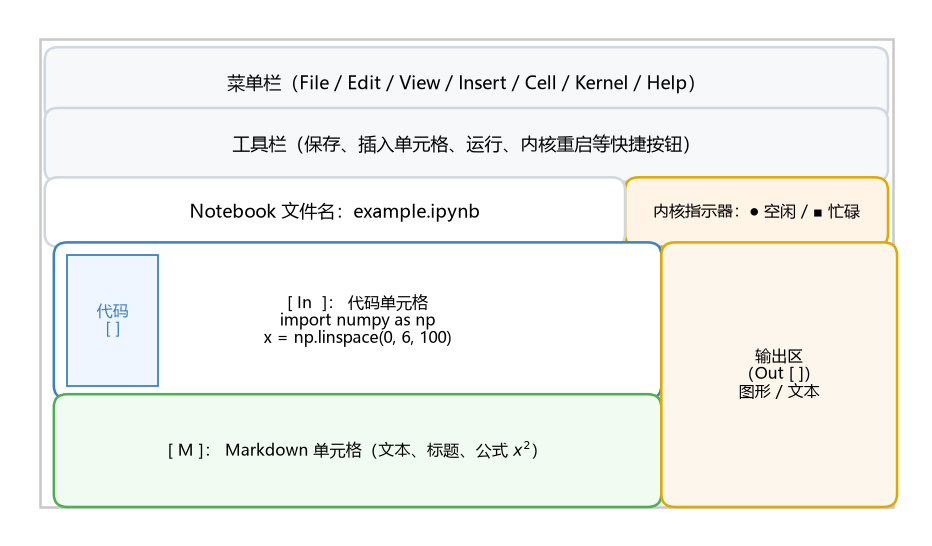
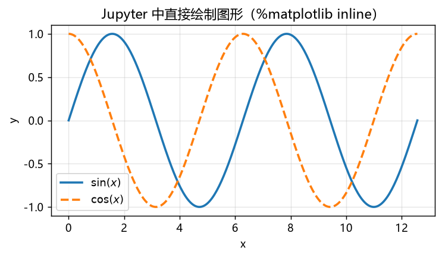
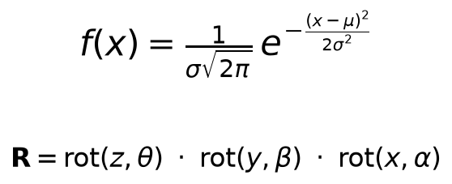
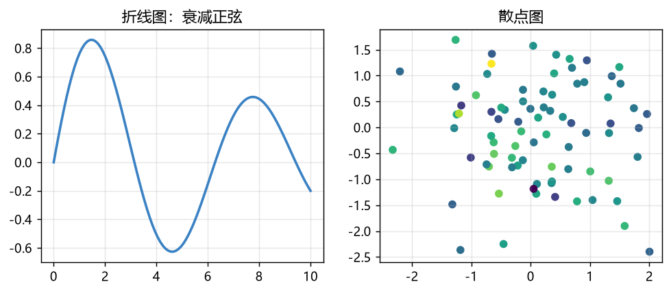
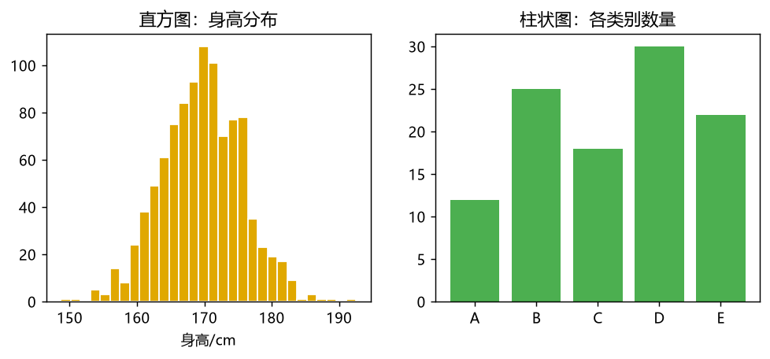
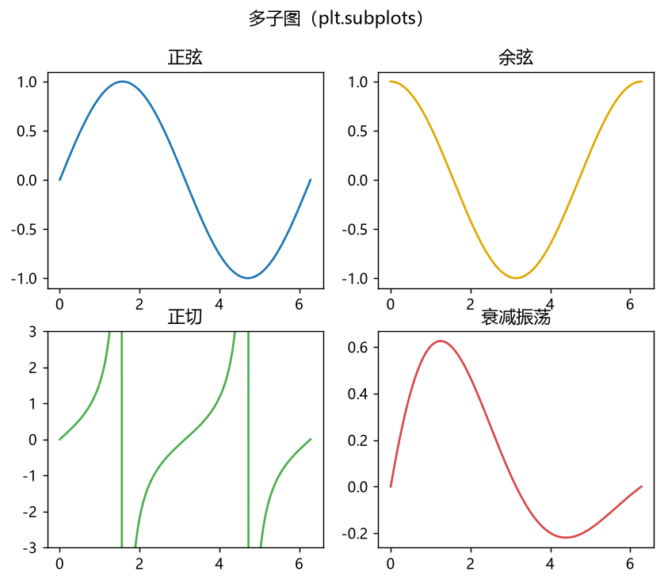

# 第 1 章 Jupyter Notebook 的使用

Jupyter Notebook（旧称 IPython Notebook）是一种基于浏览器的交互式编程环境，支持在同一个文档中编写代码、运行代码、查看输出、书写文本说明、插入图片与数学公式，非常适合数据分析、科学计算、机器学习和教学演示。本章围绕 Jupyter Notebook 的安装、界面、基本操作、Markdown 与数学公式、代码执行与魔法命令、数据可视化与数据处理基础，系统地介绍其使用方法。

## 1.1 Jupyter Notebook 的下载与安装

### 1.1.1 下载

Jupyter Notebook 运行在 Python 之上，安装前需要先准备 Python 环境。常用的安装方式有三种：


1. **安装 Anaconda 发行版**（推荐）：Anaconda 自带 Python、Jupyter Notebook、JupyterLab 以及 numpy、pandas、matplotlib、scipy、scikit-learn 等数百个常用科学计算库，开箱即用。访问 Anaconda 官方网站，选择对应操作系统的安装包下载即可。

2. **安装 Miniconda 发行版**：Miniconda 是 Anaconda 的精简版，仅包含 Python 与包管理器 conda，体积小，适合对安装包大小敏感的用户，后续可通过 `conda install` 按需安装 Jupyter 与各类库。

3. **在已有 Python 环境中用 pip 安装**：如果本机已经安装了 Python，可以直接使用 pip 安装 Jupyter Notebook，命令如下：

```
pip install jupyter notebook
```

安装完成后，可以查看已安装的版本，验证安装是否成功：

```
jupyter --version
```

### 1.1.2 安装

以 pip 方式为例，完整的安装与验证流程如下：

```
# 1. 安装 Jupyter Notebook
pip install jupyter notebook

# 2. 若需要 JupyterLab 界面，可一并安装
pip install jupyterlab

# 3. 安装常用的科学计算库（数据分析与可视化必备）
pip install numpy pandas matplotlib scipy scikit-learn

# 4. 查看版本信息，确认安装成功
jupyter --version
```

> **注意：**
>
>  在 Anaconda 中，上述库大多已预装，无需重复安装。若使用 Miniconda，可执行 
>
> `conda install jupyter numpy pandas matplotlib scipy scikit-learn`
>
>  一次性安装。

### 1.1.3 路径配置与启动

在命令行（Windows 的 CMD/PowerShell，或 macOS/Linux 的终端）中，进入希望保存 Notebook 文件的目录，然后输入启动命令：


```
# 进入工作目录（示例）
cd D:\notebook_works

# 启动 Jupyter Notebook
jupyter notebook
```

启动后，终端会输出类似下面的信息，并在默认浏览器中自动打开 Notebook 主页面（通常地址为 `http://localhost:8888`）：

```
[I 14:32:05.123 NotebookApp] Serving notebooks from local directory: D:\notebook_works
[I 14:32:05.456 NotebookApp] Jupyter Notebook 6.5.4 is running at:
[I 14:32:05.456 NotebookApp] http://localhost:8888/?token=abcdef123456
```

在浏览器地址栏输入 `http://localhost:8888`（若设置了 token，则需要附加 token 参数）即可进入 Jupyter Notebook 主页面。页面左侧会显示当前目录下的文件列表，点击右上角的 **New ▾** 按钮，选择 **Python 3**，即可新建一个空白 Notebook 文件。

除了命令行启动外，也可以在 Anaconda Navigator 中，通过图形化界面点击 **Launch** 按钮来启动 Jupyter Notebook。

### 1.1.4 JupyterLab 的启动

JupyterLab 是 Jupyter Notebook 的下一代界面，功能更强大。启动命令为：

```
jupyter lab
```

JupyterLab 在同一个浏览器标签页中提供了文件管理、Notebook 编辑、终端、文本编辑器等一体化的界面，本书第 1.7 节会进一步介绍。

## 1.2 Jupyter Notebook 的界面与基本操作

### 1.2.1 界面组成

新建并打开一个 Notebook 后，浏览器中会显示一个可交互的文档界面。如图 1-1 所示，Jupyter Notebook 的界面主要由**菜单栏**、**工具栏**、**Notebook 名称区**、**内核指示器**、**单元格区域**和**输出区**等部分组成。




**图 1-1 Jupyter Notebook 的界面组成示意**

各部分的说明如下：

| 组成部分         | 功能说明                                                       |
| ------------ | ---------------------------------------------------------- |
| 菜单栏          | 提供 File、Edit、View、Insert、Cell、Kernel、Help 等菜单，几乎所有操作都可在此完成 |
| 工具栏          | 保存、插入单元格、剪切 / 复制 / 粘贴单元格、运行单元格、中断 / 重启内核等快捷按钮              |
| Notebook 名称区 | 显示当前 Notebook 文件的名称，可单击修改                                  |
| 内核指示器        | 显示当前内核状态：实心圆表示忙碌，空心圆表示空闲；单击可切换或重启内核                        |
| 单元格区域        | Notebook 的主体，由多个单元格组成，可逐格编辑和运行                             |
| 输出区          | 单元格运行后产生的文本或图形结果，显示在对应单元格下方                                |

### 1.2.2 单元格的类型

Notebook 的核心单元是**单元格（Cell）**，主要有三种类型：

1. **代码单元格（Code）**：用于编写并运行 Python 代码。输入代码后按快捷键运行，结果（文本或图形）会显示在该单元格下方，并以 `In [序号]` / `Out [序号]` 形式标识执行顺序。

2. **文本单元格（Markdown）**：用于书写说明文字、标题、列表、表格、公式和图片，使用 Markdown 语法（详见 1.3 节）。运行时不会产生代码输出，而是渲染为格式化的文档内容。

3. **原始单元格（Raw NBConvert）**：内容不经过 Markdown 渲染，也不作为代码执行，适合写入需要原样保留的 LaTeX 源码等。

在工具栏的下拉框中可以直接切换单元格类型；也可以通过菜单 **Cell ▸ Cell Type** 进行切换。

### 1.2.3 单元格的基本操作

单元格的基本操作包括运行、插入、删除、复制、移动和合并等，均可在工具栏或菜单中完成。以运行单元格为例：

* **运行单个单元格**：选中单元格后，点击工具栏的 **Run** 按钮，或按快捷键 `Shift + Enter`（运行并跳到下一个单元格）或 `Ctrl + Enter`（运行并停留在当前单元格）。

* **从上到下运行全部单元格**：使用菜单 **Cell ▸ Run All**。

* **插入单元格**：使用菜单 **Insert ▸ Insert Cell Above / Below**，或快捷键 `A`（在上方插入）/ `B`（在下方插入，命令模式下）。

* **删除单元格**：选中后按 `D + D`（连按两次 D，命令模式）。

* **剪切 / 复制 / 粘贴单元格**：对应快捷键 `X` / `C` / `V`（命令模式）。

* **合并单元格**：选中多个单元格后按 `Shift + M`（命令模式）。

> **命令模式与编辑模式：**
>
>  单元格有两种模式。按 
>
> `Esc`
>
>  进入
>
> **命令模式**
>
> （单元格边框变为蓝色），此时快捷键作用于单元格（如 
>
> `A`
>
> 、
>
> `B`
>
> 、
>
> `D`
>
>  等）；按 
>
> `Enter`
>
>  进入
>
> **编辑模式**
>
> （单元格边框变为绿色），此时可以编辑单元格内容，快捷键作用于文本（如 
>
> `Ctrl + Z`
>
>  撤销）。

### 1.2.4 常用快捷键

下表列出了使用频率最高的快捷键：

| 操作           | 快捷键（命令模式）       | 快捷键（编辑模式）       |
| ------------ | --------------- | --------------- |
| 运行单元格并跳到下一个  | `Shift + Enter` | `Shift + Enter` |
| 运行单元格并停留在当前  | `Ctrl + Enter`  | `Ctrl + Enter`  |
| 在上方插入单元格     | `A`             | —               |
| 在下方插入单元格     | `B`             | —               |
| 删除当前单元格      | `D + D`         | —               |
| 剪切 / 复制 / 粘贴 | `X` / `C` / `V` | —               |
| 合并选中单元格      | `Shift + M`     | —               |
| 进入命令模式       | `Esc`           | —               |
| 进入编辑模式       | `Enter`         | —               |
| 保存           | `Ctrl + S`      | `Ctrl + S`      |

### 1.2.5 内核与执行状态

**内核（Kernel）** 是负责执行代码的后台进程。当用户运行代码单元格时，代码会被发送给内核执行，执行结果再返回并显示在 Notebook 中。与内核相关的常用操作有：

* **中断执行**：代码长时间运行或陷入死循环时，可通过工具栏的 **Interrupt Kernel** 按钮（方块图标）或菜单 **Kernel ▸ Interrupt** 中断当前执行。

* **重启内核**：通过 **Kernel ▸ Restart** 重启内核，内核重启后会清空所有已定义的变量与对象，代码单元格的状态也会重置。重启后可选择 **Restart & Run All** 从头运行全部单元格。

* **切换内核**：通过 **Kernel ▸ Change Kernel** 可以选择不同的内核（例如 Python 2、R、Julia 等），前提是这些内核已安装。

> **注意：**
>
>  单元格的执行顺序可能不按文档从上到下的顺序进行，因此变量可能被后运行或前运行的其他单元格覆盖。为保证结果可复现，建议按顺序从上到下执行，并在关键步骤后使用 “Restart & Run All” 验证。

### 1.2.6 文件的保存与导出

Notebook 文件以 `.ipynb` 为扩展名保存，内部使用 JSON 格式记录所有单元格及其输出。可以：

* 使用 `Ctrl + S` 或工具栏 **Save** 按钮手动保存。

* 通过菜单 **File ▸ Download as** 将 Notebook 导出为多种格式，如 `.py`（纯 Python 脚本）、`.html`（网页）、`.md`（Markdown）、`.pdf`（PDF）等。

* 借助 `nbconvert` 在命令行中批量转换（详见 1.7.2 节）。

## 1.3 Markdown 单元格与数学公式

Markdown 单元格用于书写富文本说明，是让 Notebook 兼具 “代码 + 笔记” 能力的关键。将单元格类型切换为 Markdown 后，即可输入以下语法。

### 1.3.1 Markdown 语法

**标题**使用 `#` 表示层级：

```
# 一级标题
## 二级标题
### 三级标题
```

**列表**、**加粗**、**斜体**、**行内代码**等：

```
- 无序列表项一
- 无序列表项二
  - 嵌套列表项

1. 有序列表项一
2. 有序列表项二

**加粗文本**、*斜体文本*、`行内代码`

> 引用文本：这里是一段引用说明。
```

**表格**：

```
| 库名 | 用途 |
| --- | --- |
| numpy | 数值计算 |
| pandas | 数据处理 |
| matplotlib | 数据可视化 |
```

**插入图片**（图片文件需放在 Notebook 同目录或使用相对路径）：

```

```

**插入超链接**：

```
[Jupyter 官方文档](https://jupyter.org)
```

### 1.3.2 LaTeX 数学公式

在 Markdown 单元格中可以使用 LaTeX 语法书写数学公式：

* **行内公式**：用一对美元符号 `$...$` 包裹，例如 `$x^2 + y^2 = r^2$` 显示为 $x^2 + y^2 = r^2$。

* **行间公式**：用两对美元符号 `$$...$$` 包裹，公式会单独成行并居中显示。

常用的数学符号与命令如下：

| 命令                      | 含义        | 示例                      |
| ----------------------- | --------- | ----------------------- |
| `^` `_`                 | 上标、下标     | `x^2`、`a_i`             |
| `\frac{a}{b}`           | 分式        | $\frac{a}{b}$           |
| `\sqrt{x}`              | 根号        | $\sqrt{x}$              |
| `\sum_{i=1}^{n}`        | 求和        | $\sum_{i=1}^{n}$        |
| `\int_a^b`              | 积分        | $\int_a^b$              |
| `\alpha, \beta, \theta` | 希腊字母      | $\alpha, \beta, \theta$ |
| `\mathbf{R}`            | 加粗向量 / 矩阵 | $\mathbf{R}$            |
| `\cdot`                 | 点乘        | $a \cdot b$             |

例如，正态分布的概率密度函数与旋转矩阵的乘积可以写成：

```
$$
f(x) = \frac{1}{\sigma\sqrt{2\pi}}\,e^{-\frac{(x-\mu)^2}{2\sigma^2}}
$$

$$
\mathbf{R} = \mathrm{rot}(z,\theta) \cdot \mathrm{rot}(y,\beta) \cdot \mathrm{rot}(x,\alpha)
$$
```

渲染后如图 1-2 所示。




**图 1-2 Markdown 单元格中 LaTeX 数学公式的渲染效果**

> 在 Markdown 单元格中书写公式时，不要求公式本身可以计算，它只是文本的排版渲染。若希望公式参与计算，应使用 
>
> `sympy`
>
>  等符号计算库（见 2.3 节）。

## 1.4 Python 代码单元格与魔法命令

### 1.4.1 代码的编辑与执行

在代码单元格中输入 Python 代码，按 `Shift + Enter` 运行。单元格左侧会出现 `In [1]`、`In [2]` 等序号，输出结果以 `Out [1]` 等形式显示在单元格下方。下面是一个最简单的示例：

```
# 在代码单元格中输入
print("Hello, Jupyter Notebook!")
2 + 3
```

执行结果为：

```
Hello, Jupyter Notebook!
5
```

可以看到，单元格中最后一条表达式的值会被自动显示为输出（这里 `2 + 3` 的结果是 `5`），而 `print` 的字符串则作为标准输出显示。

### 1.4.2 Python 编程基础

Jupyter Notebook 的核心语言是 Python。下面通过几个代码单元格快速回顾常用的编程基础。

**变量与数据类型：**

```
x = 10          # 整数
y = 3.14        # 浮点数
name = "Jupyter" # 字符串
is_ok = True     # 布尔值
print(type(x), type(y), type(name), type(is_ok))
```

```
<class 'int'> <class 'float'> <class 'str'> <class 'bool'>
```

**列表、元组与字典：**

```
lst = [1, 2, 3, 4]
tup = (5, 6, 7)
dct = {"名称": "Notebook", "版本": 6}
print(lst[0], tup[-1], dct["名称"])
```

```
1 7 Notebook
```

**条件与循环：**

```
total = 0
for i in range(1, 101):
    if i % 2 == 0:
        total += i
print("1~100 中偶数的和为：", total)
```

```
1~100 中偶数的和为： 2550
```

**函数定义：**

```
def square(x):
    """返回 x 的平方"""
    return x ** 2

print(square(5), square(6))
```

```
25 36
```

### 1.4.3 常用库的导入

Jupyter Notebook 最大的优势之一是方便地使用丰富的科学计算库。在单元格中导入库后，整个内核会话期间都可以直接使用这些库：

```
import numpy as np
import pandas as pd
import matplotlib.pyplot as plt

print("numpy 版本：", np.__version__)
print("pandas 版本：", pd.__version__)
print("matplotlib 版本：", plt.matplotlib.__version__)
```

```
numpy 版本： 2.5.4
pandas 版本： 3.0.6
matplotlib 版本： 3.11.2
```

### 1.4.4 行魔法命令（Line Magic）

Jupyter Notebook 提供了一批以 `%` 开头的 “魔法命令”（Magic Commands），用于增强交互式编程体验。常用的行魔法命令如下：


* `%time` / `%timeit`：测量单条语句的执行时间。

* `%run`：运行一个 Python 脚本文件。

* `%who` / `%whos`：列出当前作用域中的变量。

* `%lsmagic`：列出所有可用的魔法命令。

* `%matplotlib inline`：让 matplotlib 图形直接内嵌显示在输出区。

* `%pwd` / `%ls`：查看当前路径与目录内容。

下面用 `%timeit` 测试一次求和的性能：

```
%timeit sum(range(10**6))
```

```
20.1 ms ± 1.2 ms per loop (mean ± std. dev. of 7 runs, 100 loops each)
```

> **说明：**
>
>  
>
> `%timeit`
>
>  的输出与机器性能有关，不同电脑上的数值会有所不同，这里仅作示例。

使用 `%who` 查看已定义的变量：

```
%who
```

```
dct  is_ok  lst  name  np  pd  plt  square  total  tup  x  y
```

上面列出了当前内核作用域中已定义的变量（包括导入的模块 `np`、`pd`、`plt`）。

### 1.4.5 单元格魔法命令（Cell Magic）

以 `%%` 开头的魔法命令作用于整个单元格。常用的有：

* `%%time` / `%%timeit`：测量整个单元格的执行时间。

* `%%writefile`：把单元格内容写入一个文件。

* `%%bash`：在单元格中运行 shell 命令。

* `%%html`：将单元格内容作为 HTML 渲染。

* `%%capture`：捕获并隐藏单元格的输出。

例如，使用 `%%writefile` 把一段代码写入文件：

```
%%writefile demo.py
def greet(name):
    return f"Hello, {name}!"

print(greet("Jupyter"))
```

运行后会在当前目录生成 `demo.py` 文件，之后可以再用 `%run demo.py` 运行它。

### 1.4.6 交互式小部件（ipywidgets）

借助 `ipywidgets` 库，可以在 Notebook 中创建滑块、下拉框、按钮等交互组件，实现 “拖动参数即时更新结果” 的交互式体验：

```
import ipywidgets as widgets
from IPython.display import display

slider = widgets.IntSlider(value=5, min=1, max=10, description="参数 n：")
display(slider)

def show(change):
    print("当前值：", change["new"])

slider.observe(show, names="value")
```

拖动滑块时，会即时打印当前的参数值。此类交互在参数探索与算法调试中非常实用。

## 1.5 数据可视化基础（matplotlib）

matplotlib 是 Python 最常用的绘图库。在 Notebook 中执行 `%matplotlib inline` 后，绘制的图形会直接内嵌在输出区，如图 1-3 所示。

```
%matplotlib inline
import numpy as np
import matplotlib.pyplot as plt

x = np.linspace(0, 4*np.pi, 300)
plt.plot(x, np.sin(x), label=r"$\sin(x)$")
plt.plot(x, np.cos(x), ls="--", label=r"$\cos(x)$")
plt.title("Jupyter 中直接绘制图形")
plt.xlabel("x"); plt.ylabel("y")
plt.legend(); plt.grid(alpha=0.3)
plt.show()
```


**图 1-3&#x20;**`%matplotlib inline`**&#x20;下图形内嵌显示的效果**

### 1.5.1 折线图与散点图

折线图适合展示随时间或连续变量变化的趋势，散点图适合展示两个变量的分布关系：

```
x = np.linspace(0, 10, 100)
plt.subplot(1, 2, 1)
plt.plot(x, np.sin(x) * np.exp(-0.1 * x), color="#3b82c4", lw=2)
plt.title("折线图：衰减正弦"); plt.grid(alpha=0.3)

rng = np.random.default_rng(0)
plt.subplot(1, 2, 2)
plt.scatter(rng.normal(0, 1, 80), rng.normal(0, 1, 80),
            c=rng.normal(0, 1, 80), cmap="viridis", s=30)
plt.title("散点图"); plt.grid(alpha=0.3)
plt.tight_layout(); plt.show()
```




**图 1-4 折线图与散点图示例**

### 1.5.2 直方图与柱状图

直方图用于展示数据的分布，柱状图用于比较不同类别的数量：


```
rng = np.random.default_rng(1)
data = rng.normal(170, 6, 1000)   # 均值 170、标准差 6 的正态分布样本

plt.subplot(1, 2, 1)
plt.hist(data, bins=30, color="#e0a800", edgecolor="white")
plt.title("直方图：身高分布"); plt.xlabel("身高/cm")

plt.subplot(1, 2, 2)
cats = ["A", "B", "C", "D", "E"]
vals = [12, 25, 18, 30, 22]
plt.bar(cats, vals, color="#4caf50")
plt.title("柱状图：各类别数量")
plt.tight_layout(); plt.show()
```




**图 1-5 直方图与柱状图示例**

### 1.5.3 子图与多图

使用 `plt.subplots` 可以一次创建多个子图，在一个输出中并排展示多张图：

```
fig, axes = plt.subplots(2, 2, figsize=(7.6, 6))
x = np.linspace(0, 2*np.pi, 200)
axes[0, 0].plot(x, np.sin(x));  axes[0, 0].set_title("正弦")
axes[0, 1].plot(x, np.cos(x), color="#e0a800"); axes[0, 1].set_title("余弦")
axes[1, 0].plot(x, np.tan(x), color="#4caf50"); axes[1, 0].set_ylim(-3, 3); axes[1, 0].set_title("正切")
axes[1, 1].plot(x, np.exp(-x/3)*np.sin(x), color="#d94a4a"); axes[1, 1].set_title("衰减振荡")
fig.suptitle("多子图（plt.subplots）")
plt.tight_layout(); plt.show()
```




**图 1-6 使用&#x20;**`plt.subplots`**&#x20;创建的多子图**

### 1.5.4 图形在 Notebook 中的显示

默认情况下，`plt.show()` 会在输出区显示图形。若希望图形以更精细的方式保存到本地文件，可以使用 `fig.savefig()`：

```
fig, ax = plt.subplots()
ax.plot([1, 2, 3], [4, 5, 6])
fig.savefig("fig_output.png", dpi=150, bbox_inches="tight")
```

保存的图片文件会出现在 Notebook 所在目录，可以方便地用于报告或网页。

## 1.6 数据处理基础（pandas）

pandas 是 Python 的数据处理核心库，在 Jupyter Notebook 中处理表格数据极为方便。

### 1.6.1 数据结构的创建

pandas 的两种核心数据结构是 `Series`（一维）和 `DataFrame`（二维表格）：

```
import pandas as pd

s = pd.Series([10, 20, 30], index=["a", "b", "c"])
print("Series：")
print(s)

df = pd.DataFrame({
    "姓名": ["张三", "李四", "王五"],
    "语文": [88, 92, 76],
    "数学": [95, 84, 89]
})
print("\nDataFrame：")
print(df)
```

```
Series：
a    10
b    20
c    30
dtype: int64

DataFrame：
   姓名  语文  数学
0  张三   88   95
1  李四   92   84
2  王五   76   89
```

### 1.6.2 数据的读取

使用 `pd.read_csv`、`pd.read_excel` 等函数可以方便地读取外部数据文件：

```
# 读取 CSV 文件（文件需与 Notebook 在同一目录）
# df = pd.read_csv("data.csv")

# 读取 Excel 文件
# df = pd.read_excel("data.xlsx", sheet_name="Sheet1")

# 先用字典构造一个示例数据框
df = pd.DataFrame({"月份": range(1, 13),
                   "销量": [120, 132, 118, 150, 165, 178, 190, 205, 182, 210, 225, 260]})
print(df.head())
```

```
   月份   销量
0   1  120
1   2  132
2   3  118
3   4  150
4   5  165
```

### 1.6.3 数据清洗与统计

pandas 提供了丰富的统计与清洗函数：

```
print("描述统计：")
print(df["销量"].describe())

print("\n总销量：", df["销量"].sum())
print("平均销量：", df["销量"].mean())
print("按奇偶月份分组统计：")
print(df.groupby(df["月份"] % 2 == 0)["销量"].mean())
```

```
描述统计：
count     12.000000
mean     177.916667
std       43.566998
min      118.000000
25%      145.500000
50%      180.000000
75%      206.250000
max      260.000000
Name: 销量, dtype: float64

总销量： 2135
平均销量： 177.91666666666666
按奇偶月份分组统计：
月份
False    166.666667
True     189.166667
Name: 销量, dtype: float64
```

### 1.6.4 数据处理与可视化的联动

在 Notebook 中，pandas 与 matplotlib 通常配合使用：先用 pandas 完成数据的筛选、聚合，再用 matplotlib 绘制图形。这一 “数据到图表” 的流程是数据分析类 Notebook 的典型模式，具体综合示例见第 2 章。

## 1.7 其他工具与扩展

除了经典的 Notebook 界面外，Jupyter 生态还提供了若干重要工具与扩展。

### 1.7.1 JupyterLab

JupyterLab 是 Jupyter 项目的下一代交互式开发环境。它在同一个浏览器窗口中整合了 Notebook、文本编辑器、终端、文件管理、数据查看等能力，支持分栏与多标签布局，体验更接近专业的 IDE。启动方式为：

```
jupyter lab
```

JupyterLab 完全兼容已有的 `.ipynb` 文件，原有代码无需修改即可迁移使用。

### 1.7.2 nbconvert 与文档导出

`nbconvert` 是一个命令行工具，可以把 Notebook 转换为多种格式，用于生成报告、网页、幻灯片或 PDF：

```
# 转换为 HTML 网页
jupyter nbconvert --to html notebook.ipynb

# 转换为 Markdown
jupyter nbconvert --to markdown notebook.ipynb

# 转换为 Python 脚本
jupyter nbconvert --to script notebook.ipynb

# 转换为幻灯片（reveal.js 格式）
jupyter nbconvert --to slides notebook.ipynb
```

借助 `nbconvert`，可以把精心组织的 Notebook 直接发布为研究报告或教学讲义，这一能力将在第 2 章 2.5 节中详细演示。

### 1.7.3 常用扩展

Jupyter Notebook 支持多种扩展来增强功能，例如：


* **nbextensions**：提供代码折叠、表格格式化、目录生成（Table of Contents）、代码自动补全等扩展，可通过 `pip install jupyter_contrib_nbextensions` 安装。

* **jupyterthemes**：切换 Notebook 的主题与配色。

* **nbformat / papermill**：用于 Notebook 的编程式操作与参数化批量执行。

> **注意：**
>
>  不同扩展的兼容性不同，安装后若发现 Notebook 无法正常启动，可先禁用扩展排查。

## 本章小结

本章系统介绍了 Jupyter Notebook 的使用方法：首先说明了 Anaconda、Miniconda 与 pip 等安装方式及启动流程；其次介绍了 Notebook 的界面组成、单元格类型、基本操作、常用快捷键、内核管理与文件保存导出；然后讲解了 Markdown 单元格与 LaTeX 数学公式的书写；接着重点介绍了 Python 代码单元格、行魔法命令与单元格魔法命令、交互式小部件；最后介绍了基于 matplotlib 的数据可视化基础、基于 pandas 的数据处理基础，以及 JupyterLab、nbconvert 等扩展工具。掌握本章内容是进行第 2 章各类应用开发的基础。

## 参考文献

\[1] Jupyter Project. Jupyter Notebook Documentation. [https://jupyter.org/documentation](https://jupyter.org/documentation).

\[2] Wes McKinney. Python for Data Analysis. O'Reilly Media, 2022.

\[3] Python Software Foundation. Python 官方文档. [https://docs.python.org](https://docs.python.org).

\[4] matplotlib. Matplotlib Documentation. [https://matplotlib.org/stable/index.html](https://matplotlib.org/stable/index.html).

\[5] pandas. pandas Documentation. [https://pandas.pydata.org/docs/](https://pandas.pydata.org/docs/).


***
