# 第1章 机器人学与 MATLAB 机器人工具箱

## 1.1 MATLAB 机器人工具箱的下载与安装

### 下载

MATLAB 工具箱可从 Peter Corke 提供的网站上免费下载, 网址为: <http://www.petercorke.com/Robotics_Toolbox.html>。在 Downloading the Toolbox 栏目中单击 here 按钮进入下载页面, 然后在该页面中填写国家、组织和身份等信息, 进入机器人工具箱的下载页面。如图 1-1 所示, 在下载页面中, 它提供了机器人工具箱的多个历史版本, 本书选择和使用了版本名为 robot-9.10 的 MATLAB 机器人工具箱。

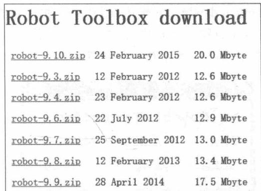

图 1-1 网站所提供的机器人工具箱版本
{: .figure-caption }


### 安装

将下载后的 zip 压缩包进行解压, 然后将名字为“rvctools”的文件夹存放在 MATLAB 的安装路径下的 toolbox 文件夹里面。

### 路径配置

MATLAB 调用的函数必须在它的搜索路径中, 因此需要将机器人工具箱的文件夹路径添加到 MATLAB 的搜索路径。具体的做法是: 启动 MATLAB, 在 Set Path 的界面中添加相关的机器人工具箱路径。如图 1-2 所示, 利用 MATLAB 工具栏里面的 Set Path 将文件夹 rvctools 里面的文件夹设置为搜索目录,包括了...\rvctools,...\rvctools\common,...\rvctools\contrib,...\rvctools\robot,...\rvctools\simulink 这 5 个文件夹。

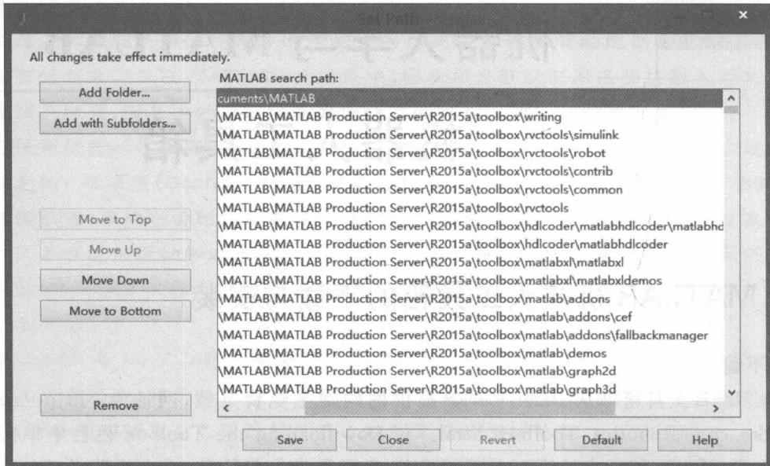

图 1-2 MATLAB 工具栏中对机器人工具箱的路径配置
{: .figure-caption }


### 机器人工具箱的启动

在 MATLAB 中的 command window 输入 rtbdemo, 完成机器人工具箱的启动。如图 1-3 所示, 可以查看机器人工具箱的所有功能, 主要包含了关节机器人和移动机器人的各种功能。本书将侧重于介绍机器人工具箱在关节机器人中的应用。

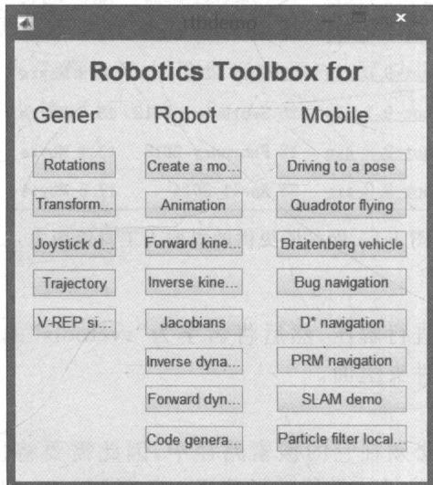

图 1-3 机器人工具箱的启动界面
{: .figure-caption }


## 1.2 机器人学的数学基础

### 1.2.1 三维空间中的位置与姿态

通常来说,机器人指的是至少包含有一个固定刚体和一个活动刚体的机器装置。其中,固定的刚体称为基座,而活动的刚体称为末端执行器。在两个部件之间会有若干连杆和关节来支撑末端执行器,并使其移动到一定的位置。

控制一个机器人的运动,可以通过控制机器人(机械臂)上各关节的位置,设定关节运动的轨迹。而首先需要做的就是获取机器人本身的位姿。所谓位姿,就是指机器人上每个关节在每一时刻的位置和姿态。这就需要确定描述空间物体位姿的方法,本书中使用空间坐标系来描述相关位姿。当得到位姿的描述以后,就可以利用各关节位姿之间的关系来描述机器人的整个运动链,进而得到机器人的基座坐标系和末端执行器坐标系之间的关系。

机器人的运动学模型包括机器人各连杆、关节的位置姿态以及在各关节上的坐标系，其任务之一就是确立机器人末端执行器的位姿。机器人的机械臂通常是由一组关节连接的连杆结合体：第一个连杆固定，连接该机械臂的基座，而最后一个连杆连接的是它的末端执行器。操作机器人是为了控制与机器人相关的零件、工具在三维空间中运动，因此需要描述相应的位置和姿态。

#### 位置描述

如图 1-4 所示, 在三维空间中建立某一坐标系, 于是空间中的任何一个点就可以通过一个 $3 \times 1$ 的位置矢量来确定。建立一个直角坐标系 $\{A\}$ , 空间中的任一点 $^{A}P$ 可以表示为:

$$
^ {A} \boldsymbol {P} = \left[ \begin{array}{l} p _ {x} \\ p _ {y} \\ p _ {z} \end{array} \right]\tag{1.1}
$$

其中， $p_{x}$ 、 $p_{y}$ 、 $p_{z}$ 分别是 $^{A}P$ 在坐标系 $\{A\}$ 中的三个坐标分量， $^{A}P$ 称为位置矢量。

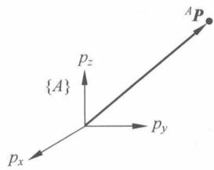

图1-4 空间中点 ${}^{A}\mathbf{P}$ 的位置描述
{: .figure-caption }


在 MATLAB 中, 可以利用它本身自带的函数 plot3() 画出三维空间中的一个点。例如点 p 的坐标为 $(1,1,3)$ ，输入代码: $\text{plot3}(1,1,3,'o')$ 就用圆圈画出这个点。

#### 姿态描述

空间中的物体还需要描述它的姿态(也称为方位)，这用固定在物体上的坐标系 $\{B\}$ 来描述。如图1-5所示，为了规定空间某刚体B的方位，设一坐标系 $\{B\}$ 与此刚体固连；用三个单位矢量 $x_{B},y_{B},z_{B}$ 来表示坐标系 $\{B\}$ 的主轴方向，因此物体相对于参考坐标系 $\{A\}$ 的姿态可以用矢量 $x_{B},y_{B},z_{B}$ 相对于参考坐标系 $\{A\}$ 的方向余弦组成的 $3\times3$ 矩阵来表示，这个矩阵 $_{B}^{A}R$ 称为旋转矩阵。

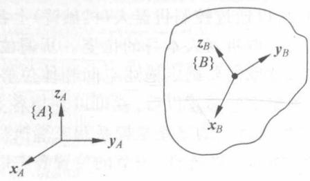

图 1-5 空间中某刚体 B 的姿态描述
{: .figure-caption }


$$
{ } _ { B } ^ { A } \boldsymbol { R } = \left[ \begin{array} { c c c } ^ { A } \boldsymbol { x } _ { B } & ^ { A } \boldsymbol { y } _ { B } & ^ { A } \boldsymbol { z } _ { B } \end{array} \right] = \left[ \begin{array} { c c c } r _ { 1 1 } & r _ { 1 2 } & r _ { 1 3 } \\ r _ { 2 1 } & r _ { 2 2 } & r _ { 2 3 } \\ r _ { 3 1 } & r _ { 3 2 } & r _ { 3 3 } \end{array} \right]\tag{1.2}
$$

用矢量两两之间的余弦则表示为：

$$
{ } _ { B } ^ { A } \boldsymbol { R } = \left[ \begin{array} { l l l } \cos ( x _ { A } , x _ { B } ) & \cos ( x _ { A } , y _ { B } ) & \cos ( x _ { A } , z _ { B } ) \\ \cos ( y _ { A } , x _ { B } ) & \cos ( y _ { A } , y _ { B } ) & \cos ( y _ { A } , z _ { B } ) \\ \cos ( z _ { A } , x _ { B } ) & \cos ( z _ { A } , y _ { B } ) & \cos ( z _ { A } , z _ { B } ) \end{array} \right]\tag{1.3}
$$

对应于轴 X, Y 或 Z 作转角为 $\theta$ 的旋转变换, 其旋转矩阵分别为:

$$
\boldsymbol {R} _ {x} (\theta) = \left[ \begin{array}{c c c} 1 & 0 & 0 \\ 0 & \cos \theta & - \sin \theta \\ 0 & \sin \theta & \cos \theta \end{array} \right]\tag{1.4}
$$

$$
\boldsymbol {R} _ {y} (\theta) = \left[ \begin{array}{c c c} \cos \theta & 0 & \sin \theta \\ 0 & 1 & 0 \\ - \sin \theta & 0 & \cos \theta \end{array} \right]\tag{1.5}
$$

$$
\boldsymbol {R} _ {z} (\theta) = \left[ \begin{array}{c c c} \cos \theta & - \sin \theta & 0 \\ \sin \theta & \cos \theta & 0 \\ 0 & 0 & 1 \end{array} \right]\tag{1.6}
$$

旋转矩阵 $_{B}^{A}R$ 具有这样的特点：

(1) 3 个主矢量两两垂直；

(2) 9个元素中, 只有3个是独立的;

(3) 3个单位主矢量满足6个约束条件：

$$
{ } ^ { A } \boldsymbol { x } _ { B } \cdot { } ^ { A } \boldsymbol { x } _ { B } = { } ^ { A } \boldsymbol { y } _ { B } \cdot { } ^ { A } \boldsymbol { y } _ { B } = { } ^ { A } \boldsymbol { z } _ { B } \cdot { } ^ { A } \boldsymbol { z } _ { B } = 1\tag{1.7}
$$

$$
{ } ^ { A } \boldsymbol { x } _ { B } \cdot { } ^ { A } \boldsymbol { y } _ { B } = { } ^ { A } \boldsymbol { y } _ { B } \cdot { } ^ { A } \boldsymbol { z } _ { B } = { } ^ { A } \boldsymbol { x } _ { B } \cdot { } ^ { A } \boldsymbol { z } _ { B } = 0\tag{1.8}
$$

(4) 旋转矩阵为正交矩阵,并且满足条件:

$$
{ } _ { B } ^ { A } \boldsymbol { R } ^ { - 1 } = { } _ { B } ^ { A } \boldsymbol { R } ^ { T } , \quad | { } _ { B } ^ { A } \boldsymbol { R } | = 1
$$

在机器人工具箱中,可分别用函数 $\mathrm{rotx}(\theta)$ , $\mathrm{roty}(\theta)$ , $\mathrm{rotz}(\theta)$ 计算旋转 $\theta$ 的旋转矩阵, 其中, 在默认情况下, $\theta$ 用弧度表示。

例如围绕 X 轴做转角为 $180^{\circ}$ 的旋转变换时, 输入 MATLAB 命令:

```txt
>> R = rotx(pi)
```

运行结果：

```txt
R =
1.0000 0 0
0 -1.0000 -0.0000
0 0.0000 -1.0000
```

如果直接用角度 $\theta$ 表示, 可以分别用 rotx( $\theta$ , 'deg'), roty( $\theta$ , 'deg'), rotz( $\theta$ , 'deg') 计算旋转矩阵。上面例子的 MATLAB 命令:

```python
>> R = rotx(180, 'deg')
```

运行结果：

<table><tr><td colspan="3">R =</td></tr><tr><td>1.0000</td><td>0</td><td>0</td></tr><tr><td>0</td><td>-1.0000</td><td>-0.0000</td></tr><tr><td>0</td><td>0.0000</td><td>-1.0000</td></tr></table>

以上两种方式,都可以得到相对应的旋转矩阵。

在机器人工具箱中,可以使用两种函数实现坐标的旋转可视化。函数 trplot()可以用图形表示相应的体坐标系,函数 tranimate()用动画展示世界坐标系旋转为体坐标系的过程。

输入 trplot(R), 运行结果如图 1-6 所示; 输入 tranimate(R), 运行结果如图 1-7 所示。

#### 本节函数解析

根据 Peter Corke 所编著的 MATLAB 机器人工具箱的函数说明文档(即 Robotics Toolbox for MATLAB)，以下对本节所出现过的函数进行进一步的解析。

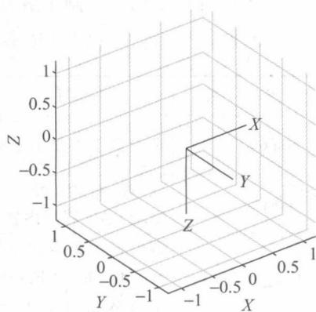

图 1-6 使用 trplot() 生成的坐标图
{: .figure-caption }


## 1）获取旋转矩阵

(1) $\operatorname{rotx}()$ : $R = \operatorname{rotx}(\theta)$ 是表示围绕 $X$ 轴旋转弧度为 $\theta$ 得到的旋转矩阵, 返回一个 $3 \times 3$ 的矩阵。

(2) roty(): R=roty(θ) 是表示围绕 Y 轴旋转弧度为 θ 得到的旋转矩阵, 返回一个 $3 \times 3$ 的矩阵。

(3) rotz(): R=rotz(θ) 是表示围绕 Z 轴旋转弧度为 θ 得到的旋转矩阵, 返回一个 $3 \times 3$ 的矩阵。

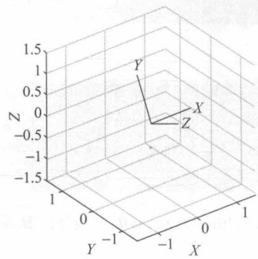

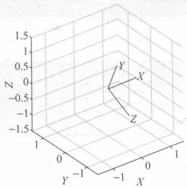

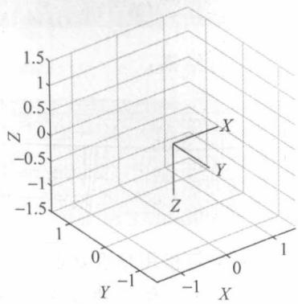

图 1-7 使用 tranimate() 生成的坐标图
{: .figure-caption }

以上三个函数中,可选参数为“deg”,表示角度值单位为度(degree)。

## 2）绘制坐标系

函数为：trplot()。
对于三维坐标系的绘制,机器人工具箱提供了强大的可视化函数 trplot()。
(1) trplot(R): 绘制由旋转矩阵得到的坐标系, 其中坐标系根据正交旋转矩阵围绕原点旋转得到, R 为 $3 \times 3$ 的矩阵。
(2) trplot(T): 绘制由齐次变换矩阵 T 表示的三维坐标系, 其中 T 为 $4 \times 4$ 的矩阵。
此外,它包含了许多可选参数,这里列举主要的几种:

<table><tr><td>参数</td><td>意义</td><td>参数</td><td>意义</td></tr><tr><td>&#x27;noaxes&#x27;</td><td>在绘图上不显示坐标轴</td><td>&#x27;axis&#x27;, A</td><td>将图形显示的轴尺寸设置为A,其中A=[xmin xmax ymin ymax zmin zmax]</td></tr><tr><td>&#x27;color&#x27;, C</td><td>设置轴的颜色,C代表MATLAB图形内置的颜色类型</td><td>&#x27;frame&#x27;, F</td><td>将绘制出来的坐标系命名为F,并且X,Y,Z轴的下标含有F</td></tr><tr><td>&#x27;text_opts&#x27;, opt</td><td>调整显示文本的字体大小等属性;例如{&#x27;FontSize&#x27;, 10,&#x27;FontWeight&#x27;, &#x27;bold&#x27;}</td><td>&#x27;view&#x27;, V</td><td>设置绘图视图参数V=[az el]角度,或者对于坐标系的原点查看&#x27;auto&#x27;</td></tr><tr><td>&#x27;length&#x27;, s</td><td>坐标轴的长度(默认值1)</td><td>&#x27;arrow&#x27;</td><td>设置坐标轴的末端为箭头,而不是线段</td></tr><tr><td>&#x27;width&#x27;, w</td><td>箭头宽度(默认为1)</td><td>&#x27;thick&#x27;, t</td><td>线条粗细(默认0.5)</td></tr><tr><td>&#x27;3d&#x27;</td><td>在三维空间中使用浮雕图形绘制</td><td>&#x27;anaglyph&#x27;, A</td><td>将“3d”的浮雕颜色指定为左右两个字符(默认颜色为&quot;rc&quot;):选自红,绿,蓝,青,品红</td></tr><tr><td>&#x27;dispar&#x27;, D</td><td>3d显示差异(默认0.1)</td><td>&#x27;text&#x27;</td><td>启用在框架上显示X,Y,Z标签</td></tr><tr><td>&#x27;labels&#x27;, L</td><td>使用字符串L的第1个,第2个,第3个字符标记X,Y,Z轴</td><td>&#x27;rgb&#x27;</td><td>以红色,绿色,蓝色分别显示X,Y,Z轴</td></tr></table>

## 3）动画展示

函数为：tranimate()。

(1) tranimate(x1, x2, options)展示 3D 坐标系从姿态 x1 变换到姿态 x2 的动画效果。其中，姿态 x1 和 x2 有三种表示方法：一个 $4 \times 4$ 的齐次矩阵，或一个 $3 \times 3$ 的旋转矩阵，或一个四元数。

(2) tranimate(x, options)展示了坐标系由上一个姿态变换到姿态 x 的动画效果。同样地，姿势 x 也有三种表示方法：一个 $4 \times 4$ 的齐次矩阵，或一个 $3 \times 3$ 的旋转矩阵，或一个四元数。

(3) tranimate(xseq, options)展示了移动一段轨迹的动画效果。xseq 可以是一组 $4 \times 4 \times N$ 的齐次矩阵，或一组 $3 \times 3 \times N$ 的旋转矩阵，或是一组四元数向量 $(N \times 1)$ 。

它包含的可选参数如下：

<table><tr><td>参数</td><td>意义</td><td>参数</td><td>意义</td></tr><tr><td>&#x27;fps&#x27;, fps</td><td>每秒显示的帧数(默认为10)</td><td>&#x27;nsteps&#x27;, n</td><td>沿路径的步数(默认50)</td></tr><tr><td>&#x27;axis&#x27;, A</td><td>设置三个轴的边界, A = [xmin, xmax, ymin, ymax, zmin, zmax]</td><td>&#x27;movie&#x27;, M</td><td>将帧保存为文件夹M中的文件,M为文件的路径</td></tr></table>

### 1.2.2 坐标变换

在三维空间中,任一坐标系均可作为描述一个物体位姿的参考坐标系。在机器人学的许多问题中,常常需要在不同的参考坐标系中表示同一个物体的位姿。例如,图1-8的应用例子中,需要在相机的指导下,使用机器人的手臂去夹取一个目标物体。因此,需要获取世界坐标系、固定相机的坐标系、机器人的坐标系、机器人的相机坐标系、目标物体的坐标系的位置与姿态,使得机器人的末端执行器能够达到夹取目标物体所需要的位姿,执行夹取任务。

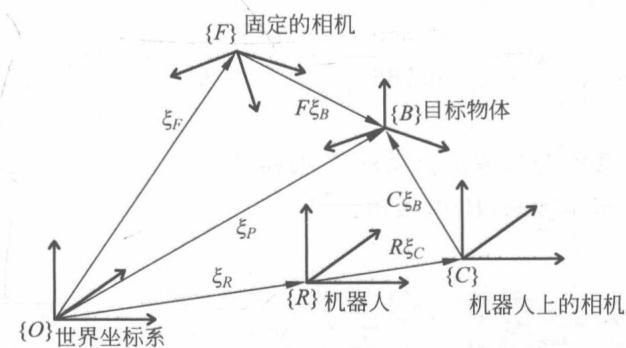

图 1-8 机器人夹取物体任务中的坐标系
{: .figure-caption }


#### 平移坐标变换

如图 1-9 所示, 坐标系 $\{A\}$ 没有经过旋转, 只经过平移得到坐标系 $\{B\}$ 。P 是 B 坐标系中的一点，用矢量 $^{B}P$ 表示它在坐标系 $\{B\}$ 中的位置； $^{A}P_{BORG}$ 表示A坐标系平移到B坐标系的距离。当P用坐标系 $\{A\}$ 表示时，用矢量 $^{A}P$ 表示。因为矢量 $^{A}P$ 和 $^{B}P$ 具有相同的姿态，所以可以使用矢量相加的方法表示 $^{A}P$ ：

$$
^ {A} \boldsymbol {P} = ^ {B} \boldsymbol {P} + ^ {A} \boldsymbol {P} _ {B O R G}\tag{1.9}
$$

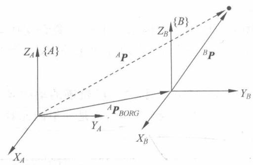

图 1-9 坐标系 $\{O_{A}\}$ 经过平移变换到坐标系 $\{O_{B}\}$
{: .figure-caption }


用 $4 \times 4$ 的齐次矩阵表示平移变换矩阵 T，则

$$
\boldsymbol {T} = \left[ \begin{array}{c c c c} 1 & 0 & 0 & p _ {x} \\ 0 & 1 & 0 & p _ {y} \\ 0 & 0 & 1 & p _ {z} \\ 0 & 0 & 0 & 1 \end{array} \right]\tag{1.10}
$$

其中， $p_{x}, p_{y}$ 和 $p_{z}$ 是平移向量 P 相对于参考坐标系 X 轴、Y 轴和 Z 轴的 3 个分量。与矢量和旋转矩阵一样，坐标系还可以用上述变换算子表示。

对于平移坐标变换,机器人工具箱提供了函数 transl() 计算一段平移相对应的平移变换矩阵。

例如,空间中的一个坐标系 $\{A\}$ ,它可以表示为

$$
\mathbf {A} = \left[ \begin{array}{c c c c} 0. 5 2 7 & - 0. 5 7 4 & 0. 6 2 8 & 5 \\ 0. 3 6 9 & 0. 8 1 9 & 0. 4 3 9 & 3 \\ - 0. 7 6 6 & 0 & 0. 6 4 3 & 8 \\ 0 & 0 & 0 & 1 \end{array} \right]
$$

如果将这个坐标系沿着参考坐标系的 Y 轴移动 10 个单位, 然后再沿着 Z 轴移动 5 个单位得到坐标系 $\{B\}$ , 求坐标系 $\{B\}$ 的表示。

输入命令：

```matlab
>> A = [0.527, -0.574, .628, 5;
    0.369, 0.819, 0.439, 3;
    -0.766, 0, 0.643, 8;
    0, 0, 0, 1];
>> T = transl(0, 10, 5);
>> B = T * A
```

运行结果：

<table><tr><td>B =</td><td></td><td></td><td></td></tr><tr><td>0.5270</td><td>-0.5740</td><td>0.6280</td><td>5.0000</td></tr><tr><td>0.3690</td><td>0.8190</td><td>0.4390</td><td>13.0000</td></tr><tr><td>-0.7660</td><td>0</td><td>0.6430</td><td>13.0000</td></tr><tr><td>0</td><td>0</td><td>0</td><td>1.0000</td></tr></table>

其中平移变换矩阵为：

<table><tr><td>T =</td><td></td><td></td><td></td></tr><tr><td>1</td><td>0</td><td>0</td><td>0</td></tr><tr><td>0</td><td>1</td><td>0</td><td>10</td></tr><tr><td>0</td><td>0</td><td>1</td><td>5</td></tr><tr><td>0</td><td>0</td><td>0</td><td>1</td></tr></table>

#### 旋转坐标变换

如图 1-10 所示, 当坐标系 $\{A\}$ 没有经过平移, 只经过旋转时 (旋转矩阵为 $\overset{A}{B}R$ ), 得到坐标系 $\{B\}$ 。同一个点 P 在坐标系 $\{A\}$ 和 $\{B\}$ 中的表示分别为 $^{A}P$ 和 $^{B}P$ , 这两个矢量有这样的变换关系:

$$
{ } ^ { A } \boldsymbol { P } = _ { B } ^ { A } \boldsymbol { R } ^ { B } \boldsymbol { P }
$$

机器人工具箱分别提供了 $\mathrm{trotx()}$ ， $\mathrm{troty()}$ ， $\mathrm{trotz()}$ 三个函数计算旋转变换矩阵，分别对应着 $X$ 轴， $Y$ 轴和 $Z$ 轴旋转一定的角度，得到的是一个 $4\times 4$ 的矩阵。

例如上面的坐标系 $\{A\}$ ，然后绕着X轴旋转 $30^{\circ}$ ，求旋转后得到的坐标系 $\{C\}$ 。

运行指令：

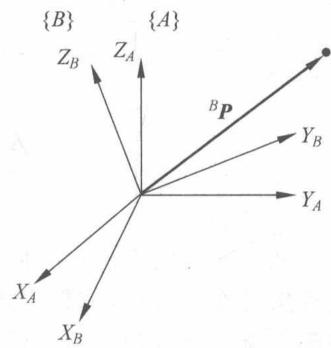

图1-10 坐标系 $\{O_A\}$ 经过旋转变换到坐标系 $\{O_B\}$
{: .figure-caption }


$$
\gg \mathrm{T} = \operatorname{trotx} (\mathrm{pi} / 6)
$$

运行结果：

<table><tr><td colspan="5">T =</td></tr><tr><td></td><td>1.0000</td><td>0</td><td>0</td><td>0</td></tr><tr><td></td><td>0</td><td>0.8660</td><td>-0.5000</td><td>0</td></tr><tr><td></td><td>0</td><td>0.5000</td><td>0.8660</td><td>0</td></tr><tr><td></td><td>0</td><td>0</td><td>0</td><td>1.0000</td></tr></table>

得到旋转变换矩阵后,可运行下面指令得到坐标系 $\{C\}$ 的表示:

$$
> > C = T * A
$$

运行结果：

<table><tr><td>C =</td><td></td><td></td><td></td></tr><tr><td>0.5270</td><td>-0.5740</td><td>0.6280</td><td>5.0000</td></tr><tr><td>0.7026</td><td>0.7093</td><td>0.0587</td><td>-1.4019</td></tr><tr><td>-0.4789</td><td>0.4095</td><td>0.7764</td><td>8.4282</td></tr><tr><td>0</td><td>0</td><td>0</td><td>1.0000</td></tr></table>

#### 齐次坐标变换

如图 1-11 所示, 当坐标系 $\{A\}$ 经过平移 (距离为 $^{A}P_{BORG}$ ) 与旋转 (旋转矩阵为 $_{B}^{A}R$ ) 得到坐标系 $\{B\}$ 。同一个点 P 在坐标系 $\{A\}$ 和 $\{B\}$ 中的表示分别为 $^{A}P$ 和 $^{B}P$ , 这两个矢量有如下的变换关系:

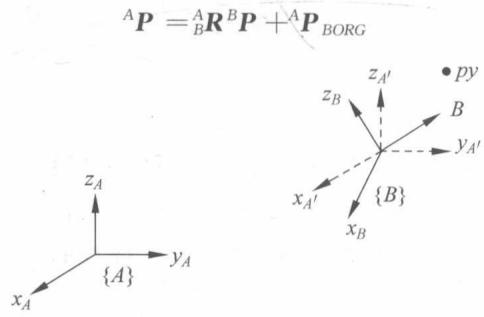

图 1-11 包括了平移变换和旋转变换的一般坐标变换
{: .figure-caption }


(1.11)

从上式可以得出在不同坐标系中的位姿 $^{A}P$ 和 $^{B}P$ 之间的关系，但在上式中 $^{A}P$ 和 $^{B}P$ 并不是齐次变换的关系，结果只能简易计算相邻坐标系中位姿之间的关系，当不是相邻甚至需要得到末端执行器和基座坐标系上位姿的关系时，计算量太大、太复杂，所以应该将这个等式写成齐次变换的形式。因为在三维矩阵计算不能充分描述齐次变换，所以增加了矩阵的维数，将等式改写为四维矩阵的形式，即：

$$
\binom {^ A \boldsymbol {P}} {1} = \left( \begin{array}{c c} ^ A _ {B} \boldsymbol {R} & ^ A _ {B O R G} \\ 0 _ {1 \times 3} & 1 \end{array} \right) \binom {^ B \boldsymbol {P}} {1}\tag{1.12}
$$

将转换因子用齐次变换矩阵 $_{B}^{A}T$ 表示,即:

$$
{ } _ { B } ^ { A } \boldsymbol { T } = \left( \begin{array} { c c } { } _ { B } ^ { A } \boldsymbol { R } & { } ^ { A } \boldsymbol { P } _ { B O R G } \\ 0 _ { 1 \times 3 } & 1 \end{array} \right)\tag{1.13}
$$

因此上式可以表示为

$$
{ } ^ { A } \boldsymbol { P } = { } _ { B } ^ { A } \boldsymbol { T } ^ { B } \boldsymbol { P }\tag{1.14}
$$

对于旋转矩阵 $_{B}^{A}R$ ，根据正交矩阵的性质可以得到：

$$
{ } _ { B } ^ { A } \boldsymbol { R } ^ { - 1 } = { } _ { B } ^ { A } \boldsymbol { R } = { } _ { B } ^ { A } \boldsymbol { R } ^ { T }\tag{1.15}
$$

而对于转换矩阵,其逆矩阵不等于原矩阵,经过推导,可得到:

$$
{ } _ { B } ^ { A } \boldsymbol { T } ^ { - 1 } = { } _ { A } ^ { B } \boldsymbol { T } = \left( \begin{array} { c c } { } _ { B } ^ { A } \boldsymbol { R } ^ { \mathrm{T} } & - { } _ { B } ^ { A } \boldsymbol { R } ^ { \mathrm{T} A } \boldsymbol { P } _ { B O R G } \\ 0 _ { 1 \times 3 } & 1 \end{array} \right)\tag{1.16}
$$

因此,得到了相邻坐标系间矢量(旋转矢量和移动矢量)的齐次变换。

前面提到,对于平移坐标变换,机器人工具箱提供了函数 transl(); 对于旋转坐标变换,机器人工具箱分别提供了函数 trotx()、troty()、trotz()。下面用例子说明如何用机器人工具箱解决齐次变换的问题。

【例 1-1】已知坐标系 $\{A\}$ 与坐标系 $\{B\}$ 初始位姿重合，首先 $\{B\}$ 相对于 $\{A\}$ 的 $y_{A}$ 旋转 $60^{\circ}$ ，再沿着 $\{A\}$ 的 $x_{A}$ 轴移动 4 个单位，最后沿着 $\{A\}$ 的 $z_{A}$ 轴移动 3 个单位。

(1) 点 $p_{1}$ 在坐标系 $\{B\}$ 中的描述为 $^{B}p_{1}=[2\quad4\quad3]^{T}$ ，求它在坐标系 $\{A\}$ 中的描述 $^{A}p_{1}$ 。

（2）另有一点 $p_2$ 在坐标系 $\{A\}$ 中的描述为 $^A p_2 = [2\quad 4\quad 3]^{\mathrm{T}}$ ，求它在坐标系 $\{B\}$ 中的描述 $^B p_2$ 。

解析：

(1) 旋转矩阵 $_{B}^{A}R=R(y,60^{\circ})$ ，平移矢量为 $^{A}p_{B}=\left[4\quad0\quad3\right]^{T}$

$$
{ } _ { B } ^ { A } \boldsymbol { T } = \left( \begin{array} { c c } { } _ { B } ^ { A } \boldsymbol { R } & { } ^ { A } \boldsymbol { P } _ { B O R G } \\ 0 _ { 1 \times 3 } & 1 \end{array} \right)
$$

输入命令：

$$
\gg \mathrm{T} = \text { transl } (4, 0, 3) * \text { troty } (\mathrm{pi} / 3)
$$

运行结果为：

<table><tr><td colspan="4">T =</td></tr><tr><td>0.5000</td><td>0</td><td>0.8660</td><td>4.0000</td></tr><tr><td>0</td><td>1.0000</td><td>0</td><td>0</td></tr><tr><td>-0.8660</td><td>0</td><td>0.5000</td><td>3.0000</td></tr><tr><td>0</td><td>0</td><td>0</td><td>1.0000</td></tr></table>

点 $p_{1}$ 在坐标系 $\{A\}$ 中的描述为： $^{A}P=^{A}_{B}T^{B}P$ 。

输入命令：

$$
\gg \mathrm{p} = \mathrm{T} * [ 2; 4; 3; 1 ]
$$

运行结果为：

(2) 由 $^{A}P=_{B}^{A}T^{B}P$ 可得到 $^{B}P=_{B}^{A}T^{-1A}P$ 。

输入命令：

```txt
>> p2 = inv(T) * [2;4;3;1]
```

运行结果为：

```txt
p2 =
-1.0000
4.0000
-1.7321
1.0000
```

关于三维空间中的坐标系，MATLAB 机器人工具箱提供了函数 trplot() 可以画出该坐标系。对于上面的例子，可以通过 trplot() 画出坐标系 $\{A\}$ 和坐标系 $\{B\}$ 。

输入命令：

```matlab
>> T0 = transl(0, 0, 0);
>> trplot(T0, 'frame', 'A', 'color', 'b');
>> hold on;
>> trplot(T, 'frame', 'B', 'color', 'r');
>> axis([0 5 0 5 0 5]);
>> axis([0 5 0 5 0 5]);
>> p2 = inv(T) * [2; 4; 3; 1]
```

运行结果如图 1-12 所示。

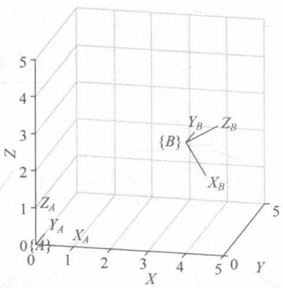

图 1-12 通过函数 trplot() 生成的坐标系
{: .figure-caption }


此外，关于齐次变换矩阵 $A_{B}T$ ，机器人工具箱提供了函数 $t2r()$ 可以提取旋转矩阵分量。输入命令：

```txt
>> R = t2r(T)
```

运行结果为：

<table><tr><td>R =</td><td></td><td></td></tr><tr><td>0.5000</td><td>0</td><td>0.8660</td></tr><tr><td>0</td><td>1.0000</td><td>0</td></tr><tr><td>-0.8660</td><td>0</td><td>0.5000</td></tr></table>

而函数 $r2t()$ 则可以将旋转矩阵转换成对应的齐次变换矩阵。如通过运行指令 $r2t(R)$ 可以得到上面的矩阵 T。

通过以下的命令可以提取平移变换分量。

输入命令：

```txt
>> p = tranl(T)
```

运行结果：

#### 本节函数解析

根据 Robotics Toolbox for MATLAB, 以下对本节所出现过的函数进行进一步的解析。

1) 平移变换 transl()

(1) 使用 transl() 创建平移变换矩阵。

$T = \text{transl}(x, y, z)$ ：表示能够获取一个分别沿着 $x, y, z$ 轴平移一段距离得到的 $4 \times 4$ 齐次变换矩阵。

$T = \text{transl}(p)$ : 表示由经过矩阵(或向量) $p = [x, y, z]$ 的平移得到的齐次变换矩阵。如果 $p$ 为 $(M \times 3)$ 的矩阵，则 $T$ 为一组齐次变换矩阵 $(4 \times 4 \times M)$ ，其中 $T(\cdot, \cdot, i)$ 对应于 $p$ 的第 $i$ 行。

(2) 使用 transl() 提取一个矩阵中的平移变换分量。

$[x, y, z] = \text{transl}(T): x, y, z$ 是齐次变换矩阵中的三个分量，是一个 $1 \times M$ 的向量。

$p = \text{transl}(T)$ : p 是齐次变换矩阵中 T 的平移部分, 是一个 $3 \times M$ 的矩阵。

2）旋转坐标变换

(1) $T = \operatorname{trotx}(\theta)$ : 表示围绕 X 轴旋转 $\theta$ (弧度) 得到的齐次变换矩阵 $(4 \times 4)$ 。

(2) $T = \text{troty}(\theta)$ : 表示围绕 Y 轴旋转 $\theta$ (弧度) 得到的齐次变换矩阵 $(4 \times 4)$ 。

(3) $T = \operatorname{trotz}(\theta)$ : 表示围绕 Z 轴旋转 $\theta$ (弧度) 得到的齐次变换矩阵 $(4 \times 4)$ 。

以上 3 个函数中, 可选参数为 deg, 表示角度值单位为度(degree)。

3) t2r()

$R = t2r(T)$ 获取齐次变换矩阵 T 中正交旋转矩阵分量。如果 T 是一个 $4 \times 4$ 的矩阵，

则 R 是一个 $3 \times 3$ 的矩阵；如果 T 是一个 $3 \times 3$ 的矩阵，则 R 是一个 $2 \times 2$ 的矩阵。

$$
\mathrm{r} 2 \mathrm{t} ()
$$

函数 r2t() 可将旋转矩阵转换为齐次变换矩阵。

$T=r2t(R)$ 获取一个正交旋转矩阵R等价的具有零平移分量的齐次变换矩阵。如果R是一个 $3\times3$ 的矩阵，则T是一个 $4\times4$ 的矩阵；如果R是一个 $2\times2$ 的矩阵，则T是一个 $3\times3$ 的矩阵。

### 1.2.3 姿态的其他表示方法

#### 角坐标表示法

角坐标表示法的原理是：首先考虑坐标系 $\{B\}$ 和一个固定的参考坐标系 $\{A\}$ 重合，然后每次将 $\{B\}$ 绕着 $\{A\}$ 或 $\{B\}$ 的其中一条轴旋转一定的角度，需要连续转三次。角坐标表示法有24种典型的表示方法：每次旋转都只围绕着 $\{A\}$ 的某条轴，共有12种，称为固定角坐标系法；而每次旋转都是绕着 $\{B\}$ 的某条轴，共有12种，称为欧拉角坐标系法。下面介绍几种常用的方法。

## 1） $X - Y - Z$ 固定角坐标系

X-Y-Z 固定角坐标系的方法：首先将坐标系 $\{B\}$ 和固定的参考坐标系 $\{A\}$ 重合，然后 $\{B\}$ 绕着 $X_{A}$ 旋转 $\gamma$ ，再绕着 $Y_{A}$ 旋转 $\beta$ ，最后绕 $Z_{A}$ 旋转 $\alpha$ 。相对于 X、Y 和 Z 轴旋转的角分别称为回转角、俯仰角和偏转角。这里可以通过三个旋转矩阵的相乘推导出经过一系列旋转后的等价旋转矩阵：

$$
{ } _ { B } ^ { A } \boldsymbol { R } _ { X Y Z } ( \gamma , \beta , C ) = \boldsymbol { R } _ { Z } ( \alpha ) \boldsymbol { R } _ { Y } ( \beta ) \boldsymbol { R } _ { X } ( \gamma )\tag{1.17}
$$

从而可以得出：

$$
\begin{array}{r l} & _ {B} ^ {A} \boldsymbol {R} _ {X Y Z} (\gamma , \beta , \alpha) \\ = & \left( \begin{array}{c c c} \cos \alpha \cdot \cos \beta & \cos \alpha \cdot \sin \beta \cdot \sin \gamma - \sin \alpha \cdot \cos \gamma & \cos \alpha \cdot \sin \beta \cdot \cos \gamma + \sin \alpha \cdot \sin \gamma \\ \sin \alpha \cdot \cos \beta & \sin \alpha \cdot \sin \beta \cdot \sin \gamma + \cos \alpha \cdot \cos \gamma & \sin \alpha \cdot \sin \beta \cdot \cos \gamma - \cos \alpha \cdot \sin \gamma \\ - \sin \beta & \cos \beta \cdot \sin \gamma & \cos \beta \cdot \cos \gamma \end{array} \right) \end{array}\tag{1.18}
$$

可以看出，上式的结果比较复杂，而机器人工具箱提供了简单的函数去计算等价的旋转矩阵，其中一种是使用之前提过的函数 $\mathrm{rotx}()$ 、roty()和 $\mathrm{rotz}()$ 按顺序相乘；另外一种是使用函数rpy2r()。

例如，在 X-Y-Z 固定角坐标系中，当回转角 $\gamma$ 为 $30^{\circ}$ ，俯仰角 $\beta$ 为 $45^{\circ}$ ，偏转角 $\alpha$ 为 $60^{\circ}$ 时，求出经过这一系列旋转变换得到的旋转矩阵：

输入命令

```txt
>> R1 = rotz(pi/3) * roty(pi/4) * rotx(pi/6)
```

或者

```txt
>> R1 = rpy2r(pi/3, pi/4, pi/6, 'zyx')
```

该函数默认的是 XYZ, 应在后面的选项添加 zyx 指定为 ZYX 顺序。

运行结果：

```csv
R1 =
0.3536 - 0.5732 0.7392
0.6124 0.7392 0.2803
-0.7071 0.3536 0.6124
```

如果已知一个旋转矩阵,要求出对应的偏转角、俯仰角和回转角,根据理论计算很难得到所要求的值。在机器人工具箱中,可以根据函数 tr2rpy() 计算出一个给定旋转矩阵的偏转角、俯仰角和回转角。

例如，在上面中的例子求出的旋转矩阵 R1，可以求出对应的三个角、输入命令：

```txt
>> TB = tr2rpy(R1, 'zyx')
```

运行结果：

```txt
TB =
1.0472 0.7854 0.5236
```

因此，可以得出，回转角 $\gamma$ 为0.5236，俯仰角 $\beta$ 为0.7854，偏转角 $\alpha$ 为1.0472（注意顺序）。

## 2）Z-Y-Z 欧拉角坐标系

Z-Y-Z 欧拉角坐标系的方法：首先将坐标系 $\{B\}$ 和固定的参考坐标系 $\{A\}$ 重合，然后 $\{B\}$ 绕着 $Z_{B}$ 旋转 $\alpha$ 角，再绕着 $Y_{B}$ 旋转 $\beta$ ，最后绕 $Z_{B}$ 旋转 $\gamma$ 。这里可以通过三个旋转矩阵的相乘推导出经过一系列旋转后的等价旋转矩阵：

$$
{ } _ { B } ^ { A } \boldsymbol { R } _ { Z ^ { \prime } Y ^ { \prime } X ^ { \prime } } ( \gamma , \beta , C ) = \boldsymbol { R } _ { Z } ( \alpha ) \boldsymbol { R } _ { Y } ( \beta ) \boldsymbol { R } _ { Z } ( \gamma )\tag{1.19}
$$

从而可以得出：

$$
\begin{array}{r l} & _ {B} ^ {A} \boldsymbol {R} _ {Z ^ {\prime} Y ^ {\prime} X ^ {\prime}} (\gamma , \beta , C) \\ = & \left( \begin{array}{c c c} \cos \alpha \cdot \sin \beta \cdot \cos \gamma - \sin \alpha \cdot \sin \gamma & - \cos \alpha \cdot \cos \beta \cdot \sin \gamma - \sin \alpha \cdot \cos \gamma & \cos \alpha \cdot \sin \beta \\ \sin \alpha \cdot \cos \beta \cdot \cos \gamma + \cos \alpha \cdot \sin \gamma & \sin \alpha \cdot \cos \beta \cdot \sin \gamma + \cos \alpha \cdot \cos \gamma & \sin \alpha \cdot \sin \beta \\ - \sin \beta \cdot \cos \gamma & \sin \beta \cdot \sin \gamma & \cos \beta \end{array} \right) \end{array}\tag{1.20}
$$

同样地,机器人工具箱提供了函数 eul2r()去计算对应的欧拉角。

例如，在 Z-Y-Z 欧拉角中，坐标系 $\{B\}$ 绕 $Z_{B}$ 旋转 $30^{\circ}$ ，再绕 $Y_{B}$ 旋转 $45^{\circ}$ ，最后绕 $Z_{B}$ 旋转

$60^{\circ}$ ,要求经过这一系列旋转变换得到的旋转矩阵。

输入命令：

```txt
>> R2 = rotz(pi/6) * roty(pi/4) * rotz(pi/3)
```

或者

```txt
>> R2 = eul2r(pi/6, pi/4, pi/3)
```

运行结果：

```csv
R2 =
-0.1268 -0.7803 0.6124
0.9268 0.1268 0.3536
-0.3536 0.6124 0.7071
```

此外,如果已知一个旋转矩阵,要求出对应的三个欧拉角,在机器人工具箱中,可以根据函数 tr2eul() 计算出一个给定旋转矩阵的欧拉角。

输入命令：

```txt
>> EA = tr2eul(R2)
```

运行结果：

```txt
EA =
0.5236 0.7854 1.0472
```

因此可以得出，三个 Z-Y-Z 欧拉角分别是 0.5236、0.7854 和 1.0472。

#### 向量表示法

在机器人学中,用向量去表示一个坐标系的方法比较少用,但机器人工具箱提供了相关的函数进行计算。

## 1）双向量表示法

双向量表示法是假设一个旋转矩阵为

$$
\boldsymbol {R} = \left[ \begin{array}{l l l} n _ {x} & o _ {x} & a _ {x} \\ n _ {y} & o _ {y} & a _ {y} \\ n _ {z} & o _ {z} & a _ {z} \end{array} \right]\tag{1.21}
$$

已知两个在同一个平面但不平行的向量 $a=\left[a_{x}\quad a_{y}\quad a_{z}\right]$ 和向量 $o=\left[o_{x}\quad o_{y}\quad o_{z}\right]$ 。因为两个向量确定了一个平面，即使它们之间不存在正交的关系，但可以通过叉乘来确定另一个新的向量 n，而且向量 n 垂直于它们所确定的平面。

在机器人工具箱中,提供了函数 oa2r()去计算两个非平行的向量所定义的一个坐标

系。例如，两个向量分别是 $a = [2,1,0]$ 和 $o = [1,2,0]$ ，计算对应的旋转矩阵。

输入指令：

```matlab
>> a = [2, 1, 0];
>> o = [1, 2, 0];
>> R = oa2r(o, a)
```

运行结果：

<table><tr><td>R =</td><td></td><td></td></tr><tr><td></td><td>0 - 0.4472</td><td>0.8944</td></tr><tr><td></td><td>0 0.8944</td><td>0.4472</td></tr><tr><td></td><td>-1.0000</td><td>0 0</td></tr></table>

## 2）单向量旋转法

对于空间中任意两个姿态的坐标系,可以在空间中找到某个轴,使得其中一个坐标系绕着这个轴旋转一定的角度,与另外一个坐标系姿态重合。其中这个向量称为旋转向量,与前面提到的旋转矩阵,二者可以通过罗德里格斯变换进行转换:

$$
\boldsymbol {R} = \cos \theta \boldsymbol {I} + (1 - \cos \theta) \boldsymbol {r r} ^ {\mathrm{T}} + \sin \theta \left[ \begin{array}{c c c} 0 & - r _ {z} & r _ {y} \\ r _ {z} & 0 & - r _ {z} \\ - r _ {y} & r _ {x} & 0 \end{array} \right]\tag{1.22}
$$

其中，r 为旋转向量， $\theta$ 为对应的角度。

机器人工具箱中,提供了函数 angvec2r() 将向量与它所选择的角度转换到等价的旋转矩阵。例如,坐标系 A 绕着 X 轴旋转 $90^{\circ}$ , 求它等价的旋转矩阵。

输入指令：

```txt
>> R = angvec2r(pi/2, [1, 0, 0])
```

运行结果：

<table><tr><td colspan="3">R =</td></tr><tr><td>1.0000</td><td>0</td><td>0</td></tr><tr><td>0</td><td>0.0000</td><td>-1.0000</td></tr><tr><td>0</td><td>1.0000</td><td>0.0000</td></tr></table>

提供了函数 angvec2tr() 将向量与它所选择的角度转换到等价的齐次变换矩阵。以上面的例子为例, 输入指令:

```erlang
>> T = angvec2tr(pi/2, [1, 0, 0])
```

运行结果：

<table><tr><td colspan="4">T =</td></tr><tr><td>1.0000</td><td>0</td><td>0</td><td>0</td></tr><tr><td>0</td><td>0.0000</td><td>-1.0000</td><td>0</td></tr><tr><td>0</td><td>1.0000</td><td>0.0000</td><td>0</td></tr><tr><td>0</td><td>0</td><td>0</td><td>1.0000</td></tr></table>

如果进行逆运算,求出旋转矩阵所对应的旋转向量及角度,可以使用函数 tr2angvec()。例如上面例子的逆运算,输入指令:

```txt
>> [theta, v] = tr2angvec(R)
```

运行结果：

```txt
theta =
1.5708
v =
1 0 0
```

#### 本节函数解析

根据 Robotics Toolbox for MATLAB, 下面对本节所出现过的函数进行进一步的解析。

```txt
1) rpy2r()
```

$R = rpy2r(roll, pitch, yaw, options)$ 能够根据一组回转角、俯仰角和偏转角 $(1 \times 3)$ 求出对应齐次变换矩阵中的旋转矩阵 $R(3 \times 3)$ ，其中3个角度 $rpy = [R, P, Y]$ 分别对应于关于X、Y和Z轴的顺序旋转。

$R = rpy2r(rpy, options)$ 与前者相同，但是输入的是一个向量 $(1 \times 3)$ 。如果 rpy 是 $N \times 3$ ，那么它们表示为一段轨迹，得到的旋转矩阵 R 是三维矩阵 $(3 \times 3 \times N)$ 。

函数 rpy2r() 包含的可选参数如下:

<table><tr><td>‘deg’</td><td>用角度去计算(默认为弧度)</td></tr><tr><td>‘zyx’</td><td>返回关于Z,Y,X轴的顺序旋转的解</td></tr></table>

```lua
2) tr2rpy()
```

rpy = tr2rpy(T, options)能够将齐次变换矩阵转换为对应的回转角、俯仰角和偏转角。其中，T 为一个 $4 \times 4$ 的矩阵，rpy 为齐次变换矩阵中的旋转部分对应的回转角、俯仰角和偏转角。其中，3 个角度 roy=[R, P, Y] 分别对应于围绕 X、Y 和 Z 轴的顺序旋转。

rpy = tr2rpy(R, options)与上面相似,但输入的矩阵 R 是一个 $3 \times 3$ 的矩阵。

如果 $R(3 \times 3 \times K)$ 或 $T(4 \times 4 \times K)$ 表示一个序列，则 rpy 的每一行对应于该序列的一组回转角、俯仰角和偏转角。

函数 tr2rpy() 包含的可选参数如下：

<table><tr><td>&#x27;deg&#x27;</td><td>用角度去计算(默认为弧度)</td></tr><tr><td>&#x27;zyx&#x27;</td><td>返回关于Z,Y,X轴的顺序旋转的解</td></tr></table>

## 3) eul2r()

函数 eul2r() 的主要功能是将一组欧拉角转换为旋转矩阵。

$R = eul2r(phi, theta, psi, options)$ 是能够获得一组指定的欧拉角对应的正交旋转矩阵 $(3 \times 3)$ 。其中输入的三个欧拉角分别对应于围绕 Z, Y, Z 轴旋转的角度。如果 phi, theta, psi 是列向量 $(N \times 1)$ ，则假设它们表示一段轨迹，得到的旋转矩阵 R 是三维矩阵 $(3 \times 3 \times N)$ 。 $R = eul2r(eul, options)$ 与上面的相似，但是欧拉角是从矩阵的列向量中取得的。如果 eul 是矩阵 $(N \times 3)$ ，则它们表示一段轨迹，得到的旋转矩阵 R 是三维矩阵 $(3 \times 3 \times N)$ 。

函数 eul2r() 的可选参数为 'deg'，用角度表示。

## 4) tr2eul()

函数 tr2eul() 的主要功能是将齐次变换矩阵转换为欧拉角。

eul = tr2eul(T, options) 是对应于齐次变换矩阵 T(4×4) 的旋转部分 X、Y 和 Z 轴欧拉角 (1×3)。获得的向量 eul = [PHI, THETA, PSI], 3 个角度分别对应于围绕 X、Y 和 Z 轴的顺序旋转。

eul = tr2eul(R, options)与上面相似,但输入是一个正交旋转矩阵 $R(3 \times 3)$ 。如果 $R(3 \times 3 \times K)$ 或 $T(4 \times 4 \times K)$ 表示一个序列,那么 eul 的每一行对应于该序列的每一步。

函数 tr2eul() 包含的可选参数如下：

<table><tr><td>&#x27;deg&#x27;</td><td>用角度去计算(默认为弧度)</td></tr><tr><td>&#x27;flip&#x27;</td><td>选择第一个欧拉角在第2象限或第3象限</td></tr></table>

```txt
5) oa2r()
```

函数 oa2r()能够将方向和接近向量转换为等价的旋转矩阵。

$R = \text{oa2r(o, a)}$ 对于由 3 个向量形成的指定取向和接近向量 $(3 \times 1)$ , $R = \text{oa2r(o, a)}$ 是 SO(3) 旋转矩阵 $(3 \rightarrow 3)$ , 使得 $R = [N\text{ oa}]$ 。

## 6) angvec2r()

函数 angvec2r()能够将角度和向量方向转换为等价的旋转矩阵。

$R = \text{angvec2r(theta,v)}$ 能够得到绕矢量 $v$ 旋转 theta 角度而得到对应的正交旋转矩阵 $R(3 \times 3)$ 。

## 7) angvec2tr()

```txt
8) tr2angvec()
```

函数 tr2angvec()能够将旋转矩阵转换为等价的角和矢量形式。

[theta,v] = tr2angvec(R,options)能够求出正交旋转矩阵 $R(3 \times 3)$ 相应等价的向量和向量所需要旋转的角度。[theta,v] = tr2angvec(T,options)与上面相类似，但用齐次变换表示旋转部分。

### 1.2.4 具体例子的应用

【例 1-2】如图 1-13 所示,一个单连杆操作臂的手腕具有一个自由度。

已知手部起始位姿矩阵为 $G_{1}=\begin{bmatrix}0&1&0&2\\ 1&0&0&6\\ 0&0&-1&2\\ 0&0&0&1\end{bmatrix}$ ，若手臂绕 $Z_{0}$ 轴旋转 $+90^{\circ}$ ，则手部到

达 $G_{2}$ ；若手臂不动，仅手部绕手腕 $Z_{1}$ 轴旋转 $+90^{\circ}$ ，则手部到达 $G_{3}$ ；写出手部坐标系 $\{G_{2}\}$ 及 $\{G_{3}\}$ 的矩阵表达式。

解析：

（1）手臂绕定轴转动是相对固定坐标系作旋转变换，故有

$$
\mathbf {G} _ {2} = \operatorname{Rot} (Z, 9 0 ^ {\circ}) \mathbf {G} _ {1}
$$

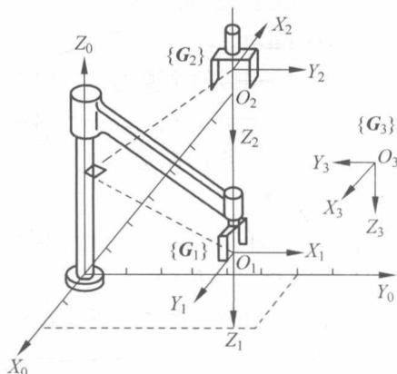

(2) 手部绕手腕轴转动是相对动坐标系作旋转变换, 故有

$$
\mathbf {G} _ {3} = \mathbf {G} _ {1} \mathrm{Rot} (Z, 9 0 ^ {\circ})
$$

程序代码如下：

```matlab
G1 = [0 1 0 2;
    1 0 0 6;
    0 0 - 1 2;
    0 0 0 1];
% % % 问题一求解：
G2 = trotz(pi/2) * G1;
% % % 问题二求解：
G3 = G1 * trotz(pi/2);
```

图 1-13 一个单连杆操作臂结构
{: .figure-caption }


可以得到运行结果：

```lisp
G2 =
-1.0000 0.0000 0 -6.0000
0.0000 1.0000 0 2.0000
0 0 -1.0000 2.0000
0 0 0 1.0000
```

<table><tr><td colspan="4">G3 =</td></tr><tr><td>0.0000</td><td>-1.0000</td><td>0</td><td>2.0000</td></tr><tr><td>-1.0000</td><td>-0.0000</td><td>0</td><td>6.0000</td></tr><tr><td>0</td><td>0</td><td>-1.0000</td><td>2.0000</td></tr><tr><td>0</td><td>0</td><td>0</td><td>1.0000</td></tr></table>

【例 1-3】如图 1-14 所示,通过人的手腕握住 WII 遥控器转动,从而控制机器人的手腕,让机器人的手腕跟随遥控器进行转动。然而,WII 遥控器的取向是根据横滚-俯仰-偏航(RPY)角度给出,而机器人的手的取向是使用 ZYZ 欧拉角,此时就需要进行 RPY 角与 ZYZ 欧拉角进行转换。

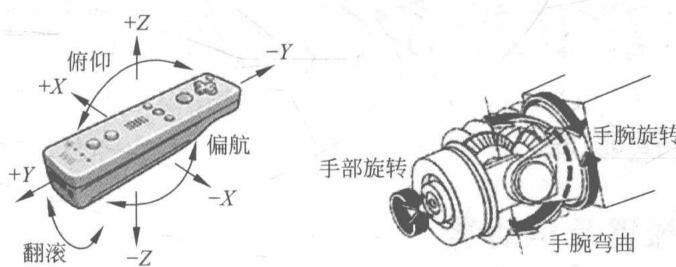

图 1-14 WII 遥控器与机器人手腕(左图表示了遥控器的俯仰角,翻滚角和偏转角,
{: .figure-caption }

右图表示了机器人手腕旋转,手腕弯曲和手部旋转)

问题：编写一个 MATLAB 函数，使得给出一组 RPY 角能够返回一组与之对应的欧拉角。从旋转矩阵确定一组欧拉角有两种解决方案：第一种方案即通过普通的旋转，第二种方案即将第二次旋转约束在 $0^{\circ} \sim 180^{\circ}$ 之间，然后进行旋转。

解析：

第一方案：通过机器人工具箱提供的 rpy2eul()，可以将 PRY 角直接转化为 ZYZ 欧拉角，它将返回一个向量，这个向量对应于分别围绕 Z、Y 和 Z 轴旋转的三个角。

第二种方案：

由一组欧拉角(phi,theta,psi)给出的旋转矩阵可以表示为：

```txt
R = rotz(phi) * roty(theta) * rotz(psi)
```

在这种方案中：

<div class="mineru-algorithm" style="white-space: pre-wrap; font-family:monospace;">
$\text{roty(theta)} = \text{rotz(pi)} * \text{roty(-theta)} * \text{rotz(pi)}$
</div>

因此，旋转矩阵为：

```matlab
R = rotz(phi) * rotz(pi) * roty(-theta) * rotz(pi) * rotz(psi)
= rotz(phi + pi) * roty(-theta) * rotz(psi + pi)
```

程序代码如下：

```matlab
% 通过 sigma 的设置, 决定两种方案
functioneuler = rpy2eul(rpy, sigma)
% 方案一: 直接通过函数计算欧拉角
euler = tr2eul(rpy2tr(rpy));
% 方案二: 通过 R = rotz(phi + pi) * roty(-theta) * rotz(psi + pi) 计算欧拉角
if sigma == -1
euler(1) = euler(1) + pi;
euler(2) = -euler(2);
euler(3) = euler(3) + pi;
end
end
```

## 1.3 机器人运动学

### 1.3.1 机械臂及运动学

#### 机械臂的构成

机器人本体,是机器人赖以完成作业任务的执行机构,一般是一台机械臂,也称操作臂或操作手,可以在确定的环境中执行控制系统指定的操作。典型工业机器人本体一般由手部(末端执行器)、腕部、臂部、腰部和基座构成。机械臂多采用关节式机械结构,一般具有6个自由度,其中3个用来确定末端执行器的位置,另外3个则用来确定末端执行装置的方向(姿势)。机械臂上的末端执行装置可以根据操作需要换成焊枪、吸盘、扳手等作业工具。

如图 1-15 所示,一个机械臂是由一组可做相对运动的关节连接的连杆结合体。第一个连杆固定,连接该机械臂的基座,而最后一个连杆连接的是它的末端执行器。

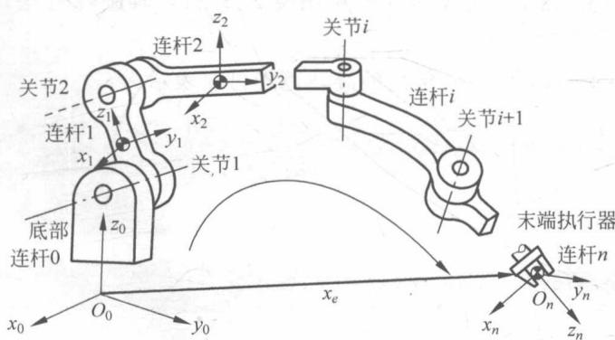

图1-15 机械臂的构成
{: .figure-caption }


通常可将关节划分为两种：第一种称为转动关节（或称为旋转关节），转动关节可绕基准轴转动，相应的转动量称为关节角；第二种称为移动关节，移动关节是沿着基准轴移动，相应的位移称为关节偏距。还有一种特殊的关节称为球关节，球关节拥有三个自由度，可以用三个转动关节和一个零长度的连杆来描述一个球关节。

位于机械臂固定基座的坐标系称为基坐标系；位于操作臂末端执行器的坐标系称为工具坐标系，通常用它来描述机械臂的位置。

#### 机器人运动学的定义

运动学是研究物体的运动,而不考虑物体的质量以及引起这种运动的力。如图 1-16 所示,机器人正运动学是已知或给定一组关节角,计算出工具坐标系相对于基坐标系的位置和姿态,也就是说,用正运动学来确定机器人末端执行器的位姿。机器人逆运动学是给定机械臂末端执行器的位置和姿态,计算所有可到达给定位置和姿态的关节角。也就是说,末端执行器在特定的一个点具有特定的姿态,去计算出它所对应的每一关节变量的值。机器人运动学的研究方法,首先利用位姿描述、坐标系变换等数学方法确定物体位置、姿态和运动;然后确定不同结构类型的机器人的正逆运动学,这些类型包括直角坐标型、圆柱坐标型和球坐标型等等;最后根据 Denavit-Hartenberg 参数法去推导机器人的正逆运动学方程。

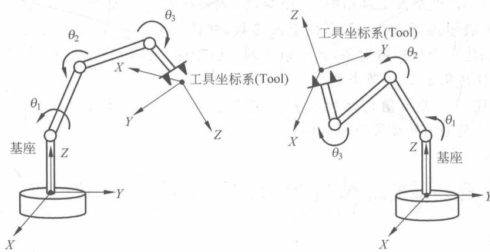

图 1-16 机械臂的正运动与逆运动示意图
{: .figure-caption }


### 1.3.2 DH 参数法

DH 参数全称为 Denavit-Hartenberg 参数, 它使用连杆参数来描述机构运动关系。如图 1-17 所示, 在标准型 DH 参数法中, 描述机械臂中的每一个连杆需要 4 个运动学参数, 分别是连杆长度 $a_{i-1}$ 、连杆转角 $\alpha_{i-1}$ 、连杆偏距 $d_{i}$ 和关节角 $\theta_{i}$ , 它们的定义如下:

\- 连杆长度 $a_{i - 1}$ ：关节轴 $i - 1$ 和关节轴 $i$ 之间公垂线的长度。

\- 连杆转角 $\alpha_{i - 1}$ ：第 $i - 1$ 个关节轴和第 $i$ 个关节轴之间的夹角。

\- 连杆偏距 $d_{i}$ ：沿两个相邻连杆公共轴线方向的距离。

\- 关节角 $\theta_{i}$ ：两相邻连杆绕公共轴线旋转的夹角。

用以上 4 个参数对应转动关节和移动关节有两种情况：转动关节中，连杆长度、连杆转角和连杆偏距是固定不变的，关节角 $\theta_{i}$ 为变量；移动关节中，连杆长度、连杆转角和关节角

是固定不变的，连杆偏距 $d_{i}$ 为变量。

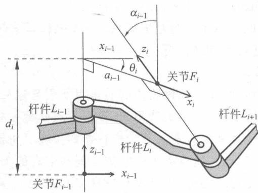

图 1-17 DH 参数法示意图
{: .figure-caption }


#### 创建一个连杆对象

在 MATLAB 机器人工具箱中, 还用变量 $\sigma_{i}$ 表示机器人的关节类型, 其中 $\sigma_{i}=0$ 表示转动关节, $\sigma_{i}=1$ 表示移动关节 (若未指定该参数, 默认为转动关节)。在工具箱中, 用函数 Link() 可以创建一个机械臂对象, 其中输入的参数顺序分别是关节角 $\theta_{i}$ 、连杆偏距 $d_{i}$ 、连杆长度 $a_{i-1}$ 、连杆转角 $\alpha_{i-1}$ 、关节类型。

例如，创建一个关节角初始为 $\theta_{i}=0^{\circ}$ ，连杆偏距 $d_{i}=2$ ，连杆长度 $a_{i-1}=3$ ，连杆转角 $\alpha_{i-1}=45^{\circ}$ ，关节类型为转动关节的连杆。

输入命令：

```txt
>> L = Link([0, 2, 3, pi/4, 0])
```

运行结果：

其中，offset 表示关节的偏移量。R 表示为旋转关节、stdDH 表示用标准型 DH 参数法去描述。用以下的命令可以获取连杆的各个参数。

\- 获取连杆的关节类型：L.RP；

\- 获取连杆的关节角：L. theta；

\- 获取连杆的连杆偏距：L.d；

\- 获取连杆的连杆长度：L.a;

\- 获取连杆的连杆转角：L.alpha。

#### 创建一个具有 $n$ 自由度的机械臂

创建一个平面三杆机械臂,因为它的3个关节均为转动关节,所以有时称该机械臂为RRR(或3R)机构。

三连杆平面机械臂的 DH 参数如下表所示：

<table><tr><td>连杆</td><td> <span class="arithmatex">\(\theta_{i}\)</span> </td><td> <span class="arithmatex">\(d_{i}(m)\)</span> </td><td> <span class="arithmatex">\(a_{i-1}(m)\)</span> </td><td> <span class="arithmatex">\(\alpha_{i-1}\)</span> </td></tr><tr><td>1</td><td> <span class="arithmatex">\(\theta_{1}\)</span> </td><td>0</td><td>1</td><td>0</td></tr><tr><td>2</td><td> <span class="arithmatex">\(\theta_{2}\)</span> </td><td>0</td><td>0.8</td><td>0</td></tr><tr><td>3</td><td> <span class="arithmatex">\(\theta_{3}\)</span> </td><td>0</td><td>0.6</td><td>0</td></tr></table>

输入命令：

```txt
>> L(1) = Link([0, 0, 1, 0]);
>> L(2) = Link([0, 0, 0.8, 0]);
>> L(3) = Link([0, 0, 0.6, 0]);
>> L
```

运行结果：

```txt
L =
theta = q1, d = 0, a = 1, alpha = 0, offset = 0 (R, stdDH)
theta = q2, d = 0, a = 0.8, alpha = 0, offset = 0 (R, stdDH)
theta = q3, d = 0, a = 0.6, alpha = 0, offset = 0 (R, stdDH)
```

通过构造函数 SerialLink() 可以给创建的机械臂对象命名，并显示出对象的信息。输入命令：

```python
>> three_link = SerialLink(L, 'name', 'threelink')
```

运行结果：

<table><tr><td colspan="10">three_link =</td></tr><tr><td colspan="10">threelink (3 axis, RRR, stdDH, slowRNE)</td></tr><tr><td colspan="10">+----+----+----+----+----+----+----+</td></tr><tr><td>| j|</td><td colspan="3">theta |</td><td>d |</td><td colspan="2">a |</td><td>alpha |</td><td colspan="2">offset |</td></tr><tr><td colspan="10">+----+----+----+----+----+----+----+</td></tr><tr><td>| 1|</td><td colspan="3">q1 |</td><td>0 |</td><td colspan="2">1 |</td><td>0 |</td><td colspan="2">0 |</td></tr><tr><td>| 2|</td><td colspan="3">q2 |</td><td>0 |</td><td colspan="2">0.8 |</td><td>0 |</td><td colspan="2">0 |</td></tr><tr><td>| 3|</td><td colspan="3">q3 |</td><td>0 |</td><td colspan="2">0.6 |</td><td>0 |</td><td colspan="2">0 |</td></tr><tr><td colspan="10">+----+----+----+----+----+----+----+</td></tr><tr><td colspan="10">grav = 0 base = 1 0 0 0 tool = 1 0 0 0</td></tr><tr><td></td><td>0</td><td>0</td><td>1</td><td>0</td><td>0</td><td>0</td><td>1</td><td>0</td><td>0</td></tr><tr><td></td><td>9.81</td><td>0</td><td>0</td><td>1</td><td>0</td><td>0</td><td>0</td><td>1</td><td>0</td></tr><tr><td>0</td><td>0</td><td>0</td><td>1</td><td>0</td><td>0</td><td>0</td><td>0</td><td>1</td><td>0</td></tr></table>

这里的 std 表示该机械臂根据标准型 DH 参数进行定义, 重力加速度默认作用在 Z 轴上, 为 9.81N/kg, 基坐标系和工具坐标系保存初始的位姿。

用以下的命令可以获取已创建机械臂的各个参数：

<table><tr><td>参数</td><td>命令</td><td>参数</td><td>命令</td></tr><tr><td>关节数目</td><td>three_link.n</td><td>关节角</td><td>three_link.theta</td></tr><tr><td>DH 参数</td><td>three_link.links</td><td>连杆偏距</td><td>three_link.d</td></tr><tr><td>关节类型</td><td>three_link.config</td><td>连杆长度</td><td>three_link.a</td></tr><tr><td>连杆转角</td><td>three_link.alpha</td><td></td><td></td></tr></table>

同时也可以对创建的机械臂对象进行复制,如复制一个名称为“three\_link2”的机械臂。输入命令:

```txt
>> L2 = SerialLink(three_link, 'name', 'threelink2')
```

运行结果：

<table><tr><td colspan="11">L2 = threelink2(3 axis, RRR, stdDH, slowRNE)</td></tr><tr><td colspan="11">+----+----+----+----+----+----+----+</td></tr><tr><td colspan="11">| j | theta | d | a | alpha | offset |</td></tr><tr><td colspan="11">+----+----+----+----+----+----+----+----+</td></tr><tr><td colspan="11">| 1 | q1 | 0 | 1 | 0 | 0 |</td></tr><tr><td colspan="11">| 2 | q2 | 0 | 0.8 | 0 | 0 |</td></tr><tr><td colspan="11">| 3 | q3 | 0 | 0.6 | 0 | 0 |</td></tr><tr><td colspan="11">+----+----+----+----+----+----+----+----+</td></tr><tr><td colspan="11">grav = 0 base = 1 0 0 0 tool = 1 0 0 0</td></tr><tr><td></td><td>0</td><td>0</td><td>1</td><td>0</td><td>0</td><td>0</td><td>1</td><td>0</td><td>0</td><td></td></tr><tr><td></td><td>9.81</td><td>0</td><td>0</td><td>1</td><td>0</td><td>0</td><td>0</td><td>1</td><td>0</td><td></td></tr><tr><td>0</td><td>0</td><td>0</td><td>1</td><td>0</td><td>0</td><td>0</td><td>0</td><td>1</td><td>0</td><td></td></tr></table>

### 1.3.3 机器人正运动学

#### 1.3.3.1 连杆坐标中的 DH 参数

首先应该确定两个关节上的坐标系,方法步骤如下:

① 将两个关节轴方向都定为第 $i$ 个坐标系和第 $i - 1$ 个坐标系的 $Z$ 轴。

② 将两个关节轴之间公垂线方向定为第 $i$ 个坐标系的 $X$ 轴，而在公垂线第 $i$ 个关节轴上的交点作为原点。同理，第 $i - 1$ 个坐标系的 $X$ 轴和原点由之前两个坐标系公垂线共同确定。

③ 在已经确定坐标系 Z 轴和 X 轴的情况下，坐标系的 Y 轴直接通过右手定则来确定。对于初始轴（第 0 个轴），其与基座有关，可以自由定义，甚至可以与第 1 个关节轴重合，这样使第一个连杆长度 $a_{0}$ 、第一个转角 $\alpha_{0}$ 置零，同时会简化正运动学的计算。

确定坐标系之后,可以对 DH 参数做进一步描述:

\- 连杆长度 $a_{i-1}: x_i$ 轴方向上 $z_i$ 轴和 $z_{i+1}$ 轴之间的距离。

\- 连杆转角 $\alpha_{i-1}: x_i$ 轴方向上 $z_i$ 轴和 $z_{i+1}$ 轴之间的夹角。

\- 连杆偏距 $d_{i}: z_{i}$ 轴方向上 $x_{i-1}$ 轴和 $x_{i}$ 轴之间的距离。

\- 关节角 $\theta_{i}: z_{i}$ 轴方向上 $x_{i-1}$ 轴和 $x_{i}$ 轴之间的夹角。

#### 1.3.3.2 相邻连杆之间的变换

#### 标准型 DH 参数描述法

在机器人的每个关节上 DH 参数中的四个参数分别代表关节连杆不同的特征或在进行不同的变换。如图 1-18 所示，在某一瞬间，从第 i-1 个关节到第 i 个关节，经历的变换有：Z 轴旋转 $(\theta_{i})$ 、Z 轴平移 $(d_{i})$ 、X 轴平移 $(a_{i-1})$ 和 X 轴旋转 $(\alpha_{i-1})$ 。

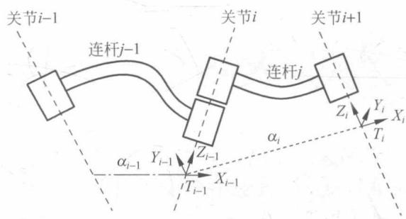

图 1-18 标准的 DH 参数的示意图
{: .figure-caption }


将之前的齐次变换矩阵 T 和 DH 参数联系起来, 即可得到以下公式:

$$
\begin{array}{r l} _ {i - 1} ^ {i} \boldsymbol {T} & = R _ {Z} (\theta_ {i}) D _ {Z} (d _ {i}) D _ {X} (a _ {i - 1}) R _ {x} (\alpha_ {i - 1}) \\ _ {i - 1} ^ {i} \boldsymbol {T} & = \left( \begin{array}{c c c c} \cos \theta_ {i} & - \sin \theta_ {i} \cos \alpha_ {i - 1} & \sin \theta_ {i} \sin \alpha_ {i - 1} & a _ {i - 1} \cos \theta_ {i} \\ \sin \theta_ {i} & \cos \theta_ {i} \cos \alpha_ {i - 1} & - \cos \theta_ {i} \sin \alpha_ {i - 1} & a _ {i - 1} \sin \theta_ {i} \\ 0 & \sin \alpha_ {i - 1} & \cos \alpha_ {i - 1} & d _ {i} \\ 0 & 0 & 0 & 1 \end{array} \right) \end{array}\tag{1.23}
$$

(1.24)

MATLAB 机器人工具箱用矩阵 A 表示 T，用函数 L.A() 求出上一节创建的连杆对象的连杆变换矩阵。

输入命令：

```txt
>> L = Link([0, 2, 3, pi/4, 0]);
>> L.A(0)
```

运行结果：

```txt
ans =
1.0000 0 0 3.0000
0 0.7071 -0.7071 0
```

<table><tr><td>0</td><td>0.7071</td><td>0.7071</td><td>2.0000</td></tr><tr><td>0</td><td>0</td><td>0</td><td>1.0000</td></tr></table>

所以这个变换矩阵为：

$$
{ } _ { i - 1 } ^ { i } \boldsymbol { T } = \left( \begin{array} { c c c c } 1 & 0 & 0 & 3 \\ 0 & 0 . 7 0 7 1 & - 0 . 7 0 7 1 & 0 \\ 0 & 0 . 7 0 7 1 & 0 . 7 0 7 1 & 2 \\ 0 & 0 & 0 & 1 \end{array} \right)
$$

对于给定机器人的连杆，坐标系 $\{i\}$ 相对应坐标系 $\{i-1\}$ 的变换是只有一个变量的函数（即旋转关节的关节角 $\theta_{i}$ 或移动关节的连杆偏距 $d_{i}$ ）。

当上面创建的连杆对象关节角 $\theta_{i}$ 为 $30^{\circ}$ 时，可用函数 L.A() 求出相应的变换矩阵。输入命令：

$$
\gg \mathrm{L.A} (\mathrm{pi} / 6)
$$

运行结果为：

$$
\begin{array}{r l r l r l} \text { ans } & = & & \\ & 0. 8 6 6 0 & - 0. 3 5 3 6 & 0. 3 5 3 6 & 2. 5 9 8 1 \\ & 0. 5 0 0 0 & 0. 6 1 2 4 & - 0. 6 1 2 4 & 1. 5 0 0 0 \\ & 0 & 0. 7 0 7 1 & 0. 7 0 7 1 & 2. 0 0 0 0 \\ & 0 & 0 & 0 & 1. 0 0 0 0 \end{array}
$$

求出相应的变换矩阵为：

$$
_ {i - 1} ^ {i} \boldsymbol {T} = \left( \begin{array}{c c c c} 0. 8 6 6 & - 0. 3 5 3 6 & 0. 3 5 3 6 & 2. 5 9 8 1 \\ 0. 5 & 0. 6 1 2 4 & - 0. 6 1 2 4 & 1. 5 \\ 0 & 0. 7 0 7 1 & 0. 7 0 7 1 & 2 \\ 0 & 0 & 0 & 1 \end{array} \right)
$$

#### 改进型 DH 参数描述法

改进型 DH 参数描述法对坐标系变换如图 1-19 所示，在某一瞬间，从第 i-1 个关节到第 i 个关节，经历的变换有：X 轴旋转 $(\alpha_{i-1})$ 、X 轴平移 $(a_{i-1})$ 、Z 轴旋转 $(\theta_{i})$ 和 Z 轴平移 $(d_{i})$ 。所以，对应的变换矩阵为：

$$
_ {i - 1} ^ {i} \boldsymbol {T} = R _ {X} (\alpha_ {i - 1}) D _ {X} (a _ {i - 1}) R _ {Z} (\theta_ {i}) D _ {Z} (d _ {i})
$$

因此：

$$
_ {i - 1} ^ {i} \boldsymbol {T} = \left( \begin{array}{c c c c} \cos \theta_ {i} & - \sin \theta_ {i} & 0 & \alpha_ {i - 1} \\ \sin \theta_ {i} \cos \alpha_ {i - 1} & \cos \theta_ {i} \cos \alpha_ {i - 1} & - \sin \alpha_ {i - 1} & - \sin \alpha_ {i - 1} d _ {i} \\ \sin \theta_ {i} \sin \alpha_ {i - 1} & \cos \theta_ {i} \sin \alpha_ {i - 1} & \cos \alpha_ {i - 1} & \cos \alpha_ {i - 1} d _ {i} \\ 0 & 0 & 0 & 1 \end{array} \right)
$$

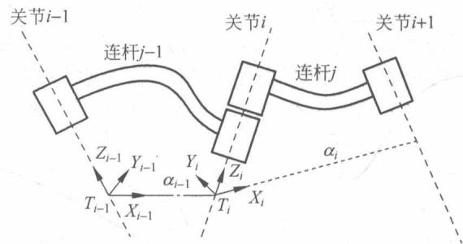

图1-19 改进的DH参数的示意图
{: .figure-caption }


在创建连杆对象时,使用改进型 DH 描述法需要指定参数为 modified。输入命令:

```txt
>> L = Link([0, 2, 3, pi/4, 0], 'modified')
```

运行结果：

```txt
L =
theta = q, d = 2, a = 3, alpha = 0.7854, offset = 0 (R, modDH)
```

modDH 表示使用了改进后的 DH 参数描述法, 输入命令:

```txt
>> L.A(0)
```

运行结果：

$$
\begin{array}{r l r l r l} \text { ans } & = & & \\ & 1. 0 0 0 0 & 0 & 0 & 3. 0 0 0 0 \\ & 0 & 0. 7 0 7 1 & - 0. 7 0 7 1 & - 1. 4 1 4 2 \\ & 0 & 0. 7 0 7 1 & 0. 7 0 7 1 & 1. 4 1 4 2 \\ & 0 & 0 & 0 & 1. 0 0 0 0 \end{array}
$$

所以这个变换矩阵为

$$
{ } _ { i - 1 } ^ { i } \mathbf { T } = \left( \begin{array} { c c c c } 1 & 0 & 0 & 3 \\ 0 & 0 . 7 0 7 1 & - 0 . 7 0 7 1 & - 1 . 4 1 4 2 \\ 0 & 0 . 7 0 7 1 & 0 . 7 0 7 1 & 1 . 4 1 4 2 \\ 0 & 0 & 0 & 1 \end{array} \right)
$$

#### 1.3.3.3 连续的连杆变换

通过将每一个连杆的变换矩阵连乘能够得到坐标 $\{N\}$ 相对于坐标 $\{0\}$ 的变换矩阵：

$$
{ } _ { N } ^ { 0 } \boldsymbol { T } = { } _ { 1 } ^ { 0 } \boldsymbol { T } { } _ { 2 } ^ { 1 } \boldsymbol { T } \cdots { } _ { i + 1 } ^ { i } \boldsymbol { T } \cdots { } _ { N } ^ { N - 1 } \boldsymbol { T }
$$

这个变换矩阵是 N 个关节变量的函数。

回顾正运动学的概念：给定一组关节角，计算出工具坐标系相对于基坐标系的位置和姿态。在这里，可以通过各个关节位置传感器得到所需要的值，然后求出每个连杆的变换矩阵，通过上式就可求出机器人末端的工具坐标系相对于基坐标系的位姿，可表示为：

$$
{ } _ { N } ^ { 0 } \boldsymbol { T } = \left( \begin{array} { c c c c } r _ { 1 1 } & r _ { 1 2 } & r _ { 1 3 } & p _ { x } \\ r _ { 2 1 } & r _ { 2 2 } & r _ { 2 3 } & p _ { y } \\ r _ { 3 1 } & r _ { 3 2 } & r _ { 3 3 } & p _ { z } \\ 0 & 0 & 0 & 1 \end{array} \right)
$$

上面的等式中的 r，即三行三列的子矩阵代表从基座到末端执行器的旋转矩阵，其中的每列从左到右分别代表末端执行器描述基座中 X 轴、Y 轴和 Z 轴方向上的单位矢量，即可表示末端执行器基于基座坐标系的方向姿态。而 p 三行一列从上往下分别代表末端执行器相对于基座坐标系的位置。

MATLAB 机器人工具箱中用了函数 fkine() 计算正运动学的问题。以上面的三连杆平面机械臂为例，用标准型 DH 参数描述法计算。

输入命令：

```matlab
>> L(1) = Link([0, 0, 1, 0]);
>> L(2) = Link([0, 0, 0.8, 0]);
>> L(3) = Link([0, 0, 0.6, 0]);
>> three_link = SerialLink(L, 'name', 'threelink');
>> T = three_link.fkine([0 0 0])
```

运行结果：

<table><tr><td colspan="4">T =</td></tr><tr><td>1.0000</td><td>0</td><td>0</td><td>2.4000</td></tr><tr><td>0</td><td>1.0000</td><td>0</td><td>0</td></tr><tr><td>0</td><td>0</td><td>1.0000</td><td>0</td></tr><tr><td>0</td><td>0</td><td>0</td><td>1.0000</td></tr></table>

所以初始状态时：

$$
{ } _ { 3 } ^ { 0 } \boldsymbol { T } = \left( \begin{array} { c c c c } 1 & 0 & 0 & 2 . 4 \\ 0 & 1 & 0 & 0 \\ 0 & 0 & 1 & 0 \\ 0 & 0 & 0 & 1 \end{array} \right)
$$

通过下面的语句可以将创建的机械臂用图像化显示出来。输入命令：

```txt
three_link.plot([0 0 0])
```

运行结果如图 1-20 所示。

当第二个关节旋转 $30^{\circ}$ ，第三个关节旋转 $45^{\circ}$ 时，输入命令：

```txt
>> T = three_link.fkine([0 pi/6 pi/4])
```

运行结果：

<table><tr><td colspan="4">T =</td></tr><tr><td>0.2588</td><td>-0.9659</td><td>0</td><td>1.8481</td></tr><tr><td>0.9659</td><td>0.2588</td><td>0</td><td>0.9796</td></tr><tr><td>0</td><td>0</td><td>1.0000</td><td>0</td></tr><tr><td>0</td><td>0</td><td>0</td><td>1.0000</td></tr></table>

所以：

$$
{ } _ { 3 } ^ { 0 } \boldsymbol { T } = \left( \begin{array} { c c c c } 0 . 2 5 8 8 & - 0 . 9 6 5 9 & 0 & 1 . 8 4 8 1 \\ 0 . 9 6 5 9 & 0 . 2 5 8 8 & 0 & 0 . 9 7 9 6 \\ 0 & 0 & 1 & 0 \\ 0 & 0 & 0 & 1 \end{array} \right)
$$

输入命令：

```txt
>> three_link.plot([0 pi/6 pi/4])
```

运行结果如图 1-21 所示。

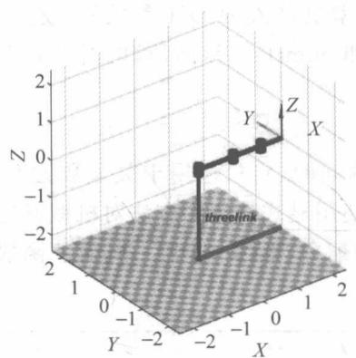

图 1-20 使用 DH 参数法创建的机械臂
{: .figure-caption }


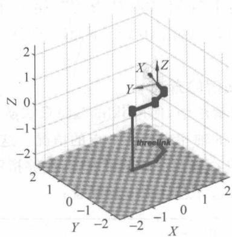

图 1-21 经过旋转变换的机械臂
{: .figure-caption }


### 1.3.4 机器人逆运动学

#### 1.3.4.1 逆运动学的解

机器人逆运动学的问题即已知机械臂末端的工具坐标系相对于基坐标系的位置和姿态,计算所有能够到达给定位置和姿态的关节角,即已知变换矩阵 $_{N}^{0}T$ ,计算出能够得到 $_{N}^{0}T$

的一系列关节角 $\theta_{1}, \theta_{2}, \cdots, \theta_{n}$ 。

对于以上的问题,有以下几种情况:

（1）不存在相应的解。当所期望的位姿离基坐标系太远，而机械臂不够长时，末端执行器无法达到该位姿；当机械臂的自由度少于6个自由度时，它将不能达到三维空间的所有位姿；此外，对于实际中的机械臂，关节角不一定能到达 $360^{\circ}$ ，使得它不能达到某些范围内的位姿。在以上的情况中，机械臂都不能达到某些给定的位姿，因此不存在解。

（2）存在唯一的解。当机械臂只能从一个方向达到期望的位姿时，只存在一组关节角使得它能到达这个位姿，即存在唯一的解。

（3）存在多个解。当机械臂能从多个方向达到期望的位姿时，存在着多组关节角能使得它到达这个位姿，即存在多个解。此时，需要选择一组最适合的解：一是要考虑机械臂从初始位姿移动到期望位姿的“最短路程”，得到相应的解；二是要考虑在机械臂移动的过程中是否会遇到障碍，应选择无障碍的一组解。

#### 1.3.4.2 逆运动学的解法

对机器人的运动学方程进行求解,是一个非线性问题。目前对这个问题的求解方法分为两种:封闭解法和数值解法。封闭解法不需要进行迭代,就可以对不高于四次项的多项式进行求解,存在代数法和几何法这两种方法;数值解法的求解过程需要迭代,因此求解的速度较慢。

因以上的方法无通用的公式解,本书对于以上解法的数学方法不做具体的详述,下面使用 MATLAB 机器人工具箱对封闭解和数值解进行介绍。

工具箱中用 M 文件的形式存储了许多种类型机器人的 DH 参数等信息, 如 KUKA KR5、puma560、Fanuc10L。下面以 KUKA KR5 和 puma640 为例, 对机器人的逆运动学进行解析。

#### 封闭解的方法

在封闭解法中,使用 ikine6s() 求解逆运动学的问题,它只适用于关节数为 6,且腕部三个旋转关节的轴相交于一个点的情况。这种解法使用显式控制的方法对机械臂运动学进行配置,使得在存在多个解的情况下,能够指定一定的配置,得到一个唯一的解。函数 ikine6s() 使用以下标志符进行相应的配置:

<table><tr><td>左旋</td><td>&#x27;l&#x27;</td><td>右旋</td><td>&#x27;r&#x27;</td></tr><tr><td>肘部向上</td><td>&#x27;u&#x27;</td><td>肘部向下</td><td>&#x27;d&#x27;</td></tr><tr><td>腕部翻转</td><td>&#x27;f&#x27;</td><td>腕部不翻转</td><td>&#x27;n&#x27;</td></tr></table>

以 KUKA KR5 机器人为例,对机器人的逆运动学问题进行数值解法的求解。加载机器人 KR5 模型,输入命令:

运行结果, MATLAB 的工作空间加载了机器人的参数, 如图 1-22 所示。

<table><tr><td>Name ▲</td><td>Value</td><td>Size</td></tr><tr><td>KR5</td><td>1x1 SerialLink</td><td>1x1</td></tr><tr><td>L</td><td>1x6 Link</td><td>1x6</td></tr><tr><td>qk1</td><td>[0.7854,1.0472,0.78...</td><td>1x6</td></tr><tr><td>qk2</td><td>[0.7854,1.0472,0.52...</td><td>1x6</td></tr><tr><td>qk3</td><td>[0.5236,1.0472,0.52...</td><td>1x6</td></tr></table>


图 1-22 MATLAB 工作空间中显示的机器人参数
{: .figure-caption }


为显示机器人的具体参数,输入命令:

```txt
>> KR5
```

运行结果为：

```txt
KR5 =
Kuka KR5 (6 axis, RRRRRR, stdDH, slowRNE)
+----+----+----+----+----+----+----+
| j | theta | d | a | alpha | offset |
+----+----+----+----+----+----+
| 1 | q1 | 0.4 | 0.18 | 1.571 | 0 |
| 2 | q2 | 0.135 | 0.6 | 3.142 | 0 |
| 3 | q3 | 0.135 | 0.12 | -1.571 | 0 |
| 4 | q4 | 0.62 | 0 | 1.571 | 0 |
| 5 | q5 | 0 | 0 | -1.571 | 0 |
| 6 | q6 | 0 | 0 | 0 | 0 |
+----+----+----+----+----+----+
grav = 0 base = 1 0 0 0 tool = 1 0 0 0
    0    0   1   0   0    0   1   0   0
    9.81    0   0   1   0    0   0   1   0.115
    0   0   0   1    0   0   0   1
```

首先,使用正运动学的方法,让机器人按下列的关节角旋转,达到一定的位姿 T,输入命令:

```html
>> qn = [0 0 pi/4 0 pi/6 pi/3];
>> T = KR5.fkine(qn)
```

运行结果为：

```txt
T =
0.1294 -0.2241 -0.9659 0.3154
-0.8660 -0.5000 0.0000 -0.0000
-0.4830 0.8365 -0.2588 -0.1530
0 0 0 1.0000
```

以 T 为已知条件,用封闭解的方法求出相应的旋转关节角,输入命令:

```txt
>> q1 = KR5. ikine6s(T)
```

运行结果为：

```txt
q1 =
3.1416 - 3.3226 3.1775 3.1416 1.5259 1.0472
```

可以看到,得到的一组关节角与之前的关节角不一样,但这两组关节角显然能够达到相同的末端执行器位姿。此时可以指定配置,得到一个目标解。

输入命令：

```txt
>> q2 = KR5. ikine6s(T, 'run')
```

运行结果为：

```txt
q2 =
-0.0000 0 0.7854 -0.0000 0.5236 1.0472
```

分别用 KR5.plot(q2) 和 KR5.plot(q1) 可以生成以下图形。如图 1-23 所示, 可以看出, 虽然关节角不同, 但末端执行器的位姿相同。

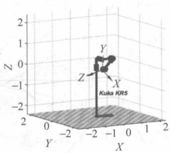

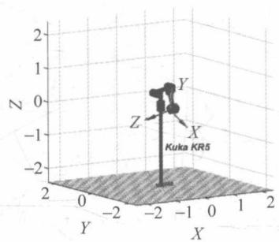

图 1-23 封闭解-两组不同的关节角使得末端执行器达到同样的位姿
{: .figure-caption }


#### 数值解的方法

数值解的方法使用 ikine() 求解逆运动学的问题, 它可适用于各种关节数目的机械臂, 通过设定初始的关节角坐标对机械臂运动学配置进行隐式控制。

以 puma560 机器人为例,对机器人的逆运动学问题进行数值解法的求解。

加载机器人模型,并输入一组关节角,输入命令:

```txt
>> mdl_puma560;
>> qn = [0, pi/4, pi, 0, pi/4, 0];
```

```txt
>> T = p560.fkine(qn)
T =
-0.0000 0.0000 1.0000 0.5963
-0.0000 1.0000 -0.0000 -0.1501
-1.0000 -0.0000 -0.0000 -0.0144
    0    0    0    1.0000
```

未设定初始关节角坐标,使用 ikine() 进行求解,输入命令:

```txt
>> q1 = p560. ikine(T)
```

运行结果为：

```txt
q1 =
-0.0000 -0.8335
```

设定初始关节角坐标,使用 ikine() 进行求解,输入命令:

```txt
>> q2 = p560. ikine(T, [0 0 3 0 0 0])
```

运行结果为：

```txt
q2 =
-0.0000 0.7854 3.1416 -0.0000 0.7854 0.0000
```

同样地,分别用 p560.plot(q2) 和 p560.plot(q1) 可以生成以下的图形。如图 1-24 所示,可以看出,虽然关节角不同,但末端执行器的位姿相同。

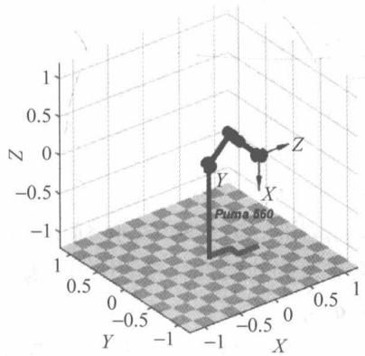

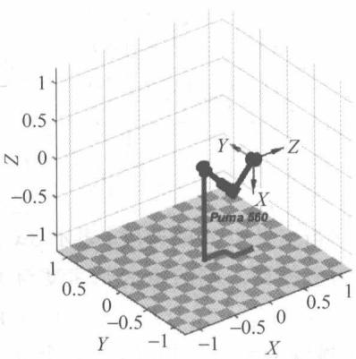

图 1-24 数值解-两组不同的关节角使得末端执行器达到同样的位姿
{: .figure-caption }


### 1.3.5 机器人的瞬态运动学

#### 瞬态运动学与雅可比矩阵

正运动学的内容主要是研究如何定位末端执行器,即得到基坐标系中如何描述末端执行器的位姿。当机械臂开始运动时,其中各个关节上的编码器会即时记录并监控微分运动,如果在当前位姿下把末端执行器移动一段很小的位移,就会得到末端执行器一个特定的位姿。

假设末端执行器的位姿是 x，关节角为 $\theta$ ，则线速度为 $\dot{x}$ ，关节角速度为 $\dot{\theta}$ 。

\- 对于正向运动学,需要解决的问题是: $\theta \rightarrow x$ 。

\- 对于逆运动学,需要解决的问题是: $x \to \theta$ 。

\- 而对于瞬态运动学： $\theta + \delta \theta \rightarrow x + \delta x$ ，需要解决的问题则是： $\delta \theta \rightarrow \delta x$ ，即从关节角速度到线速度： $\dot{\theta} \rightarrow \dot{x}$ 。

可以通过一个矩阵将两者联系在一起,这个矩阵就是雅可比矩阵。

#### 雅可比矩阵的定义及求法

机械臂的位姿 $x$ 与关节变量 $q$ 的函数关系是：

$$
x = f (q)\tag{1.25}
$$

即：

$$
\left( \begin{array}{c} x _ {1} \\ x _ {3} \\ \vdots \\ x _ {m} \end{array} \right) = \left( \begin{array}{c} f _ {1} (q) \\ f _ {2} (q) \\ \vdots \\ f _ {m} (q) \end{array} \right)\tag{1.26}
$$

式(1.26)两边分别计算其速度,需要使用微分和偏微分,并用矩阵形式表示:

$$
\delta \pmb {x} _ {(m \times 1)} = \left( \begin{array}{c c c c} \frac {\partial f _ {1}}{\partial q _ {1}} & \frac {\partial f _ {1}}{\partial q _ {2}} & \dots & \frac {\partial f _ {1}}{\partial q _ {n}} \\ \frac {\partial f _ {2}}{\partial q _ {1}} & \frac {\partial f _ {2}}{\partial q _ {2}} & \dots & \frac {\partial f _ {2}}{\partial q _ {n}} \\ \vdots & \vdots & \ddots & \vdots \\ \frac {\partial f _ {m}}{\partial q _ {1}} & \frac {\partial f _ {m}}{\partial q _ {2}} & \dots & \frac {\partial f _ {m}}{\partial q _ {n}} \end{array} \right) _ {(m \times n)} \delta \pmb {q} _ {(n \times 1)}\tag{1.27}
$$

用机械臂末端在笛卡儿空间的速度 $\dot{x}$ 表示 $\delta x_{(m\times1)}$ ，用关节速度 $\dot{q}$ 表示 $\delta q_{(n\times1)}$ ，则机械臂的雅可比矩阵定义为机械臂末端的笛卡儿速度与关节速度的线性变换，用公式表达如下：

$$
\dot {x} = J (q) \dot {q}\tag{1.28}
$$

其中， $J(q)$ 为机械臂的雅可比矩阵，为一个 $m \times n$ 的偏导数矩阵。操纵机器人时，想得到微分运动 $\delta x$ 所对应的 $\delta q$ ，可用下式：

$$
\dot {\boldsymbol {q}} = \boldsymbol {J} (\boldsymbol {q}) ^ {- 1} \dot {\boldsymbol {x}}\tag{1.29}
$$

将末端执行器的线速度 $(v_{x}, v_{y}, v_{z})$ 和角速度 $(\omega_{x}, \omega_{y}, \omega_{z})$ 这6个变量作为雅可比矩阵等

式的左边，即：

$$
\left[ \begin{array}{l} v _ {x} \\ v _ {y} \\ v _ {z} \\ \omega_ {\dot {x}} \\ \omega_ {y} \\ \omega_ {z} \end{array} \right] _ {(6 \times 1)} = J _ {0 (6 \times 1)} \dot {q} _ {(n \times 1)}\tag{1.30}
$$

上式中，n 代表机器人的自由度， $J_{0}$ 在运动学中起着非常重要的作用，可以用于对速度的表述。因为所有对速度的表述都与线速度和角速度相关，任何与速度有关的表述都可以和这个雅可比矩阵建立联系。

将这个雅可比矩阵去掉下标(即 J)作为基本雅可比矩阵, 这个矩阵建立了线速度及角速度与关节角速度之间的关系。根据这种关系也将雅可比矩阵 J 分为两部分, 即:

$$
J = \binom {J _ {v}} {J _ {\omega}}\tag{1.31}
$$

对于矩阵 $J_{v}$ ，即为联系关节角速度和末端执行器线速度的矩阵。在笛卡儿坐标中，由前面齐次转换矩阵 T 可知，矩阵 T 的最后一列中的前三个变量 $(p_{x}, p_{y}, p_{z})$ 表示末端执行器或者物体最后一个关节坐标系相对于基座参考坐标系的位置，将这三个变量统一表示为一个位置变量 $x_{p}$ ，则线速度可以表示为：

$$
\boldsymbol {v} = \left( \begin{array}{l} \dot {x} \\ \dot {y} \\ \dot {z} \end{array} \right) = \dot {\boldsymbol {x}} _ {p} = \frac {\partial x _ {p}}{\partial q _ {1}} \dot {\boldsymbol {q}} _ {1} + \frac {\partial x _ {p}}{\partial q _ {2}} \dot {\boldsymbol {q}} _ {2} + \dots + \frac {\partial x _ {p}}{\partial q _ {n}} \dot {\boldsymbol {q}} _ {n}\tag{1.32}
$$

从中可得：

$$
\boldsymbol {J} _ {v} = \left( \begin{array}{c c c c} \frac {\partial x _ {p}}{\partial q _ {1}} & \frac {\partial x _ {p}}{\partial q _ {2}} & \dots & \frac {\partial x _ {p}}{\partial q _ {n}} \end{array} \right)\tag{1.33}
$$

上式即为与线性运动相关的雅可比矩阵 $J_{v}$ 。当然，从结构定义可知，上式是指当关节为转动关节时的矩阵，当机器人关节为移动关节时，其对应的变量为 0 。

对于矩阵 $J_{\omega}$ ，即为联系关节角速度末端执行器角速度的矩阵。角速度可以表示为：

$$
\boldsymbol {\omega} = \left( \begin{array}{l l l l l} \bar {\varepsilon} _ {1} & z _ {1} & \bar {\varepsilon} _ {2} & z _ {2} & \dots & \bar {\varepsilon} _ {n} & z _ {n} \end{array} \right) \left( \begin{array}{c} \dot {q} _ {1} \\ \dot {q} _ {2} \\ \vdots \\ \dot {q} _ {n} \end{array} \right)\tag{1.34}
$$

从中可得：

$$
J _ {\omega} = (\bar {\varepsilon} _ {1} z _ {1} \quad \bar {\varepsilon} _ {2} z _ {2} \dots \quad \bar {\varepsilon} _ {n} z _ {n})\tag{1.35}
$$

上式中， $\bar{\varepsilon}_i = 1 - \varepsilon_i$ ，当关节为转动关节时， $\varepsilon_i = 0$ ；当关节为移动关节时， $\varepsilon_i = 1$ 。而每个 $z$ 的定义，对于每个机器人关节，旋转都是指绕 $Z$ 轴的旋转，而 $z_i$ 则是指齐次变换矩阵 $_i^0 T$ 中的

第三列前三个变量表示为一个旋转变量,即

$$
(r _ {1 3} \quad r _ {2 3} \quad r _ {3 3}) ^ {\mathrm{T}}
$$

分别得到 $J_{v}$ 和 $J_{\omega}$ 之后, 最终就得到了需要的反映末端执行器线速度和角速度的雅可比矩阵。

在 MATLAB 机器人工具箱中, 可用函数 SerialLink.jacob0() 求出对应某个位姿下世界坐标系中的雅可比矩阵, 可用函数 SerialLink.jacobn() 求出对应某个位姿下工具坐标系中的雅可比矩阵。

以 KUKA KR5 机器人为例, 给定一组关节角, $q = \left[0 \frac{\mathrm{pi}}{4} \mathrm{pi} 0 \frac{\mathrm{pi}}{4} 0\right]$ , 求出在该位姿下的雅可比矩阵。

输入命令：

```txt
>> mdl_KR5
>> q = [0 pi/4 pi 0 pi/4 0];
>> J0 = KR5. jacob0(q)
```

运行结果：

<table><tr><td colspan="6">J0 =</td></tr><tr><td>-0.0000</td><td>-0.8928</td><td>0.4686</td><td>0.0000</td><td>0.1150</td><td>0</td></tr><tr><td>0.0810</td><td>-0.0000</td><td>0.0000</td><td>0.0813</td><td>-0.0000</td><td>0</td></tr><tr><td>-0.0000</td><td>-0.0990</td><td>0.5233</td><td>-0.0000</td><td>0.0000</td><td>0</td></tr><tr><td>0.0000</td><td>0.0000</td><td>0.0000</td><td>-0.7071</td><td>0.0000</td><td>-0.0000</td></tr><tr><td>-0.0000</td><td>-1.0000</td><td>1.0000</td><td>0.0000</td><td>1.0000</td><td>0.0000</td></tr><tr><td>1.0000</td><td>0.0000</td><td>-0.0000</td><td>0.7071</td><td>-0.0000</td><td>1.0000</td></tr></table>

输入命令：

```txt
>> Jn = KR5. jacobn(q)
```

运行结果：

<table><tr><td colspan="6">Jn =</td></tr><tr><td>0.0000</td><td>0.8928</td><td>-0.4686</td><td>-0.0000</td><td>-0.1150</td><td>0</td></tr><tr><td>-0.0810</td><td>0.0000</td><td>0.0000</td><td>-0.0813</td><td>0</td><td>0</td></tr><tr><td>0.0000</td><td>-0.0990</td><td>0.5233</td><td>-0.0000</td><td>0</td><td>0</td></tr><tr><td>-0.0000</td><td>-0.0000</td><td>0.0000</td><td>0.7071</td><td>0</td><td>0</td></tr><tr><td>0.0000</td><td>1.0000</td><td>-1.0000</td><td>-0.0000</td><td>-1.0000</td><td>0</td></tr><tr><td>1.0000</td><td>-0.0000</td><td>0.0000</td><td>0.7071</td><td>0.0000</td><td>1.0000</td></tr></table>

#### 雅可比矩阵参考坐标系的变换

已知坐标系 $\{B\}$ 中， $6\times1$ 的笛卡儿速度矢量可以通过以下变换得到在坐标系 $\{A\}$ 中的

变换：

$$
{ } ^ { A } \dot { \boldsymbol { x } } = \left( \begin{array} { c } { } ^ { A } \boldsymbol { v } \\ { } ^ { A } \boldsymbol { \omega } \end{array} \right) = \left( \begin{array} { c c } { } _ { B } ^ { A } \boldsymbol { R } & 0 \\ 0 & { } _ { B } ^ { A } \boldsymbol { R } \end{array} \right) \left( \begin{array} { c } { } ^ { B } \boldsymbol { v } \\ { } ^ { B } \boldsymbol { \omega } \end{array} \right) = \left( \begin{array} { c c } { } _ { B } ^ { A } \boldsymbol { R } & 0 \\ 0 & { } _ { B } ^ { A } \boldsymbol { R } \end{array} \right) { } ^ { B } \dot { \boldsymbol { x } }\tag{1.36}
$$

已知坐标系 $\{A\}$ 、 $\{B\}$ 中的雅可比矩阵分别为：

$$
{ } ^ { A } \dot { \boldsymbol { x } } = { } ^ { A } \boldsymbol { J } ( q ) \dot { \boldsymbol { q } }\tag{1.37}
$$

$$
{ } ^ { B } \dot { \boldsymbol { x } } = { } ^ { B } \boldsymbol { J } ( q ) \dot { \boldsymbol { q } }\tag{1.38}
$$

因此,可以得到雅可比矩阵参考坐标系的变换:

$$
{ } ^ { A } \boldsymbol { J } ( q ) = \left( \begin{array} { c c } { } _ { B } ^ { A } \boldsymbol { R } & 0 \\ 0 & { } _ { B } ^ { A } \boldsymbol { R } \end{array} \right) { } ^ { B } \boldsymbol { J } ( q )\tag{1.39}
$$

以上面的 KUKA KR5 机器人为例,通过下列语句可以得到基坐标系到工具坐标系的齐次变换矩阵输入命令:

```txt
>> T = KR5.fkine([0 0 0 0 0 0])
```

运行结果：

$$
\begin{array}{r l r l r l} \mathrm{T} & = & & \\ & 1. 0 0 0 0 & 0 & 0 & 0. 9 0 0 0 \\ & 0 & - 1. 0 0 0 0 & - 0. 0 0 0 0 & - 0. 0 0 0 0 \\ & 0 & 0. 0 0 0 0 & - 1. 0 0 0 0 & - 0. 3 3 5 0 \\ & 0 & 0 & 0 & 1. 0 0 0 0 \end{array}
$$

从而可以得到旋转矩阵：

$$
{ } _ { N } ^ { 0 } \boldsymbol { R } = \left( \begin{array} { c c c } 1 & 0 & 0 \\ 0 & - 1 & 0 \\ 0 & 0 & - 1 \end{array} \right)
$$

因此可得到相应的变换矩阵,输入命令:

$$
\begin{array}{r l} & \gg R = [ 1 0 0 0 0 0; \\ & \quad 0 - 1 0 0 0 0; \\ & \quad 0 0 - 1 0 0 0; \\ & \quad 0 0 0 1 0 0; \\ & \quad 0 0 0 0 - 1 0; \\ & \quad 0 0 0 0 0 - 1 ]; \\ & \gg R * J n \end{array}
$$

运行结果：

$$
0. 7 3 5 0 - 0. 7 3 5 0
$$

$$
0 - 0. 1 1 5 0
$$

<table><tr><td>ans =</td><td></td><td></td><td></td><td></td><td></td></tr><tr><td>1.4142</td><td>0</td><td>1.4142</td><td>0</td><td>0</td><td>0</td></tr></table>

<table><tr><td>0.9000</td><td>-0.0000</td><td>-0.0000</td><td>0</td><td>0</td><td>0</td></tr><tr><td>0.0000</td><td>0.7200</td><td>-0.1200</td><td>0</td><td>0</td><td>0</td></tr><tr><td>0</td><td>0</td><td>0</td><td>0</td><td>0</td><td>0</td></tr><tr><td>-0.0000</td><td>-1.0000</td><td>1.0000</td><td>0</td><td>1.0000</td><td>0</td></tr><tr><td>1.0000</td><td>-0.0000</td><td>-0.0000</td><td>-1.0000</td><td>-0.0000</td><td>-1.0000</td></tr></table>

可以看出,结果与 $J_{0}$ 的值相同。

#### 速度的笛卡儿变换

当坐标系 $\{A\}$ 和坐标系 $\{B\}$ 是刚性连接时，且 $\{A\}$ 通过选择矩阵，再通过平移矢量得到 $\{B\}$ 时，通过下式可以得到速度在两个坐标系中表示的变换。

$$
\left( \begin{array}{c} ^ {B} \boldsymbol {v} _ {B} \\ ^ {B} \boldsymbol {w} _ {B} \end{array} \right) = \left( \begin{array}{c c} ^ {B} _ {A} \boldsymbol {R} & - _ {A} ^ {B} \boldsymbol {R} \times^ {A} \boldsymbol {P} _ {B} \\ 0 & ^ {B} _ {A} \boldsymbol {R} \end{array} \right) \left( \begin{array}{c} ^ {A} \boldsymbol {v} _ {A} \\ ^ {A} \boldsymbol {w} _ {A} \end{array} \right)
$$

写成矩阵形式为：

$$
{ } ^ { B } \boldsymbol { v } _ { B } = { } _ { A } ^ { B } \boldsymbol { T } _ { v } { } ^ { A } \boldsymbol { v } _ { A }
$$

这里， $_{A}^{B}T_{v}$ 为一个 $6\times6$ 的速度变换矩阵。

在 MATLAB 机器人工具箱中, 可用函数 tr2jac() 求出不同变换的雅可比矩阵。例如, $\{B\}$ 是通过 $\{A\}$ 平移 $(2,4,0)$ , 再旋转 $45^{\circ}$ 得到的, 求速度变换矩阵 $T_{v}$ 。当 $\{A\}$ 中 X 方向的线速度为 2m/s, 求 $\{B\}$ 中的速度。

输入命令：

```matlab
>> T = transl(2,4,0) * troty(pi/4);
>> Tv = tr2jac(T)
```

运行结果：

<table><tr><td colspan="6">Tv =</td></tr><tr><td>0.7071</td><td>0</td><td>-0.7071</td><td>-2.8284</td><td>1.4142</td><td>-2.8284</td></tr><tr><td>0</td><td>1.0000</td><td>0</td><td>0</td><td>0</td><td>2.0000</td></tr><tr><td>0.7071</td><td>0</td><td>0.7071</td><td>2.8284</td><td>-1.4142</td><td>-2.8284</td></tr><tr><td>0</td><td>0</td><td>0</td><td>0.7071</td><td>0</td><td>-0.7071</td></tr><tr><td>0</td><td>0</td><td>0</td><td>0</td><td>1.0000</td><td>0</td></tr><tr><td>0</td><td>0</td><td>0</td><td>0.7071</td><td>0</td><td>0.7071</td></tr></table>

输入命令：

```txt
>> vB = Tv * [2 0 0 0 0 0]';
>> vB'
```

运行结果：

可以得到,该速度在 $\{B\}$ 中X方向为1.4142m/s,在Z方向速度为1.4142m/s。

### 1.3.6 具体例子的应用

【例 1-4】一只三连杆的平面机器人如图 1-25 所示：参考坐标系 0 代表世界坐标系，参考坐标系 $i(i=1,2,3)$ 是一个与连杆 i 相关的坐标系，连杆的长度分别是 $l_{1}, l_{2}$ 和 $l_{3}$ 。

（1）获取相邻连杆之间的参考坐标系变换，即 $^{0}_{1}T$ ， $^{1}_{2}T$ ， $^{2}_{3}T$ ，它们是关于 $\theta_{1},\theta_{2}$ 和 $\theta_{3}$ 的函数。

（2）获取世界参考系中的连杆和机器人手中的参考系之间的变换。

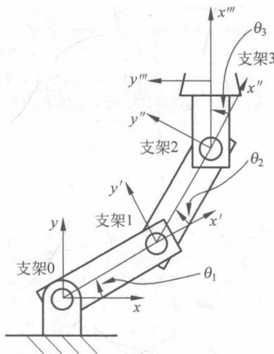

(3) 假设连杆的长度 $l_{1}=l_{2}=l_{3}$ ，其将机器人手移动

到由 $\begin{pmatrix}-1&0&0&0\\0&-1&0&1\\0&0&1&0\\0&0&0&1\end{pmatrix}$ 给出的相对应的世界参考系的


图 1-25 三连杆的平面机器人
{: .figure-caption }


位置，尝试获取 $\theta_{1},\theta_{2}$ 和 $\theta_{3}$ 的值。

（4）证明：一般来说，这个机器人的逆运动学问题有两个解决方案，并在 MATLAB 中写一个函数，返回两种方案的结果。

解析：

(1) 相关代码如下:

```matlab
a1 = sym('a1');
l1 = sym('l1');
a2 = sym('a2');
l2 = sym('l2');
a3 = sym('a3');
l3 = sym('l3');
T01 = trotz(a1) * transl(l1, 0, 0);
T12 = trotz(a2) * transl(l2, 0, 0);
T23 = trotz(a3) * transl(l3, 0, 0);
```

(2) 相关代码如下:

```matlab
T03 = T01 * T12 * T23;
% % % 或者, 我们也可以使用其 DH 参数来解决该机器人的正向运动学.
% % % 然后, 取 a_i = 1
L(1) = Link([0 0 1 0]);
L(2) = Link([0 0 1 0]);
```

```matlab
L(3) = Link([0 0 1 0]);
ThreeLink = SerialLink(L);
ThreeLink.name = 'Planar3R';
% % %为了验证我们已经正确地构建了机器人,我们将它绘制出来.
ThreeLink.plot([pi/4 pi/4 pi/4]);
ThreeLink.fkine([pi/4 pi/4 pi/4]);
```

运行结果如图 1-26 所示。

(3) 相关代码如下:

```matlab
TL = [-1 0 0 0; 0 - 1 0 1; 0 0 1 0; 0 0 0 1];
% % %一种可能性在于使用由 ikine 实现的数值方法.问题是给出一个好的猜测，
% % %以便算法收敛到一个有效的解决方案.在一些试验和错误之后,良好的起
% % %点是 theta_1 = 0,theta_2 = pi,theta_3 = π,Q0 = [0 - pi/2 pi/2];
QF = ThreeLink.ikine(TL, QO, [1 1 0 0 0 1]);
ThreeLink.plot(QF);
% % % 我们可以获得 QO 和 QF 之间的轨迹
TRAJ = jtraj(QO, QF, (0:.05:1));
ThreeLink.plot(TRAJ);
```

运行上面的代码,得到机器人轨迹,如图 1-27 所示。

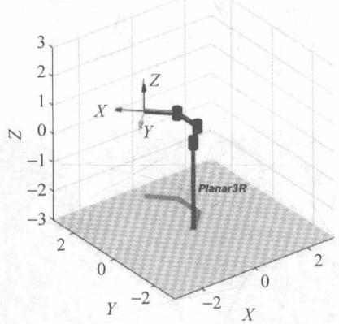

图 1-26 使用工具箱生成的平面机器人
{: .figure-caption }


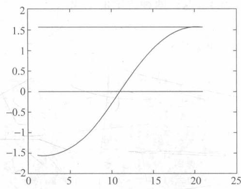

图 1-27 机器人运行的轨迹
{: .figure-caption }


(4) 相关代码如下:

```matlab
function theta = ikine3r(1, conf, sigma)
% % % IKINE3R解决了 3R 平面机器人的逆运动学[THETA1 THETA2 THETA3] = ikine3r
% % % ([111, 123], [XY PHI], SIGMA) 返回与围绕三个关节的旋转对应的 3 个角度
% % % 的向量. sigma = + / - 1 是一个标志，给我们两个可能的解决方案之一
xx = conf(1) - l(3) * cos(conf(3));
yy = conf(2) - l(3) * sin(conf(3));
```

```matlab
theta(1) = atan2(yy, xx) + ...
sigma * acos((l(1) * l(1) + xx * xx + yy * yy - l(2) * l(2)) / ...
(2 * l(1) * sqrt(xx * xx + yy * yy)));
theta(2) = atan2(yy - l(1) * sin(theta(1)), ...
xx - l(1) * cos(theta(1))) - theta(1);
theta(3) = conf(3) - theta(1) - theta(2);
end
```

### 1.3.7 机器人工具箱的 Link 类

根据 Robotics Toolbox for MATLAB, 对机器人工具箱中的 Link 类进行进一步的解析。

机器人工具箱中的 Link 对象保存与机器人连杆相关的所有信息,例如运动学参数、刚体惯性参数、电机和传动参数等。

与 Link 对象有关参数如下所示：

<table><tr><td>参数</td><td>意义</td><td>参数</td><td>意义</td></tr><tr><td>A</td><td>连杆变换矩阵</td><td>islimit</td><td>测试关节是否超过软限制</td></tr><tr><td>RP</td><td>RP关节类型:&#x27;R&#x27;或&#x27;P&#x27;</td><td>isrevolute</td><td>测试关节是否旋转关节</td></tr><tr><td>friction</td><td>摩擦力</td><td>isprismatic</td><td>测试关节是否移动关节</td></tr><tr><td>nofriction</td><td>将摩擦参数设置为零的连杆对象</td><td>display</td><td>以可读的形式打印连杆参数</td></tr><tr><td>dyn</td><td>显示连杆动态参数</td><td>char</td><td>转换为字符串</td></tr></table>

## 写入/读取 Link 的参数如下所示：

<table><tr><td>参数</td><td>意义</td><td>参数</td><td>意义</td></tr><tr><td>theta</td><td>运动学:关节角度</td><td>m</td><td>动力学:连杆质量</td></tr><tr><td>d</td><td>运动学:连杆偏移</td><td>r</td><td>动力学:连杆的重心 <span class="arithmatex">\(3 \times 1\)</span> </td></tr><tr><td>a</td><td>运动学:连杆长度</td><td>I</td><td>动力学:连杆的惯性矩阵 <span class="arithmatex">\(3 \times 3\)</span> </td></tr><tr><td>alpha</td><td>运动学:连杆扭转角</td><td>B</td><td>动力学:连杆黏性摩擦(电机参考)</td></tr><tr><td>sigma</td><td>运动学:0表示旋转,1表示移动</td><td>Tc</td><td>动力学:连杆的库仑摩擦</td></tr><tr><td>mdh</td><td>运动学:0表示标准DH,其他情况为1</td><td>g</td><td>执行器:齿轮比</td></tr><tr><td>offset</td><td>运动学:关节变量偏移</td><td>Jm</td><td>执行器:电机惯量(电机参考)</td></tr><tr><td>qlim</td><td>运动学:关节变量极限[min max]</td><td></td><td></td></tr></table>

注意：
(1) 连杆对象是一个引用类对象。

(2) 连杆对象可以在向量和数组中使用。

1. Link: 创建机器人的连杆对象

这是具有几个调用名的类构造函数,它有三种形式:

(1) L = Link() 是具有默认参数的 Link 对象；

(2) L = Link(lnk) 是一个 Link 对象, 它是连杆对象 link 的副本;

(3) L = Link(options) 是指定了运动和动态参数的连杆对象。

## 它的参数如下所示：

<table><tr><td>参数</td><td>意义</td><td>参数</td><td>意义</td></tr><tr><td>Options &#x27;theta&#x27;, TH</td><td>关节角度,如果没有指定,则默认的关节是旋转关节</td><td>&#x27;r&#x27;, R</td><td>求出重心(3×1的矩阵)</td></tr><tr><td>&#x27;d&#x27;, D</td><td>关节延伸,如果没有指定,则默认的关节是移动的</td><td>&#x27;G&#x27;, G</td><td>设置电机齿轮比(默认值1)</td></tr><tr><td>&#x27;a&#x27;, A</td><td>关节偏移(默认为0)</td><td>&#x27;B&#x27;, B</td><td>关节摩擦(默认为0)</td></tr><tr><td>&#x27;alpha&#x27;, A</td><td>关节的扭转角(默认为0)</td><td>&#x27;Jm&#x27;, J</td><td>电机惯量(默认为0)</td></tr><tr><td>&#x27;standard&#x27;</td><td>使用标准型DH参数法(默认)定义</td><td>&#x27;Tc&#x27;, T</td><td>库仑摩擦(1×1或2×1)(默认值[0×0])</td></tr><tr><td>&#x27;modified&#x27;</td><td>使用修改的DH参数定义</td><td>&#x27;revolute&#x27;</td><td>设置为旋转关节(默认)</td></tr><tr><td>&#x27;offset&#x27;, O</td><td>关节变量 offset(默认为0)</td><td>&#x27;prismatic&#x27;</td><td>设置移动关节&#x27;p&#x27;</td></tr><tr><td>&#x27;qlim&#x27;, L</td><td>关节限制(默认为[])</td><td>&#x27;m&#x27;, M</td><td>与连杆的质量相关</td></tr><tr><td>&#x27;I&#x27;, I</td><td>连杆惯性矩阵(3×1,6×1或3×3的矩阵)</td><td>&#x27;sym&#x27;</td><td>将所有参数值视为符号而非数字</td></tr></table>

注意：
(1) 同时指定 'theta' 和 'd' 是错误的；
(2) 连杆的惯性矩阵 $(3\times3)$ 是对称的, 可以通过给定一个 $3\times3$ 的矩阵(对角元素[Ixx Iyy Izz])或矩阵的矩和乘积[Ixx Iyy Izz Ixy Iyz Ixz]来指定;
（3）所有摩擦量均以电机而不是负载为参考；
(4) 齿轮比仅用于转换电机参考量。

#### Link.A: 连杆的变换矩阵

T = L. A(q): 求对应于连杆变量 q 的连杆均匀变换矩阵 $(4 \times 4)$ ，连杆变量 q 是 DH 参数 THETA(旋转) 或 D(移动)。

注意：

(1) 对于旋转关节, 忽略连杆的 THETA 参数, 而改为使用 q。

(2) 对于移动关节, 忽略连杆的 D 参数, 而改为使用 q。

(3) 在计算变换矩阵之前, 将连杆偏移参数添加到 q。

(4) Link. char: 转换为字符串。

s = L.char(): 是一个以紧凑单行格式显示连杆参数的字符串。如果 L 是一个 Link 对象的向量，则返回每个连杆一行的字符串。

3. Link.display: 显示连杆的参数

L. display()以紧凑单行格式显示连杆参数。如果 L 是连杆对象的向量，则每个元素

显示一行。

注意：当表达式的结果是 Link 对象并且命令没有尾部分号时，在命令行中隐式调用此方法。

#### Link.dyn: 显示连杆的惯性属性

L. dyn()以多行格式显示连杆对象的惯性属性。属性包括质量、质心、惯性、摩擦、传动比和电机性能。如果 L 是连杆对象的向量，则显示每个连杆的属性。

#### Link. friction: 关节摩擦力

f = L. friction(qd) 是用于连杆速度 qd 的关节摩擦力/扭矩。

注意：

(1) 1 返回的摩擦值被称为齿轮箱的输出；

(2) Link 对象中的摩擦参数以电机为参考；

(3) 电机黏性摩擦力按 G2 放大；

(4) 电机库仑摩擦由 G 放大；

（5）在非对称情况下使用的适当的库仑摩擦值取决于对关节速度的符号，而不是电机速度。

#### Link.islimit: 测试关节极限

如果 q 超出为该关节设置的软限制, 则 L.islimit(q) 为真(即为 1)。

注意：任何工具箱函数目前都不使用这些限制。

7. Link.isprismatic: 测试关节是否为移动关节

如果关节是移动的,则 L.isprismatic() 为 1; 如果关节是转动的,则 L.isprismatic() 为 0。

8. Link.isrevolute: 测试关节是否旋转

如果关节是转动的,则 L.isrevolute()为 1; 如果关节是移动的,则 L.isrevolute()为 0。

#### Link. issym: 检查连杆是否是符号模型

如果连杆 L 具有符号参数, 则 res = L. issym() 为真。

#### Link. nofriction: 清除连杆的摩擦

$\ln = L.$ nofriction()是除了非线性之外具有与L相同的参数的连杆对象,使得它的(库仑)摩擦系数为零。

(1) $\ln = L.$ nofriction('all'), 除了黏性和库仑摩擦, 其他的参数设置为零。

(2) $\ln = L.$ nofriction('coulomb'), 除了库仑摩擦, 其他的参数设置为零。

(3) $\ln = L.$ nofriction('viscous'), 除了黏性摩擦, 其他的参数设置为零。

注意：有限库仑摩擦的前向动力学仿真可能很慢。

#### Link.RP: 获取关节类型

c = L.RP() 是一个字符“R”或“P”，取决于关节是旋转还是移动的。如果 L 是一个 Link 对象的向量，则以联合顺序返回一个字符串。

#### 三项参数的设置

1) Link. set. I: 设置连杆惯量

L. I = [Ixx Iyy Izz] 将连杆惯量设置为对角矩阵。

L. I = [Ixx Iyy Izz Ixy Iyz Ixz] 将连杆惯量设置为具有指定惯性和惯性元素乘积的对称矩阵。

L. I = M 设置连杆的惯性矩阵为 $M(3 \times 3)$ ，它必须是对称的。

2) Link. set. r: 设置重心

L. r = R 将连杆重心(COG)设置为 R(3-矢量)。

3) Link. set. Tc: 设置库仑摩擦

L. Tc = F 将库仑摩擦参数设置为 $[F - F]$ ，对于模型的对称库仑摩擦。

L. $T_{c} = [FP FM]$ 将库仑摩擦设置为 $[FP FM]$ ，用于非对称库仑摩擦模型。FP > 0 和 FM < 0。其中，FP 用于正关节速度，FM 用于负关节速度。

注意：摩擦参数被定义为对于正关节速度是正的，通过 Link. friction 计算的摩擦力使用摩擦参数的负数，即，与关节的运动相反的力。

### 1.3.8 机器人工具箱的 SerialLink 类 1

根据 Robotics Toolbox for MATLAB, 本节将对 SerialLink 类涉及机器人运动学内容进行进一步的解析。

机器人工具箱中的 SerialLink 类表示串联臂型机器人的具体类。该机制使用 DH 参数描述, 每个关节一组。

SerialLink 类包含的参数如下所示：

<table><tr><td>参数</td><td>意义</td><td>参数</td><td>意义</td><td>参数</td><td>意义</td></tr><tr><td>plot</td><td>显示机器人的图形表示</td><td>jacob0</td><td>世界坐标系中的雅可比矩阵</td><td>rne</td><td>逆动力学</td></tr><tr><td>plot3d</td><td>显示机器人的3D图形模型</td><td>jacobn</td><td>工具坐标系中的雅可比矩阵</td><td>fdyn</td><td>正向动力学</td></tr><tr><td>teach</td><td>驱动一个图形化的机器人</td><td>Jacob_dot</td><td>雅可比衍生物</td><td>payload</td><td>在末端执行器的坐标中添加有效载荷</td></tr><tr><td>getpos</td><td>获取一个图形化机器人的位置</td><td>maniplty</td><td>可操作性</td><td>perturb</td><td>象征性地得到的ikine对称分析逆运动学</td></tr><tr><td>jtraj</td><td>关节空间轨迹</td><td>vellipse</td><td>显示速度椭圆体</td><td>gravjac</td><td>重力荷载和雅可比</td></tr><tr><td>edit</td><td>显示和编辑运动和动态参数</td><td>fellipse</td><td>显示力椭圆体</td><td>paycap</td><td>有效载荷能力</td></tr><tr><td>isspherical</td><td>测试机器人是否有球形手腕</td><td>qmincon</td><td>零空间运动到界限之间的中心关节</td><td>pay</td><td>有效载荷效应</td></tr><tr><td>islimit</td><td>测试机器人是否在关节限制</td><td>accel</td><td>关节加速</td><td>sym</td><td>对象的符号版本</td></tr><tr><td>isconfig</td><td>测试机器人关节配置</td><td>coriolis</td><td>科里奥利关节力</td><td>gencoords</td><td>符号广义坐标</td></tr><tr><td>fkine</td><td>正向运动学</td><td>dyn</td><td>显示连杆的动态属性</td><td>genforces</td><td>符号广义力量</td></tr><tr><td>trchain</td><td>正向运动学作为一个基本变换链</td><td>friction</td><td>摩擦力</td><td>ikine sym</td><td>象征性地获得分析逆运动学</td></tr><tr><td>ikine6s</td><td>6轴球形手腕旋转机器人的逆运动学</td><td>gravload</td><td>重力关节力</td><td>issym</td><td>测试对象是否是符号的</td></tr><tr><td>ikine</td><td>使用迭代数值方法的逆运动学</td><td>inertia</td><td>关节惯性矩阵</td><td>A</td><td>连杆的变换矩阵</td></tr><tr><td>ikunc</td><td>使用优化方法的逆运动学</td><td>cinertia</td><td>笛卡儿惯性矩阵</td><td></td><td></td></tr><tr><td>ikcon</td><td>使用关节限制优化的逆运动学</td><td>nofriction</td><td>将摩擦参数设置为零</td><td></td><td></td></tr></table>

写入/读取 SerialLink 类的参数如下所示：

<table><tr><td>参数</td><td>意义</td><td>参数</td><td>意义</td></tr><tr><td>links</td><td>连杆对象的向量(1×N的矩阵)</td><td>comment</td><td>注释,一般性注释</td></tr><tr><td>gravity</td><td>重力方向[gx gy gz]</td><td>plotopt</td><td>plot()方法的选项(单元数组)</td></tr><tr><td>base</td><td>机器人基础姿势(4×4的矩阵)</td><td>fast</td><td>使用MEX版本的RNE。只有在mex文件存在时才能设置为true。默认值为true。</td></tr><tr><td>tool</td><td>机器人的工具变换,T6到工具的末端(4×4的矩阵)</td><td>n</td><td>关节数量(只读)</td></tr><tr><td>qlim</td><td>关节极限,[qmin qmax](N×2的矩阵)</td><td>config</td><td>关节配置字符串,例如。‘RRRRRR’(只读)</td></tr><tr><td>offset</td><td>运动学关节坐标偏移(N×1的矩阵)</td><td>mdh</td><td>运动学约定布尔(0 = DH,1 = MDH)(只读)</td></tr><tr><td>name</td><td>机器人的名称,用于图形显示</td><td>theta</td><td>运动学:关节角度(1×N的矩阵)(只读)</td></tr><tr><td>manuf</td><td>注释,作者的注释</td><td>d</td><td>运动学:连杆偏移(1×N的矩阵)(只读)</td></tr><tr><td>a</td><td>运动学:连杆长度(1×N的矩阵)</td><td>alpha</td><td>运动学:连杆扭角(1×N的矩阵)(只读)</td></tr></table>

注意：
(1) SerialLink 是一个引用对象。
(2) SerialLink 对象可以在向量和数组中使用。
1. SerialLink: 创建一个 SerialLink 机器人对象
(1) R = SerialLink(links, options) 是一个由 Link 类对象定义的机器人对象, 它可以是 Link, Revolute, Prismatic, RevoluteMDH 或 PrismaticMDH 的实例。
(2) R = SerialLink(options) 是一个没有连杆的空机器人对象。
(3) R = SerialLink([R1 R2 …], 选项) 连接机器人, R2 的基座连接到 R1 的末端。也

可以写成 R1 \* R2 等。

(4) R = SerialLink(R1, 选项) 是机器人对象 R1 的深层副本, 具有所有相同的属性。

(5) R = SerialLink(dh, options) 是具有由矩阵 dh 定义的运动学的机器人对象, 其中每个关节具有一行, 并且每一行是 $\theta a$ 并且假设关节被旋转。可选的第五列 sigma 指示旋转 (sigma = 0, 默认) 或移动 (sigma = 1)。

它的参数如下所示：

<table><tr><td>参数</td><td>意义</td><td>参数</td><td>意义</td></tr><tr><td>&#x27;name&#x27;,NAME</td><td>将机器人名称属性设置为NAME</td><td>&#x27;gravity&#x27;,G</td><td>设置重力矢量属性为G</td></tr><tr><td>&#x27;comment&#x27;,COMMENT</td><td>将机器人注释属性设置为COMMENT</td><td>&#x27;plotopt&#x27;,P</td><td>将.plot()的默认选项设置为P</td></tr><tr><td>&#x27;manufacturer&#x27;,MANUF</td><td>设置机器人制造商属性为MANUF</td><td>&#x27;plotopt3d&#x27;,P</td><td>将.plot3d()的默认选项设置为P</td></tr><tr><td>&#x27;base&#x27;,T</td><td>设置基底变换矩阵属性为T</td><td>&#x27;nofast&#x27;</td><td>不要使用RNE MEX文件</td></tr><tr><td>&#x27;tool&#x27;,T</td><td>设置工具转换矩阵属性为T</td><td></td><td></td></tr></table>

实例：

1）创建一个两连杆的机器人

```matlab
L(1) = Link([0 0 a1 pi/2], 'standard');
L(2) = Link([0 0 a2 0], 'standard');
twolink = SerialLink(L, 'name', 'two link');
```

2）创建一个两连杆的机器人（最具描述性）

```matlab
L(1) = Revolute('d', 0, 'a', a1, 'alpha', pi/2);
L(2) = Revolute('d', 0, 'a', a2, 'alpha', 0);
twolink = SerialLink(L, 'name', 'two link');
```

3) 创建一个两连杆的机器人(最少描述性)

```matlab
twolink = SerialLink([0 0 a1 0; 0 0 a2 0], 'name', 'two link');
```

4）机器人对象可以以两种方式连接

```javascript
R = R1 * R2;
R = SerialLink([R1 R2]);
```

注意：

(1) SerialLink 是一个引用对象, 一个 Handle 对象的子类。

(2) SerialLink 对象可以在向量和数组中使用。

(3) 传入的连杆子类元素必须是所有标准或所有修改的 DH 参数。

（4）当机器人连接时，中间基础和工具变换被删除，因为通常的常数变换不能以 DH 符号表示。

#### SerialLink.A: 连杆的变换矩阵

(1) s = R. A(J, qj) 是从连杆帧 fJ-1g 变换到作为第 J 个联合变量 qj 的函数的帧 fJg 的 SE(3) 均匀变换 $(4 \times 4)$ 。

(2) $s = R.A(jlist, q)$ ，但是是在列表 JLIST 中给出的连杆变换矩阵的组合，并且联合变量取自 Q 的相应元素。

#### SerialLink.accel 机械臂正向动力学

(1) qdd = R. accel(q, qd, torque) 是在状态 q 和 qd 下向驱动器力/转矩施加到机械手机机器人 R 而产生的关节加速度的矢量 ( $N \geqslant 1$ ), N 是机器人的关节数量。

如果 q, qd, 转矩是矩阵 $(K \geqslant N)$ , 则 qdd 是矩阵 $(K \in N)$ , 其中每行对应于 q, qd, 转矩的等效行的加速度。

(2) qdd = R. accel(x) 如上所述, 但是 x = [q, qd, 转矩] (1 × 3N)。

注意：

（1）用于仿真机械手动力学，结合数值积分函数。

(2) 使用 Walker 和 Orin 的方法 1 计算正向动力学。

(3) Featherstone 的方法对于具有大量关节的机器人更有效。

(4) 应当考虑关节摩擦。

#### SerialLink.animate: 更新机器人动画

R. animate(q)更新机器人 R 的现有动画。这将使用 R.plot()创建。在所有图中更新此机器人的图形实例。

注意：

(1) 由 plot() 和 plot3d() 调用来实际移动手臂模型。

(2) 用于 Simulink 机器人动画。

#### SerialLink.char: 转换为字符串

s = R.char() 是机器人运动参数的字符串表示, 显示 DH 参数、关节结构、注释、重力矢量、基准和工具变换。

#### SerialLink.edit(): 编辑 SerialLink 机械臂的运动参数和动态参数

(1) R. edit 在新的图形界面中将机器人的运动参数显示为可编辑的表。

(2) R. edit('dyn') 如上所述,但也显示动态参数。

## 注意：

(1) “保存”按钮将值从表中复制到 SerialLink 操纵器对象。

(2) 要退出编辑器而不更新对象, 只需杀死图形窗口。

7. SerialLink.fkine: 用于计算机器人的正向运动学

(1) T = R.fkine(q,options) 是机器人末端执行器的姿态, 作为关节配置 q(1×N) 的 SE(3) 均匀变换 (4×4)。

如果 q 是矩阵 $(K \in N)$ ，则行被解释为沿着轨迹的点序列的广义联合坐标。 $q(i, j)$ 是第 i 个轨迹点的第 j 个联合参数。在这种情况下，T 是一个 3d 矩阵 $(4 \times 4 \times K)$ ，其中最后一个下标是沿着路径的索引。

(2) [T, all] = R. fkine(q)，但是所有的 $(4 \times 4 \times N)$ 是连杆的坐标系1到N的姿态k。

#### SerialLink. ikcon

## 1）具有关节限制的数值逆运动学

q = R. ikcon(T) 是对应于作为均匀变换的机器人末端执行器姿态 T(4×4) 的关节坐标 (1×N)。

[q, err] = robot. ikcon(T) 如上所述, 但也返回 err, 它是目标函数的标量最终值。

```txt
[q, err, exitflag] = robot. ikcon(T), 但也返回 fmincon 的状态 exitflag。
```

```txt
[q, err, exitflag] = robot. ikcon(T, q0), 但是指定用于最小化的初始关节坐标 q0。
```

[q, err, exitflag] = robot. ikcon(T, q0, options) 如上所述，但指定 fmincon 使用的选项。

## 2）轨迹操作

在所有情况下,如果 T 是 $4 \times 4 \times M$ 矩阵作为均匀变换序列,并且 R. ikcon() 返回与序列中的每个变换对应的联合坐标。q 是 $M \times N$ 矩阵,其中 N 是机器人关节的数量。对于每个时间步长的 q 的初始估计被取作来自先前时间步长的解。err 和 exitflag 也是 $M \times N$ 矩阵,并且指示对应的轨迹步长的优化结果。

注意：

(1) 需要优化工具箱中的 fmincon。

(2) 在本解决方案中考虑联合限制。

(3) 可用于具有任意自由度的机器人。

(4) 在多个可行解的情况下, 返回的解取决于 q0 的初始选择。

（5）通过最小化关节角度解的正向运动学和末端效应器框架之间的误差作为优化工作。目标函数(误差)描述为：

```txt
sumsqr((inv(T) * robot.fkine(q) - eye(4)) * omega)
```

#### SerialLink. ikine

## 1）数值逆运动学

q = R. kinine(T) 是与作为均匀变换的机器人末端执行器姿势 $T(4 \times 4)$ 对应的关节坐标 $(1 \times N)$ 。

q = R. ikine(T, q0, options) 指定关节坐标的初始估计。该方法可用于具有 6 个或更多自由度的机器人。

## 2）欠驱动机器人

对于操纵器具有少于 6 个 DOF 的情况, 解空间具有比可以由操纵器关节坐标跨越的更多的尺寸。

q = R. ikine(T, q0, m, options), 但是其中 m 是向量 (1×6 矩阵), 其指定在达到解中将被忽略的笛卡儿 DOF(在腕部坐标系中)。向量 m 具有对应于平移的 6 个元素。

在 X, Y 和 Z 轴中, 以及分别绕 X, Y 和 Z 轴旋转。该值应为 0 (对于忽略) 或 1。非零元素的数量应等于操纵器 DOF 的数量。

例如，当使用3自由度机械手时，旋转方向可能不重要，在这种情况下 $m = [11100]$ 。对于具有4或5自由度的机器人，这种方法是非常难以使用的，因为方向由世界坐标中的T指定，并且可实现的取向是刀具位置的函数。

## 3）轨迹操作

在所有情况下,如果 T 是 $4 \times 4 \times m$ 作为均匀变换序列,并且 R. ikine() 返回与序列中的每个变换对应的联合坐标。q 是 $m \times 1 \times N$ ,其中 N 是机器人关节的数量。对于每个时间步长的 q 的初始估计被取作来自先前时间步长的解。

## 1.4 机器人动力学

### 1.4.1 机器人动力学概述

动力学主要研究产生运动所需要的力。对于机器人动力学分析,有两种经典的方法:一种是牛顿-欧拉法,另一种是拉格朗日法。与机器人运动学相似,机器人动力学也有两个相反的问题:

（1）动力学正问题是已知机械臂各关节的作用力或力矩，求各关节的位移、速度和加速度，即机器人的运动轨迹 $(\tau\rightarrow q,\dot{q},\ddot{q})$ ，这可以用于对机械臂的仿真。

（2）动力学逆问题是已知机械臂的运动轨迹，即各关节的位移、速度和加速度，求各关节所需要的驱动力或力矩 $(q,\dot{q},\ddot{q}\rightarrow\tau)$ ，这可以用于对机械臂的控制。

### 1.4.2 机器人动力学方程的建立方法

#### 机器人刚体的加速度

设两个相互独立的坐标系 $\{A\}$ 和 $\{B\}$ ，坐标系 $\{B\}$ 固连在一个刚体上，刚体有一个相对于坐标系 $\{A\}$ 的运动 $^{B}Q$ 。坐标系 $\{B\}$ 相对于坐标系 $\{A\}$ 的位置可以用位置矢量 $^{A}P_{BORG}$ 和旋转矩阵 $_{B}^{A}R$ 来描述。则Q点在坐标系 $\{A\}$ 中的线速度可以表示为：

$$
{ } ^ { A } \mathbf { V } _ { Q } = { } ^ { A } \mathbf { V } _ { \text {   BORG   } } + { } _ { B } ^ { A } \mathbf { R } ^ { B } \mathbf { V } _ { Q }\tag{1.40}
$$

注意,上式只适用于在坐标系 $\{A\}$ 和 $\{B\}$ 相对方位保持一定的前提下。

在一般情况下，即机器人均是转动关节的时候，Q 点在 $\{B\}$ 坐标系中的位置固定，即 $^{B}Q$ 为常量的时候，关节转动时坐标系 $\{B\}$ 相对于坐标系 $\{A\}$ 的旋转的角速度为 $^{A}\Omega_{B}$ 。经过推导和计算,最后得到机器人的线加速度的表达式为:

$$
{ } ^ { A } \mathbf { V } _ { Q } = { } ^ { A } \mathbf { V } _ { \text {   BORG   } } + { } ^ { A } \Omega _ { B } \times ( { } ^ { A } \Omega _ { B } \times _ { B } ^ { A } \mathbf { R } ^ { B } Q ) + { } ^ { A } \Omega _ { B } \times _ { B } ^ { A } \mathbf { R } ^ { B } Q\tag{1.41}
$$

通常情况下,上式用于计算转动关节机械臂连杆的线加速度。

同上假设,关节转动时坐标系 $\{B\}$ 相对于坐标系 $\{A\}$ 旋转的角速度为 $^{A}\Omega_{B}$ ,而坐标系 $\{C\}$ 相对于坐标系 $\{B\}$ 旋转的角速度为 $^{B}\Omega_{C}$ ,则坐标系 $\{C\}$ 相对于 $\{A\}$ 旋转的角速度为:

$$
{ } ^ { A } \Omega _ { C } = { } ^ { A } \Omega _ { B } + { } _ { B } ^ { A } R ^ { B } \Omega _ { C }\tag{1.42}
$$

然后对其求导,最终得到:

$$
{ } ^ { A } \dot { \Omega } _ { C } = { } ^ { A } \dot { \Omega } _ { B } + { } _ { B } ^ { A } R ^ { B } \dot { \Omega } _ { C } + { } ^ { A } \Omega _ { B } \times _ { B } ^ { A } R ^ { B } \Omega _ { C }\tag{1.43}
$$

由上式即可计算机械臂连杆的角加速度。

#### 机器人刚体的质量分布

分析机器人动力学的时候还应考虑到机器人刚体的质量分布。对于转动关节机械臂（定轴转动），在一个刚体绕任意轴做旋转运动的时候，用惯性张量表示机器人刚体的质量分布。在基于刚体构建的坐标系，如坐标系 $\{A\}$ 上的惯性张量可表示为：

$$
^ {A} \boldsymbol {I} = \left( \begin{array}{c c c} I _ {\mathrm{xx}} & - I _ {\mathrm{xy}} & - I _ {\mathrm{xz}} \\ - I _ {\mathrm{xy}} & I _ {\mathrm{yy}} & - I _ {\mathrm{yz}} \\ - I _ {\mathrm{xz}} & - I _ {\mathrm{yz}} & I _ {\mathrm{zz}} \end{array} \right)\tag{1.44}
$$

其中的各元素分别为：

$$
I _ {\mathrm{xx}} = \iiint_ {\mathrm{V}} (y ^ {2} + z ^ {2}) \rho \mathrm{d} v\tag{1.45}
$$

$$
I _ {\mathrm{yy}} = \iiint_ {\mathrm{V}} (x ^ {2} + z ^ {2}) \rho \mathrm{d} v\tag{1.46}
$$

$$
I _ {z z} = \iiint_ {\mathrm{V}} (x ^ {2} + y ^ {2}) \rho \mathrm{d} v\tag{1.47}
$$

$$
I _ {\mathrm{xy}} = \iiint_ {\mathrm{V}} x y \rho \mathrm{d} v\tag{1.48}
$$

$$
I _ {\mathrm{xz}} = \iiint_ {\mathrm{V}} x z \rho \mathrm{d} v\tag{1.49}
$$

$$
I _ {\mathrm{yz}} = \iiint_ {\mathrm{V}} y z \rho \mathrm{d} v\tag{1.50}
$$

上式中，机器人刚体由微分体积 dv 组成，其密度是 $\rho$ ，其中每个微分体的位置由其坐标确定，而上面 6 个相互独立的元素的大小取决于所在坐标系的位姿。其中， $I_{xx}$ 、 $I_{yy}$ 和 $I_{zz}$ 称为惯量矩，其余 3 个称为惯量积，参考坐标系的轴称为主轴。

#### 牛顿-欧拉递推动力学方程

将机器人上的连杆看作刚体,首先应确定机器人每个连杆的质量分布(包括质心位置和惯性张量),这是控制连杆进行加速和减速运动的前提,即连杆运动所需的驱动力是关于连杆的期望加速度和质量分布的函数。而牛顿-欧拉方程就描述了力或力矩与惯量、加速度等之间的关系。

根据牛顿第二定律,即物体加速度的大小与作用力成正比,与物体的质量成反比,可以得到机器人上连杆质心上的作用力 F 与相对应的刚体加速度的关系式:

$$
\boldsymbol {F} = m \dot {\boldsymbol {v}} _ {c}\tag{1.51}
$$

其中，m 是刚体的总质量。

而对于一个转动的刚体,还要分析引起刚体转动的力矩 N。欧拉方程用来表示作用在刚体上的力矩与刚体转动的角速度和角加速度的关系:

$$
\boldsymbol {N} = ^ {c} \boldsymbol {I} \dot {\omega} + \omega \times^ {c} \boldsymbol {I} \omega\tag{1.52}
$$

上式中， $^{c}$ I 指刚体在坐标系 $\{C\}$ 中的惯性张量。注意：刚体质心的位置位于坐标系原点。

有了上面两个方程,可以进一步得到基于机械臂给定运动轨迹求解驱动力或力矩的方法,即已知关节的位姿、速度和加速度分别为 q、 $\dot{q}$ 和 $\ddot{q}$ ,可以进一步得出机器人运动的驱动力。

这种计算方法可分为两步。

第一步，在已知连杆位置 q 的情况下，从连杆 1 到连杆 n 向外递推计算连杆的速度 $\dot{q}$ 和加速度 $\ddot{q}$ ，然后进一步对机器人的所有连杆使用牛顿和欧拉方程，得到作用在连杆质心上的力和力矩。对于转动关节，递推求解的具体过程如下：

$$
{ } ^ { i + 1 } \omega _ { i + 1 } = { } _ { i } ^ { i + 1 } R ^ { i } \omega _ { i } + \dot { \theta } _ { i + 1 } Z _ { i + 1 }\tag{1.53}
$$

$$
{ } ^ { i + 1 } \dot { \omega } _ { i + 1 } = { } _ { i } ^ { i + 1 } R ^ { i } \dot { \omega } _ { i } + { } _ { i } ^ { i + 1 } R ^ { i } \omega _ { i } \times \dot { \theta } _ { i + 1 } \hat { Z } _ { i + 1 } + \ddot { \theta } _ { i + 1 } { } ^ { i + 1 } \hat { Z } _ { i + 1 }\tag{1.54}
$$

$$
{ } ^ { i + 1 } \dot { v } _ { i + 1 } = { } _ { i } ^ { i + 1 } R ( { } ^ { i } \dot { \omega } _ { i } \times { } ^ { i } P _ { i + 1 } + { } ^ { i } \omega _ { i } \times ( { } ^ { i } \omega _ { i } \times { } ^ { i } P _ { i + 1 } ) + { } ^ { i } v _ { i } )\tag{1.55}
$$

$$
{ } ^ { i + 1 } \dot { v } _ { C _ { i + 1 } } = { } _ { i } ^ { i + 1 } R ( { } ^ { i + 1 } \dot { \omega } _ { i + 1 } \times ^ { i } P _ { i + 1 } + { } ^ { i + 1 } \omega _ { i + 1 } \times ( { } ^ { i + 1 } \omega _ { i + 1 } \times ^ { i + 1 } P _ { i + 1 } ) + { } ^ { i + 1 } \dot { v } _ { i + 1 } )\tag{1.56}
$$

$$
{ } ^ { i + 1 } F _ { i + 1 } = m _ { i + 1 } { } ^ { i + 1 } \dot { v } _ { C _ { i + 1 } }\tag{1.57}
$$

$$
{ } ^ { i + 1 } N _ { i + 1 } = ^ { C _ { i + 1 } } I _ { i + 1 } { } ^ { i + 1 } \dot { \omega } _ { i + 1 } + ^ { i + 1 } \omega _ { i + 1 } \times ^ { C _ { i + 1 } } I _ { i + 1 } { } ^ { i + 1 } \omega _ { i + 1 }\tag{1.58}
$$

上式中，i=0,1,2,3,4,5。对于通常的6个关节均为转动关节的机器人，通过上面的式子可以求解出作用在每个连杆上的力和力矩。

第二步,计算关节力矩。实际上,动力学要得出的这些关节力矩是施加在连杆上的力和力矩,即驱动器施加在机器人上的力矩或作用在机器人上使其运动的外力。而这种求解需要使用向内递推的方法,在得到上面的结果后,具体过程如下:

$$
{ } ^ { i } f _ { i } = { } _ { i } ^ { i + 1 } R { } ^ { i + 1 } f _ { i + 1 } + { } ^ { i } F _ { i }\tag{1.59}
$$

$$
{ } ^ { i } n _ { i } = { } ^ { i } N _ { i } + { } _ { i + 1 } ^ { i } R ^ { i + 1 } n _ { i + 1 } + { } ^ { i } P _ { C _ { i } } \times { } ^ { i } F _ { i } + { } ^ { i } P _ { i + 1 } \times _ { i + 1 } ^ { i } R ^ { i + 1 } f _ { i + 1 }\tag{1.60}
$$

$$
\tau_ {i} = ^ {i} n _ {i} ^ {T i} \hat {Z} _ {i}\tag{1.61}
$$

上式中，i=6,5,4,3,2,1。上面的式子即为通过牛顿-欧拉递推法推导得出的机器人动力学方程。

在分析机器人动力学的过程中,还有一个因素不能忽视,那就是重力因素,各连杆的重力也要加入到动力学方程中。由于递推推导过程中计算力的时候会使用到连杆的质量和加速度，所以可以假设机器人正以1g（即10m/s）的加速度向上做加速运动，这和连杆上的重力作用是等效的。因此可以让线加速度的初始值与重力加速度大小相等、方向相反，这样，不需要进行其他附加的运算就可以将重力的影响加入到动力学方程中。

上面各式即为运用牛顿-欧拉递推的方法通过机器人的运动轨迹(即位姿、速度和加速度)得到机器人的期望驱动力矩的具体过程。其中,角速度、角加速度和线加速度的初始值分别是:

$$
{ } ^ { 0 } \pmb { \omega } _ { 0 } = \left( \begin{array} { l } 0 \\ 0 \\ 0 \end{array} \right) ^ { 0 } \qquad \dot { \pmb { \omega } } _ { 0 } = \left( \begin{array} { l } 0 \\ 0 \\ 0 \end{array} \right) ^ { 0 } \qquad \dot { \pmb { v } } _ { 0 } = \left( \begin{array} { l } - g \\ 0 \\ 0 \end{array} \right)\tag{1.62}
$$

#### 用拉格朗日法建立机器人动力学方程

牛顿-欧拉法是通过基于由牛顿定律和欧拉方程推导出作用在连杆上的力和力矩从而得到机器人动力学的方法，而拉格朗日法则是从基于能量的角度来分析机器人的动力学。对于同一个机器人，两者得到的动力学方程是相同的。

首先从分析动能开始：对于机器人的第 i 个连杆，其动能可以表示为：

$$
k _ {i} = \frac {1}{2} m _ {i} v _ {C _ {i}} ^ {\mathrm{T}} v _ {C _ {i}} + \frac {1}{2} ^ {i} \omega_ {i} ^ {\mathrm{T}} C _ {i} I _ {i} ^ {i} \omega_ {i}\tag{1.63}
$$

上式中的两项分别代表由连杆的线速度(质心处)引起的动能和由连杆的角速度(同为质心处)引起的动能。则整个机械臂的动能是所有的连杆的动能之和,即:

$$
k = \sum_ {i = 1} ^ {n} k _ {i}\tag{1.64}
$$

而机器人的动能又可以和之前的惯性矩阵 $M(q)$ 建立等式，对于 6 关节的机器人，6 个连杆的动能可以由 $6 \times 6$ 矩阵 $M(q)$ 与关节角速度 $\dot{q}$ 建立关系式：

$$
k (q, \dot {q}) = \frac {1}{2} \dot {q} ^ {\mathrm{T}} M (q) \dot {q}\tag{1.65}
$$

从物理力学可知,物体的总动能总是为正,所以惯性矩阵 $M(q)$ 为正定矩阵。

第二步研究机器人的势能：对于机器人的第 $i$ 个连杆，其势能可以表示为：

$$
u _ {i} = - m _ {i} ^ {0} g ^ {\mathrm{T}} \boldsymbol {P} _ {C _ {i}} + u _ {\text { ref } _ {i}}\tag{1.66}
$$

上式中， $^{0}g$ 是 $3\times1$ 的重力加速度矢量， $^{0}P_{C_{i}}$ 是第i个连杆的质心的相对位置矢量；取常数 $u_{ref_{i}}$ 是为了使势能最小为0。则整个机械臂的势能是所有的连杆的势能之和，即：

$$
u = \sum_ {i = 1} ^ {n} u _ {i}\tag{1.67}
$$

因为 $^{0}P_{C_{i}}$ 是第i个连杆质心的相对位置矢量，则 $^{0}P_{C_{i}}$ 应该是关节角的函数；机械臂的整体势能可以表述为 $u(1)$ ，是各关节位置的标量函数。

当得到机器人的动能和势能后,进一步推导计算得到拉格朗日函数,即:

$$
L (q, \dot {q}) = k (q, \dot {q}) - u (q)\tag{1.68}
$$

通过拉格朗日函数得到机器人的驱动力矩：

$$
\frac {\mathrm{d}}{\mathrm{d} t} \frac {\partial L}{\partial \dot {q}} - \frac {\partial L}{\partial q} = \tau\tag{1.69}
$$

对于机械臂,驱动力矩方程也可以表示为:

$$
\frac {\mathrm{d}}{\mathrm{d} t} \frac {\partial k}{\partial \dot {q}} - \frac {\partial k}{\partial q} + \frac {\partial u}{\partial q} = \tau\tag{1.70}
$$

这样通过机器人的动能和势能,即拉格朗日函数,就能得到机器人的驱动力矩,这就是由拉格朗日法推导机器人动力学的过程。

### 1.4.3 状态空间方程

#### 状态空间方程

如果对方程进行相关的归纳和分类,然后可以进一步简化,并且很简便地表示机械臂的动力学方程。其中有一种就是用状态空间方程表示动力学方程。不考虑一切摩擦因素,其具体形式如下:

$$
M (q) \ddot {q} + C (q, \dot {q}) \dot {q} + G (q) + F (\dot {q}) + J (q) ^ {\mathrm{T}} f = \tau\tag{1.71}
$$

上式中， $q \in R^{n}$ ，为关节角位移量； $M(q) \in R^{n \times n}$ ，为机器人的惯性矩阵，该矩阵是一个角对称矩阵，在这个 $n \times n$ 矩阵中，里面的非零元素的大小取决于机器人中各关节角 $q(\theta_{1}, \theta_{2}, \cdots, \theta_{n})$ 的大小； $M(q)\ddot{q}$ 表示该机械臂受到的惯性力的大小。 $C(q, \dot{q}) \in R^{n}$ 为科里奥利矩阵，表示离心力和科里奥利力（科氏力）， $V(q, \dot{q}) = C(q, \dot{q})\dot{q}$ 矩阵中非零元素的大小取决于两个因素——机器人中各关节的关节角 q 及其关节角速度 $\dot{q}$ 。 $G(q) \in R^{n}$ 表示重力矩阵，即机械臂上各连杆的重力因素，它表示这个机器人受到重力的大小。 $G(q)$ 中非零元素的大小与机器人各关节的关节角 q 有关。 $F(\dot{q})$ 为摩擦力矩， $J(q)^{\mathrm{T}}f$ 表示关节力，由一个作用在末端执行器的扭力 f 产生，J 是机械臂的雅可比矩阵。 $\tau \in R^{n}$ ，是与关节角位移量 q 有关的广义驱动力向量。

由于上式中的离心力和科氏力矩阵 $C(q,\dot{q})$ 取决于机械臂各关节连杆的位置和速度，所以将这个方程式称为状态空间方程。

#### 各项参数的获取与分析

MATLAB 机器人工具箱提供了一些函数, 可以提取工具箱中已定义的机器人模型的动力参数。下面以 puma560 机器人为例, 对函数进行说明(机器人工具箱, 定义了许多机器人模型, 其中只有 puma560 机器人的定义中涉及动力参数)。

## 1）运动学和动力学参数

可以用函数 SerialLink.dyn() 来显示机器人某个连杆的运动学参数和动力学参数。例如，显示 puma560 机器人第 6 个连杆的参数。

输入命令：

运行结果为：

可以得到以下信息：第6个连杆的运动学DH参数，连杆质量，质心的坐标，惯性矩阵，电机转动惯量，电机摩擦力，库仑力和齿轮传动比。

## 2）惯性矩阵

当机器人的关节角为 q 时, 可以通过函数 SerialLink.inertia() 获取机器人的惯性矩阵。例如, 当 $q = [0 \quad 0 \quad 0 \quad 0 \quad 0]$ 时, 求出相应的惯性矩阵。

输入命令：

```txt
>> q = [0 0 0 0 0 0];
>> p560. inertia(q)
```

运行结果为：

<table><tr><td>ans =</td><td></td><td></td><td></td><td></td><td></td></tr><tr><td>3.9611</td><td>-0.1627</td><td>-0.1389</td><td>0.0016</td><td>-0.0004</td><td>0.0000</td></tr><tr><td>-0.1627</td><td>4.4566</td><td>0.3727</td><td>0.0000</td><td>0.0019</td><td>0.0000</td></tr><tr><td>-0.1389</td><td>0.3727</td><td>0.9387</td><td>0.0000</td><td>0.0019</td><td>0.0000</td></tr><tr><td>0.0016</td><td>0.0000</td><td>0.0000</td><td>0.1924</td><td>0.0000</td><td>0.0000</td></tr><tr><td>-0.0004</td><td>0.0019</td><td>0.0019</td><td>0.0000</td><td>0.1713</td><td>0.0000</td></tr><tr><td>0.0000</td><td>0.0000</td><td>0.0000</td><td>0.0000</td><td>0.0000</td><td>0.1941</td></tr></table>

得到惯性矩阵 M 为：

$$
\boldsymbol {M} (q) = \left( \begin{array}{c c c c c c} 3. 9 6 1 1 & - 0. 1 6 2 7 & - 0. 1 3 8 9 & 0. 0 0 1 6 & - 0. 0 0 0 4 & 0 \\ - 0. 1 6 2 7 & 4. 4 5 6 6 & 0. 3 7 2 7 & 0 & 0. 0 0 1 9 & 0 \\ - 0. 1 3 8 9 & 0. 3 7 2 7 & 0. 9 3 8 7 & \dot {0} & 0. 0 0 1 9 & 0 \\ 0. 0 0 1 6 & 0 & 0 & 0. 1 9 2 4 & 0 & 0 \\ - 0. 0 0 0 4 & 0. 0 0 1 9 & 0. 0 0 1 9 & 0 & 0. 1 7 1 3 & 0 \\ 0 & 0 & 0 & 0 & 0 & 0. 1 9 4 1 \end{array} \right)
$$

能够看出，惯性矩阵 $M(q)$ 为一个角对称矩阵。

## 3）科里奥利矩阵

当机器人的关节角为 q 时, 关节角的速度为 $\dot{q}$ , 可以通过函数 SerialLink.coriolis() 获取机器人的科里奥利矩阵。

例如，当 $q = \left[0\quad 0\quad 0\quad 0\quad 0\quad 0\right]$ ，每个关节的角速度为 $30^{\circ} / \mathrm{s},\dot{q} = \left[\frac{\mathrm{pi}}{6}\quad \frac{\mathrm{pi}}{6}\quad \frac{\mathrm{pi}}{6}\quad \frac{\mathrm{pi}}{6}\right.$ $\frac{\mathrm{pi}}{6}\quad \frac{\mathrm{pi}}{6}\Bigg]$ ，求出相应的惯性矩阵。

输入命令：

```txt
>> q = [0 0 0 0 0 0];
>> qd = [pi/6 pi/6 pi/6 pi/6 pi/6 pi/6];
>> p560.coriolis(q, qd)
```

运行结果：

$$
\begin{array}{r l r l r l} \text { ans } & = \\ - 0. 4 2 0 6 & - 0. 5 7 7 3 & - 0. 2 1 2 1 & - 0. 0 0 0 7 & - 0. 0 0 1 4 & 0. 0 0 0 0 \\ 0. 2 1 1 8 & - 0. 2 0 2 9 & - 0. 4 0 5 0 & - 0. 0 0 0 0 & - 0. 0 0 2 0 & 0 \\ 0. 2 0 8 1 & 0. 2 0 2 1 & - 0. 0 0 0 0 & 0. 0 0 0 0 & - 0. 0 0 0 1 & 0 \\ 0. 0 0 0 0 & 0. 0 0 0 0 & 0. 0 0 0 0 & 0 & 0 & 0 \\ 0. 0 0 0 7 & 0. 0 0 0 7 & 0. 0 0 0 1 & 0 & 0 & 0 \\ \quad \quad \quad \quad \quad \quad \quad \quad \quad \quad \quad \quad \quad \quad \quad \quad \quad \quad \quad \quad \quad \quad \quad \quad \quad \end{array}
$$

得到科氏矩阵 $C(q,\dot{q})$ 为：

$$
\boldsymbol {C} (q, \dot {q}) = \left( \begin{array}{c c c c c c} - 0. 4 2 0 6 & - 0. 5 7 7 3 & - 0. 2 1 2 1 & - 0. 0 0 0 7 & - 0. 0 0 1 4 & 0 \\ 0. 2 1 1 8 & - 0. 2 0 2 9 & - 0. 4 0 5 0 & 0 & - 0. 0 0 2 0 & 0 \\ 0. 2 0 8 1 & 0. 2 0 2 1 & 0 & 0 & - 0. 0 0 0 1 & 0 \\ 0 & 0 & 0 & 0 & 0 & 0 \\ 0. 0 0 0 7 & 0. 0 0 0 7 & 0. 0 0 0 1 & 0 & 0 & 0 \\ 0 & 0 & 0 & 0 & 0 & 0 \end{array} \right)
$$

## 4）重力矩阵

当机器人的关节角为 q 时, 可以通过函数 SerialLink.gravload() 获取机器人的重力矩阵。

例如，当 $q = [000000]$ ，得到相应的重力矩阵。

输入命令：

```txt
>> q = [0 0 0 0 0 0];
>> p560.gravload(q)
```

运行结果为：

得到重力矩阵为：

<div class="mineru-algorithm" style="white-space: pre-wrap; font-family:monospace;">
$G(q) = (0\quad 37.4837\quad 0.2489\quad 0\quad 0\quad 0)^{\mathrm{T}}$
</div>

## 5）摩擦力矩

工具箱中没有对摩擦力矩进行直接计算的函数,从函数 SerialLink.dyn() 可以得到跟摩擦力矩相关的黏性摩擦系数、库伦摩擦系数和传动比的参数。例如前面的 p560.links(6).dyn 函数的返回值中:

\- $\mathrm{Bm} = 3.67\mathrm{e} - 05$ 为黏性摩擦系数；

\- $\mathrm{Tc} = 0.00396(+)$ -0.0105(-)为库仑摩擦系数；

\- G=76.69 为齿轮传动比。

#### 逆向动力学的计算

MATLAB 机器人工具箱中使用函数 SerialLink.rne() 计算动力学的逆问题, 其中主要该函数的参数主要为 q(关节角), qd(速度), qdd(加速度), grav(重力项, 默认下为地球的重力项)。

以 puma560 机器人为例, 设置关节角为 $q = (0 \quad 0 \quad 0 \quad 30^{\circ} \quad 30^{\circ} \quad 30^{\circ})$ , 关节角速度 $\dot{q}$ 为 $(0 \quad 0 \quad 0 \quad 10^{\circ} \quad 10^{\circ} \quad 10^{\circ})$ , 加速度 $\ddot{q}$ 为 $(0 \quad 0 \quad 0 \quad 0 \quad 0 \quad 0)$ 。

输入语句：

```txt
>> mdl_puma560;
>> q = [0 0 0 pi/6 pi/6 pi/6];
>> qd = [0 0 0 pi/18 pi/18 pi/18];
>> qdd = [0 0 0 0 0 0];
>> t1 = p560.rne(q, qd, qdd)
```

运行结果为：

```txt
t1 =
-0.0000 37.4713 0.2366 0.9235 0.7265 0.3413
```

可以得到,此时的驱动力矩为:

<div class="mineru-algorithm" style="white-space: pre-wrap; font-family:monospace;">
$\tau 1 = (0\quad 37.4713\quad 0.2366\quad 0.9235\quad 0.7265\quad 0.3413)$
</div>

当忽略掉状态方程的重力项时,输入语句:

```txt
>> t2 = p560.rne(q, qd, qdd, [0 0 0]')
```

运行结果为：

```txt
t2 =
-0.0000 -0.0001 -0.0001 0.9235 0.7406 0.3413
```

可以得到,此时的驱动力矩为:

<div class="mineru-algorithm" style="white-space: pre-wrap; font-family:monospace;">
$\tau 2 = (0 - 0.0001 - 0.0001 0.9235 0.7406 0.3413)$
</div>

此外,函数 SerialLink.rne()也可以计算机器人沿着一条轨迹运动时,每一个时刻下的驱动力矩。

输入语句：

```matlab
>> T1 = transl(0.3, 0.1, 0) * trotx(pi); % 设置初始位姿
>> q1 = p560. ikine6s(T1); % 计算对应关节角
>> T2 = transl(0.2, 0.4, 0) * trotx(pi)/2; % 设置最终位姿
>> q2 = p560. ikine6s(T2); % 计算对应关节角
>> t = [0:0.1:6]'; % 设置时间及步长
>> [q, qd, qdd] = jtraj(q1, q2, t); % 生成相应的轨迹
>> tu = p560. rne(q, qd, qdd); % 计算轨迹上每个点的驱动力矩
```

运行结果：

```txt
0.0000 -15.5857 -2.6777 -0.0000 0.0000 0
24.7760 -23.2628 4.4214 -1.2850 -1.0435 0.3066
...... ...... ...... ...... ...... ......
24.6978 -17.2257 5.5386 -1.2850 -1.0424 0.3010
0.0000 -9.5899 -1.5434 -0.0000 -0.0000 0.3037
```

结果得到了一个 $61 \times 6$ 的矩阵，每一行都对应着某一个时间点的驱动力矩。更直观地观察每个关节的驱动力矩随时间的变换，可以用图形表示，输入语句：

```txt
>> plot(t, tu(:, 1));
>> hold on
>> plot(t, tu(:, 2));
>> plot(t, tu(:, 3));
>> plot(t, tu(:, 4));
>> plot(t, tu(:, 5));
>> plot(t, tu(:, 6));
```

运行结果如图 1-28 所示。

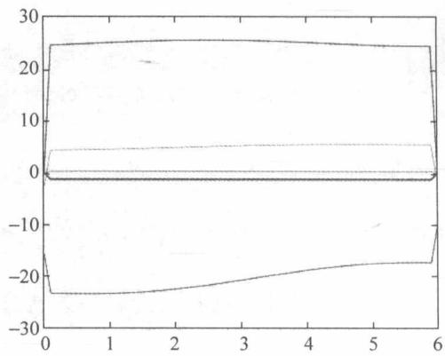

图 1-28 机器人的各个关节在力矩的驱动下运行的轨迹
{: .figure-caption }


### 1.4.4 正向动力学

#### 正向动力学的计算方法

通过状态空间方程进行推算,可以得到动力学方程中的加速度:

$$
\ddot {q} = M (q) ^ {- 1} (\tau - C (q, \dot {q}) \dot {q} - G (q) + F (\dot {q}))\tag{1.72}
$$

可以通过简单的欧拉积分方法，计算出机械臂的位置、速度和加速度。设 $q(0)=q_{0}$ ， $\dot{q}(0)=0$ ，从 t=0 时开始，进行迭代计算。

当时刻为 $t + \Delta t$ ，机械臂的速度为：

$$
\dot {q} (t + \Delta t) = \dot {q} (t) + \ddot {q} (t) \Delta t\tag{1.73}
$$

此时,机械臂的位置为:

$$
q (t + \Delta t) = q (t) + \dot {q} (t) \Delta t + \frac {1}{2} \ddot {q} (t) \Delta t ^ {2}\tag{1.74}
$$

然后将 $q = q(t + \Delta t)$ 和 $\dot{q} = \dot{q}(t + \Delta t)$ ，代入到上面的方程能够得到机械臂的加速度 $\ddot{q}(t + \Delta t)$ 。对于一个机械臂来说，输入一定的驱动力矩 $\tau$ 时，就可以通过上面的方法，得到每一个时刻的机械臂位置、速度和加速度。此外，关于数值积分的方法，实现欧拉积分，还有其他的方法，这里不做详述。

#### MATLAB 计算正向动力学

MATLAB 机器人工具箱中提供了函数 SerialLink.fdyn() 计算正向动力学, 主要的调用格式为: [T, q, qd] = SerialLink.fdyn(T, torqfun)。其中, T 表示时间间隔(采样时间), torqfun 表示给定的力矩函数, 根据力矩函数可以求出相对应的关节角度和关节角速度。

此外，MATLAB 机器人工具箱中提供了函数 SerialLink.accel()，可以计算给定关节角、关节角速度、关节角驱动力矩时，相对应的关节角加速度。

给定关节角： $q=(0\quad0\quad0\quad0\quad0\quad0)$ ;

关节角速度： $\dot{q}=(0\quad0\quad0\quad0\quad0\quad0)$ ;

关节角驱动力矩： $t=(1\quad1\quad1\quad1\quad1\quad1)$ 。

计算关节角加速度,输入命令:

```txt
>> mdl_puma560
>> q = [0 0 0 0 0 0];
>> qd = [0 0 0 0 0 0];
>> t = [1 1 1 1 1 1];
>> qdd = p560.accel(q, qd, t)
```

运行结果：

#### Simulink 计算正向动力学

MATLAB 机器人工具箱中提供了一些用于机器人仿真的 Simulink 文件, 其中包含着一个这样的例子: puma560 在零关节力矩的情况下, 受到重力作用导致机械臂在仿真时就立即下坠的结果。这里使用该例子, 并改变初始的力矩, 阐明如何用 Simulink 计算正向动力学。

输入语句：

```txt
>>sl_ztorque
```

通过以上的语句,即可加载已创建的 Simulink 文件,对该模型进行修改,如图 1-29 所示。

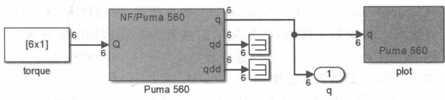

图 1-29 MATLAB 工具箱中 Simulink 模型(一)
{: .figure-caption }


输入力矩为 $t=\left[20\ 20\ 20\ 20\ 20\ 20\right]$ ，并进行仿真，输入语句：

```txt
>> r = sim('sl_ztorque')
```

可以看到机器人在驱动力矩的作用下进行运动,并输出机器人运动过程中变化的时间和关节角(这里的输入力矩可能与具体的情况不符,在实际的仿真工作中,应当设置合理的力矩值):

```yaml
Simulink.SimulationOutput:
tout: [161x1 double]
yout: [161x6 double]
```

可以获取时间与关节角,并绘制出关节角随时间变化的图形:
输入语句:

```txt
>> t = r.find('tout');
>> q = r.find('yout');
>> plot(t, q(:, 1:6))
```

### 1.4.5 机器人工具箱的 SerialLink 类 2

根据 Robotics Toolbox for MATLAB 一书, 下面对 SerialLink 类涉及机器人动力学内容进行进一步的解析。

#### SerialLink.cinertia: 笛卡儿惯性矩阵

m = R.cinertia(q)笛卡儿(操作空间)惯性矩阵,其将笛卡儿力/扭矩与关节配置 q 处的笛卡儿加速度相关。

#### SerialLink collisions: 执行碰撞检查

（1）如果姿态 $q(1 \times N)$ 下的 SerialLink 对象 R 与属于 CollisionModel 类的实体模型相交，则 C = R.collisions(q, model) 为真。该模型包括多个几何基元和相关姿势。

(2) $C = R.$ collisions(q, model, dynmodel, tdyn) 如上所述, 但也检查其元素处于姿势 tdyn 的动态碰撞模型 dynmodel。tdyn 是一个变换矩阵 $(4 \times 4 \times P)$ 的数组, 其中 $P$ 为长度 (dynmodel\_primitives)。tdyn 的第 $P$ 个平面预取 dynmodel 的第 $P$ 个原语的姿态。

(3) C = R. collisions(q, model, dynmodel) 如上所述, 但假设 tdyn 是机器人的工具框架。如果 q 是 $M \times N$ 为姿态序列, C 为 $M \times 1$ , 并且冲突值应用 q 矩阵相应行的姿态。tdyn 是 $4 \times 4 \times M \times P$ 。

#### SerialLink.dyn: 显示惯性属性

（1）R.dyn() 以多行格式显示 SerialLink 对象的惯性属性。所示的属性是质量，质心，惯性，齿轮比，电机惯量和电机摩擦。

(2) R. dyn(J) 如上所述,但仅显示关节 J 的参数。

#### SerialLink.fdyn：用于计算机器人的正向动力学

(1) $[T, q, qd] = R.fdyn(T, torqfun)$ 在 0 到 T 的时间间隔上对机器人的动力学进行积分，并返回时间 T，关节位置 q 和关节速度 qd 的向量。初始关节位置和速度为零。施加到关节的扭矩由用户提供的控制函数 torqfun 计算：

```javascript
TAU = TORQFUN(T, Q, QD)
```

其中，Q 和 QD 分别是操纵器关节坐标和速度状态，T 是当前时间。

(2) $[ti, q, qd] = R.fdyn(T, torqfun, q0, qd0)$ 允许指定初始关节位置和速度。

(3) $[T, q, qd] = R. fdyn(T1, torqfun, q0, qd0, ARG1, ARG2, \cdots)$ 允许将可选参数传递给用户提供的控制函数：

```txt
TAU = TORQFUN(T, Q, QD, ARG1, ARG2, ...)
```

例如,如果机器人由 PD 控制器控制,可以定义一个函数来计算以下控制函数

```matlab
tau = mytorqfun(t, q, qd, qstar, P, D)
tau = P * (qstar - q) + D * qd;
```

然后将机器人动力学与控制器集成

```javascript
[t,q] = robot.fdyn(10,@mytorqfun,qstar,P,D)
```

注意：

（1）此函数对非线性关节摩擦(例如库仑摩擦)执行效果较差。R. nofriction 方法可用于将此摩擦设置为零。

(2) 如果未指定 torqfun, 或给定为 0 或 [ ], 则无扭矩施加到机械手关节。

(3) 使用内置积分函数 ode45()。

5. SerialLink.friction: 机器人的摩擦力

它是机器人以关节速度 qd 移动的关节摩擦力/扭矩的矢量。

摩擦模型包括：

\- 速度线性函数的黏性摩擦力。

\- 与 qd 成比例的库仑摩擦。

6. SerialLink.gencoords: 符号广义坐标向量

q = R. gencoords() 是符号 [q1 q2 … qN] 的向量 (1 × N)。

$[q, qd] = R. gencoords(), qd$ 是符号的向量 $(1 \times N)[qd1 qd2 \cdots qdN]$ 。

$[q, qd, qdd] = R. gencoords(), qdd$ 是符号 $[qdd1, qdd2, \cdots, qddN]$ 的向量 $(1 \times N)$ 。

7. SerialLink.genforces: 矢量符号广义力量

q = R. genforces() 是符号 [Q1 Q2 … QN] 的向量 (1 × N)。

8. SerialLink.getpos: 从图形显示获取关节坐标

q = R.getpos()返回图形机器人上的最后一个绘图或给出操作设置的关节坐标。

#### SerialLink.gravjac()

## 1）快速重力荷载和雅可比

[tau,jac0] = R.gravjac(q) 由机器人处在于姿态 $q(1 \times N)$ 时，由于重力 $(1 \times N)$ 和机械臂的雅可比产生的广义关节力/扭矩，其中 $N$ 是机器人关节的数量。

$\left[\mathrm{ga}, \mathrm{jac}0\right] = \mathrm{R.gravjac(q,grav)}$ 与上面的相似，但重力由 $\operatorname{grav}(3 \times 1)$ 明确给出。

## 2）轨迹操作

如果 q 是 $M \times N$ ，其中 N 是机器人关节的数量，则 q 的每一行对应于假定轨迹的姿态。 $\mathrm{tau}(M \times N)$ 是广义的关节力矩，每行对应于输入姿态， $\mathrm{jac0}(6 \times N \times M)$ ，其中每个平面是对应于输入姿态的雅可比行列式。

注意：

(1) 如果没有明确给出, 重力矢量由 SerialLink 属性定义。

(2) 不使用逆动力学函数 RNE。

(3) 比分别计算重力和雅可比更快。

#### SerialLink.gravload: 关节重力负荷

(1) $\operatorname{taug} = R.\operatorname{gravload}(q)$ 对关节配置 $q(1 \times N)$ 中机器人 R 的关节重力加载 $(1 \times N)$ ，其中 N 是机器人关节的数量。重力加速度是机器人对象的属性。

如果 q 是矩阵 $(M \times N)$ ，则每行被解释为联合配置向量，并且结果是：每行是对应的关节扭矩的矩阵 $(M \times N)$ 。

(2) $\operatorname{taug} = R.\operatorname{gravload}(q,\operatorname{grav})$ 如上,但重力加速度向量 grav 被明确给出。

## 1.5 机器人的运动轨迹

### 1.5.1 运动轨迹问题

机械臂在三维空间中每个关节的位置、速度和加速度都是关于时间的函数，它们构成了机械臂的运动轨迹。关于机械臂的运动轨迹主要有3个问题：根据具体的操作任务给机械臂指定一条空间中的轨迹；描述一条规划好的轨迹；与轨迹生成相关的问题。

关于机械臂的位姿描述的方法，一共有3种：关节空间描述、驱动器空间描述和笛卡儿空间描述。确定一个 $n$ 自由度机械臂的所有连杆位置，需要一组 $n$ 个关节变量的关节矢量，所有的关节矢量组成了关节空间。将关节矢量表示成一组驱动器函数，称为驱动器矢量。所有的驱动器矢量组成了驱动器空间。当机械臂的位置是在空间相互正交的轴上测量、姿态按照欧拉角等规定测量时，称这个空间为笛卡儿空间。

### 1.5.2 关节空间的规划方法

使用五阶多项式作为路径段,确定路径段的起始点和终止点的位置、速度和加速度,需要用一个五次多项式进行插值。

$$
\theta (t) = a _ {0} + a _ {1} t + a _ {2} t ^ {2} + a _ {3} t ^ {3} + a _ {4} t ^ {4} + a _ {5} t ^ {5}\tag{1.75}
$$

约束条件为：

$$
\theta_ {0} = a _ {0}\tag{1.76}
$$

$$
\theta_ {f} = a _ {0} + a _ {1} t _ {f} + a _ {2} t _ {f} ^ {2} + a _ {3} t _ {f} ^ {3} + a _ {4} t _ {f} ^ {4} + a _ {5} t _ {f} ^ {5}\tag{1.77}
$$

$$
\dot {\theta} _ {0} = a _ {1}\tag{1.78}
$$

$$
\dot {\theta} _ {f} = a _ {1} + 2 a _ {2} t _ {f} + 3 a _ {3} t _ {f} ^ {2} + 4 a _ {4} t _ {f} ^ {3} + 5 a _ {5} t _ {f} ^ {4}\tag{1.79}
$$

$$
\ddot {\theta} _ {0} = 2 a _ {2}\tag{1.80}
$$

$$
\ddot {\theta} _ {f} = 2 a _ {2} + 6 a _ {3} t _ {f} + 1 2 a _ {4} t _ {f} ^ {2} + 2 0 a _ {5} t _ {f} ^ {3}\tag{1.81}
$$

可以由上面的方程组得到相应的解：

$$
a _ {0} = \theta_ {0}\tag{1.82}
$$

$$
a _ {1} = \dot {\theta} _ {0}\tag{1.83}
$$

$$
a _ {2} = \frac {\ddot {\theta} _ {0}}{2}\tag{1.84}
$$

$$
a _ {3} = \frac {2 0 \theta_ {f} - 2 0 \theta_ {0} - (8 \dot {\theta} _ {f} + 2 0 \dot {\theta} _ {0}) t _ {f} - (3 \ddot {\theta} _ {0} - \ddot {\theta} _ {f}) t _ {f} ^ {2}}{2 t _ {f} ^ {3}}\tag{1.85}
$$

$$
a _ {4} = \frac {3 0 \theta_ {0} - 3 0 \theta_ {f} - (1 4 \dot {\theta} _ {f} + 1 6 \dot {\theta} _ {0}) t _ {f} + (3 \ddot {\theta} _ {0} - 2 \ddot {\theta} _ {f}) t _ {f} ^ {2}}{2 t _ {f} ^ {4}}\tag{1.86}
$$

$$
a _ {5} = \frac {1 2 \theta_ {f} - 1 2 \theta_ {0} - (6 \dot {\theta} _ {f} + 6 \dot {\theta} _ {0}) t _ {f} - (\ddot {\theta} _ {0} - \ddot {\theta} _ {f}) t _ {f} ^ {2}}{2 t _ {f} ^ {5}}\tag{1.87}
$$

MATLAB 机器人工具箱中提供的函数 tpoly() 可以生成五次多项式轨迹。例如，生成一个初始位置为 0，最终位姿为 4，初速度为 2，最终速度为 0，最初加速度和最终加速度都为 0，时间长度为 20 的轨迹时：

输入命令：

```erlang
>> [x v a] = tpoly(0, 4, 20, 2, 0);
>> plot(x)
```

运行结果如图 1-30 所示。

#### 关节角空间的轨迹

以 KUKA KR5 机器人为例, 利用 MATLAB 机器人工具箱, 对机器人末端执行器在关节角空间中两个位姿之间移动的轨迹进行仿真。

初始位姿：

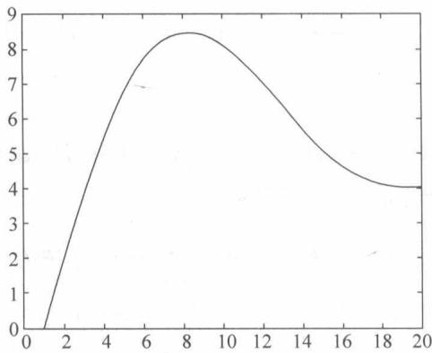

图 1-30 tpoly()生成的五次多项式轨迹
{: .figure-caption }


此时,对应的一组关节角为:

```javascript
q1 = KR5. ikine6s(T1);
```

最终位姿：

```javascript
T2 = transl(0.2, 0.4, 0) * trotx(pi)/2;
```

此时,对应的一组关节角为:

```javascript
q2 = KR5. ikine6s(T2);
```

设置机器人末端执行器从 A 点移动到 B 点, 用时 6s, 每 100ms 计算一次关节角:

```txt
t = [0:0.1:6]';
```

求解 A 点到 B 点, 6 个关节角在 6s 中的变换过程, MATLAB 机器人工具箱中可以用以下三条等价的语句进行计算:

```txt
语句 1: q = mtraj(@tpoly, q1, q2, t);
语句 2: q = mtraj(@lspb, q1, q2, t);
语句 3: q = jtraj(q1, q2, t);
```

结果运行如下：

```txt
q =
3.4633 -3.7572 2.7273 3.1416 0.2013 0.3218
3.4633 -3.7572 2.7273 3.1415 0.2014 0.3218
2.1582 -3.4343 2.9869 0.5501 1.9780 1.4876
2.1582 -3.4343 2.9869 0.5500 1.9781 1.4877
```

生成了一个 $61 \times 6$ 的矩阵, 可以看出从 $A$ 点到 $B$ 点的移动过程中, 关节角由 $q1$ 到 $q2$ 逐渐逼近。此外, 还可以通过可选参数求出从 $A$ 点到 $B$ 点移动过程中的速度和加速度。

语句： $[q,v,a] = j\text{traj}(q1,q2,t)$ ；同样为速度 $v$ 、加速度 $a$ 各自生成了一个 $61\times 6$ 的矩阵。

下面将从动画、图形对机械臂的轨迹进行显示：

当用动画对该过程进行仿真时,相关的语句为:

```javascript
KR5.plot(q);
```

需要绘制所有关节角随时间变化的图形时,相关的语句为:

```txt
>> qplot(t, q)
```

运行结果如图 1-31 所示。

当只需要绘制第 n 个关节角随时间变化的图形时, 相关语句为: plot(t, q(:, n)), 例如:

```lisp
>> plot(t, q(:, 1))
```

运行结果如图 1-32 所示。

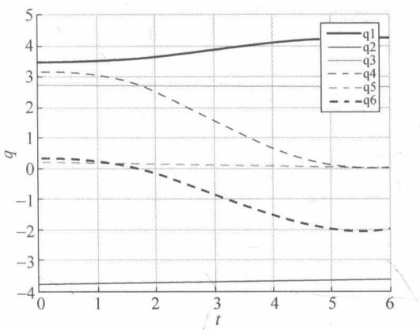

图 1-31 所有关节角随时间变化图
{: .figure-caption }


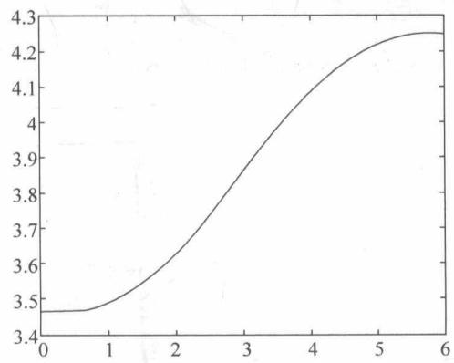

图 1-32 关节角 q1 随时间变化图
{: .figure-caption }


使用下列代码可以求出末端执行器在笛卡儿空间中的移动轨迹。

```matlab
>> T3 = KR5.fkine(q);
>> p = transl(T3);
>> plot(p(:,1),p(:,2))
```

运行结果如图 1-33 所示。

#### 笛卡儿空间的轨迹

绘制末端执行器在 xy 平面上的运动轨迹, 输入命令:

```erlang
>> Ts = ctraj(T1, T2, length(t));
>> plot(t, transl(Ts))
```

运行结果如图 1-34 所示。

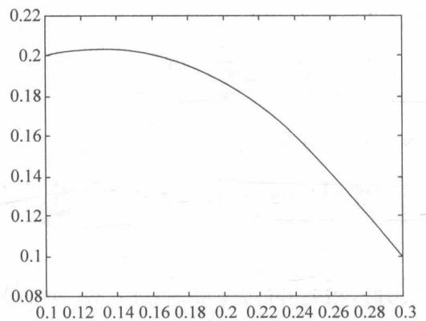

图 1-33 末端执行器在笛卡儿空间中的移动轨迹
{: .figure-caption }


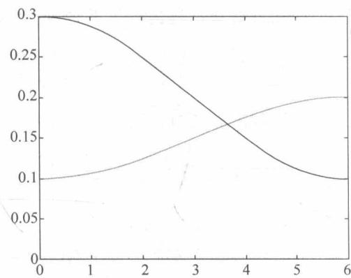

图1-34 末端执行器在 $xy$ 平面的轨迹
{: .figure-caption }


绘制末端执行器在 xy 平面的指向轨迹, 输入命令:

```txt
>> plot(t, tr2rpy(Ts))
```

运行结果如图 1-35 所示。

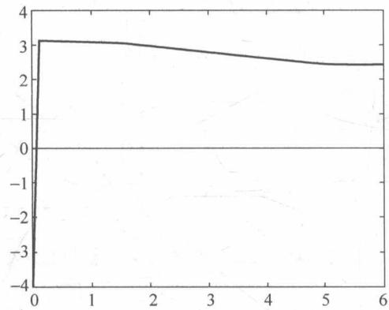

图1-35 末端执行器在 $xy$ 平面的指向轨迹
{: .figure-caption }


## 1.6 机械臂关节控制

### 1.6.1 机器人控制系统的构成

在实际中,机器人控制系统的物理构成如图 1-36 所示。通过示教、数值数据或外传感器来生成目标轨迹,转换成笛卡儿坐标系下的机器人末端执行器的坐标轨迹;因机械臂各关节的运动轨迹是在关节空间里,所以需要通过目标轨迹生成环节将笛卡儿空间的坐标轨迹转换成机器人各个机械臂的转角轨迹,即为机器人各关节的期望输出;控制器通过相关的控制算法处理并输出控制量,执行器根据控制量的大小输出力矩驱动机器人各关节,最终使系统稳定并保证跟踪误差(即:期望值与实际值之差)收敛到零或零附近的一个区域,同时满足一定的动态性能指标。

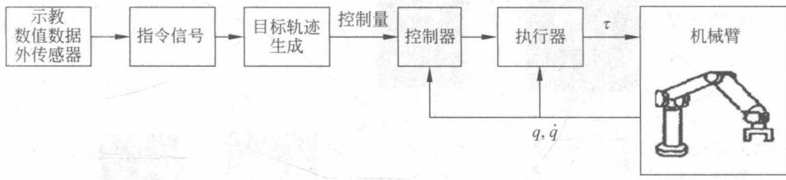

图 1-36 机器人控制系统物理构成示意图
{: .figure-caption }


用 X 表示机器人末端执行器在笛卡儿坐标系下的期望运行轨迹,可根据逆运动学由 X 求取出机器人各关节的期望转角 $q_{d}$ , 其转角速度及其加速度分别用 $\dot{q}_{d}$ 、 $\ddot{q}_{d}$ 表示, 用 $\mu$ 表示控制器的输入, 则机器人控制系统的框图形式如图 1-37 所示。

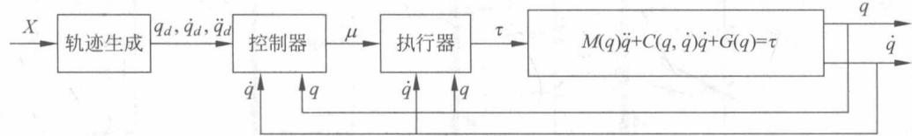

图 1-37 机器人控制系统框图
{: .figure-caption }


### 1.6.2 Simulink 机器人模块

机器人工具箱中提供了一些机器人模块,存放的目录路径为 toolbox\rvctools\simlink,可以通过以下的命令显示工具箱中所有的机器人模块,输入命令:

>> roblocks

运行结果如图 1-38 所示。

可以看出,它包括了图形模块、轨迹模块、变换转换模块、运动学模块、变换模块、动力学模块。用鼠标双击可进入下一级的子目录,如图 1-39 所示,动力学模块提供的 Simulink 模块,包括了关节机器人模块、移动机器人模块、飞行器模块和关节控制模型。

此外,机器人工具箱针对机器人控制的方法,提供了一些 Simulink 仿真模型,下面将以这些 Simulink 仿真模

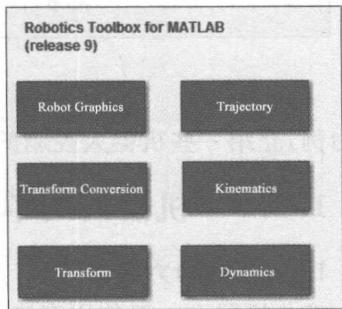

图 1-38 工具箱中的机器人模块库
{: .figure-caption }


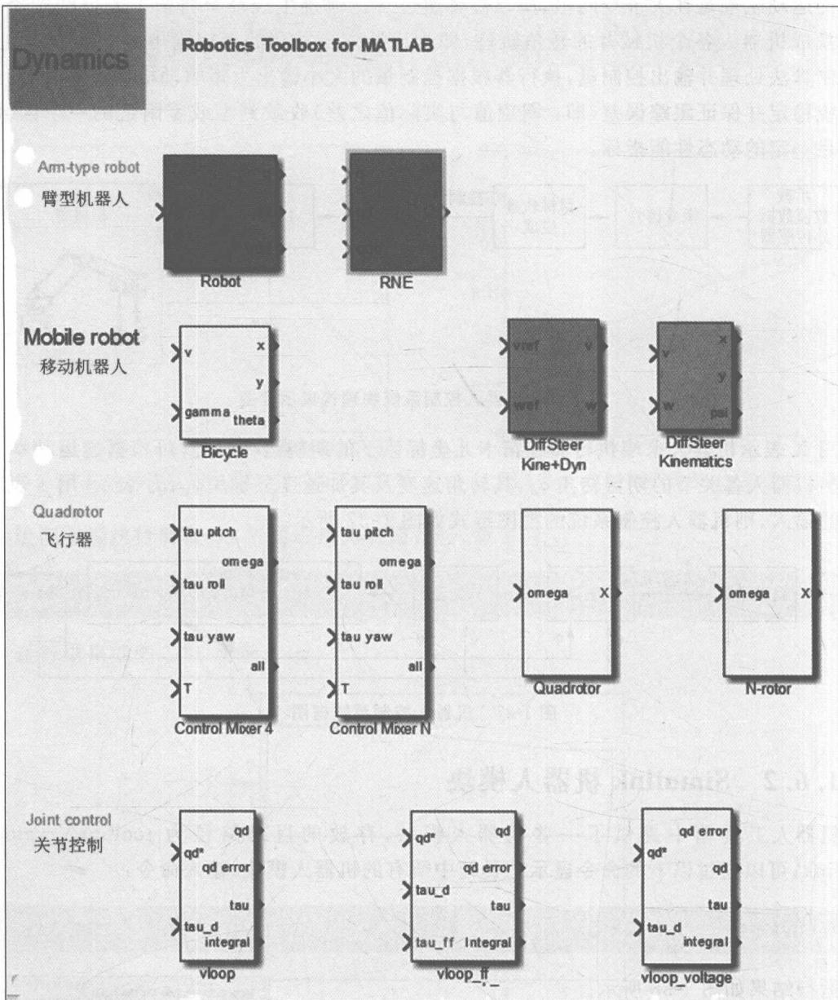

图1-39 动力学模块
{: .figure-caption }

型为例,介绍一些机器人控制的方法。

### 1.6.3 机器人的单关节控制

#### 电机的动力模型

工业机器人一般使用直流(DC)力矩电机作为驱动器。设电机驱动器提供的电流为：

$$
i = K _ {a} u\tag{1.88}
$$

它产生力矩的能力用电机转角常数 $K_{m}$ 来描述,因此,电枢电流与电机产生的转矩的关系为:

$$
\tau = K _ {m} i\tag{1.89}
$$

电机动力学模型可表示为：

$$
J _ {m} \dot {\omega} + B \omega + \tau_ {c} (\omega) = K _ {m} K _ {a} u\tag{1.90}
$$

其中， $J_{m}$ 是电机总的惯性，B 是黏性摩擦系数， $\tau_{c}$ 是库仑摩擦力矩。

#### 单关节控制的思想

机器人单关节控制的常见方法是将每个关节当作一个独立的控制系统，让它去跟随各自的关节轨迹。因此，机器人每个关节可以看作一个独立的电机模型，因此可以借鉴电机的双环控制，其中内层为速度层。

#### 速度环

在机器人工具箱中给出了肩关节的速度控制环 Simulink 模型。

忽略电机的库仑摩擦力,对电机动力模型进行拉普拉斯变换得到:

$$
s J \Omega (s) + B \Omega (s) = K _ {m} K _ {a} U (s)\tag{1.91}
$$

其中， $\Omega(s)$ 是时域信号 $\omega(t)$ 的拉普拉斯变换， $U(s)$ 是 $u(t)$ 的拉普拉斯变换，可以进一步推算得到电机的传递函数：

$$
(s J + B) \Omega (s) = K _ {m} K _ {a} U (s)\tag{1.92}
$$

$$
\frac {\Omega (s)}{U (s)} = \frac {K _ {m} K _ {a}}{s J + B}\tag{1.93}
$$

## 1）比例控制

基于期望速度和实际速度之间的误差的比例控制器控制律为：

$$
u ^ {*} = K _ {v} (\dot {q} ^ {*} - \dot {q})\tag{1.94}
$$

比例控制的框图如图 1-40 所示, 其中, 电机动力学模型的传递函数如上式所述; 控制周期为 1ms, 它用于仿真控制算法的计算时间; 力矩限制器用于限制电机的输入力矩, 防止输入的力矩过高, 不符合实际工作情况; $K_{v}$ 为比例控制的增益。

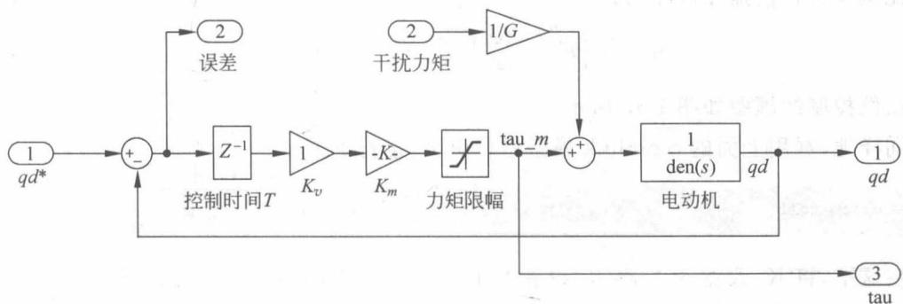

图 1-40 比例控制框图
{: .figure-caption }


```txt
>> vloop_test
```

机器人工具箱提供了一个 Simulink 对 puma560 肩关节进行比例控制的模型, 运行下列命令:

加载得到的 Simulink 模型如图 1-41 所示。

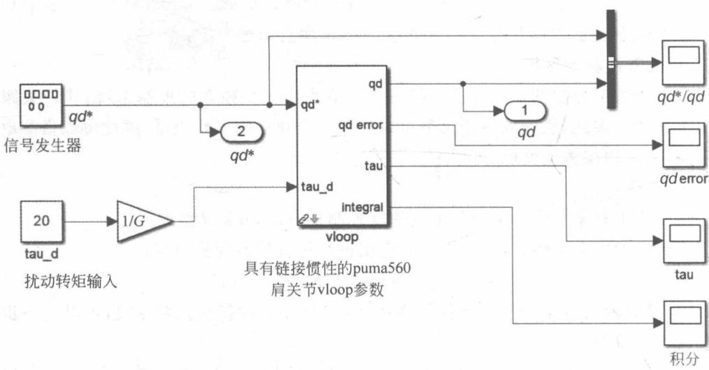

图 1-41 Simulink vloop\_test 模型
{: .figure-caption }


相比于图 1-40 所示的比例控制器,本模型包含了一个输入扰动:重力力矩项,它的值设置为 $20N \cdot m$ 。这里的 vloop 模型为图 1-41 的模型,但多了一个积分环节,因此双击该模块,将 $K_{v}$ 设置为 1, $K_{i}$ 设置为 0,使它为增益为 1 的纯比例控制器。此外,将信号发生器设置为 sawtooth,即为锯齿波测试信号。

运行仿真结果如图 1-42 所示。

## 2）比例积分控制

比例积分控制器控制律为：

$$
u ^ {*} = \left(K _ {v} + \frac {K _ {i}}{s}\right) (\dot {q} ^ {*} - \dot {q}), K _ {i} > 0\tag{1.95}
$$

比例控制的框图如图 1-43 所示。

同样地,利用上面的 Simulink 模型进行测试,运行下列命令:

```txt
>> vloop_test
```

在这里，将 $K_{v}$ 设置为 1，将 $K_{i}$ 设置为 10，因此，该控制器为一个比例增益为 1，积分增益为 10 的比例-积分控制器。

运行仿真的结果如图 1-44 所示。

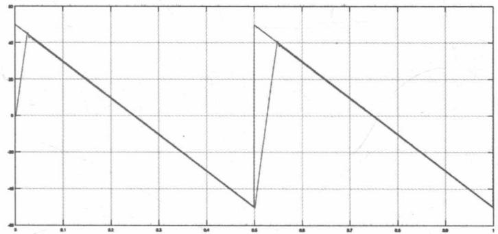
(a) 期望关节角和实际关节角

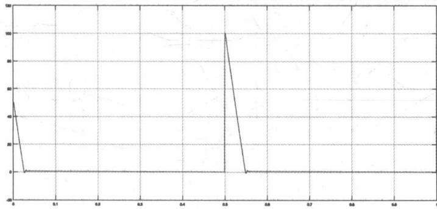
(b) 期望关节角和实际关节角误差

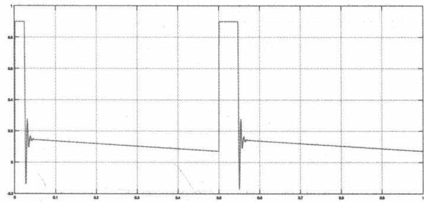
(c) 反馈得到的电机力矩


图1-42 运行仿真结果1
{: .figure-caption }

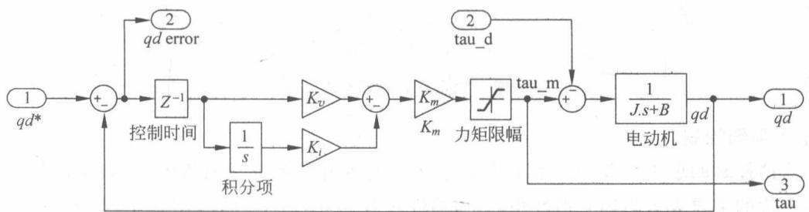

图 1-43 比例-积分控制框图
{: .figure-caption }


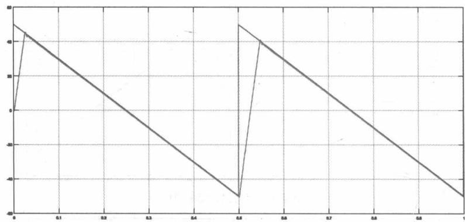

(a) 期望关节角和实际关节角
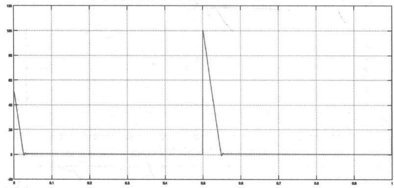
(b) 期望关节和实际关节角误差


(c) 反馈得到的电机力矩

图1-44 运行仿真结果2
{: .figure-caption }


## 3）前馈控制

前馈控制的思想是预测产生干扰的力矩，并把它输入到前馈通道中，消除掉力矩。这里产生干扰的主要为重力项和惯性矩阵，但惯性矩阵未知，只抵消掉重力项的干扰时，同样把输入力矩设置为20。

机器人工具箱提供了一个 Simulink 对 puma560 肩关节进行前馈控制的模型, 运行下列命令:

>> vloop\_test2

加载得到的 Simulink 模型如图 1-45 所示。


图 1-45 前馈控制 Simulink 模型
{: .figure-caption }


运行仿真的结果如图 1-46 所示。

#### 位置环

外层为位置环,负责维持位置和确定关节的速度。这里使用简单的比例控制,基于期望位置和实际位置之间的误差的比例控制器控制律为:

$$
\dot {q} ^ {*} = K _ {p} (q ^ {*} - q)\tag{1.96}
$$

位置控制环的控制框图如图 1-47 所示, 其中 vloop 为速度环模型, $K_{p}$ 为比例控制器的增益。

机器人工具箱提供了一个对 puma560 肩关节的位置控制环进行测试的 Simulink 模型, 运行下列命令:

## >>ploop\_test

加载得到的 Simulink 模型如图 1-48 所示。其中，用一个 LSPB 轨迹发生器设置期望的位置，它从 0 到 0.5rad 运动，采样频率是 1000Hz。

运行仿真图形如图 1-49 所示。


(a) 期望关节角和实际关节角


(b) 期望关节和实际关节角误差

(c) 反馈的得到的电机力矩


图1-46 运行仿真结果3
{: .figure-caption }


图 1-47 位置控制环的控制框图
{: .figure-caption }


图 1-48 位置控制环 vloop\_test 模型
{: .figure-caption }


图 1-49 位置控制环的仿真图形
{: .figure-caption }


### 1.6.4 机器人的多关节控制

#### 机器人系统的伺服控制律

因为机器人的操作臂具有多个关节,分别需要相应的驱动电机提供驱动力矩,并输出多个关节的位置、速度和加速度,所以对操作臂进行控制是一个多输入多输出的问题。

将控制律分解为基于模型的控制部分和伺服控制部分,那么它可以表示为:

$$
\boldsymbol {F} = \alpha \boldsymbol {F} ^ {\prime} + \beta\tag{1.97}
$$

其中， $F, F'$ 、 $\beta$ 为 $n \times 1$ 的矢量， $\alpha$ 为 $n \times n$ 的矩阵。 $\beta$ 为基于模型的控制部分、而 $F'$ 为伺服控

制部分,可以表示为:

$$
\mathbf {F} ^ {\prime} = \ddot {\mathbf {X}} _ {d} + \mathbf {K} _ {v} \dot {\mathbf {E}} + \mathbf {K} _ {p} \mathbf {E}\tag{1.98}
$$

其中， $K_{v}$ 、 $K_{p}$ 为 $n \times n$ 的矩阵，E 为 $n \times 1$ 维的位置误差矢量， $\dot{E}$ 为 $n \times 1$ 维的速度误差矢量。

#### 基于模型的操作臂控制

在前面建立了机器人的刚体动力学方程,如下:

$$
\tau = \boldsymbol {M} (q) \ddot {q} + \boldsymbol {C} (q, \dot {q}) \dot {q} + \boldsymbol {G} (q) + \boldsymbol {F} (\dot {q})\tag{1.99}
$$

其中， $M(q)\in R^{n\times n}$ 为机器人的惯性矩阵， $C(q,\dot{q})\in R^{n}$ 为科里奥利矩阵， $G(q)\in R^{n}$ 表示重力矩阵， $F(\dot{q})$ 为摩擦力矩。

可以得到控制律：

$$
\tau = \alpha \tau^ {\prime} + \beta\tag{1.100}
$$

其中：

$$
\alpha = M (q)\tag{1.101}
$$

$$
\boldsymbol {\beta} = \boldsymbol {C} (q, \dot {q}) \dot {q} + \boldsymbol {G} (q) + \boldsymbol {F} (\dot {q})\tag{1.102}
$$

$$
\pmb {\tau} ^ {\prime} = \ddot {q} _ {d} + \pmb {K} _ {v} \dot {\pmb {E}} + \pmb {K} _ {p} \pmb {E}\tag{1.103}
$$

式中：

$$
\dot {\pmb {E}} = q _ {d} - q\tag{1.104}
$$

#### 前馈控制

使用前馈控制器的控制框图如图 1-50 所示, 对机械臂动力学模块的输入力矩为:

$$
\begin{array}{r l} Q ^ {*} & = M (q ^ {*}) \ddot {q} ^ {*} + C (q ^ {*}, \dot {q} ^ {*}) \dot {q} ^ {*} + F (\dot {q} ^ {*}) + G (q ^ {*}) + \left\{K _ {v} (\dot {q} ^ {*} - \dot {q}) + K _ {p} (q ^ {*} - q) \right\} \\ & = \mathcal {D} (q ^ {*}, \dot {q} ^ {*}, \ddot {q} ^ {*}) + \left\{K _ {v} (\dot {q} ^ {*} - \dot {q}) + K _ {p} (q ^ {*} - q) \right\} \end{array} \tag{1.105}
$$

其中， $K_{p}$ 为位置增益矩阵，为对角矩阵； $K_{v}$ 为速度增益（或者阻尼）矩阵，也为对角矩阵； $\mathcal{D}(\cdot)$ 是逆动力学函数，包含的3个参数分别是期望关节角 $q^{*}$ 、期望关节角速度 $\dot{q}^{*}$ 、期望关节角加速度 $\ddot{q}^{*}$ 。


图 1-50 机器人前馈控制的控制框图
{: .figure-caption }


在这里， $\mathcal{D}(q^{*},\dot{q}^{*},\ddot{q}^{*})$ 为前馈力矩，它提供期望的机械臂状态 $(q^{*},\dot{q}^{*},\ddot{q}^{*})$ 所需要的关节力； $\{K_{v}(\dot{q}^{*}-\dot{q})+K_{p}(q^{*}-q)\}$ 为反馈项，它补偿控制系统存在的误差，造成这些误差的因素包括了惯性参数的不确定性、未建模力和外部干扰。

机器人工具箱中提供了一个对前馈控制测试的 Simulink 模型, 运行下面的命令加载相关的 Simulink 模型:

```txt
>> mdl_puma560
>> sl_fforward
```

加载得到的 Simulink 模型, 运行结果如图 1-51 所示, 其中, 前馈力矩是使用 RNE 模块来计算的, 加入到由位置和速度误差计算出来的反馈力矩中。期望关节角度和速度是使用 jtraj 模块计算的。因为机器人结构改变相对缓慢, 前馈力矩可以以比误差反馈回路 $T_{fb}$ 更低的速度 $T_{ff}$ 来估计。这里采用零阶保持器以维持相对较低的采样率——20Hz。


图 1-51 前馈控制的 Simulink 模型
{: .figure-caption }


#### 计算力矩控制

使用计算力矩控制器的控制框图如图 1-52 所示, 对机械臂动力学模块的输入力矩为:


图 1-52 机器人计算力矩控制的框图
{: .figure-caption }


(1.106)

其中， $K_{v}$ 是位置增益矩阵， $K_{p}$ 是速度增益矩阵； $\mathcal{D}(\cdot)$ 是逆动力学函数。

机器人工具箱中提供了一个对前馈控制测试的 Simulink 模型, 运行下面的命令加载相关的 Simulink 模型:

```txt
>> mdl_puma560
>> p560 = p560.nofriction();
>> s1_ctorque
```

加载得到的 Simulink 模型, 运行结果如图 1-53 所示。设置 jtraj 模块, 将初始关节角度设置为 $q0 = [0 \quad 0 \quad 0 \quad 0 \quad 0 \quad 0]$ , 末端关节角度设置为 $qf = [\text{pi}/4 \quad \text{pi}/2 \quad -\text{pi}/2 \quad 0 \quad 0 \quad 0]$ , 最大的力矩设置为 10。


图 1-53 计算力矩控制的 Simulink 模型
{: .figure-caption }


输入以下命令,运行程序:

```txt
>> r = sim('sl_ctorque');
```

仿真开始时,机器人的操作臂按照期望的关节角度、关节角速度和关节角加速度运动,如图 1-54 所示。


图 1-54 计算力矩控制的机器人仿真图
{: .figure-caption }


此外可以通过输入命令得到关节角度随时间变化的图形,输入命令:

```javascript
>> t = r.find('tout');
>> q = r.find('yout');
>> plot(t, q)
```

得到的图形如图1-55所示，可以看出，关节角度由初始位置 $q0 = [0 0 0 0 0 0]$ 到末端位置 $\mathrm{qf} = [\mathrm{pi} / 4 \quad \mathrm{pi} / 2 - \mathrm{pi} / 2 0 0 0]$ 变化的图形。


图 1-55 计算力矩控制的机器人仿真图
{: .figure-caption }


## 1.7 其他基于 MATLAB 的机器人工具箱

### 1.7.1 Kuka 控制工具箱(KCT)的介绍与测试

#### KCT 的诞生背景

在过去十年中，MATLAB已经开发出了用于机器人系统建模的几个工具箱。这些仿真工具受到各种应用场景的启发，逐渐开发出适用于基于视觉的机器人和空间机器人的工具箱，实现了从工业到学术教育的转型。其中具有挑战性的问题是设计MATLAB工具包以提供多功能和高级编程环境用于真实机器人的运动控制。puma560机械手在这个领域已经做了已经做出了一些尝试。然而，这个机器人有一些已知固有的软件限制，特别是在实时应用程序方面。Kuka控制工具箱(KCT)在实时应用程序方面取得突出进展，本节将重点介绍Kuka控制工具箱和其他一些常用的机器人工具箱。

#### KCT 的发展历程

Kuka 控制工具箱(KCT)是用于 KUKA 机器人操纵器运动控制的 MATLAB 函数集合, 开发环境为用户提供直观和高级的编程接口。该工具箱与使用 Eth. RSIXML 的所有 6 自由度小型和低型库卡机器人兼容, 通过 TCP/IP 与 KUKA 控制器连接在远程计算机上运行。KCT 包括超过 30 个功能, 涵盖正向和反向运动学计算、点对点连接和笛卡儿控制、

轨迹生成、图形显示和诊断等操作。

库卡操纵器是由世界领先的工业机器人制造商之一 KUKA 生产的一款操纵器，其设计适用于工业设置中的大量应用，例如组装、材料处理、分配、码垛和焊接任务。KUKA 已经开发了一种特定的 C 语言编程语言，称为 KRL（库卡机器人语言），用于机器人运动控制。这种语言很简单，编程方便。然而，它不适用于关键的实时远程控制应用，不支持图形界面和高级数学工具（如矩阵运算、优化和过滤任务），不允许外部硬件模块的简单集成，例如使用公共协议的照相机或嵌入式设备 USB、PCI 等。

为了克服这些缺点，MATLAB工具箱Kuka-KRL-tbx在KRL上构建MATLAB抽象层，使用串行接口连接库卡机器人控制器(KRC)和装载MATLAB的远程计算机。在KRC上运行的KRL解释器在机器人和远程计算机之间建立双向通信，负责识别和执行通过串行接口传输的所有指令。然而，Kuka-KRL-tbx仍然受到一些限制，例如工具箱的MATLAB命令与KRL函数是一对一的，阻碍用户设计高级控制应用程序，串行接口可能给实时控制应用带来限制。另外，工具箱也不包括用于图形显示的特定例程。

Kuka 控制工具箱(KCT)则很好地解决了上面的问题，KCT 的函数不像 KRL 命令那样一对一，这使得工具箱非常灵活和通用；KCT 通过 TCP/IP 与 KRC 连接在远程计算机上运行，多线程服务器在 KRC 上运行，并通过 Eth. RSIXML（以太网机器人传感器接口 XML）在客户端与操纵器进行信息交换和通信，这保证了高传输速率，使实时控制应用成为可能；KCT 有几个专用于图形和三维动画的功能，并包括一个图形用户界面。

本部分内容将根据 KCT 工具箱中的函数和 KCT: a MATLAB toolbox for motion control of KUKA robot manipulators 一文, 对 KCT 的通信原理进行详解, 对所有函数的功能进行测试, 以让读者更深入了解 KCT。

#### KCT 的通信原理

KCT 与机器人操纵器之间的通信由 3 个部分组成：在 MATLAB 下运行 KCT 的远程计算机，KUKA 机器人控制器 (KRC)，机器人机械手。为了在远程计算机和机器人控制器之间建立连接，KCT 提供了 kctserver，它是一个在 KRC 上运行的 C++ 多线程服务器。kctserver 通过 eth.RSIXML（用于 TCP/IP-robot 接口的 KUKA 软件包）与 kctrsiclient.src 进行通信，该 kctrsiclient.src 是在 KRC 上运行 eth.RSIXML 客户端并管理与机器人操纵器的信息交换的 KRL 脚本。KCT 的 MATLAB 函数使用特定的 MEX 文件（默认选项）或通过 MATLAB 仪器控制工具箱与 kctserver 通信。

#### KCT 的函数测试

KCT 工具箱共有 41 个函数, 按功能可大致分为七类: 初始化、联网、运动学、运动控制、图像、齐次变换和演示。

## 1）初始化函数

初始化函数主要用于工具箱和机器人的初始化设置,共有9个函数,以下将依次介绍。

函数 kctrobot() 的功能是显示所有本工具箱支持的库卡机器人的信息。本工具箱默认支持 13 款型号的库卡机器人，其中的信息均存放在 kctrobotdata.mat 文件中。本函数的程序代码如下所示，从中可见该函数的程序是相当简单的，先判断能否找 kctrobotdata.mat 文件，如果不能，则打印 'kctrobotdata.mat not found.' 信息，如果能，则加载 kctrobotdata.mat 文件并打印 13 款库卡机器人版本信息。

函数 kctrobot() 的程序如下：

```matlab
function kctrobot()
% Can't read the data structure
if exist('kctrobotdata.mat') == 0
    display('kctrobotdata.mat not found.');
    return
end
% Reading the data structure
load kctrobotdata;
for i = 1:size(kctrobotdata,2)
    disp(['position: ', num2str(i)]);
    kctrobotdata(i)
end
```

运行结果：

```txt
>> kctrobot( );
position: 1
ans =
    name: 'KR5arc'
    link1: 400
    link2: 180
    link3: 600
    link4: 120
    link5: 620
    link6: 115
    link5: 270
    link6: 75
    position: 4
    ans =
    name: 'KR5arcHW'
    link1: 400
    link2: 180
    link3: 600
    link4: 170
    link5: 620
    link6: 200
    link3: 270
    link4: 90
    link5: 295
    link6: 80
```

```yaml
position: 5
ans =
    name: 'KR6 - 2'
    link1: 675
    link2: 300
    link3: 650
    link4: 155
    link5: 600
    link6: 125

position: 6
ans =
    name: 'KR6 - 2KS'
    link1: 235
    link2: 450
    link3: 645
    link4: 35
    link5: 670
    link6: 115

position: 7
ans =
    name: 'KR15SL'
    link1: 600
    link2: 240
    link3: 640
    link4: -60
    link5: 620
    link6: 170

position: 8
ans =
    name: 'KR16 - 2'
    link1: 675
    link2: 260
    link3: 680
    link4: 0
    link5: 670
    link6: 158

position: 9
ans =
    name: 'KR16 - 2S'
    link1: 675
    link2: 260
    link3: 680
```

```asm
link4: 0
    link5: 670
    link6: 158

position: 10
ans =
    name: 'KR16 - 2KS'
    link1: 235
    link2: 450
    link3: 680
    link4: 0
    link5: 670
    link6: 158

position: 11
ans =
    name: 'KR16L6 - 2'
    link1: 675
    link2: 260
    link3: 680
    link4: 0
    link5: 970
    link6: 115

position: 12
ans =
    name: 'KR16L6 - 2KS'
    link1: 235
    link2: 450
    link3: 680
    link4: 0
    link5: 970
    link6: 115

position: 13
ans =
    name: 'KR5sixxr850'
    link1: 335
    link2: 75
    link3: 365
    link4: 90
    link5: 405
    link6: 80
```

## kctfindrobot()

函数 kctfindrobot() 的功能是在 kctrobotdata 列表中查找 KUKA 机器人的模型, 找到, 则返回 1, 没找到, 则返回 0。其用法是: bFound = kctfindrobot(kctname), 其中的参数 kctname 是 kuka 机器人型号名称的字符串。

其程序代码如下所示：

```matlab
function bFound = kctfindrobot(kctname)
    krd = load('kctrobotdata.mat');
    temp_kctrobotdata = krd.kctrobotdata;
    bFound = 0;
    for i = 1:size(temp_kctrobotdata, 2)
    if (strcmp(temp_kctrobotdata(i).name, kctname) == 1)
    bFound = 1;
    return;
end
end
```

运行结果：

```txt
>> bFound = kctfindrobot('KR3')
bFound =
```

文件中含有机器人'KR3',返回1。

```txt
>> bFound = kctfindrobot('KR2')
bFound =
0
```

文件中不含有机器人'KR2',返回0。

## kctinsertrobot()

函数 kctinsertrobot() 的功能是将新模型添加到 kctrobotdata 列表并保存。其用法是：kctinsertrobot(kctname, kctlinks)，该函数具有两个参数，kctname 为 kuka 机器人型号名称的字符串，kctlinks 是一个六维向量，它表示该模型的六个连杆的长度。若所添加的模型名称已存在，则提示该模型已存在；若所添加的模型名称未存在 kctrobotdata.mat 中，则把新模型存入 kctrobotdata 列表，并提示新模型已成功添加。

函数 kctinsertrobot() 的程序如下所示：

```matlab
function kctinsertrobot(kctname, kctlinks)
if kctfindrobot(kctname) == 0
krd = load('kctrobotdata.mat');
kctrobotdata = krd.kctrobotdata;
```

```matlab
kctindex = length(kctrobotdata) + 1;
kctrobotdata(kctindex).name = kctname;
kctrobotdata(kctindex).link1 = kctlinks(1);
kctrobotdata(kctindex).link2 = kctlinks(2);
kctrobotdata(kctindex).link3 = kctlinks(3);
kctrobotdata(kctindex).link4 = kctlinks(4);
kctrobotdata(kctindex).link5 = kctlinks(5);
kctrobotdata(kctindex).link6 = kctlinks(6);
save('kctrobotdata.mat', 'kctrobotdata');
disp(['Model ', kctname, 'added correctly.'])
else
disp(['Model ', kctname, 'already in kctrobotdata.mat.'])
end
```

## 运行结果：

```txt
>> kctlinks = [345, 75, 385, 90, 435, 80];
>> kctinsertrobot('KR3', kctlinks)
Model KR3 already in kctrobotdata.mat.
>> kctinsertrobot('KR2', kctlinks)
Model KR2 added correctly.
```

文件中已存在机器人'KR3', 则提示机器人'KR3'已存在, 文件中不存在机器人'KR2', 则提示已成功添加。

## kctdeleterobot()

函数 kctdeleterobot() 的功能是从 kctrobotdata 列表中删除一个特定的模型并自动更新 kctrobotdata.mat 文件。其用法是：kctdeleterobot(kctname)，其中参数 kctname 是 kuka 机器人型号名称的字符串。若该模型存在于 kctrobotdata 列表中，则从列表中删除该模型，并提示已成功删除模型；若该模型不存在于 kctrobotdata 列表中，提示未找到该模型。

函数 kctdeleterobot() 的程序如下所示：

```matlab
function kctdeleterobot(kctname)
    krd = load('kctrobotdata.mat');
    temp_kctrobotdata = krd.kctrobotdata;
    bDelete = 0;
    for i = 1:size(temp_kctrobotdata,2)
    if(strcmp(temp_kctrobotdata(i).name, kctname) == 1)
    bDelete = 1;
end
if (bDelete == 1) && i size(temp_kctrobotdata,2)
    temp_kctrobotdata(i) = temp_kctrobotdata(i+1);
end
```

```matlab
end
    if bDelete == 1
kctrobotdata = temp_kctrobotdata(1:(size(temp_kctrobotdata,2)-1));
    save('kctrobotdata.mat', 'kctrobotdata');
disp(['Model ', kctname, 'removed correctly.'])
else
disp(['Model ', kctname, 'not found.'])
end
```

运行结果：

```txt
>> kctlinks = [345, 75, 385, 90, 435, 80];
>> kctinsertrobot('KR2', kctlinks)
Model KR2 added correctly.
>> kctdeleterobot('KR2')
Model KR2 removed correctly.
>> kctdeleterobot('KR1')
Model KR1 not found.
```

文件中存在机器人'KR2', 提示机器人已成功删除, 文件中不存在机器人'KR1', 提示没找到该机器人。

## kctinit()

函数 kctinit() 的功能是提取某一特定 KUKA 机器人的数据并将其保存在 .mat 文件中, 这些机器人数据是运动功能操作所必需的, 另外该函数还可以加载 TCP/IP 通信选项。其用法为: kctinit(robotname), 其中参数 robotname 为机器人型号名称字符串。若参数为空, 则提示错误, 需要输入一个参数; 若输入的参数模型不存在, 则提示错误; 若模型存在, 则提取该模型的数据保存到 kctrobotlinks.mat 文件中, 并加载 kcttcpiptype.mat 文件。

函数的程序如下所示：

```matlab
function kctinit(robotname)
    if(nargin ~ = 1)
    display('ERROR : kctinit requires one input.');
    return;
end
krd = load('kctrobotdata');
i = 1;
while ~strcmp(robotname, krd.kctrobotdata(i).name)
    i = i + 1;
end
kctrobotlinks = [krd.kctrobotdata(i).link1, krd.kctrobotdata(i).link2, krd.kctrobotdata(i).link3, krd.kctrobotdata(i).link4, krd.kctrobotdata(i).link5, krd.kctrobotdata(i).link6];
save('kctrobotlinks.mat', 'kctrobotlinks');
```

```matlab
kctchframe(eye(4));
% Load TCP/IP communication type
global kcttcpiptype;
load('kcttcpiptype.mat');
```

运行结果：

```txt
>> kctinit()
ERROR : kctinit requires one input.
>> kctinit('KR2')
Index exceeds matrix dimensions.
Error in kctinit (line 43)
while ~strcmp(robotname, krd.kctrobotdata(i).name)
>> kctinit('KR3')
```

## kctsetbound()

函数 kctsetbound() 的功能是设置机器人的工作区边界，并将工作区边界保存到 kctrobotbound.mat 文件中。其用法为：kctsetbound(bound)，其中参数 bound 为 $2 \times 6$ 的矩阵，第一行为 X, Y, Z 轴坐标的最大和最小值，第二行为关节角度 4, 5, 6 的最大和最小值。设置好参数后调用函数，则将工作区边界保存到 kctrobotbound.mat 文件中，并调用 kctgetbound() 函数。

函数 kctsetbound() 的程序如下：

```javascript
function kctsetbound(kctworkspace)
save('kctrobotbound.mat', 'kctworkspace');
kctgetbound();
```

运行结果：

```lisp
>> kctsetbound([ -800 800 -800 800 0 800; -90 180 -90 180 -90 180])
```

调用该函数后弹出一个用户界面,如图 1-56 所示,其绘出了机器人和机器人的工作区间。


图 1-56 函数 kctsetbound() 生成的 KUKA 机器人及其工作区间
{: .figure-caption }


## kctgetbound()

函数 kctgetbound() 的功能是显示机器人的工作区边界。其用法是：B = kctgetbound()，其返回值为包含边界的最小值和最大值的 $2 \times 6$ 矩阵。调用函数后返回机器人的工作区边界数据，并调用函数 kctdrawbound() 和 kctdisprobot() 将工作区边界和机器人以三维图形的形式表示出来。

函数 kctgetbound() 的程序为：

```matlab
function kctworkspace = kctgetbound
kw = load('kctrobotbound');
kctworkspace = kw.kctworkspace;
h_bound = figure();
kctrobothome = load('kctrobothome.mat');
df = 40;
% Box color
color2 = [0.0,0.0,0.8];
axis equal;
k = [0:pi/4:2*pi];
d = 40;
Xzvert = [d * 0.25 * sin(k); d * 0.25 * sin(k + pi/4); zeros(1, length(k))];
Yzvert = [d * 0.25 * cos(k); d * 0.25 * cos(k + pi/4); zeros(1, length(k))];
Zzvert = [zeros(1, length(k)); zeros(1, length(k)); d/2 * ones(1, length(k))];
Xyvert = [d * 0.25 * sin(k); d * 0.25 * sin(k + pi/4); zeros(1, length(k))];
Yyvert = [zeros(1, length(k)); zeros(1, length(k)); d/2 * ones(1, length(k))];
Zyvert = [d * 0.25 * cos(k); d * 0.25 * cos(k + pi/4); zeros(1, length(k))];
Xxvert = [zeros(1, length(k)); zeros(1, length(k)); d/2 * ones(1, length(k))];
Yxvert = [d * 0.25 * cos(k); d * 0.25 * cos(k + pi/4); zeros(1, length(k))];
Zxvert = [d * 0.25 * sin(k); d * 0.25 * sin(k + pi/4); zeros(1, length(k))];
framecolor = 'red';
patch(df + Xxvert, Yxvert, Zxvert, framecolor);
patch(Xyvert, df + Yyvert, Zyvert, framecolor);
patch(Xzvert, Yzvert, df + Zzvert, framecolor);
line([0 df], [0 0], [0 0], 'color', framecolor, 'LineWidth', 2);
line([0 0], [0 df], [0 0], 'color', framecolor, 'LineWidth', 2);
line([0 0], [0 0], [0 df], 'color', framecolor, 'LineWidth', 2);
text(df + 5, 5, 5, 'XO');
text(5, df + 5, 5, 'YO');
text(5, 5, df + 5, 'ZO');
grid on;
axis equal;
hold on;
% Plot robot's bounds
kctdrawbound(kctworkspace, color2);
% Plot the robot
kctdisprobot(-kctrobothome.kcthomeposition(2,:), h_bound);
```

运行结果：

```txt
>> kctsetbound([ -800 800 -800 800 0 800; -90 180 -90 180 -90 180])
>> kctsetbound([ -800 800 -800 800 0 800; -90 180 -90 180 -90 180])
>> kctgetbound()
ans =
-800 800 -800 800 0 800
-90 180 -90 180 -90 180
```

调用该函数后,返回一个包含机器人工作区间的矩阵,并弹出一个用户界面,如图 1-57 所示,其绘出了机器人和机器人的工作区间。


图 1-57 函数 kctgetbound() 生成的 KUKA 机器人及其工作区间
{: .figure-caption }


## kctchecksystem()

函数 kctchecksystem() 的功能是检查系统是否满足要求。其用法为：[issystemok, foundmatlab, foundtoolbox] = kctchecksystem()。其中返回值 issystemok 为 1，表示系统支持该工具箱；为 0，表示系统不支持该工具箱。返回值 foundmatlab 为 1，表示 MATLAB 支持该工具箱（MATLAB7.0 及以上版本）；为 0，表示 MATLAB 不支持该工具箱。返回值 foundtoolbox 为 1，表示工具箱已成功安装；为 0，表示工具箱为成功安装。另外，函数也会返回 MATLAB 的版本信息，若 MATLAB 版本过低或工具箱未正常安装，则做出相应的提示。

函数 kctchecksystem() 的程序如下：

```matlab
function [issystemok, foundmatlab, foundtoolbox] = kctchecksystem()
global kcttcpiptype;
load('kcttcpiptype.mat');
toolboxlist = ver();
% Check Matlab version
matlabversion = version();
foundmatlab = 0;
if matlabversion(1) >= 7
    foundmatlab = 1;
    fprintf('Matlab version %s.\n', matlabversion);
```

```matlab
end
% Check if Instrument Control Toolbox is installed
foundtoolbox = 0;
for i = 1:size(toolboxlist,2)
    if strcmp(toolboxlist(i).Name, 'Instrument Control Toolbox') == 1
    foundtoolbox = 1;
    display('Instrument Control Toolbox found.');
    break;
    end
end
if foundmatlab == 0
    display('Matlab version too old required 7.x or higher.');
    display('Some KCT functions may not work properly.');
end
if foundtoolbox == 0
    display('Instrument Control Toolbox not found.');
    display('MEX functions will be used for the network communication.');
    kctsettcpip('MEX');
end
issystemok = and(foundmatlab, foundtoolbox);
```

运行结果：

```txt
>> [issystemok, foundmatlab, foundtoolbox] = kctchecksystem()
Matlab version 8.0.0.783 (R2012b).
Instrument Control Toolbox found.
    issystemok = 1
    foundmatlab = 1
    foundtoolbox = 1
```

## kctdrawbound()

函数 kctdrawbound() 的功能是显示机器人边界。其用法为：kctdrawbound(kctworkspace, kctcolor, h\_fig)，其中参数 kctworkspace 为包含机器人边界的矩阵，kctcolor 为边框颜色（可选），h\_fig 为图的句柄（可选）。

运行结果：

```txt
>> kctdrawbound([ -600 600 -600 600 0 600])
```

输入该函数后弹出一个用户界面,如图 1-58 所示,中间较深色的箱子表示机器人的边界。

## 2）联网函数

联网函数主要用于通信连接,共有4个函数,如下所示:

kctsettcpip()


图 1-58 函数 kctdrawbound() 生成的 KUKA 机器人及其工作区间
{: .figure-caption }


函数 kctsettcpip() 的功能是设置网络通信协议(仪器控制工具箱或 Mex 文件)。其用法为：kctsettcpip('ICT') 或 kctsettcpip('MEX')，其中 kctsettcpip('ICT') 对应于仪器控制工具箱，kctsettcpip('MEX') 对应于 Mex 文件，参数 value 为表示 TCP/IP 类型的字符串。若调用函数时没有设定参数，则提示错误并要求输入一个参数；若调用函数时设定参数为 ICT，则调用 kctchecksystem() 函数判断工具箱是否能用于 TCP/IP 通信；调用函数时设定参数为 ICT 或 MEX 均会关闭当前的 TCP/IP 通信形式，并设置为新的 TCP/IP 通信形式，同时将新的 TCP/IP 通信类型保存至 kcttcpiptype.mat 文件中。

函数 kctsettcpip() 的程序如下：

```matlab
function kctsettcpip(value)
global kctipvar
if(nargin ~= 1)
    display('ERROR : kctsettcpip requires one input.');
    return;
end
% Load TCP/IP communication type
global kcttcpiptype;
if value == 'ICT'
    [issystemok, foundmatlab, foundtoolbox] = kctchecksystem();
    if foundtoolbox == 0
    display('Instrument Control Toolbox cannot be used for TCPIP communication.');
    return;
    end
end
% Closing previous communication if exist
if isempty(kctipvar) == 0
display('Closing previous TCPIP communication.');
kctcloseclient();
end
% Changing TCPIP communication type
```

```javascript
kcttcpiptype = value;
save('kcttcpiptype.mat', 'kcttcpiptype');
```

运行结果：

```txt
>> kctsettcpip('ICT')
Matlab version 8.0.0.783 (R2012b).
Instrument Control Toolbox found.
Closing previous TCPIP communication.
KUKA ICT client successfully closed.
>> kctsettcpip('MEX')
```

## kctgettcpip()

函数 kctgettcpip() 的功能是获取网络通信协议, 其用法是: kctgettcpip(), 其返回信息为网络通信类型。若通信类型为 ICT, 则打印 KUKA communication protocol: Instrument Control Toolbox.; 若通信类型为 MEX, 则打印 KUKA communication protocol: MEX files.。

函数 kctgettcpip() 的程序如下：

```matlab
function kctsettcpip(value)
% Load TCP/IP communication type
global kcttcpiptype;
if kcttcpiptype == 'ICT'
    display('KUKA communication protocol: Instrument Control Toolbox. ');
elseif kcttcpiptype == 'MEX'
    display('KUKA communication protocol: MEX files. ');
end
```

运行结果：

```txt
>> kctgettcpip()
KUKA communication protocol: Instrument Control Toolbox.
```

```txt
kctclient()
```

函数 kctclient() 的功能是初始化 KUKA 机器人通信的 MATLAB 客户端，它可以初始化指定的 URL 和端口上的 TCP/IP 连接，以便启动与 KUKA 机器人的服务器的通信。其用法为： $t = \text{kctclient(str\_address)}$ ，其中参数 str\_address 为服务器 PC 的 IP 地址（字符串格式），参数 SampleTime 为控制通信所需的时间（最小值为 0.015s），返回值 t 为与 KUKA 机器人通信的处理程序。

运行结果：

```txt
>> t = kctclient('192.168.1.0')
KCTCLIENT: connect the robot with MATLAB
```

```txt
Start the kctserver.exe on the KUKA robot controller and press any key to continue...
Connection on port failed
Frame position and orientation
kctptfr =
0 0 0
TCPIP Object : TCPIP-192.168.1.0
Communication Settings
RemotePort: 2999
RemoteHost: 192.168.1.0
Terminator: 'LF'
NetworkRole: client
Communication State
Status: closed
RecordStatus: off
Read/Write State
TransferStatus: idle
BytesAvailable: 0
ValuesReceived: 0
ValuesSent: 0
kctrotfr =
1 0 0
0 1 0
0 0 1
Sample time for communication
Ts =
0.1500
```

## kctcloseclient()

函数 kctcloseclient() 的功能是终止用于 KUKA 机器人通信的 MATLAB 客户端，即终止与 KUKA 机器人服务器的 TCP/IP 连接。其用法是：kctcloseclient(t)，其中参数 t 为与 KUKA 机器人通信的处理程序。

kctcloseclient()的程序如下：

```matlab
function kctcloseclient()
global kctipvar;
% Load TCP/IP communication type
global kcttcpiptype;
if( kcttcpiptype == 'ICT' & ~isempty(kctipvar) )
    fclose(kctipvar);
    clear global kctipvar;
    clear global kctrobotlinks;
    fprintf('KUKA ICT client successfully closed. \n')
elseif( kcttcpiptype == 'MEX' & ~isempty(kctipvar) )
    kctcloseclientmex();
```

```matlab
clear global kctipvar;
clear global kctrobotlinks;
fprintf('KUKA MEX client successfully closed. \n')
else
    fprintf('TCPIP communication not initialized. \n')
end
```

运行结果：

```txt
>> kctcloseclient()
KUKA ICT client successfully closed.
```

## 3）运动学函数

运动学函数主要用于求取机器人的运动学,共有5个函数,如下所示:

## kctreadstate()

函数 kctreadstate() 的功能是返回机器人的当前状态,该函数返回一个 $2 \times 6$ 的矩阵,第一行为实际位置,第二行为机械臂的关节角度。其用法为: kctreadstate(), 返回值为表示机器人状态的 $2 \times 6$ 矩阵,第一行为末端效应器的位置,第二行为机械臂关节连接处的角度。

函数 kctreadstate() 的程序如下：

```matlab
function robotstate = kctreadstate()
global Ts;
global kctipvar;
global kcttcpiptype;
    t = kctipvar;
tic;
% Reading Data
v_coor = [];
v_axis = [];
if kcttcpiptype == 'ICT'
    fwrite(t,' ask/>');
    B = t.BytesAvailable;
    while t.BytesAvailable 400
    end
    DataReceived = char(fread(t,400));
    DataReceived = DataReceived';
elseif kcttcpiptype == 'MEX'
    totalBytesRec = 0;
    DataReceived = '';
    kctsenddatamex(' ask/>');
    [bytesRec, dataRec] = kctrecdatamex();
    dataRec = dataRec([1:bytesRec]);
    DataReceived([1:bytesRec]) = char(dataRec);
```

```matlab
totalBytesRec = totalBytesRec + bytesRec;
while totalBytesRec 400
    [bytesRec, dataRec] = kctrecdatamex();
    DataReceived([(size(DataReceived,2) + 1):(size(DataReceived,2) + bytesRec)]) = dataRec([1:bytesRec]);
    totalBytesRec = totalBytesRec + bytesRec;
end

end

v_temp = findstr(DataReceived,'''');
j = 1;
i = 5;
while i 17
    try
    temp = DataReceived((v_temp(1,i) + 1):(v_temp(1,i+1) - 1));
    catch
    disp('system wake up')
    flushinput(t);
    kctstop();
    DataReceived = char(fread(t,400));
DataReceived = DataReceived';
    v_temp = findstr(DataReceived,'''');
    temp = DataReceived((v_temp(1,i) + 1):(v_temp(1,i+1) - 1));
    end
    v_coor(1,j) = str2num(temp);
    i = i + 2;
    j = j + 1;
end

i = 29;
j = 1

while i 41
    temp = DataReceived((v_temp(1,i) + 1):(v_temp(1,i+1) - 1));
    v_axis(1,j) = str2num(temp);
    i = i + 2;
    j = j + 1;
end

robotstate(1,1:6) = v_coor;
robotstate(2,1:6) = v_axis;
% Pause for synchronizatio;
tempo = toc;
while (tempo) Ts
    tempo = toc;
end
```

## 运行结果：

由于没有连接硬件,不能返回机器人的当前状态。

```txt
>> kctreadstate()
Error using icinterface/fwrite (line 191)
OBJ must be connected to the hardware with FOPEN.
Error in kctreadstate (line 51)
fwrite(t,' ask/>');
```

```bazel
kctfkine()
```

函数 kctfkine() 的功能是计算机器人的正向运动学，并返回机器人正向运动学的齐次矩阵（本工具箱利用 DH 法求正向运动学）。其用法为： $H_{0}e = kctfkine(angleDH)$ ，其中参数 angleDH 为以角度为单位的关节角矢量，返回值 $H_{0}e$ 为正向运动学的齐次矩阵。

工业机器人的正向运动学指已知机器人各关节类型、相邻关节之间的尺寸和相邻关节相对运动量的大小时，确定机器人末端执行器在固定坐标系中的位姿。

KUKA 机器人为六自由度机器人, 可以通过每个连接点的相对位姿求得最终的位姿。不妨设六个关节角分别为 $\theta 1, \theta 2, \theta 3, \theta 4, \theta 5, \theta 6$ ，六个连杆长度分别为 $l1, l2, l3, l4, l5, l6$ ，令 ${}_{1}^{0}T$ 表示从 0 位置到 1 位置的刚性运动齐次变换矩阵，则有

<div class="mineru-algorithm" style="white-space: pre-wrap; font-family:monospace;">
$^{0}_{e}T = ^{0}_{1}T_{2}^{1}T_{3}^{2}T_{4}^{3}T_{5}^{4}T_{6}^{5}T_{e}^{6}T$
</div>

函数 kctfkine() 的程序如下：

```matlab
function H_0e = kctfkine(angleDH)
global kctrobotlinks;
global kctptfr;
global kctrotfr;
l1 = kctrobotlinks(1);
l2 = kctrobotlinks(2);
l3 = kctrobotlinks(3);
l4 = kctrobotlinks(4);
l5 = kctrobotlinks(5);
l6 = kctrobotlinks(6);
a = angleDH;
H_01 = kctrotoz(a(1)) * kcttran([0,0,l1]);
H_12 = kctrotox(90) * kcttran([12,0,0]);
H_23 = kctrotoz(a(2)) * kcttran([13,0,0]);
H_34 = kctrotoz(a(3)) * kcttran([sqrt(15^2 + l4^2),0,0]) * kctrotoy(90);
H_45 = kctrotoz(a(4)) * kctrotoy(-90);
H_56 = kctrotoz(a(5)) * kctrotoy(90);
H_6e = kctrotoz(a(6)) * kcttran([0,0,l6]) * kctrotoz(-90);
H_0e = H_01 * H_12 * H_23 * H_34 * H_45 * H_56 * H_6e;
H_0e(1:3,1:3) = inv(kctrotfr(1:3,1:3)) * H_0e(1:3,1:3);
temp_fr = [kctrotfr(1:3,1:3), kctptfr'; [0 0 0 1]];
temp_fr = inv(temp_fr);
H_0e(1:3,4) = temp_fr(1:3,1:3) * H_0e(1:3,4) + temp_fr(1:3,4);
```

分析以上程序可知,该函数利用式3-2-1\~3-2-8求取机器人相对于基本坐标系的齐次矩阵,再将其变换到用户自定义的坐标系(当前坐标系),得到最终的齐次矩阵。

运行结果：

```txt
>> angleDH = [30, 30, 30, -30, 30, 30]
angleDH =
30 30 30 -30 30 30
>> H_0e = kctfkine(angleDH)
H_0e =
0.8331 -0.5480 -0.0748 396.6590
0.5480 0.7996 0.2455 250.6618
-0.0748 -0.2455 0.9665 788.8148
0 0 0 1.0000
```

## kctikine()

函数 kctikine() 的功能是返回机器人的逆运动学, 即计算机器人的逆运动学, 返回以角度为单位的关节角向量。其用法为: angleDH = kctikine(mat), 其中参数 mat 为一个 $4 \times 4$ 的齐次矩阵, 返回值 angleDH 为以度为单位的关节角矢量。

给定机器人的终端位姿,求各关节变量,称为运动学逆解。

函数 kctikine() 的程序如下所示：

```matlab
function angleDH = kctikine(mat)
global kctrobotlinks;
global kctptfr
global kctrotfr
l1 = kctrobotlinks(1);
l2 = kctrobotlinks(2);
l3 = kctrobotlinks(3);
l4 = kctrobotlinks(4);
l5 = kctrobotlinks(5);
l6 = kctrobotlinks(6);
vet = mat(1:3,4);
rot = mat(1:3,1:3);
delta = 1;
gamma = 1;
% update the new frame (if it exists)
vet = kctptfr' + kctrotfr(1:3,1:3) * vet;
rot = kctrotfr(1:3,1:3) * mat(1:3,1:3);
if vet(1,1) 0
    delta = 0;
    if vet(2,1) 0
    gamma = 0;
    end
end
```

```matlab
% Computes the coordinates of joint 5 using joint 6.
vet = vet - 16 * rot(1:3,3);
theta_1 = asin(vet(2,1)/(sqrt(vet(2,1)^2 + vet(1,1)^2)));
theta_1 = ((1 - delta) * (pi - theta_1) + theta_1 * delta) * (gamma) + ((1 - delta) * (-pi - theta_1) + theta_1 * delta) * (1 - gamma);
t2_1 = atan((vet(3,1) - l1)/(sqrt(vet(1,1)^2 + vet(2,1)^2) - sqrt((l2 * sin(theta_1))^2 + (l2 * cos(theta_1))^2)));
d_2_5 = sqrt((vet(3,1) - l1)^2 + (sqrt(vet(1,1)^2 + vet(2,1)^2) - sqrt((l2 * sin(theta_1))^2 + (l2 * cos(theta_1))^2))^2); % distanza dal giunto 2 5
t2_2 = acos(((l4^2 + l5^2) - l3^2 - d_2_5^2)/(-2 * l3 * d_2_5)); % Carnot inverse formula
t3_1 = acos((l3^2 - (l4^2 + l5^2) - d_2_5^2)/(-2 * sqrt(l4^2 + l5^2) * d_2_5));
theta_2 = t2_2 + t2_1;
theta_3 = (-1) * (t3_1 + t2_2);
% Computes the forward kinematics between joint 0 and joint 3
H_01 = kctrotoz(theta_1 * 180/pi) * kcttran([0,0, l1]);
H_12 = kctrotox(90) * kcttran([l2,0,0]);
H_23 = kctrotoz(theta_2 * 180/pi) * kcttran([l3,0,0]);
H_34 = kctrotoz(theta_3 * 180/pi) * kcttran([sqrt(l5^2 + l4^2),0,0]) * kctrotoy(90);
H_0_3 = H_01 * H_12 * H_23 * H_34;
H_0_3 = H_0_3(1:3,1:3);
% Indirect computation of the homogeneous matrix between joint 4 and 6
H4_e = inv(H_0_3) * rot;
if rot(3,3) 0 && rot(1,2) >= 0 && rot(3,2) >= 0
    theta_4 = -atan(H4_e(1,3)/H4_e(2,3));
    theta_5 = asin(H4_e(2,3)/cos(theta_4));
    theta_6 = -asin(H4_e(3,2)/sin(theta_5));
elseif (rot(3,3) 0 && rot(1,2) 0) || (rot(3,3) 0 && rot(3,2) 0)
    theta_4 = -atan2(H4_e(1,3),H4_e(2,3));
    theta_5 = asin(H4_e(2,3)/cos(theta_4));
    theta_6 = -atan2(H4_e(3,2),H4_e(3,1));
elseif rot(3,3) > 0
    theta_4 = -atan2(H4_e(1,3),H4_e(2,3));
    theta_6 = -atan2(H4_e(3,2),H4_e(3,1));
    theta_5 = atan2((H4_e(3,1)/cos(theta_6)),(H4_e(3,3))); %
end
angleDH = [theta_1 theta_2 theta_3 theta_4 theta_5 theta_6] * 180/pi;
```

分析以上程序可知,该函数先判断当前坐标系是否为用户自定义坐标系,若是,则进行相应的坐标变换,然后逆向求解出6个关节角。

运行结果：

```txt
>> mat = [1 0 0 100; 0 1 0 10; 0 0 1 100; 0 0 0 1]
mat =
    1    0    0    100
    0    1    0    10
    0    0    1    100
    0    0    0    1
```

```txt
>> angleDH = kctikine(mat)
angleDH =
5.7106 -36.6159 -105.1919 180.0000 128.1922 174.2894
```

## kctfkinerpy()

函数 kctfkinerpy() 的功能是计算机器人的正向运动学(返回姿势)，即返回正向运动学向量 $p = [x, y, z, \text{roll}, \text{pitch}, \text{yaw}]$ 。其用法为： $p = \text{kctfkinerpy}(\text{angleDH})$ ，其中参数 angleDH 为以度为单位的关节角矢量，返回值 p 为六维向量：前三个分量是末端执行器的 x、y、z 坐标，最后三个分量是末端执行器的侧倾-俯仰-偏航角（以度为单位）。

函数 kctfkinerpy() 的程序如下所示：

```matlab
function [c_rpy] = kctfkinerpy(angleDH)
    H = kctfkine(angleDH);
    coor = H(1:3,4);
    Y = real(atan(H(2,1)/H(1,1)));
    P = real(-asin(H(3,1)));
    Rx = inv(kctrotoz(Y) * kctrotoy(P)) * H;
    Rtemp(1,1) = real(acos(Rx(2,2)));
    Rtemp(2,1) = real(asin(Rx(3,2)));
    Rtemp(3,1) = real(-asin(Rx(2,3)));
    Rtemp(4,1) = real(acos(Rx(3,3)));
    % Disambiguate the solution
    for i = 1:4
    Hdiff = H - kctrotoz(Y) * kctrotoy(P) * kctrotox(Rtemp(i,1));
    kctsignal = 0;
    for j = 1:3
    for k = 1:3
    if abs(Hdiff(j,k)) > 0.0001
    k = 4;
    j = 4;
    kctsignal = 1;
    end
    end
    end
    if kctsignal == 0
    R = Rtemp(i,1);
    i = 5;
    end
end
try
    c_rpy = [coor',Y*180/pi,P*180/pi,R*180/pi];
catch
    warning('Solution may be unfeseable, please check joint angles 4,5,6')
end
```

分析以上程序可知,该函数调用函数 kctfkine() 求取正向运动学的齐次矩阵解,再将齐次矩阵经过变换转化为六维向量 $p = [x, y, z, \text{roll}, \text{pitch}, \text{yaw}]$ 。

roll、pitch、yaw 角可以通过以下公式求取：

<div class="mineru-algorithm" style="white-space: pre-wrap; font-family:monospace;">
$\left[ \begin{array}{cccc}\cos y\cdot \cos p &amp; \cos y\cdot \sin p\cdot \sin r - \sin y\cdot \cos r &amp; \cos y\cdot \sin p\cdot \cos r + \sin r\cdot \sin y\\ \sin y\cdot \cos p &amp; \sin y\cdot \sin p\cdot \sin r + \cos y\cdot \cos r &amp; \sin y\cdot \sin p\cdot \cos r - \cos y\cdot \sin r\\ -\sin p &amp; \cos p\cdot \sin r &amp; \cos p\cdot \cos r \\ \end{array} \right]$ $= \left[ \begin{array}{lll}r_{11} &amp; r_{12} &amp; r_{13}\\ r_{21} &amp; r_{22} &amp; r_{23}\\ r_{31} &amp; r_{32} &amp; r_{33} \end{array} \right]$ 运行结果：
</div>

```python
>> angleDH = [5.7106 - 36.6159 - 105.1919 180.0000 128.1922 174.2894]
angleDH =
5.7106 - 36.6159 - 105.1919 180.0000 128.1922 174.2894
>> p = kctfkinerpy(angleDH)
p =
99.9999 10.0000 100.0000 0.0000 0.0000 0
```

## kctikinerpy()

函数 kctikinerpy() 的功能是从姿势中计算机器人的逆运动学, 即利用 6 维向量 p = [x, y, z, roll, pitch, yaw] 计算机器人的逆运动学。其用法为: angleDH = kctikine(p), 其中参数 p 为六维向量: 前三个分量是末端执行器的 x、y、z 坐标, 后三个分量是末端执行器的侧倾-俯仰-偏航角(以度为单位), 返回值 angleDH 为以度为单位的关节角矢量。

函数 kctikinerpy() 的程序如下：

```matlab
function angDH = kctikinerpy(c_rpy)
A = c_rpy(1,4);
B = c_rpy(1,5);
C = c_rpy(1,6);
rot = kctrotoz(A) * kctrotoy(B) * kctrotox(C)
M = [rot(1:3,1:3),c_rpy(1:3)';0 0 0 1];
angDH = kctikine(M);
```

分析以上程序可知,该函数利用旋转变换:

<div class="mineru-algorithm" style="white-space: pre-wrap; font-family:monospace;">
$R_{x}(\theta) = \begin{bmatrix} 1 &amp; 0 &amp; 0\\ 0 &amp; \cos \theta &amp; -\sin \theta \\ 0 &amp; \sin \theta &amp; \cos \theta \end{bmatrix}$
</div>

$$
\boldsymbol {R} _ {y} (\theta) = \left[ \begin{array}{c c c} \cos \theta & 0 & \sin \theta \\ 0 & 1 & 0 \\ - \sin \theta & 0 & \cos \theta \end{array} \right]
$$

$$
\begin{array}{r l} & {\pmb {R} _ {z} (\theta) = \left[ \begin{array}{c c c} {\cos \theta} & {- \sin \theta} & {0} \\ {\sin \theta} & {\cos \theta} & {0} \\ {0} & {0} & {1} \end{array} \right]} \\ & {R = R _ {Z} (\mathrm{roll}) * R _ {Y} (\mathrm{pitch}) * R _ {X} (\mathrm{yaw}) 3 - 5 - 4} \end{array}
$$

实现六维向量 $p = [x, y, z, \text{roll}, \text{pitch}, \text{yaw}]$ 与齐次矩阵之间的变换，再调用函数 kctikine() 求取机器人的逆运动学。

运行结果：

```txt
p =
50 60 80 30 60 45
>> angleDH = kctikinerpy(p)
rot =
0.4330 0.1768 0.8839 0
0.2500 0.9186 -0.3062 0
-0.8660 0.3536 0.3536 0
0 0 0 1.0000
angleDH =
78.8904 144.1135 -112.5877 68.2578 85.7598 -99.9667
```

## 4）运动控制函数

运动控制函数主要用于控制机器人的运动,共有10个函数,如下所示:

## kctsetjoint()

函数 kctsetjoint() 的功能是将关节角度设置为所需的值，即将机器人从当前配置移动到所需的配置，并向机器人发送速度曲线。其用法为：[robotinfo, warn] = kctsetjoint(angleDH, vp, option)，参数 angleDH 为关节角矢量，vp 为所支持的最大速度百分比，option 为指定其他属性参数对。例如，'Plot'，布尔变量（1/0）可以启用/禁用绘图；'FrameDimension', float 变量可以设置末端效应器框架尺寸；'FrameStep', float 变量可以设置末端效应器框架步长；'FrameColor'，可以确定末端效应器框架的颜色；'TrajColor'，可以确定机器人轨迹的颜色；'ShowRobot'，布尔变量（1/0）可以启用/禁用机器人的绘图；'View'，可以设定视点规格。返回值 robotinfo 为包含了机器人关节角度序列的矩阵，warn 为二进制变量，如果 warn = 1，则发生问题。

运行结果：

```txt
>> [robotinfo, warn] = kctsetjoint([90 20 45 30 45 30], 30, 'Plot', 1)
Error using icinterface/fwrite (line 191)
OBJ must be connected to the hardware with FOPEN.
Error in kctreadstate (line 51)
    fwrite(t, ' ask/>');
Error in kctsetjoint (line 111)
robotstate = kctreadstate();
```

由于没有连接到硬件,不能得到最终的测试结果。

## kctsetxyz()

函数 kctsetxyz() 的功能是将末端执行器移动到所需位置，即将机器人的末端执行器从当前位置移动到所需的位姿 [x, y, z, roll, pitch, yaw]，并使用 kctmovejoint 向机器人发送速度剖面。其用法为：[robotinfo, warn] = kctsetxyz(pose, vp, option)，其中参数 pose 为期望的末端效应器姿态的矢量 [x, y, z, roll, pitch, yaw]，vp 为所支持的最大速度百分比，option 为指定其他属性参数对。例如，'Plot'，布尔变量（1/0）可以启用/禁用绘图；'FrameDimension'，float 变量可以设置末端效应器框架尺寸；'FrameStep'，float 变量可以设置末端效应器框架步长；'FrameColor'，可以确定末端效应器框架的颜色；'TrajColor'，可以确定机器人轨迹的颜色；'ShowRobot'，布尔变量（1/0）可以启用/禁用机器人的绘图；'View'，可以设定视点规格。返回值 robotinfo 为包含机器人关节角度序列的矩阵，warn 为二进制变量，如果 warn = 1，则发生问题。

运行结果：

```matlab
>> [robotinfo, warn] = kctsetxyz([400 200 400 45 60 90],30,'Plot',1)
Error using fwrite
Invalid file identifier. Use fopen to generate a valid file identifier.
Error in kctreadstate (line 51)
    fwrite(t,' ask/>');
Error in kctsetxyz (line 64)
currentpos = kctreadstate();
```

由于该函数调用了 kctreadstate() 函数, 而 kctreadstate() 函数需要连接硬件, 故没有得到想要的测试结果。

## kctmovejoint()

函数 kctmovejoint() 的功能是将关节速度设置为所需的值, 并将参考速度发送到库卡机器人控制器(KRC): 它使用低级库卡控制跟踪速度曲线。其用法为: kctmovejoint(vet), 其中参数 vet 为关节角速度向量。

运行结果：

```txt
>> kctmovejoint([2 2 2 2 2 2])
Error using icinterface/fwrite (line 191)
OBJ must be connected to the hardware with FOPEN.
Error in kctmovejoint (line 119)
fwrite(t, robotspeed);
```

由于没有连接到硬件,不能得到最终的测试结果。

## kctmovexyz()

函数 kctmovexyz() 的功能是设置末端执行器的线性速度和角速度, 并将参考速度发送到库卡机器人控制器(KRC): 它使用低级库卡控制跟随速度分布。其用法为: kctmovexyz(vet),其中,参数 vet 为末端执行器的线性向量(vet(1:3))和角速度(vet(4:6))。

运行结果：

```txt
>> kctmovexyz([10 10 10 2 2 2])
Error using icinterface/fwrite (line 191)
OBJ must be connected to the hardware with FOPEN.
Error in kctmovexyz (line 128)
    fwrite(t, robotspeed);
```

由于没有连接到硬件,不能得到最终的测试结果。

```txt
kctpathjoint()
```

函数 kctpathjoint() 的功能是沿着给定轨迹移动机器人的末端执行器，给定轨迹为关节空间中的一系列指定分配的位姿。其用法为 kctpathjoint(points, vp, plot)，其中参数 points 为包含末端效应器位姿的 $n \times 6$ 矩阵，vp 为所支持的最大速度的百分比（如果未指定，则设置默认值 $(\mathrm{vp} = 20\%)$ ），plot 为标志变量：若为 1，则显示轨迹，若为 0，则不显示轨迹。返回值 robotinfo 为结构体，其包含 3 个参数：realtraj 为末端执行器沿实际轨迹的姿态序列，idealtraj 为末端效应器沿期望轨迹的姿态序列，warn 为二进制变量，如果 warn = 1，则发生问题。

运行结果：

```txt
>> kctpathjoint([90 20 45 30 45 30],30,1)
Error using icinterface/fwrite (line 191)
OBJ must be connected to the hardware with FOPEN
Error in kctreadstate (line 51)
    fwrite(t,' ask/>');
Error in kctpathjoint (line 53)
CurrentState = kctreadstate();
```

由于没有连接到硬件,不能得到最终的测试结果。

## kctpathxyz()

函数 kctpathxyz() 的功能是沿着给定的轨迹移动机器人的末端执行器，轨迹通过一系列指定分配的姿势 $[x, y, z, \text{roll}, \text{pitch}, \text{yaw}]$ 确定。其用法为：kctpathxyz(points, vp, plot)，其中参数 points 为包含末端效应器姿态的 $n \times 6$ 矩阵，vp 为所支持的最大速度的百分比（如果未指定，则设置默认值 $(vp = 20\%)$ ，plot 为标志变量：若为 1，则显示轨迹，若为 0，则不显示。返回值 robotinfo 为结构体，其包含 3 个参数：realtraj 为末端执行器沿实际轨迹的姿态序列，idealtraj 为末端效应器沿期望轨迹的姿态序列，warn 为二进制变量，如果 warn = 1，则发生问题。

运行结果：

```txt
>> kctpathxyz([400 500 400 45 45 60],30,1)
```

```txt
Error using icinterface/fwrite (line 191)
OBJ must be connected to the hardware with FOPEN.
Error in kctreadstate (line 51)
    fwrite(t,' ask/>');
Error in kctpathxyz (line 60)
CurrentState = kctreadstate();
```

由于没有连接到硬件,不能得到最终的测试结果。

## kctstop()

函数 kctstop() 的功能是在当前位置停止机器人, 即发送零速度设定值以停止机器人。其用法为 kctstop()。

函数 kctstop() 的程序如下所示：

```matlab
function kctstop()
    global kctipvar;
    t = kctipvar;
    global kcttcpiptype;
    global kcttom;
    kcttom;
    if (kcttom == 0) || (kcttom == 1)
    A1 = ['0.000'];
    A2 = ['0.000'];
    A3 = ['0.000'];
    A4 = ['0.000'];
    A5 = ['0.000'];
    A6 = ['0.000'];
    robotspeed = [' AKorr A1 = ',A1,' A2 = ',A2,' A3 = ',A3,' A4 = ',A4,' A5 = ',A5,' A6 = ',A6, '/>'];
    else
    X = ['0.000'];
    Y = ['0.000'];
    Z = ['0.000'];
    A = ['0.000'];
    B = ['0.000'];
    C = ['0.000'];
    robotspeed = [' RKorr X = ',X,' Y = ',Y,' Z = ',Z,' A = ',A,' B = ',B,' C = ',C,' />'];
end
    if kcttcpiptype == 'ICT'
    fwrite(t,robotspeed);
    elseif kcttcpiptype == 'MEX'
    kctsenddatamex(robotspeed);
    end
```

分析以上程序可知,其将机器人关节角速度或末端执行器的速度均变为0,以达到使机

器人停止运动的目的。

运行结果：

```txt
>> kctstop()
Error using icinterface/fwrite (line 191)
OBJ must be connected to the hardware with FOPEN.
Error in kctstop (line 57)
    fwrite(t, robotspeed);
```

由于没有连接到硬件,不能得到最终的测试结果。

```txt
kcthome()
```

函数 kcthome() 的功能是驱动机器人回到初始位置, 初始位置在函数 kctrsiclient.src 中定义。其用法为 kcthome()。

运行结果：

```txt
>> kcthome()
ans =
1
```

## kctdrivegui()

函数 kctdrivegui() 的功能是显示机器人运动的图形界面, 其用法是 kctdrivegui()。

运行结果：

弹出以下两个用户界面。如图 1-59 所示,通过这两个图形用户界面,用户可以自由地设置关节角和运动轨迹并观察机器人的运动。


图 1-59 函数 kctdrivegui() 生成的机器人运动图形界面
{: .figure-caption }


```txt
kctcheckarg()
```

函数 kctcheckarg() 的功能是检查 KCT 函数的参数，并返回 KCT 例程所需使用的值。从严格意义上来说，函数 kctcheckarg() 应该算是一个诊断函数。其用法为：kctoption =kctcheckarg(varargin)，其中参数'Plot'，布尔变量（1/0）可以启用/禁用绘图；'FrameDimension', float 变量可以设置末端效应器框架尺寸；'FrameStep', float 变量可以设置末端效应器框架步长；'FrameColor', 可以确定末端效应器框架的颜色；'TrajColor', 可以确定机器人轨迹的颜色；'ShowRobot', 布尔变量(1/0)可以启用/禁用机器人的绘图；'View', 可以设定视点规格。返回值为包含以上项目相对应值的结构体。

## 5）图像函数

图像函数主要用于绘画和显示机器人的运动,共有4个函数,如下所示:

## kctdisrobot()

函数 kctdisprobot() 的功能是在用户定义的位置显示机器人的 3D 模型。其还会显示出基本参考系 <x0, y0, z0> 和末端效应器参考系 <x6, y6, z6>。其用法为：kctdisprobot(angleDH, h\_fig)，其中参数 angleDH 为所需关节角向量，h\_fig 为图的处理程序数，如果未指定，则设置默认值。返回值 h\_fig 为图处理程序数。

运行结果：

```txt
>> kctdrivegui()
>> kctdisprobot([90 20 45 30 45 30])
ans =
1
```

输入函数后弹出一个图形用户界面。如图 1-60 所示, 显示出当前机器人的 3D 模型的底座坐标系和末端执行器参考系。


图 1-60 机器人底座坐标系及末端执行器参考系
{: .figure-caption }


## kctdisptraj()

函数 kctdisptraj() 的功能是显示末端执行器的 3D 轨迹和机器人的初始和最终姿态。其用法为：kctdisptraj(state, option)，其中参数 state 为 $n \times 6$ 的关节角矢量矩阵，option 为指定其他属性的参数对。例如，'Plot'，布尔变量（1/0）可以启用/禁用绘图；

'FrameDimension', float 变量可以设置末端效应器框架尺寸；'FrameStep', float 变量可以设置末端效应器框架步长；'FrameColor', 可以确定末端效应器框架的颜色；'TrajColor', 可以确定机器人轨迹的颜色；'ShowRobot', 布尔变量 (1/0) 可以启用/禁用机器人的绘图；'View', 可以设定视点规格。

运行结果：

>> kctdisptraj([90 20 45 30 45 30;90 10 45 30 45 30])

输入函数后弹出一个图形用户界面。如图 1-61 所示, 它显示末端执行器的 3D 轨迹和机器人的初始位姿和最终姿态。


图 1-61 机器人的初始位姿和最终位姿
{: .figure-caption }


## kctdispdyn()

函数 kctdispdyn() 的功能是显示参考和实际关节角度随时间变化的图形。其用法为：kctdispdyn(state, linecolor)，其中参数 state 为 $n \times 6$ 的关节角矢量矩阵，linecolor 为行的颜色。

运行结果：

>> kctdispdyn([90 20 45 30 45 30;90 10 45 30 45 30])

输入函数后弹出一个图形用户界面。如图 1-62 所示, 它显示参考和实际关节角度的时间曲线。

## kctanimtraj()

函数 kctanimtraj() 的功能是显示机器人沿给定轨迹的 3D 运动动画。其用法：kctanimtraj(state, option)，其中参数 state 为 $n \times 6$ 的关节角矢量矩阵，option 为指定其他属性的参数对。例如，'Plot'，布尔变量 (1/0) 可以启用/禁用绘图；'FrameDimension'，float 变量可以设置末端效应器框架尺寸；'FrameStep'，float 变量可以设置末端效应器框架步长；'FrameColor'，可以确定末端效应器框架的颜色；'TrajColor'，可以确定机器人轨迹的颜色。


图 1-62 函数 kctdispdyn()生成的关节角-时间曲线
{: .figure-caption }


色；'ShowRobot',布尔变量(1/0)可以启用/禁用机器人的绘图；'View',可以设定视点规格。运行结果：

```txt
>> kctanimtraj([90 20 45 30 45 30;90 10 45 30 45 30;80 10 45 30 45 30],2,'Plot',1) kctanimtraj finished...
```

输入函数后弹出一个图形用户界面。如图 1-63 所示, 它显示机器人沿给定轨迹的 3D 运动动图。


图 1-63 函数 kctanimtraj() 生成的机器人轨迹动图
{: .figure-caption }


## 6）齐次变换

齐次变换主要用于坐标的变换,共有6个函数。

## kctrotox()

函数 kctrotox() 的功能是计算围绕 X 轴旋转的齐次旋转矩阵, 其中旋转角度以弧度表示。其用法为: H = kctrotox(alpha), 其中参数 alpha 为绕 x 轴旋转的旋转角(以角度表示), 返回值为一个 $4 \times 4$ 的齐次旋转矩阵。

空间中某一点 A，不妨设其坐标为 $(X_{A}, Y_{A}, Z_{A})$ ，该点绕 X 轴旋转 $\theta$ 角后到达 A1 点，不妨设 A1 的坐标为 $(X_{A1}, Y_{A1}, Z_{A1})$ ，A1 点和 A 点的坐标关系为

$$
\begin{array}{l} {X _ {A 1} = X _ {A}} \\ {Y _ {A 1} = Y _ {A} \cos (\theta) - Z _ {A} \sin (\theta)} \\ {Z _ {A 1} = Y _ {A} \sin (\theta) + Z _ {A} \cos (\theta)} \end{array}
$$

用矩阵表示为

$$
\left[ \begin{array}{c} X _ {A 1} \\ Y _ {A 1} \\ Z _ {A 1} \end{array} \right] = \left[ \begin{array}{c c c} 1 & 0 & 0 \\ 0 & \cos (\theta) & - \sin (\theta) \\ 0 & \sin (\theta) & \cos (\theta) \end{array} \right] \left[ \begin{array}{c} X _ {A} \\ Y _ {A} \\ Z _ {A} \end{array} \right]
$$

函数 kctrotox() 的程序如下所示：

```matlab
function H = kctrotox(alpha)
alpha = alpha * pi / 180;
H = [1, 0, 0, 0;
0, cos(alpha), -sin(alpha), 0;
0, sin(alpha), cos(alpha), 0;
0, 0, 0, 1];
```

由以上程序可知,该函数先将旋转角的角度转化为弧度,再求取齐次旋转矩阵。运行结果:

```txt
>> H = kctrotox(180)
H =
1.0000 0 0 0
0 -1.0000 -0.0000 0
0 0.0000 -1.0000 0
0 0 0 1.0000
```

```txt
kctrotoy()
```

函数 kctrotoy() 的功能是计算围绕 Y 轴旋转的齐次旋转矩阵, 其中旋转角度以弧度表示。其用法为: H = kctrotoy(alpha), 其中参数 alpha 为绕 Y 轴旋转的旋转角(以角度表示), 返回值为一个 $4 \times 4$ 的齐次旋转矩阵。

空间中某一点 A，不妨设其坐标为 $(X_{A}, Y_{A}, Z_{A})$ ，该点绕 Y 轴旋转 $\theta$ 角后到达 A1 点，不妨设 A1 的坐标为 $(X_{A1}, Y_{A1}, Z_{A1})$ ，A1 点和 A 点的坐标关系为：

$$
X _ {A 1} = X _ {A} \cos (\theta) + Z _ {A} \sin (\theta)
$$

$$
\begin{array}{l} Y _ {A 1} = Y _ {A} \\ Z _ {A 1} = - X _ {A} \sin (\theta) + Z _ {A} \cos (\theta) \end{array}
$$

用矩阵表示为：

$$
\left[ \begin{array}{c} X _ {A 1} \\ Y _ {A 1} \\ Z _ {A 1} \end{array} \right] = \left[ \begin{array}{c c c} \cos (\theta) & 0 & \sin (\theta) \\ 0 & 1 & 0 \\ - \sin (\theta) & 0 & \cos (\theta) \end{array} \right] \left[ \begin{array}{c} X _ {A} \\ Y _ {A} \\ Z _ {A} \end{array} \right]
$$

函数 kctrotoy() 的程序如下所示：

```matlab
function H = kctrotoy(alpha)
alpha = alpha * pi / 180;
H = [cos(alpha), 0, sin(alpha), 0;
    0, 1, 0, 0;
    -sin(alpha), 0, cos(alpha), 0;
    0, 0, 0, 1];
```

由以上程序可知,该函数先将旋转角的角度转化为弧度,再求取绕Y轴旋转后的齐次旋转矩阵。

运行结果：

```txt
>> H = kctrotoy(90)
H =
0.0000 0 1.0000 0
0 1.0000 0 0
-1.0000 0 0.0000 0
0 0 0 1.0000
```

```txt
kctrotoz()
```

函数 kctrotoz() 的功能是计算围绕 Z 轴旋转的齐次旋转矩阵, 其中旋转角度以弧度表示。其用法为: H = kctrotoz(alpha), 其中参数 alpha 为绕 Z 轴旋转的旋转角(以角度表示), 返回值为一个 $4 \times 4$ 的齐次旋转矩阵。

空间中某一点 A，不妨设其坐标为 $(X_{A}, Y_{A}, Z_{A})$ ，该点绕 Z 轴旋转 $\theta$ 角后到达 A1 点，不妨设 A1 的坐标为 $(X_{A1}, Y_{A1}, Z_{A1})$ ，A1 点和 A 点的坐标关系为：

$$
\begin{array}{l} X _ {A 1} = X _ {A} \cos (\theta) - Y _ {A} \sin (\theta) \\ Y _ {A 1} = X _ {A} \sin (\theta) + Y _ {A} \cos (\theta) \\ Z _ {A 1} = Z _ {A} \end{array}
$$

用矩阵表示为：

$$
\left[ \begin{array}{c} X _ {A 1} \\ Y _ {A 1} \\ Z _ {A 1} \end{array} \right] = \left[ \begin{array}{c c c} \cos (\theta) & - \sin (\theta) & 0 \\ \sin (\theta) & \cos (\theta) & 0 \\ 0 & 0 & 1 \end{array} \right] \left[ \begin{array}{c} X _ {A} \\ Y _ {A} \\ Z _ {A} \end{array} \right]
$$

函数 kctrotoz() 的程序如下所示：

```matlab
function H = kctrotoz(alpha)
alpha = alpha * pi / 180;
H = [cos(alpha), -sin(alpha), 0, 0;
    sin(alpha), cos(alpha), 0, 0;
    0, 0, 1, 0;
    0, 0, 0, 1];
```

由以上程序可知,该函数先将旋转角的角度转化为弧度,再利用公式6-3-1求取绕Z轴旋转后的齐次旋转矩阵。

运行结果：

```txt
>> H = kctrotoz(45)
H =
0.7071 - 0.7071 0 0
0.7071 0.7071 0 0
0 0 1.0000 0
0 0 0 1.0000
```

```txt
kcttran()
```

函数 kcttran() 的功能是计算平移后的齐次矩阵, 其中平移长度以毫米为单位。其用法为: H = kcttran(tran\_vet), 其中参数 tran\_vet 为平移向量 [dx, dy, dz], 返回值 H 为平移后的齐次矩阵。

空间中一点 A，不妨设其坐标为 $(X_{A}, Y_{A}, Z_{A})$ ，该点经过平移后到达 A1 点，不妨设 A1 的坐标为 $(X_{A1}, Y_{A1}, Z_{A1})$ ，设平移向量为 $[dx, dy, dz]$ ，则 A1 点和 A 点的坐标关系为

$$
\begin{array}{l} X _ {A 1} = X _ {A} + \mathrm{d} x \\ Y _ {A 1} = Y _ {A} + \mathrm{d} y \\ Z _ {A 1} = Z _ {A} + \mathrm{d} z \end{array}
$$

函数 kcttran() 的程序如下所示：

```matlab
function H = kcttran(tran_vet)
H = [1, 0, 0, tran_vet(1,1);
    0, 1, 0, tran_vet(1,2);
    0, 0, 1, tran_vet(1,3);
    0, 0, 0, 1];
```

分析以上程序可知,该函数保持 X,Y,Z 轴方向不变,将 X,Y,Z 轴坐标与相应的平移量相加得到平移后的齐次矩阵。

运行结果：

```python
>> tran_vet = [100, 150, 180]
tran_vet =
    100 150 180
>> H = kcttran(tran_vet)
H =
    1    0    0    100
    0    1    0    150
    0    0    1    180
    0    0    0    1
```

## kctchframe()

函数 kctchframe() 的功能是更改机器人的参考系, 工具箱默认的基准参考系为 <x0, y0, z0>, 用户可以新增自定义的参考系 <xw, yw, zw>, 参考系储存在文件 kctrobotframe .mat 中。其用法为: kctchframe(H0w), 其中参数 H0w 为基本参考系 <x0, y0, z0> 和新的参考系 <xw, yw, zw> 之间刚性运动的齐次矩阵。

函数 kctchframe() 的程序如下：

```matlab
function kctchframe(H0w)
global kctptfr
global kctrotfr
load('kctrobotframe.mat');
kctptfr = H0w(1:3,4);
kctrotfr = H0w(1:3,1:3);
save('kctrobotframe.mat', 'kctptfr', 'kctrotfr');
```

运行结果：

```erlang
>> H0w = [1 0 0 100; 0 1 0 100; 0 0 1 100; 0 0 0 1]
H0w =
    1    0    0    100
    0    1    0    100
    0    0    1    100
    0    0    0    1
>> kctchframe(H0w)
>> Hfr = kctgetframe()
Hfr =
    1    0    0    100
    0    1    0    100
    0    0    1    100
    0    0    0    1
```

## kctgetframe()

函数 kctgetframe() 的功能是返回当前的笛卡儿坐标系, 所有运动均是相对于该坐标系进行的。其用法为：Hfr = kctgetframe()，其中返回值 Hfr 为当前的笛卡儿坐标系和基本参考坐标系之间刚性运动的齐次矩阵。

函数 kctgetframe() 的程序如下所示：

```matlab
function currentframe = kctgetframe
global kctrotfr;
global kctptfr;
currentframe = [kctrotfr, kctptfr'; 0 0 0 1];
```

运行结果：

```txt
>> Hfr = kctgetframe()
Hfr =
0 0 0 1
>> H0w = [1 0 0 100; 0 1 0 100; 0 0 1 100; 0 0 0 1]
H0w =
1 0 0 100
0 1 0 100
0 0 1 100
0 0 0 1
>> kctchframe(H0w)
>> Hfr = kctgetframe()
Hfr =
1 0 0 100
0 1 0 100
0 0 1 100
0 0 0 1
```

## 7) 演示函数

演示函数共有 3 个, 如下所示:

```txt
kctdemo()
```

函数 kctdemo() 的功能是 KUKA 控制工具箱的演示, 即进行一些简单和基本的操作演示, 以增进用户对本工具箱的理解和运用。其用法为 kctdemo()。

函数 kctdemo() 的程序如下所示：

```matlab
fprintf('KUKA Control Toolbox Demo. \n Press any key to continue... \n')
pause
kctsel = input('If you want to connect the robot press 1, any key if it is already connect:');
if kctsel == 1
    kctmodel = input('Insert a string with your KUKA robot model:');
    kctinit(kctmodel)
    addr = input('Insert a string with your KUKA controller's IP address:');
    t = kctclient(addr, 0.15);
end
```

```matlab
disp('Press any key to move the robot.')
pause
disp('Robot moving...'
pause(0.1);
[robotstate, warn] = kctsetjoint([0 0 45 0 - 45 0], 50);
disp('Press any key to display the dynamics of the robot:')
pause
kctdispdyn(robotstate);
disp('Press any key to move the robot along a square path:')
pause
disp('Home positioning...'
kcthome()
disp('...)
P = [450 225 100 0 90 0;
450 225 550 10 60 - 10;
450 - 225 550 0 90 0;
450 - 225 100 0 90 20;
450 225 100 0 90 0];
kctpathxyz(P, 30, 1);
disp('Press any key to use the KCT GUI for robot motion control:')
pause
kctdrivegui
disp('The demo is finished.')
```

由以上程序可知,其演示的流程为:选择连接机器人,输入库卡机器人模型,输入库卡机器人控制端的 IP 地址,移动机器人,演示机器人的运动,沿着正方形路径移动机器人,令机器人回到初始位置,调用函数加载用户图形界面。

运行结果：

```txt
>> kctdemo()
KUKA Control Toolbox Demo.
Press any key to continue...
If you want to connect the robot press 1, any key if it is already connect:1
Insert a string with your KUKA robot model:'KR3'
Insert a string with your KUKA controller's IP address:'192.168.1.0'
KCTCLIENT: connect the robot with MATLAB
Start the kctserver.exe on the KUKA robot controller and press any key to continue..
Connection on port failed
Frame position and orientation
kctptfr =
0 0 0
TCPIP Object : TCPIP-192.168.1.0
Communication Settings
```

```txt
RemotePort: 2999
RemoteHost: 192.168.1.0
Terminator: 'LF'
NetworkRole: client
Communication State
Status: closed
RecordStatus: off
Read/Write State
TransferStatus: idle
BytesAvailable: 0
ValuesReceived: 0
ValuesSent: 0
kctrotfr =
1 0 0
0 1 0
0 0 1
Sample time for communication
Ts =
0.1500
Press any key to move the robot.
Robot moving...
Error using icinterface/fwrite (line 191)
OBJ must be connected to the hardware with FOPEN.
Error in kctreadstate (line 51)
fwrite(t,' ask/>');
Error in kctsetjoint (line 111)
robotstate = kctreadstate();
Error in kctdemo (line 41)
[robotstate, warn] = kctsetjoint([0 0 45 0 - 45 0],50);
```

由于该演示过程涉及硬件连接,故不进行相关的测试。

## kctdemohaptik()

函数 kctdemohaptik() 的功能是使用 HaptiK Library 演示 KUKA 控制工具箱, 其允许通过触觉界面控制机器人操纵器(需要 Haptik Library 1.0)。其用法为 kctdemohaptik()。

由于该演示过程涉及硬件连接,故不进行相关的测试。

## kctdemovision()

函数 kctdemovision() 功能是在视觉伺服中演示 KUKA 控制工具箱, 其用法为 kctdemovision()。

由于该演示过程涉及硬件连接,故不进行相关的测试。

#### 绘画一个圆

以上为单个函数的测试,下面通过组合一些函数实现某一特定功能:利用机器人末端执行器绘画一个圆。其程序如下所示:

```matlab
>> kctsetbound([ -800 800 -800 800 0 800; -90 180 -90 180 -90 180])
>> k = [0:pi/50:2*pi];
>> x = 600 * ones(1, length(k));
>> y = 150 * cos(k);
>> z = 150 * sin(k) + 400;
>> p = [x',y',z',repmat([0 90 0],length(k),1)];
>> kctpathxyz(p,20,1);
Error using icinterface/fwrite (line 191)
OBJ must be connected to the hardware with FOPEN.
Error in kctreadstate (line 51)
    fwrite(t,' ask/>');
Error in kctpathxyz (line 60)
CurrentState = kctreadstate();
```

由于没有连接到硬件,单独运行以上代码并没有成功地生成动画及图形。如图 1-64 所示,它是程序运行成功时应该弹出的用户图形界面。


图1-64 利用机器人末端执行器绘画一个圆
{: .figure-caption }


### 1.7.2 其他机器人工具箱

基于 MATLAB 的机器人工具箱还有不少,它们或多或少都具有一些突出的优点和不足,下面将介绍几个 MATLAB 机器人工具箱,与 KCT 形成对比。

#### KUKA-KRL-Tbx

KUKA-KRL-Tbx 是由维斯马大学的计算工程和自动化研究小组开发的。它实现了具有 SCE 的工业机器人的控制，如 MATLAB 和 Scilab。该工具箱通过基于 KUKA 的 KR3机器人原型开发进行测试和验证。由于对机器人技术的研究正在不断地发展，机器人的应用领域也在不断地增加，使得对于机器人的要求非常高，编程简单和集成不同的外部硬件（如传感器、操作器）显得特别重要。在这种情况下，人们期望提供从早期设计到操作阶段的连续平稳软件开发环境。

在工程和科学领域中,控制模型设计通常的特征在于使用科学和技术计算环境(Super Computing Environment, SCE),如 MATLAB 和已经存在的其他自由 SCE,如 Scilab 或 Octave。KUKA-KRL-Tbx 工具箱弥补了机器人制造商特定的编程语言(例如 KUKA 机器人语言(KRL))和 SCE 之间的差距。如图 1-65 所示,显示了通过添加包含 MATLAB 或 Scilab 的 PC 来扩展 KUKA 环境的示例。


图 1-65 KRL 与 KUKA 控制器、KUKA 机器人通信的例子
{: .figure-caption }


由图 1-65 可知，KUKA 控制器通过串行接口与 PC 相连。随后，在 KRL 中实现了与解释器的双向通信。解释器在 KUKA 控制器上运行，负责识别和执行由 PC 发送的命令。控制程序是使用 MATLAB 或 Scilab 在 KUKA-KRL-Toolbox 的基础上开发，在 PC 上运行。

与其他的机器人工具箱相比较，KUKA-KRL-Toolbox 具有以下优点：

\- 提供从早期设计到操作阶段的连续均匀软件环境；

\- 可以轻松集成附加硬件；

\- 使用仿真的控制策略的综合测试；

\- KRL 通过工作区监控提供的安全具有永久性, 它会检查每个机器人轴的最终位置开关等。

它实现了从设计到操作使用 MATLAB 或 Scilab-Toolboxes 的可能性。

与 KCT 对比可以发现：KUKA-KRL-Toolbox 缺少图形用户界面，没有实时跟踪功能。同时它还具有一些自身的不足：其工具箱中的 MATLAB 命令与 KRL 函数是一对一通信，阻碍了用户设计先进的控制应用程序；串行接口不允许高速传输等。

#### Machine Vision Toolbox(MVT)

Machine Vision Toolbox(MVT)是一个用于机器视觉的开源工具箱，工具箱中表现出作者对光度、摄影测量和比色法领域的兴趣。MVT包括超过60个功能，包括图像文件读取和写入、获取、显示、过滤、斑点、点和线特征提取、数学形态学、单应性、视觉雅可比、相机校准和颜色空间转换。MVT可用于机器视觉的研究，但也具有足够的通用性，可用于实时工作甚至控制。MVT结合MATLAB和模型工作站计算机，是一种用于机器视觉算法调查的有用和方便的环境。对于适度的图像大小，处理速率可以是足够实时的以允许闭环控制。诸如动态窗口(未提供)的注意力焦点方法可以用于增加处理速率。使用来自火线或网络摄像机(提供支持)和输出到机器人(未提供)的输入，可以完全在 MATLAB 中实现可视伺服系统。

图像通常被视为表示强度或可能范围的标量值的矩形阵列。该矩阵是 MATLAB 的自然数据类型，这使得图像的操作在 MATLAB 语言中的算术语句中很容易表示。许多图像操作，如阈值、滤波和统计可以用现有的 MATLAB 函数实现。MVT 使用实现函数和类的 M 文件以及用于某些计算密集型操作的 MEX 文件来扩展此核心功能。可以使用 MEX 文件与图像采集硬件接口，从简单的帧加速器到机器人。MATLAB 矢量化已被尽可能地用于提高效率，然而，一些算法不适于矢量化。一些特别是计算密集型功能被提供为 MEX 文件，并且可能需要为特定平台编译。MVT 将图像通常视为双精度数字的数组。

虽然有很多共同的功能,但 MVT 不是 Mathworks 公司的图像处理工具箱(IPT)的克隆。这个工具箱的第三个版本已经扩大到包括代表不同类型的相机(透视、鱼眼、反射和球面)、姿态估计、视觉雅可比和高级分割技术,如 MSER 和基于图表的类。工具箱还包括用于臂式、移动和飞行机器人的 PBVS 和 IBVS 视觉伺服系统的 Simulink 模型。

MVT 具有以下优点：代码相当成熟，并为同一算法的其他实现提供了比较点；这些例程通常以直接的方式编写，这允许容易地理解，或许以牺牲计算效率为代价进行编写，如果想提高计算效率，可以重写函数来实现，可以使用 MATLAB 编译器编译 M 文件或创建 MEX 版本。

#### Robotics System Toolbox

Robotics System Toolbox 为开发自动化移动机器人应用程序提供算法和硬件连接。工具箱算法包括差分驱动机器人的地图表示、路径规划和路径跟踪，可以设计和电机控制、计算机视觉和状态机在 MATLAB 应用程序或 Simulink 的原型，并将它们与机器人系统工具箱核心算法集成。系统工具箱提供了 MATLAB 和 Simulink 之间的接口和机器人操作系统（ROS），使用户能够测试和验证启用 ROS 的机器人和机器人仿真器（如 Gazebo）上的应用程序。它支持 C++ 代码生成，使用户能够从 Simulink 模型生成 ROS 节点并将其部署到 ROS 网络。机器人系统工具箱包括示例，显示如何使用 Gazebo 中的虚拟机器人和启用 ROS 的机器人。

Robotics System Toolbox 的主要功能有：路径规划，路径跟踪和地图表示算法；用于在不同旋转和平移表示之间转换的函数；与启用 ROS 的机器人进行双向通信；接口到 Gazebo 和其他启用 ROS 的仿真器；从 rosbag 日志文件导入数据；从 Simulink 中 ROS 节点代车型（使用 Simulink 编码器）。

对于坐标变换,在机器人应用中,可以使用许多不同的坐标系来定义机器人、传感器和其他物体位于何处。通常,3D空间中的对象的位置由其位置和取向来定义。机器人系统工具箱支持机器人中常用的坐标表示,并允许用户在它们之间进行转换。当将这些坐标表示应用于3D点时,也可以在坐标系之间进行转换。轴角、欧拉角、齐次变换矩阵、四元数、旋

转矩阵和平移矢量是一些支持的坐标表示。

对于互动数据探索, Robotics System Toolbox 提供 MATLAB 和 Simulink 中与机器人操作系统(ROS)之间的接口。使用此接口, 可以连接到 ROS 网络, 使用标准和专门的 ROS 消息, 与发布者和订户交换数据, 调用和提供服务, 访问 ROS 参数服务器, 导入 rosbag, 并从 ROS 访问转换树包。可以将来自任何启用 ROS 的机器人或仿真器上的传感器的数据传送到 MATLAB 中进行可视化、探索、系统识别和校准。还可以向执行器发送命令以控制机器人, 并探索其功能和限制。例如, 可以从 Husky 机器人上的 ROS 启用测距仪读取数据, 以验证其测量范围读数; 可以直接从 Baxter 机器人的相机读取图像序列, 并执行相机校准, 以查找视觉系统与计算机视觉系统工具箱的内在和外在参数; 可以向 TurtleBot 机器人的电机发送速度命令, 以了解其在不同表面上的行为。

Robotics System Toolbox 提供了包括差分驱动机器人的路径规划、路径跟踪和地图表示的算法。可以将这些算法与在设计机器人应用程序时使用其他 MathWorks 工具开发的电机控制、计算机视觉和状态机组件集成。然后，可以在启用 ROS 的仿真环境（如 Gazebo 或 V-REP）中直接测试和验证这些算法。工具箱允许通过 ROS 与仿真环境进行交互。例如，可以自主直接从 MATLAB 中读取模型和仿真属性，添加、构建和删除对象，施加力和扭矩和测试机器人。如果无法访问机器人仿真器，则系统工具箱会提供一个虚拟机映像，使用该虚拟机映像可以测试算法。

当准备在启用物理 ROS 的机器人上测试算法时, 可以使用通过仿真开发和测试的相同算法。使用最少的代码更改, 可以连接到物理机器人, 而不是仿真器机器人。当连接到启用 ROS 的机器人时, 可以在 MATLAB 中交互式地修改和调整算法, 并立即看到结果。

当要验证和验证算法的性能时,可以将 ROS 日志文件从机器人导入到 MATLAB 中进行离线分析和可视化。工具箱能够导入 rosbag 并检索有关其内容的信息。可以在 bag 文件中按时间和主题阅读消息的子集。可以从包文件中的一个或多个消息属性中将数据作为时间序列提取,并将该时间序列用于进一步处理。

Simulink 支持机器人系统中的 ROS System Toolbox 创建与 ROS 网络配合使用的 Simulink 模型, 用于发送和接收指定主题的消息。可以使用实时 ROS 网络中的数据测试算法。一旦在 Simulink 中有一个工作算法或设计规范, 就可以为能够在任何 Ubuntu 系统上运行的独立 ROS 节点生成 C++ 代码。可部署的 ROS 节点是完全独立的, 它不需要 MATLAB 运行。

#### Core Control Toolbox

Core Control Toolbox 提供完整的源代码,并完全理解每个功能正在做什么,用户可以查看和修改工具箱中的任何功能,以满足它们的特定需求。CCT 包含过滤,图形,数学,四元数,机器人和其他通用功能。

Core Control Toolbox 具有控制和估计功能。控制功能允许用户按照想要的方式工作，用户可以使用许多不同的技术来处理控制设计，包括频域、状态空间和特征结构分配。

工具箱包含卡尔曼滤波器、扩展卡尔曼滤波器、迭代扩展卡尔曼和无限卡尔曼滤波器等众多滤波器。每个卡尔曼滤波器可以处理和测量在不同时间到达的多个测量源。测量在包括指向测量功能的指针的数据结构中，允许容易地使用不同的测量方法。

工具箱包括一个递归的牛顿-欧拉动力学模型,可以处理各种机器人,包括多臂机器人。SCARA 用于需要在平面中组装的许多工业应用中,例如制造 PC 板,如图 1-66 所示,它为利用 CCT 构建的一个 SCARA 机械手。


图 1-66 利用 CCT 构建的 SCARA 机械手
{: .figure-caption }


Core Control Toolbox 具有动力学和仿真功能, 它包含各种动力系统的模型和仿真。例如, 托卡马克的等离子体垂直定位模型; 永磁同步电机的仿真; 汽车悬架的仿真。

## 本章小结

本章主要介绍了如何利用 MATLAB 机器人工具箱解决机器人学的问题,包括机器人学的数学基础、机器人正逆运动学、机器人动力学、运动轨迹和机械臂关节控制等几方面的内容。此外,还对工具箱的一些函数进行了详细的说明。最后,本章对 Kuka 控制工具箱进行了介绍,对它包含的所有函数进行了测试与说明,并简要介绍了其他几个基于 MATLAB 的机器人工具箱。

## 参考文献

[1] 蔡自兴. 机器人学基础 [M]. 北京：机械工业出版社，2015.

[2] Corke P. Robotics Vision and Control[M]. Berlin: Springer, 2011.

[3] Corke P. Robotics toolbox for MATLAB, release 9 [Software][J]. Robotics Toolbox for MATLAB, 2011.

[4] Saeed B Niku. 机器人学导论：分析、系统及应用 [M]. 孙富春, 朱纪洪, 刘国栋, 等译. 北京：电子工业出版社, 2004.

[5] Yang C, Ma H, Fu M. Advanced Technologies in Modern Robotic Applications[M]. 北京：科学出版社，2016.

[6] Corke P. A robotics toolbox for MATLAB[J]. Robotics & Automation Magazine IEEE, 1996, 3

(1): 24-32.

[7] Chinello F, Scheggi S, Morbidi F. KCT: a MATLAB toolbox for motion control of KUKA robot manipulators[C]. Proc. IEEE Int. Conf. on Robotics and Automation. IEEE, 2010: 4603-4608.

[8] <https://www.mb.hs-wismar.de/cea/Kuka_KRL_Tbx/Kuka_KRL_Tbx.html>.

[9] <https://www.mathworks.com/products/robotics.html>.

[10] <http://www.psatellite.com/products/core-control-toolbox/>.
