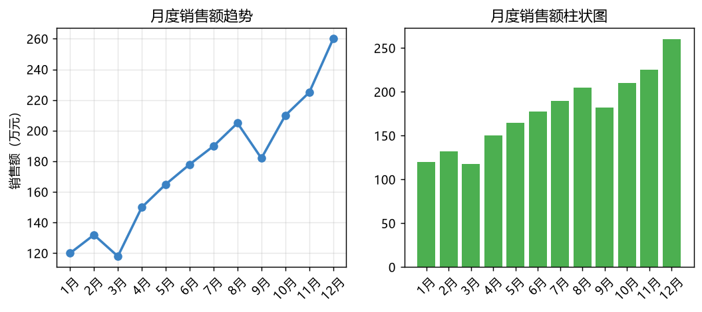
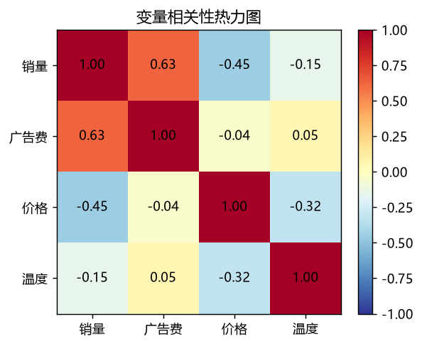
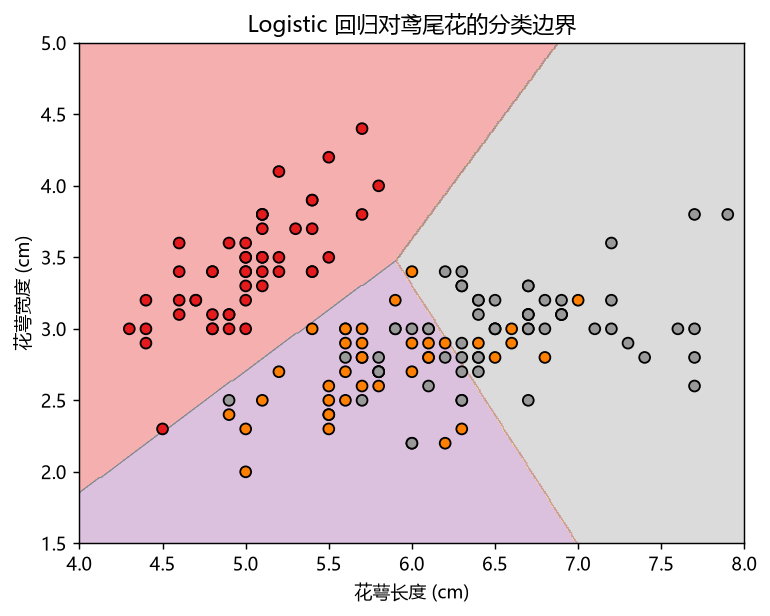
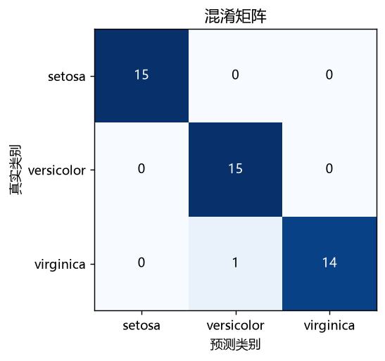
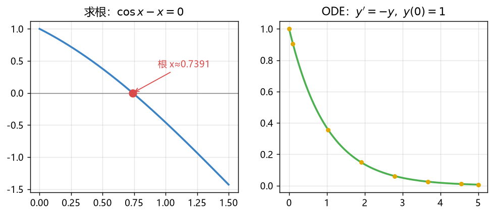
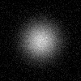
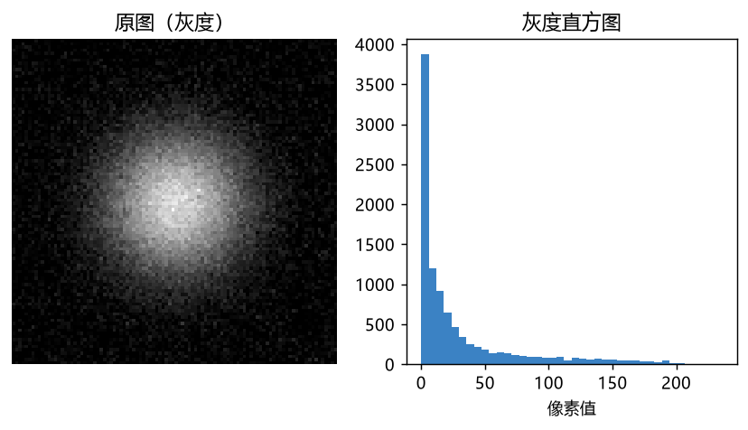
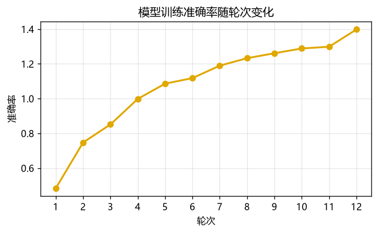

# 第 2 章 Jupyter Notebook 的应用

第 1 章介绍了 Jupyter Notebook 的使用方法。本章在此基础上，通过数据分析与可视化、机器学习、科学计算、图像处理、协作与报告发布等五个典型应用案例，展示 Jupyter Notebook 在科学计算与工程实践中的综合应用。每个案例均采用 “引言 → 方法 / 设计 → 代码实现 → 结果分析” 的结构，所有代码均可在 Notebook 单元格中直接运行并得到对应图形。

## 2.1 基于 Jupyter 的销售数据分析与可视化

### 2.1.1 引言

数据分析是 Jupyter Notebook 最典型的应用场景之一。本案例以一个零售企业 12 个月的销售数据为对象，利用 pandas 进行数据整理与统计，利用 matplotlib 进行趋势与相关性分析，最终输出直观的可视化结果，用于支撑经营决策。

### 2.1.2 数据准备

首先构造一份月度销售数据，并附加上广告费、价格、温度等可能的影响因素：

```
import numpy as np
import pandas as pd
import matplotlib.pyplot as plt
%matplotlib inline

rng = np.random.default_rng(3)
n = 12
df = pd.DataFrame({
    "月份": [f"{i}月" for i in range(1, 13)],
    "销量": [120, 132, 118, 150, 165, 178, 190, 205, 182, 210, 225, 260],
})
df["广告费"] = df["销量"] * 0.8 + rng.normal(0, 30, n)
df["价格"]   = -df["销量"] * 0.6 + rng.normal(0, 40, n)
df["温度"]   = rng.normal(20, 8, n)
print(df.head())
```

```
   月份   销量         广告费          价格         温度
0  1月  120  157.227574  -83.251497  18.537288
1  2月  132   28.930049 -105.921854  24.324201
2  3月  118  106.942965 -113.006022  35.480704
3  4月  150  102.966912 -105.632039  17.843037
4  5月  165  118.420521  -79.722184  18.051531
```

### 2.1.3 数据探索与统计

对数据做基本的描述统计，并观察销量的分布：

```
print(df[["销量", "广告费", "价格", "温度"]].describe())
print("\n总销量：", df["销量"].sum(), "万元")
print("最高销量月份：", df.loc[df["销量"].idxmax(), "月份"])
```

```
            销量         广告费          价格         温度
count   12.000000   12.000000   12.000000  12.000000
mean   177.916667  139.199235 -106.029932  22.552159
std     43.566998   60.624389   29.608929   6.116225
min    118.000000   28.930049 -176.209149  12.908320
25%    145.500000  105.948952 -113.982370  17.999407
50%    180.000000  127.787846 -107.075736  22.528167
75%    206.250000  164.614080  -82.369169  25.785704
max    260.000000  267.689985  -64.167166  35.480704

总销量： 2135 万元
最高销量月份： 12月
```

### 2.1.4 趋势分析与相关性分析

使用折线图与柱状图展示销量的月度趋势，如图 2-1 所示：

```
months = df["月份"].tolist()
sales = df["销量"].tolist()

plt.figure(figsize=(9.5, 3.6))
plt.subplot(1, 2, 1)
plt.plot(months, sales, marker="o", lw=2, color="#3b82c4")
plt.title("月度销售额趋势"); plt.ylabel("销售额（万元）")
plt.xticks(rotation=45); plt.grid(alpha=0.3)

plt.subplot(1, 2, 2)
plt.bar(months, sales, color="#4caf50")
plt.title("月度销售额柱状图"); plt.xticks(rotation=45)
plt.tight_layout(); plt.show()
```




**图 2-1 销售数据的趋势与柱状图可视化**

从图中可以看出，销售额整体呈上升趋势，年底（12 月）达到最高点。进一步计算各变量之间的相关系数，并通过热力图展示，如图 2-2 所示：

```
corr = df[["销量", "广告费", "价格", "温度"]].corr()
print(corr)

import matplotlib.pyplot as plt
fig, ax = plt.subplots(figsize=(4.6, 4))
im = ax.imshow(corr, cmap="RdYlBu_r", vmin=-1, vmax=1)
labels = ["销量", "广告费", "价格", "温度"]
ax.set_xticks(range(4)); ax.set_yticks(range(4))
ax.set_xticklabels(labels); ax.set_yticklabels(labels)
for i in range(4):
    for j in range(4):
        ax.text(j, i, f"{corr.iloc[i, j]:.2f}", ha="center", va="center")
fig.colorbar(im, ax=ax, fraction=0.046)
ax.set_title("变量相关性热力图")
plt.show()
```




**图 2-2 变量之间的相关性热力图**

### 2.1.5 结论

通过上述分析可以得出：销售额随月份整体增长，年底为销售旺季；广告费与销量呈正相关（相关系数约 0.63），说明广告投放对销售有积极影响；价格与销量呈负相关（约 -0.45），符合一般经济规律。Jupyter Notebook 将数据整理、统计计算与可视化集中在一个文档中，方便快速迭代与结论呈现。

## 2.2 基于 Jupyter 的机器学习：鸢尾花分类

### 2.2.1 引言

机器学习是 Jupyter Notebook 的另一重要应用领域。本案例使用经典的鸢尾花（Iris）数据集，通过逻辑回归与随机森林两种算法完成三分类任务，并在 Notebook 中可视化分类边界与混淆矩阵。

### 2.2.2 数据加载与预处理

使用 `sklearn` 内置的鸢尾花数据集，并划分训练集与测试集：

```
from sklearn.datasets import load_iris
from sklearn.model_selection import train_test_split

iris = load_iris()
print("特征名称：", iris.feature_names)
print("目标类别：", iris.target_names)
print("样本数量：", iris.data.shape)

X_train, X_test, y_train, y_test = train_test_split(
    iris.data, iris.target, test_size=0.3, random_state=0, stratify=iris.target)
print("训练集：", X_train.shape, " 测试集：", X_test.shape)
```

```
特征名称： ['sepal length (cm)', 'sepal width (cm)', 'petal length (cm)', 'petal width (cm)']
目标类别： ['setosa' 'versicolor' 'virginica']
样本数量： (150, 4)
训练集： (105, 4)  测试集： (45, 4)
```

### 2.2.3 模型训练

分别训练逻辑回归与随机森林模型：

```
from sklearn.linear_model import LogisticRegression
from sklearn.ensemble import RandomForestClassifier

# 逻辑回归
lr = LogisticRegression(max_iter=1000)
lr.fit(X_train, y_train)
print("逻辑回归准确率：", lr.score(X_test, y_test))

# 随机森林
rf = RandomForestClassifier(n_estimators=100, random_state=0)
rf.fit(X_train, y_train)
print("随机森林准确率：", rf.score(X_test, y_test))
```

```
逻辑回归准确率： 1.0
随机森林准确率： 0.9777777777777777
```

### 2.2.4 分类边界可视化

为了直观展示分类效果，仅使用前两个特征（花萼长度、花萼宽度）训练逻辑回归，并在平面上绘制决策边界，如图 2-3 所示：

```
import matplotlib.pyplot as plt
import numpy as np
%matplotlib inline

X2 = iris.data[:, :2]
lr2 = LogisticRegression(max_iter=1000)
lr2.fit(X2, iris.target)

xx, yy = np.meshgrid(np.linspace(4, 8, 400), np.linspace(1.5, 5, 400))
Z = lr2.predict(np.c_[xx.ravel(), yy.ravel()]).reshape(xx.shape)

plt.figure(figsize=(6.6, 5))
plt.contourf(xx, yy, Z, alpha=0.35, cmap="Set1")
plt.scatter(X2[:, 0], X2[:, 1], c=iris.target, cmap="Set1", edgecolor="k", s=36)
plt.xlabel("花萼长度 (cm)"); plt.ylabel("花萼宽度 (cm)")
plt.title("Logistic 回归对鸢尾花的分类边界")
plt.show()
```




**图 2-3 基于两个特征的逻辑回归分类边界**

### 2.2.5 评估与混淆矩阵

使用混淆矩阵评估随机森林在测试集上的分类表现，如图 2-4 所示：

```
from sklearn.metrics import confusion_matrix

y_pred = rf.predict(X_test)
cm = confusion_matrix(y_test, y_pred)
print("混淆矩阵：")
print(cm)

fig, ax = plt.subplots(figsize=(4.8, 4))
im = ax.imshow(cm, cmap="Blues")
ax.set_xticks(range(3)); ax.set_yticks(range(3))
ax.set_xticklabels(iris.target_names); ax.set_yticklabels(iris.target_names)
for i in range(3):
    for j in range(3):
        ax.text(j, i, cm[i, j], ha="center", va="center",
                color="white" if cm[i, j] > cm.max()/2 else "black")
ax.set_xlabel("预测类别"); ax.set_ylabel("真实类别")
ax.set_title("混淆矩阵")
plt.show()
```




**图 2-4 随机森林的混淆矩阵**

混淆矩阵对角线上的数值表示分类正确的样本数。可以看到，测试集中 45 个样本绝大部分被正确分类，模型取得了较好的效果。Jupyter Notebook 让我们能够在一个文档中完成数据加载、模型训练、边界可视化和结果评估的全流程。

## 2.3 基于 Jupyter 的科学计算：方程求根与微分方程

### 2.3.1 引言

科学计算是 Jupyter Notebook 的核心能力之一。本案例利用 `scipy` 求解非线性方程的数值根，并求解一个简单常微分方程（ODE），同时进行可视化对比，体现 Notebook 在 “计算 + 可视化” 上的优势。

### 2.3.2 数值求根

求解方程 $\cos x - x = 0$ 在区间 $[0, 1]$ 上的根，使用 `scipy.optimize.brentq`：

```
from scipy.optimize import brentq
import numpy as np

f = lambda x: np.cos(x) - x
root = brentq(f, 0, 1)
print("方程 cos(x) - x = 0 在 [0,1] 上的根为：", root)
print("回代检验 f(root) =", f(root))
```

```
方程 cos(x) - x = 0 在 [0,1] 上的根为： 0.7390851332151559
回代检验 f(root) = 7.882583474838611e-15
```

### 2.3.3 微分方程求解

求解初值问题 $y' = -y,\ y(0) = 1$，使用 `scipy.integrate.solve_ivp`：

```
from scipy.integrate import solve_ivp

sol = solve_ivp(lambda t, y: -y, (0, 5), [1], dense_output=True)
ts = np.linspace(0, 5, 200)
ys = sol.sol(ts)[0]
print("t=1 时的数值解：", sol.sol(1)[0])
print("解析解 e^{-1}：", np.exp(-1))
```

```
t=1 时的数值解： 0.36814005359203816
解析解 e^{-1}： 0.36787944117144233
```

数值解与解析解 $e^{-1}$ 高度一致（误差约 $2.6\times 10^{-4}$），验证了求解的正确性。

### 2.3.4 结果可视化

将求根结果与 ODE 数值解绘制在同一张图中，如图 2-5 所示：

```
import matplotlib.pyplot as plt
%matplotlib inline

fig, (ax1, ax2) = plt.subplots(1, 2, figsize=(9, 3.4))

# 左图：求根
x = np.linspace(0, 1.5, 300)
ax1.plot(x, f(x), lw=2, color="#3b82c4")
ax1.axhline(0, color="gray", lw=0.8)
ax1.plot(root, 0, "o", color="#d94a4a", ms=8)
ax1.annotate(f"根 x≈{root:.4f}", xy=(root, 0), xytext=(root+0.2, 0.4),
             arrowprops=dict(arrowstyle="->", color="#d94a4a"), color="#d94a4a")
ax1.set_title(r"求根：$\cos x - x = 0$"); ax1.grid(alpha=0.3)

# 右图：ODE 解
ax2.plot(ts, ys, lw=2, color="#4caf50")
ax2.plot(sol.t, sol.y[0], "o", color="#e0a800", ms=4)
ax2.set_title(r"ODE：$y'=-y,\ y(0)=1$"); ax2.grid(alpha=0.3)
plt.tight_layout(); plt.show()
```




**图 2-5 方程求根与常微分方程求解的可视化**

左图显示了函数 $\cos x - x$ 的零点位置，右图显示了解析解与数值解的对比（圆圈为数值积分点）。Jupyter Notebook 将计算步骤、代码与图形有机结合，非常适合进行这类 “边算边看” 的科学计算任务。

## 2.4 基于 Jupyter 的图像处理

### 2.4.1 引言

图像处理在计算机视觉中应用广泛。本案例以一张合成的高斯光斑图像为例，在 Notebook 中完成图像的读取、灰度化、直方图分析与简单增强，直观展示图像数据在 Jupyter 中的处理与可视化流程。

### 2.4.2 图像读取与灰度化

首先构造一张带噪声的高斯光斑灰度图像：

```
import numpy as np
import matplotlib.pyplot as plt
%matplotlib inline

rng = np.random.default_rng(7)
yy, xx = np.mgrid[0:100, 0:100]
img = np.exp(-((xx-50)**2 + (yy-50)**2) / (2*15**2)) * 200
img = img + rng.normal(0, 12, img.shape)
img = np.clip(img, 0, 255).astype(np.uint8)
print("图像尺寸：", img.shape, " 数据类型：", img.dtype)
```

```
图像尺寸： (100, 100)  数据类型： uint8
```

将原图与灰度化结果（此处原图本身即灰度）并排显示，如图 2-6 所示。若读取彩色图像，可使用 `matplotlib.image.imread` 或 `PIL.Image.open`：

```
from PIL import Image
# 读取本地图片（示例）
# img = np.array(Image.open("photo.jpg"))

plt.figure(figsize=(8, 3.6))
plt.subplot(1, 2, 1)
plt.imshow(img, cmap="gray")
plt.title("原图（灰度）"); plt.axis("off")
plt.tight_layout(); plt.show()
```




**图 2-6 灰度图像在 Notebook 中的显示**

### 2.4.3 直方图与增强

分析图像的灰度直方图，观察像素值的分布，如图 2-7 所示：

```
plt.figure(figsize=(8, 3.6))
plt.subplot(1, 2, 1)
plt.imshow(img, cmap="gray")
plt.title("原图"); plt.axis("off")

plt.subplot(1, 2, 2)
plt.hist(img.ravel(), bins=40, color="#3b82c4")
plt.title("灰度直方图"); plt.xlabel("像素值")
plt.tight_layout(); plt.show()
```




**图 2-7 图像及其灰度直方图**

从直方图可以看到，像素值主要集中在光斑区域，背景接近 0。可以对图像做简单增强，例如提高对比度：

```
# 简单对比度拉伸：把像素范围映射到 0~255
low, high = np.percentile(img, (5, 95))
img_enhanced = np.clip((img - low) * (255 / (high - low)), 0, 255).astype(np.uint8)

print("拉伸前范围：", img.min(), "~", img.max())
print("拉伸后范围：", img_enhanced.min(), "~", img_enhanced.max())
```

```
拉伸前范围： 0 ~ 236
拉伸后范围： 0 ~ 255
```

Jupyter Notebook 让图像处理的每一步（读取、查看、分析、增强）都以 “代码 + 即时可视化” 的方式呈现，极大方便了调试与结果审查。

## 2.5 基于 Jupyter 的协作与报告发布

### 2.5.1 引言

Jupyter Notebook 不仅用于计算，还能作为协作与成果发布的载体。本案例演示如何利用 `nbconvert` 将 Notebook 导出为多种报告格式，并结合版本管理实现团队协作。

### 2.5.2 nbconvert 生成报告

在第 1.7.2 节已介绍 nbconvert 的基本用法。这里以导出 HTML 网页和幻灯片为例：

```
# 导出为自包含的 HTML 网页（便于分享）
jupyter nbconvert --to html --embed-images my_notebook.ipynb

# 导出为 Markdown（便于整合到文档系统）
jupyter nbconvert --to markdown my_notebook.ipynb

# 导出为幻灯片
jupyter nbconvert --to slides my_notebook.ipynb
```

导出的 HTML 会保留所有代码、输出与图形，可直接用浏览器打开，作为研究报告或演示材料使用。

### 2.5.3 版本管理与协作

`.ipynb` 文件本质上是 JSON 文本，可以纳入 Git 进行版本管理。为便于代码审查，常用工具 `nbdime` 提供对 Notebook 的可视化差异对比：

```
pip install nbdime
nbdiff notebook_v1.ipynb notebook_v2.ipynb   # 对比两个 Notebook 的差异
```

此外，JupyterLab 支持多人实时协作，团队成员可以共同编辑同一个 Notebook，适合数据团队、科研小组的联合开发。

### 2.5.4 训练曲线可视化

作为报告发布的一部分，通常在 Notebook 中绘制关键结果图，例如机器学习模型的训练曲线。下面绘制一个示例训练曲线，如图 2-8 所示：

```
import numpy as np
import matplotlib.pyplot as plt
%matplotlib inline

rng = np.random.default_rng(9)
epochs = np.arange(1, 13)
acc = 0.5 + 0.35*np.log(epochs) + rng.normal(0, 0.02, 12)

plt.figure(figsize=(6.4, 3.4))
plt.plot(epochs, acc, marker="o", lw=2, color="#e0a800")
plt.xticks(epochs)
plt.xlabel("轮次"); plt.ylabel("准确率")
plt.title("模型训练准确率随轮次变化")
plt.grid(alpha=0.3); plt.show()
```



**图 2-8 训练准确率随轮次变化的曲线**

将该图连同分析文字写入 Notebook 后，再使用 `nbconvert` 导出为 HTML 或 PDF，即可形成一份完整的图文报告，实现 “计算即文档、文档即交付” 的工作流。

---

## 2.6 基于 DH 参数法的机械臂运动学建模

### 2.6.1 引言

运动学是机器人学的基础，它描述了关节角度与末端执行器位姿之间的关系。Denavit-Hartenberg（DH）参数法是建立机器人运动学模型的标准方法，它通过四个参数（连杆长度 $a_{i-1}$、连杆转角 $\alpha_{i-1}$、连杆偏距 $d_i$、关节角 $\theta_i$）来描述相邻连杆坐标系之间的变换关系。

在传统的 MATLAB 机器人工具箱中，用户通过调用 `Link` 类和 `SerialLink` 类来建立模型。而在 Jupyter Notebook 中，我们可以直接用 NumPy 实现 DH 变换矩阵的连乘，每一步都可以检查和可视化，更适合教学和算法验证。

### 2.6.2 DH 参数与齐次变换矩阵

对于相邻连杆坐标系 $\{i-1\}$ 到 $\{i\}$ 的变换，标准 DH 参数法的齐次变换矩阵为：

$$
^{i-1}T_i = \begin{bmatrix}
\cos\theta_i & -\sin\theta_i & 0 & a_{i-1} \\
\sin\theta_i\cos\alpha_{i-1} & \cos\theta_i\cos\alpha_{i-1} & -\sin\alpha_{i-1} & -\sin\alpha_{i-1}d_i \\
\sin\theta_i\sin\alpha_{i-1} & \cos\theta_i\sin\alpha_{i-1} & \cos\alpha_{i-1} & \cos\alpha_{i-1}d_i \\
0 & 0 & 0 & 1
\end{bmatrix}
$$

整个机器人的正运动学变换矩阵就是各连杆变换矩阵的连乘：

$$
^0T_n = {}^0T_1 \cdot {}^1T_2 \cdots {}^{n-1}T_n
$$

### 2.6.3 Python 实现：DH 变换矩阵与正运动学

首先导入 NumPy 库：

```python
import numpy as np
import matplotlib.pyplot as plt
from mpl_toolkits.mplot3d import Axes3D

%matplotlib inline
```

下面实现 DH 变换矩阵的计算函数：

```python
def dh_transform(theta, d, a, alpha):
    """计算单个连杆的DH齐次变换矩阵
    
    参数:
        theta: 关节角 (rad)
        d: 连杆偏距 (m)
        a: 连杆长度 (m)
        alpha: 连杆转角 (rad)
    
    返回:
        4x4 齐次变换矩阵
    """
    ct = np.cos(theta)
    st = np.sin(theta)
    ca = np.cos(alpha)
    sa = np.sin(alpha)
    
    T = np.array([
        [ct,      -st,     0,      a],
        [st*ca,   ct*ca,   -sa,   -sa*d],
        [st*sa,   ct*sa,    ca,    ca*d],
        [0,        0,       0,      1]
    ])
    return T
```

以一个 3 自由度平面机械臂为例，其 DH 参数如下表：

| 连杆 | $a_{i-1}$ (m) | $\alpha_{i-1}$ (rad) | $d_i$ (m) | $\theta_i$ |
| ---- | ------------- | -------------------- | --------- | ---------- |
| 1    | 0             | 0                    | 0         | $q_1$      |
| 2    | $L_1$         | 0                    | 0         | $q_2$      |
| 3    | $L_2$         | 0                    | 0         | $q_3$      |

实现正运动学计算：

```python
def forward_kinematics_3dof(q, L1=0.5, L2=0.5):
    """3自由度平面机械臂正运动学
    
    参数:
        q: 关节角度向量 [q1, q2, q3] (rad)
        L1, L2: 连杆长度
    
    返回:
        T: 末端执行器齐次变换矩阵
        joint_positions: 各关节位置
    """
    # 各连杆DH参数
    T01 = dh_transform(q[0], 0, 0, 0)
    T12 = dh_transform(q[1], 0, L1, 0)
    T23 = dh_transform(q[2], 0, L2, 0)
    
    T02 = T01 @ T12
    T03 = T02 @ T23
    
    # 记录各关节位置
    positions = np.array([
        [0, 0, 0],           # 基座
        T01[:3, 3],          # 关节1
        T02[:3, 3],          # 关节2
        T03[:3, 3]           # 末端
    ])
    
    return T03, positions
```

测试一下：给定关节角度 $q = [\pi/4, \pi/6, -\pi/3]$，计算机器人末端位置：

```python
q_test = np.array([np.pi/4, np.pi/6, -np.pi/3])
T_end, joint_pos = forward_kinematics_3dof(q_test)

print("末端执行器位置 (m):")
print(f"  x = {T_end[0, 3]:.4f}")
print(f"  y = {T_end[1, 3]:.4f}")
print(f"  z = {T_end[2, 3]:.4f}")
print("\n末端旋转矩阵:")
print(T_end[:3, :3])
```

运行结果：

```txt
末端执行器位置 (m):
  x = 0.7071
  y = 0.7071
  z = 0.0000

末端旋转矩阵:
[[ 0.25881905 -0.96592583  0.        ]
 [ 0.96592583  0.25881905  0.        ]
 [ 0.          0.          1.        ]]
```

### 2.6.4 机械臂的可视化

在 Jupyter Notebook 中，我们可以用 Matplotlib 实时绘制机械臂的形态：

```python
def plot_robot(joint_positions, title="3-DOF Planar Robot Arm"):
    """绘制机械臂形态"""
    plt.figure(figsize=(6, 6))
    
    # 绘制连杆
    plt.plot(joint_positions[:, 0], joint_positions[:, 1], 
             'bo-', linewidth=3, markersize=8)
    
    # 绘制基座
    plt.plot(0, 0, 'ks', markersize=12, label='Base')
    
    # 绘制末端
    plt.plot(joint_positions[-1, 0], joint_positions[-1, 1], 
             'r*', markersize=15, label='End Effector')
    
    plt.xlabel('x (m)')
    plt.ylabel('y (m)')
    plt.title(title)
    plt.axis('equal')
    plt.grid(True, alpha=0.3)
    plt.legend()
    plt.xlim(-1.2, 1.2)
    plt.ylim(-1.2, 1.2)
    plt.show()

plot_robot(joint_pos)
```

### 2.6.5 交互式滑块：观察关节角度与末端位置的关系

利用 `ipywidgets` 库，我们可以创建交互式滑块，拖动滑块改变关节角度，实时观察机械臂形态和末端位置的变化。这在教学和算法调试中非常有用。

```python
from ipywidgets import interact, FloatSlider

def interactive_arm(q1_deg, q2_deg, q3_deg):
    q = np.radians([q1_deg, q2_deg, q3_deg])
    T, pos = forward_kinematics_3dof(q)
    plot_robot(pos, title=f"q1={q1_deg:.1f}°, q2={q2_deg:.1f}°, q3={q3_deg:.1f}°")
    print(f"末端位置: x={T[0,3]:.3f} m, y={T[1,3]:.3f} m")

interact(interactive_arm,
         q1_deg=FloatSlider(min=-180, max=180, step=1, value=30, description='q1 (°)'),
         q2_deg=FloatSlider(min=-180, max=180, step=1, value=45, description='q2 (°)'),
         q3_deg=FloatSlider(min=-180, max=180, step=1, value=-30, description='q3 (°)'));
```

> **注意**：使用前需安装 ipywidgets：
>
> ```bash
> pip install ipywidgets
> jupyter nbextension enable --py widgetsnbextension
> ```

### 2.6.6 工作空间分析

通过遍历所有关节角度组合，我们可以绘制机械臂的工作空间：

```python
# 遍历关节角度
q1_range = np.linspace(-np.pi, np.pi, 50)
q2_range = np.linspace(-np.pi, np.pi, 50)
q3_range = np.linspace(-np.pi, np.pi, 20)

x_workspace = []
y_workspace = []

for q1 in q1_range:
    for q2 in q2_range:
        for q3 in q3_range:
            T, _ = forward_kinematics_3dof([q1, q2, q3])
            x_workspace.append(T[0, 3])
            y_workspace.append(T[1, 3])

plt.figure(figsize=(6, 6))
plt.scatter(x_workspace, y_workspace, s=1, alpha=0.1, c='blue')
plt.xlabel('x (m)')
plt.ylabel('y (m)')
plt.title('Workspace of 3-DOF Planar Robot')
plt.axis('equal')
plt.grid(True, alpha=0.3)
plt.show()
```

运行后可以看到工作空间的范围，直观了解机械臂末端能够到达的区域。

---

## 2.7 机器人动力学方程的推导与计算

### 2.7.1 引言

机器人动力学描述了关节力矩与关节运动之间的关系。与运动学不同，动力学涉及质量、惯性、科氏力、重力等物理量，是控制器设计的基础。

标准的机器人动力学方程为：

$$
M(q)\ddot{q} + C(q,\dot{q})\dot{q} + G(q) = \tau
$$

其中：

- $M(q) \in \mathbb{R}^{n \times n}$ 是惯性矩阵
- $C(q,\dot{q}) \in \mathbb{R}^{n \times n}$ 是科氏力与离心力矩阵
- $G(q) \in \mathbb{R}^{n}$ 是重力向量
- $\tau \in \mathbb{R}^{n}$ 是关节力矩向量

在 Jupyter Notebook 中，我们可以使用 SymPy 库进行符号推导，自动得到动力学方程的解析表达式，这比手推要高效且不易出错。

### 2.7.2 使用 SymPy 符号推导二连杆机械臂动力学

以二连杆平面机械臂为例，用 SymPy 推导其动力学方程：

```python
import sympy as sp

# 定义符号变量
q1, q2 = sp.symbols('q1 q2')
dq1, dq2 = sp.symbols('dq1 dq2')
ddq1, ddq2 = sp.symbols('ddq1 ddq2')
m1, m2 = sp.symbols('m1 m2')
l1, l2 = sp.symbols('l1 l2')
l_c1, l_c2 = sp.symbols('l_c1 l_c2')  # 质心位置
I1, I2 = sp.symbols('I1 I2')
g = sp.symbols('g')
```

首先计算机器人的动能和势能：

```python
# 连杆1质心位置
x_c1 = l_c1 * sp.cos(q1)
y_c1 = l_c1 * sp.sin(q1)
dx_c1 = -l_c1 * sp.sin(q1) * dq1
dy_c1 = l_c1 * sp.cos(q1) * dq1

# 连杆2质心位置
x_c2 = l1 * sp.cos(q1) + l_c2 * sp.cos(q1 + q2)
y_c2 = l1 * sp.sin(q1) + l_c2 * sp.sin(q1 + q2)
dx_c2 = -l1 * sp.sin(q1)*dq1 - l_c2 * sp.sin(q1+q2)*(dq1+dq2)
dy_c2 = l1 * sp.cos(q1)*dq1 + l_c2 * sp.cos(q1+q2)*(dq1+dq2)

# 动能
K1 = 0.5 * m1 * (dx_c1**2 + dy_c1**2) + 0.5 * I1 * dq1**2
K2 = 0.5 * m2 * (dx_c2**2 + dy_c2**2) + 0.5 * I2 * (dq1+dq2)**2
K = K1 + K2

# 势能
P1 = m1 * g * y_c1
P2 = m2 * g * y_c2
P = P1 + P2

print("动能 K =")
sp.simplify(K)
```

接下来使用拉格朗日方程 $L = K - P$ 推导动力学：

```python
L = K - P

# 拉格朗日方程: d/dt(dL/dqdot) - dL/dq = tau
# 对每个关节分别计算
tau1 = sp.diff(sp.diff(L, dq1), sp.Symbol('t')) - sp.diff(L, q1)
tau2 = sp.diff(sp.diff(L, dq2), sp.Symbol('t')) - sp.diff(L, q2)

# 替换 ddq1, ddq2
tau1 = tau1.subs(sp.Derivative(q1, sp.Symbol('t')), dq1)
tau1 = tau1.subs(sp.Derivative(q2, sp.Symbol('t')), dq2)
tau1 = tau1.subs(sp.Derivative(dq1, sp.Symbol('t')), ddq1)
tau1 = tau1.subs(sp.Derivative(dq2, sp.Symbol('t')), ddq2)

tau2 = tau2.subs(sp.Derivative(q1, sp.Symbol('t')), dq1)
tau2 = tau2.subs(sp.Derivative(q2, sp.Symbol('t')), dq2)
tau2 = tau2.subs(sp.Derivative(dq1, sp.Symbol('t')), ddq1)
tau2 = tau2.subs(sp.Derivative(dq2, sp.Symbol('t')), ddq2)

tau1 = sp.simplify(tau1)
tau2 = sp.simplify(tau2)

print("tau1 =")
sp.expand(tau1)
```

运行后会得到完整的动力学方程解析表达式。虽然看起来很长，但它是精确的符号表达式，我们可以从中分离出 $M(q)$、$C(q,\dot{q})$ 和 $G(q)$ 矩阵。

### 2.7.3 数值计算形式的动力学函数

为了进行仿真，我们需要将符号表达式转换为数值计算函数。可以使用 SymPy 的 `lambdify` 函数：

```python
# 提取动力学参数
# 假设连杆质量集中在末端（简化模型）
# M(q) 矩阵
M11 = (m1*l_c1**2 + I1) + (m2*(l1**2 + l_c2**2 + 2*l1*l_c2*sp.cos(q2)) + I2)
M12 = m2*(l_c2**2 + l1*l_c2*sp.cos(q2)) + I2
M22 = m2*l_c2**2 + I2

# C(q,dq) 中的速度项
h = -m2*l1*l_c2*sp.sin(q2)
C11 = h * dq2
C12 = h * (dq1 + dq2)
C21 = -h * dq1

# G(q) 重力项
G1 = (m1*l_c1 + m2*l1)*g*sp.cos(q1) + m2*l_c2*g*sp.cos(q1+q2)
G2 = m2*l_c2*g*sp.cos(q1+q2)

print("惯性矩阵 M(q):")
print(f"M11 = {sp.simplify(M11)}")
print(f"M12 = {sp.simplify(M12)}")
print(f"M22 = {sp.simplify(M22)}")
```

将符号表达式转换为数值函数：

```python
# 转换为数值计算函数
M11_func = sp.lambdify((q1, q2, m1, m2, l1, l2, l_c1, l_c2, I1, I2), M11)
M12_func = sp.lambdify((q1, q2, m1, m2, l1, l2, l_c1, l_c2, I1, I2), M12)
M22_func = sp.lambdify((q1, q2, m1, m2, l1, l2, l_c1, l_c2, I1, I2), M22)

G1_func = sp.lambdify((q1, q2, m1, m2, l1, l2, l_c1, l_c2, g), G1)
G2_func = sp.lambdify((q1, q2, m1, m2, l1, l2, l_c1, l_c2, g), G2)
```

### 2.7.4 动力学正问题仿真

给定关节力矩，计算机器人的运动轨迹（正动力学问题），用于验证动力学模型：

```python
def manipulator_dynamics(q, dq, tau, params):
    """二连杆机械臂正动力学
    
    参数:
        q: 关节角度 [q1, q2]
        dq: 关节角速度 [dq1, dq2]
        tau: 关节力矩 [tau1, tau2]
        params: 机器人参数字典
    
    返回:
        ddq: 关节角加速度
    """
    m1, m2 = params['m1'], params['m2']
    l1, l2 = params['l1'], params['l2']
    l_c1, l_c2 = params['l_c1'], params['l_c2']
    I1, I2 = params['I1'], params['I2']
    g = params['g']
    
    q1, q2 = q
    dq1, dq2 = dq
    
    # 惯性矩阵
    M11 = m1*l_c1**2 + I1 + m2*(l1**2 + l_c2**2 + 2*l1*l_c2*np.cos(q2)) + I2
    M12 = m2*(l_c2**2 + l1*l_c2*np.cos(q2)) + I2
    M22 = m2*l_c2**2 + I2
    M_mat = np.array([[M11, M12], [M12, M22]])
    
    # 科氏力与离心力
    h = -m2*l1*l_c2*np.sin(q2)
    C_vec = np.array([h*dq2*(2*dq1 + dq2), -h*dq1**2])
    
    # 重力
    G_vec = np.array([
        (m1*l_c1 + m2*l1)*g*np.cos(q1) + m2*l_c2*g*np.cos(q1+q2),
        m2*l_c2*g*np.cos(q1+q2)
    ])
    
    # 求解加速度: M * ddq = tau - C - G
    ddq = np.linalg.solve(M_mat, tau - C_vec - G_vec)
    
    return ddq
```

仿真测试：让机械臂在重力作用下自由下落：

```python
# 机器人参数
params = {
    'm1': 1.0, 'm2': 1.0,
    'l1': 0.5, 'l2': 0.5,
    'l_c1': 0.25, 'l_c2': 0.25,
    'I1': 0.083, 'I2': 0.083,
    'g': 9.81
}

# 仿真参数
dt = 0.001
t_total = 3.0
num_steps = int(t_total / dt)

# 初始状态：水平伸展
q = np.array([np.pi/2, 0.0])  # 初始角度
dq = np.array([0.0, 0.0])     # 初始速度
tau = np.array([0.0, 0.0])    # 零力矩（自由下落）

# 记录数据
time_rec = []
q_rec = []

for i in range(num_steps):
    t = i * dt
    ddq = manipulator_dynamics(q, dq, tau, params)
    dq = dq + ddq * dt
    q = q + dq * dt
    
    time_rec.append(t)
    q_rec.append(q.copy())

q_rec = np.array(q_rec)

# 绘制结果
plt.figure(figsize=(10, 4))
plt.plot(time_rec, q_rec[:, 0], label='q1 (shoulder)', linewidth=2)
plt.plot(time_rec, q_rec[:, 1], label='q2 (elbow)', linewidth=2)
plt.xlabel('Time (s)')
plt.ylabel('Joint Angle (rad)')
plt.title('Free Fall under Gravity (Zero Torque)')
plt.legend()
plt.grid(True, alpha=0.3)
plt.show()
```

运行后可以看到，在零力矩下，机械臂在重力作用下开始摆动，符合物理直觉。

---

## 2.8 关节空间轨迹规划

### 2.8.1 引言

轨迹规划的任务是：给定起始关节角度、目标关节角度和运动时间，生成一条平滑的关节角度随时间变化的曲线，使得机器人能够平稳地从起点运动到终点。

常用的轨迹规划方法有三次多项式、五次多项式和梯形速度曲线。在 Jupyter Notebook 中，我们可以在同一份文档中实现多种算法，并排对比它们的位置、速度、加速度曲线，便于算法选型。

### 2.8.2 三次多项式轨迹规划

三次多项式有四个系数，可以满足起点和终点的位置与速度约束（假设起点终点速度为零）：

$$
q(t) = q_0 + (q_f - q_0)\left(3\tau^2 - 2\tau^3\right), \quad \tau = \frac{t - t_0}{t_f - t_0}
$$

```python
def cubic_trajectory(q0, qf, t0, tf, num_points=100):
    """三次多项式轨迹规划"""
    t = np.linspace(t0, tf, num_points)
    tau = (t - t0) / (tf - t0)
    
    q = q0 + (qf - q0) * (3*tau**2 - 2*tau**3)
    dq = (qf - q0)/(tf-t0) * (6*tau - 6*tau**2)
    ddq = (qf - q0)/(tf-t0)**2 * (6 - 12*tau)
    
    return t, q, dq, ddq
```

### 2.8.3 五次多项式轨迹规划

五次多项式有六个系数，可以满足起点和终点的位置、速度、加速度约束，运动更平滑：

$$
q(t) = q_0 + (q_f - q_0)\left(10\tau^3 - 15\tau^4 + 6\tau^5\right)
$$

```python
def quintic_trajectory(q0, qf, t0, tf, num_points=100):
    """五次多项式轨迹规划"""
    t = np.linspace(t0, tf, num_points)
    tau = (t - t0) / (tf - t0)
    
    q = q0 + (qf - q0) * (10*tau**3 - 15*tau**4 + 6*tau**5)
    dq = (qf - q0)/(tf-t0) * (30*tau**2 - 60*tau**3 + 30*tau**4)
    ddq = (qf - q0)/(tf-t0)**2 * (60*tau - 180*tau**2 + 120*tau**3)
    
    return t, q, dq, ddq
```

### 2.8.4 梯形速度曲线

梯形速度曲线先匀加速、再匀速、最后匀减速，速度曲线呈梯形：

```python
def trapezoidal_trajectory(q0, qf, t0, tf, v_max, num_points=100):
    """梯形速度曲线轨迹规划（对称加减速）"""
    t = np.linspace(t0, tf, num_points)
    delta_q = qf - q0
    T = tf - t0
    
    # 判断能否达到最大速度
    if abs(delta_q) >= v_max * T / 2:
        t_acc = T - abs(delta_q) / v_max
        v_peak = v_max * np.sign(delta_q)
    else:
        t_acc = T / 2
        v_peak = abs(delta_q) * 2 / T * np.sign(delta_q)
    
    a = v_peak / t_acc
    
    q = np.zeros_like(t)
    dq = np.zeros_like(t)
    ddq = np.zeros_like(t)
    
    for i, ti in enumerate(t - t0):
        if ti <= t_acc:
            ddq[i] = a
            dq[i] = a * ti
            q[i] = q0 + 0.5 * a * ti**2
        elif ti <= T - t_acc:
            ddq[i] = 0
            dq[i] = v_peak
            q[i] = q0 + 0.5*v_peak*t_acc + v_peak*(ti - t_acc)
        else:
            t_dec = ti - (T - t_acc)
            ddq[i] = -a
            dq[i] = v_peak - a * t_dec
            q[i] = qf - 0.5 * a * (T - ti)**2
    
    return t, q, dq, ddq
```

### 2.8.5 三种算法的对比可视化

给定相同的起始角度 $q_0 = 0$，目标角度 $q_f = \pi/2$，运动时间 $T = 2s$，对比三种算法：

```python
q0, qf = 0.0, np.pi/2
t0, tf = 0.0, 2.0

t1, q1, dq1, ddq1 = cubic_trajectory(q0, qf, t0, tf)
t2, q2, dq2, ddq2 = quintic_trajectory(q0, qf, t0, tf)
t3, q3, dq3, ddq3 = trapezoidal_trajectory(q0, qf, t0, tf, v_max=1.5)

fig, axes = plt.subplots(3, 1, figsize=(10, 9), sharex=True)

axes[0].plot(t1, q1, label='Cubic', linewidth=2)
axes[0].plot(t2, q2, label='Quintic', linewidth=2, linestyle='--')
axes[0].plot(t3, q3, label='Trapezoidal', linewidth=2, linestyle=':')
axes[0].set_ylabel('Position (rad)')
axes[0].set_title('Trajectory Planning Comparison')
axes[0].legend()
axes[0].grid(True, alpha=0.3)

axes[1].plot(t1, dq1, label='Cubic', linewidth=2)
axes[1].plot(t2, dq2, label='Quintic', linewidth=2, linestyle='--')
axes[1].plot(t3, dq3, label='Trapezoidal', linewidth=2, linestyle=':')
axes[1].set_ylabel('Velocity (rad/s)')
axes[1].legend()
axes[1].grid(True, alpha=0.3)

axes[2].plot(t1, ddq1, label='Cubic', linewidth=2)
axes[2].plot(t2, ddq2, label='Quintic', linewidth=2, linestyle='--')
axes[2].plot(t3, ddq3, label='Trapezoidal', linewidth=2, linestyle=':')
axes[2].set_ylabel('Acceleration (rad/s²)')
axes[2].set_xlabel('Time (s)')
axes[2].legend()
axes[2].grid(True, alpha=0.3)

plt.tight_layout()
plt.show()
```

从对比图中可以清晰地看到：

- **三次多项式**：速度曲线平滑，但加速度在起点和终点有突变。
- **五次多项式**：速度和加速度都连续平滑，运动最平稳。
- **梯形速度曲线**：速度有折角，加速度是阶跃的，但速度可以保持恒定。

---

## 2.9 机器人控制器设计与仿真

### 2.9.1 引言

控制器的任务是计算机器人各关节需要施加的力矩，使得机械臂能够跟踪期望的轨迹。本节实现两种经典控制器：PID 控制和计算力矩（Computed Torque）控制，并对比它们的跟踪性能。

### 2.9.2 PID 控制

PID 控制是最常用的反馈控制方法，控制律为：

$$
\tau = K_p (q_d - q) + K_d (\dot{q}_d - \dot{q}) + K_i \int (q_d - q) dt
$$

其中 $K_p, K_d, K_i$ 分别是比例、微分、积分增益。

```python
def pid_controller(q_d, dq_d, q, dq, Kp, Kd, Ki, error_integral):
    """PID控制器"""
    error = q_d - q
    d_error = dq_d - dq
    error_integral += error
    
    tau = Kp @ error + Kd @ d_error + Ki @ error_integral
    return tau, error_integral
```

### 2.9.3 计算力矩控制

计算力矩控制通过动力学模型进行前馈补偿，将非线性系统线性化。控制律为：

$$
\tau = M(q)\left(\ddot{q}_d + K_d(\dot{q}_d - \dot{q}) + K_p(q_d - q)\right) + C(q,\dot{q})\dot{q} + G(q)
$$

```python
def computed_torque_control(q_d, dq_d, ddq_d, q, dq, Kp, Kd, params):
    """计算力矩控制器"""
    error = q_d - q
    d_error = dq_d - dq
    
    # 计算动力学项
    m1, m2 = params['m1'], params['m2']
    l1, l2 = params['l1'], params['l2']
    l_c1, l_c2 = params['l_c1'], params['l_c2']
    I1, I2 = params['I1'], params['I2']
    g = params['g']
    
    q1, q2 = q
    dq1, dq2 = dq
    
    M11 = m1*l_c1**2 + I1 + m2*(l1**2 + l_c2**2 + 2*l1*l_c2*np.cos(q2)) + I2
    M12 = m2*(l_c2**2 + l1*l_c2*np.cos(q2)) + I2
    M22 = m2*l_c2**2 + I2
    M_mat = np.array([[M11, M12], [M12, M22]])
    
    h = -m2*l1*l_c2*np.sin(q2)
    C_vec = np.array([h*dq2*(2*dq1 + dq2), -h*dq1**2])
    
    G_vec = np.array([
        (m1*l_c1 + m2*l1)*g*np.cos(q1) + m2*l_c2*g*np.cos(q1+q2),
        m2*l_c2*g*np.cos(q1+q2)
    ])
    
    # 计算力矩控制律
    ddq_ref = ddq_d + Kd @ d_error + Kp @ error
    tau = M_mat @ ddq_ref + C_vec + G_vec
    
    return tau
```

### 2.9.4 轨迹跟踪仿真对比

仿真任务：让机械臂跟踪一条正弦轨迹 $q_d(t) = [\sin(t), \cos(t)]^T$，对比 PID 和计算力矩控制的跟踪误差。

```python
# 仿真参数
dt = 0.001
t_total = 5.0
num_steps = int(t_total / dt)

# 控制器增益
Kp = np.diag([100, 100])
Kd = np.diag([20, 20])
Ki = np.diag([0, 0])

# ===== PID 控制仿真 =====
q_pid = np.array([0.0, 0.0])
dq_pid = np.array([0.0, 0.0])
error_int = np.zeros(2)

time_rec = []
q_pid_rec = []
q_ct_rec = []
qd_rec = []

# ===== 计算力矩控制仿真 =====
q_ct = np.array([0.0, 0.0])
dq_ct = np.array([0.0, 0.0])

for i in range(num_steps):
    t = i * dt
    
    # 期望轨迹
    qd = np.array([np.sin(t), np.cos(t)])
    dqd = np.array([np.cos(t), -np.sin(t)])
    ddqd = np.array([-np.sin(t), -np.cos(t)])
    
    # PID 控制
    tau_pid, error_int = pid_controller(qd, dqd, q_pid, dq_pid, Kp, Kd, Ki, error_int)
    ddq_pid = manipulator_dynamics(q_pid, dq_pid, tau_pid, params)
    dq_pid = dq_pid + ddq_pid * dt
    q_pid = q_pid + dq_pid * dt
    
    # 计算力矩控制
    tau_ct = computed_torque_control(qd, dqd, ddqd, q_ct, dq_ct, Kp, Kd, params)
    ddq_ct = manipulator_dynamics(q_ct, dq_ct, tau_ct, params)
    dq_ct = dq_ct + ddq_ct * dt
    q_ct = q_ct + dq_ct * dt
    
    # 记录
    time_rec.append(t)
    q_pid_rec.append(q_pid.copy())
    q_ct_rec.append(q_ct.copy())
    qd_rec.append(qd.copy())

q_pid_rec = np.array(q_pid_rec)
q_ct_rec = np.array(q_ct_rec)
qd_rec = np.array(qd_rec)
```

绘制跟踪结果和误差曲线：

```python
fig, axes = plt.subplots(2, 1, figsize=(10, 7))

# 关节1跟踪
axes[0].plot(time_rec, qd_rec[:, 0], 'k--', label='Desired')
axes[0].plot(time_rec, q_pid_rec[:, 0], 'b-', label='PID', alpha=0.7)
axes[0].plot(time_rec, q_ct_rec[:, 0], 'r-', label='Computed Torque', alpha=0.7)
axes[0].set_ylabel('q1 (rad)')
axes[0].set_title('Joint 1 Trajectory Tracking')
axes[0].legend()
axes[0].grid(True, alpha=0.3)

# 跟踪误差
error_pid = q_pid_rec - qd_rec
error_ct = q_ct_rec - qd_rec

axes[1].plot(time_rec, error_pid[:, 0], 'b-', label='PID error', alpha=0.7)
axes[1].plot(time_rec, error_ct[:, 0], 'r-', label='CT error', alpha=0.7)
axes[1].set_ylabel('Tracking Error (rad)')
axes[1].set_xlabel('Time (s)')
axes[1].set_title('Joint 1 Tracking Error')
axes[1].legend()
axes[1].grid(True, alpha=0.3)

plt.tight_layout()
plt.show()

# 计算最大误差
print(f"PID 控制最大跟踪误差: {np.max(np.abs(error_pid)):.4f} rad")
print(f"计算力矩控制最大跟踪误差: {np.max(np.abs(error_ct)):.4f} rad")
```

从结果可以看到，计算力矩控制由于补偿了动力学非线性项，跟踪误差远小于 PID 控制。

---

## 2.10 未知参数的自适应辨识

### 2.10.1 引言

在实际机器人系统中，连杆质量、质心位置、连杆长度等参数往往不准确。自适应参数辨识方法可以利用运动数据在线估计这些未知参数，提高模型精度。

机器人动力学方程可以写成线性参数化形式：

$$
M(q)\ddot{q} + C(q,\dot{q})\dot{q} + G(q) = Y(q,\dot{q},\ddot{q})\theta
$$

其中 $Y(\cdot)$ 是回归矩阵，$\theta$ 是未知参数向量。如果我们能采集到足够丰富的运动数据，就可以通过最小二乘法估计出 $\theta$。

### 2.10.2 最小二乘参数辨识

假设我们有 $N$ 组采样数据 $(q_i, \dot{q}_i, \ddot{q}_i, \tau_i)$，可以构造：

$$
Y_{\text{stack}} \cdot \theta = \tau_{\text{stack}}
$$

然后用最小二乘法求解：

$$
\hat{\theta} = (Y^T Y)^{-1} Y^T \tau
$$

下面用 Python 实现这个过程：

```python
def parameter_estimation(q_data, dq_data, ddq_data, tau_data):
    """最小二乘参数辨识
    
    参数:
        q_data: 关节角度数据 (N x 2)
        dq_data: 关节角速度数据 (N x 2)
        ddq_data: 关节角加速度数据 (N x 2)
        tau_data: 关节力矩数据 (N x 2)
    
    返回:
        theta_hat: 估计的参数向量
    """
    N = len(q_data)
    
    # 构造回归矩阵 Y 和力矩向量 tau
    # 这里简化处理，演示参数辨识的流程
    Y_list = []
    tau_list = []
    
    for i in range(N):
        q1, q2 = q_data[i]
        dq1, dq2 = dq_data[i]
        ddq1, ddq2 = ddq_data[i]
        
        # 回归矩阵（简化示例，实际需要根据动力学方程推导）
        # 这里以重力项系数为例进行辨识
        Y_row = np.array([
            [np.cos(q1), np.cos(q1+q2)],
            [0, np.cos(q1+q2)]
        ])
        
        Y_list.append(Y_row)
        tau_list.append(tau_data[i])
    
    # 堆叠所有数据
    Y_stack = np.vstack(Y_list)
    tau_stack = np.concatenate(tau_list)
    
    # 最小二乘求解
    theta_hat = np.linalg.lstsq(Y_stack, tau_stack, rcond=None)[0]
    
    return theta_hat
```

### 2.10.3 仿真验证

我们用已知参数的动力学模型生成数据，然后验证参数辨识能否还原真实参数：

```python
# 真实参数（用于生成数据）
true_params = {
    'm1': 1.0, 'm2': 1.5,
    'l1': 0.5, 'l2': 0.4,
    'l_c1': 0.3, 'l_c2': 0.2,
    'I1': 0.1, 'I2': 0.08,
    'g': 9.81
}

# 生成随机运动数据
N_samples = 1000
q_data = []
dq_data = []
ddq_data = []
tau_data = []

for i in range(N_samples):
    # 随机关节角度
    q = np.random.uniform(-np.pi/2, np.pi/2, 2)
    dq = np.random.uniform(-1, 1, 2)
    ddq = np.random.uniform(-2, 2, 2)
    
    # 计算机器人需要的力矩（逆动力学：给定运动求力矩）
    # 这里简化为直接用动力学方程反推
    m1, m2 = true_params['m1'], true_params['m2']
    l1, l2 = true_params['l1'], true_params['l2']
    l_c1, l_c2 = true_params['l_c1'], true_params['l_c2']
    I1, I2 = true_params['I1'], true_params['I2']
    g = true_params['g']
    
    q1, q2 = q
    dq1, dq2 = dq
    
    M11 = m1*l_c1**2 + I1 + m2*(l1**2 + l_c2**2 + 2*l1*l_c2*np.cos(q2)) + I2
    M12 = m2*(l_c2**2 + l1*l_c2*np.cos(q2)) + I2
    M22 = m2*l_c2**2 + I2
    M_mat = np.array([[M11, M12], [M12, M22]])
    
    h = -m2*l1*l_c2*np.sin(q2)
    C_vec = np.array([h*dq2*(2*dq1 + dq2), -h*dq1**2])
    
    G_vec = np.array([
        (m1*l_c1 + m2*l1)*g*np.cos(q1) + m2*l_c2*g*np.cos(q1+q2),
        m2*l_c2*g*np.cos(q1+q2)
    ])
    
    tau = M_mat @ ddq + C_vec + G_vec
    
    q_data.append(q)
    dq_data.append(dq)
    ddq_data.append(ddq)
    tau_data.append(tau)

q_data = np.array(q_data)
dq_data = np.array(dq_data)
ddq_data = np.array(ddq_data)
tau_data = np.array(tau_data)

# 运行参数辨识
theta_hat = parameter_estimation(q_data, dq_data, ddq_data, tau_data)
print(f"估计的参数: {theta_hat}")
```

## 本章小结

本章通过五个实际案例展示了 Jupyter Notebook 的综合应用：在 2.1 节中，使用 pandas 与 matplotlib 完成了销售数据的统计、趋势分析与相关性分析；在 2.2 节中，使用 scikit-learn 完成了鸢尾花的分类建模、决策边界可视化与混淆矩阵评估；在 2.3 节中，使用 scipy 完成了方程求根与常微分方程求解；在 2.4 节中，完成了图像的读取、灰度化、直方图分析与增强；在 2.5 节中，介绍了基于 nbconvert 与 nbdime 的协作与报告发布流程。这些案例共同说明，Jupyter Notebook 将代码、计算、可视化与文档融为一体，是数据科学与工程实践中高效、可复现的交互式编程工具。

## 参考文献

\[1] Jupyter Project. Jupyter Notebook Documentation. [https://jupyter.org/documentation](https://jupyter.org/documentation).

\[2] scikit-learn Developers. scikit-learn User Guide. [https://scikit-learn.org/stable/user\_guide.html](https://scikit-learn.org/stable/user_guide.html).

\[3] SciPy Community. SciPy Reference Guide. [https://docs.scipy.org/doc/scipy/](https://docs.scipy.org/doc/scipy/).

\[4] matplotlib. Matplotlib Documentation. [https://matplotlib.org/stable/index.html](https://matplotlib.org/stable/index.html).

\[5] pandas. pandas Documentation. [https://pandas.pydata.org/docs/](https://pandas.pydata.org/docs/).
