# 第2章 MATLAB 机器人工具箱的应用

## 2.1 基于学习算法的机器人触觉识别算法研究

本节将介绍机器人触觉检测算法的原理、编程与实现。

### 2.1.1 引言

在机器人上面实现触觉功能,使机器人能判别出被测物体的各种性质(如轮廓、硬度),目前最常见的方法是使用专门的触觉传感器。触觉传感器的发展始于20世纪70年代,至今已经研究出多种多样的功能各异形态各异的触觉传感器,如近年来很热门的柔性、阵列触觉传感器,然而这意味着要使机器人有“触觉”,就必须先配置上相应的触觉传感器,这对于现有的大部分机器人来说门槛太高。于是就有了触觉算法的需求。触觉算法一般对机器人的硬件要求不高,传统的机器人都具有测量所受外力的传感器,运用这个与外界物体交互所受的外力。本节内容利用一种通过迭代学习自适应的触觉算法,不断调整更新参考点的位置和输出一个前馈力,并利用加权最小二乘法来估计出物体的边界位置和硬度系数。

机器人本身性质比较复杂,且其系统参数在很多实际情况中具有不确定性或时变性,传统的控制方法都需要对机器人预先了解,或者可能会由于其系统参数在任务过程中发生变化而限制控制效果。利用自适应控制形式简单及迭代学习的性质,针对系统参数不确定的机器人模型,本节内容提出一种基于迭代自适应学习算法,在有效时间内学习逼近实际的系统参数,辅以简单的 PD 控制器实现良好的控制。

### 2.1.2 背景

#### 机器触觉概述

触觉是智能机器人实现与外部环境直接作用的必需媒介,是仅次于视觉的一种重要知觉形式,与视觉不同,触觉本身有很强的敏感能力,可直接测量对象和环境的多种性质特征。触觉的主要任务是为获取对象、环境信息和为完成某种作业任务而对机器人与对象、环境相互作用时的一系列物理特征量如形状、表面纹理、硬度等进行检测或感知。机器人触觉与视觉类似,基本上是模拟人的感觉,广义地说,它包括接触觉、压觉、力觉、滑觉、冷热觉等与接触有关的感觉,狭义地说,它是机械手与对象接触面上的力感觉。与机器人视觉相比,触觉仍处于发展的初级阶段。机器人触觉的研究涉及许多理论和技术,如计算机视觉、人工智能、心理生理学、传感器技术、控制技术、机器人手爪技术等,可以说,机器人触觉是一门综合性极强的边缘学科。机器人触觉研究的主要内容有触觉传感器、触觉控制与规划、触觉模式识别等,另外还有系统总体结构以及手爪多传感器信息融合与集成技术。将触觉融合于视觉,将为智能机器人提供可靠而坚固的知觉系统。

#### 机器触觉发展现状

目前最常见的机器人触觉识别是依靠触觉传感器实现的。机器人触觉传感技术的研究始于20世纪70年代，从最初的功能简单、探测不精准的简陋模型开始，逐步发展到现在原理运用、材料运用、功能设计都多姿多彩的触觉传感器，但其耐用性差、通用性低、可靠性不足一直是其不可忽视的缺陷。触觉技术相对落后的原因，一方面是现阶段在机理与材料上的研究不足，另一方面是最初对触觉传感器应用的技术与市场定位不当。尽管如此，随着科学的快速发展和各学科交叉频率的提升，触觉传感器的发明和应用也不断地突破各种难关。

近年来,对于机器人触觉识别的实现,一种利用力反馈的力触觉方法被提出并研究。这种方法是对人类与不同刚度对象交互时,人类不同的适应行为的研究。研究表明,人类中枢神经系统不断调节相互作用力来抵消一个兼容的对象,同时调节参考轨迹来围绕一个刚性物体并避免输入过大的力。

随着机器人的飞速发展和应用范围的扩大,机器人的触觉识别技术也需要实现更精确、更多样化的目标,以应对不同的工作环境和需求。力触觉识别方法摆脱了专门的触觉传感器,对适用的机器拥有更强的兼容性,虽然仍处于发展阶段,但拥有广大的发展前景。

#### 机器触觉识别算法概述

一般来说,探测物体表面状况和物体形状,可以单纯地依靠触觉,或者加上视觉进行探测,旨在获取被测物体的三维信息或硬度弹性(质地)。而传统的触觉探测普遍利用专门的触觉传感器,其优点是在与被测物体交互时不需要输出较大的接触力。但有一些特定的任务,如抛光或挖掘需要对物体作用一个较大的力,甚至会渗透进表面,此时不能用到触觉传感器。另外,因为抛光或挖掘的同时会对物体表面产生影响,视觉探测对于这种变化和不规则性无法提供有效的探测,在有些光线条件不佳或者视觉死角的情况下,视觉探测也爱莫能助。于是,摆脱视觉探测、不使用触觉传感器的机器人触觉识别方法应运而生。

为了控制机器人与环境的相互作用,现已提出三种方法:力/位置混合控制,阻抗/导纳控制和力/位置并联控制。第一种方法的控制过程可以分为接触阶段和非接触阶段,两阶段之间的转换需要接触面的精确模型,而不精准的位置或者时间探测将会导致转换不稳定。第二种方法不致力于追踪需求的运动和力,而更偏向于利用目标阻抗模型来调节两者的动态变化。然而,在障碍物很大的情况下,作用于物体表面的力会随着与参考轨迹之间的距离增大而增大,而这可能会损伤到物体或者机器人。为了避免以上问题而提出了第三种方法,其中设计的力控制回路要比位置控制回路更占优势。但是,这个策略仍需要关于力所作用

的表面几何形状的信息。

总的来说，当任务对象环境和外部物体已经建模得比较成功，选择一种传统的控制器就能用来执行任务，例如，利用阻抗控制并谨慎地调节阻抗参数能完成钻孔任务，利用混合控制相对于表面的水平位置和垂直作用力能完成抛磨任务。但是，若是任务环境或外部物体的信息提供不充足，这些机器人策略可能会控制失败，而与此相对的是，人类在没有视觉的情况下能与各种各样的物体相互作用。这启发了关于人类如何与未知的利用机器人界面产生的虚拟力场的动态变化进行互动的研究。我们知道，在自由运动中人类中枢神经系统（Central Nervous System, CNS）选择性地调节肌肉运动来保持相同的稳定裕度。因此，相对于人类 CNS 调节端点的作用力和机械阻抗，本节尝试建立基于学习算法的机器人触觉识别算法，实现力和轨迹的自适应，控制相互作用力并分辨出物体的几何形状和硬度（弹性）。

#### 机器人的自适应控制

由于自适应控制对受控对象的系统参数的先知需求较小，较于其他传统控制方法来说，其设计更加简单，更侧重于进行迭代学习，不断地修正控制器中的自适应项，兴起于航空领域并且在机器人控制方面的应用愈来愈广泛。本节内容针对的是系统参数不确定的机器人模型，所以也采用了自适应迭代学习控制。

### 2.1.3 算法设计

本小节将设计一个参考模型,其参考点和前馈力在迭代域上进行更新,运用加权最小二乘法来估计被测物体的边界和弹性;设计一个自适应控制器,其更新律是在时域上更新的,用来保证实际系统准确跟随参考模型,由于参考点和前馈力在每个周期都要改变,需要实际系统与参考模型之间的跟随误差在有限时间内趋于0,采用FT(Finite Time)跟踪,即跟随误差w在有限时间内趋于0。

#### 机器人运动学及动力学方程

机器人末端执行器的运动学方程为：

$$
\boldsymbol {x} (t) = \phi (\boldsymbol {q})\tag{2.1}
$$

其中， $x(t)$ 为机器人末端执行器在笛卡儿空间里的位置向量，q 为机器人关节角向量，是一个 $n \times 1$ 维向量，n 是机器人的自由度数量。本节内容后续仿真是在一个双关节机械臂上进行的，即 n = 2 。由 2.3 节中介绍的雅可比矩阵，将笛卡儿坐标速度与关节角速度联系起来，即：

$$
\dot {x} = J (q) \dot {q}\tag{2.2}
$$

对上式求导得：

$$
\ddot {x} = J (q) \ddot {q} + \dot {J} (q) \dot {q}\tag{2.3}
$$

将式 $(2.2)$ 和式 $(2.3)$ 代入机器人动力学方程式 $(2.1)$ 得：

$$
\boldsymbol {M} _ {x} (\boldsymbol {q}) \ddot {\boldsymbol {x}} + \boldsymbol {C} _ {x} (\boldsymbol {q}, \dot {\boldsymbol {q}}) \dot {\boldsymbol {x}} + \boldsymbol {G} _ {x} (\boldsymbol {q}) = \boldsymbol {\tau} _ {x} - \boldsymbol {f} _ {1}\tag{2.4}
$$

即把在关节角空间里的动力学方程对应到笛卡儿空间里。

其中：

$$
\begin{array}{l} M _ {x} (q) \ddot {x} + C _ {x} (q, \dot {q}) \dot {x} + G _ {x} (q) = \tau_ {x} - f _ {I} \\ M _ {x} (q) = J ^ {- T} (q) M (q) J ^ {- 1} (q) \\ C _ {x} (q, \dot {q}) = J ^ {- T} (q) (C (q, \dot {q}) - M (q) J ^ {- 1} (q) \dot {J} (q)) J ^ {- 1} (q) \\ G _ {x} (q) = J ^ {- T} (q) G (q) \end{array}
$$

$\tau_{x}=J^{-T}(q)\tau$ 和 $f_{I}=J^{-T}(q)\tau_{ext}$ 分别为在笛卡儿空间中施加给末端执行器的力矩和末端执行器受到环境作用的力矩。 $M_{x}(q)$ 也是对称且正定矩阵。

性质 2.1 矩阵 $2C_{x}(q,\dot{q})-\dot{M}_{x}(q)$ 是一个斜对称正定矩阵。

性质 2.2 动力学方程式(2.4)的右侧可以通过参数线性化表示成一个线性回归矩阵乘以未知参数向量,即:

$$
\boldsymbol {M} _ {x} (\boldsymbol {q}) \ddot {\boldsymbol {x}} + \boldsymbol {C} _ {x} (\boldsymbol {q}, \dot {\boldsymbol {q}}) \dot {\boldsymbol {x}} + \boldsymbol {G} _ {x} (\boldsymbol {q}) = \boldsymbol {Y} (\boldsymbol {x}, \dot {\boldsymbol {x}}, \ddot {\boldsymbol {x}}) \theta\tag{2.5}
$$

其中， $Y(x,\dot{x},\ddot{x})$ 是一个线性回归矩阵，只跟 x, $\dot{x}$ , $\ddot{x}$ 有关，对于一个确定的系统来说，Y 的形式是已经固定下来且已知的； $\theta$ 是执行器的系统参数向量，其维数跟系统参数的数量有关。

#### 参考模型的设计

因为机器人末端执行器的物理参数是未知的,我们设计一个简单的参考模型如下:

$$
\boldsymbol {M} _ {m} \ddot {e} + \boldsymbol {C} _ {m} \dot {e} + \boldsymbol {K} _ {m} e = f _ {I} - f _ {d}\tag{2.6}
$$

其中， $e=x_{d}-x$ ； $x_{d}$ 是在笛卡儿空间里的需求轨迹，也称参考轨迹； $M_{m}$ 、 $C_{m}$ 、 $K_{m}$ 分别是参考的惯性矩阵、阻抗矩阵和硬度矩阵。 $M_{m}$ 、 $C_{m}$ 、 $K_{m}$ 的选择取决于其应用情况。例如，在抛光任务中，为了使物体表面光滑并跟踪要求的轨迹，需要在工作表面垂直方向上有一个大的硬度值，而在与工作平面平行的方向上有一个较小的硬度值；例如在本节内容中，想让机器人的末端执行器在与物体的交互中呈现柔顺状态，那么就需要一个在所有工作方向上都较小的硬度值。

注意：参考模型式(2.6)给出了位置误差 $e$ 与交互力 $f_{I}$ 之间的动态关系。在某些特殊任务中，机器人不需要与物体接触，即接触力为0，若考虑式(2.6)稳定，那么这种情况下实际轨迹将会收敛到与参考轨迹重合。也就是说，式(2.6)将有接触和无接触两种情况结合起来，这意味着自由运动与接触运动之间没有传输，这一点很重要，因为实际应用中两个情况的切换往往可能导致颤动，甚至会破坏系统的稳定性。

#### 控制目标

本节内容的最终目的是估计出接触物体的边界和弹性，而控制目标是设计一个控制器控制输入力矩 $\tau_{x}$ 来使实际系统跟随上述给定的参考模型即式(2.6)。建立一个误差信号将实际系统即式(2.4)和虚拟系统即式(2.6)联系起来，也称为匹配误差，其表达式如下：

$$
\boldsymbol {w} = - \boldsymbol {M} _ {m} \ddot {\boldsymbol {e}} - \boldsymbol {C} _ {m} \dot {\boldsymbol {e}} - \boldsymbol {K} _ {m} \boldsymbol {e} + \boldsymbol {f} _ {I} - \boldsymbol {f} _ {d}\tag{2.7}
$$

控制目标是要让匹配误差 w 趋向于 0。而因为控制器的更新是时域上控制每个周期内机器人的运动；参考模型中的参考点 $x_{d}$ 和前馈力 $f_{d}$ 的更新是在迭代域上，而这要求在每个周期中实际系统都与参考模型匹配，即使 w=0 成立，那么我们设计的控制器不仅仅是使得实际系统能趋向参考模型 $\lim_{t\to\infty}w(t)\to0$ ，而且是要在有限时间内就能满足，即当 $t>t_{a}$ ，就有w=0。

因为我们对机器人的系统知识知之甚少,用经典的控制方法很难达到良好的控制效果,因此提出采用自适应控制方法,且为了使匹配误差在有限时间内收敛,参数估计的更新律采用了自适应有限时间参数估计。

#### 控制器的设计

本节着重并具体地介绍控制器和参数估计更新律的设计。为了后续分析设计的方便，根据式(2.7)设定一个增长的匹配误差如下：

$$
\bar {w} = K _ {f} w = - \ddot {e} - K _ {d} \dot {e} - K _ {p} e + K _ {f} (f _ {I} - f _ {d})\tag{2.8}
$$

其中， $K_{d}=M_{m}^{-1}C_{m},K_{p}=M_{m}^{-1}K_{m},K_{f}=M_{m}^{-1}$ 。

用 L 和 $L^{-1}$ 分别代表拉普拉斯变换和拉普拉斯逆变换。我们设计一个滤波匹配误差 z，其表达式如下：

$$
z = L ^ {- 1} \left\{\left(1 - \frac {\Gamma}{s + \Gamma}\right) L \{\dot {e} \} + \frac {1}{s + \Gamma} L \{\varepsilon \} \right\}\tag{2.9}
$$

其中， $\Gamma$ 是一个正定矩阵， $\varepsilon$ 是实际运用中的 $\bar{w}$ 。由于实际测量中关节角的加速度往往不可测， $\varepsilon$ 的表达式如下：

$$
\boldsymbol {\varepsilon} = - \mathbf {K} _ {d} \dot {e} - \mathbf {K} _ {p} e + \mathbf {K} _ {f} (\mathbf {f} _ {I} - \mathbf {f} _ {d})\tag{2.10}
$$

可见， $\varepsilon$ 比 $\bar{w}$ 少了关节角加速度这一项。

为了后续计算简化的方便,重新设计 z 为:

$$
z = - \dot {e} + e _ {h} + \varepsilon_ {l}\tag{2.11}
$$

其中， $e_{h}=L^{-1}\left\{\frac{\Gamma s}{s+\Gamma}L\{e\}\right\},\varepsilon_{l}=L^{-1}\left\{\frac{1}{s+\Gamma}L\{\varepsilon\}\right\}$ ，可以理解为分别是高通和低通滤波的值，即分别滤去频率较高和频率较低的变化。综上将式(2.11)代回式(2.8)，可以将增长匹配误差 $\bar{w}$ 表示成 $\bar{w}=\dot{z}+\Gamma z$ 。

从式(2.11)和式(2.8)可以看出,当 $\dot{z}=0$ 且z=0时,将会导致w=0。

基于学习算法的柔顺控制设置了一个参考模型去跟踪匹配,用了自适应的方法实现系统参数的估计,其参数估计的更新律是在迭代域上进行的。参考控制器提出了计算控制输入的控制器如下:

$$
\boldsymbol {\tau} _ {x} ^ {k} = \boldsymbol {\tau} _ {c t} ^ {k} + \boldsymbol {\tau} _ {f b} ^ {k} + \boldsymbol {\tau} _ {\delta} ^ {k} + \hat {\boldsymbol {f}} _ {l} ^ {k}\tag{2.12}
$$

其中，k 代表迭代次数，即第 k 次触碰； $\tau_{ct}^{k},\tau_{fb}^{k},\tau_{\delta}^{k}$ 分别是计算力矩矢量、反馈力矩矢量和补偿转矩矢量； $\hat{f}_{I}^{k}$ 是 $f_{I}^{k}$ 的测量值。

注意：为了使结果能应用得更加灵活，假定力的测量精度没得到严格的保证，例如存在着一个力的测量噪声： $\tilde{f}_{1}^{k}=\hat{f}_{1}^{k}-f_{1}^{k}\neq0$ 。那么就需要下面的假设。

假设1：力的测量噪声是有界的，且其界限 $\delta$ 可知，即 $\| \tilde{f}_I^k\| \leqslant \delta$

(1) 实际计算中, 计算力矩矢量由下式给出:

$$
\boldsymbol {\tau} _ {c t} ^ {k} = \hat {\boldsymbol {M}} _ {x} ^ {k} \ddot {x} _ {r} ^ {k} + \hat {\boldsymbol {C}} _ {x} ^ {k} \dot {x} _ {r} ^ {k} + \hat {\boldsymbol {G}} _ {x} ^ {k} = \boldsymbol {Y} (\ddot {x} _ {r} ^ {k}, \dot {x} _ {r} ^ {k}, z ^ {k}) \hat {\boldsymbol {\theta}} ^ {k}\tag{2.13}
$$

其中， $\hat{\theta}$ 是对系统参数 $\theta$ 的估计，运用自适应进行更新：

$$
\dot {x} _ {r} ^ {k} = \dot {x} _ {d} ^ {k} - e _ {h} ^ {k} - \varepsilon_ {l} ^ {k}
$$

$$
\ddot {x} _ {r} ^ {k} = \ddot {x} _ {d} ^ {k} - \dot {e} _ {h} ^ {k} - \dot {\varepsilon} _ {l} ^ {k}\tag{2.14}
$$

(2) 反馈力矩矢量的表达式如下:

$$
\pmb {\tau} _ {f b} ^ {k} = - \pmb {K z} ^ {k}\tag{2.15}
$$

其中，K 是一个对称正定矩阵。

(3) 补偿力矩矢量的表达式如下:

$$
\boldsymbol {\tau} _ {\delta} ^ {k} - \mathbf {K} _ {\delta} \operatorname{sgn} (z ^ {k})\tag{2.16}
$$

其中， $K_{\delta}>\delta$ 。

综上，计算力矩矢量 $\tau_{ct}^{k}$ 可以理解成为抵消系统参数变化带来的干扰；而反馈力矩矢量 $\tau_{fb}^{k}$ 利用误差进行控制，类似于PID控制中的PD部分；而补偿力矩矢量 $\tau_{\delta}^{k}$ 用来补偿因为力测量的不精确带来的误差。

将上述控制器即式(2.12)整合进机器人末端执行器在操作空间动力学模型即式(2.5)中,得到其闭环动力学方程如下:

$$
\begin{array}{l} \mathbf {M} _ {x} (q ^ {k}) \dot {z} ^ {k} + \mathbf {C} _ {x} (q ^ {k}, \dot {q} ^ {k}) z ^ {k} + \mathbf {K} z ^ {k} = \\ \mathbf {Y} (\ddot {x} _ {r} ^ {k}, \dot {x} _ {r} ^ {k}, \dot {x} ^ {k}, x ^ {k}) \hat {\boldsymbol {\theta}} ^ {k} - (\mathbf {K} _ {\delta} \mathrm{sgn} (z ^ {k}) - \tilde {f} _ {I} ^ {k}) \end{array}\tag{2.17}
$$

其中， $\widetilde{\theta}^{k}=\widehat{\theta}^{k}-\theta^{k}$ 。

#### 参数估计更新律的设计

因为在每次试验时都需要更新参考点 $x_{d}$ 和前馈力 $f_{d}$ ，这就意味着前面的匹配误差 w 应该在有限时间内收敛为 0，即实际系统在有限时间内与参考模型匹配以后，考虑参考点 $x_{d}$ 和前馈力 $f_{d}$ 的更新才有意义。为了保证匹配误差 w 应该在有限时间内收敛为 0，用另一种方法设计参数估计 $\hat{\theta}^{k}$ 的更新律。

定义替代向量 $\boldsymbol{F}_{x}(q^{k},\dot{q}^{k})=\boldsymbol{M}_{x}(q^{k})\dot{x}^{k}$ 和 $\boldsymbol{H}_{x}(q^{k},\dot{q}^{k})=-\dot{\boldsymbol{M}}_{x}(q^{k})\dot{x}^{k}+\boldsymbol{C}_{x}(q^{k},\dot{q}^{k})x^{k}+\boldsymbol{G}_{x}(q^{k})$ ，根据性质 2.2 可以得到：

$$
\left\{ \begin{array}{l} \mathbf {F} _ {X} (q ^ {k}, \dot {q} ^ {k}) = \mathbf {M} _ {x} (\dot {q} ^ {k}) \dot {x} ^ {k} = \mathbf {Y} _ {1} (q ^ {k}, \dot {q} ^ {k}) \boldsymbol {\theta} ^ {k} \\ \mathbf {H} _ {x} (q ^ {k}, \dot {q} ^ {k}) = - \dot {\mathbf {M}} _ {x} (\dot {q} ^ {k}) \dot {x} ^ {k} + \mathbf {C} _ {x} (q ^ {k}, \dot {q} ^ {k}) x + \mathbf {G} _ {x} (q ^ {k}) \\ = \mathbf {Y} _ {2} (q ^ {k}, \dot {q} ^ {k}) \boldsymbol {\theta} ^ {k} \end{array} \right.\tag{2.18}
$$

其中， $Y_{1}(q^{k},\dot{q}^{k})\theta^{k},Y_{2}(q^{k},\dot{q}^{k})\theta^{k}$ 都是新的回归矩阵，可以看出，两者都与关节角加速度 $\ddot{q}^{k}$ 无关。式(2.4)可以表示为：

$$
\dot {\boldsymbol {F}} _ {x} (q ^ {k}, \dot {q} ^ {k}) + \boldsymbol {H} _ {x} (q ^ {k}, \dot {q} ^ {k}) = \boldsymbol {\tau} _ {x} ^ {k} - \boldsymbol {f} _ {I} ^ {k}\tag{2.19}
$$

其中， $\dot{\pmb{F}}_x(q^k, \dot{q}^k) = \frac{\mathrm{d}}{\mathrm{d}t}[\pmb{M}_x(q^k)\dot{x}^k] = \dot{\pmb{Y}}_1(q^k, \dot{q}^k)\pmb{\theta}^k$ 。

定义 $Y_{1}(q^{k},\dot{q}^{k})\theta^{k}, Y_{2}(q^{k},\dot{q}^{k})\theta^{k}$ 和 $\tau_{f}^{k}$ 经过一阶滤波后分别为 $Y_{1f}(q^{k},\dot{q}^{k})\in R^{n\times N}, Y_{2f}(q^{k},\dot{q}^{k})\in R^{n\times N}$ 和 $\tau_{f}^{k}\in R^{n}$ ，其实就是使 $Y_{1}(q^{k},\dot{q}^{k})\theta^{k}, Y_{2}(q^{k},\dot{q}^{k})\theta^{k}$ 和 $\tau_{f}^{k}$ 的曲线更平滑，有利于后续运算控制：

$$
\left\{ \begin{array}{l} l \dot {\mathbf {Y}} _ {1 f} (q ^ {k}, \dot {q} ^ {k}) + \mathbf {Y} _ {1 f} (q ^ {k}, \dot {q} ^ {k}) = \mathbf {Y} _ {1} (q ^ {k}, \dot {q} ^ {k}), \mathbf {Y} _ {1 f} (q ^ {k}, \dot {q} ^ {k}) | _ {t = 0} = 0 \\ l \dot {\mathbf {Y}} _ {2 f} (q ^ {k}, \dot {q} ^ {k}) + \mathbf {Y} _ {2 f} (q ^ {k}, \dot {q} ^ {k}) = \mathbf {Y} _ {2} (q ^ {k}, \dot {q} ^ {k}), \mathbf {Y} _ {2 f} (q ^ {k}, \dot {q} ^ {k}) | _ {t = 0} = 0 \\ l \dot {\boldsymbol {\tau}} _ {f} ^ {k} + \boldsymbol {\tau} _ {f} ^ {k} = \boldsymbol {\tau} _ {x} ^ {k}, \boldsymbol {\tau} _ {f} ^ {k} | _ {t = 0} = 0 \\ l \dot {\boldsymbol {f}} _ {f} ^ {k} + \boldsymbol {f} _ {f} ^ {k} = \boldsymbol {f} _ {I} ^ {k}, \boldsymbol {f} _ {f} ^ {k} | _ {t = 0} = 0 \end{array} \right.\tag{2.20}
$$

结合式(2.18)和式(2.20)，式(2.19)可表示成：

$$
\dot {\pmb {F}} _ {x} (q ^ {k}, \dot {q} ^ {k}) + \pmb {H} _ {x} (q ^ {k}, \dot {q} ^ {k}) =
$$

$$
[ \dot {\mathbf {Y}} _ {1 f} (q ^ {k}, \dot {q} ^ {k}) + \mathbf {Y} _ {2 f} (q ^ {k}, \dot {q} ^ {k}) ] \boldsymbol {\theta} ^ {k} = \boldsymbol {\tau} _ {f} ^ {k} - \boldsymbol {f} _ {f} ^ {k}\tag{2.21}
$$

将式(2.20)中的第一个式子代入上式得：

$$
\left[ \frac {\mathbf {Y} _ {1} (q ^ {k} , \dot {q} ^ {k}) - \mathbf {Y} _ {1 f} (q ^ {k} , \dot {q} ^ {k})}{l} + \mathbf {Y} _ {2} (q ^ {k}, \dot {q} ^ {k}) \right] \boldsymbol {\theta} ^ {k} = \mathbf {Y} _ {f} (q ^ {k}, \dot {q} ^ {k}) \boldsymbol {\theta} ^ {k} = \boldsymbol {\tau} _ {f} ^ {k} - \boldsymbol {f} _ {f} ^ {k}\tag{2.22}
$$

其中， $Y_{f}(q^{k},\dot{q}^{k})=\frac{Y_{1}(q^{k},\dot{q}^{k})-Y_{1f}(q^{k},\dot{q}^{k})}{l}+Y_{2}(q^{k},\dot{q}^{k})\in\mathbf{R}^{n\times N}$ 也是个新的回归矩阵，将会用在参数估计更新律的设计里。

定义矩阵 $P^{k}\in R^{N}$ 和向量 $Q^{k}\in R^{N}$ 如下：

$$
\left\{ \begin{array}{l} \dot {\boldsymbol {P}} ^ {k} = - l \boldsymbol {P} ^ {k} + \boldsymbol {Y} _ {f} ^ {k ^ {\mathrm{T}}} \boldsymbol {Y} _ {f} ^ {k}, \boldsymbol {P} ^ {k} (0) = 0 \\ \dot {\boldsymbol {Q}} ^ {k} = - l \boldsymbol {Q} ^ {k} + \boldsymbol {Y} _ {f} ^ {k ^ {\mathrm{T}}} \boldsymbol {Y} _ {f} ^ {k}, \boldsymbol {Q} ^ {k} (0) = 0 \end{array} \right.\tag{2.23}
$$

其中，l>0 是可以设计的参数。

定义一个辅助向量 $W^{k}\in R^{N}$ ，其可以根据式(2.23)中的 $P^{k}$ 和 $Q^{k}$ 计算得到：

$$
\boldsymbol {W} ^ {k} = \boldsymbol {P} ^ {k} \hat {\boldsymbol {\theta}} ^ {k} - \boldsymbol {Q} ^ {k}\tag{2.24}
$$

从而可以得到：

$$
\boldsymbol {W} ^ {k} = \boldsymbol {P} ^ {k} \hat {\boldsymbol {\theta}} ^ {k} - \boldsymbol {P} ^ {k} \boldsymbol {\theta} ^ {k} = - \boldsymbol {P} ^ {k} \tilde {\boldsymbol {\theta}} ^ {k}\tag{2.25}
$$

为了保证参数估计的误差 $\tilde{\theta}^{k}$ 能在有效时间内收敛到0,选择以下的方法:

$$
\dot {\hat {\boldsymbol {\theta}}} ^ {k} = - \boldsymbol {\Lambda} \frac {\boldsymbol {P} ^ {k ^ {\mathrm{T}}} \boldsymbol {W} ^ {k}}{\| \boldsymbol {W} ^ {k} \|}\tag{2.26}
$$

其中， $\Lambda>0$ 是一个增益常数矩阵。

选择李雅普诺夫函数的形式如 $V^{k}=\frac{1}{2}W^{k^{T}}P^{k^{-1}}P^{k^{-1}}W^{k}$ ，可以得到， $\lim_{t\to t_{a}}W_{1}=0$ 收敛于有限时间 $t_{a}\leqslant2\sqrt{V^{k}(0)}/\mu^{k}$ 内，其中， $\mu^{k}=(\lambda_{\min}(\Lambda)-\parallel P^{k^{-1}}\psi^{k^{\prime}}\parallel)\sigma\sqrt{2}$ 是一个正定的标量，选择大于预先设定的常数；当外力 $f_{l}^{k}$ 和回归矩阵 $Y_{f}(q^{k},\dot{q}^{k})$ 有界时， $\psi^{k} = -\int_{0}^{t}\mathrm{e}^{-l(t - r)}Y_{f}^{k^{\mathrm{T}}}(r)f_{f}^{k}(r)\mathrm{d}r$ 也有界。

因此，当 $t > t_a$ 时，参数误差 $\hat{\theta}^k$ 可以看成0，从闭环方程即式(2.17)可以看出，当 $\hat{\theta}^k = 0$ 时， $\dot{Z} = 0$ 且 $Z = 0$ ，那么匹配误差 $w = 0$ ，即实际系统即式(2.4)准确跟踪了参考模型即式(2.6)，也就是此时可以用式(2.6)代替式(2.4)。得以保证后续的分析在式(2.6)上进行。也就是说，只要令每个试验周期的时间 $t_f \geqslant t_a$ 且始终令下一个迭代周期开始的时候参数的取值是这个周期最后时刻参数的值，即 $\hat{\theta}^{k+1}(0) = \hat{\theta}^k(t_f)$ ，就可以在第 $k = 0$ 个周期内完成机械臂不确定参数 $\hat{\theta}$ 的学习，从第 $k = 1$ 个周期开始，就能够开始估计物体的边界和弹性了。

#### 参考点和前馈力的自适应

假设在每次试验中 $C_{m}$ 、 $K_{m}$ 和初始参考点 $x_{t}$ 都选择恰当，使得末端执行器得以平滑地接触并触碰未知物体而不会毁坏它。阻尼系数 $C_{m}$ 是用来避免过大的速度和反弹，硬度系数 $K_{m}$ 用来产生一个柔顺的驱动力来跟随参考点 $x_{d}$ ，参考点的初始值为在物体边界内部的 $x_{t}$ 。用 $x_{b}$ 来表示机器人末端执行器在试验中首次触碰物体的边界所处的位置，用 $K_{0}$ 表示物体的硬度，那么在接触过程中，由于物体弹性所产生的作用在机器人末端执行器的反作用力可以表示成：

$$
f _ {I} = K _ {0} (x - x _ {b})\tag{2.27}
$$

其中， $K_{0}$ 是代表着物体的硬度，而 $x_{b}$ 是末端执行器在表面变形前的接触位置。

由之前的讨论可知，当 $t > t_{a}$ 时，匹配误差 w = 0 。由此可以将式(2.27)代入参考模型即式(2.7)中，得到接触过程中的闭环动态方程：

$$
M _ {m} \ddot {e} + C _ {m} \dot {e} + K _ {m} e - K _ {0} (x - x _ {b}) = - f _ {d}\tag{2.28}
$$

取每次试验的时间为 $t_{f}$ ，并假设这个时间足够大，使得在这个时间段内机器人末端与物体交互已达到平衡点 $x_{*}$ 。综合上面的 W 在有效时间 $t_{a}$ 内收敛，可知 $t_{f}$ 与 $t_{a}$ 的关系应为： $t_{f} \geqslant t_{a}$ 。

在平衡点位置时有：

$$
K _ {0} (x _ {*} - x _ {b}) = - K _ {m} (x _ {*} - x _ {d}) + f _ {d}\tag{2.29}
$$

用 $v^{k}=x_{*}^{k}-x_{d}^{k}$ ，设计参考点 $x_{d}$ 和前馈力 $f_{d}$ 从第 k 次到 $k+1$ 次试验的更新规律如下：

$$
\left\{x _ {d} ^ {k + 1} = x _ {d} ^ {k} + \alpha^ {k} v ^ {k} + (1 - \alpha^ {k}) (x _ {t} - x _ {d} ^ {k}) \quad (v ^ {k} \leqslant 0) \right.\tag{2.30}
$$

$$
\left\{ \begin{array}{l} f _ {d} ^ {0} = f _ {d} ^ {1} = F _ {0}, k = 2, 3, 4, \dots \\ f _ {d} ^ {k + 1} = f _ {d} ^ {k} + K _ {m} (v ^ {k} - v ^ {k - 1}) + \beta^ {k} (F _ {0} - f _ {d} ^ {k}), \quad (v ^ {k} \leqslant 0) \\ f _ {d} ^ {k + 1} = f _ {d} ^ {k} + \beta^ {k} (F _ {0} - f _ {d} ^ {k}) \quad (v ^ {k} > 0) \end{array} \right.\tag{2.31}
$$

其中， $0<\alpha^{k}<1$ 是一个柔顺因子。 $\alpha$ 越大，参考点将越随着物体而变化；反之 $\alpha$ 越小，参考点的改变值将越小，则机器人更趋向于保持上次的参考点。人类运动控制实验表明，当人类主体与一个柔软的物体交互时，人类使用一种补偿性响应，趋向于在自由运动中遵守参考点；而当物体比较硬时，它们将跟随着物体的边缘来修改参考点。由这个观察现象得出启示：根据对物体刚度的估计来选择一个柔性的 $\alpha^k$ ，这将会在式(2.37)中说明； $0 < \beta^{i} < 1$ 是个放松因子，它更倾向于使 $f_{d}$ 的值趋向于 $F_{0}$ （默认的接触力）。这个可能与人类运动控制中的疲劳相一致。当人举着一个高硬度的物体（如玻璃杯）时，他得小心翼翼地控制接触力以防摔坏它，而当物体比较有弹性更容易拿住时，他就能够控制得比较轻松。所以，应当设定这个因数随物体刚度的增大而减小，正如式(2.37)中所示。

当 $v^{k}>0$ 时，换句话说，机器人末端执行器到达的地方超过了参考设置点，这也许是额外的前馈力导致的，或者由于物体的刚度降低了，如物体已被移走或者被替换成一个比较柔软的东西。在前面一种情况中，在式(2.31)中将会减少前馈力；然后在后面一种情况中，将简单地调节 $x_{d}$ 回到原来的参考点，例如当物体被移走时，机器人末端执行器应归回原状。

#### 计算物体的边界和弹性

为了推导方便,定义一些变量如下:

$$
\begin{array}{l} \theta_ {1} \equiv \frac {K _ {m}}{K _ {0}}, \quad \theta_ {1} \equiv x _ {b} \\ s ^ {k} \equiv \frac {x _ {*} ^ {k}}{x _ {*} ^ {k} - x _ {d} ^ {k}} \\ \phi_ {1} ^ {k} \equiv \frac {f _ {d} ^ {k}}{K _ {m} (x _ {*} ^ {k} - x _ {d} ^ {k})} - 1, \quad \phi_ {2} ^ {k} \equiv \frac {1}{x _ {*} ^ {k} - x _ {d} ^ {k}} \end{array}\tag{2.32}
$$

将上式代入动态闭环方程即式 $(2.28)$ 中并化简得：

$$
\Theta^ {\mathrm{T}} \Phi^ {k} = s ^ {k}\tag{2.33}
$$

其中， $\Theta=\left[\theta_{1},\theta_{2}\right]^{T}$ ， $\Phi=\left[\phi_{1},\phi_{2}\right]^{T}$ 。

因为式(2.33)的系数是线性的,可以用一些求解方法如梯度下降或者递归最小二乘法来估计位置参数 $\theta_{1}$ 和 $\theta_{2}$ 。为了获得比较快速的收敛性能,采用加权最小二乘法:

$$
\begin{array}{l} \hat {\Theta} ^ {k + 1} = \hat {\Theta} ^ {k} + L ^ {k} (s ^ {k + 1} - \hat {\Theta} ^ {k ^ {\mathrm{T}}} \Phi^ {k}) \\ L ^ {k} = \frac {P ^ {k} \Phi^ {k}}{o ^ {k - 1} + \Phi^ {k ^ {\mathrm{T}}} P ^ {k} \Phi^ {k}} \\ P ^ {k + 1} = P ^ {k} - \frac {P ^ {k} \Phi^ {k} \Phi^ {k ^ {\mathrm{T}}} P ^ {k}}{o ^ {k - 1} + \Phi^ {k ^ {\mathrm{T}}} P ^ {k} \Phi^ {k}} (k = 2, 3, \dots) \end{array}\tag{2.34}
$$

其中， $\hat{\Theta}^i = [\hat{\theta}_1^i, \hat{\theta}_2^i]^{\mathrm{T}}$ 中的 $\hat{\theta}_1^i, \hat{\theta}_2^i$ 分别是 $\theta_1, \theta_2$ 的估计值。那么在第 $k$ 次实验时， $K_0, x_b$ 的估计值分别用 $\hat{K}_0^k, \hat{x}_b^k$ 表示，为：

$$
\left\{ \begin{array}{l} \hat {K} _ {0} ^ {k} \equiv \frac {K _ {m}}{\hat {\theta} _ {1} ^ {k}}, \hat {x} _ {b} ^ {k} \equiv \hat {\theta} _ {2} ^ {k} \quad (\mathrm{e} ^ {k} \leqslant 0) \\ \hat {K} _ {0} ^ {k} \equiv \beta^ {k} \hat {K} _ {0} ^ {k - 1}, \hat {x} _ {b} ^ {k} \equiv \alpha^ {k} \hat {x} _ {b} ^ {k - 1} + (1 - \alpha^ {k}) x _ {t} \quad (\mathrm{e} ^ {k} > 0) \end{array} \right.\tag{2.35}
$$

从数学上来讲， $\hat{\Theta}^0$ 的 $\Theta$ 的初始估计值能任意取值，但实际上一般选择 $K_0$ 和 $x_b$ 的初始值分别为 $\hat{K}_0^1 = \hat{K}_0^0 = \overline{K}_0$ 和 $\hat{x}_b = x_s$ ；其中 $\overline{K}_0$ 是物体刚度可能的最大值，而 $x_s$ 是机器人末端执行器的初始位置。另外，式(2.34)中 $P$ 的初始值可简单地设为 $P^0 = I$ ，其中 $I$ 是单位矩阵，权值序列 $o^k$ 为：

$$
o ^ {k} = \frac {1}{\log^ {1 + \gamma} (1 + \sum_ {0} ^ {k} \| \Phi^ {k} \| ^ {2})}\tag{2.36}
$$

此时， $K_{0}$ 已经估计出来，现在计算式(2.30)和式(2.31)中的柔顺因子 $\alpha^{k}$ 和放松因子 $\beta^{k}$ :

$$
\alpha^ {k} = \lambda   \frac {\hat {K} _ {0}}{\overline {{K}} _ {0}}, \quad \beta^ {k} = 1 - \alpha^ {k}\tag{2.37}
$$

其中， $\lambda$ 是一个由设计者设计的常数。

### 2.1.4 实验设计

根据算法设计可以得到触觉识别算法实现框图如图 2-1 所示。本节将对实验中三个部分进行介绍，包括如何使用机器人工具箱对 Baxter 机器人进行建模，Simulink 中的机器人模块和加权最小二乘法的实现。

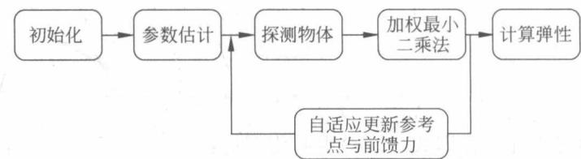

图 2-1 触觉识别算法实现框图
{: .figure-caption }


#### Baxter 机器人模型的建立

使用 MATLAB 机器人工具箱对 Baxter 机器人进行运动学和动力学建模,生成的可视化模型如图 2-2 所示。这里以 Baxter 机器人的左臂建模为例,所使用的 MATLAB 代码如下:

```matlab
% -- Create Links with D-H parameters.
% 1. left_s0 --> left_upper_shoulder --> left_s1
% Left(1) = Link([0 Lzs1 Lxs1 -pi/2 0], 'standard'); Left(1).offset = 0; % s1
ixx = 0.04709102262; ixy = 0.00012787556; ixz = 0.00614870039;
iyy = 0.03766976455; iyz = 0.00078086899;
izz = 0.03595988478;
I_interia = [ixx iyy izz ixy iyz ixz];
% \Theta d a \alpha \sigma
Left(1) = Link([0, left_s1_xyz(3), left_s1_xyz(1), -pi/2, 0], 'standard');
Left(1).offset = 0;
```

```matlab
Left(1).qlim = [-1.70167993878 1.70167993878]; % [-97.5, 97.5], left_s0
Left(1).I = I_interia;
Left(1).r = [0.01783 0.00086 0.19127] + [0,0,0]; % left_s0 = joint_s0
Left(1).m = 5.70044;
Left(1).Jm = 200e-6;
Left(1).G = -62.6111;
Left(1).B = 1.48e-3;
Left(1).Tc = [0.395 - 0.435];
% 2. left_s1 --> left_lower_shoulder --> left_e0
% Left(2) = Link([0 0 0 pi/2 0 ], 'standard'); Left(2).offset = pi/2;
ixx = 0.01175209419; ixy = -0.00030096398; ixz = 0.00207675762;
iyy = 0.0278859752; iyz = -0.00018821993;
izz = 0.02078749298;
I_interia = [ixx iyy izz ixy iyz ixz];
% \Theta d a \alpha \sigma
Left(2) = Link([0, 0, 0, pi/2, 0 ], 'standard');
Left(2).offset = pi/2;
Left(2).qlim = [-2.147 1.047]; % [-123, 60], left_s1
Left(2).I = I_interia;
Left(2).r = [0.06845 0.00269 - 0.00529] + [0,0,0]; % left_s1 = joint_s1;
Left(2).m = 3.22698;
Left(2).Jm = 200e-6;
Left(2).G = 107.815;
Left(2).B = .817e-3;
Left(2).Tc = [0.126 - 0.071];
% 3. left_e0 --> left_upper_elbow --> left_e1
% Left(3) = Link([0 Lxe0 + Lze1 Lxe1 - pi/2 0 ], 'standard'); Left(3).offset = 0;
ixx = 0.02661733557; ixy = 0.00029270634; ixz = 0.00392189887;
iyy = 0.02844355207; iyz = 0.0010838933;
izz = 0.01248008322;
I_interia = [ixx iyy izz ixy iyz ixz];
% \Theta d a \alpha \sigma
Left(3) = Link([0, left_e0_xyz(1) + left_e1_xyz(3), left_e1_xyz(1), -pi/2, 0], 'standard');
Left(3).offset = 0;
Left(3).qlim = [-3.05417993878 3.05417993878]; % [-175, 175], left_e0
Left(3).I = I_interia;
Left(3).r = [-0.00276 0.00132 0.18086] + [0,0,left_e0_xyz(1)]; % left_e0 != joint_e0
Left(3).m = 4.31272;
Left(3).Jm = 200e-6;
Left(3).G = -53.7063;
Left(3).B = 1.38e-3;
Left(3).Tc = [0.132, -0.105];
% 4. left_e1 --> left_lower_elbow --> left_wo
% Left(4) = Link([0 0 0 pi/2 0 ], 'standard'); Left(4).offset = 0;
```

```matlab
ixx = 0.00711582686; ixy = 0.00036036173; ixz = 0.0007459496;
    iyy = 0.01318227876; iyz = -0.00019663418;
    izz = 0.00926852064;

I_interia = [ixx iyy izz ixy iyz ixz];
% \Theta d a \alpha \sigma
Left(4) = Link([0, 0, 0, pi/2, 0], 'standard');
Left(4).offset = 0;
Left(4).qlim = [-0.05 2.618]; % [-2.865, 150], left_e1
Left(4).I = I_interia;
Left(4).r = [0.02611 0.00159 -0.01117] + [0, 0, 0]; % left_e1 = joint_e1
Left(4).m = 2.07206;
Left(4).Jm = 33e-6;
Left(4).G = 76.0364;
Left(4).B = 71.2e-6;
Left(4).Tc = [11.2e-3, -16.9e-3];

% 5. left_w0 --> left_upper_forearm --> left_w1
% Left(5) = Link([0 Lxw0 + Lzw1 Lxw1 -pi/2 0], 'standard'); Left(5).offset = 0;
ixx = 0.01667742825; ixy = 0.00018403705; ixz = 0.00018657629;
    iyy = 0.01675457264; iyz = -0.00064732352;
    izz = 0.0037463115;

I_interia = [ixx iyy izz ixy iyz ixz];
% \Theta d a \alpha \sigma
Left(5) = Link([0, left_w0_xyz(1) + left_w1_xyz(3), left_w1_xyz(1), -pi/2, 0], 'standard');
Left(5).offset = 0;
Left(5).qlim = [-3.059 3.059]; % [-175.27, 175.27], left_w0
Left(5).I = I_interia;
Left(5).r = [-0.00168 0.0046 0.13952] + [0, 0, left_w0_xyz(1)]; % left_w0 = joint_w0
Left(5).m = 2.24665;
Left(5).Jm = 33e-6;
Left(5).G = 71.923;
Left(5).B = 82.6e-6;
Left(5).Tc = [9.26e-3, -14.5e-3];

% 6. left_w1 --> left_lower_forearm --> left_w2
% Left(6) = Link([0 0 0 pi/2 0], 'standard'); Left(6).offset = 0;
ixx = 0.00387607152; ixy = -0.00044384784; ixz = -0.00021115038;
    iyy = 0.00700537914; iyz = 0.00015348067;
    izz = 0.0055275524;

I_interia = [ixx iyy izz ixy iyz ixz];
% \Theta d a \alpha \sigma
Left(6) = Link([0, 0, 0, pi/2, 0], 'standard');
Left(6).offset = 0;
Left(6).qlim = [-1.57079632679 2.094]; % [-90, 120], left_w1;
Left(6).I = I_interia;
Left(6).r = [0.06041 0.00697 0.006] + [0, 0, 0]; % left_w1 = joint_w1;
```

```matlab
Left(6).m = 1.60979;
Left(6).Jm = 33e-6;
Left(6).G = 76.686;
Left(6).B = 36.7e-6;
Left(6).Tc = [3.96e-3, -10.5e-3];
% 7.left_w2 --> left_wrist -->
% Left(7) = Link([0 Lxw2 0 0 0 ], 'standard'); Left(5).offset = 0;
ixx = 0.00025289155; ixy = 0.00000575311; ixz = -0.00000159345;
    iyy = 0.0002688601; iyz = -0.00000519818;
    izz = 0.0003074118;
I_interia = [ixx iyy izz ixy iyz ixz];
% \Theta d a \alpha \sigma
Left(7) = Link([0,left_w2_xyz(1)+left_wrist_hand_xyz(3)+left_endpoint_xyz(3), 0, 0, 0], 'standard');
Left(7).offset = 0;
Left(7).qlim = [-3.059 3.059]; % [-175.27, 175.27], left_w2
Left(7).I = I_interia;
Left(7).r = [0.00198 0.00125 0.01855]+[0,0,left_w2_xyz(1)]; % left_w2 != joint_w2
Left(7).m = 0.35093+0.19125+0.0001*4;% + hand + camera + range + base + gripper
Left(7).Jm = 33e-6;
Left(7).G = 76.686;
Left(7).B = 36.7e-6;
Left(7).Tc = [3.96e-3, -10.5e-3];

LeftArm = SerialLink(Left, 'name', 'LeftArm');
LeftArm.base = ...

transl(base_torso_xyz(1), base_torso_xyz(2), base_torso_xyz(3)) ...
* transl(torso_left_arm_mount_xyz(1), torso_left_arm_mount_xyz(2), torso_left_arm_mount_xyz(3)) ...
* trotz(torso_left_arm_mount_rpy(3)) ...
* transl(left_s0_xyz(1), 0, left_s0_xyz(3));
```

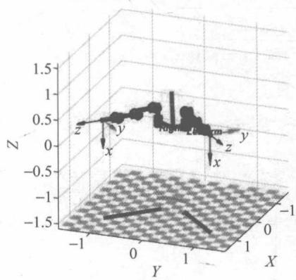

图2-2 Baxter机器人模型
{: .figure-caption }


#### Simulink 中的机器人模块

在 Simulink 中, 实现的算法是对机器人进行控制, 其中机器人模块的 Simulink 框图如图 2-3 所示。

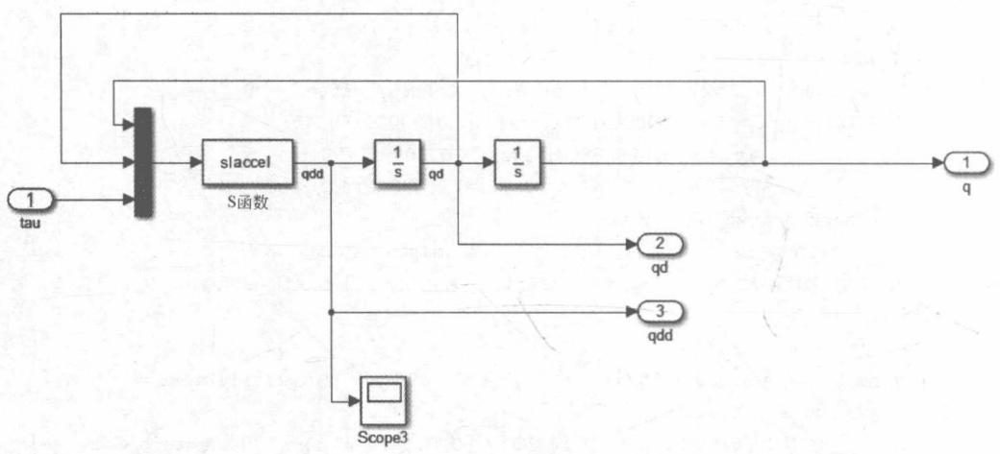

图 2-3 机器人模块的 Simulink 框图
{: .figure-caption }


在机器人模块中，slaccel 模块的代码如下：

```matlab
% SLACCEL S-function for robot acceleration
%
% This is the S-function for computing robot acceleration. It assumes input data u to be the vector [q qd tau].
%
% Implemented as an S-function to get around vector sizing problem with Simulink 4.

function [sys, x0, str, ts] = slaccel(t, x, u, flag, robot)
    switch flag,
    case 0
    % initialize the robot graphics
    [sys, x0, str, ts] = mdlInitializeSizes(robot);    % Init
    case {3}
    % come here to calculate derivatives
    % first check that the torque vector is sensible
    if numel(u) ~= (3 * robot.n)
    error('RTB:slaccel:badarg', 'Input vector is length %d, should be %d', numel(3 * robot.n);
    end
    if ~isreal(u)
```

```matlab
error('RTB:slaccel:badarg', 'Input vector is complex, should be real');
end

sys = robot.accel(u(:)');
case {1, 2, 4, 9}
sys = [];
end

% ====================
% mdlInitializeSizes
% Return the sizes, initial conditions, and sample times for the S-function.
% ====================
function [sys,x0,str,ts] = mdlInitializeSizes(robot)

% call simsizes for a sizes structure, fill it in and convert it to a
% sizes array.

% Note that in this example, the values are hard coded. This is not a
% recommended practice as the characteristics of the block are typically
% defined by the S-function parameters.
%
sizes = simsizes;

sizes.NumContStates = 0;
sizes.NumDiscStates = 0;
sizes.NumOutputs = robot.n;
sizes.NumInputs = 3 * robot.n;
sizes.DirFeedthrough = 1;
sizes.NumSampleTimes = 1; % at least one sample time is needed

sys = simsizes(sizes);

% initialize the initial conditions
x0 = [];

% str is always an empty matrix
str = [];

% initialize the array of sample times
ts = [0 0];
% end mdlInitializeSizes
```

#### 加权最小二乘法的实现

在计算物体的边界和弹性中,为了获得比较快速的收敛性能,采用加权最小二乘法来估计位置参数 $\theta_{1}$ 和 $\theta_{2}$ 。使用 Simulink 对加权最小二乘法进行实现,如图 2-4 所示。

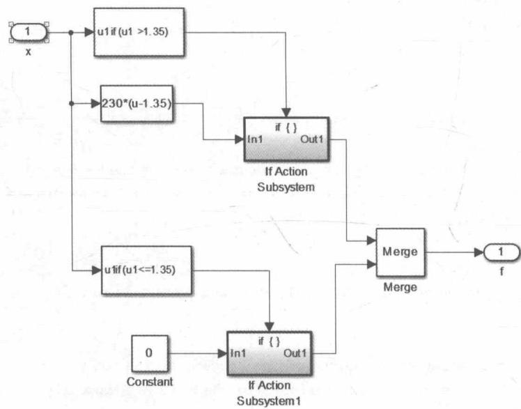

图2-4 加权最小二乘法的Simulink框图
{: .figure-caption }


### 2.1.5 实验与结果

本节将在 MATLAB/Simulink 平台中, 利用已有的机器人工具箱里的机器人模型, 对控制器进行仿真。本节所提到的控制器的实现大体可分为两个部分, 第一部分先进行自适应参数估计, 在有限时间内参数估计值收敛后, 即实际系统即式(2.4)与参考模型即式(2.6)成功匹配后, 再通过调节参考点和前馈力, 并利用最小二乘法对物体边界和弹性进行估计和学习。由于程序较复杂且需调参数较多, 在实现过程中先把时域和迭代域分开来调试实现, 一方面设计一个简单的 PD 控制器控制机器人与被测物体接触, 每次试探时间为 3s, 共试探 20 次, 每次试探结束就计算更新参考点和前馈力, 并估计出被测物体的性质; 另一方面, 实现实际系统与参考模型在有限时间内匹配, 才能用上前面的物体估计部分。把上述第一部分又再细分: 先将系统参数 $\theta$ 设定为真实值, 同时调节参数 $K$ 使系统保持稳定状态; 再加上参数估计部分 $\hat{\theta}$ 使匹配误差 $w$ 在有限时间内收敛。另外, 为了分析简便, 本节内容仿真所用的是较为简单的双关节单机械臂, 具有两个自由度, 所触碰物体设定为一个弹簧, 可通过设置改变其末端位置 $x_b$ 及其劲度系数 $K_0$ , 只研究执行器与弹簧在 $x$ 轴方向的交互, 其位置关系如图 2-5 所示。

用 $m_{i}, l_{i}, I_{i}, l_{ci} (i=1,2)$ 分别表示关于 z 轴的质量、长度、惯性和关节重心与上一个关节之间的距离，其中 z 轴方向为穿出纸面的方向。令 $m_{1}=m_{2}=10.0kg, l_{1}=l_{2}=1.0m, I_{1}=$

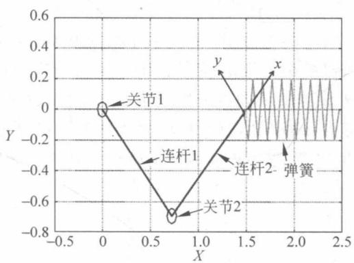

图 2-5 双关节单机械臂与被测弹簧
{: .figure-caption }


$I_{2}=0.83kgm^{2}, l_{c1}=l_{c2}=0.1m$ 。注意，这里介绍的参数是为了搭建仿真平台，因为MATLAB中的机器人模块也需要设置一些参数才能使用，并没有用到前文设计的控制器中。本实验假设机械臂所受的重力因素 $G(q)=0$ 。

如式(2.7)所示,采用如下简写方式: $s_{1}=\sin(q_{1}),s_{2}=\sin(q_{2}),s_{12}=\sin(q_{1}+q_{2}),c_{1}=\cos(q_{1}),c_{2}=\cos(q_{2}),c_{12}=\cos(q_{1}+q_{2})$ ,该机械臂的雅可比矩阵为:

$$
\boldsymbol {J} (q) = \left( \begin{array}{c c} - (l _ {1} s _ {1} + l _ {2} s _ {1 2}) & l _ {2} s _ {1 2} \\ l _ {1} c _ {1} + l _ {2} c _ {1 2} & l _ {2} c _ {1 2} \end{array} \right)
$$

机械臂末端执行器的初始位置为：

$$
x ^ {k} (0) = 1. 0 \mathrm{m}, \quad y ^ {k} (0) = 0. 0 \mathrm{m}
$$

设定每次试探时间为 3s, 3s 内机器人与被测弹簧之间已处于稳定的平衡关系, 即已到达平衡点 $x_{*}$ 。弹簧的劲度系数设为 $K_{0}=150$ , 边界所处位置为 $x_{b}=1.3$ 。机器人末端执行器的初始位置 $x_{s}=1$ 。自适应参数估计机器人的参数结果如图 2-6 所示, 实际系统与参考模型的匹配误差如图 2-7 所示。

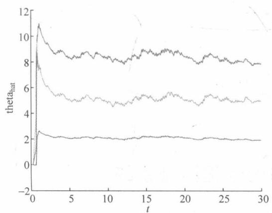

图 2-6 自适应参数估计机器人的参数结果
{: .figure-caption }


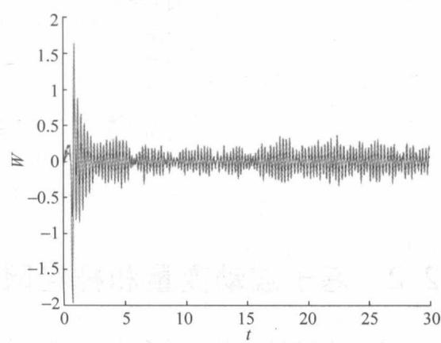

图 2-7 实际系统与参考模型的匹配误差
{: .figure-caption }


在学习好的基础上，经过20次迭代探测物体后，将估计的劲度系数和边界位置以曲线形式表示出来，如图2-8所示。可以看出，从第4个周期开始已经能准确地估计出实际弹簧的 $K_{0}$ 和 $x_{b}$ 。说明所用的加权最小二乘法确实能保证收敛的快速性。为了证明程序的可靠估计和非偶然性，我们另外设弹簧的劲度系数设为 $K_{0}=200$ ，边界位置为 $x_{b}=1.4$ 和劲度系数设为 $K_{0}=175$ ，边界位置为 $x_{b}=1.2$ ，测量估计曲线结果分别如图2-9和图2-10所示。可以看出，就算弹簧性质发生改变，程序也能成功准确地估计出其硬度和边界性质。

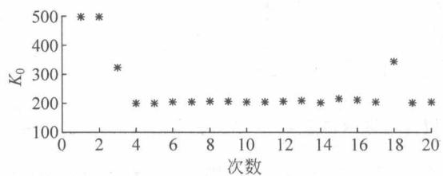

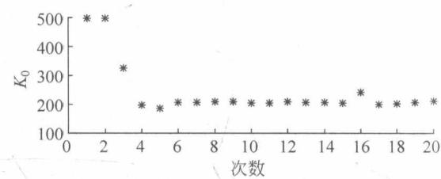

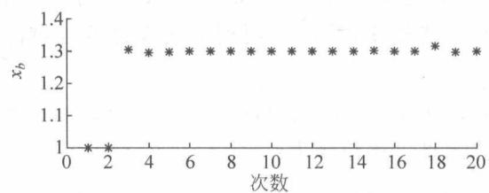

图2-8 $K_{0} = 150, x_{b} = 1.3$
{: .figure-caption }


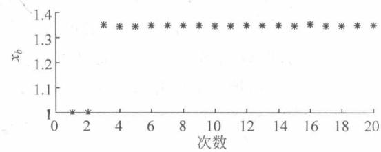

图2-9 $K_{0} = 200, x_{b} = 1.4$
{: .figure-caption }


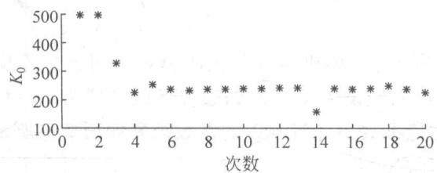

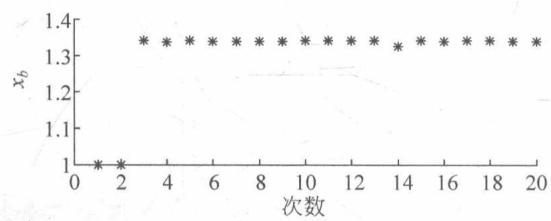

图2-10 $K_{0} = 175, x_{b} = 1.2$
{: .figure-caption }


## 2.2 基于波动变量和神经网络的远程控制系统

本节将介绍基于波动变量和神经网络的远程操作系统的数学模型、原理、编程与实现。

### 2.2.1 引言

在过去的几十年中，机器人技术在各种工程领域中得到快速发展。远程操作作为机器人技术中最具吸引力和最具挑战性的话题之一，被应用于远程外科、搜索和救援、三维游戏开发等各种应用。典型的远程操作系统通常包括五个部分：人类操作者、主设备、通信信道、从机器人、环境。通常，人类操作者控制与人接触的主设备进行运动；随后主设备生成对应的命令轨迹通过通信信道传递；接下来，命令轨迹被传递到作用于目标环境并执行某任务的从属机器人。从机器人和环境之间的相互作用力被反馈到主机，根据该相互作用力，人类操作者可以更有效地控制机器人。

本节使用 Geomagic Touch X 作为主设备。Touch X 由 SensAble Technologies Inc. 设计。Touch X 是一种包括硬件驱动器和软件包 (OpenHaptics 工具包) 的触觉反馈设备。Touch X 臂包括三个旋转关节，每个旋转关节配备有产生反馈力的电机。

作为从机器人，在 Baxter 的每个臂中有 7 个旋转关节，这使得它在 3D 空间中容易移动。为了抓握和处理物体，在每个臂的末端执行器处安装旋转夹具。MATLAB 机器人工具箱用于建立 Baxter 机器人手臂的运动学和动力学模型，用作从属远程机器人来测试所提出的方法。

通信通道在远程操作系统中起重要作用，并且通道中的时间延迟可能在存在力反馈的情况下导致系统不稳定。由于实际应用中存在不确定性，控制不确定机器人系统的研究变得非常重要。机器人的自适应控制方法已经在相当多的工作中进行了研究，可用于机器人模型中未知参数和时变参数的情况。机器人模型的时变延迟和不确定性已经与自适应控制一起被研究。近年来，由于神经网络具有仿真复杂的非线性和不确定的函数的能力，神经网络（神经网络）在机器人控制系统中的应用越来越普及。径向基函数（Radical Basis Function, RBF）神经网络是一种非常有效的方法，已广泛用于不确定机器人系统的控制设计。自适应RBF基于神经网络的控制已经被用于处理死区和不确定的机器人模型。

本节基于 PD 控制的神经网络控制器应用于具有 7 个自由度的从机器人, 这保证了比常规 PD 控制器更准确的轨迹跟踪。

### 2.2.2 远程操作系统的数学模型

#### 远程操作系统的框架

远程操作系统如图 2-11 所示, 操作者握住触觉装置的接触杆并驱动主装置运动, 这提供了位置命令。通过计算机的处理, 新命令将由主计算机生成, 然后传递到从计算机, 并由从控制器接收。Baxter 机器人将根据从控制器的命令移动。操纵器的末端执行器与环境相互作用, 并且相互作用力被传递到触觉装置已由操作者感测, 这将导致新的运动和新的控制命令。以下分析远程操作系统的各个组件及其数学模型。

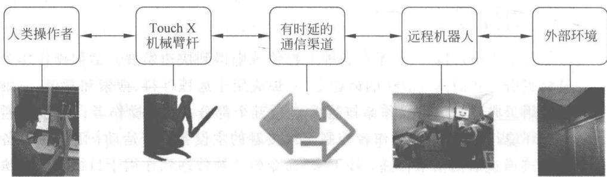

图2-11 系统的框架
{: .figure-caption }


#### 主机器人臂的运动学和动力学

力触觉操纵杆 Geomagic Touch X 是一种 6 关节机器人, 是对人的手臂进行模仿相应设计的, 触觉设备 Touch X 不仅向主设备发送运动命令, 而且返回远程机器人与环境之间的相互作用力, 这对于操作者调节接触力是非常有用的。主机器人的数学模型包括运动学模型和动力学模型。

Touch X 的运动学模型是基于其结构, 如图 2-12 所示。Touch X 具有 6 个旋转关节, 其中 3 个关节配备有电动机, 而另外 3 个被认为是末端执行器的万向节关节, 使其可以灵活地在工作空间内移动。

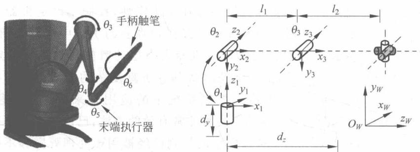

图2-12 TouchX的结构
{: .figure-caption }


为了更具体和直观地表示其结构，DH 参数用于建立运动学模型。DH 参数有两种表示形式：

\- 标准的 DH 参数法；

\- 修改的 DH 参数法。

后面将根据修改的 DH 参数法用于本节中的 Touch X 操纵杆的运动学建模。根据标准的 DH 参数法，如图 2-13 的左图所示，与关节 4 和 5 相关的坐标的原点是相同的。

因此，应该修改由 MATLAB 机器人工具箱建模的仿真机器人。具体地， $a_{i-1}$ 和 $d_{i}$ 分别用于表示连杆长度和连杆偏移，其中 i 表示主设备的第 i 个关节。 $\alpha_{i-1}$ 和 $\theta_{i}$ 分别用于表示关节扭转角和关节角。所有 6 个主设备的关节是旋转的，并且 Touch X 的修改 DH 参数在表 2-1 中获得。表 2-1 中的 DH 参数表示主设备的结构特性，从其中可以获得运动学模型。

依据标准的DH参数法建立的模型

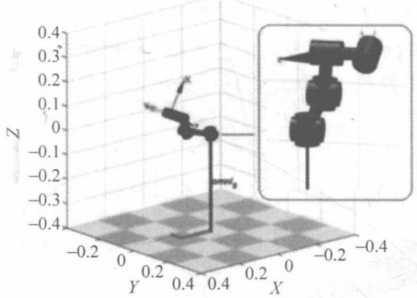
(a) 基于标准DH参数
依据修改的DH参数法建立的模型

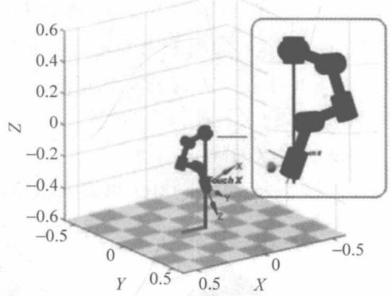
(b) 修改的DH参数

图 2-13 Touch X 的两个运动学模型之间的比较
{: .figure-caption }


表 2-1 主动臂的 DH 参数

<table><tr><td>Link i</td><td> <span class="arithmatex">\(\theta_i\)</span> (angle limit(deg))</td><td> <span class="arithmatex">\(d_i\)</span> </td><td> <span class="arithmatex">\(a_{i-1}\)</span> </td><td> <span class="arithmatex">\(\alpha_{i-1}\)</span> (rad)</td></tr><tr><td>1</td><td> <span class="arithmatex">\(q_1(-60\sim60)\)</span> </td><td>0</td><td>0</td><td>0</td></tr><tr><td>2</td><td> <span class="arithmatex">\(q_2(0\sim105)\)</span> </td><td>0</td><td>0</td><td> <span class="arithmatex">\(-\pi/2\)</span> </td></tr><tr><td>3</td><td> <span class="arithmatex">\(q_3(-180\sim180)\)</span> </td><td>0</td><td> <span class="arithmatex">\(L_{m1}\)</span> </td><td>0</td></tr><tr><td>4</td><td> <span class="arithmatex">\(q_4(-145\sim145)\)</span> </td><td> <span class="arithmatex">\(L_{m2}\)</span> </td><td>0</td><td> <span class="arithmatex">\(-\pi/2\)</span> </td></tr><tr><td>5</td><td> <span class="arithmatex">\(q_5(-70\sim70)\)</span> </td><td>0</td><td>0</td><td> <span class="arithmatex">\(-\pi/2\)</span> </td></tr><tr><td>6</td><td> <span class="arithmatex">\(q_6(-145\sim145)\)</span> </td><td>0</td><td>0</td><td> <span class="arithmatex">\(-\pi/2\)</span> </td></tr></table>

两个相邻坐标之间的齐次变换,可以使用 DH 参数表示如下:

$$
{ } ^ { i - 1 } \mathbf { A } _ { i } ( \theta _ { i } , d _ { i } , a _ { i } , \alpha _ { i } ) = \left[ \begin{array} { c c c c } c \theta _ { i } & - s \theta _ { i } c \alpha _ { i } & s \theta _ { i } c \alpha _ { i } & a _ { i } c \theta _ { i } \\ c \theta _ { i } & c \theta _ { i } c \alpha _ { i } & - c \theta _ { i } c \alpha _ { i } & a _ { i } s \theta _ { i } \\ 0 & \alpha _ { i } & c \alpha _ { i } & d _ { i } \\ 0 & 0 & 0 & 1 \end{array} \right]\tag{2.38}
$$

其中，c 是三角函数 $\cos$ 的缩写，s 是 $\sin$ 的缩写。

此外,可以用下式来表示末端执行器的位置和基部之间的关系:

$$
{ } ^ { n } X _ { 0 } = { } ^ { 0 } A _ { 1 } { } ^ { 1 } A _ { 2 } \cdots { } ^ { n - 1 } A _ { n } \cdot X _ { n }\tag{2.39}
$$

其中，对于主设备 n 为 6, X = [x, y, z, 1] 表示相关关节的位置， $^{i}A_{i+1} (i = 0, 1, \cdots, n-1)$ 表示相邻的坐标。

主机器人臂的动力学模型表示了驱动转矩或相关力和关节运动之间的关系,并且可以表示如下:

$$
\boldsymbol {M} _ {m} (q _ {m}) \ddot {q} _ {m} + h _ {m} (q _ {m}, \dot {q} _ {m}) = \boldsymbol {J} _ {m} ^ {\mathrm{T}} F _ {h} - \tau_ {m} + f _ {m}
$$

其中，

$$
h _ {m} (q _ {m}, \dot {q} _ {m}) = C _ {m} (q _ {m}, \dot {q} _ {m}) \dot {q} _ {m} + G _ {m} (q _ {m})\tag{2.40}
$$

下标 m 用于表示主机器人臂。对于具有 n 自由度的串联和所有关节旋转的机器人机械手， $q_{m}$ 、 $\dot{q}_{m}$ 、 $\ddot{q}_{m} \in R^{n}$ 分别是关节位置、速度和加速度。 $M_{m}(q_{m}) \in R^{n \times n}$ 表示惯性矩阵。 $h_{m}(q_{m}, \dot{q}_{m})$ 表示向心力、科里奥利力和重力的非线性耦合项。 $f_{m}$ 表示库仑摩擦，负载变化，时间延迟干扰和其他干扰。 $J_{m}$ 是雅可比矩阵， $F_{h}$ 是人类操作者施加的力， $\tau_{m}$ 是扭矩控制信号，这两者都将被施加到主装置。

#### 从机器人的模型


图 2-14 展示出了 Baxter 机器人的结构, 它是每臂具有 7 自由度的双臂机器人。
{: .figure-caption }


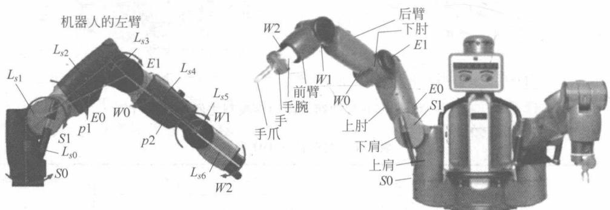

图 2-14 Baxter 机器人的结构
{: .figure-caption }


本节将 Baxter 机器人的仿真左臂作为从属远程机器人。标准 DH 参数用于描述 Baxter 机器人左臂的结构，如表 2-2 所示。相关的长度在图 2-14 和表 2-2 中给出。 $L_{s0}=0.27m, L_{s1}=0.069m, L_{s2}=0.364m, L_{s3}=0.069m, L_{s4}=0.375m, L_{s5}=0.01m, L_{s6}=0.28m$ 。

表 2-2 从属机器人的 DH 参数(标准规则)

<table><tr><td>Link i</td><td> <span class="arithmatex">\(\theta_i\)</span> (angle limit(deg))</td><td> <span class="arithmatex">\(d_i\)</span> </td><td> <span class="arithmatex">\(a_i\)</span> </td><td> <span class="arithmatex">\(\alpha_i\)</span> (rad)</td></tr><tr><td>1</td><td> <span class="arithmatex">\(q_1(-97.5\sim 97.5)\)</span> </td><td> <span class="arithmatex">\(L_{s0}\)</span> </td><td> <span class="arithmatex">\(L_{s1}\)</span> </td><td> <span class="arithmatex">\(-\pi/2\)</span> </td></tr><tr><td>2</td><td> <span class="arithmatex">\(q_2+\frac{\pi}{2}(-123\sim 60)\)</span> </td><td>0</td><td>0</td><td> <span class="arithmatex">\(\pi/2\)</span> </td></tr><tr><td>3</td><td> <span class="arithmatex">\(q_3(-175\sim 175)\)</span> </td><td> <span class="arithmatex">\(L_{s2}\)</span> </td><td> <span class="arithmatex">\(L_{s3}\)</span> </td><td> <span class="arithmatex">\(-\pi/2\)</span> </td></tr><tr><td>4</td><td> <span class="arithmatex">\(q_4(2.865\sim 150)\)</span> </td><td>0</td><td>0</td><td> <span class="arithmatex">\(\pi/2\)</span> </td></tr><tr><td>5</td><td> <span class="arithmatex">\(q_5(-175.27\sim 175.27)\)</span> </td><td> <span class="arithmatex">\(L_{s4}\)</span> </td><td> <span class="arithmatex">\(L_{s5}\)</span> </td><td> <span class="arithmatex">\(-\pi/2\)</span> </td></tr><tr><td>6</td><td> <span class="arithmatex">\(q_6(-90\sim 120)\)</span> </td><td>0</td><td>0</td><td> <span class="arithmatex">\(\pi/2\)</span> </td></tr><tr><td>7</td><td> <span class="arithmatex">\(q_7(-175.27\sim 175.27)\)</span> </td><td> <span class="arithmatex">\(L_{s6}\)</span> </td><td>0</td><td>0</td></tr></table>

为了实现由主操纵杆命令的位置的精确跟踪,主操纵杆和从属远程机器人之间的工作空间匹配是必要的。使用的蒙特卡罗方法应用于近似主从的工作空间。为了确保主设备的变换的工作空间被约束在从属机器人的工作空间内,主设备的工作空间以固定比例缩放。图 2-15 表示出了在匹配过程之后主设备和从设备的工作空间。


图 2-15(a) 表示出了三维包络表面, 它在匹配过程之后作为主从的工作空间的 3D 云的包络产生。Baxter 机器人手臂和 Touch X 操纵杆之间的工作空间变换给出为
{: .figure-caption }


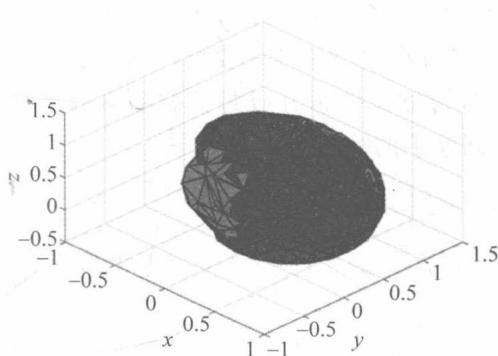
(a) 机器人与Touch X工作空间的包络面

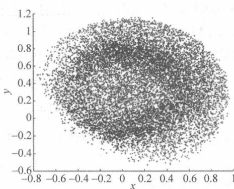
(b) $x - y$ 平面中的工作空间匹配

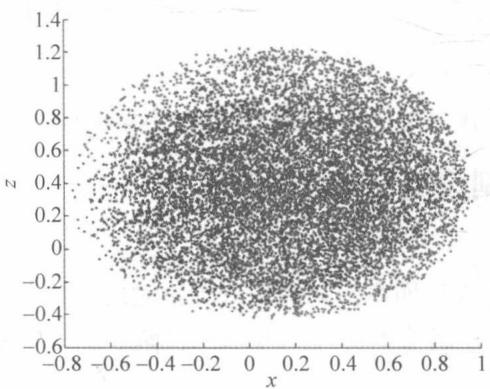
(c) x-z 平面中的工作空间匹配

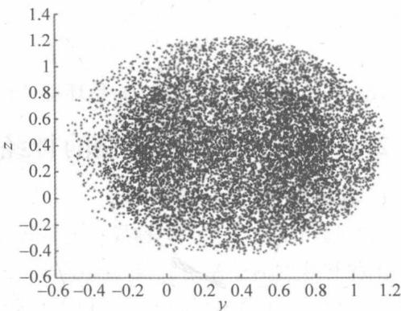
(d) $y - z$ 平面中的工作空间匹配

图 2-15 工作区匹配
{: .figure-caption }


$$
\left[ \begin{array}{l} x _ {s} \\ y _ {s} \\ z _ {s} \end{array} \right] = \left[ \begin{array}{c c c} \cos \delta & - \sin \delta & 0 \\ \sin \delta & \cos \delta & 0 \\ 0 & 0 & 1 \end{array} \right] \times \left(\left[ \begin{array}{c c c} S _ {x} & 0 & 0 \\ 0 & S _ {y} & 0 \\ 0 & 0 & S _ {z} \end{array} \right] \left[ \begin{array}{l} x _ {m} \\ y _ {m} \\ z _ {m} \end{array} \right] + \left[ \begin{array}{l} T _ {x} \\ T _ {y} \\ T _ {z} \end{array} \right]\right)\tag{2.41}
$$

其中， $[x_s, y_s, z_s]^{\mathrm{T}}, [x_m, y_m, z_m]^{\mathrm{T}}$ 分别表示 Baxter 和 Touch X 操纵杆的末端效应器的笛卡儿坐标。 $\delta$ 是主设备的基底的 $z$ 轴的旋转角度， $[S_x, S_y, S_z]^{\mathrm{T}}$ 和 $[T_x, T_y, T_z]^{\mathrm{T}}$ 是关于 $x, y$ 和 $z$ 的比例系数和偏移校正项轴。匹配参数由下式给出：

$$
\delta = \frac {\pi}{4} \left[ \begin{array}{l} S _ {x} \\ S _ {y} \\ S _ {z} \end{array} \right] = \left[ \begin{array}{l} 0. 0 0 4 1 \\ 0. 0 0 4 0 \\ 0. 0 0 4 1 \end{array} \right] \left[ \begin{array}{l} T _ {x} \\ T _ {y} \\ T _ {z} \end{array} \right] = \left[ \begin{array}{l} 0. 7 0 1 \\ 0. 2 1 0 \\ 0. 1 2 9 \end{array} \right]\tag{2.42}
$$

远程机器人的动力学模型可以表示如下：

$$
\boldsymbol {M} _ {s} (q _ {s}) \ddot {q} _ {s} + h _ {s} (q _ {s}, \dot {q} _ {s}) = \tau_ {s} - \boldsymbol {J} _ {s} ^ {\mathrm{T}} F _ {e} + f _ {s}\tag{2.43}
$$

$$
h _ {s} (q _ {s}, \dot {q} _ {s}) = C _ {s} (q _ {s}, \dot {q} _ {s}) \dot {q} _ {s} + G _ {s} (q _ {s})\tag{2.44}
$$

其中，下标 s 用于指示从属。 $F_{e}$ 是环境和远程机器人之间的相互作用力， $\tau_{s}$ 是从机的控制输入。

#### 人类操作员的模型

早期研究已经表明,人手的肌肉特性可以建模为弹簧。在遥控操作系统中,人手握住主操纵杆的接触杆，并给出相应的位置和速度命令。即使主设备受到从从设备传输而来的环境力，操作者也可以调整手的输出，以使主设备跟踪操作者的期望运动。因此，人手实际上可以认为是由智能比例积分(PI)控制器控制的，智能比例积分(PI)控制器可以根据实际位置 $x_{m}$ 和主控器的期望位置 $x_{md}$ 之间的误差来调整手的输出力：

$$
F _ {h} = K _ {h p} (x _ {m d} - x _ {m}) + K _ {h i} \int_ {t _ {0}} ^ {t} (x _ {m d} - x _ {m}) \mathrm{d} t\tag{2.45}
$$

其中， $K_{hp}$ 和 $K_{hi}$ 分别是人手的比例增益和积分增益， $t_{0}$ 和 t 的符号分别是初始时刻和当前时刻。

#### 环境的模型

考虑环境的简单数学模型,它描述了环境 $F_{e}$ 的相互作用力与从机器人位置 $x_{s}$ 之间的关系,即

$$
F _ {e} = K _ {s p} (x _ {s} - x _ {e}) + K _ {s d} \dot {x} _ {s}\tag{2.46}
$$

其中， $K_{sp}$ 和 $K_{sd}$ 是环境的参数， $x_{e}$ 是环境的位置。在自由空间运动中， $K_{sp}=K_{sd}=0_{m\times n}$ 。

### 2.2.3 基于波动变量的神经控制设计

#### 基本的 PD 控制设计

本节提出了使用基于标称模型的转矩控制和神经网络控制器来处理不确定性的控制方案。主侧和从侧的控制系统首先根据基本的 PD 控制技术设计。考虑主设备和从属机器人的动力学模型，分别为它们引入了以下控制器：

$$
\tau_ {m} = \mathbf {K} _ {m} e _ {m} + D _ {m} \dot {e} _ {m}\tag{2.47}
$$

$$
\tau_ {s} = - \mathbf {K} _ {s} e _ {s} - D _ {s} \dot {e} _ {s}\tag{2.48}
$$

其中， $e_{i}=q_{i}-q_{id}$ 是跟踪误差， $q_{id}\in R_{n}$ 是用作局部PD控制器的参考命令的期望关节角， $K\in R_{n}\times n$ 和 $D\in R_{n}\times n$ 是关节的对称正定矩阵角度和角速度增益。下标“i”表示“m”和“s”，它们分别表示主设备和从机器人。定义广义跟踪误差为：

$$
e _ {v s} = \dot {e} _ {s} + K _ {s 1} e _ {s}\tag{2.49}
$$

对于轨迹跟踪,如果机器人的动力学可用,通过适当选择角位置和角速度增益 K 和 D, PD 控制可以保证闭环系统的稳定性。对于不确定的模型,传统的 PD 控制器可能不能保证全局的协调稳定性。如上所述,神经网络具有强大的函数近似能力,可用于识别不确定性。

人工操作员的模型可以被认为是智能 PI 控制器, 它可以实时调整输出力和位置。本节专注于从属远程机器人的精确位置控制。

#### 任务空间位置到位置控制

闭环反运动学(the Closed Loop Inverse Kinematics, CLIK)方法用于从机器人的位置控制,当解决逆运动学问题时,可以避免运动学奇异性和数值漂移。

所需的从属关节速度可以在 CLIK 算法中描述

$$
q _ {s d} = \int K _ {p} J _ {s} ^ {\mathrm{T}} (q) e \mathrm{d} \sigma\tag{2.50}
$$

其中 $e=x_{sd}-x_{s}$ 是期望从轨迹 $x_{sd}$ 和实际从轨迹之间的误差， $K_{p}$ 是调整收敛速率的正定矩阵， $J_{s}^{\mathrm{T}}(q)$ 是雅可比矩阵的转置。该方法可以避免在开环形式中出现的问题，并且 CLIK 算法的框图在图 2-16 中给出。

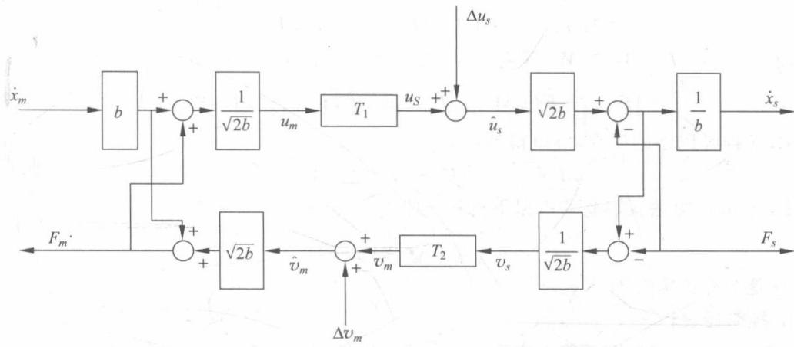

图 2-16 使用全局神经控制器的波动校正方案的远程操作控制
{: .figure-caption }


#### RBF 神经网络

RBF 神经网络可以利用其局部泛化网络的能力去近似机器人模型的动力学,它可以大大加快学习速度,避免局部最小问题,提高机器人的跟踪精度,特别是对于结构复杂和大量自由度的机器人,这些优势更加明显,RBF 神经网络可以表示为:

$$
\varphi_ {i} = \exp \left(- \frac {\| z - c _ {i} \| ^ {2}}{\sigma_ {i} ^ {2}}\right), \quad i = 1, 2, \dots , n\tag{2.51}
$$

$$
\hat {\boldsymbol {F}} (\boldsymbol {z}) = \hat {\boldsymbol {W}} ^ {\mathrm{T}} \varphi (\boldsymbol {z})\tag{2.52}
$$

其中， $z \in R_{n}$ 是输入向量，n 表示从属机器人的自由度，对于 Baxter 机器人的左臂为 7， $F(z) \in R_{n}$ 是输出向量， $W \in RN \times n$ 是连接隐层和输出层的权重矩阵，N 表示隐藏节点数， $c_{i} \in R_{n}$ 和 $\sigma_{i} > 0$ 是中心向量和第 i 个隐藏节点的宽度。通过径向对称函数（例如，高斯函数）计算 RBF 神经网络中的隐藏节点的输出。

RBF 神经网络的可调参数是每个隐藏节点的权重矩阵 W，中心向量 $c_{i}$ 和宽度 $\sigma_{i}$ 。通常， $c_{i}$ 和 $\sigma_{i}$ 的值根据系统的知识或通过预处理来选择训练。网络 $F(z)$ 的输出相对于权重矩阵 W 是线性的，这极大地简化了 RBF 神经网络的分析和学习过程。

RBF 神经网络用于近似不确定非线性函数 $F(z)$ ，并给出以下引理。

引理 1 RBF 神经网络的输入向量 $z \in X$ ，其中 X 是紧凑子集。

引理2 给定正常数 $\varepsilon_0$ 和连续函数 $F: z \to R_n$ ，存在权重矩阵 $W^* \in RN \times n$ ，使得具有 $N$ 个隐藏层节点 $\hat{F}(z)$ 的RBF神经网络的输出满足

$$
\max _ {z \in X} \| \hat {\boldsymbol {F}} (z, \boldsymbol {W} ^ {*}) - \boldsymbol {F} (z) \| \leqslant \varepsilon\tag{2.53}
$$

其中，N 由精度参数 $\varepsilon_{0}$ 和函数 $\hat{F}(z)$ 确定。 $\hat{F}(z,\hat{W})$ 是具有理想权重矩阵 $W^{*}$ 的输出 $F(z)$ 的估计。

引理 3 RBF 神经网络 $F(z,W)$ 对其参数 z、W 的输出是连续的。因此，可以得到：

$$
\boldsymbol {M} _ {s} \dot {\boldsymbol {e}} _ {v s} = - (C _ {s} + D _ {s}) \boldsymbol {e} _ {v s} + \hat {\boldsymbol {F}} (\boldsymbol {z}, \boldsymbol {W} ^ {*}) + \eta\tag{2.54}
$$

其中， $\eta = F(z) - F(z, W^{*})$ ， $W^{*}$ 是对应于 $z \in X$ 的最佳权重矩阵，即

$$
\left\| \boldsymbol {F} (z) - \hat {\boldsymbol {F}} (z, \boldsymbol {W} ^ {*}) \right\| = \min \sup _ {z \in X} \left\| \boldsymbol {F} (z) - \hat {\boldsymbol {F}} (z, \hat {\boldsymbol {W}}) \right\|\tag{2.55}
$$

根据 RBF 神经网络的属性, 可以得到:

$$
\boldsymbol {M} _ {s} \dot {\boldsymbol {e}} _ {v s} = - (C _ {s} + D _ {s}) \boldsymbol {e} _ {v s} + \boldsymbol {W} ^ {* T} \varphi (\boldsymbol {z})\tag{2.56}
$$

使用 Lyapunov 方法很容易获得以下更新定律：

$$
\dot {\hat {W}} = - Q ^ {- 1} \varphi (z) e _ {v s} ^ {\mathrm{T}}\tag{2.57}
$$

其中，Q 是对称正定矩阵。

#### 控制器设计

当 $F(z) \neq 0_{m \times n}$ 时，即机器人模型中存在不确定性，并且 PD 控制器可以确保跟踪误差的有限性，收敛到零。因此，RBF 神经网络控制是基于 Lemmas 1-3 开发的。控制力矩由两部分组成：

$$
\tau_ {s} = \tau_ {P D} + \tau_ {N N}\tag{2.58}
$$

其中， $\tau_{PD}$ 是基本 PD 控制，并且根据上面的推论，有

$$
\tau_ {P D} = - \mathbf {K} _ {s} e _ {s} - D _ {s} \dot {e} _ {s} = - D _ {s} e _ {v s}\tag{2.59}
$$

而 $\tau_{NN}$ 是神经网络的补偿控制器

$$
\tau_ {N N} = \hat {\boldsymbol {F}} (\boldsymbol {z}) = \hat {\boldsymbol {W}} ^ {T} \varphi (\boldsymbol {z})\tag{2.60}
$$

然后从属机器人的闭环系统动力学可以写成

$$
M _ {s} \dot {e} _ {v s} + C _ {s} e _ {v s} + D _ {s} e _ {v s} = F _ {z} - \hat {F} _ {z}\tag{2.61}
$$

### 2.2.4 实验设计

#### 主从臂远程操作系统

主从臂远程操作系统的 Simulink 框图如图 2-17 所示, 它由 Master 模块、通信模块和 Slave 模块组成。其中, Master 模块用于接收 Touch X 的数据, 并进行初步处理, 输出位置误差、期望速度和力矩。通信模块实现了波动变量功能, 减少了时延对远程操作系统的影响, Slave 模块实现了对 Baxter 机器人的神经网络控制, 包括了 Baxter 机器人模型和神经网络控制算法的实现。

#### Touch X 的建模

使用机器人工具箱对 Touch X 进行运动学和动力学建模, 其中运动学建模方法使用了修改的 DH 参数法, 所生成的 Touch X 模型如图 2-13 所示。

对 Touch X 建模所使用的代码如下：

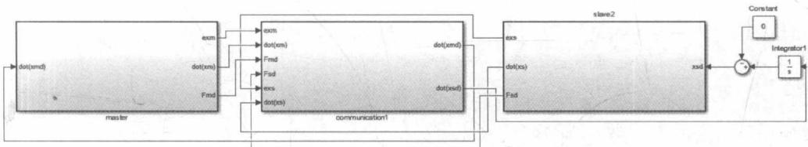

图 2-17 主从臂远程操作系统的 Simulink 框图
{: .figure-caption }


```matlab
Joff12 = 0.019; % m horizontal displace between 1,2 joint along negative direction of z axis;
Joff23 = 0.019; % m horizontal displace between 2,3 joint along positive direction of z axis;
L1 = 0.13335; % m length of link2(between joint1,2) = 133.35mm
L2 = 0.13335; % m length of link2(between joint1,2) = 133.35mm
Lup = 0.02335; % m vertical downward displace
Lout = 0.16835; % m horizontal outward displace

clear L;
deg = pi/180;

% \Theta d a \alpha \sigma
L(1) = Link([0, 0, 0, 0, 0], 'modified');
L(1).offset = 0;
L(1).qlim = [-60 60] * pi/180; %
L(1).I = [0, 0.35, 0, 0, 0, 0];
L(1).r = [0.01783 0.00086 0.19127] + [0,0,0]; % left_s0 = joint_s0
L(1).m = 5.70044;
L(1).Jm = 200e-6;
L(1).G = -62.6111;
L(1).B = 1.48e-3;
L(1).Tc = [0.395 - 0.435];

L(2) = Link([0, 0, 0, -pi/2, 0], 'modified');
L(2).offset = 0;
L(2).qlim = [0 105] * pi/180; %
L(2).I = [0, 0.35, 0, 0, 0, 0];
L(2).r = [0.01783 0.00086 0.19127] + [0,0,0]; % left_s0 = joint_s0
L(2).m = 4.70044;
L(2).Jm = 200e-6;
L(2).G = 107.815;
L(2).B = .817e-3;
L(2).Tc = [0.126 - 0.071];

L(3) = Link([-pi/2, 0, L1, 0, 0], 'modified');
L(3).offset = pi/2;
L(3).qlim = [-180 180] * pi/180; %
L(3).I = [0, 0.35, 0, 0, 0, 0];
L(3).r = [0.01783 0.00086 0.19127] + [0,0,0]; % left_s0 = joint_s0
```

```matlab
L(3).m = 3.70044;
L(3).Jm = 200e-6;
L(3).G = -53.7063;
L(3).B = 1.38e-3;
L(3).Tc = [0.132, -0.105];

L(4) = Link([0, L1, 0, -pi/2, 0], 'modified');
L(4).offset = 0;
L(4).qlim = [-145 145] * pi/180; %
L(4).I = [0, 0.35, 0, 0, 0, 0];
L(4).r = [0, 0, 0]; % left_s0 = joint_s0
L(4).m = 2.70044;
L(4).Jm = 33e-6;
L(4).G = 76.0364;
L(4).B = 71.2e-6;
L(4).Tc = [11.2e-3, -16.9e-3];

L(5) = Link([0, 0, -L1, -pi/2, 0], 'modified');
L(5).offset = pi/2;
L(5).qlim = [-70 70] * pi/180; % [-97.5, 97.5], left_s0
L(5).I = [0, 0.25, 0, 0, 0, 0];
L(5).r = [0, 0, 0]; % left_s0 = joint_s0
L(5).m = 1.70044;
L(5).Jm = 33e-6;
L(5).G = 71.923;
L(5).B = 82.6e-6;
L(5).Tc = [9.26e-3, -14.5e-3];

L(6) = Link([0, L1, 0, -pi/2, 0], 'modified');
L(6).offset = 0;
L(6).qlim = [-145 145] * pi/180; % [-97.5, 97.5], left_s0
L(6).I = [0, 0.15, 0, 0, 0, 0];
L(6).r = [0, 0, 0]; % left_s0 = joint_s0
L(6).m = 0.70044;
L(6).Jm = 33e-6;
L(6).G = 76.686;
L(6).B = 36.7e-6;
L(6).Tc = [3.96e-3, -10.5e-3];

omni_6 = SerialLink(L, 'name', 'Touch X');
% omni_6.base = transl(-Lout, 0, Lup) ...
% *transl(torso_left_arm_mount_xyz(1), torso_left_arm_mount_xyz(2), torso_left_arm_
% mount_xyz(3)) ...
% *trotz(torso_left_arm_mount_rpy(3)) ...
% *transl(left_s0_xyz(1), 0, left_s0_xyz(3));

% some, useful, poses
oqz = [0, 0, 0, 0, 0, 0]; % zero angles, L, shaped, pose
```

```javascript
oqn = [0, 0.2689, -2.209, 0, 0.796, 0.1126];
omni_6.plot(oqn);
view(100, 45);
clear L;
```

#### Touch X 工作空间标定

使用 MATLAB 机器人工具箱对 Touch X 的工作空间进行标定,生成的图形如图 2-15 所示,所使用的 MATLAB 代码如下:

```matlab
clear st1 st2 st3 st4 st5 st6 st7 a p;
N = 10^4 * 0.6;
st1 = unifrnd(-60, 60, N, 1) * pi/180;    % [-60 60]
st2 = unifrnd(0, 105, N, 1) * pi/180;    % [0 105]
% modify to fit the real situation because the range of st3 vary according to the value of st2
st3 = unifrnd(-180, 180, N, 1) * pi/180;    % !!! 修改[-100 100] --- [-180 180]
st4 = unifrnd(-145, 145, N, 1) * pi/180;    % [-145 145]
st5 = unifrnd(-70, 70, N, 1) * pi/180;    % [-70 70]
st6 = unifrnd(-145, 145, N, 1) * pi/180;    % [-145 145]
a = size(st1);

k = 4;    % ratio of mapping the touch x to baxter
for i = 1 : 1 : a
    i;
    T = omni_6.fkine([st1(i), st2(i), st3(i) st4(i) st5(i) st6(i)]);
    % rotate about the z axis -pi/4
    % T = T * trotz(-pi/4);
% transl(T)
    p(:,i) = transl(T) * 2 + [-0.005;0.32;0.525];
end

% % [d1,d2] = decision matrix for existence of point (j1,j2,j3) in left and right arm
% workspace.
st1 = unifrnd(-1.55, 1.7, N, 1);    % [-97.5, 97.5], left_s0;
% d1 = inpolygon(j1,j2,p(1,k1),p(2,k1))&&inpolygon(j2,j3,p(2,k2),p(3,k2))&&inpolygon(j1,j3,p(1,k3),p(3,k3));
% d2 = inpolygon(j1,j2,p1(1,kk1),p1(2,kk1))&&inpolygon(j2,j3,p1(2,kk2),p1(3,kk2))&&inpolygon(j1,j3,p1(1,kk3),p1(3,kk3));
st2 = unifrnd(-1.4, 1.033,N, 1); % [-123, 60], left_s1
st3 = unifrnd(-3.045, 3.05,N, 1);    % [-175, 175], left_e0
st4 = unifrnd(-0.05, 2.6, N, 1);    % [-2.865, 150],left_e1
st5 = unifrnd(-3.05, 3.055, N, 1);    % [-175.27, 175.27],left_w0
% joint angle of joint 6 remains constant at 90 deg throughout the
% experiment
st6 = unifrnd(-1.57, 2.09, N, 1);    % [-90, 120],left_w1
st7 = unifrnd(-3.055, 3.052, N, 1);    % [-175.27, 175.27],left_w2
```

```matlab
a = size(st1);

for i = 1 : 1 : a
    T = LeftArm.fkine([st1(i), st2(i), st3(i) st4(i) st5(i) 1.57 st7(i)]);
    p2(:,i) = (transl(T) - [0.63;0.825;0.0365]) * 8/100;
    p2(:,i) = transl(T);
end

    % Plotting the workspaces of both the arms with convhull
figure;
plot3(p2(1,:), p2(2,:), p2(3,:), 'r.');
hold on;
DT = delaunayTriangulation(p');
[K2,v] = convexHull(DT);
trisurf(K2,DT.Points(:,1),DT.Points(:,2),DT.Points(:,3),...
    'FaceColor','r')
plot3(p(1,:), p(2,:), p(3,:), 'b Angeles');
DT1 = delaunayTriangulation(p2');
[K2,v] = convexHull(DT1);
trisurf(K2,DT1.Points(:,1),DT1.Points(:,2),DT1.Points(:,3),...
    'FaceColor','b')
xlabel('X','FontSize',10,'FontWeight','bold','Color','k')
ylabel('Y','FontSize',10,'FontWeight','bold','Color','k')
zlabel('Z','FontSize',10,'FontWeight','bold','Color','k')
hold on
grid on;
box off;
view(45, 45);
% Plotting the xy
figure;
plot(p(1,:), p(2,:), 'b Angeles');
hold on;
plot(p2(1,:), p2(2,:), 'r Angeles');
xlabel('X','FontSize',10,'FontWeight','bold','Color','k')
ylabel('Y','FontSize',10,'FontWeight','bold','Color','k')
box off;
% Plotting the yz
figure;
plot(p(2,:), p(3,:), 'b Angeles');
hold on;
plot(p2(2,:), p2(3,:), 'r Angeles');
xlabel('Y','FontSize',10,'FontWeight','bold','Color','k')
ylabel('Z','FontSize',10,'FontWeight','bold','Color','k')
box off;
% Plotting the xz
```

```matlab
figure;
plot( p(1,:), p(3,:), 'b.');
hold on;
plot( p2(1,:), p2(3,:), 'r Syria');
xlabel('X','FontSize',10,'FontWeight','bold','Color','k')
ylabel('Z','FontSize',10,'FontWeight','bold','Color','k')
box off;
```

### 2.2.5 仿真实验

为了以下目的进行比较实验：

（1）证明与无补偿的典型 PD 控制相比，RBF 神经网络补偿有效地改善跟踪性能。

（2）证明波可变技术增强的主-从远程操作系统在存在各种时间延迟的情况下保持稳定。

（3）说明遥操作系统的神经控制方案和波动变量技术的无缝组合。

#### 实验平台

实验平台设置有 Touch X 触觉设备和连接到它的计算机，以及使用 MATLAB 机器人工具箱仿真的从机器人 Baxter（见图 2-18）。人类操作者移动 Touch X 操纵杆的接触杆，通过该接触杆将期望的轨迹发送到模拟的通信信道，并且调节模拟的机器人和环境之间的接触力。通过通信通道，从机器人的期望位置被传递到 Baxter 机器人的仿真左臂。

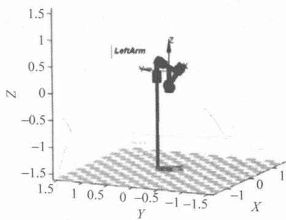

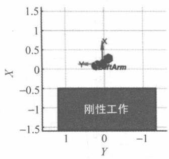

图2-18 仿真的从机器人
{: .figure-caption }


#### 不同控制器下的轨迹跟踪

首先，将从机器人的控制器设计为典型的 PD 控制器，并设计了由主机设备（Touch X）为从机器人（仿真的 Baxter 机器人臂）设置的期望轨迹，其要求操作者将主操纵杆的接触杆从初始位置沿着 x 方向移动到最小值，然后沿 x 方向达到最大值，最后恢复到初始位置，时间跨度为 0～3s。然后，人类操作者沿着 y 方向执行相同的运动 3～6s，并且沿着 z方向执行相同的运动 6～9s。具有传统 PD 控制器的从机器人的轨迹跟踪结果如图 2-19 所示。

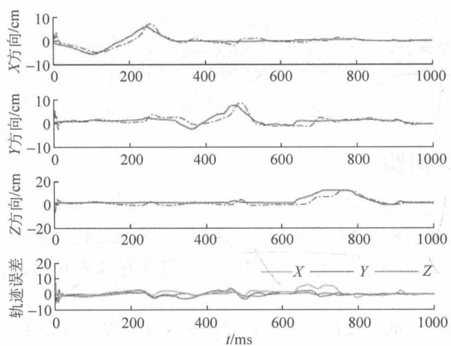

图 2-19 传统 PD 控制器的主设备(实线)和从设备(虚线)的轨迹
{: .figure-caption }


然后，在基本 PD 控制器之上添加 RBF 神经控制器，以将不确定的非线性动力学补偿在该实验中，保留前 10s 用于神经网络训练。

显然,不同关节的权重收敛到不同的值,其中关节 S1,W0 和 W2 的标准权重的值接近于 0,因为它们在机器人的移动期间几乎不受重力影响。在 10\~19s,人工操作者重复最后一个实验的过程。神经网络的权重如图 2-20 所示。与如图 2-19 和图 2-21 所示的两个实验的跟踪性能相比,在添加 RBF 神经网络控制器之后,从机器人的跟踪性能大大提高。

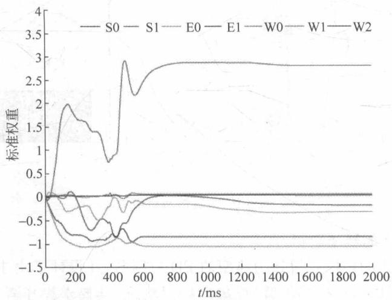

图 2-20 神经网络训练期间从机器人的每个关节的神经网络权重的标准
{: .figure-caption }


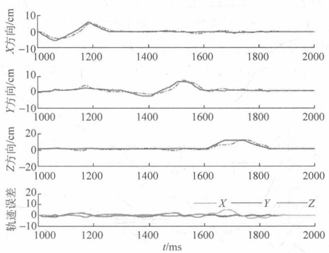

图 2-21 使用 RBF 神经网络补偿的主设备(实线)和从设备(虚线)的轨迹
{: .figure-caption }


#### 在不同的通信下的轨迹和力反馈

在时变延迟的情况下,系统很可能变得不稳定和不可控制。接下来测试远程操作系统通信中的波动变量技术,然后在不使用波动变量的情况下与其他实验组进行比较。实验中添加的时间延迟 $T_{1}$ 和 $T_{2}$ 如图 2-22 所示。图 2-22 中的力反射到人类操作者。图 2-23 是通过 $F_{\mathrm{fb}} = K_{\mathrm{fb}}(x_{\mathrm{s}} - x_{\mathrm{m}})$ 计算的。

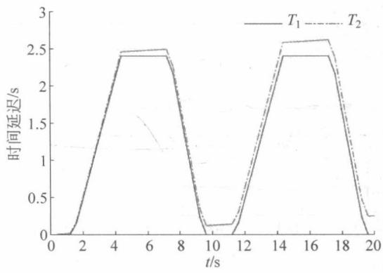

图 2-22 变化时间延迟 $T_{1}$ (实线) 和 $T_{2}$ (虚线)
{: .figure-caption }


人类操作者需要重复上一次实验的两次移动，一次在通信信道中具有波变量，另一次没有。两个比较实验的轨迹跟踪性能如图2-23和图2-24所示。在力反射实验中，类似于壁的刚性工件被建立并沿 $x$ 方向安装，如图2-23所示。在前3s中，主设备和从属机器人都处于自由运动。然后，主件开始朝向从件将接触工件的位置移动，并且接触将持续约10s。在与工件接触期间，从机器人几乎不移动，施加在从机器人上的环境力收敛到设定值，并且操作者以恒定的力保持主装置。然后，操作员将主操纵杆移动回自由运动，并且从动机器人离开工件并跟踪主动作而没有时变延迟。图2-25表示了沿着主设备和从属远程机的 $x$ 方向的轨迹以及具有时变延迟和波变量的力反射，图中的振荡是由于在接触之前和之后的力反馈的过程引起的。

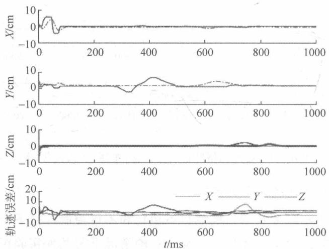

图 2-23 使用波可变技术的主设备(实线)和从设备(虚线)轨迹随时变延迟通信
{: .figure-caption }


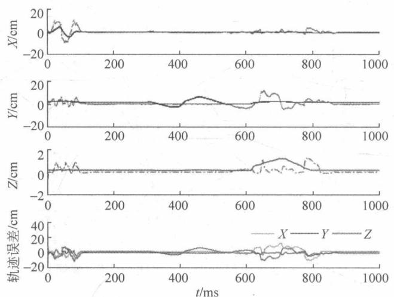

图 2-24 不使用波可变技术的主设备(实线)和从设备(虚线)轨迹随时变延迟通信
{: .figure-caption }


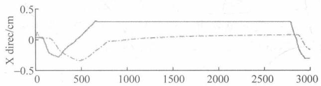

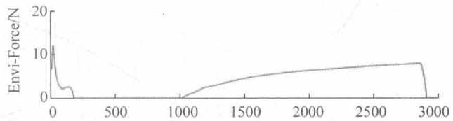

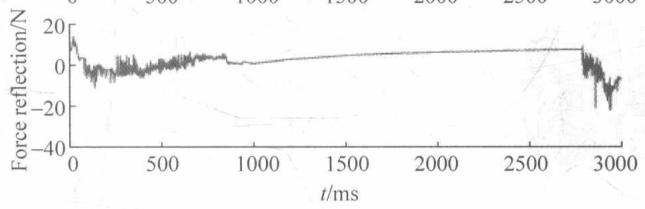

图 2-25 （顶部）使用波可变技术，随着时间延迟通信，沿着主设备（实线）和从设备（虚线）的 x 方向的轨迹；（中）对从机器人的环境力；（底部）使用波可变技术，随着时变延迟通信，沿着 x 方向对主设备施加反馈
{: .figure-caption }


## 2.3 开发混合运动捕捉方法使用 MYO 手环应用于远程操作

本节介绍根据 2.2 节所述方法搭建的仿真系统的设计方法、编程与实现。

### 2.3.1 引言

#### MYO 手环

如图 2-26 所示, MYO 手环(手势控制臂环)是加拿大创业公司 Thalmic Labs 推出的创新性臂环, 佩戴者只要动动手指或者手, 就能操作科技产品, 与之发生互动。手势控制臂环可以佩戴在任何一条胳膊的前臂, 探测用户的肌肉产生的电活动。它通过低功率的蓝牙设备与其他电子产品进行无线连接, 不需要借助相机就可感知用户的动作。MYO 手环由 9 轴 IMU 测量单元(三轴陀螺仪、三轴加速度、三轴磁场)和 8 个肌电信号传感器组成。通过 9 轴惯性测量单元可以有效地测量穿戴者的手臂姿态, 而通过 8 个肌电信号传感器可以检测操作者手臂皮肤表面的肌电信号, 用于识别操作者的手势。通过 MYO 手环提供的肌电信号可以有效地估计操作者的手势。MYO 手环测量的数据可以通过蓝牙传输到计算机。

#### 人类关节运动学模型

健康的人类手臂包括肩关节、肘关节和腕关节，由7个自由度组成，其中肩关节包括3个自由度，肘关节包括2个自由度，腕关节包括2个自由度。

本节使用标准 DH 参数（见表 2-3）的方法，建立了代表人体手臂的运动学模型，如图 2-27 所示。这里假设人类手臂是一个 7 自由度串联机器人手臂，表 2-3 显示相关的 DH 参数。Z 轴表示旋转轴。 $L_{1}$ 表示操作者上臂的长度。 $L_{2}$ 表示操作者的下臂长度。 $L_{3}$ 是手掌的长度。 $L_{1}$ 、 $L_{2}$ 和 $L_{3}$ 的单位为米。假设手腕偏航角为零。

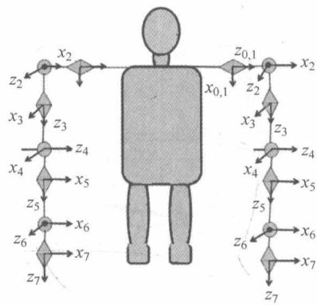

图 2-27 人类肢体的运动学模型
{: .figure-caption }


图 2-26 MYO 手环
{: .figure-caption }

表 2-3 人体动力学模型的标准 DH 参数

<table><tr><td> <span class="arithmatex">\(i\)</span> </td><td> <span class="arithmatex">\({\theta }_{1}\)</span> </td><td> <span class="arithmatex">\({d}_{i}\)</span> </td><td> <span class="arithmatex">\({a}_{i}\)</span> </td><td> <span class="arithmatex">\({\alpha }_{i}\)</span> </td></tr><tr><td>1</td><td> <span class="arithmatex">\({q}_{1}\)</span> </td><td>0</td><td>0</td><td> <span class="arithmatex">\(- {90}^{ \circ }\)</span> </td></tr><tr><td>2</td><td> <span class="arithmatex">\({q}_{2} + {90}^{ \circ }\)</span> </td><td>0</td><td>0</td><td> <span class="arithmatex">\({90}^{ \circ }\)</span> </td></tr><tr><td>3</td><td> <span class="arithmatex">\({q}_{3}\)</span> </td><td> <span class="arithmatex">\({L}_{1}\)</span> </td><td>0</td><td> <span class="arithmatex">\(- {90}^{ \circ }\)</span> </td></tr><tr><td>4</td><td> <span class="arithmatex">\({q}_{4}\)</span> </td><td>0</td><td>0</td><td> <span class="arithmatex">\({90}^{ \circ }\)</span> </td></tr><tr><td>5</td><td> <span class="arithmatex">\({q}_{5}\)</span> </td><td> <span class="arithmatex">\({L}_{2}\)</span> </td><td>0</td><td> <span class="arithmatex">\(- {90}^{ \circ }\)</span> </td></tr><tr><td>6</td><td> <span class="arithmatex">\({q}_{6}\)</span> </td><td>0</td><td>0</td><td> <span class="arithmatex">\({90}^{ \circ }\)</span> </td></tr><tr><td>7</td><td> <span class="arithmatex">\({q}_{7}\)</span> </td><td> <span class="arithmatex">\({L}_{3}\)</span> </td><td>0</td><td>0</td></tr></table>

### 2.3.2 设计方法

#### 肩部和肘部运动捕获方法Ⅰ

如图 2-28 所示, 全局坐标系 $(X_{\mathrm{G}}, Y_{\mathrm{G}}, Z_{\mathrm{G}})$ 定义为: X 轴指向侧面; Y 轴向前, Z 轴向上。假设最初肱骨参考坐标系 $(X_{\mathrm{T}}, Y_{\mathrm{T}}, Z_{\mathrm{T}})$ 和前臂参考坐标系 $(X_{\mathrm{F}}, Y_{\mathrm{F}}, Z_{\mathrm{F}})$ 与全局坐标系重合, 因此能够确定旋转矩阵 $R_{\mathrm{GF}}^{i} = [X_{\mathrm{GF}}^{i} Y_{\mathrm{GF}}^{i} Z_{\mathrm{GF}}^{i}]$ 和 $R_{\mathrm{GH}}^{i} = [X_{\mathrm{GH}}^{i} Y_{\mathrm{GH}}^{i} Z_{\mathrm{GH}}^{i}]$ , 其中 R 表示旋转矩阵; 上标“i”表示初始位置; 下标“G”、“H”和“F”分别表示全局参考坐标系、肱骨参考坐标系和前臂参考坐标系。旋转矩阵 $R_{\mathrm{MN}}$ 表示参考坐标系“N”相对于参考坐标系“M”的姿态。列向量 $X_{MN}, Y_{MN}, Z_{MN}$ 表示用参考坐标系“M”表示坐标系“N”的坐标轴方向的单位向量， $X_{MN}, Y_{MN}, Z_{MN} \in R^{3 \times 1}$ 。

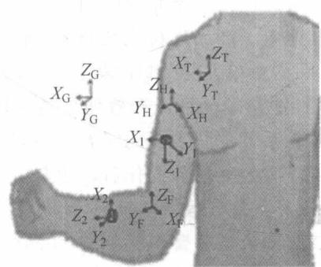

图 2-28 全局参考坐标系以及局部参考坐标系
{: .figure-caption }


肱骨坐标系相对于第一个 MYO 臂环坐标系和下臂坐标系相对于第二个 MYO 臂环坐标系的取向分别表示如下：

$$
\boldsymbol {R} _ {U H} ^ {i} = \left(\boldsymbol {R} _ {G U ^ {\cdot}} ^ {i}\right) ^ {\mathrm{T}} \boldsymbol {R} _ {G U} ^ {i}, \quad \boldsymbol {R} _ {L F} ^ {i} = \left(\boldsymbol {R} _ {G L} ^ {i}\right) ^ {\mathrm{T}} \boldsymbol {R} _ {G F} ^ {i}\tag{2.62}
$$

其中，下标 U 表示佩戴在上臂上的第一 MYO 手环坐标系，下标 L 表示佩戴在下臂上的第二 MYO 手环坐标系。

当操作者将手臂移动到新的姿势时,全局坐标系中的肱骨和前臂的取向可以由以下旋转矩阵描述:

$$
\boldsymbol {R} _ {G H} ^ {f} = \boldsymbol {R} _ {G U} ^ {f} \boldsymbol {R} _ {U H} ^ {i}, \quad \boldsymbol {R} _ {G F} ^ {f} = \boldsymbol {R} _ {G L} ^ {f} \boldsymbol {R} _ {L F} ^ {i}\tag{2.63}
$$

其中，上标 f 表示操作者的手臂新姿势。

从第一个 MYO 的陀螺仪, 获得四元数 $q = [x, y, z, w]^{\mathrm{T}}$ , 其中 $(x, y, z)$ 是向量, w 是标量。

$$
\boldsymbol {q} = \boldsymbol {x} _ {i} + \boldsymbol {y} _ {j} + \boldsymbol {z} _ {k} + \boldsymbol {\omega}\tag{2.64}
$$

从四元数中,肱骨在全局坐标系中的姿态可以表示如下:

$$
\begin{array}{r l} \mathbf {R} _ {G H} ^ {f} & = \left[ \begin{array}{l l l} r _ {1 1} & r _ {1 2} & r _ {1 3} \\ r _ {2 1} & r _ {2 2} & r _ {2 3} \\ r _ {3 1} & r _ {3 2} & r _ {3 3} \end{array} \right] \\ & = \left[ \begin{array}{l l l} 1 - 2 (y ^ {2} + z ^ {2}) & 2 (x y - w z) & 2 (w y + x z) \\ 2 (x y + w z) & 1 - 2 (x ^ {2} + z ^ {2}) & 2 (y z - w x) \\ 2 (x z - w y) & 2 (w x + y z) & 1 - 2 (x ^ {2} + y ^ {2}) \end{array} \right] \end{array}\tag{2.65}
$$

人体胳膊坐标系的关节角度图示见图2-29。考虑参考坐标系 $\{B\}$ 和坐标系 $\{A\}$ 之间的3个欧拉角，即 $\gamma, \beta, \alpha$ ，它们分别是回转角、俯仰角和偏转角。首先，参考坐标系 $\{B\}$ 与参考坐标系 $\{A\}$ 重合，然后参考坐标系 $\{B\}$ 绕 $x$ 轴旋转 $\gamma$ 弧度，然后绕 $y$ 轴旋转 $\beta$ 弧度，最后绕 $z$ 轴旋转 $\alpha$ 弧度。因此，可以写成如下形式：

$$
\begin{array}{r l} \boldsymbol {R} _ {G H} ^ {f} & = \boldsymbol {R} _ {Z} (\alpha) \boldsymbol {R} _ {Y} (\beta) \boldsymbol {R} _ {X} (\gamma) \\ & = \left[ \begin{array}{c c c} c \alpha c \beta & c \alpha s \beta s \gamma - s \alpha c \gamma & c \alpha s \beta c \gamma + s \alpha s \gamma \\ s \alpha c \beta & s \alpha s \beta s \gamma + c \alpha c \gamma & s \alpha s \beta c \gamma - c \alpha s \gamma \\ - s \beta & c \beta s \gamma & c \beta c \gamma \end{array} \right] \end{array}\tag{2.66}
$$

其中， $c\beta$ 是 $\cos\beta$ 的简写， $s\beta$ 是 $\sin\beta$ 的简写。

从两个 MYO 手环的读数, 可以计算操作者手臂的前五个关节角度。从上面的式子可以计算 3 个肩关节角度(肩部弯曲/伸展、外展/内收和内/外旋转):

$$
\beta = A \tan 2 (\sqrt {r _ {3 1} ^ {2} + r _ {3 2} ^ {2}}, r _ {3 3})\tag{2.67}
$$

$$
\alpha = A \tan 2 (r _ {2 3} / s \beta , r _ {1 3} / s \beta)\tag{2.68}
$$

$$
\gamma = A \tan 2 (r _ {3 2} / s \beta , - r _ {3 1} / s \beta)\tag{2.69}
$$

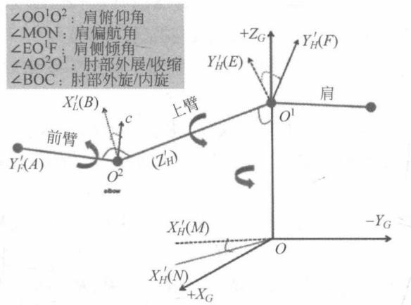

图 2-29 人体胳膊坐标系的关节角度图示
{: .figure-caption }


其中， $\gamma,\alpha$ 和 $\beta$ 分别代表肩关节回转角、偏转角和俯仰角。

通过从两个 MYO 手环收集的数据, 还可以计算两个肘关节角度(肘屈曲/伸展和旋前/旋后), 通过第二个 MYO 臂环可以得到如下旋转矩阵:

$$
\boldsymbol {R} _ {G L} ^ {f} = \left[ \begin{array}{l l l} a _ {1 1} & a _ {1 2} & a _ {1 3} \\ a _ {2 1} & a _ {2 2} & a _ {2 3} \\ a _ {3 1} & a _ {3 2} & a _ {3 3} \end{array} \right]\tag{2.70}
$$

因此可得：

$$
A _ {f e} = \arccos (a _ {1 2} r _ {1 3} + a _ {2 2} r _ {2 3} + a _ {3 2} r _ {3 3})\tag{2.71}
$$

$$
A _ {p s} = \arccos (a _ {1 1} r _ {1 1} + a _ {2 1} r _ {2 1} + a _ {3 1} r _ {3 1})\tag{3.72}
$$

其中， $A_{fe}$ 和 $A_{ps}$ 分别表示肘关节屈曲和肘弯的关节角度。

#### 肩部和肘部运动捕获方法Ⅱ

为了估计上臂的旋转角度,需要先找出用于描述操作者上臂三个旋转轴线的旋转矩阵。 $W_{FE}$ 、 $W_{AA}$ 、 $W_{IE}$ 是相对于胸部坐标系的旋转矩阵,分别用来描述上臂屈曲伸展、外展内收和内旋外旋的旋转轴。

计算旋转矩阵 $W_{FE}$ 的步骤如下：

① 操作者手臂戴两个 MYO 手环站立，将手臂自然放在一侧。

② 让操作者以缓慢速度完全弯曲上臂,到达手臂弯曲上限后,将手臂伸回到初始位置。计算旋转矩阵 $W_{AA}$ 的步骤如下:

① 让操作者以缓慢的速度完全外展上臂。

② 让操作者将手臂加回到初始位置。

通过相同的过程,以下面的方式找到 $W_{IE}$ 。让操作者的手臂以适当的速度向内充分旋转,然后旋转回到初始位置。操作者每个动作执行5次。为了找到胸部坐标系中上臂屈曲伸展的旋转轴,假设胸部坐标系是固定的,并且胸部的坐标系与全局坐标系重合。上臂的MYO手在最初参考坐标系中的姿态用旋转矩阵表示如下:

$$
\boldsymbol {R} _ {U} ^ {i f} = (\boldsymbol {R} _ {G U} ^ {i}) \boldsymbol {R} _ {G U} ^ {f}\tag{2.73}
$$

$R_{U}^{if}$ 的旋转轴可以由下面的对称矩阵表示：

$$
\boldsymbol {W} _ {U} ^ {F E} = \boldsymbol {R} _ {U} ^ {i f} - (\boldsymbol {R} _ {U} ^ {i f}) ^ {\mathrm{T}} = \left[ \begin{array}{c c c} 0 & - w _ {z} & w _ {y} \\ w _ {z} & 0 & - w _ {x} \\ - w _ {y} & w _ {x} & 0 \end{array} \right]\tag{2.74}
$$

旋转矩阵 $W_{U}^{FE}$ 关于旋转轴的描述为：

$$
W = W _ {U} ^ {F E} / \sqrt {w _ {x} ^ {2} + w _ {y} ^ {2} + w _ {z} ^ {2}}\tag{2.75}
$$

因为胸部坐标系与全局坐标系重合,所以胸部坐标系中的旋转轴的旋转矩阵可以写为

$$
\boldsymbol {W} _ {F E} = \boldsymbol {R} _ {G U} ^ {i} \boldsymbol {W}\tag{2.76}
$$

同理,可以引入对应于外展内收和内旋外旋的旋转轴的反对称矩阵。可以计算出肱骨坐标系在胸部坐标系中的姿态为

$$
\boldsymbol {R} _ {T H} ^ {n} = \left(\boldsymbol {R} _ {G T} ^ {n}\right) ^ {\mathrm{T}} \boldsymbol {R} _ {G H} ^ {n}\tag{2.77}
$$

其中，下标“T”表示胸部坐标系。在时间步骤 n，肱骨坐标系相对于初始姿态的的旋转矩阵可以计算为

$$
\boldsymbol {R} _ {T} ^ {i, n} = (\boldsymbol {R} _ {T H} ^ {i}) ^ {\mathrm{T}} \boldsymbol {R} _ {H R} ^ {n}\tag{2.78}
$$

刚体围绕固定轴线旋转以指数形式描述为 $R = e^{Wq}$ ，其中 $q \in R$ 是围绕旋转轴线的旋转角度，用更明确的形式可以表示为

$$
\boldsymbol {R} = \mathrm{e} ^ {\hat {W} q} = \boldsymbol {I} + \hat {\boldsymbol {W}} \sin q + \hat {\boldsymbol {W}} ^ {2} (1 - \cos q)\tag{2.79}
$$

其中， $w=(w_{x},w_{y},w_{z})^{\mathrm{T}}\in R^{3\times1}$ ，W表示刚体的旋转轴。在肩关节中有3个自由度，使得上臂的运动可以分解成3个连续的旋转，分别是围绕屈伸伸展的轴线、外展内收的轴线和内旋外旋的轴线，计算公式如下

$$
\boldsymbol {R} _ {\text { shoulder }} = \mathrm{e} ^ {W ^ {F E} q _ {F E}} \mathrm{e} ^ {W ^ {A A} q _ {A A}} \mathrm{e} ^ {W ^ {E I} q _ {E I}}\tag{2.80}
$$

其中， $R_{shoulder}$ 和式(2.78)中的 $R_{T}^{i,n}$ 表示上臂相同的运动。 $q_{FE}$ 、 $q_{AA}$ 、 $q_{EI}$ 分别是相对于伸展的轴线、外展内收的轴线和内旋外旋的轴线的旋转角。

下臂的最终位置相对于第二个 MYO 手环坐标中的初始位置的姿态是

$$
\boldsymbol {R} _ {L} ^ {i f} = \left(\boldsymbol {R} _ {G L} ^ {i}\right) ^ {\mathrm{T}} \boldsymbol {R} _ {G L} ^ {f}\tag{2.81}
$$

$R_{L}^{if}$ 的旋转轴用斜对称矩阵 $R_{L}^{EF}$ 表示为

$$
\boldsymbol {W} _ {L} ^ {E F} = \boldsymbol {R} _ {L} ^ {i f} - (\boldsymbol {R} _ {L} ^ {i f}) ^ {\mathrm{T}}\tag{2.82}
$$

下臂 MYO 坐标系旋转轴用旋转矩阵表示为

$$
\boldsymbol {W} _ {2} = \boldsymbol {W} _ {L} ^ {E F} / \sqrt {w _ {2 x} ^ {2} + w _ {2 y} ^ {2} + w _ {2 z} ^ {2}}\tag{2.83}
$$

其中， $w_{2x}^{2}$ 、 $w_{2y}^{2}$ 和 $w_{2z}^{2}$ 是 $W_{L}^{EF}$ 的元素。相对于上臂 MYO 手环坐标系中，旋转轴的姿态表示为

$$
\boldsymbol {W} _ {1} = \boldsymbol {R} _ {U L} ^ {i} \boldsymbol {W} _ {2}\tag{2.84}
$$

肱骨坐标系中旋转轴的姿态为

$$
\boldsymbol {W} _ {E F} = \left(\boldsymbol {R} _ {G H} ^ {i}\right) ^ {\mathrm{T}} \boldsymbol {R} _ {G U} ^ {i} \boldsymbol {W} _ {1}\tag{2.85}
$$

前臂坐标系在肱骨坐标系中的姿态为

$$
\boldsymbol {R} _ {H F} ^ {n} = (\boldsymbol {R} _ {G H} ^ {n}) ^ {\mathrm{T}} \boldsymbol {R} _ {G F} ^ {0}\tag{2.86}
$$

下臂在肱骨坐标系中的姿态为

$$
\boldsymbol {R} _ {H} ^ {i, n} = (\boldsymbol {R} _ {H F} ^ {i}) ^ {\mathrm{T}} \boldsymbol {R} _ {H F} ^ {n}\tag{2.87}
$$

考虑到肘部有两个自由度。肘的运动可以由两个连续的旋转组成：一个是关于肘关节的屈曲伸展，另一个是关于肘关节的内旋外旋

$$
\boldsymbol {R} _ {\mathrm{elbow}} = \mathrm{e} ^ {W ^ {F E} q _ {F E}} \mathrm{e} ^ {W ^ {P S} q _ {P S}}\tag{2.88}
$$

其中， $R_{elbow}$ 和 $R_{H}^{i,n}$ 是描述操作者肘关节运动的旋转矩阵， $q_{FE}$ 和 $q_{PS}$ 分别是相对于轴关节屈曲延伸轴和内旋外旋轴的旋转角度。

#### 手腕关节角度估计

当 MYO 手环佩戴在操作者的前臂上时，它能够通过 EMG 信号识别操作者的手姿势。通过确定的手势，基于 EMG 信号建立关节角度模型。这里只估算手腕的回转角。令 $\theta_{i}$ 表示腕关节角，其中 i=1,2 表示不同的旋转方向。EMG(IEMG) 是一个引入的变量，可以通过应用全智能整流和平滑得到。EMG 信号的幅度作为 IEMG 信号的平均值的 AIEMG 特征表示。其中， $IEMG1(n)(n=1,\cdots,8)$ 是第 1 个 EMG 传感器测量第 n 参考坐标系中的 IEMG 信号的值。第 n 参考坐标系中的 AIEMG 特征的平均值计算如下

$$
A I E M G _ {l} (m) = \frac {1}{t} \int_ {0} ^ {t} I E M G _ {l} \mathrm{d} t\tag{2.89}
$$

假设腕关节角度的幅度和 ENG 信号之间的关系是近似线性的。腕关节角度计算为

$$
E (n) \frac {1}{L} \sum_ {l = 1} ^ {8} A I E M G _ {l} (n)\tag{2.90}
$$

其中， $\theta_{i}^{\max}$ 是手势 $i$ 中角度的最大值， $i = 1$ 表示手掌向内， $i = 2$ 表示手掌向外。 $E_{i}^{\max}$ 和 $E_{i}^{\min}$ 分别是 $E(n)$ 的最大值和最小值，因此

$$
\hat {\theta} _ {i} = \frac {E (n) - E _ {i} ^ {\mathrm{min}}}{E _ {i} ^ {\mathrm{max}} - E _ {i} ^ {\mathrm{min}}} \theta_ {i} ^ {\mathrm{max}}\tag{2.91}
$$

### 2.3.3 仿真系统设计

根据编者前期研究工作,下面介绍根据上述方法搭建的仿真系统的编程与实现。设计仿真系统如图 2-30 所示。它的工作原理为: MYO 手环用于采集操作者手臂的姿态数据,经过无线蓝牙发送到计算机。然后通过一个 C++ 程序对这些数据进行处理,计算出操作者手臂的关节角度,包括 3 个肩关节角度和 2 个肘关节角度,从而确定手臂的姿态。最后,通过无线网络将关节角发送到另一台计算机中的 MATLAB 程序,用于控制虚拟的机器人模型。


图 2-30 仿真系统的结构
{: .figure-caption }


#### 使用程序接收并处理 MYO 手环传输的数据所使用的代码如下：

```txt
if (identifyMyo(myo) == 1)
{
    // Calculate Euler angles (roll, pitch, and yaw) from the unit quaternion.

    a11 = 1 - 2 * (quat.y() * quat.y() + quat.z() * quat.z());
    a12 = 2 * (quat.x() * quat.y() - quat.z() * quat.w());
    a13 = 2 * (quat.x() * quat.z() + quat.y() * quat.w());
    a21 = 2 * (quat.x() * quat.y() + quat.z() * quat.w());
    a22 = 1 - 2 * (quat.x() * quat.x() + quat.z() * quat.z());
    a23 = 2 * (quat.y() * quat.z() - quat.x() * quat.w());
    a31 = 2 * (quat.x() * quat.z() - quat.y() * quat.w());
    a32 = 2 * (quat.y() * quat.z() + quat.x() * quat.w());
    a33 = 1 - 2 * (quat.x() * quat.x() + quat.y() * quat.y());

    // calculated the three shoulder joint angles.
    float pitch = atan2(-1 * a31, sqrt(a11 * a11 + a21 * a21));
    float yaw = atan2(a21 / (cos(pitch)), a11 / (cos(pitch)));
    float roll = atan2(a32 / (cos(pitch)), a33 / (cos(pitch)));
    // 转换为度数
    pitch_w = pitch / 3.14 * 180;
    roll_w = -1 * roll / 3.14 * 180;
    yaw_w = yaw / 3.14 * 180;
    }
    else
    {
    // Calculate Euler angles (roll, pitch, and yaw) from the unit quaternion.

    b11 = 1 - 2 * (quat.y() * quat.y() + quat.z() * quat.z());
    b12 = 2 * (quat.x() * quat.y() - quat.z() * quat.w());
    b13 = 2 * (quat.x() * quat.z() + quat.y() * quat.w());
    b21 = 2 * (quat.x() * quat.y() + quat.z() * quat.w());
    b22 = 1 - 2 * (quat.x() * quat.x() + quat.z() * quat.z());
    b23 = 2 * (quat.y() * quat.z() - quat.x() * quat.w());
    b31 = 2 * (quat.x() * quat.z() - quat.y() * quat.w());
    b32 = 2 * (quat.y() * quat.z() + quat.x() * quat.w());
    b33 = 1 - 2 * (quat.x() * quat.x() + quat.y() * quat.y));

    // calculated the elbow joint angles
    float Pitch = acos(a11 * b11 + a21 * b21 + a31 * b31);
    // float Roll = acos((a31 * b21 - a21 * b31) * b12 + (a11 * b31 - a31 * b11) * b22 + (a21 * b11 - a11 * b21) * b32);
    float Roll = acos(a12 * b12 + a22 * b22 + a32 * b32);
    // 转换成度数
    Pitch_w = Pitch / 3.14 * 180;
    Roll_w = Roll / 3.14 * 180;
```

2. 使用 MATLAB 机器人工具箱对机器人进行建模所使用的 MATLAB 代码如下：

```matlab
% 设置机器人的连杆长度
11 = 0.27;
12 = 0.069;
13 = 0.28;
deg = pi/180;
clear L;
% 使用标准的 DH 参数对人体手臂进行建模
%    \theta    d a \alpha \sigma
    % 0.1    % 0.069
L(1) = Link([0,    0.1,    0.069, -pi/2, 0], 'standard');
L(2) = Link([pi/2,    0,    0, pi/2, 0], 'standard');
L(3) = Link([0,    0.364,    L2, -pi/2, 0], 'standard');
L(4) = Link([0,    0,    0, pi/2, 0], 'standard');
L(5) = Link([0,    0.104 + 0.271,    0.01, -pi/2, 0], 'standard');
L(6) = Link([0,    0,    0, pi/2, 0], 'standard');
L(7) = Link([0,    0.28,    0,    0, 0], 'standard');
% 显示手臂的名称
D_H = SerialLink(L, 'name', 'robot arm');
% 设置初始位姿
oqz = [0, 0, 0, 0, 0, 0, 0];
oqn = [0, pi/2, 0, 0, 0, 0, 0];
% 画出机器人模型
D_H.plot(oqn);
% 设置观察角度
view(100, 45);
clear L;
```

### 2.3.4 仿真实验

为了验证仿真系统的有效性,开展了以下实验: 让一个操作者参与到实验中。操作者在同一个手臂上穿戴两个 MYO 手环,保持站立的姿势。第一个 MYO 手环佩戴在上臂中心附近,第二个 MYO 手环佩戴在前臂中心附近。利用本书介绍的 MATLAB 机器人工具箱建立虚拟的机器人手臂,其初始姿势如图 2-31 所示。

在操作者控制虚拟机器人臂之前，MYO 手环必须被校准，并且 EMG 传感器必须进行一段时间的“适应”操作者手臂，使得 MYO 手环能够辨别不同的手姿势。操作者不能移动位置，使得只有两个臂可以自由移动。而且，实验过程中，手臂的移动速度不能过快。

如图 2-32 所示, 可以看到, 当操作者以适当的速度移动臂时, 虚拟机器人臂很好地跟随操作者的手臂运动。操作者手臂在不同姿势下的方向如表 2-4 和表 2-5 所示, 前三行的值分别用于俯仰角、回转角和偏转角。第四和第五行的值为肘关节的弯曲和回转角度，第六行为手腕关节角度。可以看到，两种方法都能够捕获人的手臂姿势。

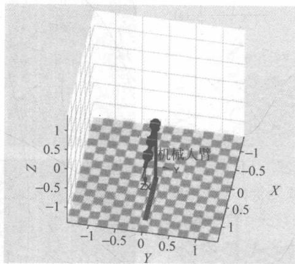

图 2-31 机器人模型的初始位姿
{: .figure-caption }


表 2-4 第一种方法计算不同位置的操作者臂的关节角度

<table><tr><td>姿态</td><td>俯仰角</td><td>翻滚角1</td><td>偏航角</td><td>屈伸角</td><td>翻滚角2</td><td>手腕翻滚角</td></tr><tr><td>1</td><td>12.58</td><td>-17.44</td><td>12.36</td><td>18.72</td><td>5.70</td><td>0</td></tr><tr><td>2</td><td>4.41</td><td>-31.54</td><td>-11.78</td><td>12.85</td><td>19.31</td><td>42.85</td></tr><tr><td>3</td><td>-15.42</td><td>-28.08</td><td>62.70</td><td>18.59</td><td>12.34</td><td>0</td></tr><tr><td>4</td><td>-15.61</td><td>-79.54</td><td>53.28</td><td>6.5</td><td>47.69</td><td>0</td></tr><tr><td>5</td><td>-64.96</td><td>-18.30</td><td>20.04</td><td>16.63</td><td>47.69</td><td>0</td></tr><tr><td>6</td><td>6.63</td><td>-21.30</td><td>-8.79</td><td>89.58</td><td>17.54</td><td>0</td></tr><tr><td>7</td><td>0.07</td><td>-22.65</td><td>-10.28</td><td>73.02</td><td>27.49</td><td>0</td></tr><tr><td>8</td><td>-34.87</td><td>-58.39</td><td>22.93</td><td>65.68</td><td>30.05</td><td>75.08</td></tr></table>

表 2-5 第二种方法计算不同位置的操作者臂的关节角度

<table><tr><td>姿态</td><td>俯仰角</td><td>翻滚角1</td><td>偏航角</td><td>屈伸角</td><td>翻滚角2</td><td>手腕翻滚角</td></tr><tr><td>1</td><td>18.00</td><td>-8.02</td><td>-4.67</td><td>16.33</td><td>0.78</td><td>0</td></tr><tr><td>2</td><td>12.18</td><td>-24.52</td><td>-6.23</td><td>7.92</td><td>21.34</td><td>42.85</td></tr><tr><td>3</td><td>-21.34</td><td>-40.41</td><td>47.55</td><td>8.63</td><td>13.51</td><td>0</td></tr><tr><td>4</td><td>-4.92</td><td>-86.27</td><td>41.59</td><td>36.6</td><td>12.60</td><td>0</td></tr><tr><td>5</td><td>-77.18</td><td>-21.12</td><td>-31.01</td><td>14.28</td><td>5.56</td><td>0</td></tr><tr><td>6</td><td>-4.19</td><td>-21.52</td><td>-12.36</td><td>81.25</td><td>21.84</td><td>0</td></tr><tr><td>7</td><td>5.17</td><td>-19.51</td><td>-8.61</td><td>71.00</td><td>4.16</td><td>0</td></tr><tr><td>8</td><td>-42.61</td><td>-66.68</td><td>-59.90</td><td>60.19</td><td>27.81</td><td>75.08</td></tr></table>

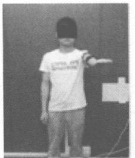

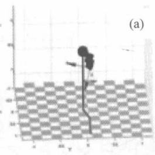

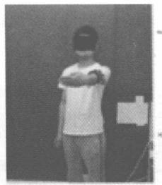

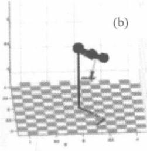

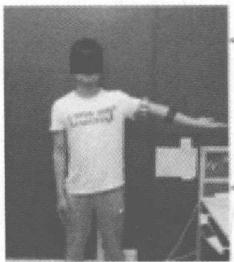

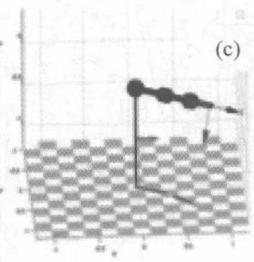

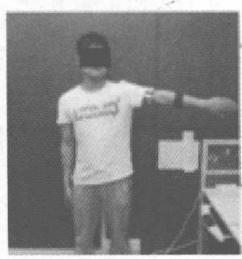

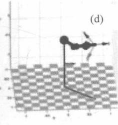

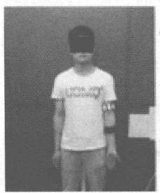

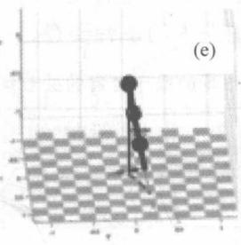

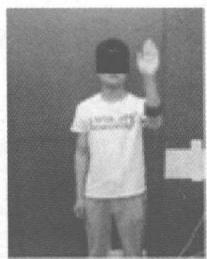


图 2-32 操作者的不同手臂姿态控制不同的机械臂姿态(使用 MATLAB 工具箱中的仿真机器人)
{: .figure-caption }

(a) 姿态 1: 操作者的手臂初始姿势; (b) 姿态 2: 操作者的手波入; (c) 姿态 3: 操作者的肩膀内收; (d) 姿态 4: 操作者的肩部内旋; (e) 姿态 5: 操作者的手臂放下; (f) 姿态 6: 操作者的肘伸展; (g) 姿态 7: 操作者的肘关节;
(h) 姿态 8: 操作者的复杂姿势

## 2.4 基于自适应参数识别的 Geomagic Touch X 触觉装置运动学建模

本节主要介绍基于自适应参数识别的 Geomagic Touch X 触觉装置运动学建模的步骤、仿真设计、编程与实现。

### 2.4.1 引言

在过去二十年中，力反馈设备的商业化已使得触觉技术广泛应用在各个方面，例如虚拟现实、遥操作、娱乐和医学研究。触觉技术在如牙修复和医学模拟中成为研究热点，引起了广泛的关注。

Geomagic Touch X 是由 SensAble 技术公司开发的触觉装置, 不仅仅提供了力反馈装置, 还提供了硬件驱动程序和软件包 (OpenHaptics 工具包)。它支持一系列如手动旋转的动作, 支持各种商业、学术和研究应用。该装置是专门为动觉反馈设计, 包含了一系列机器手臂以及一个手柄。它的机器手臂包括 3 个旋转关节, 每个关节配备一个电机提供反馈力。手柄是通过一个万向节安装在机器手臂末端的。Touch X 设备具有级联结构, 具有定位精度高、工作空间大、摩擦小、惯性低的性能。

当操作者在人机交互应用上使用触觉设备，如医学模拟训练，需要设计一个视觉反馈接口在模拟环境中显示用户的操作来作为反馈信息，提高操作可控性。为了达到这个目的，首先需要建立一个高精度的机器人运动学模型来描述机器人的运动。MATLAB软件包提供了一个有效的仿真环境，包含了多种专业工具箱和许多数学函数，因此，该软件包应用于机器人实时的控制和运动性能的表示。Robotics Toolbox 是一个在 MATLAB 下建立的机器人仿真软件，也已广泛应用。它允许用户以一个简单的方式规划轨迹和实现坐标变换，同时有内置模块来获取机器人动力学和运动学信息，而这些功能都是创建仿真模型的基础。

DH 方法已广泛应用于描述机器人的运动学模型。它可以用来建立运动学模型以分析机器人结构的几何形状。如果一个机器人的 DH 参数是完全已知的，机器人的运动就可以很容易地利用机器人工具箱进行模拟，并计算机器人的运动学（例如雅可比矩阵、关节姿态等）。

然而 Touch X 装置的标称 DH 参数并不提供给用户,而且由于机械结构是看不见的,所以不易测量。相反,官方提供的 SDK 提供了末端执行器的位置和关节角度。为了获得精确的 DH 参数并进一步建立运动学模型,需要通过参数估计方法确定有效的 DH 参数。

机器人的自适应控制已经研究了数十年,它一直被视为一个强大的用来估计机器人系统未知参数的工具。通过使用恰当的自适应规律和一些错误估计的信息,估计的参数可以渐近收敛到真实值。

本节提到的自适应参数估计算法被应用于解决 DH 参数识别问题。同时，利用 DH 表示法模拟三维运动学模型来表示 Touch X 的运动。此外，实施实验来测试模型的精确度和验证参数估计的有效性。本节建立一个 Touch X 设备的精确模型，利用有限时间收敛估计来确定未知的 DH 参数和精确确定器件的工作空间。

### 2.4.2 建模步骤

Touch X 触觉设备的运动学建模过程包括以下步骤。首先，介绍该触觉设备的基本机械结构；其次，使用修改的 DH 法来获取 Touch X 的正向运动学方程；然后，利用自适应有限时间估计的方法来获取触觉设备的 DH 参数。

#### Touch X 设备的描述

Geomagic 的 Touch X 触觉设备由一系列环节组成, 包括 6 个旋转关节。前 3 个关节配备直流电机和光电编码器, 这些关节描述了末端执行器的位置和确定了反馈力大小。后 3 个关节通过万向节连接到端部执行器, 这些关节与手柄的方向有关。同时, 通过 OpenHaptics 工具包, 用户可以通过手柄获取关节角度和末端控制器的位置。

#### 机器人正运动学模型

正向运动学用来描述关节角度和机器人位置和方向之间的关系。对于 Touch X 触觉设备，本地化端部执行器的位置是很重要的，因为它代表了手柄柄端并且将用于在虚拟环境中位置信息的广义化。同时，手柄的方向与 3 个转动关节形成的万向节有关。这是一个有效的结构，因为它允许用户独立地控制和定位。为了建立一个与 Touch X 相似的运动学模型，需要计算出它的运动学模型的 DH 参数见表 2-6。Touch X 的运动学模型如图 2-33 所示。

Touch X 模型的 DH 参数

<table><tr><td>连杆</td><td> <span class="arithmatex">\(a_{i-1}\)</span> (m)</td><td> <span class="arithmatex">\(d_i\)</span> (m)</td><td> <span class="arithmatex">\(\alpha_{i-1}\)</span> (rad)</td><td> <span class="arithmatex">\(\theta_i\)</span> </td></tr><tr><td>1</td><td>0</td><td>0</td><td>0</td><td> <span class="arithmatex">\(q_1\)</span> </td></tr><tr><td>2</td><td>0</td><td>0</td><td> <span class="arithmatex">\(-\pi/2\)</span> </td><td> <span class="arithmatex">\(q_2\)</span> </td></tr><tr><td>3</td><td> <span class="arithmatex">\(l_1\)</span> </td><td>0</td><td>0</td><td> <span class="arithmatex">\(q_3\)</span> </td></tr><tr><td>4</td><td>0</td><td> <span class="arithmatex">\(l_2\)</span> </td><td> <span class="arithmatex">\(-\pi/2\)</span> </td><td> <span class="arithmatex">\(q_4\)</span> </td></tr><tr><td>5</td><td>0</td><td>0</td><td> <span class="arithmatex">\(-\pi/2\)</span> </td><td> <span class="arithmatex">\(q_5\)</span> </td></tr><tr><td>6</td><td>0.030</td><td>0</td><td> <span class="arithmatex">\(-\pi/2\)</span> </td><td> <span class="arithmatex">\(q_6\)</span> </td></tr></table>

$\alpha_{i-1}$ 表示连杆的旋转， $a_{i-1}$ 表示连杆的长度， $d_{i-1}$ 表示连杆的偏移，还有 $\theta_{i-1}$ 表示关节角度，它们都是变量。连杆长度 $L_{1}$ 和 $L_{2}$ 是关节 2 和 3、关节 3 和 5 之间的长度。在运动学模型中，关节 4 和 5 分别设置在两个正交点的同一点上。因此，连杆偏移 $d_{5}$ 设置为零。由于在运动学模型中关节 4、5 和 6 只代表方向，与末端执行器的位置无关。连杆长度 $a_{5}$ 可以通过直尺来预先测量。注意： $L_{1}$ 和 $L_{2}$ 的长度由于机械结构是看不见的因此是未知的，很难精确地测量它的值，这些参数将通过下一节的估计算法得到。


图 2-33 Touch X 的运动学模型示意图
{: .figure-caption }


利用 DH 表示法, Touch X 设备的每一个环节都附有一个坐标系。当 $\theta_{1}$ 等于零的时候与坐标系 $\{1\}$ 有关, 坐标系 $\{2\}$ 的原点与坐标系 $\{1\}$ 相同。

有了这些 DH 参数,有关 i-1 到 i 所涉及的坐标系的齐次变换矩阵如下所示。

$$
{ } ^ { i - 1 } \mathbf { A } _ { i } = \left[ \begin{array} { c c c c } c _ { i } & - s _ { i } & 0 & a _ { i - 1 } \\ s _ { i } c \alpha _ { i - 1 } & c _ { i } c \alpha _ { i - 1 } & - s \alpha _ { i - 1 } & - s \alpha _ { i - 1 } d _ { i } \\ s _ { i } s \alpha _ { i - 1 } & c _ { i } s \alpha _ { i - 1 } & c \alpha _ { i - 1 } & c _ { i } c \alpha _ { i - 1 } d _ { i } \\ 0 & 0 & 0 & 1 \end{array} \right]\tag{2.92}
$$

参考式(2.92)可以计算从端部执行器到基坐标的变换矩阵,可以通过以下矩阵乘法计算所得

$$
{ } ^ { 0 } \mathbf { A } _ { n } = { } ^ { 0 } \mathbf { A } _ { 1 } { } ^ { 1 } \mathbf { A } _ { 2 } \cdots { } ^ { n - 1 } \mathbf { A } _ { n }\tag{2.93}
$$

与固定的参考坐标机器人运动学模型不同, Touch X 有自己的世界坐标系。因此, 为了使得运动学模型的直角坐标系与 Touch X 设备匹配, 将一个世界坐标系 $\{OW\}$ 添加到模拟的运动学模型, 如图 2-34 所示。坐标矩阵 $\{0\}$ 到世界坐标系 $\{W\}$ 的变换矩阵可以计算如下

$$
{ } ^ { w } \mathbf { A } _ { 0 } = R _ { x } ( \pi ) \mathbf { R } _ { z } \left( - \frac { \pi } { 2 } \right) \mathbf { R } _ { y } \left( \frac { \pi } { 2 } \right) \mathbf { T } _ { y } ( d _ { y } ) \mathbf { T } _ { z } ( d _ { z } )\tag{2.94}
$$

其中， $R_{x}(\cdot)$ ， $R_{y}(\cdot)$ ， $R_{z}(\cdot)\in R^{4\times4}$ 表示沿 x、y、z 轴的齐次旋转变换矩阵， $T_{y}(\cdot)$ ， $T_{z}(\cdot)$ 表示沿 y、z 轴的转换矩阵，dy 和 dz 表示偏移参数。 $R_{y}(\cdot)$ ， $R_{z}(\cdot)$ 可从实验获得，因为 x 方向没有偏移，因此 $T_{x}(\cdot)$ 不考虑。


图2-34 自适应参数估计过程
{: .figure-caption }


因此末端控制器从坐标 $\{e\}$ 到世界坐标 $\{W\}$ 的转换可以通过以下转换

$$
{ } ^ { W } \mathbf { A } _ { e } = { } ^ { W } \mathbf { A } _ { 0 } { } ^ { 0 } \mathbf { A } _ { e }\tag{2.95}
$$

其中， $^{w}A_{e}$ 可以如下计算

$$
{ } ^ { w } \mathbf { A } _ { e } = \left[ \begin{array} { c c c c } s _ { 1 } c _ { 2 3 } & - c _ { 1 } & - s _ { 1 } s _ { 2 3 } & p _ { x } \\ - s _ { 2 3 } & 0 & - c _ { 2 3 } & p _ { y } \\ c _ { 1 } c _ { 2 3 } & s _ { 1 } & - c _ { 1 } s _ { 2 3 } & p _ { z } \\ 0 & 0 & 0 & 1 \end{array} \right]\tag{2.96}
$$

其中 $s_{i}, c_{i}, s_{ij}$ 和 $c_{ij}$ 分别表示 $\sin q_{i}, \cos q_{i}, \sin (q_{i} + q_{j})$ 和 $\cos (q_{i} + q_{j})$ 。 $p_{x}, p_{y}$ 和 $p_{z}$ 表示末端执行器的位置：

$$
\begin{array}{l} p _ {x} = - \sin q _ {1} \cos q _ {2} l _ {1} - l _ {2} \sin q _ {1} \sin q _ {3} \\ p _ {y} = l _ {1} \sin q _ {2} - l _ {2} \cos q _ {3} + d _ {y} \\ p _ {z} = l _ {1} \cos q _ {1} \cos q _ {2} + l _ {2} \cos q _ {1} \sin q _ {3} + d _ {z} \end{array}\tag{2.97}
$$

式 $(2.97)$ 中的运动学方程可以用一个紧凑的形式重写为

$$
\boldsymbol {p} = \varphi (\boldsymbol {q})\tag{2.98}
$$

其中， $p=\left[p_{x},p_{y},p_{z}\right]^{T}$ 是连续函数向量， $q\in R3$ ，是关节向量。

这样,建立了 Touch X 的正向运动学和它的位置跟关节角度的关系。

末端执行器的笛卡儿位置可以通过正向运动学模型计算所得。然而，制造商不提供触觉设备的 DH 参数。因此采用了一种自适应的有限时间参数估计方法来确定这个 DH 参数，以获取精确的值来建立运动学模型。在估算之前，将式(2.98)改写为：

$$
p = \phi (q) \theta
$$

其中， $\theta = [l_1, l_2, d_y, d_z]^{\mathrm{T}} \in R^4$ ，是未知的参数向量。而 $\phi(q) \in R^{3 \times 4}$ 是已知的回归矩阵。根据 $p_x, p_y, p_z$ 和 $\theta$ 的定义， $\phi(q)$ 可以定义如下

$$
\boldsymbol {\Phi} (\boldsymbol {q}) = \left[ \begin{array}{c c c c} - \sin q _ {1} \cos q _ {2} & - \sin q _ {1} \sin q _ {3} & 0 & 0 \\ \sin q _ {2} & - \cos q _ {3} & 1 & 0 \\ \cos q _ {2} \cos q _ {2} - 1 & \cos q _ {1} \sin q _ {3} & 0 & 1 \end{array} \right]\tag{2.99}
$$

估算的目的是使得 $\hat{\theta}(t)$ 接近它的真实值 $\theta$ ，确保位置误差 $p = p - \hat{p}$ 的收敛性。其中， $\hat{p} = \phi(q)\hat{\theta}$ 是真实位置 $p$ 的估算。为了估算方便，一个辅助过滤矩阵 $D \in R^{4 \times 4}$ 和向量 $F \in R^{1 \times 4}$ 介绍如下

$$
\left\{ \begin{array}{l l} \dot {D} = - h D + \phi^ {\mathrm{T}} \phi , & D (0) = 0 \\ \dot {F} = - h F + \phi^ {\mathrm{T}} p, & F (0) = 0 \end{array} \right.\tag{2.100}
$$

其中，h 是一个由设计者指定的参数。

对上式进行积分,结果如下

$$
\left\{ \begin{array}{l} D (t) = \int_ {0} ^ {t} \mathrm{e} ^ {- h (t - r)} \phi (q (r)) ^ {\mathrm{T}} \phi (q (r)) \mathrm{d} r \\ F (t) = \int_ {0} ^ {t} \mathrm{e} ^ {- h (t - r)} \phi (q (r)) ^ {\mathrm{T}} p (r) \mathrm{d} r \end{array} \right.\tag{2.101}
$$

对比式子中的 D 和 F，再根据 p 的定义，可以得到下式

$$
F = D \theta\tag{2.102}
$$

可以定义由 D、F 所确定的误差向量 W

$$
\boldsymbol {W} = D \hat {\theta} - F\tag{2.103}
$$

通过参数估计误差的定义 $\tilde{\theta}=\theta-\hat{\theta}, W$ 可重定义为

$$
\boldsymbol {W} = D \hat {\theta} - F = D \hat {\theta} - D \theta = D \tilde {\theta}\tag{2.104}
$$

这表明,向量 W 包含了位置误差的信息,之后自适应参数估计法则如下

$$
\dot {\hat {\theta}} = - \boldsymbol {\Gamma} \frac {D ^ {\mathrm{T}} \boldsymbol {W}}{\| \boldsymbol {W} \|}\tag{2.105}
$$

其中， $\Gamma$ 是一个常数学习增益矩阵。

定义 假设一个向量或矩阵函数 $\phi$ 是持续激发的，如果存在 $T > 0, \varepsilon > 0$ ，那么 $\int_{t}^{t + T} \phi(r)^{*} \phi(r)^{\mathrm{T}} \mathrm{d}r \geqslant \varepsilon I, \forall t \geqslant 0$ 。

定理 使用 $\varphi(q)$ 满足 PE 条件的运动学模型和参数估计法则, 估计误差会在有限时间内收敛 ta, 满足 $ta \leqslant ||\hat{\theta}(0)||\lambda\max(\Gamma - 1)/\sigma$ , $\lambda\max(\cdot)$ 是矩阵一个最大的特征值, $\lambda\max(\cdot) > \sigma > 0$ , $\sigma$ 是一个正定值。

证明：考虑李雅普诺夫函数：

$$
V = \frac {1}{2} \widetilde {\theta} ^ {\mathrm{T}} \pmb {\Gamma} ^ {- 1} \widetilde {\theta}\tag{2.106}
$$

考虑上式对时间的偏导数,可得

$$
\begin{array}{r l} \dot {V} & = \tilde {\theta} ^ {\mathrm{T}} \Gamma^ {- 1} \dot {\tilde {\theta}} = - \tilde {\theta} ^ {\mathrm{T}} \frac {D ^ {\mathrm{T}} W}{\| D \hat {\theta} - F \|} \\ & = - \frac {\tilde {\theta} ^ {\mathrm{T}} D ^ {\mathrm{T}} D \tilde {\theta}}{\| D \tilde {\theta} \|} \\ & \leqslant - \| D \tilde {\theta} \| \leqslant - \mu \sqrt {V} \end{array}\tag{2.107}
$$

其中， $\mu=\sigma\sqrt{2/\lambda_{\max}\left(\boldsymbol{\Gamma}^{-1}\right)}$ 是一个正常数。因此，估计的收敛性得到保证。

### 2.4.3 仿真设计

下面介绍 Touch X 运动学建模的步骤。基于自适应参数识别的程序实现步骤框图如图 2-35 所示。


图2-35 程序的实现步骤
{: .figure-caption }


根据程序的实现步骤,基于自适应参数识别的 Touch X 运动学建模进行编程,代码如下所示:

```matlab
clc;
clear;
% ———— 设定初值 ————
a0 = 0; a1 = 0; a2 = 0.06; a3 = 0; a4 = 0.133; a5 = 0; % DH 参数初值
d1 = 0; d2 = 0; d3 = 0.0; d4 = 0.09; d5 = 0; d6 = 0.133;
theta = [a2, d3, d4]'; % 参数可以定义成一个, 实时更新.
ay = 0;
az = 0;

theta_u = 10;
theta_l = -10;
dthetalb = -0.00275;
dthetaab = 0.00275;
kdtheta = 0.31;
% theta_u = 0.3;
% theta_l = -0.3;

% ————
h = 100;
Ki = 0.15 * eye([3,3]); % 参数估计增益 Ki
% h = 10;
% Ki = 5 * eye([3,3]);
%
% h = 15;
% Ki = 2 * eye([12,12]);
%
% load q_data1;
% q = Q;
% ———— 数据采样 ————
QO = importdata('JointAngle.txt');
tq = length(QO(:,1));
i0q = ceil(tq/20) - 1;
q = zeros(i0q,9);
ik = 0;
ilq = 1;
for t0q = 1:tq
ik = ik + 1;
if (ik >= 20)
    q(i1q,:) = QO(t0q,:);
ik = 0;
ilq = ilq + 1;
end;
end

% ————
q(:,7) = q(:,7). /1000;
q(:,8) = q(:,8). /1000;
```

```matlab
q(:,9)=q(:,9)./1000;
t1=length(q(:,1))/50;    %总时间
dt=0.02;    %时间间隔
t=0.02:dt:t1;
i0=length(q(:,1));    %总步数
%q=zeros(6,i0);    %关节角度
pr=zeros(3,i0);
p=zeros(3,1);    %位置估计值
phi=zeros(3,3);
D=zeros(3,3);    %滤波器矩阵初值
F=zeros(3,1);    %滤波器向量初值
Dtemp=zeros(3,3);    %D初值
phif=zeros(3,3);
ptemp=zeros(3,4);

W=zeros(3,1);
dtheta=zeros(3,1);

ep=zeros(3,1);    %位置误差;

data_p=zeros(i0,3);
data_phi{i0}=zeros(i0,3);
data_theta=zeros(i0,3);
data_dtheta=zeros(i0,3);
data_W=zeros(i0,3);
data_ep=zeros(i0,3);

%----第k0步----
for k0=1:i0
% for k0=1:260
%----读取数据----
%读取t时刻q数据
% q1=q(k0,1);q2=q(k0,2)+pi/2;q3=q(k0,3)+pi/2;q4=q(k0,4);q5=q(k0,5);q6=q(k0,6);
q1=q(k0,1);q2=q(k0,2);q3=q(k0,3);q4=q(k0,4);q5=q(k0,5);q6=q(k0,6);

% pr=[q(k0,7);q(k0,8)+0.1-d4;q(k0,9)+a2];
pr=[q(k0,7);q(k0,8)-0.03335;q(k0,9)+0.13335];

% pr=[q(k0,7);q(k0,8)+0.1-d4;q(k0,9)+a2];
%----运动学方程----
%----t时刻----
phi1=[-sin(q1)*cos(q2)
    0
    -sin(q1)*sin(q3)]';
```

```matlab
phi11 = 0;
phi2 = [sin(q2)
    0
    -cos(q3)]';
phi22 = 0;
phi3 = [cos(q1) * sin(q3)
    0
    cos(q1) * cos(q2)]';
phi33 = 0;
phi = [phi1;phi2;phi3];
p = phi * theta;

ep = p - pr; % 位置误差
% ---- 求解滤波器矩阵微分方程 ----
% ---- t - dt to t 时刻 ----

B1 = phi' * phi;
for i = 1:3 % 第 i 个列向量
b1 = B1(:,i);
dD1 = @(r,D1)(-h. * D1 + b1); % 微分方程, 变量 D1
% [xt,DOUT] = ode45(@(t,D)FE(t,D,B),[tt+0.1],Dtemp);
[xt,DOUT] = ode45(dD1,[(k0-1) * dt k0 * dt],Dtemp(:,i));
D(:,i) = DOUT(end,:)';
end
Dtemp = D;

b2 = phi' * pr;
df = @(r,f)(-h. * f + b2); % 微分方程, 变量 f
ftemp = F;
[xt,FOUT] = ode45(df,[(k0-1) * dt k0 * dt],ftemp);
F = FOUT(end,:)';
% ---- 参数自适应律 ----
% ---- t 时刻 ----
W = D * theta - F;
dtheta = -Ki * D' * W/norm(W);

if (dtheta(3) > dthetalb && dtheta(3) = dthetaub)
    dtheta(3) = dtheta(3) * kdtheta;
end

% ----
theta = theta + dtheta;
% ---- 数据存储 ----
```

```matlab
data_p(k0, :) = p';
data_theta(k0, :) = theta';
data_dtheta(k0, :) = dtheta';
data_W(k0, :) = W';
data_ep(k0, :) = ep';
end
% 画图
figure(1)
plot(t, data_ep(:, 1), 'b -'); hold on;
plot(t, data_ep(:, 2), 'r -');
plot(t, data_ep(:, 3), 'g -'); hold off;
legend('ep_x', 'ep_y', 'ep_z');
figure(11)
plot3(q(:, 9), q(:, 7), q(:, 8), 'b -- ', 'LineWidth', 1); hold on;
% plot3(data_p(:, 3), data_p(:, 1), data_p(:, 2), 'g - ', 'LineWidth', 1);
plot3(q(1, 9), q(1, 7), q(1, 8)', 'rd', q(end, 9), q(end, 7), q(end, 8)', 'bs'); hold off;
legend('Actual trajectory', 'Start point', 'End point')
xlabel('z(m)');
ylabel('x(m)');
zlabel('y(m)');
figure(2)
plot(t, data_theta(:, 1), 'b -'); hold on;
% plot(t, data_theta(:, 2), 'r -');
plot(t, data_theta(:, 3), 'g -'); hold off;
legend('a_1', 'a_2');
figure(11)
plot(t, q(:, 7), 'b -'); hold on;
plot(t, q(:, 8), 'r -');
plot(t, q(:, 9), 'g -'); hold off;
legend('x', 'z', 'z');
figure(12)
plot(t, data_p(:, 1), 'b -'); hold on;
plot(t, data_p(:, 2), 'r -');
plot(t, data_p(:, 3) - 0.11, 'g -'); hold off;
legend('x', 'z', 'z');
%
```

### 2.4.4 实验和仿真

为了说明 DH 参数估计的有效性,以下进行数值仿真和实验。实验的设计是为了验证估计的 DH 参数和建立的运动学模型的有效性。

#### DH 参数估计

为了执行估计算法,满足 PE 条件的真实的位置轨迹和关节角度通过操作伴随一个圆形轨迹的末端执行器广义化。在估算之前,参数缩减方法被应用于简化估算过程,并根据连杆长度和坐标偏移之前的关系提高计算效率。在 Touch X 设备的运动学模型中，偏移参数与连杆长度 dy、dz 有关，相关方程 dy = l2 - 0.1, dz = -l1。因此，估算的参数可以平等地简化为 $\theta = [l1, l2]$ 。在接下来的模拟中，l1 和 l2 的初始值被设定为 $\theta(0) = [l1, l2] = [0, 0]$ ，而自适应学习的增益设置为 $\Gamma = 2I$ ，还有 h 被设定为 h = 10。仿真结果显示在图 2-36 和图 2-37 中，图 2-36 顶部的图像显示了参数 l1 估计的效果，而底部显示参数 l2 估计的效果。而图 2-37 展示了真实数据与所建模型计算数据的位置误差。可以从图中看到，参数收敛到一定值时，同时位置误差收敛到原点。这表明自适应有限时间参数估计算法可以实现高精度的估计，并保证在短时间内收敛。因此，Touch X 的估计所得的参数为 $l1 = 0.13335m, l2 = 0.13335m$ 。


图 2-36 末端控制器的轨迹
{: .figure-caption }


图 2-37 自适应 DH 参数估计
{: .figure-caption }


#### 实验证明

为了验证估计的 DH 参数的准确性和运动学模型的有效性,进行了实验进行证明。在验证之前,移动手柄,并通过读取官方的软件开发包工具来广义化 Touch X 的关节角度和位置轨迹。然后利用运动学方程来计算笛卡儿坐标下的位置与 DH 参数的估计。实验结果如图 2-38 所示,通过真实数据和从运动学模型计算所得的位置轨迹信息得到展示。从图 2-38 可以看出,当实际机器和所建立模型之间的误差收敛到零时,由运动学模型产生的轨迹(红色曲线)与 Touch X 末端执行器的实际轨迹很接近。因此,估计 DH 参数的准确性和运动学模型的有效性得到了验证。为了实现模拟仿真目的的运动学模型的精度是令人满意的。


$t(\mathrm{s})$


图 2-38 实际位置轨迹与运动学模型广义轨迹的比较
{: .figure-caption }


### 2.4.5 可视化运动学模型与工作空间识别

利用 DH 参数和运动学方程, Touch X 的可视化运动学模型是通过 MATLAB 中的机器人工具箱创建的。同时, 通过仿真研究已确定 Touch X 的工作空间。

#### 可视化的运动学模型

根据已建立的运动学模型, Touch X 可视化运动学模型是用机器人工具箱建立的, 见图 2-39。当所有关节角度已知的时候, 可以利用运动学模型计算出 Touch X 的位置和方向。如果给定了相同的关节角度, 当相同的 Touch X 姿势出现时, 将在可视化界面上给出。这意味着通过可视化的模型, 可以模拟运动, 并进一步研究 Touch X 设备的属性。


图 2-39 Touch X 实际图与可视化模型
{: .figure-caption }


#### 工作空间的确定

利用运动学模型和机器人工具箱确定 Touch X 的工作空间时，机械手的工作空间边界估计是机器人算法总体设计和分析优化必不可少的。利用运动学模型和 DH 参数和关节旋转极限，可以延伸蒙特卡洛法来识别 Touch X 的活动空间。均匀的径向分布是用来产生 6000 个 Touch X 随机选择的关节角度值的点，并应用运动学估计该末端执行器的位置。因此，Touch X 可达的工作空间点云创建如图 2-40 所示。接下来，用 Delaunay 三角来生成一组在三维空间点的外接圆。这有利于创建一个用于约束工作区的凸壳的联合空间。识别到 Touch X 的 3D 工作空间如图 2-41 所示。因此，Touch X 的工作空间已被确定。


图2-40 2D空间下表示TouchX的工作区间
{: .figure-caption }


图2-41 3D空间下表示TouchX的工作区间
{: .figure-caption }


## 2.5 复杂扰动环境中的新型机械臂混合自适应控制器

本节介绍复杂扰动环境中的新型机械臂混合自适应控制器的控制问题,仿真设计,编程与实现。

### 2.5.1 引言

我们期望现代机器人能够与环境和人类广泛地交互。当与动态的、未知的环境交互时，我们需要一种控制方法，即使受到了干扰，仍然能够保持稳定性并高效地执行任务。阻抗控制是人们首次提出与位置环境交互的控制方案之一。环境被建模为导纳系统，机械臂被建模为阻抗系统，使得交互式控制能够通过能量交换实现。阻抗控制能够在自适应控制之上进行设计，从而补偿了参数的不确定性。自适应阻抗控制改善了传统的阻抗控制器的操作性能。特别地，控制器能够在初始交互不稳定（典型的情况如钻孔、雕刻）的情况下，逐渐保持稳定和成功执行任务。

与上述的研究并行发展，在生物学和人类神经学等领域，研究已经表明人类的神经系统能够适应机械阻抗（例如，抗扰动），以在稳定和不稳定的环境中成功执行任务。这是通过如图2-42(a)中所示的“主动肌/对抗肌”肌肉群共同收缩实现的。神经系统通过独立控制阻抗和施加的力来适应运动命令以稳定交互作用；适应过程自动选择激活合适的肌肉以补偿交互作用和不稳定性。同时，当误差足够小时，通过肌肉群自然松弛使代谢成本最小化。这种学习模型演化成了一种新型的非线性自适应控制器，这种控制器已成功地应用在机器人上。该仿生控制器中阻抗的适应遵循“V形”散发，如图2-42(b)所示。常规设计的自适应控制


图 2-42 共同收缩如何影响到肌肉阻抗
{: .figure-caption }


（a）通过两侧肌肉以不同的力同时收缩，屈肌和伸肌肌肉一起工作以维持效应器扭矩，增加阻抗；（b）“V-形”自适应律。阻抗的增加与误差方向无关，当误差小于一定阈值时阻抗减小，这种机制保证了代谢成本（即控制力）的最小化

器设计通常关注于在稳定的运动下对不确定参数进行估计；相比之下，仿生控制器设计能够通过力和阻抗的适应在不稳定动力学下获得稳定，同时使控制能量最小化。类似于肌肉松弛，在稳定的相互作用下，控制器也表现出柔顺性，这在最近的机器人操作研究中得到很多关注。

以下从两方面拓展这种新型的自适应控制器：第一个方面是“任务/关节”空间混合控制。通常情况下，控制器要么在关节空间中实现（对应于驱动器），要么在笛卡儿空间中实现（在这种情况下必须求解逆运动学）。这两种控制方法都有优势和劣势：

（1）相比于关节空间控制器，笛卡儿控制器能够在世界空间中更加直观地表达轨迹。放置在工作空间中的物体通常具有笛卡儿表达式，例如一个箱子放置在机器人前0.1m处。

（2）另一方面，机器人通常需要在关节空间中输入，也就是说，输入是力矩而不是力或动量。因此，在关节空间中进行控制避免了逆运动学的问题，使得其计算量要比在笛卡儿空间中进行控制的计算量小。对于欠驱动或冗余机器人（例如 Baxter 机械手）来说，更是如此。

（3）远程操作任务在关节空间中会更加直观，如当一个拟人机器人模拟人来操作者时。

（4）更具体地分析在关节空间中进行控制能够使机械臂鲁棒性更好，能够通过监控关节空间误差来抵抗作用于机械臂任意部分的干扰。笛卡儿控制器对于发生在机械臂末端执行器处，任务特定的干扰很敏感。

因此，本节内容开发并研究了关节-笛卡儿空间混合控制方案，以利用这两种控制方法的优点。我们研究的笛卡儿空间任务是沿着给定轨迹搬运一个物品，同时在执行器末端或是沿着机械臂（或两者）施加扰动，类似于在喧哗的房间握着一杯香槟时抑制噪声。

自适应控制较少受到关注的另外一方面原因是学习参数的设置。这些参数通常是由使用者整定的，以便于完成一项任务和提高性能，例如减小跟踪误差。自动选择学习参数不是一项简单的任务。真实世界中的机械臂系统由于与环境进行交互，从而表现出复杂的、未知的动力学特性，这使得建模很困难，或者在某些情况下完全无法建模。基于神经网络的方法可以用来估计不确定性，从而避免其中的一些难题。然而，模糊逻辑可以用于转移来自人类操作者的专业知识，以便在面对不精确数据时做出理性的决策。模糊逻辑已经成功地引入到控制系统中以提高性能，并且最近已被用于非线性系统和机器人操作。因此本节内容开发了一种基于模糊逻辑的方法来设置学习参数。

本节内容中的一些概念将会在 Baxter 机器人的单臂上进行仿真和测试（见图 2-43）。Baxter 是一个双臂、造价低的机器人，由 Rethink Robotics 公司设计，广泛应用于工业应用。用于学术研究的 Baxter 机器人已经面世，可以购买。

### 2.5.2 控制问题

Baxter 要求在末端执行器以高频、低振幅震动的影响下（仿真工具可能产生的干扰类型），沿着给定轨迹移动。此外，还有一个高振幅、低频的扰动作用在臂上远离末端执行器的一点，用以模拟机械臂与操作员或环境的碰撞。表 2-7 给出了变量的命名以供参考。


图 2-43 Baxter 手臂和作用于该手臂的干扰力
{: .figure-caption }


注：作用在末端执行器的 $F_{task}$ 以及作用在远离末端执行器的 $F_{euent}$ 。使用 MATLAB 工具箱“MATLAB and Peter Corke’s Robotics Toolbox”生成的模型如右图所示。

表 2-7 变量命名

<table><tr><td>符号</td><td>描述</td></tr><tr><td> <span class="arithmatex">\(n\)</span> </td><td>关节数量,即自由度</td></tr><tr><td> <span class="arithmatex">\(q\in\Re^{n}\)</span> </td><td>关节角度</td></tr><tr><td> <span class="arithmatex">\(\dot{q}\in\Re^{n}\)</span> </td><td>关节角速度</td></tr><tr><td> <span class="arithmatex">\(\ddot{q}\in\Re^{n}\)</span> </td><td>关节角加速度</td></tr><tr><td> <span class="arithmatex">\(X\in\Re^{6}\)</span> </td><td>笛卡儿/任务空间位置</td></tr><tr><td> <span class="arithmatex">\(\dot{X}\in\Re^{6}\)</span> </td><td>笛卡儿/任务空间速度</td></tr><tr><td> <span class="arithmatex">\(\ddot{X}\in\Re^{6}\)</span> </td><td>笛卡儿/任务空间加速度</td></tr><tr><td> <span class="arithmatex">\(q^{*},X^{*}\)</span> </td><td>期望关节位置,笛卡儿位置</td></tr><tr><td> <span class="arithmatex">\(F_{task},F_{envt}\in\Re^{6}\)</span> </td><td>分别为内力,外力</td></tr><tr><td> <span class="arithmatex">\(M\in\Re^{n\times n}\)</span> </td><td>惯量矩阵</td></tr><tr><td> <span class="arithmatex">\(C\in\Re^{n}\)</span> </td><td>科氏和离心力</td></tr><tr><td> <span class="arithmatex">\(G\in\Re^{n}\)</span> </td><td>重力</td></tr><tr><td> <span class="arithmatex">\(\tau_{u}\in\Re^{n}\)</span> </td><td>输入力矩</td></tr><tr><td> <span class="arithmatex">\(\tau_{dist}\in\Re^{n}\)</span> </td><td>扰动力矩</td></tr><tr><td> <span class="arithmatex">\(\tau_{v}\in\Re^{n}\)</span> </td><td>参考力矩</td></tr><tr><td> <span class="arithmatex">\(\tau_{j}\in\Re^{n}\)</span> </td><td>关节空间控制力矩</td></tr><tr><td> <span class="arithmatex">\(\tau_{x}\in\Re^{n}\)</span> </td><td>任务空间控制力矩</td></tr><tr><td> <span class="arithmatex">\(L\in\Re^{n\times n}\)</span> </td><td>稳定裕度</td></tr><tr><td> <span class="arithmatex">\(J\in\Re^{6\times n}\)</span> </td><td>机械臂的雅可比矩阵</td></tr><tr><td> <span class="arithmatex">\(J^{\dagger}\in\Re^{n\times 6}\)</span> </td><td>雅可比矩阵伪逆</td></tr><tr><td> <span class="arithmatex">\(Z\in\Re^{6\times 6}\)</span>  <span class="arithmatex">\(e, e_x\)</span> </td><td>简化矩阵分别为关节空间和任务空间位置误差</td></tr><tr><td> <span class="arithmatex">\(\dot{e}, \dot{e}_x\)</span> </td><td>分别为关节空间和任务空间速度误差</td></tr><tr><td> <span class="arithmatex">\(\cdots\ \cdots\ \varepsilon_j, \varepsilon_x\)</span> </td><td>分别为关节空间和任务空间跟踪误差</td></tr><tr><td> <span class="arithmatex">\(| \cdot |\)</span> </td><td>绝对值</td></tr><tr><td> <span class="arithmatex">\(|| \cdot ||\)</span> </td><td>欧几里得矢量范数</td></tr><tr><td> <span class="arithmatex">\(0_{[i \times j]}\)</span> </td><td> <span class="arithmatex">\(i \times j\)</span> 维0矩阵</td></tr></table>

#### 机器人动力学

机器人手臂的动力学表达式如下：

$$
\boldsymbol {M} (\boldsymbol {q}) \ddot {\boldsymbol {q}} + \boldsymbol {C} (\boldsymbol {q}, \dot {\boldsymbol {q}}) \dot {\boldsymbol {q}} + \boldsymbol {G} (\boldsymbol {q}) = \boldsymbol {\tau} _ {u} + \boldsymbol {\tau} _ {\text { dist }}\tag{2.108}
$$

其中， $q$ 表示关节角向量， $M(q) \in \Re^{n \times n}$ 是对称、有界、正定惯性矩阵， $n$ 是机器人手臂的自由度； $C(q, \dot{q}) \dot{q} \in \Re^n$ 表示科氏力和离心力； $G(q) \in \Re^n$ 是重力； $\tau_u \in \Re^n$ 是控制输入力矩矢量； $\tau_{\mathrm{dist}} \in \Re^n$ 是由摩擦力、环境干扰或负载引起的扰动转矩。控制力矩 $\tau_u$ 由设计的控制器产生，以便在运动跟踪和扰动抑制方面实现期望的性能。

#### 扰动

假设扰动转矩 $\tau_{dist}$ 可以分解为两个分量，以模拟在末端执行器的任务干扰（这里描述为 $F_{task}$ ）和施加在臂上的环境干扰 $F_{envt}$ 。

$$
F _ {\mathrm{task}} \equiv [ p 0 0 0 0 0 ] ^ {\mathrm{T}}, \quad p = A _ {p} \sin (2 \pi \omega_ {p} t)\tag{2.109}
$$

作用在末端,其中 $0N < A_{p} \leqslant 20N$ 表示幅值, $100 < \omega_{p} \leqslant 1000$ 是以 Hz 为单位的振荡频率。在关节空间中,施加的扭矩如下:

$$
\pmb {\tau} _ {\mathrm{task}} = \pmb {J} ^ {\mathrm{T}} (\pmb {q}) F _ {\mathrm{task}}\tag{2.110}
$$

其中，雅可比矩阵 $J(q)$ 由 $\dot{x} \equiv J(q) \dot{q}$ 定义。环境干扰如下：

$$
F _ {\mathrm{envt}} \equiv [ r 0 0 0 0 0 ] ^ {\mathrm{T}}, r = A _ {r} \sin (2 \pi \omega_ {r} t)\tag{2.111}
$$

其中， $20N < A_{p} \leqslant 100N$ 是扰动幅值，类似于人类推/拉强度的平均极限， $0.1 < \omega_{r} \leqslant 1$ 是以Hz为单位的频率值，它提供了缓慢变化的扰动。为了模拟作用在臂上一点的环境力 $F_{envt}$ （例如在肘部位置），雅可比矩阵J被矩阵Z简化，矩阵Z定义为：

$$
\mathbf {Z} \equiv \left[ \begin{array}{l} I _ {[ z \times z ]} \\ 0 _ {[ (n - z) \times z ]} \end{array} \right]\tag{2.112}
$$

其中，z 是从基座到接触点的关节数目（例如，如果力施加在肘部，那么 z=4）。环境力矩可以通过下式获得：

$$
\pmb {\tau} _ {\mathrm{envt}} = (\pmb {J} (\pmb {q}) \pmb {Z}) ^ {\mathrm{T}} F _ {\mathrm{envt}}\tag{2.113}
$$

### 2.5.3 自适应控制

#### 前馈控制器

考虑到机械臂的动力学特性,采用以下控制器作为初始输入力矩:

$$
\boldsymbol {\tau} _ {r} (t) = \boldsymbol {M} (\boldsymbol {q}) \ddot {q} ^ {*} + \boldsymbol {C} (\boldsymbol {q}, \dot {q}) \dot {q} ^ {*} + \boldsymbol {G} (\boldsymbol {q}) - L (t) \varepsilon (t)\tag{2.114}
$$

其中， $L(t)\varepsilon(t)$ 对应于产生最小反馈（类似于肌肉和肌腱的被动阻抗效应）的期望的稳定裕度，并且前三项是用于机械臂动力学的前馈补偿。参考滑模控制，使用如下跟踪误差：

$$
\varepsilon (t) = \dot {e} (t) + k e (t)\tag{2.115}
$$

其中

$$
e (t) = q (t) - q ^ {*} (t), \quad \dot {e} (t) = \dot {q} (t) - \dot {q} ^ {*} (t)\tag{2.116}
$$

分别为关节角度和角速度误差。除了上述控制输入 $\tau_{r}(t)$ ，本节开发了关节空间和任务空间的自适应。

## 1) 关节空间自适应控制

用于整定控制力矩 $\tau_{u}$ 的前馈和反馈分量的自适应律适用于关节空间和任务空间。这里自适应在运动期间是连续的，而不是一次接着一次地重复运动，因此跟踪误差和控制力被连续地最小化。定义以下公式：

$$
\boldsymbol {\tau} _ {j} = - \boldsymbol {\tau} (t) - \boldsymbol {K} (t) e (t) - \boldsymbol {D} (t) \dot {e} (t)\tag{2.117}
$$

其中， $-\tau(t)$ 是学习获得的前馈力矩， $-K(t)e(t)$ 和 $-D(t)\dot{e}(t)$ 是分别对应于刚度和阻尼的反馈力矩。用于周期为 T 的轨迹跟踪的自适应律如下：

$$
\begin{array}{l} \delta \pmb {\tau} (t) \equiv \pmb {\tau} (t) - \pmb {\tau} (t - T) \equiv Q _ {\tau} (\varepsilon (t) - \gamma (t) \pmb {\tau} (t)) \\ \delta \pmb {K} (t) \equiv \pmb {K} (t) - \pmb {K} (t - T) \equiv Q _ {K} (\varepsilon (t) e ^ {T} (t) - \gamma (t) \pmb {K} (t)) \\ \delta \pmb {D} (t) \equiv \pmb {D} (t) - \pmb {D} (t - T) \equiv Q _ {D} (\varepsilon (t) \dot {e} ^ {T} (t) - \gamma (t) \pmb {D} (t)) \end{array}\tag{2.118}
$$

将遗忘因子 $\gamma(t)$ 从增益矩阵 $Q_{(\cdot)}$ 中分解出来，以避免当 $\gamma(t)$ 和 $Q_{(\cdot)}$ 都比较大的时候产生的高频振荡。如上所述，考虑连续时间的适应，而不是通过连续迭代试验的适应，导出了关节空间中的自适应律：

$$
\begin{array}{l} \delta \pmb {\tau} (t) \equiv \pmb {\tau} (t) - \pmb {\tau} (t - \delta t) \equiv Q _ {\tau} \pmb {\varepsilon} _ {j} (t) - \gamma_ {j} (t) \pmb {\tau} (t) \\ \delta \pmb {K} (t) \equiv \pmb {K} (t) - \pmb {K} (t - \delta t) \equiv Q _ {K _ {j}} \pmb {\varepsilon} _ {j} (t) e _ {j} ^ {T} (t) - \gamma_ {j} (t) \pmb {K} _ {j} (t) \\ \delta \pmb {D} (t) \equiv \pmb {D} (t) - \pmb {D} (t - \delta t) \equiv Q _ {D _ {j}} \pmb {\varepsilon} _ {j} (t) \dot {e} _ {j} ^ {T} (t) - \gamma_ {j} (t) \pmb {D} _ {j} (t) \end{array}\tag{2.119}
$$

其中， $\delta t$ 是采样时间， $K_{j}(0) = 0_{[n \times n]}, D_{j}(0) = 0_{[n \times n]}$ 。 $Q_{\tau}, Q_{Kj}, Q_{Dj} \in \Re^{n \times n}$ 是对角正定增益矩阵。此外， $\gamma(t) \in \Re^{n \times n}$ 是对角矩阵，且满足

$$
\gamma_ {i i} (t) = \frac {a}{1 + b \| \varepsilon_ {i} (t) \| ^ {2}}\tag{2.120}
$$

上式需要整定两个变量：a 和 b。为了简化参数的选择，重新定义 $\gamma$ 值如下

$$
\gamma_ {i i} (t) = \alpha_ {j i} \exp \left(- \frac {\varepsilon_ {j i} ^ {2} (t)}{0 . 1 \alpha_ {j i} ^ {2}}\right), \quad 0 <   \alpha_ {j i} \leqslant 1\tag{2.121}
$$

上式只需要调整一个变量 $\alpha_{j}$ 来描述 $\gamma$ 取值随着 $\varepsilon$ 变化的曲线形状，见图 2-44，同时保持着

与前面式子相同的功能。这也展示了简单应用模糊推理机的优点，后文会进一步描述。


图 2-44 $\alpha$ 的大小如何影响遗忘因子 $\gamma$
{: .figure-caption }


注： $\alpha$ 取较高值时， $\gamma$ 为高窄的形状，从而在跟踪性能良好时，控制力能够最大限度地减小；当跟踪性能较差时，遗忘因子较小，反馈力矩随之增加。

## 2）任务空间自适应控制

任务空间控制器的设计与关节空间中的设计方式类似。首先，在笛卡儿空间中定义误差项：

$$
\begin{array}{l} e _ {x} (t) = X (t) - X ^ {*} (t) \\ \dot {e} _ {x} (t) = \dot {X} (t) - \dot {X} ^ {*} (t) \\ \varepsilon_ {x} (t) = \dot {e} _ {x} (t) + k e _ {x} (t) \end{array}\tag{2.122}
$$

这使得前面公式中描述的前馈和反馈项发生变化,为:

$$
\begin{array}{l} \delta F _ {x} \equiv Q _ {F} \varepsilon_ {x} - \gamma_ {x} F _ {x} \\ \delta K _ {x} \equiv Q _ {K x} \varepsilon_ {x} e _ {x} ^ {\mathrm{T}} - \gamma_ {x} K _ {x} \\ \delta D _ {x} \equiv Q _ {D x} \varepsilon_ {x} \dot {e} _ {x} ^ {\mathrm{T}} - \gamma_ {x} D _ {x} \end{array}\tag{2.123}
$$

从而

$$
\tau_ {x} = J ^ {\mathrm{T}} (q) (- F _ {x} - K _ {x} e _ {x} - D _ {x} \dot {e} _ {x})\tag{2.124}
$$

对于任务空间的遗忘因子定义如下：

$$
\gamma_ {x} = \alpha_ {x} \exp \left(- \frac {\varepsilon_ {x} ^ {2} (t)}{0 . 1 \alpha_ {x} ^ {2}}\right), \quad 0 <   \alpha_ {x} \leqslant 1\tag{2.125}
$$

## 3）混合控制器

基本控制器、关节空间控制器和任务空间控制器相互组合后产生了混合控制器，因此输入力矩为：

$$
\pmb {\tau} _ {u} (t) = \pmb {\tau} _ {r} (t) + \pmb {\tau} _ {x} (t) + \pmb {\Omega} \pmb {\tau} _ {j} (t)\tag{2.126}
$$

其中， $\Omega \in \Re^{n \times n}$ 表示加权矩阵，通过设计该加权矩阵，使得关节力矩反馈被限制在特定关节上，这些关节取决于所需执行的任务。假设能够获得机器人精确的动态模型，由扰动产生的力矩 $\tau_{\mathrm{dist}}$ 给定为

$$
\boldsymbol {\tau} _ {\mathrm{dist}} = \boldsymbol {M} (q) \ddot {q} + \boldsymbol {C} (q, \dot {q}) \dot {q} + G (q) - \boldsymbol {\tau} _ {u}\tag{2.127}
$$

即,建模的系统力矩减去输入力矩。通过相对于该矢量最大元素归一化该力矩矢量,可以形成加权矢量:

$$
\Omega_ {i i} = \frac {\tau_ {\mathrm{dist} _ {i}}}{\max _ {1 <   i \leqslant n} (\tau_ {\mathrm{dist}})}, \quad \Omega_ {i j} \equiv 0 (i \neq j)\tag{2.128}
$$

然后将上式应用到前面的公式中,使得关节空间控制力矩能够主要施加在那些受到较大扰动力影响的关节上,较少施加在那些受影响较少的关节。这限制了不必要施加的控制力,减少了总的控制力。

#### 控制增益的模糊推理

传统意义上,用户基于系统运行时的响应来设置学习参数 $Q_{(.)}$ 和 $\alpha$ ,以确保良好的控制性能。在这里,系统的专家知识被提炼成模糊推理机以在线调整增益,从而不需要用到先验知识。系统性能得到改进,因为系统将根据对不可测干扰的系统响应来选择适当的增益值。推理是根据跟踪误差和控制力得到的,期望该推理能够使跟踪误差和控制力最小化,同时给出控制器总体性能的良好指示。

输出 $Y$ 的模糊推理需要执行几个步骤。首先，模糊化，利用隶属度函数，将真实的标量（例如，温度值）映射到模糊空间中。令 $X$ 为点的空间，空间中的元素 $x \in X$ 。 $X$ 中的模糊集合 $A$ 通过将区间 $[0,1]$ 中的隶属度 $\mu_A(x_i)$ 与 $A$ 中的每个点 $x$ 相关联的隶属度函数 $\mu_A(x)$ 来描述。

本节使用简单的三角形隶属度函数,它对输入变化的灵敏度低,并且计算成本低。此外,所有的隶属度函数都被设置,使得所有的模糊集合的完整度是0.5。这通过消除论域中真实程度较低的区域来降低不确定性,保证了合理的超调。

需要先定义几个概念。集合 A 和集合 B 的并集是模糊集合 C，对应于“或”连接方式如下。

$$
C = A \cup B; \quad \mu_ {C} (x) = \max [ (\mu_ {A} (x), \mu_ {B} (x)) ], \quad x \in X\tag{2.129}
$$

交集,对应于“和”连接方式,能够类似地描述如下:

$$
C = A \cap B; \quad \mu_ {C} (x) = \min [ (\mu_ {A} (x), \mu_ {B} (x)) ], \quad x \in X\tag{2.130}
$$

笛卡儿乘积用于描述两个或更多的模糊集之间的关系,令 A 为 X 空间中的集合,B 为 Y 空间中的集合。集合 A 和集合 B 的笛卡儿乘积结果满足以下关系:

$$
\Re \equiv A \times B \subset X \times Y\tag{2.131}
$$

其中,模糊关系 R 具有一个隶属度函数

$$
\mu_ {R} (x, y) = \mu_ {A \times B} (x, y) = \min [ \mu_ {A} (x), \mu_ {B} (y) ]\tag{2.132}
$$

上式在 Mamdani 最小推理中将用到,用于将输出集合与输入集合相关联,即,如果 x 是 A,那么 y 是 B。然后使用规则集来表示输出,这是所有规则最大的聚合。

接着使用一般的重心法执行去模糊化操作。去模糊后的输出 $y^{*}$ 计算如下

$$
y ^ {*} = \frac {\int \mu_ {B} (y) y \mathrm{d} y}{\int \mu_ {B} (y) \mathrm{d} y}\tag{2.133}
$$

上式计算聚集的输出隶属度函数的质心,关联 $\mu$ 值使 y 返回到清晰的输出值。

模糊系统原始输入为跟踪误差和控制器控制输出，在关节空间中为 $\varepsilon_{j},\tau_{u}$ ；类似地，在任务空间中为 $\varepsilon_{x},F_{u}$ 。在进行模糊化操作前，必须对输入进行归一化处理，使得同样的模糊推理机具有一般性而不取决于输入的幅值。跟踪误差 $\hat{\varepsilon}_j\in \Re^n,\hat{\varepsilon}_x\in \Re^6$ ，输入力矩 $\hat{\tau}_u\in \Re^n$ 和输入力 $\hat{F}_u\in \Re^6$ 的平均基准值通过在总的仿真时间步 $t_f / \delta t$ 中，针对每个自由度进行计算获得：

$$
\hat {\varepsilon} _ {x _ {i}} = \frac {\sum | \varepsilon_ {x _ {i}} (t) |}{t _ {f} / \delta t}, \quad \hat {\varepsilon} _ {j _ {i}} = \frac {\sum | \varepsilon_ {j _ {i}} (t) |}{t _ {f} / \delta t}, \quad \hat {\tau} _ {u _ {i}} = \frac {\sum | \tau_ {u _ {i}} (t) |}{t _ {f} / \delta t}, \quad \hat {F} _ {u _ {i}} = \frac {\sum | F _ {u _ {i}} (t) |}{t _ {f} / \delta t}\tag{2.134}
$$

然后将这些用于计算模糊系统的输入,即给出与前一次迭代相比的性能指示的值。

$$
\bar {\varepsilon} _ {j _ {i}} (t) = \frac {\sigma | \varepsilon_ {j _ {i}} (t) |}{\hat {\varepsilon} _ {j _ {i}}}, \quad \bar {\varepsilon} _ {x _ {i}} (t) = \frac {\sigma | \varepsilon_ {x _ {i}} (t) |}{\hat {\varepsilon} _ {x _ {i}}}, \quad \bar {\tau} _ {u _ {i}} (t) = \frac {\sigma | \tau_ {u _ {i}} (t) |}{\hat {\tau} _ {u _ {i}}}, \quad \bar {F} _ {u _ {i}} (t) = \frac {\sigma | F _ {u _ {i}} (t) |}{\hat {F} _ {u _ {i}}}\tag{2.135}
$$

对于模糊控制系统的所有输入, 小于 $\sigma$ 的值表示性能的改善, 大于 $\sigma$ 的值表示性能变差。在这里, 我们设置 $\sigma=0.5$ , 从而输入的范围大约在 0\~1 之间。式(2.135)产生的变量没有上界限, 因此任意一个大于单位的输入都会返回“高”分类的最大真值。这允许将一组通用的输入隶属度函数应用于所有系统中。

这些被归一化的变量接下来被应用于自适应规律。 $Q_{\tau}\equiv Q_{\tau}(\bar{\varepsilon}_{j},\bar{\tau}_{j}),Q_{K_{j}}\equiv Q_{K_{j}}(\bar{\varepsilon}_{j},\bar{\tau}_{j})$ ， $Q_{D_{j}}\equiv Q_{D_{j}}(\bar{\varepsilon}_{j},\bar{\tau}_{j}),\alpha_{j}\equiv\alpha_{j}(\bar{\varepsilon}_{j},\bar{\tau}_{j})$ 用于关节空间控制器，同时能够应用于任务空间控制器中。

使用专家知识设置控制增益的模糊推理规则。通常情况下：如果控制力太高，那么增益设置为低；如果跟踪误差性能太差，那么增益设置为高（如表2-8所示对 $Q_{(\cdot)}$ 进行设置）。遗忘因子增益对应的真值表则有所不同（参看表2-9）：当误差跟踪性能改善时， $\alpha$ 需要设置更大一点的值。注意，模糊控制推理系统的输出 $Q_{(\cdot)}$ 和 $\alpha$ 是有界的：

$$
\begin{array}{l} 0 <   Q _ {(\cdot) i i} \leqslant Q _ {(\cdot) i i} \max \\ 0 <   \alpha_ {i} \leqslant \alpha_ {i} \max \end{array}\tag{2.136}
$$

其中，最大值是根据先前没有应用模糊系统进行试验设置的。控制力和跟踪误差的变化对 $Q_{(\cdot)}$ 增益的影响如图2-45(a)所示。可以看出，通常：当跟踪误差高且控制力低时，增益增加；当跟踪误差低且控制力高时，增益最小。 $\alpha$ 的模糊推理表面如图2-45(b)所示，可以看出，当跟踪误差低且控制力高时，遗忘因子处于最大值。

表 2-8 基于 $\bar{\varepsilon}_{j_{i}}$ , $\bar{\varepsilon}_{x_{i}}$ , $\bar{\tau}_{u_{i}}$ , $\bar{F}_{u_{i}}$ 模糊隶属度函数的推理输出 $Q(\cdot)$ 的真值表

<table><tr><td></td><td></td><td>输入</td><td></td><td></td><td></td><td>输出</td></tr><tr><td>规则1</td><td>如果</td><td> <span class="arithmatex">\(\bar{\varepsilon}_{j},\bar{\varepsilon}_{x}<\sigma\)</span> </td><td></td><td></td><td>那么</td><td> <span class="arithmatex">\(Q_{(\cdot)}\)</span> 小</td></tr><tr><td>规则2</td><td>如果</td><td> <span class="arithmatex">\(\bar{\varepsilon}_{j},\bar{\varepsilon}_{x}\approx\sigma\)</span> </td><td>且</td><td> <span class="arithmatex">\(\overline{\tau}_{u},\overline{F}_{u}<\sigma\)</span> </td><td>那么</td><td> <span class="arithmatex">\(Q_{(\cdot)}\)</span> 小</td></tr><tr><td>规则3</td><td>如果</td><td></td><td>且</td><td> <span class="arithmatex">\(\overline{\tau}_{u},\overline{F}_{u}\geqslant\sigma\)</span> </td><td>那么</td><td> <span class="arithmatex">\(Q_{(\cdot)}\)</span> 中等</td></tr><tr><td>规则4</td><td>如果</td><td> <span class="arithmatex">\(\bar{\varepsilon}_{j},\bar{\varepsilon}_{x}>\sigma\)</span> </td><td>且</td><td> <span class="arithmatex">\(\overline{\tau}_{u},\overline{F}_{u}\leqslant\sigma\)</span> </td><td>那么</td><td> <span class="arithmatex">\(Q_{(\cdot)}\)</span> 大</td></tr><tr><td>规则5</td><td>如果</td><td></td><td>且</td><td> <span class="arithmatex">\(\overline{\tau}_{u},\overline{F}_{u}>\sigma\)</span> </td><td>那么</td><td> <span class="arithmatex">\(Q_{(\cdot)}\)</span> 中等</td></tr></table>

表 2-9 基于 ${\bar{\varepsilon }}_{{j}_{i}},{\bar{\varepsilon }}_{{x}_{i}},{\bar{\tau }}_{{u}_{i}},{\bar{F}}_{{u}_{i}}$ 模糊隶属度函数的推理输出 $\alpha$ 的真值表

<table><tr><td></td><td></td><td>输入</td><td></td><td></td><td></td><td>输出</td></tr><tr><td>规则1</td><td>如果</td><td> <span class="arithmatex">\(\bar{\varepsilon}_{j},\bar{\varepsilon}_{x}<\sigma\)</span> </td><td>且</td><td> <span class="arithmatex">\(\overline{\tau}_{u},\overline{F}_{u}<\sigma\)</span> </td><td>那么</td><td> <span class="arithmatex">\(\alpha\)</span> 中等</td></tr><tr><td>规则2</td><td>如果</td><td></td><td>且</td><td> <span class="arithmatex">\(\overline{\tau}_{u},\overline{F}_{u}\geqslant\sigma\)</span> </td><td>那么</td><td> <span class="arithmatex">\(\alpha\)</span> 大</td></tr><tr><td>规则3</td><td>如果</td><td> <span class="arithmatex">\(\bar{\varepsilon}_{j},\bar{\varepsilon}_{x}\approx\sigma\)</span> </td><td>且</td><td> <span class="arithmatex">\(\overline{\tau}_{u},\overline{F}_{u}\leqslant\sigma\)</span> </td><td>那么</td><td> <span class="arithmatex">\(\alpha\)</span> 中等</td></tr><tr><td>规则4</td><td>如果</td><td></td><td>且</td><td> <span class="arithmatex">\(\overline{\tau}_{u},\overline{F}_{u}>\sigma\)</span> </td><td>那么</td><td> <span class="arithmatex">\(\alpha\)</span> 大</td></tr><tr><td>规则5</td><td>如果</td><td> <span class="arithmatex">\(\bar{\varepsilon}_{j},\bar{\varepsilon}_{x}>\sigma\)</span> </td><td>且</td><td> <span class="arithmatex">\(\overline{\tau}_{u},\overline{F}_{u}\leqslant\sigma\)</span> </td><td>那么</td><td> <span class="arithmatex">\(\alpha\)</span> 小</td></tr><tr><td>规则6</td><td>如果</td><td></td><td>且</td><td> <span class="arithmatex">\(\overline{\tau}_{u},\overline{F}_{u}>\sigma\)</span> </td><td>那么</td><td> <span class="arithmatex">\(\alpha(\cdot)\)</span> 中等</td></tr></table>


(a) $Q_{x}$ 增益自适应


(b) 以 $\varepsilon_{x}$ 和 $F_{u}$ 作为输入

图 2-45 规则表面(任务空间中的增益的表面也具有类似特性)
{: .figure-caption }


#### 稳定性

控制器在关节空间中的稳定性和收敛到小有界集合，并且笛卡儿空间控制器的证明与之类似。然而，本节内容中必须考虑到的是，对角适应增益矩阵 $Q_{(\cdot)}$ 是时变的。

$$
\begin{array}{r l} \sigma V _ {c} (t) & = \frac {1}{2} \int_ {t - \delta t} ^ {t} \left\{\operatorname{tr} (\widetilde {K} ^ {\mathrm{T}} (\sigma) Q _ {k} ^ {- 1} (\sigma) \widetilde {K} (\sigma) - \widetilde {K} ^ {\mathrm{T}} (\sigma - \delta t) Q _ {k} ^ {- 1} (\sigma - \delta t) \widetilde {K} (\sigma - \delta t)) + \right. \\ & \left. \operatorname{tr} (\widetilde {D} ^ {\mathrm{T}} (\sigma) Q _ {D} ^ {- 1} (\sigma) \widetilde {D} (\sigma) - \widetilde {D} ^ {\mathrm{T}} (\sigma - \delta t) Q _ {D} ^ {- 1} (\sigma - \sigma t) \widetilde {D} (\sigma - \delta t)) + \right. \\ & \left. \widetilde {\tau} (\sigma) Q _ {\tau} ^ {- 1} (\sigma) \widetilde {\tau} (\sigma) - \widetilde {\tau} ^ {\mathrm{T}} (\sigma - \delta t) Q _ {\tau} ^ {- 1} (\sigma - \delta t) \widetilde {\tau} (\sigma - \delta t) \right\} \end{array} \tag{2.137}
$$

定义一个新的变量 $\delta Q \equiv diag[I \otimes \delta Q_{K}, I \otimes \delta Q_{D}, I \otimes \delta Q_{\tau}]$ (其中 $\otimes$ 是克罗内克积) 以允许在公式的最后添加另一项, 得到:

$$
\begin{array}{r l} \delta V _ {c} (t) & = - \frac {1}{2} \int_ {t - \delta t} ^ {t} \delta \widetilde {\Phi} ^ {\mathrm{T}} (\sigma) Q ^ {- 1} (\sigma) \delta \widetilde {\Phi} (\sigma) \mathrm{d} \sigma - \int_ {t - \delta t} ^ {t} \gamma (\sigma) Q ^ {- 1} (\sigma) \widetilde {\Phi} ^ {\mathrm{T}} (\sigma) \Phi (\sigma) \mathrm{d} \sigma + \\ & \int_ {t - \delta t} ^ {t} \varepsilon^ {\mathrm{T}} (\sigma) \widetilde {K} (\sigma) e (\sigma) + \varepsilon^ {\mathrm{T}} (\sigma) \widetilde {D} (\sigma) \dot {e} (\sigma) + \varepsilon^ {\mathrm{T}} (\sigma) \widetilde {D} (\sigma) \dot {e} (\sigma) + \\ & \varepsilon^ {\mathrm{T}} (\sigma) \widetilde {\tau} (\sigma) \mathrm{d} \sigma + \int_ {t - \delta t} ^ {t} \widetilde {\Phi} ^ {\mathrm{T}} (\sigma) \delta Q ^ {- 1} (\sigma) \widetilde {\Phi} (\sigma) \mathrm{d} \sigma \end{array}\tag{2.138}
$$

最后一个被积式中的项可以用 $\varepsilon_{Q}\tilde{\Phi}^{T}\tilde{\Phi}$ 表述, 其中

$$
\varepsilon_ {Q} \widetilde {\Phi} ^ {\mathrm{T}} \widetilde {\Phi} \geqslant t r (\varepsilon_ {K} \widetilde {K} ^ {\mathrm{T}} \widetilde {K} + \varepsilon_ {D} \widetilde {D} ^ {\mathrm{T}} \widetilde {D} + \varepsilon_ {\tau} \widetilde {\tau} ^ {\mathrm{T}} \widetilde {\tau}), \quad \varepsilon_ {Q} = \max (\varepsilon_ {K}, \varepsilon_ {D}, \varepsilon_ {\tau})\tag{2.139}
$$

考虑到 $\widetilde{K}^{\mathrm{T}}\Phi_{K}^{-1}\widetilde{K}\leqslant \varepsilon_{K}\widetilde{K}^{\mathrm{T}}\widetilde{K},\widetilde{D}^{\mathrm{T}}\Phi_{D}^{-1}\widetilde{D}\leqslant \varepsilon_{D}\widetilde{D}^{\mathrm{T}}\widetilde{D}$ 和 $\widetilde{\tau}^{\mathrm{T}}\Phi_{-1\tau}\widetilde{\tau}\leqslant \varepsilon_{\tau}\widetilde{\tau}^{\mathrm{T}}\widetilde{\tau}$ ，其中 $\varepsilon_{K,D,\tau}$ 分别定义为 $\Phi_{K,D,\tau}^{-1}$ 的最小特征值。这可以被添加到公式中的条件，并给出不等式：

$$
\begin{array}{r l} \delta V & \geqslant \lambda_ {L} \| \varepsilon \| ^ {2} + \bar {\gamma} _ {\max} \| \tilde {\Phi} \| ^ {2} - \gamma^ {\prime} \| \tilde {\Phi} \| \| \Phi^ {*} \| \\ & \geqslant \lambda_ {L} \| \varepsilon \| ^ {2} + \bar {\gamma} \| \tilde {\Phi} \| ^ {2} - \gamma^ {\prime} \| \tilde {\Phi} \| \| \Phi^ {*} \| \geqslant 0 \end{array}\tag{2.140}
$$

其中， $\gamma' = Q^{-1}\gamma, \bar{\gamma} = \gamma' + \varepsilon_Q$ 。这是证明稳定性的充分条件，并且假定 $Q(t)$ 由前面的公式中的模糊推理的输出界定。

### 2.5.4 仿真

任务包括跟踪沿 y 坐标定义的平滑最小颠簸轨迹：

$$
y ^ {*} (t) \equiv y ^ {*} (0) + \left(y ^ {*} (T) - y ^ {*} (0)\right) \left(1 0 \bar {t} ^ {3} - 1 5 \bar {t} ^ {4} + 6 \bar {t} ^ {5}\right), \quad \bar {t} \equiv \frac {2 t}{T}\tag{2.141}
$$

其中 $T$ 是运动周期。关节空间角速度通过使用雅可比的伪逆 $J^{\dagger}(q) \equiv J^{\mathrm{T}}(JJ^{\mathrm{T}})^{-1}$ 计算获得：

$$
\dot {q} ^ {*} (t) = J ^ {\dagger} (q) [ 0, y ^ {*} (t), 0, 0, 0, 0 ] ^ {\mathrm{T}}\tag{2.142}
$$

从中可以分别求出位置和加速度

$$
q ^ {*} (t) \equiv \int_ {0} ^ {t} \dot {q} ^ {*} (t) \mathrm{d} t, \quad \ddot {q} ^ {*} \equiv \frac {\mathrm{d}}{\mathrm{d} t} (\dot {q} ^ {*}) (t)\tag{2.143}
$$

使用具有运动学和动态 Baxter 机器人刚性关节模型的 MATLAB 和 Peter Corke's RoboticToolbox 实现所提出的任务和控制器仿真。为了在连续不同的条件下测试控制器，两个扰动力 $F_{\text{task}}$ 和 $F_{\text{envt}}$ 将在不同阶段被引入：

\- 阶段Ⅰ：没有扰动；

\- 阶段Ⅱ：只有 $F_{\mathrm{task}}$ ；

\- 阶段Ⅲ：只有 $F_{\mathrm{envt}}$ ；

\- 阶段IV： $F_{\mathrm{task}}$ 和 $F_{\mathrm{envt}}$ 。

对于每个阶段分析性能,观察控制器对不同扰动的反应。仿真期望看到的结果是关节空间控制能够改善对 $F_{envt}$ 产生的扰动的抑制以及任务空间控制能够抵抗 $F_{task}$ 产生的扰动。设置阶段的顺序是为了使读者更容易理解适应的整个过程。性能指数 $\eta$ 可以通过对输入力 $F_{u}$ 和任务空间跟踪误差 $\varepsilon_{x}$ 的加权和积分计算得到：

$$
\eta = \int_ {t _ {s}} ^ {t _ {f}} F _ {u} (t) ^ {\mathrm{T}} Q F _ {u} (t) + \varepsilon_ {x} ^ {\mathrm{T}} (t) R \varepsilon_ {x} (t) \mathrm{d} t\tag{2.144}
$$

其中 $Q, R \in R^{6 \times 6}$ 是正对角缩放矩阵， $t_{s}$ 和 $t_{f}$ 被设置以获得仿真过程中每个阶段的 $\eta$ 。小的性能指数 $\eta$ 对应于小的跟踪误差和控制力，因此意味着好的控制性能。

### 2.5.5 实验设计

下面对 Simulink 仿真中重要的框图进行介绍。

(1) 笛卡儿空间的自适应控制模块如图 2-46 所示。

(2) 关节空间的自适应控制模块如图 2-47 所示。


图2-46 笛卡儿空间的自适应控制Simulink框图
{: .figure-caption }


图2-47 关节空间的自适应控制Simulink框图
{: .figure-caption }


(3) 正向运动学模块如图 2-48 所示。


图2-48 正向运动学Simulink框图
{: .figure-caption }


(4) 模糊控制的反馈模块如图 2-49 所示。


图 2-49 模块控制 Simulink 框图
{: .figure-caption }


### 2.5.6 实验与结果

#### 混合控制

当控制器输出力矩分别满足 $\tau_{u}(t)=\tau_{r}(t)+\tau_{j}(t)$ 和 $\tau_{u}(t)=\tau_{r}(t)+\tau_{x}(t)$ 时，混合控制器 $\tau_{u}(t)=\tau_{r}(t)+\tau_{x}(t)+\Omega\tau_{j}(t)$ 分别仅与关节空间控制器和任务空间控制器的控制性能进行比较。干扰参数在每种情况下保持不变；式(2.145)中定义的 $F_{task}$ 满足 $p=20\sin(2\pi50t)$ ，式(2.111)中定义的参数满足 $r=100\sin(2\pi0.1042t)$ 。轨迹周期和行进距离分别设置为

4.8s 和 0.2m。每个仿真阶段对应于完成一次式(2.141)的轨迹跟踪。图 2-50(a) 中有 3 个控制方案的笛卡儿跟踪误差示出了当一个工具类型扰动作用于机械臂时任务空间控制器如何执行得更好，但当大的干扰被施加在远离末端执行器时，任务空间控制受到影响。在这种情况下，关节空间控制能够更有效地减少跟踪误差。当混合控制器将两者组合时，跟踪误差进一步降低。从图 2-50(b) 可以注意到，应用三种控制方案所需的控制力总量之间几乎没有差别。通过测量跟踪误差和控制力，组合计算出的每个阶段的性能指数 $\eta$ 如图 2-50(c) 所示。在阶段Ⅱ和阶段Ⅲ中可以明显看出的任务空间和关节空间控制器的性能差异，其中干扰类型从 $F_{task}$ 切换到 $F_{envt}$ ；任务空间控制能更好地处理前者 $F_{task}$ 类型的干扰，而关节空间控制则能更好地处理后者 $F_{envt}$ 类型的干扰。混合控制器在阶段Ⅱ中关节空间稍微有所改善，但在其阶段Ⅲ和阶段Ⅳ的组件部分则能够看出有所改进。考虑到三种方案中的 $\|\tau_{u}\|$ 类似，如图 2-50(b) 所示，这表明混合控制器以更有针对性的方式应用控制。


(a) 跟踪误差的欧几里得范数


(b) 输入力矩 $\tau_{u}(t)$ 欧几里得范数


(c) 在每个仿真阶段计算性能指数 $\eta$

图 2-50 控制器性能对比
{: .figure-caption }


对于图 2-50(a): 阶段Ⅰ中(0<t<4.8)，在跟踪误差方面，三种控制器性能上没有很大的差别。在阶段Ⅱ中，任务空间的跟踪误差最小，在关节空间中误差最大，混合控制器则处于两者之间。在接下来的两个阶段中(9.6<t<19.2)，任务空间控制产生的误差最大，而混合控制器显示出比组成部分低得多的跟踪误差。对于图 2-50(b): 通过观察输入力矩，可以看出三种控制方案之间的微小差异。对于图 2-50(c)：每个阶段的性能指数 $\eta$ 表明了在不同干扰条件下每个控制类型的限制。特别是在关节控制表现出色但任务空间控制性能下降的阶段Ⅲ和阶段Ⅳ中，混合控制显示出了两者改进的性能。即仅对需要附加反馈的关节施加附加反馈。


图 2-51 为学习获得的前馈力矩和刚度。通过查看图 2-51(a) 中前馈力矩的变化，可以看到控制器如何在阶段Ⅲ和阶段Ⅳ中增大力矩来补偿低频 $F_{envt}$ 的干扰，主要是在第一个关节（沿着 x-y 平面旋转）。比较控制器之间前馈力矩的大小，显然，关节空间控制产生了更大的力矩，而混合力矩输出施加在关节 1 的幅值和权重都比较小。
{: .figure-caption }


(a) 关节在 $F_{envt}$ 作用下产生的前馈力矩 $\tau(t)$


(b) 每个控制器在每个阶段中间的椭圆刚度

图 2-51 学习获得的前馈力矩和刚度
{: .figure-caption }


笛卡儿刚度椭圆如图2-51(b)所示，对于每个控制器，在阶段I和II的中点，对 $x - y$ 平面中的用椭圆表示的刚度几何形状进行对比。在任务空间和混合控制中，椭圆主要在对应于扰动方向的 $x$ 轴上伸长。在任务空间和混合控制中，可以观察到刚度从 $y$ 方向上的轻微取向（由于沿着该轴线移动的轨迹）变化到主要在 $x$ 轴上的更大的椭圆，与扰动作用方向一致。然而在关节空间控制中，刚度椭圆的取向与扰动方向则不完全一致，这表明在这种情况下反馈力矩被低效地应用。

#### 控制增益模糊推理

通过在混合控制器上实现来检验控制增益 $Q_{(\cdot)}$ 和 $\alpha$ 的模糊推理的有效性，并且与前面部分(其中控制增益是固定的)获得的结果进行比较。在式(2.135)中描述的基线平均值和适应增益的上限通过从先前实验中混合控制器运行时收集的数据计算获得,它们随后将用作影响自适应定律的模糊推理机的输入。

模糊调整参数的性能见图 2-52。观察图 2-52(a) 可以看到，阶段Ⅱ中的跟踪误差有改善，但其他阶段没有那么多，这类似于以前的结果。然而，将结果与图 2-52(b) 进行比较，可以看出，尽管在前两个阶段中控制力矩没有减小，但是在最后两个阶段中显著减小；这不仅证明了在控制力已经最小时，在线整定能够减少跟踪误差，而且还减少了维持良好跟踪所需要的控制力。这反映在图 2-52(c) 中，其示出在所有扰动阶段中，通过在线调整学习参数来改善总体性能指标得分。


(a) 跟踪误差 $\varepsilon_{x}(t)$ 的欧几里得范数


(b) 输入力矩 $\tau_{u}(t)$ 的欧几里得范数


(c) 固定和模糊参数控制器之间的性能指数 $\eta$ 比较

图 2-52 模糊调整参数的性能
{: .figure-caption }


在图 2-53(a)、(b) 中，比较近侧关节的前馈力矩，可以看到，刚度椭圆随时间变化的形状在两个控制器之间是类似的。然而，模糊混合控制器期间施加较大的前馈转矩。模糊整定有一个高得多的响应幅度，尽管形状保持不变。与图 2-53(c)、(d) 相比，利用模糊调整参数时，刚度椭圆幅值减小。这表明在线调节控制增加了前馈力矩，同时牺牲刚度以减少在图 2-50(b) 中观察到的控制作用，尽管椭圆的几何形状保持在扰动的方向。在图 2-53(c)、(d) 中，混合控制器的刚度椭圆与相同的模糊参数整定的控制器相比，具有更高的幅值。注意,在模糊整定的情况改下的缩放倍数是0.02。在第二阶段中的椭圆在干扰方向上伸长。


(a) 混合控制


(b) 混合控制与模糊控制协调


(c) 混合控制


(d) 混合控制与模糊控制协调

图 2-53 力和阻抗有和没有模糊推理的情况
{: .figure-caption }


## 本章小结

本章以 5 个先进的机器人研究课题为实例,介绍了 MATLAB 机器人工具箱在机器人研究中的应用。其中控制算法中介绍了神经网络控制算法,自适应控制算法,触觉识别算法;与机器人相关的设备包括了 MYO 手环,力触觉传感器 Touch X。读者可根据自己的研究课题,对感兴趣的实例进入深入的研究。

## 参考文献

[1] Huang K, Yang C, Cheng H. Object Property Identification Using Uncertain Robot Manipulator [C]. Chinese Conference on Pattern Recognition. Springer Singapore, 2016: 174-188.

[2] Yang C, Wang X, Li Z, et al. Teleoperation Control Based on Combination of Wave Variable and Neural Networks[J]. IEEE Transactions on Systems, Man, and Cybernetics: Systems, vol. 47 2017.

[3] Xu Y, Yang C, Liang P, et al. Development of a hybrid motion capture method using MYO armband

with application to teleoperation[C]. IEEE International Conference on Mechatronics and Automation. IEEE, 2016: 1179-1184.

[4] Jiang Y, Yang C, Wang X, et al. Kinematics modeling of Geomagic Touch X haptic device based on adaptive parameter identification[C]. Real-time Computing and Robotics (RCAR), IEEE International Conference on. IEEE, 2016: 295-300.

[5] Smith A M C, Yang C, Ma H, et al. Novel hybrid adaptive controller for manipulation in complex perturbation environments[J]. PloS one, 2015, 10(6): e0129281.

[6] Yang C, Ma H, Fu M. Advanced Technologies in Modern Robotic Applications [M]. 科学出版社, 2016.
