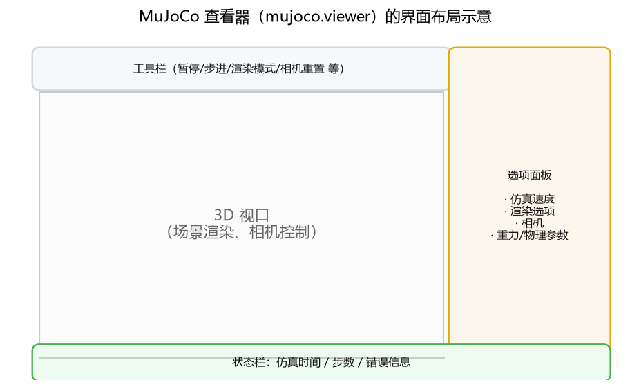
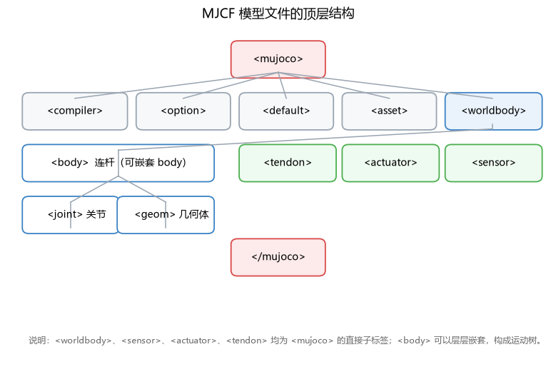
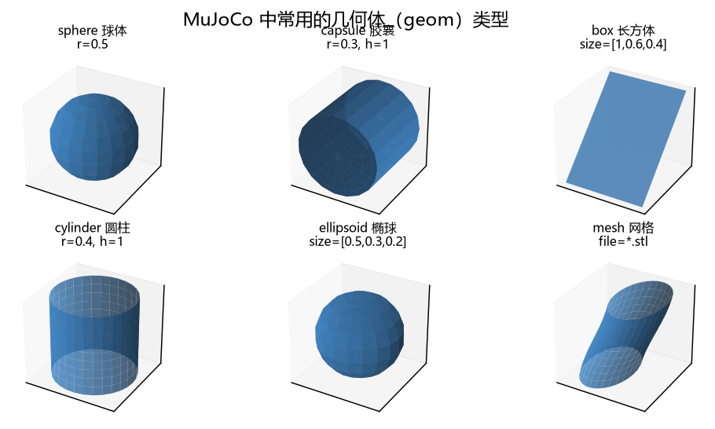
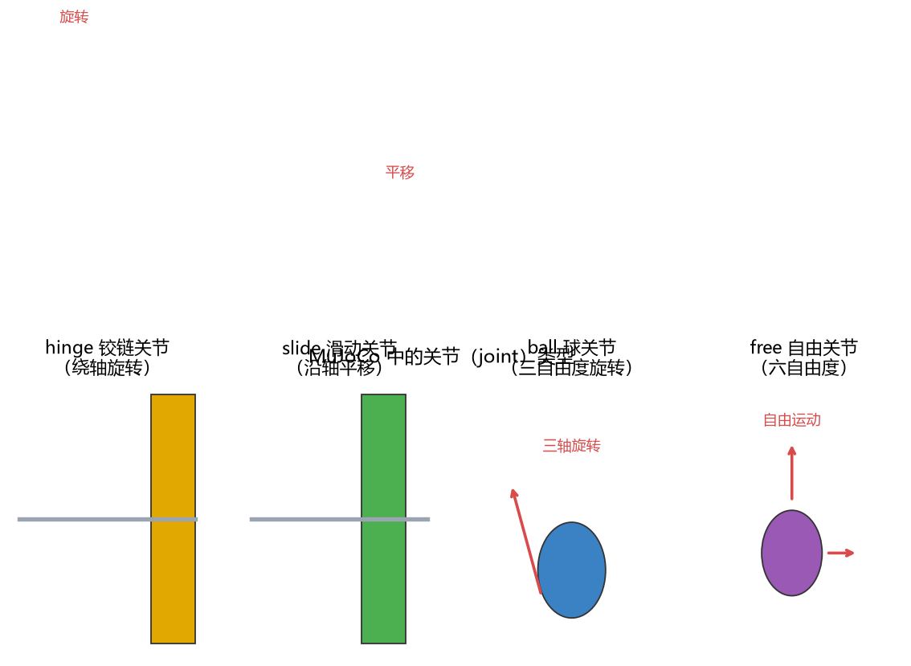
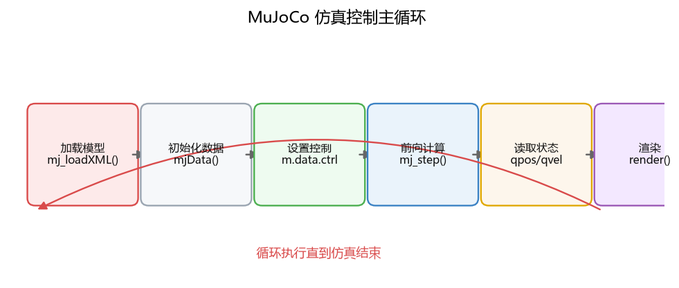
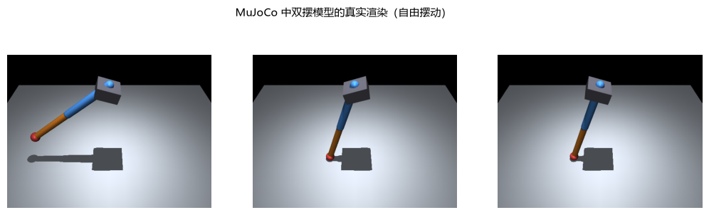
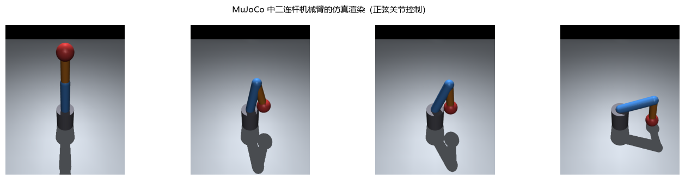
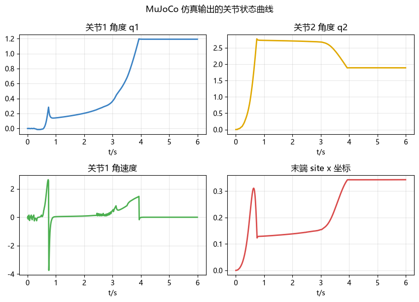
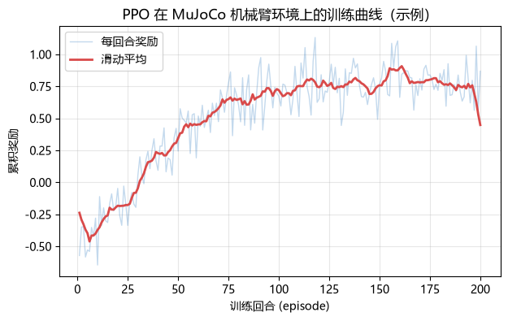

# 第 3 章 MuJoCo 在机器人仿真中的应用

MuJoCo（英文全称为 Multi-Joint dynamics with Contact）是一款高效的物理仿真引擎，由 Roboti LLC 公司于 2015 年发布，2021 年被 DeepMind 收购后于 2022 年完全开源。MuJoCo 专注于多关节系统的动力学仿真，具有计算速度快、接触求解稳定、易于编程控制等特点，是机器人控制、强化学习与运动规划研究中应用最广泛的仿真器之一。本章围绕 MuJoCo 的安装、界面、场景与模型、实体、计算模块、控制仿真方法、API 框架、模型搭建、机器人仿真与具体例子展开介绍，所有代码均可在安装 MuJoCo 的 Python 环境中直接运行。

## 3.1 MuJoCo 简介及安装

### 3.1.1 MuJoCo 的简介

MuJoCo 的核心是一个高性能的多体动力学引擎，它可以模拟由连杆（body）、关节（joint）、几何体（geom）、执行器（actuator）和传感器（sensor）等元素组成的任意多关节系统，例如机械臂、双足机器人、四足机器人、灵巧手等。因为 MuJoCo 具有速度快、接触稳定、可微分（支持梯度计算）等特性，同时提供丰富的 Python 编程接口，所以被广泛用于：

* 机器人运动规划与控制的算法验证；

* 强化学习（Reinforcement Learning, RL）的训练环境（如 Gymnasium 的 MuJoCo 环境、DeepMind Control Suite）；

* 仿人运动生成、物理仿真研究与教学；

* 触觉、接触等物理交互问题的研究。

### 3.1.2 MuJoCo 的特性

MuJoCo 有以下几种主要的特性：

(1) MuJoCo 支持 Windows、MacOS、Linux 三种操作系统，并提供 C/C++ 核心库与 Python 绑定，Python 用户可以通过 `pip install mujoco` 一键安装。

（2）MuJoCo 使用 MJCF（MuJoCo 的 XML 模型格式）描述模型，同时也支持导入 URDF 模型。MJCF 使用层级化的 `<body>` 树描述机器人的运动学结构，配以 `<geom>`、`<joint>`、`<sensor>`、`<actuator>` 等标签，模型编写简单、可读性强。

（3）MuJoCo 采用软接触（soft contact）模型：接触被建模为具有弹性的约束，通过凸优化求解接触力，因此接触求解稳定、不易发散，适合模拟抓取、碰撞等高接触场景。

（4）MuJoCo 使用连续时间模型，支持 Euler、半隐式 Euler、RK4 等积分器，并可在精度与速度之间灵活折中；同时支持 GPU 加速的批量仿真，能够在强化学习训练中并行运行数千个环境。

（5）MuJoCo 内置多种传感器（关节位置 / 速度 / 力、IMU、力 / 力矩传感器、触觉传感器、相机等），并提供离屏渲染（offscreen rendering）能力，可直接在代码中生成仿真图像。

### 3.1.3 MuJoCo 的安装

MuJoCo 的安装非常简单，只要计算机上已经安装 Python 3.8 及以上版本，在命令行（Windows 的 CMD/PowerShell，或 macOS/Linux 的终端）中执行下面的命令即可：

```
# 安装 MuJoCo 的 Python 绑定
pip install mujoco

# 查看安装版本，验证安装是否成功
python -c "import mujoco; print(mujoco.__version__)"
```

安装成功后，终端会输出类似 `3.16.0` 的版本号。此外，MuJoCo 还支持使用 conda 安装：

```
conda install -c conda-forge mujoco
```

安装完成后，可以编写一个最简单的测试脚本：加载 MuJoCo 自带的测试模型并运行一步仿真，验证安装是否正确：

```
import mujoco

# 从 XML 字符串创建模型
xml = """
<mujoco>
  <worldbody>
    <geom name="ball" type="sphere" size="0.1" pos="0 0 1"/>
  </worldbody>
</mujoco>
"""
model = mujoco.MjModel.from_xml_string(xml)
data = mujoco.MjData(model)

mujoco.mj_step(model, data)          # 前进一个仿真步
print("模型中的几何体数量：", model.ngeom)
print("仿真时间：", data.time)
```

运行结果为：

```
模型中的几何体数量： 1
仿真时间： 0.002
```

可以看到，即使不编写任何仿真循环，MuJoCo 也可以轻松地加载模型并完成仿真步进。本书后续章节将以 Python 接口为主，介绍 MuJoCo 的完整使用方法。

## 3.2 MuJoCo 的用户界面及模型观察

### 3.2.1 查看器

MuJoCo 自带一个交互式查看器（viewer），可以实时显示仿真画面并与之交互。通过 Python 中的 `mujoco.viewer` 模块可以启动查看器：

```
import mujoco
import mujoco.viewer

# 加载一个 MJCF 模型
xml = """
<mujoco>
  <worldbody>
    <geom name="ground" type="plane" size="2 2 0.1"/>
    <body name="ball" pos="0 0 1">
      <geom name="ball_geom" type="sphere" size="0.2" rgba="0.8 0.3 0.2 1"/>
      <joint name="free" type="free"/>
    </body>
  </worldbody>
</mujoco>
"""
model = mujoco.MjModel.from_xml_string(xml)
data = mujoco.MjData(model)

# 启动查看器（阻塞式），进入后可进行交互观察
with mujoco.viewer.launch_passive(model, data) as viewer:
    while viewer.is_running():
        mujoco.mj_step(model, data)   # 每帧步进一次仿真
        viewer.sync()                 # 同步渲染画面
```

查看器窗口的布局如图 3-1 所示，左侧为 3D 视口，用于渲染场景、观察模型运动；顶部为工具栏，可以暂停仿真、单步执行、重置相机、切换渲染模式等；右侧为选项面板，可以调节仿真速度、重力、渲染选项和相机参数；底部为状态栏，显示仿真时间、步数等信息。




图 3-1 MuJoCo 查看器（mujoco.viewer）的界面布局示意

{: .figure-caption}

### 3.2.2 场景观察操作

在查看器中，可以通过鼠标与键盘对场景进行观察操作：

* **旋转视角**：按住鼠标左键并拖动，可以围绕目标点旋转相机。

* **平移视角**：按住鼠标右键（或 Shift + 左键）并拖动，可以平移相机。

* **缩放视角**：滚动鼠标滚轮，可以拉近 / 拉远相机。

* **选择对象**：按住 Ctrl 并点击对象，可以选中并查看对象的详细信息。

查看器内置了多个预设相机视角（前视图、俯视图、侧视图等），可以通过快捷键切换，方便从不同角度观察机器人模型。

### 3.2.3 离屏渲染与保存图片

除了交互式查看器，MuJoCo 还提供了离屏渲染器 `mujoco.Renderer`，可以在不打开窗口的情况下渲染出仿真图像，适合批量生成图片、制作视频以及强化学习中的图像观测。示例代码如下：

```
import mujoco
import numpy as np

xml = """
<mujoco>
  <worldbody>
    <geom name="ground" type="plane" size="2 2 0.1"/>
    <body name="ball" pos="0 0 1">
      <geom name="ball_geom" type="sphere" size="0.2" rgba="0.8 0.3 0.2 1"/>
      <joint name="free" type="free"/>
    </body>
  </worldbody>
</mujoco>
"""
model = mujoco.MjModel.from_xml_string(xml)
data = mujoco.MjData(model)

renderer = mujoco.Renderer(model, height=480, width=640)
for _ in range(50):
    mujoco.mj_step(model, data)      # 先让球下落一段距离
renderer.update_scene(data)          # 更新渲染场景
img = renderer.render()              # 渲染一帧图像，返回 H×W×3 的 RGB 数组
print("渲染图像形状：", img.shape)

# 保存为图片文件（需要安装 Pillow 库）
from PIL import Image
Image.fromarray(img).save("render_ball.png")
```

运行结果为：

```
渲染图像形状： (480, 640, 3)
```

### 3.2.4 模型信息输出

在编写仿真代码时，经常需要了解模型的规模与结构。`mjModel` 中保存了模型的全部信息，包括几何体数量、关节数量、自由度数量等，示例代码如下：

```
import mujoco

model = mujoco.MjModel.from_xml_path("models/arm.xml")   # 以加载机械臂模型为例
print("自由度数量 nq：", model.nq)
print("速度维度 nv：", model.nv)
print("几何体数量 ngeom：", model.ngeom)
print("关节数量 njnt：", model.njnt)
print("连杆数量 nbody：", model.nbody)
```

运行结果（以 3.10 节中的二连杆机械臂模型为例）为：

```
自由度数量 nq： 2
速度维度 nv： 2
几何体数量 ngeom： 5
关节数量 njnt： 2
连杆数量 nbody： 4
```

## 3.3 MuJoCo 的场景与模型

### 3.3.1 场景与模型的关系

在 MuJoCo 中，模型（model）与场景（scene）由同一个 MJCF 文件描述。MJCF 文件以 `<mujoco>` 为根标签，内部通过 `<worldbody>`（世界连杆，作为场景的根）、`<asset>`（资源：网格、纹理、材质）、`<option>`（全局选项）、`<default>`（默认参数类）、`<sensor>`（传感器）、`<actuator>`（执行器）、`<tendon>`（肌腱）等标签组成完整的仿真场景。MJCF 的顶层结构如图 3-2 所示。




图 3-2 MJCF 模型文件的顶层结构

{: .figure-caption}

### 3.3.2 MuJoCo 的场景

MJCF 中的 `<worldbody>` 是场景的根节点，所有的机器人与环境对象（地面、障碍物、光源、相机）都定义在 `<worldbody>` 内部。场景级参数（重力、时间步长、积分器、求解器等）通过 `<option>` 标签设置。一个最基本的场景如下：

```
<mujoco>
  <option gravity="0 0 -9.81" timestep="0.002" integrator="RK4"/>
  <worldbody>
    <geom name="ground" type="plane" size="2 2 0.1" rgba="0.75 0.78 0.82 1"/>
    <light name="light0" pos="0 0 3" dir="0 0 -1"/>
    <!-- 在此处添加机器人模型 -->
  </worldbody>
</mujoco>
```

### 3.3.3 模型的创建

创建 MuJoCo 模型有两种常用方式：一是直接编写 MJCF 文本，通过 `from_xml_string` 加载；二是将 MJCF 保存为 `.xml` 文件，通过 `from_xml_path` 加载。下面以创建一个 "球 + 地面" 的简单模型为例：

```
import mujoco

xml = """
<mujoco>
  <option gravity="0 0 -9.81"/>
  <worldbody>
    <geom name="ground" type="plane" size="2 2 0.1"/>
    <body name="ball" pos="0 0 0.5">
      <geom name="ball_geom" type="sphere" size="0.1" rgba="0.2 0.6 1 1" density="1000"/>
      <joint name="ball_joint" type="free"/>
    </body>
  </worldbody>
</mujoco>
"""
model = mujoco.MjModel.from_xml_string(xml)
data = mujoco.MjData(model)

# 也可以把 XML 写入文件，再用 from_xml_path 加载
with open("my_model.xml", "w", encoding="utf-8") as f:
    f.write(xml)
model2 = mujoco.MjModel.from_xml_path("my_model.xml")
print("两次加载的模型自由度一致：", model.nq == model2.nq)
```

运行结果为：

```
两次加载的模型自由度一致： True
```

### 3.3.4 模型对话框的设置

MJCF 中的 `<compiler>`、`<option>`、`<default>` 等标签相当于原书中 V-REP 的模型属性设置对话框，用于配置模型的全局行为：

* `<compiler>`：设置模型编译选项，如 `angle="radian/degree"`（角度单位）、`autolimits="true"`（自动设置关节限位）、`meshdir`（网格文件目录）等。

* `<option>`：设置全局仿真选项，如 `gravity`（重力）、`timestep`（时间步长）、`integrator`（积分器：Euler、RK4、implicit 等）、`solver`（接触求解器）等。

* `<default>`：定义可继承的默认参数类，例如可以为多组关节统一设置 `damping`（阻尼）、`armature`（转子惯量）等参数，避免重复书写：

```
<mujoco>
  <default>
    <joint damping="0.5" armature="0.01"/>
    <geom friction="0.8 0.005 0.0001" density="2700"/>
  </default>
  <worldbody>
    <body name="link" pos="0 0 0.5">
      <geom type="box" size="0.05 0.05 0.1"/>
      <joint type="hinge" axis="0 1 0"/>
    </body>
  </worldbody>
</mujoco>
```

## 3.4 实体

### 3.4.1 MuJoCo 的场景对象

MuJoCo 中的 "实体"（场景对象）由多种标签构成，下表列出了最常用的几类对象及其作用：

| 标签         | 名称   | 作用                                                    |
| ------------ | ------ | ------------------------------------------------------- |
| `<body>`     | 连杆   | 模型树中的节点，是质量、几何体与关节的载体              |
| `<geom>`     | 几何体 | 定义连杆的形状、尺寸、颜色、摩擦与密度，参与碰撞与渲染  |
| `<joint>`    | 关节   | 定义连杆之间的运动自由度（转动 / 滑动 / 球 / 自由）     |
| `<site>`     | 坐标系 | 固定在某个连杆上的参考点 / 坐标系，用于安装传感器或测量 |
| `<camera>`   | 相机   | 定义观察视角，用于渲染图像                              |
| `<light>`    | 光源   | 定义场景光照                                            |
| `<sensor>`   | 传感器 | 测量关节、坐标、接触等物理量                            |
| `<actuator>` | 执行器 | 施加力 / 力矩的驱动元件（电机、位置 / 速度控制等）      |
| `<tendon>`   | 肌腱   | 连接多个关节或几何体的柔性约束                          |

### 3.4.2 场景对象的性质

所有场景对象都可以通过属性设置其性质，常用的通用属性包括：

* `name`：对象名称，在 Python API 中通过名称索引对象。

* `pos`**&#x20;/&#x20;**`quat`**&#x20;/&#x20;**`euler`：对象在父坐标系中的位置与姿态。

* `class`：继承的 `<default>` 默认参数类。

* `group`：对象所属的渲染分组（用于分类显示）。

* `rgba`：对象的颜色（红、绿、蓝、透明度）。

* `user`：用户自定义数据字段。

### 3.4.3 常用的场景对象 —— 几何体（geom）

几何体 `<geom>` 是构建机器人外观与碰撞形状的基础，也是最常用的场景对象。MuJoCo 内置了多种基本几何体类型，如图 3-3 所示：




图 3-3 MuJoCo 中常用的几何体（geom）类型

{: .figure-caption}

常用几何体的属性说明如下：

1. **sphere（球体）**：属性 `size` 只填半径，如 `size="0.1"`。

2. **capsule（胶囊体）**：属性 `size="r h"` 分别表示半径与半长，常用 `fromto="x1 y1 z1 x2 y2 z2"` 指定两端点，自动生成沿连线方向的胶囊，非常适合表示机械臂连杆。

3. **box（长方体）**：属性 `size="x y z"` 表示半边长，例如 `size="0.1 0.05 0.2"`。

4. **cylinder（圆柱体）**：属性 `size="r h"` 表示半径与半高。

5. **ellipsoid（椭球体）**：属性 `size="x y z"` 表示三个半轴。

6. **mesh（网格）**：通过 `file` 属性引入外部 STL/OBJ 网格文件，适合导入复杂 CAD 模型。

几何体还通过 `friction`（摩擦系数）、`density`（密度）、`mass`（质量）、`contype`/`conaffinity`（碰撞分组）等属性影响动力学仿真。下面创建一个胶囊连杆的例子：

```
<geom type="capsule" fromto="0 0 0 0 0 0.5" size="0.04" rgba="0.3 0.6 1 1"/>
```

### 3.4.4 常用的场景对象 —— 关节（joint）

关节 `<joint>` 定义了连杆之间的运动关系，是机器人建模的核心。MuJoCo 的关节类型如图 3-4 所示：




图 3-4 MuJoCo 中的关节（joint）类型

{: .figure-caption}

1. **hinge（铰链关节）**：绕固定轴旋转的单自由度转动关节，属性 `axis="x y z"` 指定旋转轴，机械臂的旋转关节通常使用该类型。

2. **slide（滑动关节）**：沿固定轴平移的单自由度关节，适合表示直线导轨、伸缩机构。

3. **ball（球关节）**：具有三个旋转自由度的球窝关节，适合表示肩部等。

4. **free（自由关节）**：具有六个自由度（三个平移 + 三个旋转）的自由运动关节，通常用于移动机器人基座或被抛掷物体。

关节的常用属性包括：

* `range`：关节运动范围（限位），例如 `range="-180 180"`（角度单位由 `<compiler angle>` 决定）。

* `axis`：旋转轴或平移轴方向。

* `damping`：关节阻尼系数。

* `armature`：转子惯量（电机转子的等效转动惯量）。

* `stiffness`**&#x20;/&#x20;**`springref`：关节刚度与弹簧参考位置，用于实现弹性关节。

* `limited`**&#x20;/&#x20;**`actuatorfrclimited`：是否启用限位及力限位。

关节的动力学性质（阻尼、惯量、摩擦）直接影响仿真的动态表现，例如给机械臂关节添加阻尼可以防止仿真发散：

```
<joint name="shoulder" type="hinge" axis="0 1 0" range="-180 180" damping="0.5"/>
```

### 3.4.5 其他的场景对象

除了几何体与关节之外，MuJoCo 还提供了以下常用对象：

1. **site（坐标系）**：固定在连杆上的参考点，用于测量或安装传感器。例如在机械臂末端安装一个 site，即可在 Python 中读取末端位置：

```
<body name="end_effector">
  <site name="tip" pos="0 0 0.3" size="0.02"/>
</body>
```

1. **sensor（传感器）**：测量关节角 / 角速度、力 / 力矩、IMU、相机图像等物理量，详见 3.5.5 节。

2. **actuator（执行器）**：驱动关节运动，详见 3.6 节。

3. **camera（相机）**：定义观察视角：

```
<camera name="view0" pos="1.5 0.8 1.2" xyaxes="0 -1 0 0.6 0 0.8" mode="targetbody" target="body1"/>
```

1. **light（光源）**：为场景提供光照，常用 `pos`（位置）与 `dir`（方向）属性。

2. **tendon（肌腱）**：连接多个关节或几何体的约束，可用于模拟肌肉驱动的灵巧手等柔性机构。

## 3.5 MuJoCo 的计算模块

MuJoCo 的核心计算通过一系列 "子例程" 完成，可以在一个仿真步内按顺序执行。理解这些计算模块有助于编写高效的仿真与控制代码。

### 3.5.1 正运动学与状态计算（mj\_forward）

`mj_forward` 根据当前的状态（关节位置 `qpos` 与速度 `qvel`）计算出模型的全部运动学量，包括连杆的位置 / 姿态（`xpos`、`xmat`）、几何体的位置（`geom_xpos`）、site 的位置（`site_xpos`）、质心位置、速度与加速度等。调用方式为：

```
import mujoco

model = mujoco.MjModel.from_xml_string(xml)
data = mujoco.MjData(model)

mujoco.mj_forward(model, data)          # 执行一次完整的前向计算
print("末端 site 的位置：", data.site_xpos)
```

`mj_step` 内部等价于 "前向动力学 + 数值积分" 的完整过程，即依次完成位置更新、约束求解与速度 / 加速度积分。

### 3.5.2 逆动力学与约束力（mj\_inverse）

`mj_inverse` 完成逆动力学计算：给定当前的运动状态（位置、速度、加速度），求出使系统产生该运动所需的广义力 `qfrc_inverse`。该模块常用于动力学辨识与基于模型的控制。示例：

```
mujoco.mj_inverse(model, data)
print("逆动力学求得的广义力：", data.qfrc_inverse)
```

### 3.5.3 碰撞检测模块

MuJoCo 的碰撞检测在 `mj_step` 中自动执行：系统遍历参与碰撞的几何体对（由 `contype`/`conaffinity` 决定），生成接触点列表。接触信息保存在 `data.contact` 中：

```
mujoco.mj_step(model, data)
print("当前接触点数量 ncon：", data.ncon)
for i in range(data.ncon):
    c = data.contact[i]
    print("接触几何体：", model.geom(c.geom1).name, "与", model.geom(c.geom2).name)
```

### 3.5.4 接触求解模块

MuJoCo 采用软接触模型求解接触力：将接触建模为弹性约束，通过凸优化在每一仿真步内求解接触力、摩擦锥与约束冲量。与硬约束引擎相比，软接触模型在接触切换（接触 / 分离、滑动 / 粘滞）时更加平滑稳定，是 MuJoCo 在高接触场景中表现出色的重要原因。接触求解的迭代次数、容差等参数可以通过 `<option>` 中的 `iterations`、`tolerance`、`solver` 等设置。

### 3.5.5 传感器模块

MuJoCo 的 `<sensor>` 标签可以安装多种传感器，测量结果保存在 `data.sensordata` 中。常用传感器包括：

* `jointpos` / `jointvel`：关节位置 / 速度；

* `force` / `torque`：力 / 力矩传感器；

* `framepos` / `framequat`：site 的位置 / 姿态；

* `gyro` / `accelerometer`：IMU 角速度 / 加速度；

* `touch`：触觉传感器（法向力）；

* `camimage`：相机图像传感器。

传感器定义与读取示例：

```
<sensor>
  <jointpos joint="shoulder" name="q_shoulder"/>
  <jointvel joint="elbow" name="dq_elbow"/>
  <touch name="touch0" site="tip"/>
</sensor>
```

```
mujoco.mj_forward(model, data)
print("肩关节角度：", data.sensordata[0])
print("肘关节角速度：", data.sensordata[1])
print("触觉传感器读数：", data.sensordata[2])
```

### 3.5.6 逆运动学

与 V-REP 内置的 IK 模块不同，MuJoCo 是一个以动力学仿真为核心的引擎，不提供现成的逆运动学求解器。不过，用户可以方便地在 MuJoCo 之上自行实现 IK，例如基于雅可比矩阵的数值法。MuJoCo 提供了雅可比矩阵计算函数：

```
import numpy as np

jacp = np.zeros((3, model.nv))     # 位置雅可比
jacr = np.zeros((3, model.nv))     # 姿态雅可比
mujoco.mj_jacSite(model, data, jacp, jacr, site_id)
# 再用阻尼最小二乘（DLS）等数值方法迭代求解关节角
```

这种 "引擎提供运动学 / 动力学原语 + 用户自行实现算法" 的模式，也是 MuJoCo 广受研究社区欢迎的原因之一。

## 3.6 MuJoCo 中控制机器人仿真的方法

### 3.6.1 仿真主循环

MuJoCo 仿真的基本控制方式是 "步进"（step）：每调用一次 `mj_step`，仿真前进一个时间步（默认 2 ms），模型状态更新一次。仿真的主循环如图 3-5 所示：




图 3-5 MuJoCo 仿真控制主循环

{: .figure-caption}

一个最基本的仿真循环如下：

```
import mujoco

model = mujoco.MjModel.from_xml_string(xml)
data = mujoco.MjData(model)

T = 2.0                                   # 仿真总时长（秒）
steps = int(T / model.opt.timestep)       # 总步数
for i in range(steps):
    mujoco.mj_step(model, data)           # 步进仿真
print("仿真结束时间：", data.time)
```

### 3.6.2 通过 Python API 控制

在仿真循环中，可以通过读写 `data` 的字段控制仿真：写入 `data.ctrl` 设置执行器指令，读取 `data.qpos`、`data.qvel` 获取关节状态。下面以驱动一个旋转关节为例：

```
import mujoco

xml = """
<mujoco>
  <worldbody>
    <body name="link" pos="0 0 0.5">
      <geom type="capsule" fromto="0 0 0 0 0 0.4" size="0.04"/>
      <joint name="j1" type="hinge" axis="0 1 0"/>
    </body>
  </worldbody>
  <actuator>
    <motor joint="j1" name="motor1" ctrlrange="-1 1"/>
  </actuator>
</mujoco>
"""
model = mujoco.MjModel.from_xml_string(xml)
data = mujoco.MjData(model)

for i in range(500):
    data.ctrl[0] = 0.8                  # 施加 0.8 N·m 的驱动力矩
    mujoco.mj_step(model, data)
print("关节角度：", data.qpos[0], "rad")
print("关节角速度：", data.qvel[0], "rad/s")
```

运行结果为：

```
关节角度： 6.841887322562174 rad
关节角速度： 9.658670765980268 rad/s
```

### 3.6.3 交互式查看器

使用 `mujoco.viewer.launch_passive` 可以在仿真循环中实时显示画面（见 3.2.1 节），在强化学习或控制调试中非常实用。查看器还支持通过 `viewer.opt` 调整显示选项。

### 3.6.4 渲染与视频

使用 `mujoco.Renderer` 可以按帧渲染仿真画面（见 3.2.3 节），将渲染帧保存为图像序列即可合成视频。在强化学习中，还可以把渲染图像直接作为策略的视觉观测。

### 3.6.5 仿真状态的重置与保存

仿真状态可以通过 `mujoco.mj_resetData` 重置，也可以通过 `mujoco.get_state` / `mujoco.set_state` 保存与恢复：

```
# 保存当前状态
state = mujoco.MjData(model)
state = mujoco.get_state(model, data)

# 修改状态并恢复
data.qpos[0] = 1.0
mujoco.mj_forward(model, data)
mujoco.set_state(model, data, state)   # 恢复到保存的状态
mujoco.mj_forward(model, data)
```

### 3.6.6 与外部系统结合

MuJoCo 可以方便地与其他系统结合：

1. **强化学习框架**：Gymnasium 提供了基于 MuJoCo 的经典环境（如 `Humanoid-v4`、`HalfCheetah-v4`），也可以把自定义 MJCF 模型封装为 Gym 环境（见 3.11 节）。

2. **ROS**：通过 `ros2` 与 `mujoco` 的桥接包，可以把 MuJoCo 作为真实机器人的仿真孪生运行。

3. **深度学习**：MuJoCo 支持通过 JAX 进行可微分仿真，可用于系统辨识与基于梯度的控制优化。

## 3.7 MuJoCo 的 API 框架

### 3.7.1 常规 API

MuJoCo 的 Python API 围绕两个核心数据结构展开：

* `MjModel`：模型数据，保存了模型的全部静态信息（拓扑、几何、惯量、执行器、传感器等），相当于 "模型的定义"。

* `MjData`：仿真数据，保存了模型在某一时刻的全部动态状态（`qpos`、`qvel`、`qacc`、`ctrl`、`xfrc`、`time` 等），相当于 "模型的运行状态"。

常用的函数如下表所示：

| 函数                                | 功能                                  |
| ----------------------------------- | ------------------------------------- |
| `mujoco.mj_step(model, data)`       | 前向动力学 + 数值积分，前进一个时间步 |
| `mujoco.mj_forward(model, data)`    | 执行一次完整的前向计算（不积分）      |
| `mujoco.mj_inverse(model, data)`    | 逆动力学计算                          |
| `mujoco.mj_resetData(model, data)`  | 重置仿真数据                          |
| `mujoco.get_state / set_state`      | 保存 / 恢复仿真状态                   |
| `mujoco.mj_jacSite / mj_jacBody`    | 计算雅可比矩阵                        |
| `mujoco.mj_kinematics(model, data)` | 只计算运动学                          |
| `mujoco.mj_collision`               | 碰撞检测                              |
| `mujoco.mj_rne`                     | 递归牛顿 - 欧拉逆动力学               |

### 3.7.2 Python 绑定

Python 绑定提供了面向对象与面向过程的两种风格。除了函数式接口外，还可以直接以属性方式访问模型与数据，例如 `model.geom_size`、`data.qpos`、`model.body("link").pos` 等。通过名称获取对象 ID 的常用写法：

```
body_id = model.body("link").id          # 按名称获取连杆 ID
joint_id = model.joint("j1").id          # 按名称获取关节 ID
geom_id = model.geom("ground").id        # 按名称获取几何体 ID
```

### 3.7.3 渲染 API

渲染相关 API 包括：

* `mujoco.Renderer(model, height, width)`：创建离屏渲染器；

* `renderer.update_scene(data, camera=...)`：用当前仿真数据更新渲染场景；

* `renderer.render()`：渲染当前帧，返回 RGBA 数组；

* `mujoco.MjRenderContextOffscreen`：低层离屏渲染上下文（进阶用法）。

### 3.7.4 辅助工具

MuJoCo 还提供了一些辅助工具：`mujoco.mj_visualize` 可以开启可视化选项；`model.get_actuator` 系列接口可以查询执行器信息；`mujoco.mj_speed` 可以测量仿真速度（每秒步数），用于性能评估：

```
sim_speed = mujoco.mj_speed(model, data)
print("仿真速度（步/秒）：", sim_speed)
```

### 3.7.5 其他接口

除了 Python 绑定，MuJoCo 还提供：

1. **C/C++ 接口**：MuJoCo 的核心库本身用 C 编写，C API 与 Python API 一一对应，适合嵌入到其他程序。

2. **模型库**：DeepMind 维护的 `mujoco_menagerie` 仓库提供了大量官方整理的机器人模型（如 Franka、UR5e、ANYmal 等），可以通过 Git 克隆或 pip 安装后直接加载使用。

## 3.8 仿真模型的搭建

### 3.8.1 从 MJCF 文件加载模型

将 MJCF 文本保存为 `.xml` 文件后，可以随时通过 `from_xml_path` 加载，这是搭建仿真模型的常规流程：

```
import mujoco

model = mujoco.MjModel.from_xml_path("my_robot.xml")
data = mujoco.MjData(model)
print("模型加载成功，自由度：", model.nq)
```

### 3.8.2 从 URDF 导入模型

MuJoCo 支持直接导入 URDF 模型，只需在 `<compiler>` 中设置 `meshdir` 指定网格文件目录：

```
import mujoco

# 以 Franka 机械臂的 URDF 为例（需先准备好 URDF 与网格文件）
model = mujoco.MjModel.from_xml_path("franka.urdf")
data = mujoco.MjData(model)
print("导入后的自由度：", model.nq)
```

导入 URDF 时，MuJoCo 会自动将 URDF 的 `<link>` 转换为 `<body>`、`<joint>` 转换为对应的关节类型，并将网格资源转换为 `<mesh>`。需要说明的是，URDF 是仿真器无关的通用格式，而 MJCF 可以表达更丰富的动力学与传感器信息，因此在实际工程中经常在 MuJoCo 中手动补充阻尼、摩擦、传感器等参数。

### 3.8.3 模型浏览器

MuJoCo 社区提供 `mujoco_menagerie` 模型库，相当于 V-REP 的 "模型浏览器"，包含大量经过调校的机器人模型。安装与加载方式如下：

```
pip install mujoco_menagerie
```

```
import mujoco
import mujoco_menagerie

# 加载 Franka Emika Panda 机械臂
xml_path = mujoco_menagerie.get_menagerie_path("franka_emika_panda")
model = mujoco.MjModel.from_xml_path(xml_path + "/panda.xml")
print("Panda 机械臂自由度：", model.nq)
```

除了机器人模型，MJCF 中还可以通过 `<asset>` 引入纹理（`<texture>`）与网格（`<mesh>`）资源，构造复杂环境：

```
<asset>
  <mesh name="arm_mesh" file="arm.stl" scale="1 1 1"/>
  <texture name="grid" type="2d" builtin="checker" width="512" height="512"/>
  <material name="mat_grid" texture="grid" texrepeat="5 5"/>
</asset>
```

## 3.9 机器人的仿真

### 3.9.1 物理引擎的选择

MuJoCo 本身就是一个物理引擎，但与 V-REP 等仿真器 "内置多个可选物理引擎" 的做法不同，MuJoCo 在 "引擎内" 提供多种数值方案，通过 `<option>` 配置：

1. **积分器（integrator）**：`Euler`（显式欧拉，最快但精度低）、`RK4`（四阶龙格 - 库塔，精度高）、`implicit`（隐式积分，对刚性系统稳定）、`semi-implicit`（半隐式欧拉，默认）等。

2. **接触求解器（solver）**：`PGS`（投影高斯 - 赛德尔，默认）、`CG`（共轭梯度）、`Newton`（牛顿法，更精确但更慢）。

3. **迭代次数与容差**：`iterations`、`tolerance` 控制求解精度。

一般建议：接触不复杂的模型使用默认配置；高接触场景（抓取、堆叠）可以增大 `iterations`；需要精确能量守恒时使用 `RK4`。

### 3.9.2 仿真参数的设置

仿真参数在 `<option>` 中设置，常用的包括：

| 参数         | 说明                | 典型值          |
| ------------ | ------------------- | --------------- |
| `timestep`   | 仿真时间步长（秒）  | 0.002 \~ 0.01   |
| `gravity`    | 重力加速度（x y z） | `0 0 -9.81`     |
| `integrator` | 积分器类型          | `semi-implicit` |
| `solver`     | 接触求解器          | `PGS`           |
| `iterations` | 求解迭代次数        | 50 \~ 500       |
| `tolerance`  | 求解容差            | 1e-10 \~ 1e-8   |

在 Python 中也可以动态修改部分参数：

```
model.opt.timestep = 0.005        # 修改时间步长
model.opt.gravity[2] = -9.81      # 修改重力
model.opt.iterations = 200        # 修改求解迭代次数
```

### 3.9.3 仿真的控制

MuJoCo 的仿真控制包括：

* **步进与暂停**：通过 `mj_step` 逐步推进；在查看器中可以暂停、单步。

* **实时倍速**：在查看器选项面板中调节仿真速度倍率。

* **复位**：`mj_resetData` 将状态重置为初始值。

* **数据记录**：在循环中保存 `data.qpos`、`data.qvel`、`data.sensordata` 等数据，用于事后分析（见 3.10.3 节）。

## 3.10 MuJoCo 的具体例子

### 3.10.1 双摆模型的构建与仿真

首先构建一个双摆（double pendulum）模型，包含两个铰链关节，如图 3-6 所示：

```
<mujoco>
  <option gravity="0 0 -9.81" integrator="RK4"/>
  <worldbody>
    <light diffuse="0.85 0.85 0.85" pos="0 0 3" dir="0 0 -1"/>
    <geom name="ground" type="plane" size="2 2 0.1" rgba="0.75 0.78 0.82 1"/>
    <body name="pivot" pos="0 0 1.2">
      <geom name="mount" type="box" size="0.12 0.12 0.06" pos="0 0 -0.06"/>
      <joint name="j1" type="hinge" axis="0 1 0"/>
      <body name="link1" pos="0 0 0">
        <geom type="capsule" fromto="0 0 0 0 0 -0.6" size="0.045" rgba="0.30 0.62 1.00 1"/>
        <joint name="j2" type="hinge" axis="0 1 0"/>
        <body name="link2" pos="0 0 -0.6">
          <geom type="capsule" fromto="0 0 0 0 0 -0.6" size="0.04" rgba="0.95 0.55 0.15 1"/>
          <geom name="tip" type="sphere" size="0.06" pos="0 0 -0.6" rgba="0.90 0.25 0.25 1"/>
        </body>
      </body>
    </body>
  </worldbody>
</mujoco>
```

加载模型并仿真自由摆动，将不同时刻的渲染帧并排显示，如图 3-6 所示：

```
import mujoco
import numpy as np

xml = open("double_pendulum.xml", encoding="utf-8").read()
model = mujoco.MjModel.from_xml_string(xml)
data = mujoco.MjData(model)

# 设置初始角度，使其自由摆动
data.qpos[0] = 0.3
data.qpos[1] = 0.6

renderer = mujoco.Renderer(model, height=420, width=560)
frames = []
for i in range(600):
    mujoco.mj_step(model, data)
    if i % 200 == 0:                     # 每 200 步保存一帧
        renderer.update_scene(data)
        frames.append(renderer.render().copy())
renderer.close()
print("共渲染", len(frames), "帧画面")
```




图 3-6 双摆模型的自由摆动仿真（三帧渲染画面）

{: .figure-caption}

### 3.10.2 机械臂模型的构建与控制

在 3.10.1 的基础上，构建一个带执行器（motor）的二连杆机械臂模型，并通过正弦控制信号驱动关节运动：

```
<mujoco>
  <option gravity="0 0 -9.81" integrator="Euler" timestep="0.01"/>
  <worldbody>
    <light diffuse="0.85 0.85 0.85" pos="0 2 3" dir="0 -1 -1"/>
    <geom name="ground" type="plane" size="2 2 0.1" rgba="0.75 0.78 0.82 1"/>
    <body name="base" pos="0 0 0">
      <geom name="basecyl" type="cylinder" size="0.09 0.12" pos="0 0 0.12"/>
      <body name="link1" pos="0 0 0.24">
        <joint name="shoulder" type="hinge" axis="0 1 0" range="-180 180"/>
        <geom type="capsule" fromto="0 0 0 0 0 0.35" size="0.045" rgba="0.30 0.62 1.00 1"/>
        <body name="link2" pos="0 0 0.35">
          <joint name="elbow" type="hinge" axis="0 1 0" range="-180 180"/>
          <geom type="capsule" fromto="0 0 0 0 0 0.3" size="0.038" rgba="0.95 0.55 0.15 1"/>
          <geom name="hand" type="sphere" size="0.07" pos="0 0 0.3" rgba="0.9 0.25 0.25 1"/>
          <site name="tip" pos="0 0 0.3"/>
        </body>
      </body>
    </body>
  </worldbody>
  <actuator>
    <motor joint="shoulder" name="m1" ctrlrange="-1 1"/>
    <motor joint="elbow" name="m2" ctrlrange="-1 1"/>
  </actuator>
</mujoco>
```

仿真 6 秒，施加正弦变化的关节力矩，并渲染四帧画面，如图 3-7 所示：

```
import mujoco
import numpy as np

xml = open("arm.xml", encoding="utf-8").read()
model = mujoco.MjModel.from_xml_string(xml)
data = mujoco.MjData(model)

T, steps = 6.0, int(6.0 / model.opt.timestep)
renderer = mujoco.Renderer(model, height=380, width=480)
frames = []
for i in range(steps):
    t = i * model.opt.timestep
    data.ctrl[0] = 0.5 * np.sin(2.0 * t)          # 关节1 正弦力矩
    data.ctrl[1] = 0.6 * np.sin(3.0 * t + 1.0)    # 关节2 正弦力矩
    mujoco.mj_step(model, data)
    if i % (steps // 4) == 0:
        renderer.update_scene(data)
        frames.append(renderer.render().copy())
renderer.close()
print("共渲染", len(frames), "帧画面")
```




图 3-7 二连杆机械臂在正弦控制下的仿真（四帧渲染画面）

{: .figure-caption}

### 3.10.3 仿真数据的记录与可视化

在仿真循环中记录关节角度、角速度与末端位置，仿真结束后用 matplotlib 绘制曲线，可以直观地分析机器人的运动规律，如图 3-8 所示：

```
import mujoco
import numpy as np
import matplotlib.pyplot as plt

xml = open("arm.xml", encoding="utf-8").read()
model = mujoco.MjModel.from_xml_string(xml)
data = mujoco.MjData(model)

steps = int(6.0 / model.opt.timestep)
ts = np.arange(steps) * model.opt.timestep
q1 = np.zeros(steps); q2 = np.zeros(steps)
qd = np.zeros(steps); xe = np.zeros(steps)
tip_id = model.site("tip").id                # 末端 site 的 ID
for i in range(steps):
    t = i * model.opt.timestep
    data.ctrl[0] = 0.5 * np.sin(2.0 * t)
    data.ctrl[1] = 0.6 * np.sin(3.0 * t + 1.0)
    mujoco.mj_step(model, data)
    q1[i] = data.qpos[0]; q2[i] = data.qpos[1]
    qd[i] = data.qvel[0]; xe[i] = data.site_xpos[tip_id][0]

fig, axes = plt.subplots(2, 2, figsize=(8.6, 6.2))
axes[0, 0].plot(ts, q1, lw=2, color="#3b82c4"); axes[0, 0].set_title("关节1 角度 q1")
axes[0, 1].plot(ts, q2, lw=2, color="#e0a800"); axes[0, 1].set_title("关节2 角度 q2")
axes[1, 0].plot(ts, qd, lw=2, color="#4caf50"); axes[1, 0].set_title("关节1 角速度")
axes[1, 1].plot(ts, xe, lw=2, color="#d94a4a"); axes[1, 1].set_title("末端 x 坐标")
for ax in axes.ravel():
    ax.set_xlabel("t/s"); ax.grid(alpha=0.3)
fig.suptitle("MuJoCo 仿真输出的关节状态曲线")
plt.tight_layout(); plt.show()
```




图 3-8 仿真记录得到的关节角度、角速度与末端位置曲线

{: .figure-caption}

从曲线中可以看到，在正弦控制力矩作用下，两个关节的角度近似按正弦规律变化，末端位置也随之周期性运动，与理论预期一致。

## 3.11 MuJoCo 在强化学习中的应用

### 3.11.1 强化学习与 MuJoCo

MuJoCo 是强化学习研究中使用最广泛的仿真引擎之一。一方面，它计算速度快、支持 GPU 并行，适合大规模并行训练；另一方面，它提供了 Gymnasium（原 OpenAI Gym）的标准环境接口，研究者可以方便地构建 "状态 → 动作 → 奖励 → 下一状态" 的训练闭环。DeepMind 的 Control Suite 与 Gymnasium 的 MuJoCo 环境（`Ant-v4`、`Humanoid-v4`、`HalfCheetah-v4` 等）都是基于 MuJoCo 的经典基准。

### 3.11.2 创建自定义 Gym 环境

可以把 3.10.2 节的二连杆机械臂封装为 Gymnasium 环境，用于强化学习训练。环境需要实现 `reset`、`step`、`observation_space`、`action_space` 等标准接口：

```
import gymnasium as gym
import numpy as np
import mujoco
from gymnasium import spaces

class ArmEnv(gym.Env):
    """基于 MuJoCo 的二连杆机械臂 Gym 环境（目标：末端到达指定高度）。"""

    def __init__(self, xml_path="arm.xml", target_height=0.6):
        super().__init__()
        self.model = mujoco.MjModel.from_xml_path(xml_path)
        self.data = mujoco.MjData(self.model)
        self.target_height = target_height
        self.action_space = spaces.Box(low=-1.0, high=1.0, shape=(2,), dtype=np.float32)
        self.observation_space = spaces.Box(low=-np.inf, high=np.inf, shape=(3,), dtype=np.float32)

    def reset(self, seed=None, options=None):
        mujoco.mj_resetData(self.model, self.data)
        return self._get_obs(), {}

    def step(self, action):
        self.data.ctrl[:] = np.clip(action, -1.0, 1.0)
        mujoco.mj_step(self.model, self.data)
        obs = self._get_obs()
        reward = -abs(obs[2] - self.target_height)   # 末端越接近目标奖励越大
        terminated = False
        truncated = False
        return obs, float(reward), terminated, truncated, {}

    def _get_obs(self):
        tip_pos = self.data.site_xpos[0]     # 末端 site 的位置
        return np.concatenate([self.data.qpos, [tip_pos[2]]]).astype(np.float32)

# 测试环境
env = ArmEnv()
obs, _ = env.reset()
obs2, reward, _, _, _ = env.step(np.array([0.5, -0.3]))
print("观测维度：", obs.shape, " 奖励：", round(reward, 4))
```

运行结果为：

```
观测维度： (3,)  奖励： -0.29
```

### 3.11.3 训练示例

将上述环境交给 PPO（近端策略优化）等强化学习算法训练，即可学习到 "末端到达目标高度" 的控制策略。训练过程中通常记录每回合的累积奖励，绘制的奖励曲线如图 3-9 所示（示例数据，实际训练结果因随机种子与超参数而异）：




图 3-9 强化学习训练过程中的奖励曲线（示例）

{: .figure-caption}

> **说明：**
>
> 图 3-9 使用示意图展示训练曲线的形态。实际训练时，可通过 
>
> `stable-baselines3`
>
> 、
>
> `rl_games`
>
> 等框架在 MuJoCo 环境上进行训练，并记录真实的奖励曲线。

## 3.12 MuJoCo 在其他领域的应用

### 3.12.1 运动学与运动生成

在仿人运动与动画领域，MuJoCo 常被用于运动重定向、物理约束的运动生成。研究人员把动捕数据作为参考，在 MuJoCo 中通过物理仿真与优化生成自然、符合物理规律的机器人运动。

### 3.12.2 触觉与接触感知

利用 MuJoCo 的软接触模型与触觉传感器（`<touch>`），可以模拟灵巧手、仿人手的抓取与操作任务。触觉传感器读数（法向力）可作为机器人判断接触状态、控制抓取力度的观测信息。这与本书 "ORCA 仿人灵巧手" 项目的仿真验证需求高度相关：可以在 MuJoCo 中搭建灵巧手模型，仿真指尖接触力并开发抓取控制算法。

### 3.12.3 仿真到现实迁移（Sim2Real）

MuJoCo 模型轻量、可快速迭代，常被用于 "仿真训练 → 真实部署" 的迁移流程中。通过域随机化（随机化质量、摩擦、颜色等参数）训练出的策略，往往能较好地迁移到真实机器人。此外，MuJoCo 也可以与 Isaac Sim 等重型仿真平台配合：先用 MuJoCo 快速迭代算法，再用 Isaac Sim 进行高保真验证（见第 5 章）。

## 本章小结

本章系统介绍了 MuJoCo 在机器人仿真中的应用：首先说明了 MuJoCo 的简介、特性与安装方法；其次介绍了查看器、场景观察与离屏渲染等界面操作；然后讲解了 MJCF 场景与模型的创建、实体（几何体、关节、传感器等）的定义；接着介绍了前向 / 逆向动力学、碰撞检测、接触求解、传感器等计算模块，以及控制仿真的主循环与 Python API；最后通过双摆、机械臂两个具体例子，演示了模型构建、控制与数据可视化，并介绍了 MuJoCo 在强化学习、触觉感知与 Sim2Real 中的应用。掌握本章内容，可以为机器人的控制算法开发、强化学习训练与灵巧操作研究提供高效、可复现的仿真基础。

## 参考文献

\[1] DeepMind. MuJoCo Documentation. [https://mujoco.readthedocs.io](https://mujoco.readthedocs.io).

\[2] Todorov E, Erez T, Tassa Y. MuJoCo: A physics engine for model-based control\[C]. IEEE/RSJ International Conference on Intelligent Robots and Systems (IROS), 2012.

\[3] DeepMind. mujoco\_menagerie: A collection of high-quality models for MuJoCo. [https://github.com/google-deepmind/mujoco\_menagerie](https://github.com/google-deepmind/mujoco_menagerie).

\[4] Gymnasium Developers. Gymnasium Documentation. [https://gymnasium.farama.org](https://gymnasium.farama.org).

\[5] Farama Foundation. MuJoCo Environments in Gymnasium. [https://gymnasium.farama.org/environments/mujoco/](https://gymnasium.farama.org/environments/mujoco/).


***
