# 第3章 V-REP 在机器人仿真中的应用

## 3.1 V-REP 简介及安装

### 3.1.1 V-REP的简介

V-REP（英文全称为 Virtual Robot Experimentation Platform）是一款开源的机器人仿真软件，它可以创建、组成虚拟机器人并进行仿真。因为 V-REP 具有多种类型的功能与特性，丰富的应用编程接口，所以也被称为机器人仿真器中的“瑞士军刀”。作为一款机器人仿真软件，V-REP 可用于快速算法开发、工厂自动化仿真、快速原型设计和验证、与机器人相关的教学、远程监控、产品的安全检测等任务。

### 3.1.2 V-REP的特性

V-REP 有以下几种主要的特性：

(1) V-REP 支持 Windows、MacOS、Linux 三种操作系统。

（2）V-REP 使用集成开发环境，并基于分布式控制体系结构。因此，每个对象/模型可以通过嵌入式脚本、插件、附加组件、ROS 节点、远程客户端应用编程接口或自定义的解决方案，单独地被控制。

（3）控制器可用C/C++、Python、Java、Lua、MATLAB、Octave或者Urbi等编程语言编写。

（4）V-REP 中具有 4 个物理引擎：Bullet physics library、Open Dynamics Engine (ODE)、Vortex Dynamics 和 Newton Dynamics。其中 Bullet 引擎提供了 Bullet 2.78 和 Bullet 2.83 两个版本的物理引擎。

（5）V-REP 具有五种主要的计算模块：正向和逆向运动学模块、动力学或物理模块、路径规划模块、碰撞检测模块、最小距离计算模块。

### 3.1.3 V-REP的安装

本书选择了 Pro-edu 中的 Windows 版本, 将安装包下载至本地电脑中。双击安装程序可进入安装界面。V-REP 的安装步骤相对简单, 只需按照它的提示, 选择 Yes 或 Next 即可完成安装过程。

一般来说,安装步骤对应于以下界面: Welcome 界面(见图 3-1),License Agreement 界面, Set Program Shortcuts 界面,Confirm Setup Settings 界面,Copying Files 界面,Setup Complete 界面。


图 3-1 V-REP 的安装界面——Welcome 界面
{: .figure-caption }


这里,需要注意以下三点:

（1）如果计算机本身已安装 V-REP。在重新安装新版本的 V-REP 时，它会提示“是否卸载掉已安装的 V-REP”，再进行重装。

(2) 安装 V-REP 的默认路径为 C:\Program Files (x86)\V-REP3\V-REP\_PRO\_EDU, 用户无法进行更改。

（3）安装完毕后，会弹出对话窗口，询问是否要安装 Visual Studio 2010。如果计算机本身没有 Visual Studio 2010，应按照它的提示单击 Yes，让系统自动安装。接下来，它会提示是否对 Microsoft Visual C++ 2010 x86 Redistributable 进行修复或卸载。这些需要根据用户计算机本身的需求进行合理的选择。

## 3.2 V-REP 的用户界面及位姿操作

启动 V-REP 应用程序时,计算机(Windows 系统)将会自动创建一个控制台窗口,随后将控制台窗口自动隐藏(这种默认隐藏控制台窗口的配置可以在用户设定对话框中更改)。控制台窗口仅用于输出信息,例如表示插件是否安装成功。正常启动后 V-REP 会初始化一个默认的场景,如图 3-2 所示,场景周围分布着应用栏、菜单栏、工具栏、模型浏览器等窗口部件。

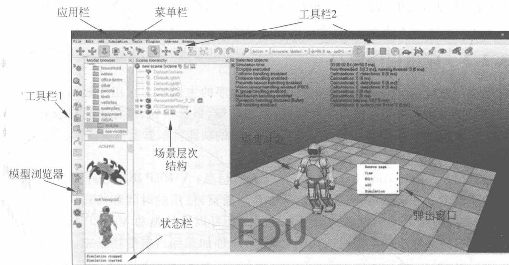

图 3-2 V-REP 的主界面
{: .figure-caption }


### 3.2.1 控制台窗口

控制台窗口(console window)不是交互式的,如图 3-3 所示,仅用于输出信息,其功能是显示所加载的插件和告知用户初始化过程是否成功。用户可以使用 Lua 打印命令(从脚本中)直接输出信息到控制台窗口。使用插件中的 C printf 或 std::cout 命令也可将信息输出到控制台窗口。除此之外,用户可以以编程的方式创建辅助控制台窗口以显示对实例进行仿真时特定的信息。

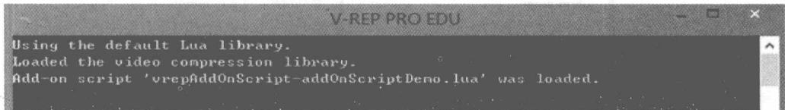

图3-3 控制台窗口
{: .figure-caption }


在 Windows 系统中：当 V-REP 应用程序启动时，将创建一个控制台窗口，但会再次直接隐藏。隐藏控制台窗口的默认配置可以在用户设置对话框中更改。

在 Linux 系统中：V-REP 需要从控制台启动，它在 V-REP 整个运行的过程中保持可见。

在 MacOSX 系统中：最好是从终端启动 V-REP，以使消息可见。

### 3.2.2 对话框

在应用程序窗口旁边,用户还可以通过调整对话框asse( dialogs)设置或参数来编辑场景与场景交互。每个对话组合一组相关函数或适用于同一目标对象的函数。由于多种原因,例如对象被选择为不同的状态,对话框的内容可能是上下文不相互关联的,需要用户加以区分。

### 3.2.3 应用程序窗口

应用程序窗口(application window)是应用程序的主窗口。它用于显示、编辑、仿真和与场景交互。当在应用程序窗口中激活时，鼠标左键、鼠标按钮、鼠标滚轮以及键盘具有特定的功能。在应用窗口内，输入设备(鼠标和键盘)的功能将根据上下文或激活位置而变化。

#### 应用程序栏

应用程序栏(application bar)给出了以下几点信息：V-REP 副本的许可证类型、当前正在显示的场景的文件名、一个渲染通道(一个显示通道)使用的时间和仿真软件的当前状态（仿真状态或当前使用的编辑模式类型）。此外，还可以通过拖动 V-REP 相关的文件到应用程序栏或应用程序窗口范围内的任意位置，将文件加载到当前的场景中。支持的文件包括“\*.ttt”-files(V-REP 场景文件),“\*.ttm”文件(V-REP 模型文件)和“\*.ttb”。

#### 菜单栏

菜单栏(menu bar)可以访问 V-REP 中所有的功能。如图 3-4 所示,其中 File 栏目可用于文件的建立和保存,或者对利用 3DMAX、Soildworks 等软件建立的模型进行加载; Edit 栏目主要用于对场景对象进行编辑; Add 栏目主要用于在场景中添加对象; Simulation 栏目主要用于对 V-REP 仿真的设置和控制; Tools 栏目主要用于对用户界面窗口的启用和关闭; Plugin 栏目和 Add-ons 栏目分别与两种编程方法有关: 插件和附加组件; 通过 Help 栏目可以直接访问 V-REP 自带的用户手册、版本信息等。

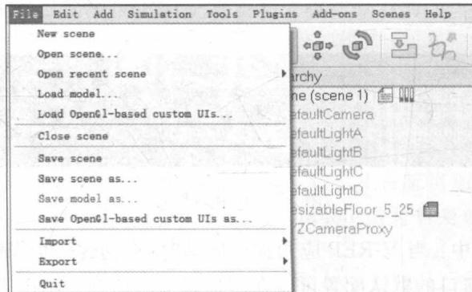

图 3-4 菜单栏目及 File 栏目展开后显示的功能
{: .figure-caption }


#### 工具栏

工具栏(toolbars)如图3-5所示，它分为两个栏目，其中工具栏1位于菜单栏下方，工具栏2位于模型浏览器的左边。工具栏1主要用于编辑模型及场景、设置仿真参数和控制仿真过程。其中包括了对场景视角的旋转、放大和缩小；对模型在三维空间中的移动与旋转；对模型进行装配与拆卸；控制模型仿真运行、暂停与结束停止（包括仿真速度的选择）。工具栏 2 包含对仿真参数的设置, 脚本的插入与设置, 路径点的规划、计算模块的启用与设置, 自定义用户界面的编辑等。总体而言, 工具栏包括了 V-REP 中所有工具功能。

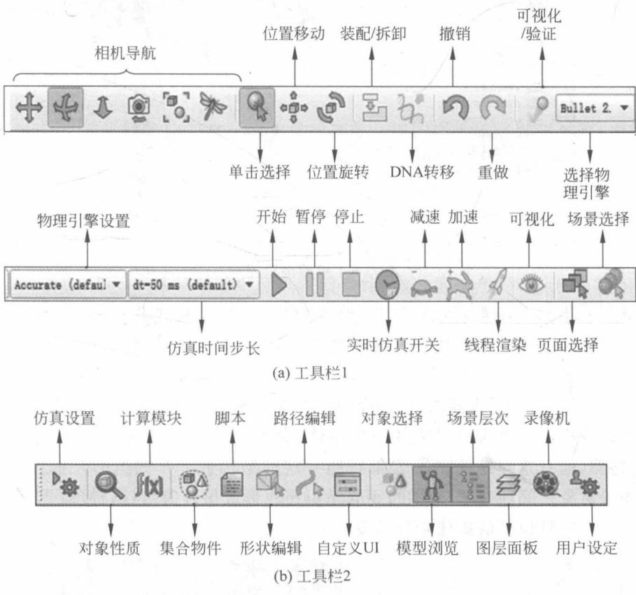

图 3-5 工具栏
{: .figure-caption }


#### 模型浏览器

仿真浏览器以文件夹的形式呈现，位于 V-REP 主界面的左边，如图 3-6 所示，文件中包含了 V-REP 中所有的模型，选择其中一个文件夹，模型浏览器的下方将会显示出文件夹内所有模型的预览缩略图及名称。模型浏览器中所有的模型都存放在 V-REP 安装文件夹的相对路径：...\V-REP3\V-REP\_PRO\_EDU\models 中，模型文件的扩展名为 .ttm。V-REP 默认的模型包含了交通工具模型，人体模型，可移动的机器人模型和不可移动的机器人模型等。

使用这些程序提供的模型非常简单,只需要用鼠标拖拽模型的预览缩略图到空白的场景中,场景将会自动加载相关的模型,以供用户下一步的使用。其中,有些模型已经包含了可执行的脚本,单击“仿真”按钮可以看到默认的仿真结果。

#### 场景层次结构

场景层次结构(scene hierarchy)显示了一个场景的所有内容,即场景中的所有场景对象。它用类似树的层次结构显示了场景中的每个元素,而这些元素都能够被展开或折叠。

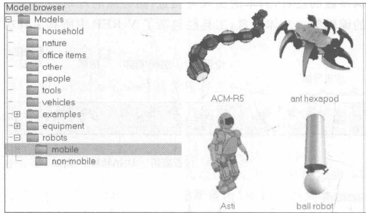

图 3-6 模型浏览器
{: .figure-caption }


可以通过鼠标双击一个场景对象的名称,修改对象名称,修改之后单击 Enter 按钮进行保存。场景对象名称前面的图形代表了场景对象的类型,双击这些图形可以打开场景对象属性编辑框。

如图 3-7 所示, 将 d12 机器人加载到场景中, 在场景层次结构窗口也将自动加载它的层次结构。可以看出, d12 机器人主要由它的主体、缓冲器、轮子等部分构成, 其中还添加了摄像头、力传感器, 而且这里所有的元素都按照一定的结构进行排列组合。在 V-REP 中, 场景对象与场景对象之间通过 Edit 栏的 object parent 形成层次等级(这种层次等级关系的正确组合对于一个完整模型的搭建十分重要)。

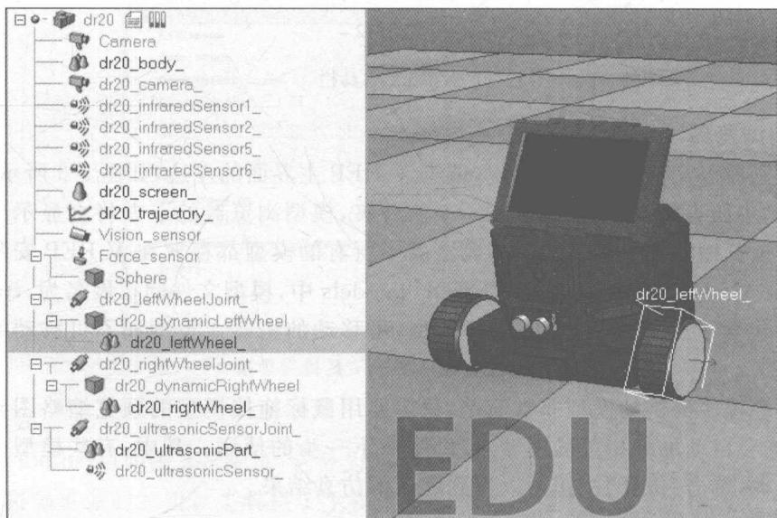

图 3-7 dr20 模型及其层次结构
{: .figure-caption }


#### 其他用户界面

信息文本在仿真时将会被自动加载,它记录了仿真时的有关数据;状态栏在仿真时会显示仿真过程的信息,如果相关代码存在漏洞,也将会在这里给出相关提示;弹出窗口会在单击鼠标右键时弹出,使用它可以方便快捷地添加场景模型和编辑场景。

页面(page): 每个场景可以包含最多 8 个页面, 每个页面可以包含无限数量的视图。页面可以看作是视图的容器。

视图(view): 页面中可以包含无限数量的视图。视图用于显示可视对象(例如相机、图形或视觉传感器)看到的场景(其本身包含环境和对象)。

信息文本(information text): 信息文本显示与当前对象/项目选择以及仿真运行时的状态或参数相关的信息。文本显示可以通过页面左上方两个小按钮的其中一个进行切换。另一个按钮可用于切换白色背景,根据场景的背景颜色提供更好的对比度。

状态栏(status bar): 状态栏显示与执行的操作、命令有关的信息, 并显示来自 Lua 解释器的错误消息。在脚本中, 用户还可以使用 simAddStatusBarMessage 函数将字符串输出到状态栏。状态栏默认只显示两行, 但可以使用其水平分隔句柄调整大小。

自定义用户界面(custom user interfaces): 自定义用户界面是可用于显示信息(如文本、图像等)或自定义对话框的用户定义的 UI 界面, 允许以自定义的方式与用户交互。

弹出菜单(popup menu): 弹出菜单是在单击鼠标右键后出现的菜单。要激活弹出式菜单,请确保鼠标在单击操作期间不移动,否则可能会激活相机旋转模式。应用窗口(例如,场景层次视图、页面、视图等)内的每个表面可以触发不同的弹出菜单(注意区分不同的情景)。弹出菜单的内容也可以根据当前的仿真状态或编辑模式而改变。除了仅在视图或页面上激活弹出菜单时出现的视图菜单项之外,还可以通过菜单栏访问大多数弹出菜单功能。

### 3.2.4 自定义用户界面

V-REP 提供了两种不同的自定义用户界面,一种是基于 Qt 的自定义用户界面,另一种是基于 OpenGI 的自定义用户界面,见图 3-8。

基于 Qt 的自定义用户界面采用 Qt 框架提供的功能。因为它是封装在一个 V-REP 插件(v\_repExtCustomUI)中，(插件源代码的路径为：…\V-REP3\V-REP\_PRO\_EDU\programming\v\_repExtCustomUI)，所以它更加容易为用户扩展自身功能。这种界面提供 Qt 类型的部件，如集成了按钮的对话框、编辑框、滑块、标签、图片等。任何在自定义用户界面上的动作（例如按钮单击、文字版、滑块运动）都以一个回调脚本的形式进行记录，其他的功能调用通过相关的 API 函数访问。

基于 OpenGI 的自定义用户界面是 V-REP 第一个开发的自定义 UI 类型，并且基于 OpenGL。它相对灵活，但是在开发复杂 UI 时可能是不切实际和过于耗时的。基于 OpenGL 的自定义 UI 可以采用集成按钮、编辑框、滑块或标签的对话框的形式。对自定义 UI 执行的任何操作（例如，按钮单击、文字编辑、滑块移动）都会报告为可被相应的 API 调用拦截的消息。这很大程度上允许自定义仿真过程。

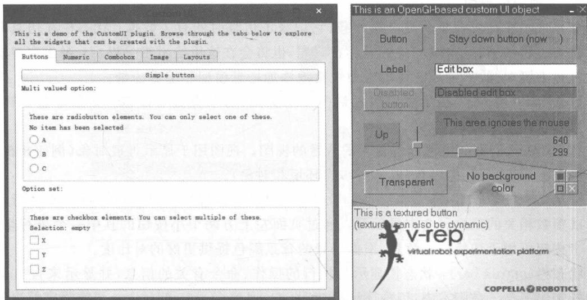

图 3-8 左图为基于 Qt 的 UI 界面, 右图为基于 OpenGI 的 UI 界面
{: .figure-caption }


此外，在 V-REP 的官方声明中宣称，将来不可能进一步发展或改进基于 OpenGL 开发的用户自定义界面。因此，在这里，我们建议读者去学习使用基于 Qt 的自定义 UI。

在 V-REP 本身提供的场景(V-REP3\V-REP\_PRO\_EDU\scenes)中分别提供了以上两种自定义界面的场景,文件名为 customUI-OpenGLBased.ttt 和 customUI-OtBased.ttt。运行这两个文件,可以将它们的界面风格、输入命令等进行比较。

### 3.2.5 页面与视图

V-REP 中的视图用于显示特定对象的图像内容。其中这个对象必须是可被查看的。V-REP 中的页面是场景主要能够被用过观看的表面。它可以由一个或一个以上的视图组成。例如，一个视图与相机对象相关联，那么它可以显示相机看到的内容。如图 3-9 所示，它说明了页面、视图和可见对象之间的关系：页面可以包含多个视图，每个视图表示同一只移动机器人的不同图像；而视图则显示了相对应相机的视角，与相机的位置及配置有关。

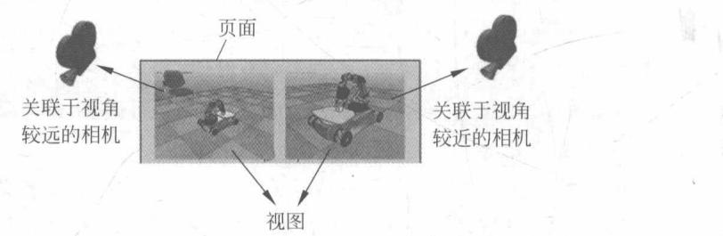

图 3-9 页面、视图和可见对象之间的关系
{: .figure-caption }


在页面中,视图可以具有一个固定位置,也可以浮动于页面上,即可以根据用户的需要去调动位置。

页面、视图和可见对象之间的关系如下页面配置所示：V-REP中的每个场景都有8个可自由配置的页面。可以通过页面选择器工具栏按钮（见图3-10）访问（即显示）单个页面。

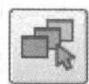

图 3-10 页面选择器
{: .figure-caption }

工具栏按钮

当创建新场景时,8个页面中的每一个页面将以不同的方式被预配置:

创建页面和选择默认页面配置时,依次选择: Popup menu(弹出菜单)、Set-Up Page With(设置页面);

删除某个页面时,依次选择: Popup menu(弹出菜单)、Remove Page(删除页面)。之后,不存在的页面(即已删除的页面)将显示深灰色表面。

有几种默认页面配置可用,如图 3-11 所示(数字表示视图索引)。

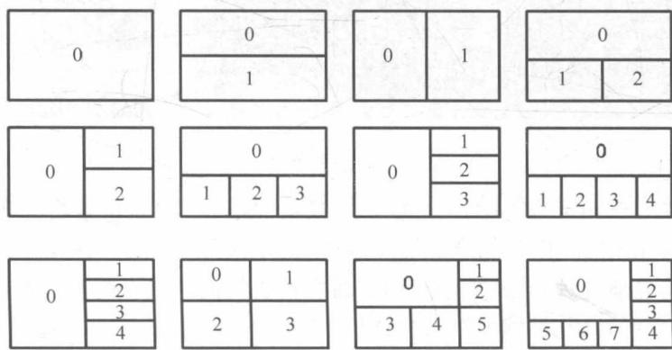

图 3-11 具有固定视图的可用页面配置
{: .figure-caption }


页面上方配置允许显示 1～8 个固定视图。浅灰色表面中的每一个对应于空视图（即非关联视图）。在任何时候，可以依次单击弹出菜单、删除页面以删除页面。删除页面还会删除其包含的所有视图，但不会删除任何关联的对象。在现有页面配置的顶部，可以依次单击弹出菜单、添加、浮动视图以添加无限数量的浮动视图。

浮动视图可以移动和调整大小,但不允许使用左或右鼠标按钮进行导航(例如相机转换、相机旋转等)。双击浮动视图以使用视图索引以交换其内容(但是,可以通过编程禁用它来禁止此操作)。要删除浮动视图,只需单击其右上方的按钮即可。要将可查看对象与视图相关联,请选择该对象,并在我们要关联的视图上依次单击弹出菜单、视图、与所选摄像机关联视图,以及弹出菜单、视图、关联视图与所选图形或依次单击弹出菜单、视图、与所选视觉传感器关联视图(弹出菜单将根据最后选择的对象自动调整其内容)。当创建视图但尚未与可见对象关联时,依次单击弹出菜单、添加、相机命令将添加一个摄像机,并直接将其与视图相关联(即透视它)。给定的可见对象可以与任何数量的视图同时关联。或者通过在视图中激活以下弹出窗口将视图与可见对象相关联:依次单击弹出菜单、视图、视图选择器。这将打开视图选择器,如图3-12所示。

一旦观看对象与视图相关联，视图中将自动显示其图像内容，如果采用视觉传感器产生其图像内容,则需要调用适当的 API 命令。默认情况下,主脚本包含将处理场景中所有视觉传感器的命令(simHandleVisionSensor(sim\_handle\_all))。除非视觉传感器被标记为显式处理,但未被明确地处理,否则其图像内容将在仿真期间生成。与摄像机相关联的视图可以通过以下方式进行自定义或调整:它可以以实体或线框显示摄像机视图:依次单击弹出菜单、视图、实体渲染;它可以透视或正投影显示摄像机视图模式:依次单击弹出菜单、视图、透视投影;它可以显示或隐藏边缘:依次单击弹出菜单、视图、可见边缘;它可以显示边缘为粗线或细线:依次单击弹出菜单、View、Thick edges;它可以打开和关闭纹理显示:依次单击弹出菜单、视图、形状纹理启用;其相关的摄像机可以跟踪最后选择的对象:依次单击弹出菜单、视图、跟踪所选对象。与图形相关联的视图可以通过以下方式进行自定义或调整:可以显示图形对象的时间图:依次单击弹出菜单、视图、显示时间图;图形对象的 x/y 图形:依次单击弹出菜单、视图、显示 x/y 图形;它可以自动调整为图形内容:依次单击弹出菜单、视图、仿真时自动调整大小;它可以保持比例为 1:1:依次单击弹出菜单、视图、保持比例在 1:1。

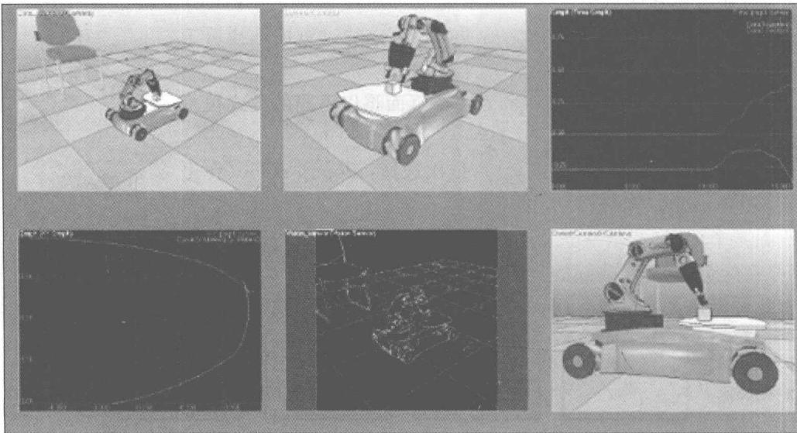

图 3-12 查看视图选择器
{: .figure-caption }


### 3.2.6 对象/项目位置和方向操作

在通过坐标和变换对话框修改对象配置之后,还可以使用鼠标直接操作对象:当选择对象时,可以使用以下工具栏按钮(见图3-13)移动或旋转对象:

如图 3-14 所示, 默认情况下, 平移是在 X-Y 平面进行的。取决于对象操纵设置中的设置, 其还可以沿着不同的轴/平面并且相对于每个单独对象的不同参考系执行。图中深色阴影覆盖处表示当前平移平面或轴。默认情况下, 围绕对象自己的 Z 轴执行旋转。也可以根据对象操纵设置中的设置，围绕不同的轴或相对于每个单独对象的不同参考系执行。图中深色阴影覆盖处表示当前旋转轴。

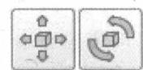

图 3-13 操作工具栏按钮
{: .figure-caption }

(平移和旋转)

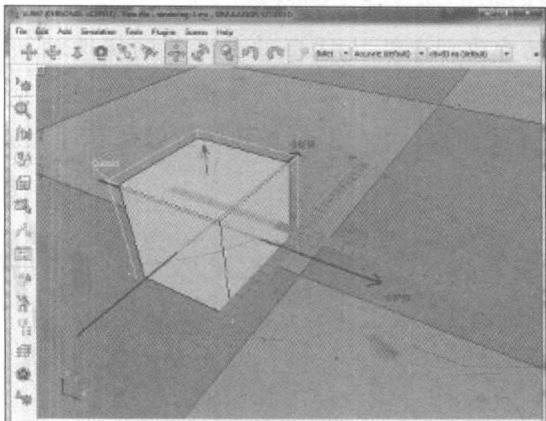

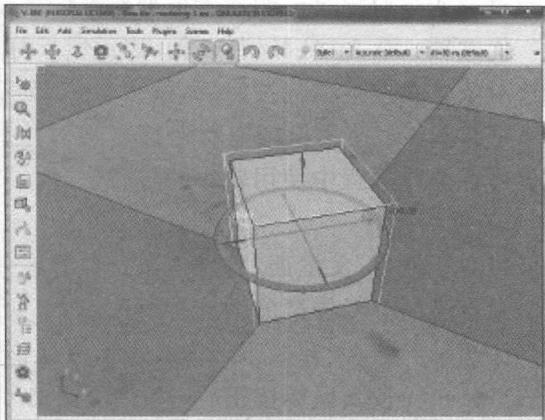

图 3-14 对象平移和旋转操作：图中深色阴影覆盖处表示平移平面或旋转轴
{: .figure-caption }


可以在用户设置对话框中调整默认平移和旋转步长(捕捉)，但建议分别保持5cm和5°的值，或者在对象操作设置中单独设置对象的步长。在对象操作期间按下鼠标按钮后，按住shift键可暂时禁用捕捉。以类似的方式，在对象操纵期间按下鼠标按钮之后，通过按住Ctrl键可临时激活可选的平移或旋转轴。

当仿真软件处于顶点编辑模式或路径编辑模式时,也可以使用对象/项目平移工具栏按钮。对于精确的对象定位,建议通过坐标和变换对话框修改对象的位置和方向。

#### 对象操作设置

可以依次单击菜单栏、工具和对象操作设置以显示对象操作设置。对话框的内容取决于最后选择的对象。如果未选择对象，则对话框处于非活动状态。对话框如图 3-15 所示。

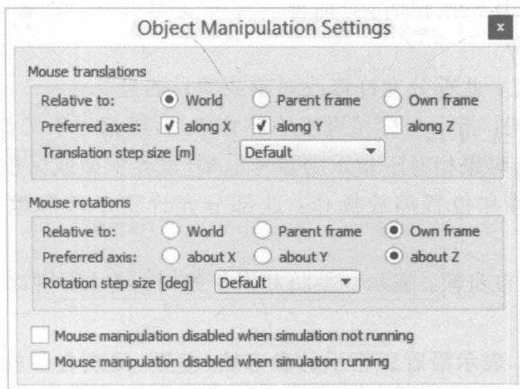

图 3-15 鼠标平移/旋转设置对话框
{: .figure-caption }


## 1）鼠标平移

相对于世界/父框架/自身框架：表示鼠标拖动将与绝对参考框架对准，与父对象参考框架对准或与对象自己的参考框架对准的平面或线上平移选定的对象。

优选轴：沿 X/沿 Y/沿 Z 轴，表示鼠标拖动允许沿着以上选择的参考系的优选轴平移所选对象。在按下鼠标按钮后，按下 Ctrl 键可以在操作过程中使用其他轴。

平移步长：使用鼠标拖动平移所选对象时使用的步长。在按下鼠标按钮后按下 Shift 键仍可在操作过程中使用较小的步长。

## 2）鼠标旋转

相对于世界/父框架/自身框架：表示鼠标拖动将围绕绝对参考框架，父对象参考框架或对象自己的参考框架的轴旋转所选对象。

优选轴：沿 X/沿 Y/沿 Z 轴，表示鼠标拖曳允许围绕上面选择的参考系的优选轴旋转所选对象。在按下鼠标按钮后，按下 Ctrl 键可以在操作过程中使用其他轴。

旋转步长：使用鼠标拖动旋转所选对象时使用的步长。在按下鼠标按钮后，按下 Shift 键仍可在操作过程中使用较小的步长。

仿真运行/不运行时禁用鼠标操作：启用时，当仿真运行/不运行时，无法操作所选对象。

#### 坐标和变换对话框

当用户使用以下工具栏按钮之一切换到对象/项目移动模式时,坐标和变换对话框变为可见。

对话框的内容取决于所选的移动模式(平移或旋转)和最后选择的对象或项目。如果未选择对象/项目，则对话框处于非活动状态。如果选择了多个对象/项目，则一些参数可以从最后选择的对象/项目复制到其他所选对象/项目(应用于选择按钮)。

## 1）位置/平移

当选择对象转换工具栏按钮时,对话框的部分变为可见。位置/平移对话框如图 3-16 所示,有两个不同的部分。

(1) 对象/项目位置：此部分允许修改对象或项目的坐标。

相对于世界/父框架：指示坐标相对于绝对参考系，或相对于父参考系。

X/Y/Z 坐标：所选对象相对于指示的参考框架(世界框架或父框架)的位置。

（2）对象/项目平移和位置缩放操作：此部分允许将平移和缩放变换应用于对象或项目。

相对于世界/父帧/自身帧：表示变换将相对于绝对参考帧，相对于父参考帧，或相对于对象自己的参考帧。

沿着 X/Y/Z 平移：表示沿着所指示的参考帧（世界、父或自己的帧）的 X 轴、Y 轴和 Z 轴的期望的平移量。

沿 X/Y/Z 的标度：表示沿着所指示的参考系(世界或母体)的 X、Y 和 Z 轴的期望位置缩放。

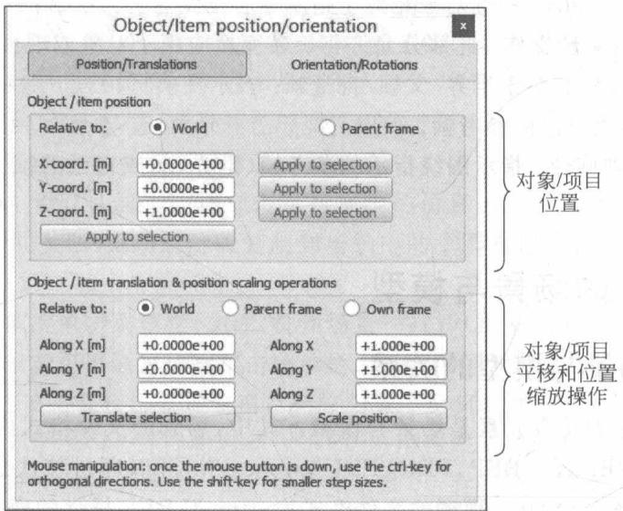

图 3-16 位置/平移对话框
{: .figure-caption }


## 2）方向/旋转

选择对象旋转工具栏按钮时,对话框的该部分变为可见。方向/旋转对话框如图 3-17 所示,它有两个不同的部分。

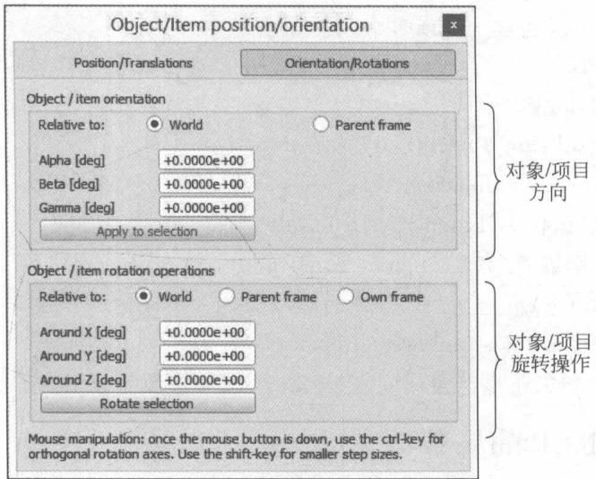

图 3-17 方向/旋转对话框
{: .figure-caption }


(1) 对象/项目方向：此部分允许修改对象或项目的方向。

对象/项目定向相对于世界/父框架：表示所指定的欧拉角度相对于绝对参考系或相对于父参考系。

Alpha/Beta/Gamma：所选对象相对于指示参考框架(世界或父)的欧拉角。

(2) 对象/项目旋转操作: 此部分允许将旋转变换应用于对象或项目。

对象/项旋转操作相对于世界/父帧/自身帧：表示变换将相对于绝对参考帧，相对于父参考帧或相对于对象自己的参考帧。

围绕 X/Y/Z 轴旋转：指示围绕指示的参考帧（世界、父或自己的帧）的 X、Y 和 Z 轴的期望旋转量。

## 3.3 V-REP 的场景与模型

### 3.3.1 场景与模型的关系

V-REP 中的主要仿真元素是场景与模型。其中，场景的文件格式为 .ttt，V-REP 提供的场景存放在 V-REP3\V-REP\_PRO\_EDU\scenes 中，可以通过依次选择 File（文件）和 Open scene（打开场景）打开。模型的文件格式为 .ttm，V-REP 提供的模型主要存放在模型浏览器中。

场景与模型的关系是：

（1）场景中包含了一个或多个模型，而模型是只包含了一种元素的场景。

(2) 模型是一个场景的子元素, 只是这个子元素被明确标明为一个完整的模型。

(3) 场景可以包含任何数量的模型。

场景和模型都可以包含一个或多个以下元素：

\- 对象(Objects)

\- 集合(Collections)

\- 碰撞对象(Collision objects)

\- 距离对象(Distance objects)

\- 逆运动学组(Inverse kinematics groups)

\- 几何约束求解器对象(Geometric constraint solver objects)

\- 子脚本(Child scripts)

\- 自定义用户界面(Custom user interfaces)

除了上述元素,场景还将包含环境、主脚本、页面和视图等元素。

### 3.3.2 V-REP 的场景

V-REP 中的场景处理包含一个或多个模型, 还包括了环境、主脚本、页面和视图。

通过与视图相关联的可视对象可以看到场景或场景图像内容,该视图本身包含在页面中。创建新场景时(可以通过依次单击菜单栏、文件、新场景打开),默认场景将包含以下元素:

\- 多个相机对象：如果相机与视图相关联，则相机允许查看场景。

\- 几个光对象：没有光，场景将几乎不可见。灯光用于照亮场景。

\- 几个视图：视图与相机相关联，并显示相机看到的内容。视图包含在页面中。

\- 几个页面：一个页面包含一个或多个视图。

\- 环境：环境由环境光、雾、背景颜色等属性组成。

\- 地板：地板由组合在一个模型中的对象组成。

\- 默认主脚本：默认主脚本应该允许运行最少的仿真，而不需要子脚本。然后，如果与场景对象相关联，则稍后阶段复制到场景中的子脚本也将被自动执行（由主脚本调用）。

场景可以通过依次单击菜单栏、文件、打开场景…打开（加载），并可以通过依次单击菜单栏、文件、保存场景或可以通过依次单击菜单栏、文件、将场景另存为…保存场景。场景文件（“\*.ttt”-files）还支持在资源管理器窗口和应用程序窗口之间进行拖放操作。场景文件也可以双击打开，双击后系统将自动启动V-REP应用程序并打开场景文件。在打开的场景之间切换可以通过在场景层级的上部中单击来实现（所有打开的场景被分组在场景层级的顶部），或者通过其相关的工具栏按钮（见图3-18）使用场景选择器来实现。

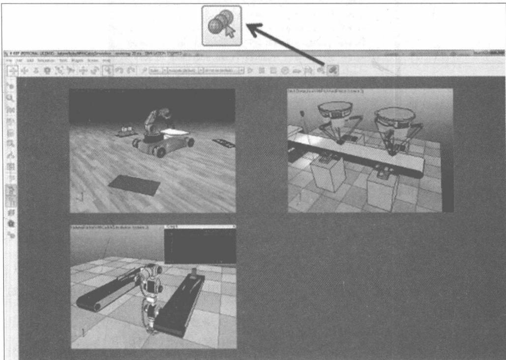

图 3-18 场景选择器工具栏按钮
{: .figure-caption }


环境定义了场景的属性和参数,包括了背景颜色、雾参数(与相机视觉、传感器相关)、环境的光线、场景创建的信息和附加的设置。环境的设置对话框可以通过依次单击 Menu bar(菜单栏)、Tools(工具)、Environment(环境)打开或通过双击场景层次结构中对应的场景图标打开。环境设置对话框见图 3-19。

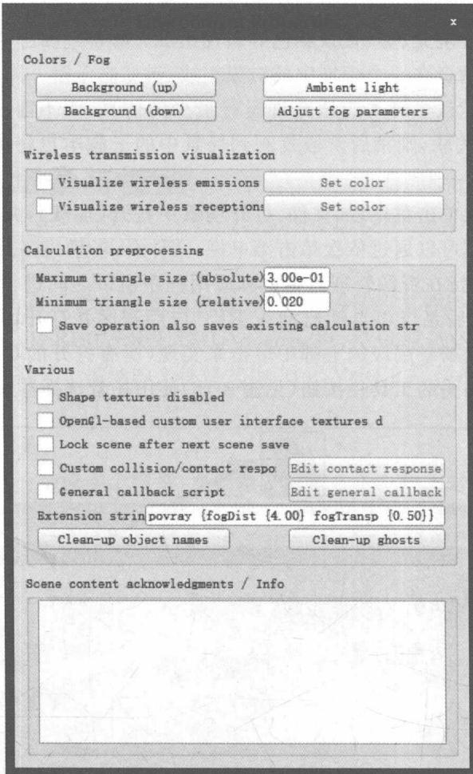

图 3-19 环境设置对话框
{: .figure-caption }


默认的情况下,每个场景都有一个主脚本,它包含了最基本的代码,使得仿真得以进行。每次仿真开始和结束时,都分别调用一次主脚本。因此,主脚本分为三个部分:初始化部分、常规部分和恢复部分。

(1) 初始化部分负责准备用于仿真的代码。

（2）常规部分负责处理所有的代码仿真器的功能(逆运动学、碰撞检测和动力学等)，其中命令 simLaunchThreadedChildScripts 调用线程的子脚本。simHandleChildScripts 调用非线程的子脚本。这一部分分为驱动(或动作/反应)部分和传感(或探测)部分。

（3）恢复部分将在每一次仿真结束时执行，这部分的代码负责恢复对象的初始配置、清除传感器状态、碰撞状态等。

### 3.3.3 V-REP 的模型

#### 模型的创建

模型是场景的子元素。模型本身不能被仿真，它必须被包含在场景中，然后组成场景以进行操作。

模型由建立在同一层次树上的场景对象的选择来定义,其中树的基础必须是被标记为模型基础的对象。它们可以通过依次单击菜单栏、文件、加载模型…加载。然而,通过在模型浏览器和场景视图之间进行拖放操作来加载模型更容易和方便。模型可以通过依次单击菜单栏、文件、保存模型为…保存,只需确保选中标记为对象的单个对象为模型库的基础,否则“将模型另存为…”菜单项将不被启用。还要严格遵循关于如何构建一个干净的仿真模型的教程。

模型按以下步骤定义：

① 将逻辑上属于该模型的所有对象附加到基础对象,以便基础对象是模型树的基础。

② 检查对象模型基础项(objectismodelbase-item)中对象的公共属性。

③ 在上面的同一个对话框中,检查对象/模型是否可以转移或接受 DNA 项目。如果稍后需要重建修改模型,这将简化重建的过程。

④ 在上面的同一对话框中,单击编辑模型属性,可以定义特殊覆盖属性(例如,使整个模型不可见、不可复制等)。这允许快速禁用模型中定义的所有对象的某些属性。

⑤ 对于模型中的所有对象,除了基础对象之外,请检查对象公共属性中模型的选择基础。这将保护建好的模型:用户将无法直接选择模型中的单个部件,而只能够对整个模型进行操作。

⑥ 对于一般不可见的所有对象,请选中不显示为内部模型选择项。这将使模型边界框在模型周围以正确的尺寸显示。

⑦ 模型的作用：例如你的模型是一个夹子，你可以附加到操纵器的手腕（例如，用户建立的机械臂模型可以接受夹具模型的操纵器）。一旦角色决定了，可以定义模型的组装行为。

现在,在模型基础上构建的单个对象不能在场景中被选择(选择它们将改为选择模型的基础),但是仍然可以通过在选择期间按住 Ctrl 和 Shift 键在场景层次中选择它们。除此之外,当选择基础对象时,包含整个模型的点画框将如图 3-20 所示显示出来。在图场景视图和相应的场景层次视图中,选定的虚拟对象被标记为模型基础对象。

双击模型标签打开模型对话框,其中可以调整模型属性。还有一个更好的做法是,编辑模型后折叠模型的层次结构,如图 3-21 所示,以便轻松识别逻辑上分组的元素/模型的数量。

当子脚本以编程方式访问对象时,将多个对象分组为模型也很重要。请记住,在 V-REP 中,对象/模型可以在仿真期间随时重复。为了使重复的子脚本能够访问正确的对象(不是原始对象而是重复的对象),子脚本应该始终与它访问的对象同时复制。一种保证方式是创建模型(如上所述),并确保访问模型中对象的子脚本与模型中包含的对象相关联。最好是将一个子脚本(也可能有辅助子脚本)与模型的基础相关联。

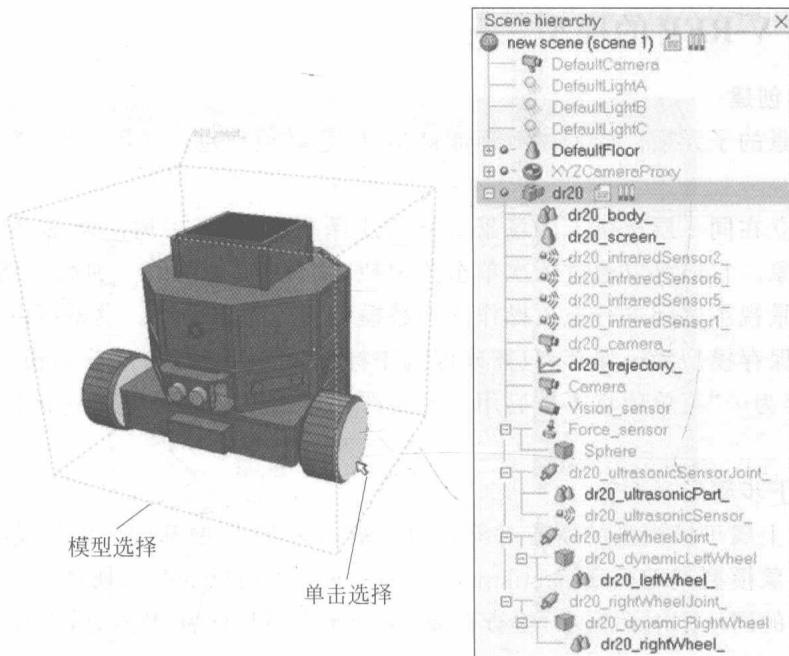

图 3-20 基础对象与层次结构
{: .figure-caption }


为了使模型能够容易地组合(即在彼此之上构建),而没有任何额外的修改,重要的是考虑模型将扮演什么角色:它会附加到其他型号,还是会接受其他型号附加给它?这些问题的答案将允许选择最佳对象类型作为模型基础。

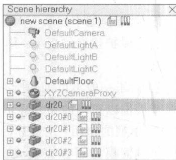

复制和粘贴模型的行为与先保存模型,然后加载它(使用内存缓冲区而不是磁盘空间)的操作完全相同。模型可以像任何其他对象一样从一个场景复制到另一个场景。模型文件(“\*.ttm”-files)还支持在资源管理器窗口和应用


图 3-21 显示 5 个折叠模型的场景层次视图
{: .figure-caption }


程序窗口之间进行拖放操作。也可以双击模型文件，随后系统将启动 V-REP 应用程序，并加载到默认场景中。

#### 模型对话框的设置

模型的属性可以在模型对话框中单独调整。可以通过双击场景层次结构中的模型图标来打开它，如图 3-22 所示。

选择模型缩略图：保存模型时，会弹出一个对话框，要求输入模型缩略图（将显示在模型浏览器中）。但是，如果希望以不同的配置保存模型的缩略图（例如，希望以直线配置保存蛇形机器人的模型，但希望缩略图以弯曲配置可视化蛇形机器人），则可以在此处指定缩

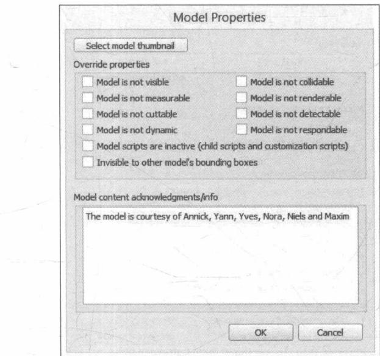

图 3-22 模型状态对话框
{: .figure-caption }


略图。

覆盖属性：在这里，可以禁用(覆盖)整个模型(即模型层次结构树中的所有对象)的特定属性。这样便于快速禁用需要太多计算时间的模型。

模型内容确认/信息：与模型相关的信息。始终良好的做法是确认场景，模型或导入网格的原始作者。当包含确认信息的模型打开时，它将自动显示该信息。

### 3.3.4 V-REP的环境

V-REP 中的环境定义作为场景一部分的属性和参数,但不是场景对象。保存模型时,不保存环境属性和参数,环境的属性和参数仅在保存场景时保存。

环境定义以下属性和参数：

\- 背景颜色。

\- 雾参数。雾参数不直接与场景对象交互，除非使用相机或视觉传感器环境光。

\- 场景创建信息。

\- 其他设置。

#### 环境设置对话框

可以通过依次单击菜单栏、工具、环境或通过双击场景层次结构中的图标访问环境对话框（见图 3-23）。

如图 3-23 所示, 对环境设置对话框的说明如下:

（1）背景(向上/向下)：允许调整场景的背景颜色。向上分量对应于屏幕的上部(天空)，向下分量对应于屏幕的下部分。背景颜色仅在禁用雾功能时可见。

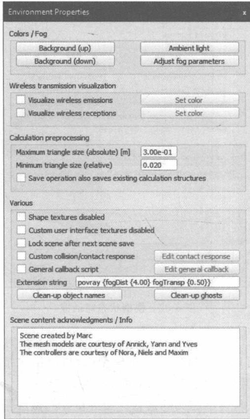

图 3-23 环境设置对话框
{: .figure-caption }


（2）环境光：允许调整场景的环境光。环境光可以被视为场景的最小光，它以完全相同的方式从所有方向照亮对象。

（3）调整雾参数：允许调整各种雾参数。

（4）可视化无线发射/接收：如果启用，则所有无线发射/接收活动将被可视化。

（5）最大三角形大小(绝对)：此项不会影响形状的视觉外观。然而，这将影响大多数V-REP计算模块的执行速度。例如，在两个实体之间执行最小距离计算时，如果两个实体由大小基本相同的三角形组成，则执行通常更快。最大三角形尺寸值指定如何处理形状的内部表示(即形状的计算结构是多么精细)。小尺寸会增加预处理时间，但一般来说，仿真执行速度会同时提高。此值将整个最大三角形的大小设置为绝对值。

（6）最小三角形大小(相对)：类似于上一项，但此项有助于避免创建可能需要很长时间的过大的计算结构。此值将最小三角形大小设置为相对值（相对于给定对象的最大维度）。保存操作还保存现有的计算结构：对于距离计算碰撞检测等，在仿真开始时（预处理）计算数据结构，或者在这种计算中第一次涉及形状，以便加速计算。该数据结构的计算可能是耗时的，因此用户可以选择将其与场景或模型一起保存。然而，必须意识到，将被保存的附加信息是大的,这将导致总的文件变得很大(有时是两倍或更大)。

(7) 禁用形状纹理：如果选中，则将禁用应用于形状的所有纹理。

（8）自定义用户界面纹理已禁用：如果选中，则将禁用应用于基于 OpenGL 的自定义 UI 的所有纹理。

（9）在下一个场景保存后锁定场景：如果要在编辑/修改、查看脚本内容、导出资源这些操作中锁定场景，可以选择该选项。如果希望以后能够修改它，请确保已经在解锁状态下保存了相同的场景。

（10）自定义碰撞/联系人响应：选中此项目后，所有动态联系人处理都可以由用户定义，并通过联系人回调脚本执行。请记住，此设置与场景相关，模型将在不同的场景中作出不同的表现。此设置仅适用于知道它们正在做什么的用户。

（11）一般回调脚本：当选中此项时，将能够处理普通回调脚本中的特定用户回调。当插件调用 API 函数 simHandleGeneralCallbackScript 时，将调用通用回调脚本。

（12）扩展字符串：描述其他环境属性的字符串，主要由扩展插件使用（与simGetExtensionString API函数有关）。

（13）清理对象名称：允许使用哈希标记将某些顺序放入对象名称中。这不是必需的，但可以方便地减少哈希标记后的后缀数。

（14）清除重影：删除场景可能包含的所有重影对象，这与重影记录功能有关。

（15）场景内容确认/信息：与场景有关的信息。始终良好的做法是确认场景、模型或导入网格的原始作者。当打开包含确认信息的场景时，它将自动显示该信息。

#### 纹理设置对话框

纹理对话框如图 3-24 所示, 它的作用是允许查看和修改与附加到形状或基于 OpenGL 的自定义 UI 的纹理相关的属性。

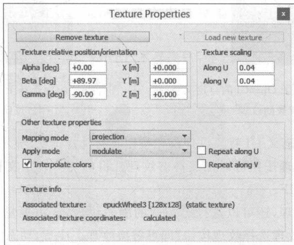

图 3-24 纹理设置对话框
{: .figure-caption }


可通过在形状属性对话框中单击设置纹理项,或通过单击基于 OpenGL 的自定义 UI 对话框中的设置 UI 背景纹理项或设置按钮纹理项来访问它。

纹理是位图图像,可以应用到表面,以使它们看起来更真实。想象一下,将砖纹理应用到矩形表面,以使其看起来像砖墙。V-REP 对形状应用纹理的默认方式是将其投影到形状的 X/Y 平面上。

V-REP 支持以下 5 种纹理映射方法：

（1）投影映射：将纹理简单地投影到对象的 X-Y 平面上。将计算纹理坐标。

(2) 圆柱映射: 纹理包裹在对象的 $Z$ 轴周围。将计算纹理坐标。

（3）球面映射：纹理被球面映射到对象上。将计算纹理坐标。

（4）框映射：纹理应用于盒状对象的所有6个面。将计算纹理坐标。

（5）导入的纹理坐标：通过 OBJ 文件格式，可以在导入网格的同时导入特定的纹理坐标。

建议保持默认设置,以保持与较旧的显卡的兼容性(当选中缩放纹理时,所有纹理都将调整为2的幂次)和文件大小。

一旦纹理在存储器中,它可以在实际映射发生之前被缩放、移位和旋转,以便获得期望的视觉外观。

如果将纹理应用于作为背景的基于 OpenGl 的自定义 UI 或基于 OpenGl 的自定义 UI 按钮，则它不能被缩放、移动或旋转。如图 3-25 和图 3-26 所示，它将自动地在整个自定义 UI 表面或整个自定义 UI 创建按钮。

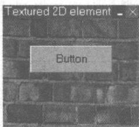

图3-25 应用于基于OpenGl的自定义UI作为背景的纹理
{: .figure-caption }


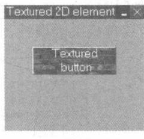

图3-26 应用于基于OpenGl的自定义UI作为按钮的纹理
{: .figure-caption }


基于 OpenGL 的自定义 UI 背景纹理仅在按钮具有选择透明/显示背景纹理项目时才可见。通过单击加载新纹理按钮可以加载静态纹理。目前支持以下文件格式：JPEG、PNG、TGA、BMP、TIFF 和 GIF。

除了从文件加载纹理, 还可以选择已加载的静态纹理, 或由视觉传感器生成的动态纹理。只需单击“从现有纹理选择纹理按钮”即可替换纹理。注意, 动态纹理只有在仿真期间, 而且视觉传感器被正确处理的时候, 才能够正常显示出来。

## 3.4 实体

模型包括了以下这些元素：对象、集合、碰撞的对象、远程对象、逆运动学组、几何约束求解对象、子脚本和自定义用户界面。其中一个场景对象或集合称为实体。场景、场景对象、集合、实体的关系如图3-27所示，对象A、对象B、对象C、对象D、集合1和集合2都称为实体。

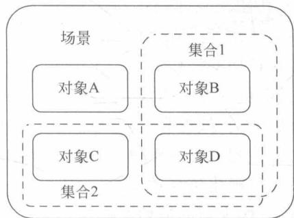

图 3-27 场景、场景对象、集合和实体的关系
{: .figure-caption }


### 3.4.1 V-REP 的场景对象

一个 V-REP 仿真场景包含了一些场景对象和基本对象。这些对象由树状的层次结构装配在一起，共同组成了 V-REP 中的仿真模型和工作环境。在 V-REP 界面中，对象存在于场景层次结构和可见的场景视图中。

如图 3-28 所示，V-REP 中所支持的场景对象包括：形状（shape）、关节（joint）、路径（path）、摄像机（camera）、光源（light）、近距离传感器（proximitysensor）、视觉传感器（visionsensor）、力/力矩传感器（force/torquesensor）、图表（graph）、磨机（mill）、镜子（mirror）等。这些场景对象部分由 V-REP 本身提供，部分可从外部的建模软件导入。下面对模型的建立所涉及的场景对象进行介绍。

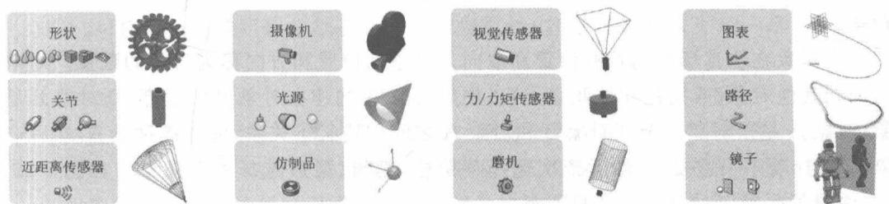

图 3-28 V-REP 中的场景对象示意图
{: .figure-caption }


形状：它是由三角形网络构成的刚性网络，一方面用于刚体的仿真，另一方面实现了刚体的可视化。形状是可碰撞、可衡量、可检测、可渲染和可放缩的对象，所以它可用于与其他对象的碰撞检测、可被近距离传感器、视觉传感器等检测。因此，其他场景对象的使用也在很大程度上依赖于形状。

关节：它是一种连接两个或多个场景对象的元素，并赋予它们1个或3个自由度。关节具有4种类型：转动关节、移动关节、螺丝关节和球形关节，前3种具有1个自由度，球形关节具有3个自由度。

路径：它允许对空间中复杂的运动进行定义，包括转化、旋转或暂停以及它们之间的组合，并使机器人沿着一个预定义的轨迹进行运动。例如，让焊接机器人沿着预定轨迹进行焊接物体表面的工作，或者让传送带沿预定轨迹运动。

摄像机：摄像机允许从不同的角度去观察仿真的场景。

磨机：可以在形状对象上执行切割操作。

力/力矩传感器：能够测量电机的力和力矩。

视觉传感器：能够与空间中的光、颜色和图片反应。

近距离传感器：能够在它的检测范围内精确地检测一个物体。

图表：图表可以用来记录和可视化仿真数据。

镜子：能够反射图像，也可以作为辅助剪切面操作。

光源：能够照明仿真的场景。

下面详细地介绍 V-REP 中的各种场景对象。

### 3.4.2 场景对象的性质

一些上述对象可以具有允许其他对象或计算模块与它们交互的特殊属性。对象可以是：

(1) 可碰撞：碰撞的对象可以与其他可碰撞的对象发生碰撞。

(2) 可测量的: 可测量的对象可以具有它们和其他可测量的对象之间的最小距离。

(3) 可检测的: 可由接近传感器检测可检测的物体。

(4) 可切割：可切割的物体可以被铣刀切割。

(5) 可渲染：可渲染的对象可以被视觉传感器看到或检测。

（6）可查看：可查看对象可以通过“查看”选项查看，它们的图像内容也可以在视图中可视化。

每个对象在仿真场景内具有位置和取向。对象的位置和方向称为对象的配置。对象可以附加到其他对象(或构建在彼此之上)。如果对象 A 构建在对象 B 的顶部,则对象 B 是父对象,对象 A 是子对象。要在对象 B 和对象 A 之间创建父子关系,请选择对象 A,然后选择对象 B(选择顺序很重要)。然后依次选择菜单栏、编辑、最后选择的对象父。如图 3-29 所示,它说明了此操作对模型关系的影响。

也可以将对象拖放到场景层次结构中的另一个上，以获得类似的结果。注意：对象A的配置没有改变（两个对象保持它们各自的配置）。然而，查看场景层次结构，可以看到对象A成为对象B的子对象。如果现在移动对象B，则对象A将自动跟随，因为对象A附加到对象 B。对象 A 可以通过选择它来分离，然后依次选择菜单栏、编辑、选择孤立的对象。这样做将分离对象 A，而不更改其配置。也可以将对象拖放到世界图标上，以获得类似的结果。

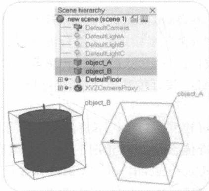
(a) 在将对象A附加到对象B之前

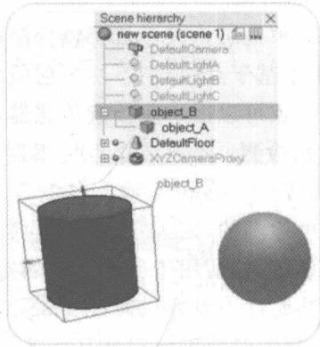
(b) 在将对象A附加到对象B之后

图 3-29 场景对象对模型关系的影响
{: .figure-caption }


每个对象都具有相对于世界参考坐标系的绝对配置(或累积配置)，以及相对于父对象参考坐标系的本地配置(或相对配置)。在上面的例子中，当对象 A 成为对象 B 的子对象时，对象 A 的绝对配置没有改变，但它的本地配置被修改。

最后选择的对象的绝对配置显示在信息文本中,某些对象数据可以通过图形对象进行记录。

#### 场景对象的具体形状

## 1) 可碰撞的对象

可碰撞的对象是可以被测试与其他可碰撞对象碰撞的对象,即将注册碰撞状态。这并不意味着它们将响应冲突(即可响应),这是不同的东西。可碰撞的对象包括:虚拟对象,形状,八叉树,点云。

可碰撞对象可以单独启用或禁用其可碰撞的属性(默认情况下为非纯形状、八叉树和点云启用)。这可以在对象公共属性中设置或通过 simSetObjectSpecialProperty API 函数设置。此外,可碰撞的对象可以根据其相关的模型属性(如果它们是模型的一部分)覆盖其可碰撞的属性。

## 2）可测量的对象

可测量的对象是可用于与其他可测量的对象进行最小距离计算的对象,包括:虚拟对象,形状,八叉树,点云。集合也是可衡量的,因为它们可能包含可衡量的对象。

可测量的对象可以单独启用或禁用其可测量的属性(对于非纯形状,八叉树和点云默认启用)。这可以在对象公共属性中设置或通过 simSetObjectSpecialProperty API 函数设置。

此外,可衡量对象可以根据其相关的模型属性(如果它们是模型的一部分)覆盖其可衡量属性。

## 3）可检测的对象

可检测的对象是可由接近传感器检测的对象,包括:虚拟对象,形状,八叉树,点云虚拟对象和点云,由于基于点,它们不能被射线型或随机型接近传感器检测到。

可检测的对象可以由所有接近传感器或仅由特定类型的接近传感器或如下所列的接近传感器的子类别检测：超声波接近传感器，红外接近传感器，激光接近传感器，电感式接近传感器，电容式接近传感器。

集合也是可检测的,因为它们可能包含可检测的对象。可检测对象的可检测的属性可以单独启用或禁用,这适用于所有类型的接近传感器(默认情况下,对于非纯形状启用)。这可以在对象公共属性中设置或通过 simSetObjectSpecialProperty API 函数设置。

此外,可检测的对象可以根据其相关的模型属性(如果它们是模型的一部分)覆盖其可检测的属性。

## 4）可切割的对象

可切割物体是可以被铣刀切割的物体。现在，只有简单的非纯形状是可以切割的，但未来的 V-REP 版本也将包括可切割的卷。集合也是可切割的，因为它们可能包含可切割对象。

可切割的对象可以单独启用或禁用它们的可切割属性(默认情况下禁用)。这可以在对象公共属性中设置或通过 simSetObjectSpecialProperty API 函数设置。

此外,可切割对象可以根据它们的相关模型属性(如果它们是模型的一部分)对其可切割属性进行重写。

## 5）可渲染对象

可渲染对象是可由视觉传感器看到或检测到的对象,包括:形状,路径(路径整形功能必须启用),图形(仅渲染非静态3D曲线),镜子,八叉树,点云。

集合也是可呈现的,因为它们可能包含可呈现对象。

你可以有一个可渲染的对象只有特定的视觉传感器才能看到。可渲染对象也可以单独启用或禁用它们的可呈现属性(默认情况下启用,纯粹形状除外)。这可以在对象公共属性中设置或通过 simSetObjectSpecialProperty API 函数设置。

此外,可渲染对象可以根据其相关的模型属性(如果它们是模型的一部分)覆盖其可渲染属性。

## 6）可见对象

可见对象是可以浏览、查看或可以显示某些图像内容的对象，包括：相机，图表，视觉传感器，可见对象可以与将显示其图像内容的视图相关联。

#### 场景对象的性质设置

依次单击菜单栏、工具、场景对象属性，可以打开场景对象属性对话框。还可以通过双击场景层次结构中的对象图标或单击其工具栏按钮来打开对话框。

如图 3-30 所示, 场景对象属性对话框显示与对象(即场景对象)相关的属性。对话框是上下文敏感的, 其内容主要取决于场景对象选择状态: 只显示最后选择的对象的属性。这

些属性分为两部分。

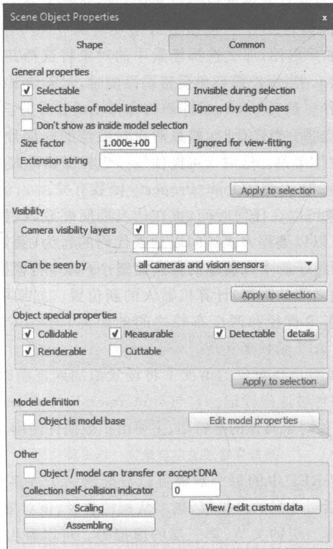

图 3-30 Scene 对象属性对话框, 当前显示对象的常用属性
{: .figure-caption }


\- 对象类型特定属性：特定于所选对象类型的属性。

\- 对象公共属性：所有对象类型共有的属性。

对话框上部的 2 个按钮允许选择要显示的属性类型。如果对象选择为空,则所有对话框项都将处于非活动状态。

对话框的对象类型特定属性部分将显示以下对话框之一,具体取决于最后选择的对象的类型。但是,场景对象具有一些公共的属性,能够在对话框中被设置。

在场景对象属性对话框中,单击常用按钮以显示对象常用属性对话框。该对话框显示上次选择的对象的设置和参数。如果未选择对象,则对话框处于非活动状态。如果选择了多个对象,则可以将一些参数从最后选择的对象复制到其他所选对象(应用于选择按钮)。

可选：指示是否可以在场景中选择对象。总是可以在场景层次结构中选择对象。与simSetObjectProperty函数有关。

在选择期间不可见：启用时，对象将在选择过程中不可见（即，我们将能够通过对象进

行选择）。

忽略深度传递：当启用时，在深度渲染过程中对象将被忽略。深度渲染通道用于正确定位红色球体以用于相机移动。

选择模型的基础：如果启用，那么选择场景中的对象将选择其第一个父对象标记为对象是模型基础（详见下文）。当保护模型免受错误操作时，此属性很方便，允许将其作为单个实体与其他对象一起操作。这与simSetObjectProperty函数有关。

不显示为内部模型选择：当选择时，并且对象是模型的一部分，则模型边界框（即模型选择边界框）将不会包含该对象。这对于可能使模型边界框显得太大的不可见对象很有用。此属性没有功能效果。它与simSetObjectProperty函数有关。

尺寸因子：每个对象可以在任何时间，也在仿真期间缩放（调整大小）。尺寸因子将以类似的方式缩放，并且可以以编程方式访问以调整代码的行为（例如子脚本）。设想一个两轮运动机器人，其运动通过子脚本以简单的方式控制：子脚本将根据几个参数（车轮旋转速度、车轮直径和两个车轮之间的距离）计算机器人的新位置。如果用户缩放机器人，子脚本应根据新的尺寸参数（车轮直径和两个车轮之间的距离）调整其计算。它可以通过使用simGetObjectSizeFactor API函数来实现。

忽略视图拟合：在没有选择对象的情况下将场景添加到视图时，将不会考虑使用所选项目的对象。通常，楼层将被这样标记。它与 simCameraFitToView API 函数有关。

扩展字符串：描述其他对象属性的字符串，主要由扩展插件使用，与 simGetExtensionString API 函数有关。

相机可见性图层：V-REP 中的每个对象可以分配给一个或多个可见性图层。如果存在至少一个与层选择对话层匹配的可见层，则当从相机看时，该对象将是可见的。默认情况下，形状分配给第一层、第二层的关节、第三层的虚拟等。可以看出：允许指定将是唯一能够看到对象的相机或视觉传感器（或包含相机或视觉传感器的集合）。

Collidable: 允许启用或禁用所选可 collidable 对象的碰撞检测功能。

可测量：允许启用或禁用所选可测对象的最小距离计算能力。

可检测：允许启用或禁用所选可检测对象的接近传感器检测能力。单击详细信息将允许编辑可检测的详细信息。

可渲染：允许启用或禁用所选可渲染对象的视觉传感器检测能力。

可切割：允许启用或禁用所选可切割对象的铣刀切割能力。

对象是模型基础：指示对象是否应作为模型的基础。标记为模型基础的对象具有特殊属性（例如，保存或复制对象也将自动保存/复制其所有子项和子项的子项等）。另外，当选择这样的对象时，选择边界框被显示为粗点画线，包围整个模型。参考模型，并选择上面的模型的选择基础。

编辑模型属性：允许打开模型对话框。

对象/模型可以传输或接受 DNA：当为对象或模型启用此功能时，它将与其所有副本共享相同的标识符。对象或模型然后可以经由转移 DNA 工具条按钮将其 DNA（即，复制其自身的实例)转移到其所有兄弟(即具有相同标识符的对象/模型)。想象一下,在你的场景中有100个相同的机器人,你想以类似的方式修改:只需修改其中之一,选择它,然后单击转移DNA工具栏按钮。这个项目应该总是检查一个模型基础(见后续),以方便模型重建。

集合自冲突指示器：当在两个相同集合之间执行冲突(或最小距离)计算时，V-REP通常将检查所有集合项目与该集合中的所有其他项目。在某些情况下，例如运动链，人们不想检查连续的连杆，因为它们可能在接口处不断地碰撞。在这种情况下，可以使用集合自冲突指示器：如果它们的指标差异正好为1，则相同集合中的两个项目不会相互检查。

缩放：对象或模型可以在 V-REP 中以灵活的方式缩放。对象或模型的大小以及所有相关属性被适当地缩放（例如关节范围、速度设置、质量等），使得缩放的对象或模型可以正常地继续操作（但是以不同的比例）。

查看/编辑自定义数据：打开一个允许可视化和编辑附加到对象的自定义数据的对话框，如图 3-31 所示。

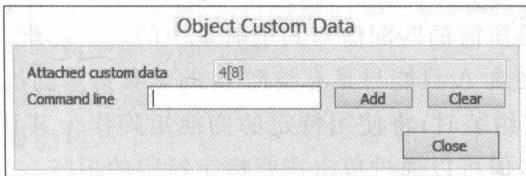

图 3-31 对象自定义数据对话框
{: .figure-caption }


附加的自定义数据：显示附加到此对象的自定义数据的摘要，格式为：header number [data size], header number [data size] 等。数据可以通过 API 调用读取和写入 (simAddObjectCustomData 和 simGetObjectCustomData)。标头号是自定义数据和/或添加它的开发人员的标识符。如果要添加自定义数据（作为公司或个人），请始终使用相同的标题（因为只有我们才知道哪些数据类型存储在该标题下）。最好是使用我们的 V-REP 副本的序列号，或高随机整数值。否则，我们可能会与其他开发人员的自定义数据（可能与我们使用相同的标题）冲突。

添加：允许向对象添加简单的自定义数据。要添加的数据应以以下格式写入命令行：头号，字符串或头号，number1，number2，number3等。不带“.”的数字默认为整数，否则为浮点数。以小端方式将数字添加到给定头号的自定义数据缓冲区中。如果必须添加/提取复杂数据，请使用API调用(simAddObjectCustomData和simGetObjectCustomData)。

清除：允许从对象中删除自定义数据。要删除的数据的头部编号应写入其右侧的空框中。如果必须添加/提取复杂数据，请使用 API 调用（simAddObjectCustomData 和 simGetObjectCustomData）。

装配：打开一个对话框，可以指定装配工具栏按钮在装配过程中如何处理对象（如果对象以不同于通过装配工具栏按钮的方式装配，则以下设置不会有影响），如图3-32所示。

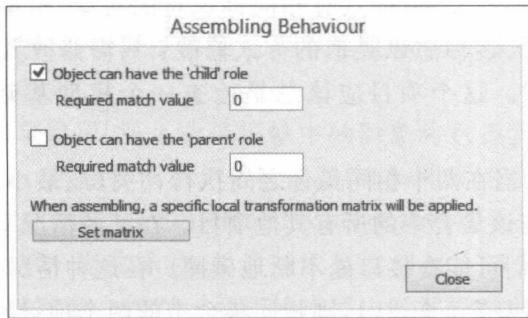

图 3-32 装配行为对话框
{: .figure-caption }


对象可以具有“子”角色：如果选中，则对象可以附加到另一个对象（即成为另一个对象的子对象），但前提是所需的匹配值与其父对象中的一个匹配。此功能对于设置夹具兼容性标准很有用（例如，夹具 A 只能与具有类型 A 的工具提示的机器人连接）。

对象可以具有“父”角色：如果选中，则另一个对象可以附加到该对象上（即成为另一个对象的父对象），但前提是所需的匹配值与其子对象中的一个匹配。此功能对于设置夹具兼容性标准很有用（例如，夹具 A 只能与具有类型 A 的工具提示的机器人连接）。

设置矩阵：当对象被组装时，将使用特定的变换矩阵作为其新的局部变换矩阵。默认情况下，矩阵是单位矩阵，但可以通过单击按钮指定特定的矩阵。该特征可以使对象自动并正确地定位和定向到其新的父对象上（例如，为了使抓手自动正确地放置在机器人的工具提示处）。

### 3.4.3 常用的场景对象——形状

形状是 V-REP 中的基本场景对象, 它们是由三角形面组成的刚性网格物体。它们可以导入、导出和编辑。它们有几种不同的子类型:

（1）简单随机形状：可以表示任何网格。它有一种颜色和一套视觉属性。未优化动态碰撞响应，不推荐用于动态碰撞响应计算（因为非常慢和不稳定）。

（2）复合随机形状：可表示任何网格。它有几种颜色和几组视觉属性。未优化动态碰撞响应，不推荐用于动态碰撞响应计算（因为非常慢和不稳定）。

（3）简单凸形：表示具有一种颜色和一组视觉属性的凸网格。针对动态碰撞响应计算进行了优化(但推荐使用纯形状)。

（4）复合凸形：表示具有几种颜色和一组视觉属性的一组凸网格。针对动态碰撞响应计算进行优化(但推荐使用纯复合形状)。

（5）纯简单形状：表示原始形状（长方体、圆柱体或球体，根据所使用的物理引擎具有额外的变化）。纯简单形状（或纯复合形状）适合于动态碰撞响应计算，因为它快速并且稳定。

(6) 纯复合形状: 表示一组原始形状(长方体、圆柱体或球体)。纯复合形状(或纯简单

形状)适合于动态碰撞响应计算,因为它快速并且稳定。

（7）高度形状：可以将地形表示为规则网格，其中只有高度变化。该形状也可以被认为是纯简单形状，并且被优化用于动态碰撞响应计算。

默认情况下,所有导入的形状是简单的形状。然而,可以将两个或多个简单形状或复合形状分组或取消分组,也可以合并简单形状。在这种情况下,所有合成元素的视觉属性都相同。也可以分割简单形状,这取决于其配置:分割算法将提取形状的每个不同元素。如果两个元素不共享任何公共边,则两个元素不同。

纯形状主要是功能形状。它们大多数时间只由物理引擎使用，因为它们比非纯形状（例如随机或凸形网格）具有更好和更快的执行能力。由于这个原因，纯形状通常隐藏在不可见层（例如层9）。

纯简单形状也可以分组,然而,如果所有的组成元素也是纯的,则所得到的复合形状将是纯的。合并纯简单形状将导致非纯简单形状。

#### 形状的特点

形状是可碰撞的、可测量的、可检测的、可渲染的和可切割的对象。这意味着形状：

\- 可用于对其他可碰撞对象的碰撞检测。

\- 可用于与其他可测量的对象的最小距离计算。

\- 可以由接近传感器检测。

\- 可以由视觉传感器检测。

\- 可以由磨机切割。然而，只有简单的非纯形状可以是可切割的。

形状的可碰撞、可测量、可检测、可呈现和可裁切的性质可以在对象的常见属性中修改。此外，如果形状是覆盖它们的模型的一部分，那么这些属性可以被覆盖。

#### 形状参考坐标系和边界框

形状跟每个对象一样,具有参考坐标系和边界框。参考坐标系或坐标坐标系(参考系或坐标系)始终位于形状的几何中心,并且指示从中计算形状的位置和取向的点。坐标系具有三个轴:X-、Y-和Z-轴,分别对应于红色、绿色和蓝色箭头。形状的边界框围绕形状的参考坐标系居中,并且具有与参考坐标系相同的取向(X、Y和Z轴具有与边界框的边缘相同的取向)。边界框完全包围形状,用户可以从4种不同的方式中选择以定义形状的参考系和边界框方向(纯简单形状和高度场形状不能重新定向):

（1）与世界参考坐标系对齐：可以通过依次单击菜单栏、编辑、重定向边界框、与世界参考坐标系打开。当单击该项目（必须预先选择形状）时，将计算坐标系，以便产生具有与世界参考坐标系（即绝对坐标系）对准的边缘的边界框。

（2）与随机形状的主轴对齐：可以通过依次单击菜单栏、编辑、重定向边界框、随机形状的主轴打开。当单击该项目（必须预先选择形状）时，将计算参考系，以便在随机形状周围产生最紧凑的边界框。这是默认的计算方法。

（3）与圆柱形主轴对齐：可以通过依次单击菜单栏、编辑、重定向边界框、圆柱形主轴打开。当单击该项目（必须预先选择形状）时，将以圆柱形状计算精确的参考系，其Z轴与圆柱的旋转轴重合。这比上述项目(与随机形状的主轴对准)更精确,但需要精确限定的圆柱形状。如果形状看起来离常规和精确的圆柱太远,操作可能失败。

（4）与长方体形状的主轴对齐：可以通过依次单击菜单栏、编辑、重定向边界框、主要长方体形状打开。当单击此项目（必须预先选择形状）时，将计算与立方体的面对齐的长方体形状的精确参考系。这比上述项目（与随机形状的主轴对准）更精确，但需要精确定义的立方体形状。如果形状看起来离常规和精确的立方体太远，则操作可能失败。

同样地,也可以在几何对话框中或通过 API 修改相对于其形状的边界框方向。如图 3-33 所示,说明了两个相同形状具有不同参考坐标系的情况。

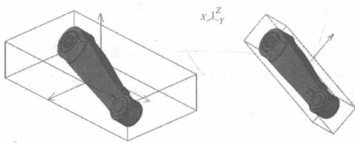

图 3-33 两个相同的形状, 具有不同的参考坐标系
{: .figure-caption }


#### 形状的性质

形状属性是场景对象属性对话框的一部分。也可以通过双击场景层次结构中的对象图标或单击其工具栏按钮来打开对话框。

在场景对象性质对话框(见图 3-34)中,单击形状按钮以显示形状对话框(仅当最后一个选择是形状时,才会显示形状按钮)。该对话框显示上次选择的形状的设置和参数。如果选择了多个形状,则可以将一些参数从最后选择的形状复制到其他所选形状(应用于选择按钮)。

对于场景对象性质的说明如下。

调整颜色：允许编辑形状的颜色。

遮光角：遮光角是区分各个面的角度。这只影响形状的视觉外观。小角度使得形状看起来清晰，具有许多边缘；大角度使得形状看起来平滑，并且具有较少的边缘。

显示边缘：以黑色显示边缘。显示的边缘将取决于指定的角度。如果选中隐藏边框，则不共享多个三角形的边将被隐藏。

背面剔除：构成一个形状的每个三角形都有一个内表面和一个外表面。当启用背面剔除时，不会显示内部面。这是对封闭形状和透明形状有用的参数。

反转面：这将翻转所有三角形。内表面变成外表面，外表面变成内表面。凸形形状将变为非凸形，纯形状除外。

线框：如果选中，则通过相机查看时，形状将始终显示为线框。

调整纹理：打开所选形状的纹理对话框。当形状与纹理相关联时，将以纹理方式显示。

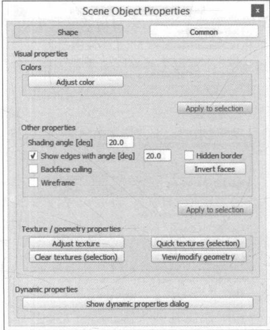

图 3-34 场景对象性质对话框
{: .figure-caption }


快速纹理(选择): 将三维映射纹理应用于所有选定的形状。这对于用作“污垢”的无缝纹理特别有用, 以使对象看起来更逼真。

清除纹理(选择): 从所有选定的形状中删除纹理。

查看/修改几何：打开所选形状的形状几何对话框。它允许调整网格的各种参数。

显示动态属性对话框：切换形状动力学属性对话框。形状动态对话框允许调整形状的动力学属性。

以上的一些参数仅适用于简单形状。选择复合形状时，可以通过切换到复合形状的形状编辑模式来编辑其视觉属性。当然也可以取消组合它，以便单独编辑其组件。

## 1）形状的动力学特性

形状动力学对话框是形状属性的一部分。对话框显示上次选择的形状的动态设置和参数。如果未选择对象，则对话框处于非活动状态。如果选择了多个形状，则可以将一些参数从最后选择的形状复制到其他所选形状（应用于选择按钮）。形状的动力学特性对话框如图3-35所示，说明如下。

刚体是可响应的：如果启用，则形状将产生与其他可响应形状的碰撞反应，但前提是相应的可应答掩码重叠。更多细节参见设计动态仿真部分。

可响应掩码：指示何时生成冲突响应(但是需要启用可响应项目)。掩码由两个8位值组成。如果两个碰撞形状共享它们的任何父对象(直接或间接)，则使用局部掩码，否则使用全局掩码。如果两个形状的AND组合掩码(局部或全局)不为零，则将生成冲突响应。

材质：所选形状的所选材质。材料属性将所有动态引擎的特定属性（如摩擦、恢复等）

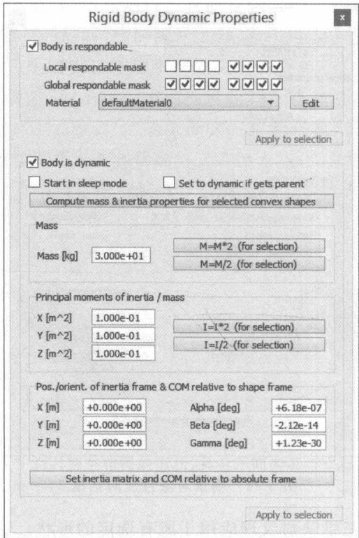

图 3-35 形状的动力学特性对话框
{: .figure-caption }


组合在一起，并可与其他几种形状共享。可以通过材料属性查看和修改(编辑)材料。

刚体是动态的：启用时，形状的位置和方向将在动力学仿真中受到影响。

在睡眠模式下开始：动态仿真的可响应形状可以以睡眠模式开始，在这种情况下，其不会对约束（例如重力）做出反应，直到其首先与另一可响应形状碰撞。

设置为动态如果获得父级：启用并且形状附加到另一个对象时，形状将自动变为动态。这对于在独立时应该是静态的模型基础是有用的，但是当与另一模型/对象结合时，变为动态的。例如，自身操作的机器人操纵器通常具有其基部静止，但是当附接到车辆时，应该变为动态。

计算所选形状的质量和惯性属性：通过单击此按钮，可以基于材料均匀密度自动计算所选凸形状的质量和惯性属性。

质量：形状的质量。所选形状可以使用 $M=M\times2$ （用于选择）和 M=M/2（用于选择）按钮，使其质量增大或减小两倍。这便于通过试错法快速找到稳定的仿真参数。

主要转动惯量/质量：无质量（即除以形状的质量）主转动惯量。所选形状可以使用 $I=I*2$ （用于选择）和I=I/2（用于选择）按钮，使其无质量惯量值增至两倍或减少一半。这便于通过试错法快速找到稳定的仿真参数。

Pos./orient.的惯性坐标系和COM相对于形状坐标系：惯性坐标系的配置和相对于形

状的参考坐标系表示的质心的配置。

设置惯性矩阵和 COM 相对于绝对坐标系：打开惯性矩阵对话框，允许指定相对于绝对参考坐标系的惯性属性。对象的自定义数据对话框如图 3-36 所示，说明如下。

惯性矩阵除以质量：惯性矩阵或张量。值是无质量的（即除以形状的质量）。矩阵必须相对于形状的质心表示（即矩阵是对称的）。

## 质心位置：质心的位置。

应用于选定的形状：选中时，所有选定的形状将相对于绝对参考系具有相同的惯性属性（即质心和惯性矩阵的所有中心将重合）。

## 2）形状的材料特性

可以通过形状动力学特性对话框访问材料特性(即与形状相关的动力学引擎特性)。

## 3）形状的几何特征对话框

形状几何对话框如图 3-37 所示, 它是形状属性的一部分。该对话框允许我们查看与形状相关联的几何图形, 并在一定程度上对其进行修改。它显示顶点和三角形的数量, 以及形状边界框的大小。网格的顶点和三角形的数量与渲染和计算时间直接相关(例如, 在冲突检测或距离计算期间), 并且网格具有的顶点/三角形越多, 仿真或场景显示越慢。虽然对象公共属性允许缩放对象(包括形状), 但是它始终保持比例相同(沿对象的 x、y 或 z 轴的缩放比例相同)。此限制不适用于几何对话框, 我们甚至可以通过指定负缩放因子来沿着其中一个轴翻转网格。但是请记住, 一些纯简单的形状和纯复合形状对非均匀缩放有限制。除此之外, 纯形状不能翻转。

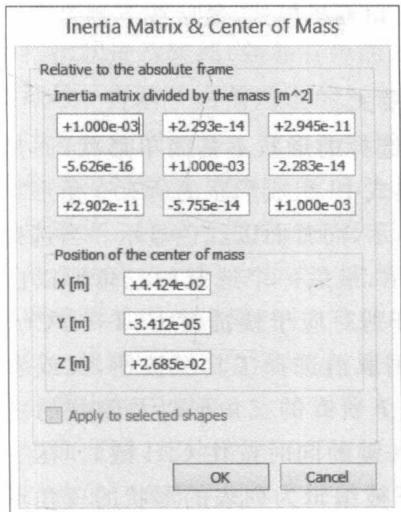

图3-36 对象的自定义数据对话框
{: .figure-caption }


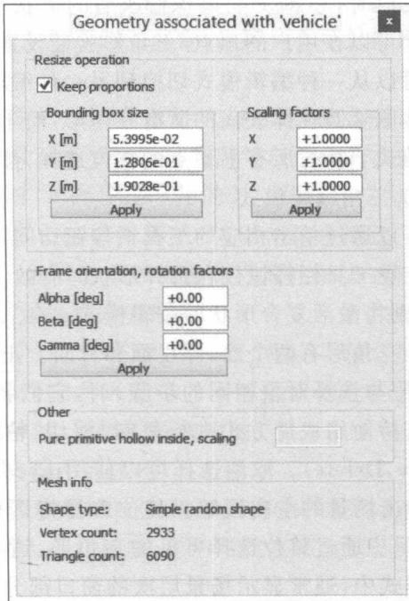

图3-37 形状的几何特征对话框
{: .figure-caption }


此外，形状几何对话框允许修改形状的边界框方向，这应该只在非常特殊的情况下使用。修改形状边界框方向的首选方法是先选中某个形状，然后依次选择菜单栏、编辑、边界框对齐、将所选形状的坐标框与主轴对齐或依次选择菜单栏、编辑、边界框对齐、将所选形状的坐标坐标系与世界对齐。

#### 形状的编辑模式

在 V-REP 中, 当需要使用到特定形状时, 最佳选择是在 CAD 应用程序 (例如 AutoCAD、3D Studio Max 等) 中绘制它们, 然后导入它们。当外部 CAD 应用程序不可用或只需要简单形状时, 用户可以创建基本形状, 然后在 V-REP 支持的三种形状编辑模式的其中一种模式下自定义创建的形状:

(1) 三角形编辑模式: 在此模式下, 构成形状的单个三角形是可见的, 可以操作或提取。

(2) 顶点编辑模式：在此模式下，组成形状的单个顶点是可见的，可以操作或提取。

（3）边缘编辑模式：在此模式下，构成形状的单个边缘可见，并且可以进行操作或提取。

在输入上述编辑模式之前,纯形状将转换为常规形状。复合形状不能直接编辑,它将首先被取消分组。或者通过复合形状的编辑模式编辑其合成元素的视觉参数。通过单击相应的工具栏按钮可访问不同的编辑模式。

确保在进入形状编辑模式之前选择了一个形状对象。在形状编辑期间，无法选择对象，也无法开始仿真。一旦编辑完成，单击形状编辑模式工具栏按钮完成编辑模式。当对形状应用更改时，V-REP将确保修改后的形状一致，并删除未使用的顶点和合并彼此靠近的顶点等。可以在用户的顶点/三角形验证设置中设置确切的行为设置对话框。

可以从一种编辑模式切换到另一种编辑模式,这允许我们实现特殊操作。例如,如果要选择和删除圆柱体表面的所有三角形,而不是在三角形编辑模式下单独选择它们,请在顶点编辑模式下执行所有上顶点的移位选择,然后切换到三角编辑模式,最后按下删除键。

## 1）三角编辑模式

可以通过单击相应的工具栏按钮访问三角形编辑模式。

上述工具栏按钮仅在选择形状时有效。如果最后选择的形状不是简单形状，而是复合形状，则将激活复合形状的编辑模式。在三角形编辑模式中，组成形状的所有三角形将分别显示。三角形有两个面，即正面和背面。正面以蓝色显示，而背面以红色显示。当选择三角形（使用与选择对象相同的步骤）时，它们将以黄色显示，最后一个选定的三角形以白色显示。支持使用快捷方式进行复制、剪切、粘贴、删除（分别对应于快捷键 Ctrl+c, Ctrl+x, Ctrl+v, Delete）。取消选择可以使用 Esc 键，或者使用取消选择工具栏按钮，又或者通过 Ctrl 单击场景的空白区域。移位选择将选择所选区域下所有的三角形以及隐藏的三角形（如果只想通过移位选择可见的三角形，请在按住 Shift 键的同时按住 Ctrl 键）。在三角形编辑模式中，通常显示场景层次的窗口部分用于显示正被编辑为列表的形状的三角形。可以使用鼠标选择列表中的项目作为层次结构窗口中的对象。

进入三角编辑模式后,编辑菜单项将变为特定于三角形的编辑模式,并将显示以下对话框,如图 3-38 所示。

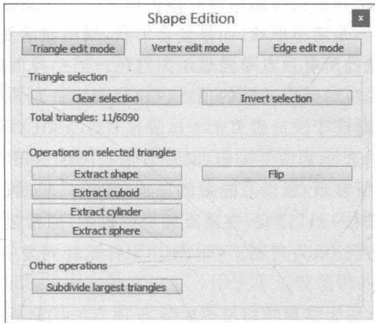

图 3-38 三角编辑模式对话框
{: .figure-caption }


三角/顶点/边编辑模式：当前激活的编辑模式。用户可以通过这些按钮从一种编辑模式切换到其他编辑模式（所选项目将被保留）。

清除选择：取消三角形的选择。

反转选择：反转三角形的选择状态。

提取形状：将基于当前选定的三角形创建一个简单的形状。形状将添加到场景，但可能不可见（编辑模式下的形状和新创建的形状在位置和方向上重合，或第一个可见性层被禁用）。将保留三角形选择。

提取立方体：将基于当前选定的三角形创建矩形(纯)简单形状(将以与包含所选三角形的最小边界框相同的方式定向新立方体)，将保留三角形选择。当需要以简化的方式对复杂的网格形状进行建模(例如有效的动力学仿真)时，该操作是有用的。

提取柱：将基于当前选定的三角形创建圆柱形(纯)简单形状(将以与包含所选三角形的最小边界框相同的方式定向新柱形)。将保留三角形选择。当需要以简化的方式对复杂的网格形状进行建模(例如有效的动力学仿真)时,该操作是有用的。

提取球体：将基于当前选择的三角形创建一个球形(纯)简单形状(将以与包含所选三角形的最小边界框相同的方式定向新球体)。将保留三角形选择。当需要以简化的方式对复杂的网格形状进行建模(例如有效的动力学仿真)时,该操作是有用的。

翻转：翻转所选三角形的边（从红色到蓝色，从蓝色到红色）。

细分最大的三角形：这将划分大的三角形。除非想减小三角形的大小，以获得更大差别的大表面照明，其他情况下不建议减少三角形的大小。相反，我们可以在环境对话框中调整计算结构的三角形大小。

三角形可以直接使用鼠标转换方向,使用工具栏的对象/项目转换按钮将在垂直平面中

选中的三角形转换到视图方向。

## 2）顶点编辑模式

可以通过单击相应的工具栏按钮访问顶点编辑模式。该工具栏按钮仅在选择形状后有效。如果最后选择的形状不是简单形状，而是复合形状，则将激活复合形状的编辑模式。在顶点编辑模式中，组成形状的所有顶点单独显示为红色。当选择顶点（使用与选择对象相同的步骤）时，它们将以黄色显示，最后选择的顶点以白色显示。顶点支持使用快捷方式来复制、剪切、粘贴、删除（分别对应于快捷键 Ctrl+c, Ctrl+x, Ctrl+v, Delete）。取消选择可以使用 Esc 键，或者使用取消选择工具栏按钮，又或者通过 Ctrl 单击场景的空白区域。移位选择将选中所选区域下的所有顶点，以及隐藏的顶点（如果只想通过移位选择可见的顶点，则在按住 Shift 键的同时按住 Ctrl 键）。在顶点编辑模式中，通常显示场景层次的窗口部分用于正被编辑的形状的顶点显示为列表。可以使用鼠标选择列表中的项目作为层次结构窗口中的对象。

进入顶点编辑模式后,编辑菜单项将变为特定于顶点的编辑模式。顶点编辑模式对话框如图 3-39 所示。

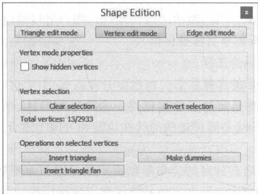

图 3-39 顶点编辑模式对话框
{: .figure-caption }


三角/顶点/边编辑模式：当前激活的编辑模式。用户可以通过这些按钮从一种编辑模式切换到其他编辑模式（所选项目将被保留）。

显示隐藏顶点：选择时，将显示隐藏顶点。

清除选择：清除顶点的选择。

反转选择：反转顶点的选择状态。

插入三角形：将在所选顶点之间插入三角形。选择顶点的顺序很重要。

插入三角风扇：将在所选顶点之间插入三角形风扇。选择顶点的顺序很重要。最后选择的顶点将是新插入的三角形之间的公共顶点。

Make Dummies: 将根据当前选择的顶点创建虚拟对象。当需要设置形状的精确坐标系时, 这是一个有用的特征。基于顶点创建虚拟对象, 离开编辑模式并将形状附加到虚拟对象上(虚拟变为父对象)。然后可以通过虚拟对象操纵形状的位置。

顶点可以通过坐标和变换对话框精确定位。它们也可以直接使用鼠标转换，使用工具栏的对象/项目转换按钮将垂直平面中选定的顶点转换为视图方向。

## 3）边缘编辑模式

可以通过单击相应的工具栏按钮访问边缘编辑模式。该工具栏按钮仅在选择形状后有效。如果最后选择的形状不是简单形状，而是复合形状，则将激活复合形状的编辑模式。在边缘编辑模式中，构成形状的所有边缘单独显示为红色。当选择边缘（使用与选择对象相同的步骤）时，它们将显示为黄色，最后一个选定的边缘显示为白色。可以使用 Delete 键删除边缘，但不能复制、剪切或粘贴。取消选择可以使用 Esc 键，或者使用取消选择工具栏按钮，又或者通过 Ctrl 单击场景的空白区域。移位选择将选中所选区域下的所有边缘，以及隐藏边缘（如果只希望通过移位选择选择可见边缘，请在按住 Shift 键的同时按住 Ctrl 键）。在边缘编辑模式中，通常显示场景层次的窗口部分用于将正被编辑的形状的边缘显示为列表。可以使用鼠标选择列表中的项目作为层次结构窗口中的对象。

进入边缘编辑模式后,编辑菜单项将变为特定于边缘的编辑模式。边缘编辑模式对话框如图 3-40 所示。

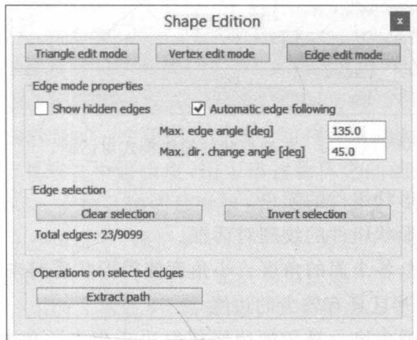

图 3-40 边缘编辑模式对话框
{: .figure-caption }


三角/顶点/边编辑模式：当前激活的编辑模式。用户可以通过这些按钮从一种编辑模式切换到其他编辑模式(所选项目将被保留)。

显示隐藏边缘：选择时，也将显示隐藏的边缘。

自动边缘跟随：当该选项被选中并且有边缘被选择时，该边缘将被跟随，直到创建循环或者边缘突然改变方向（最大直径变化角度）或消失（最大边缘角度）。当我们不仅要提取局部边缘（三角形的一侧），而且需要提取全局边缘（形状的边缘）时，这是一个有用的功能。边缘只在一个方向上被跟随。

清除选择：清除边缘的选择。

反转选择：反转边缘的选择状态。

提取路径：将基于当前选定的边缘创建路径对象。每个边表示路径中两个连续控制点之间的段(Bezier插值被关闭，每个控制点的贝塞尔点计数为1)。该路径提取功能在许多不同的情况下非常有用(例如，使焊接机器人跟随物体的边缘，或者使轨道型物体产生其相应的路径)。

边缘可以直接通过单击工具栏的对象/项目转换按钮进行转换,可以将垂直平面中选中的边缘转换到视图方向。

## 4）复合形状编辑模式

上述工具栏按钮仅在选择形状时有效。如果最后选择的形状不是复合形状，而是简单的形状，则将激活三角形编辑模式。在复合形状的编辑模式中，可以编辑形状组件的单个视觉参数。形状的组件可以选择层次结构窗口。

在进入复合形状的编辑模式后,将显示复合形状的编辑模式对话框,如图 3-41 所示。

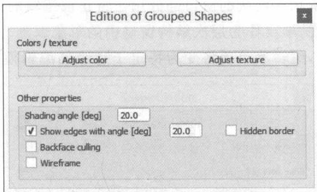

图 3-41 复合形状的编辑模式对话框
{: .figure-caption }


调整颜色：允许编辑形状组件的颜色。

调整纹理：打开所选形状组件的纹理对话框。

遮光角：遮光角是区分各个面的角度。小角度使得形状看起来清晰，具有许多边缘，大角度使得形状看起来平滑并且具有较少的边缘。

显示边缘：以黑色显示边缘。显示的边缘将取决于指定的角度。如果选中隐藏边框，则不共享多个三角形的边将被隐藏。

背面剔除：构成一个形状的每个三角形都有一个内表面和一个外表面。当启用背面剔除时，不会显示内部面。这是封闭形状和透明形状的有用参数。

线框：如果选中，则通过相机查看时，形状将始终显示为线框。

### 3.4.4 常用的场景对象——关节

关节是具有至少一个内在自由度(自由度)的对象。关节用于构建机构和移动物体。通过依次单击菜单栏、添加、关节可将关节添加到场景中。与另一个对象相比，关节具有两个参考帧(仅在选择关节时可见)。第一个是固定的常规参考系，其他对象也有；第二参考帧不是固定的，并且将根据定义其配置的关节位置(或关节值)相对于第一参考帧移动。

#### 关节类型

V-REP 有 4 种类型的关节, 如图 3-42 所示。

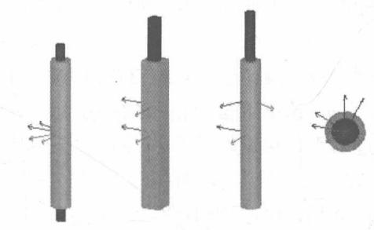

图 3-42 旋转关节、棱柱形关节、螺杆和球形关节
{: .figure-caption }


旋转关节：旋转关节具有1个自由度，并用于描述对象之间的旋转运动。它们的配置由一个值定义，这个值代表的是它们在第一参考系下的z轴的旋转量。它们可用作被动关节或主动关节（电机）。

棱柱关节：棱柱关节有一个自由度，用于描述物体之间的平移运动。它们的配置由一个值定义，这个值代表的是沿着第一参考系的 z 轴的平移量。它们可用作被动关节或主动关节（电机）。

螺钉：螺钉可以看作是旋转关节和棱柱关节(具有连杆值)的组合，具有1个自由度，用于描述类似于螺钉的运动。螺距参数定义了给定旋转量下的平移量。螺杆构造由表示围绕其第一参考系的z轴的旋转量的一个值限定。螺钉可用作被动关节或主动关节(电机)。

球形关节：球形关节具有3个自由度，用于描述物体之间的旋转运动。它们的配置由表示围绕其第一参考系的x、y和z轴的旋转量的三个值定义。定义球形关节构造的三个值被指定为欧拉角。在一些情况下，球形关节可以被认为是3个旋转关节组成，它们在层级链中彼此联系，在空间中正交。然而，这种类比只有当任意一个旋转关节保持一个不同于其他两个关节的方向时是有用的。事实上，如果两个关节接近一致，特殊的情况可能出现，机械装置可能会失去一个自由度。这在内部结构避免这种情况的球形关节不会发生。球形关节总是被动关节，不能用作电机。

关节用于允许其父对象与其子对象之间的相对运动。当在关节和对象之间建立父子关系时，对象附接到关节的第二参考系，因此，关节的配置（内在位置）的改变将直接反映到子对象上。可以通过依次单击菜单栏、添加、关节以将新关节添加到场景。

#### 关节模式

关节可以是以下模式之一。

被动模式：在这种模式下，关节不被直接控制，并且将用作固定构件。然而，用户可以通过适当的 API 函数调用（例如 simSetJointPositon 或 simSetSphericalJointMatrix）来改变关节的位置。

反运动学模式：在这种模式下，关节作为被动关节，但在逆运动学计算或几何约束求解

器计算中使用(调整)。

从属模式：在此模式下，关节位置通过线性方程直接连接（依赖）到另一个关节位置。

运动模式：此模式已弃用，不应再使用。使用被动模式和子脚本适当地更新关节可以获得类似和更灵活的行为。

力矩或力模式：在这种模式下，当且仅当动态启用时，动力学模块才会仿真关节。当动态启用时，关节可以受到力/力矩、速度或位置信号的控制而自由运动。螺钉不能在力矩或力模式下操作（但是可以通过编程连接旋转关节和棱柱关节获得类似的行为），球形关节只能在力矩或力模式下自由运动。

当关节马达被禁用时，关节是自由的，并且仅受其自身的约束。

当关节电机启用并且控制回路被禁用时，在给定其能够输送的最大力矩/力的情况下，关节将尝试达到期望的目标速度。当最大力矩/力非常高时，瞬时达到目标速度，于是关节在速度控制中运动，否则其以指定的力矩/力运动，直到达到期望的目标速度（力矩/力控制）。

当关节电机启用并且控制回路启用时,用户有3种控制模式:

自定义控件：关节控件调用脚本将负责控制关节的动态行为，允许我们使用任何我们能够想到的算法控制关节。

位置控制(PID): 通过 PID 控制器控制关节的位置, 通过以下方式调节关节速度( $\Delta t$ 分频器使控制器不受选定的控制器的时间步长影响)。

弹簧减震器模式：关节将通过力/力矩调节作用使其类似于弹簧减震器系统。

当关节处于被动模式、逆运动学模式或相关模式时，其也可以以混合方式操作：混合操作允许关节以常规方式操作，但是，在动态计算之前，当前关节位置将被复制到目标关节位置，然后，在动力学计算期间，关节将作为位置控制中的电机处理（如果且仅当其被动态启用时（参考关于设计动态仿真的部分以获得更多信息））。例如，该特征允许通过简单地指定期望的脚的位置（作为逆运动学任务）来控制类人机器人的腿；则通过相应的计算得出的关节位置将被应用为腿部动态运动的位置控制值。

#### 关节控制器

有许多不同的方法可以控制关节。后文将区分不精确控制器和精确控制器：不精确关节控制器将不能在每个可能的调节步骤中提供新的控制值（例如，一些调节步骤可以/将跳过，但控制作用仍然是可以发挥的）。另一方面，精确的关节控制器将能够在每个可能的调节步骤中提供控制值。

首先,用于控制关节的方法将取决于关节模式:

\- 关节不处于力/力矩模式。

\- 关节以力/力矩模式操作。

两种模式的不同之处在于力/力矩模式下操作关节采用的是物理引擎。物理引擎将默认执行比仿真循环多10倍的计算步骤：仿真循环以20Hz（在仿真时间）运行，而物理引擎以200Hz（也在仿真时间）运行。如果需要，完全可以配置该默认行为。

如果关节不是力/力矩模式,则可以通过 simSetJointPosition(或类似地,例如用于远程 API 的 simxSetJointPosition)API 函数直接(和瞬时地)设置其位置。我们可以从子脚本、插件、ROS 节点或远程 API 客户端执行此操作。如果从子脚本执行此操作,则应在非线程子脚本的驱动部分或在主脚本的感测阶段(默认)之前执行的线程子脚本中完成。然而,在后一种情况下,请确保线程子脚本与仿真循环同步以进行精确控制。

在下面的线程子脚本示例中,关节在位置被控制 loosley,并且没有与仿真循环的同步:

```lua
-- Following script should run threaded:
jointHandle = simGetObjectHandle('Revolute_joint')
simSetJointPosition(jointHandle, 90 * math.pi/180) -- set the position to 90 degrees
simWait(2) -- wait 2 seconds (in simulation time)
simSetJointPosition(jointHandle, 180 * math.pi/180) -- set the position to 180 degrees
simWait(1) -- wait 1 second (in simulation time)
simSetJointPosition(jointHandle, 0 * math.pi/180) -- set the position to 0 degrees
etc.
```

在下面的线程子脚本示例中,在每个仿真步骤中精确地控制关节的位置,即线程与仿真循环同步:

```lua
-- Following script should run threaded:

simSetThreadSwitchTiming(200) -- Automatic thread switching to a large value (200ms)
jointHandle = simGetObjectHandle('Revolute_joint')

simSetJointPosition(jointHandle, 90 * math.pi/180) -- set the position to 90 degrees
simSwitchThread() -- the thread resumes in next simulation step (i.e. when t becomes t + dt)
simSetJointPosition(jointHandle, 180 * math.pi/180) -- set the position to 180 degrees
simSwitchThread() -- the thread resumes in next simulation step
simSetJointPosition(jointHandle, 0 * math.pi/180) -- set the position to 0 degrees
simSwitchThread() -- the thread resumes in next simulation step
-- etc.

-- In above code, a new joint position is applied in each simulation step
```

当我们尝试从外部应用程序(例如,通过远程 API 或 ROS)控制非强制/力矩模式的关节时,外部控制器将异步地运行到 V-REP(即类似于线程子脚本的非同步代码)。这大多用于控制,但是如果希望在每个仿真循环中精确地控制关节的位置,则必须在同步模式下运行 V-REP,并且外部控制器(例如远程 API 客户端)必须明确地触发每个仿真步骤。下面说明了一个 C/C++ 远程 API 客户端:

```txt
simxSynchronous(clientId,1); -- enable the synchronous mode (client side). The server side (i.e. V-REP) also needs to be enabled.
simxStartSimulation(clientId,simx_opmode_oneshot); //start the simulation
simxSetJointPosition(clientId,jointHandle,90.0 * 3.1415f/180.0f,simx_opmode_oneshot); //set the joint to 90 degrees
simxSynchronousTrigger(clientId); //trigger next simulation step. Above commands will be applied
simxSetJointPosition(clientId,jointHandle,,180.0 * 3.1415f/180.0f,simx_opmode_oneshot); //set the joint to 180 degrees
simxSynchronousTrigger(clientId); //next simulation step executes. Above commands will be applied
simxSetJointPosition(clientId,jointHandle,,0.0 * 3.1415f/180.0f,simx_opmode_oneshot); //set the joint to 0 degrees
etc.
```

如果关节处于力/力矩模式：如果关节在力/力矩模式下操作并且动态地启用，则其将由物理引擎间接处理。如果关节的电机没有启用，那么关节不受控制（即它是可以在外力作用下自由运动的）。否则，关节可以是以下两种动态模式：

（1）关节的电机启用，但控制回路被禁用。当我们想要从外部应用程序（例如力/力矩控制，PID等)精确控制关节时，使用此模式。当想要在力/力矩模式下或用于速度控制（例如机器人轮马达)时不精确地控制关节时，也可使用此模式。

（2）关节的电机启用，控制回路启用。当关节需要用作弹簧/阻尼器，或者想要从V-REP中精确地自定义控制关节时，或者如果想从外部应用程序不精确地控制位置控制中的关节时，请使用此模式。

如果关节的电机启用,但控制回路被禁用,则物理引擎将应用指定的最大力/转矩,并加速关节直到达到目标速度。如果负载小或力和转矩达到最大,则将快速达到目标速度。否则,将需要一些时间。如果力/力矩不够大,则将永远不会达到目标速度。我们可以使用simSetJointTargetVelocity(或例如,在远程API,simxSetJointTargetVelocity的情况下)以及使用simSetJointForce(或例如,在远程API的情况下,simxSetJointForce)的最大力/力矩来以编程方式调整目标速度。如果想在脚本中编写力/力矩模式下的精确关节控制器时,应该注意以下问题:

默认情况下,仿真循环以 50ms 的时间步长(在仿真时间内)运行。但是物理引擎将以 5ms 的时间步长运行。将在每个仿真步骤中调用子脚本,但不在每个物理引擎计算步骤中调用。子脚本不是在每个物理引擎计算步骤中被调用,而是在每个仿真步骤中被调用。这意味着如果你通过一个子脚本控制一个关节,则只能每 10 个物理引擎计算步骤下提供一个新的控制值:你将缺少 9 个步骤的控制量计算与输出。克服这一点的一种方法是改变默认仿真设置,并指定仿真时间步长为 5ms,而不是 50ms。这是个很好的方法,但要记住,所有其他计算(例如视觉传感器,接近传感器,距离计算,IK 等)也将运行 10 次,最后减慢你的仿真进度(大多数时候你不需要让其他计算模块具有这样的高刷新率,但是物理引擎需要这样高的刷新率)。另一个更好的选择是,也需要启用关节的控制循环,并在关节控制回调脚本

中实现对它的控制,这将在后文进一步解释。

另一方面，如果想要在外部（例如从远程 API 客户端或 ROS 节点）运行精确和规则的关节控制器，那么除了将仿真循环设置为与物理引擎相同的速率之外，没有别的选择，然后在同步模式下运行 V-REP，外部控制器（例如远程 API 客户端）必须显式地触发每个仿真步骤。下面说明了这样做的 C/C++ 远程 API 客户端：

```csv
simxSynchronous(clientId,1); -- enable the synchronous mode (client side). The server side (i.e. V-REP) also needs to be enabled.
simxStartSimulation(clientId,simx_opmode_oneshot);//start the simulation
simxSetJointForce(clientId,jointHandle,1.0f,simx_opmode_oneshot); //set the joint force/torque
simxSetJointTargetVelocity(clientId,jointHandle,180.0f * 3.1415f/180.0f,simx_opmode_oneshot); //set the joint target velocity
simxSynchronousTrigger(clientId);//trigger next simulation step. Above commands will be applied
simxSetJointForce(clientId,jointHandle,0.5f,simx_opmode_oneshot); //set the joint force/torque
simxSetJointTargetVelocity(clientId,jointHandle,180.0f * 3.1415f/180.0f,simx_opmode_oneshot); //set the joint target velocity
simxSynchronousTrigger(clientId);//next simulation step executes. Above commands will be applied
simxSetJointForce(clientId,jointHandle,2.0f,simx_opmode_oneshot); //set the joint force/torque
simxSetJointTargetVelocity(clientId,jointHandle,180.0f * 3.1415f/180.0f,simx_opmode_oneshot); //set the joint target velocity
etc.
```

如果关节的电机启用，并且控制回路也启用，物理引擎将根据设置控制关节：可以对关节进行位置控制（即PID控制），或者在弹簧/阻尼器模式和自定义控制模式下进行控制。PID和弹簧/阻尼器参数可以从子脚本、远程API客户端或ROS节点更新。与对象参数ID2002-2004和2018-2019有关。所需的目标位置可以使用simSetJointTargetPosition(例如，从远程API客户端，simxSetJointTargetPosition)设置。当需要一个精确的自定义控制器，应该使用关节控制回调脚本，而不是从一个子脚本中控制关节。

最后,如果需要在外部应用程序中实现精确的 PID 或自定义的控制器,则需要确保仿真步长与物理引擎计算步长相同:默认情况下,V-REP 的仿真环路运行在 20Hz 在仿真时间,而物理引擎运行在 200Hz。我们可以在仿真设置中调整仿真步长。还需要确保的是:在同步模式下运行的 V-REP。下面说明了一个 C/C++ 远程 API 客户端:

```txt
simxSynchronous(clientId,1); -- enable the synchronous mode (client side). The server side (i.e. V-REP) also needs to be enabled.
simxStartSimulation(clientId,simx_opmode_oneshot); //start the simulation
```

```txt
simxSetJointTargetPosition(clientId, jointHandle, 90.0f * 3.1415f/180.0f, simx_opmode_oneshot); //set the desired joint position
simxSynchronousTrigger(clientId); //trigger next simulation step. Above commands will be applied
simxSetJointTargetPosition(clientId, jointHandle, 180.0f * 3.1415f/180.0f, simx_opmode_oneshot); //set the desired joint position
simxSynchronousTrigger(clientId); //next simulation step executes. Above commands will be applied
simxSetJointTargetPosition(clientId, jointHandle, 0.0f * 3.1415f/180.0f, simx_opmode_oneshot); //set the desired joint position
etc.
```

也可以通过远程 API 客户端来为关节控制器提供控制量, 这将需要给关节控制回调脚本提供信号实现, 如下例所示:

```csv
simxSynchronous(clientId,1); -- enable the synchronous mode (client side). The server side (i.e. V-REP) also needs to be enabled.
simxStartSimulation(clientId,simx_opmode_oneshot); //start the simulation
simxSetFloatSignal(clientId,"myDesiredTorque",1.0f,simx_opmode_oneshot);
//set the signal value
simxSetFloatSignal(clientId,"myDesiredTarget",90.0f*3.1415/180.0f,simx_opmode_oneshot);
//set the signal value
simxSynchronousTrigger(clientId); //trigger next simulation step. Above commands will be applied etc.
```

在上面的例子中,关节控制回调脚本可以在进行控制之前获取这两个信号(使用simGetFloatSignal)。

#### 关节的性质

关节属性是场景对象属性对话框的一部分,可以通过依次单击菜单栏、工具、场景对象属性打开。还可以通过双击场景层次结构中的对象图标或单击其工具栏按钮来打开对话框。

## 1) 关节的普通性质

在场景对象属性对话框中,单击关节按钮显示关节对话框(如果最后一个选择是关节,则仅显示关节按钮)。如图 3-43 所示,该对话框显示最后选择的关节的设置和参数。如果选择了多个关节,则可以将一些参数从最后选择的关节复制到其他所选关节。请注意,这仅在相同类型或模式的关节之间具有效果。

位置是循环的：指示关节位置是否是循环的（在 $-180^{\circ}$ 和 $+180^{\circ}$ 之间变化，没有限制）。只有旋转关节可以是循环的。

螺距：关节的螺距值。此属性仅适用于 Revolute/Screw 类型的关节，并且仅在“位置是循环的”选项框中保留未选中的情况下该属性才有效。

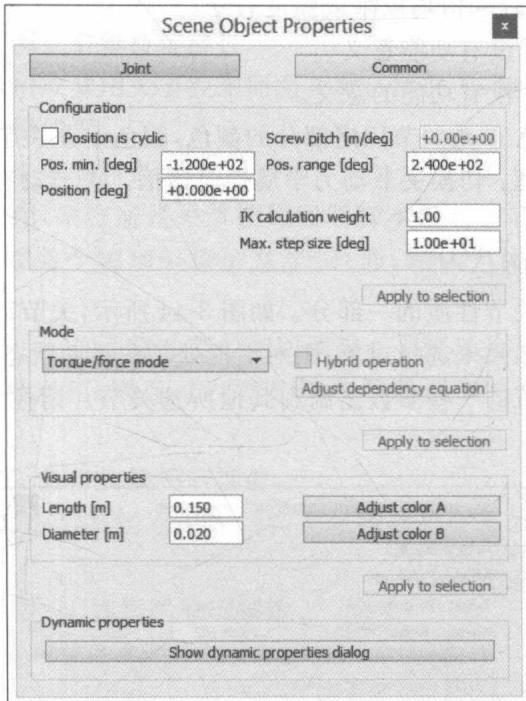

图 3-43 关节对话框
{: .figure-caption }


位置最小值：非循环旋转关节，螺钉或棱柱关节的最小允许值。

位置范围：非循环旋转关节，螺杆或棱柱关节的变化范围。这样的关节的位置被限制在一定的位置范围内。

位置：旋转关节，棱柱关节或螺钉的内在关节位置。

IK 计算重量：逆运动学计算期间关节的重量。例如，在冗余机械手的情况下，该选项使我们能够在反向运动学决议期间让某些关节超过其他关节。与其他关节相比，具有较小重量的关节将具有相对较小的位置变化。

最大步长：在一个运动学计算期间允许的最大位置变化。较小的步长通常导致较大的计算量，但可以更稳定。对于逆运动学计算，该值可以被忽略最大值覆盖。步长项目在逆运动学的对话框中。

模式：关节的控制模式。关节可以处于被动模式、反向运动学模式、依赖模式或力矩/力模式。

混合操作：当关节处于被动模式、反向运动学模式或依赖模式时，也可以选择以混合方式操作。混合操作允许关节以常规方式操作，但是，在动态计算之前，当前关节位置将复制到目标关节位置，然后在动力学计算期间，关节的控制将处理成电机的位置控制（当且仅当其被动态启用时）。

调整依赖关系方程：如果关节处于依赖模式，则可以指定将关节连杆到另一关节的线

性方程。对话框中，此部分的值均以米或弧度表示。

长度：关节的长度。没有功能意义。

直径：关节的直径。没有功能的意义。

调整颜色 A/B: 颜色 A 是关节固定部分的颜色, 颜色 B 是关节活动部分的颜色。

显示动态属性对话框：切换关节动力学属性对话框。关节动态对话框允许调整关节的动态属性。

## 2）关节的动力学性质

关节动力学性质是关节性质的一部分。如图 3-44 所示, 关节动力学对话框显示了关节的动力学设置和参数。如果未选择对象, 则对话框处于非活动状态。如果选择了多个关节, 则可以将最后选择的关节的一些参数复制到其他所选关节。请注意, 这仅在相同类型或模式的关节之间具有效果。

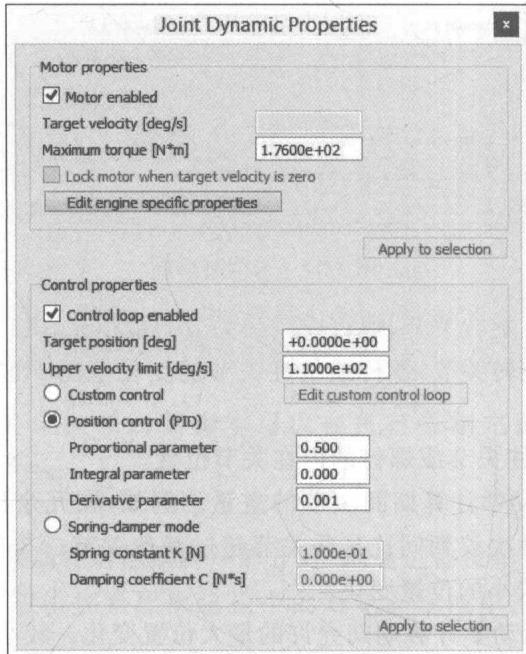

图 3-44 关节动力学对话框
{: .figure-caption }


电机启用：启用或禁用关节的电机。如果禁用，关节是可以自由运动的。仅当关节处于力矩/力模式时可用。

目标速度：关节电机的目标速度。如果最大力矩/力足够高，目标速度将立即达到；否则逐渐逼近目标速度。

最大力矩/力：关节电机运行时的最大力矩或力。

当目标速度为零时锁定电机：当关节的电机启用并且控制回路被禁用时，它在速度控制中起作用。当目标速度为零时，其可能漂移，因为力矩/力将仅作为内部摩擦。为了避免这种情况,可以启用此项目,当目标速度设置为零时,将锁定关节。

引擎特定属性：允许调整引擎特定参数。

控制回路已启用：启用或禁用关节控制回路。默认情况下，使用内置 PID 控制器。

目标位置：期望的目标位置。

速度上限：允许将速度限制在最大值。

自定义控件：如果启用，则将通过关节控件回调脚本控制关节。这允许用户写入非常特定的关节控制器，其将在每个物理引擎仿真步长（即，默认为仿真时间步长的10倍）下执行。

编辑自定义控制循环：允许编辑关节控制回调脚本来获得关节的自定义控制。

位置控制(PID): 如果启用, 则通过内置 PID 控制器调节关节速度, 从而控制关节的位置。

比例/积分/微分参数：PID 位置控制参数。

弹簧减震器模式：如果启用，则通过内置弹簧减震器控制器调节关节力/力矩，从而控制关节的位置。

弹簧常数 K / 阻尼系数 C：弹簧阻尼器参数。

3）动力学引擎与关节相关的属性

与关节相关的动力学引擎属性可以通过关节动力学属性对话框访问。最后选择的关节的引擎特定属性显示在对话框中。如果选择了多个关节，则可以将最后选择的关节的属性复制到其他所选关节（将所有属性应用于所选关节）。

(1) 项目符号属性: 与 Bullet 物理库相关的属性。

正常 CFM：当远离极限时使用的约束力混合参数。

停止 ERP：在极限处的误差减小参数。

停止 CFM：在极限处约束力混合参数。

(2) ODE 属性: 与 Open Dynamics Engine 相关的属性。

正常 CFM：当远离极限时使用的约束力混合参数。

停止 ERP：在极限处的误差减小参数。

停止 CFM: 在极限处的约束力混合参数。Bounce 是指调节在限制下的弹跳性的值(即恢复参数)。

Fudge 因子：一个任意值，可以使关节正确地运行。其值在远离极限时不太跳跃。

(3) 涡流性质: 与 Vortex Dynamics 引擎相关的属性。

关节轴摩擦：允许沿约束轴线或围绕约束轴线定义内部摩擦。

启用：启用内部摩擦。

比例：如果为真，摩擦力与约束中的张力成正比。

系数：对于比例摩擦力，摩擦力与张力系数成正比。

最大力：对于非比例摩擦，摩擦力可以由用户直接提供。

损耗：粘度系数。

关节轴限制：管理沿着或围绕约束轴的位置或角度限制。

下/上恢复：弹性。

下/上刚度：限制的弹簧的线性角刚度。

下/上阻尼：限制的弹簧的线性角阻尼。

下/上最大力：限制弹簧的力或力矩边界值。

关节依赖性：属性允许动态连杆两个启用了动态连杆功能的关节。两个连接的关节将共享/交换它们各自的负载（即，施加到一个关节中的力/力矩将被传递到另一个关节中，反之亦然）。

从属关节：与此关节关联的关节。此属性不是双向显示的（即，依赖关系将不在从属关节上显示），以便能够将依赖关节连杆到其他关节，从而建立复杂的依赖关系。所有从属关节必须共享相同的父形状，这样才能获得正确的操作。

乘法因子：连杆依赖关节的乘法因子。一般的或为1的因子将使两个连杆的旋转关节以相同的速率在相同的方向上旋转。

偏移：尚未使用。保持在0。

X 轴位置：沿约束 X 轴(位置)的松弛和摩擦参数。

松弛：松弛允许控制相应的约束强度。

\- 启用：启用松弛属性。

\- 刚度：基于位置的方程的弹性刚度。

\- 阻尼：基于位置的方程的弹簧阻尼。

\- 损失：基于速度的方程的黏度。

摩擦：沿轴的内摩擦。

\- 启用：启用此轴的内部摩擦。

\- 比例：使摩擦与关节中的张力成比例。

\- 系数：摩擦设定为张力系数。

\- 最大力：如果不是成比例的摩擦，摩擦力由用户手动设置。

\- 损耗：摩擦力黏度。

Y 轴位置：沿约束 Y 轴(位置)的松弛和摩擦参数。

Z 轴位置：沿约束 Z 轴（位置）的松弛和摩擦参数。

X 轴取向：围绕约束 X 轴（定向）的松弛和摩擦参数。

Y 轴取向：围绕约束 Y 轴（取向）的松弛和摩擦参数。

Z 轴取向：围绕约束 Z 轴（定向）的松弛和摩擦参数。

(4) Newton 属性: 与 Newton 动力学引擎相关的属性。

关节依赖性：属性允许动态连杆两个动态启用的关节，两个连接的关节将共享/交换它们各自的负载（即，施加到一个关节中的力/力矩将被传递到另一个关节中，反之亦然）。

从属关节：与此关节关联的关节。此属性不是双向显示的（即，依赖关系将在从属关节上显示），以便能够将依赖关节连杆到其他关节，从而建立复杂的依赖关系。所有从属关节必须共享相同的父形状,这样才能获得正确的操作。

乘法因子：连杆依赖关节的乘法因子。一般的或为1的因子将使两个连杆的旋转关节以相同的速率在相同的方向上旋转。

偏移：尚未使用。保持为0。

### 3.4.5 V-REP的集合

集合是用户定义的场景对象集合。集合必须包含至少一个对象，并被认为是一个实体（对象也是实体）。集合在引用几个对象（例如机器人）时非常有用。V-REP不仅支持对象，还支持基于集合的计算。例如，碰撞检测模块允许注册以下碰撞对：（集合A；对象B）。然后，冲突检查算法将检查集合A（构成它的任何对象）是否与对象B冲突。

集合是可碰撞、可测量、可检测、可切割和可呈现的实体。这意味着集合具有以下的属性：

（1）集合可用于对其他可碰撞实体的碰撞检测。

(2) 集合可用于与其他可测量的实体的最小距离的计算。

（3）集合可以由接近传感器检测。

(4) 集合可以由磨机切割。

(5) 集合可以被视觉传感器检测或看到。

（6）即使集合是可碰撞、可测量、可检测、可切割和可渲染的，这并不意味着集合中包含的所有对象都是可碰撞、可测量、可检测、可切割或可渲染的。

\- 在碰撞检测期间,仅对集合(集合的子集)的可碰撞对象与另一可碰撞实体进行检测。

\- 在距离测量期间,仅对在集合中的距离可测量的对象(集合的子集)进行与另一个可测量实体之间的距离测量。

\- 只有集合中可检测的对象(集合的子集)可以由接近传感器检测。

\- 只有集合中可切割对象(集合的子集)可以被铣刀切割。

\- 只有集合的可渲染对象(集合的子集)可以被视觉传感器检测到。

然而，集合可以覆盖其对象的属性，这些属性包括可碰撞的、可测量的、可检测的、可剪切的和可呈现的。集合必须由至少一个元素组成。支持以下元素：所有场景对象；松散物体；算上基的树；不算基的树；包含末端的链；不包含末端的链；以及上述元素的组合。

#### 所有场景对象

元素由所有场景对象组成,如图 3-45 所示(箭头表示:子元素)。

上面的元素没有任何定义对象,不能单独存在,需要结合其他类型的元素。

#### 松散物体

这是一个可松散定义的场景对象的组合,如图 3-46 所示(箭头表示: 子元素)。

在上面的示例中,如果从场景中删除对象2、对象3、对象4和对象7,则该元素不再有效,并且也将被删除。对象2、对象3、对象4和对象7是元素的定义对象。

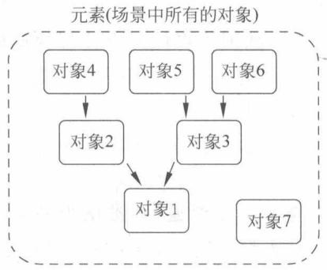

图3-45 由所有场景对象组成的元素
{: .figure-caption }


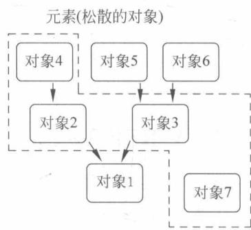

图 3-46 由松散物体组成的元素
{: .figure-caption }


#### 树(包括基)

这包括一个对象及其所有子对象(和子对象的子对象等),如图 3-47 所示(箭头表示:子对象)。

在上面的示例中,如果从场景中删除对象1,则元素不再有效,并且将被删除。对象1是元素的定义对象。

#### 树(不包括基)

这包括对象的所有子对象(和子对象的子对象等),不包括对象本身,如图 3-48 所示(箭头表示: 子对象)。

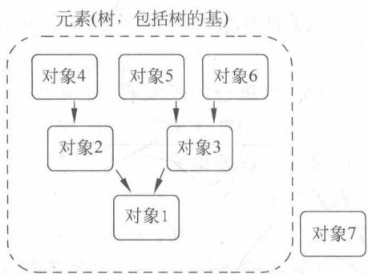

图 3-47 由一棵树, 包括基地组成的元素
{: .figure-caption }


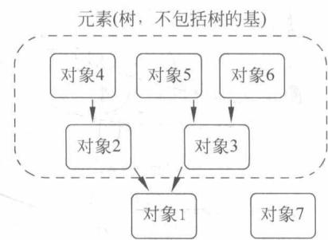

图 3-48 由一棵树组成的元素, 不包括基
{: .figure-caption }


在上面的示例中,如果从场景中删除对象1,则元素不再有效,并且将被删除。对象1是元素的定义对象。

#### 链（包括末端）

它包括一个对象和它的所有父对象(和父对象的父对象等),如图 3-49 所示(箭头表示:子对象)。

在上面的示例中,如果从场景中删除对象6,则元素不再有效,并且将被删除。对象6是元素的定义对象。

#### 链(末端除外)

这包括对象的所有父对象(和父对象的父对象等),不包括对象本身,如图 3-50 所示(箭头表示:是子对象)。

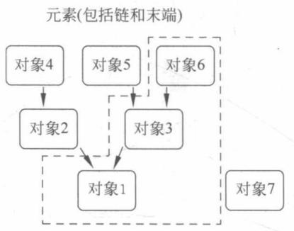

图 3-49 由链条组成的元件, 包括尖端
{: .figure-caption }


图 3-50 由链条组成的元件, 不包括尖端
{: .figure-caption }


在上面的示例中,如果从场景中删除对象 6,则元素不再有效,也将被删除。对象 6 是元素的定义对象。

#### 元素的组合

在集合中,元素可以是加法或减法。如图 3-51 所示,显示了由 3 个元素定义的集合。


图3-51 由三个元素定义的集合
{: .figure-caption }


在上面的示例中，生成的集合包含两个对象。如果新对象附加到对象2或对象4，则它不会包含在集合中（因为它将是元素2中定义的树的一部分，它是减法的）。如果新对象成为对象5、对象3或对象1的父对象，则它不会包含在集合中（因为它将是元素3中定义的链中的一部分，这是减法的）。否则，新对象将自动包含在集合中。集合是动态实体，会自动重新计算或更新。如果一个对象为定义对象，当对它进行复制或保存时，相关集合也将被自动地复制或保存。

不用盲目地使用集合,只有在没有找到其他替代品的时候可以考虑使用。例如,如果希望测试移动机器人与场景中所有其他对象的碰撞,可以定义机器人集合(从机器人底层开始建立的树)和障碍集合,然后对机器人集合和障碍物集合进行碰撞检测。这种做法是没有问题的,但是障碍物集合不是必需的。事实上,碰撞检测模块允许指定场景项目中的所有其他可碰撞的对象进行碰撞检测。

下面介绍集合对话框。依次单击菜单栏、工具、集合可以打开集合对话框。或者，也可以通过其工具栏按钮进行访问。集合的对话框如图 3-52 所示。


图 3-52 集合的对话框
{: .figure-caption }


添加新集合：添加一个新的空集合。尽量为集合提供唯一的名称，以便在与其他模型合成场景时不会发生名称冲突。集合可以在集合列表中重命名。

可视化所选集合：选择场景中所有相关的对象，则这些对象的集合是可见的。

对所选集合的操作：对话框的此部分允许向所选集合添加或从所选集合中减去各种对象。添加新集合时，它最初为空。然后可以添加或减去单个对象（选定对象）、层级树中包含的所有对象（选定对象的树）、链中包含的所有对象（选定对象的链-即所选对象的所有父级和祖先）或场景中的所有对象（所有对象）。

组合元素和属性：组成所选集合的元素列表。可以使用键盘上的删除键删除单个

元素。

集合覆盖可碰撞、可衡量、可呈现、可切割和可检测的属性：允许覆盖集合中的对象的主要属性（可碰撞、可衡量、可呈现、可剪切和可检测的）。例如，如果希望一些对象是不可检测的，除了特殊情况，可以简单地禁用这些对象的可检测的属性（参考对象常见属性），然后将这些对象建立集合，并启用可检测属性。现在，当且仅当它们作为刚刚定义的集合时，这些对象才可以被检测到（换句话说，只有当尝试检测它们的集合时，它们才能被检测到）。

## 3.5 V-REP 的六种计算模块

V-REP 具有六种计算模块,包括了碰撞检测模块、最小距离计算模块、逆运动学计算模块、几何约束求解模块、动力学模块和运动的路径规划模块。这些计算模块不是封装在对象中,但可以直接对一个或两个场景对象进行操作。

一些计算模块允许被使用在用户定义的计算对象中。计算对象与场景对象有一定的差别，但它们的操作却有一定的联系。以下有几种计算对象本身不存在的情况：

\- 碰撞检测对象依靠可碰撞的场景对象。

\- 最小距离计算对象的距离依赖可测量的对象。

\- 逆运动学计算对象主要依靠虚拟点和运动链，主要用在场景对象为关节的情况中。

\- 几何约束求解对象主要依靠虚拟点和运动链，主要在场景对象为关节中。

\- 关于计算模块的设置,可以通过依次单击 Menu bar(菜单栏)、Tools(工具)、Calculation module properties(计算模块属性)和工具栏 2 的计算模块图标打开计算模块属性对话框。

### 3.5.1 碰撞检测模块

碰撞检测模块：允许对任何形状或任何形状的集合组合进行快速干涉检查，检测它们之间是否发生了碰撞（这种碰撞完全独立于动力学模块关于碰撞反应的计算算法）。该模块使用基于二叉树的数据结构，使用了有向包围盒(OBB)的算法，使得计算速度更加快速。此外，采用了一种时序一致性缓存技术对这个模块进行了算法优化。

V-REP 可以以非常灵活的方式检测两个可冲突实体之间的碰撞。该计算是一个精确的干扰计算。碰撞检测模块将仅检测碰撞；但是它不会直接对它们做出反应（对于碰撞响应，参考动态模块）。

碰撞检测模块允许登记那些可冲突的实体对(碰撞实体和碰撞实体)的碰撞对象。在仿真期间,每个注册的碰撞对象的碰撞状态可以用不同的着色可视化,或记录在图形对象中。如果注册的碰撞对象的两个组成实体在复制粘贴操作中同时复制,则注册的碰撞对象也会自动复制。

碰撞检测对话框是计算模块属性对话框的一部分,可以通过依次单击菜单栏、工具、计算模块属性来打开。碰撞检测对话框如图 3-53 所示,对它的说明如下。


图 3-53 碰撞检测对话框
{: .figure-caption }


启用所有碰撞检测：允许启用或禁用所有已注册碰撞对象的碰撞检测。

添加新的碰撞对象：允许指定两个实体进行碰撞检测。按钮下方的列表显示所有已注册的碰撞对象，双击它们可以重命名。可以选择列表中的各个碰撞对象，然后在下面显示相关属性。

调整碰撞颜色：允许调整碰撞实体的颜色。参见碰撞更改碰撞体颜色和碰撞更改碰撞颜色项目获取进一步信息。

显式处理：指示是否应显式处理选定的碰撞对象。如果选中，当调用 simHandleCollision(sim\_handle\_all Except explicit)时，但仅当调用 simHandleCollision(sim\_handle\_all)或simHandleCollision(collisionObjectHandle)时，不会处理此碰撞对象的碰撞检测。如果用户希望在子脚本中而不是在主脚本中处理该碰撞对象的碰撞检测，则这是有用的（如果未选中，则该碰撞对象的碰撞检测将被处理两次，一次是在主脚本中调用 simHandleCollision(sim\_handle\_all Except explicit)时，另一次则是在子脚本中调用 simHandleCollision(collisionObjectHandle)时）。

碰撞更改碰撞/碰撞颜色：在碰撞期间启用或禁用碰撞/碰撞实体的颜色更改。

Comp, coll, contour(shapes only): 如果启用, 则将对形状-形状的碰撞执行完全碰撞检测, 计算并可视化所有的相交点(即碰撞轮廓)。然而, 这需要比简单碰撞检测多得多的计算时间。

调整轮廓颜色：允许调整碰撞轮廓线的颜色。

轮廓宽度：碰撞轮廓线的宽度。

### 3.5.2 最小距离计算模块

最小距离计算模块允许快速地计算形状与形状之间、形状与形状的组合之间、形状的组合与形状的组合之间的最小距离。该模块使用了与碰撞检测模块相同的数据结构。此外，该模块也采用了时序一致性缓存技术。

V-REP 可以以非常灵活的方式测量两个可测量实体之间的最小距离。该计算是精确的最小距离计算。距离计算模块将仅测量距离；但它不会直接对它们做出反应。

距离计算模块允许记录作为可测量实体对的距离对象。在仿真期间，每个注册的距离对象的最小距离段可以被可视化或记录在图形对象中。如果注册距离对象的两个合成实体在复制粘贴操作中同时复制，则注册的距离对象也会自动复制。距离计算对话框是计算模块属性对话框的一部分，可以通过依次单击菜单栏、工具、计算模块属性来打开。

在计算模块属性对话框中,单击距离计算按钮以显示距离计算对话框,如图 3-54 所示。


图3-54 距离计算对话框
{: .figure-caption }


启用所有距离计算：允许启用或禁用所有注册距离对象的距离计算。

添加新距离对象：允许指定两个实体进行距离计算。按钮下方的列表显示所有注册的距离对象，双击它们可以重命名。可以选择列表中的单个距离对象，然后在下面显示相关属性（见下文）。

显式处理：指示是否应显式处理所选的距离对象。如果选中，当调用simHandleDistance(sim\_handle\_all\_except\_explicit)时，但仅当调用simHandleDistance(sim\_handle\_all)或simHandleDistance(distanceObjectHandle)时，不会处理此距离对象的距离计算。如果用户希望在子脚本而不是在主脚本中处理该距离对象的距离测量，这将是有用的（如果未选中,则该距离对象的距离计算将被处理两次,一次是在主脚本调用 simHandleDistance(sim\_handle\_all\_except\_explicit)时,另一次是在子脚本中调用 simHandleDistance(distanceObjectHandle)时。

使用阈值：当实体间的距离很远并且不需要计算距离时，可以指定距离阈值用于加速计算。

显示距离段：如果启用，则该距离对象的最小距离段在场景中可见。

段宽度：距离段的宽度。

段颜色：允许调整距离段的颜色。

### 3.5.3 逆向运动学模块

#### 逆向运动学模块的功能

正向和逆向运动学模块：它支持分支、闭环、嵌套循环等多种类型的运动学计算机制。该模块是基于阻尼最小二乘法伪逆的计算方法，它支持有限制条件的解决方法、阻尼和加权决议的方法，以及基于约束的避障的方法。

V-REP 的逆运动学(IK)计算模块非常强大和灵活。它允许在逆运动学模式(IK 模式)或正向运动模式(FK 模式)中处理几乎任何类型的机制。IK 的问题可以看作是寻找关节值的问题,而这个关节值取决于给定主体元件(通常是末端执行器)的具体位置和方向。一般地说,它是从任务空间坐标到关节空间坐标的变换。例如,对于串行操纵器,需要解决的问题是在给定末端执行器的位置(和/或取向)的情况下找到操纵器中的所有关节的值。与之相反,找到给出关节值的末端执行器位置则被称为 FK 问题,并且通常被认为是比 IK 更容易的任务。在处理开放运动链时,FK 问题确实比 IK 问题容易,但是对于一般类型的机械配置则不是这样。

逆运动学计算模块的一些结果可以通过图形对象来记录。运动学功能还可用于外部应用(即,不直接是 V-REP 框架的一部分的应用,例如在不同计算机上,在机器人或控制器上的应用)。这些都可以通过外部运动学功能实现。最后,请确保查看文件夹场景/ik\_fk\_simple\_examples 中与 IK 和 FK 相关的各种简单示例场景。

#### IK 组和 IK 元素的基础知识

V-REP 使用 IK 组和 IK 元素来解决逆向和正向运动学任务。重要的是要了解如何解决 IK 任务，以充分利用该模块的功能。IK 组包含一个或多个 IK 元素：

（1）IK 组：IK 组将一个或多个 IK 元素组合。要解决简单运动链的运动学，需要一个包含一个 IK 元素的 IK 组。IK 组定义了一个或多个 IK 元素的总体求解属性（例如要使用什么求解算法等）。

（2）IK 元素：IK 元素指定简单的运动链。一个 IK 元素表示一个运动链。运动链是包含至少一个联合对象的连杆。简而言之，IK 元素由以下组成：

基座(任何类型的物体,甚至是关节,在这种情况下,关节被认为是刚性的): 它代表运动链的开始。

几个连杆(任何类型的对象,除了关节): 然而,不在 IK 模式中的关节也被认为是连杆(在这种情况下,它们表现为刚性关节(固定值))。

几个关节：然而，不在 IK 模式中的关节不被认为是关节，而是作为连杆（参见上文）。

一个尖端：尖端始终是虚拟的，并且是所考虑的运动链中的最后一个对象（当从基部到尖端时）。尖端虚拟器应连杆到目标虚拟器（见下文），并且链路应为 IK，尖端-目标链路类型。

一个目标：目标始终是虚拟的，并且代表尖端在仿真期间应当采用（或跟随）的位置和/或方向。目标虚拟体应该连杆到尖端虚拟（参见上文）上，并且连杆应该是 IK 或尖端-目标连杆类型。

IK 元素由运动链指定，并且指点跟随目标。运动链本身由工具提示（或末端执行器，或简称末端）和一个基础设置指定。工具提示链中的最后一个对象而基础设置指示链中的基础对象（或第一对象）。如图 3-55 所示，显示了为 IK 元素指定的两个运动链。IK 元素以类似的方式感知两个链（第二个示例的第一个关节被 IK 元素忽略）。


图 3-55 两个运动链(各自描述一个 IK 元素)
{: .figure-caption }


在上述示例中,由尖端/基部对指定的运动链都具有3自由度(DoF),因为涉及3个1-DoF关节。然而,如果关节中的一个是球形关节,则链将具有5DOF,因为球形关节自身具有3DOF。现在你应该告诉IK元素指定的运动链在仿真过程中应该如何表现。通常,如图3-56所示,我们希望运动链的尖端跟随目标(参考虚拟属性以形成尖-目标连杆)。


图3-56 IK元素和IK解决任务的相应模型
{: .figure-caption }


当仿真运行并且一些附加参数已被正确定义(参见下文参数描述)时,则机构(指定的运动链)应当朝向目标移动。这是 IK 任务的最基本情况。两个单独的运动链以相同的方式处理,但是这次需要两个 IK 组(并且每个组都应该包含每个运动链的一个 IK 元素)。解决

两个 IK 组的顺序并不重要。

如图 3-57 所示, 在上面的例子中, 如果目标 2 被附加到第一运动链的移动部分, 则求解顺序变得重要, 并且应当首先求解 IK 组 1(求解结果将移位目标 2, 如从图 3-58 可以看出的):


图 3-57 两个单独的 IK 链, 其中第二链的目标连接到第一链, 以及 IK 解决任务的相应模型
{: .figure-caption }


当一个 IK 元素建立在另一个 IK 元素的顶部而没有共享任何公共关节时, 可以出现类似的情况, 如图 3-58 所示。Base2 是两条链之间的共同对象。解决 IK element2 不会替换 Base2, 但是解析 IK element1 将会替换它。因此, 如图 3-58 所示, IK group1 必须在 IK group2 之前解决, 如上面的情况(求解顺序很重要)。


图 3-58 两个 IK 链共享一个公共连杆,但没有公共关节和 IK 解决任务的相应模型
{: .figure-caption }


当两个或更多个运动链共享公共关节时出现更困难的情况。在这种情况下，顺序求解在大多数时间不工作（在下面的示例中，两个IK元素倾向于将公共关节旋转到相反的方向），并且需要同时求解方法。为了同时求解几个IK元素，只需将它们组合成一个公共的IK组。这种情况如图3-59所示。


图 3-59 两个 IK 链共享一个共同的关节和 IK 解决任务的相应模型
{: .figure-caption }


#### 解决任何类型的机制的 IK 和 FK 问题

通过使用 IK 组和 IK 元素来解决反向运动学(IK)或正向运动学(FK)的机制,记住以下检查点,以便成功设置 IK 或 FK 计算:

（1）通过提供基座和尖端来指定单个运动链。

(2) 指定要跟踪的目标(简单地将尖端虚拟对象连接到目标虚拟对象)。

（3）如果它们共享公共关节，则 IK 组元素在单个 IK 组中。

（4）订购单个 IK 组以获取所需的行为。

(5) 验证运动链中的关节是否启用或禁用了正确的属性。

(6) 验证单个 IK 元素不是过约束的(X, Y, Z, Alpha-Beta, Gamma)。

最后一点是非常重要的：一个运动链的尖端，打开所有的约束，尖端将跟随其相关的目标在 $x, y, z$ 方向，同时试图保持与目标相同的方向。然而，这仅当运动链具有至少6个非冗余自由度（DoF）时才有效。尖端应始终被适当地约束（即从未指示比在机制中存在DoF更多的约束）。如图3-60所示，位置约束多半是相对于基本方向指定的。

有时我们并不能够正确地指定为一个尖端的限制，并且在这种情况下，IK组的计算方法应该是一个含有适当可选的阻尼因子的阻尼方法（例如DLS法）。当我们可能无法到达目标（不可达到，或接近单个配置）时，应选择阻尼分辨率方法。阻尼方法可以


图 3-60 运动链的位置约束
{: .figure-caption }


使得计算更稳定,但需要注意的是,阻尼方法也会使得 IK 计算速度减慢(需要更多的迭代将尖端放置到位)。

打开 Alpha-Beta 约束将使尖端的 z 轴方向与目标的 z 轴方向匹配，同时如果 Gamma 约束关闭，则可以让尖端围绕 z 轴自由地旋转。当 Alpha-Beta 约束和 Gamma 约束打开时，尖端将尝试保持与其关联目标完全相同的方向。

如何解决 IK 简单运动链的 IK 问题在有关 IK 组和 IK 元素基础的章节有解释。解决简单运动链的 FK 问题是容易的（只是将所需的关节值应用于链中的所有关节，以获得尖端或末端执行器的位置和方向）。但是解决闭合机制的 IK 和 FK 问题并不简单。

对于 FK 问题,首先要确定想控制的关节(如驱动机构的关节、活动关节)。那些关节应该从所有运动学计算中排除(选择一个不是反向运动模式的关节(参见关节属性))。从现在起,那些关节将通过运动学计算被认为是刚性的。然后,识别哪个运动链需要关闭。闭合操作将由尖端-目标对组成的闭合约束环来处理,如图 3-61 所示。然后,为活动关节设置期望的关节值,并调用逆运动学功能来处理闭环约束(默认主脚本处理未标记为显式处理的所有 IK 组)。下面的例子显示了一些可用于解决复杂运动学问题的附加功能,如图 3-62 所示。


图 3-61 封闭机构正向运动学求解方法
{: .figure-caption }


从图 3-62 可以看出, 用户有一个 IK 任务: 将尖端放到目标上(或使尖端跟随目标)。这可以以常规方式解决。或者用户可以如图 3-63 所示, 使用关节依赖性功能。


图 3-62 逆运动学任务
{: .figure-caption }


图 3-63 具有关节重叠约束的逆运动学任务
{: .figure-caption }


IK 主要任务是负责让尖端到达目标,闭环约束负责关闭机制(合并杆机构),并且关节重叠约束负责保持机构的基础固定(成为一条链)。必须仔细选择关节依赖性线性方程的参数,以便达到完美接合,例如,如果两个对应的关节(通过重叠约束连杆的关节)具有相同的方向,则方程中的系数需要设置成-1。(因为一个关节是自下而上构造的,而另一个关节是自上而下构造的。)

#### 反向运动学对话框的设置

逆运动学对话框是计算模块属性对话框的一部分,可以通过依次单击菜单栏、工具、计算模块属性来打开。

在计算模块属性对话框中,单击反向运动学按钮以显示反向运动学对话框,如图 3-64 所示。

启用反向运动：启用或禁用所有反向运动学计算。

添加新 IK 组：添加一个新的空 IK 组。IK 组可以包含一个或多个 IK 元素。IK 元素是基本运动链的 IK 任务，IK 组可以对整组元素同时进行求解。仅在需要时使用同时求解（计算时间比顺序求解更长）。IK 元素必须始终与 IK 组相关联，并且不能单独存在。按钮下方的列表显示了在 IK 计算期间所有需要求解的 IK 组。选择列表中的 IK 组，可以在对话框的剩余部分显示该组的参数。列表中的顺序很重要（IK group2 的快速并正确地执行可能依赖于 IK group1 的运行结果)。列表旁边的两个按钮允许更改所选 IK 组的位置。


图 3-64 逆向运动学对话框
{: .figure-caption }


IK 组处于活动状态：允许打开和关闭单个 IK 组。

显式处理：指示是否应显式处理所选的 IK 组。如果选中，当调用 simHandleIkGroup(sim\_handle\_all\_except\_explicit)时，但仅当调用 simHandleIkGroup(sim\_handle\_all)或simHandleIkGroup(ikGroupHandle)时，将不处理此 IK 组的 IK 计算。如果用户希望在子脚本而不是主脚本中处理该 IK 组的运动学问题（如果该选项未选中，则该 IK 组将进行两次 IK 计算，一次是在主脚本调用 simHandleIkGroup(sim\_handle\_all\_except\_explicit)时，另一次是在子脚本中调用 simHandleIkGroup(ikGroupHandle)时。

机构是多余的：当选择时，在 IK 解算期间将应用关节限制修正。否则，在 IK 解算之后将简单地强制执行关节限制，这可能导致不稳定。

忽略最大步长：如果选中此属性，将忽略关节属性中指定的最大步长。

计算值方法：用于指定 IK 组解算的计算方法。伪逆是最快的方法，但是当目标和尖端相距太远时，或者在运动链过度约束时又或者在机构接近单个配置或目标不可达时，其可能是不稳定的。DLS 较慢，但更稳定，因为它是一种阻尼解算方法（可指定阻尼系数（阻尼））。

当伪逆方法可能失败时,这将是一个好的选择。

阻尼：使用阻尼解算方法(DLS)时的阻尼系数。当阻尼系数大时，求解将更稳定但也更加缓慢。关键是要调整到合适的值。

最大迭代次数：可以指定最大迭代次数。这是给定 IK 组的最大计算次数，直到达到其指定的解的精度。阻尼求解方法(DLS)通常比非阻尼求解(伪逆)需要更多的迭代。

关节限制(计算权重): 应用于关节限制约束的计算权重(关节限制约束在关节属性(位置最小值和位置范围)中指定)。

障碍物回避(计算权重): 应该用于障碍物回避约束的计算权重。

关节限制阈值：应与关节限制约束一起使用的线性和角阈值。

编辑条件参数：允许调整所选 IK 组的条件解析参数。将弹出 IK 条件解析对话框，如图 3-65 所示。

执行…：这是条件解析部分。用户可以在下拉列表中选择 IK 组，其 IK 解析结果将决定当前 IK 组是否将被解决。当 IK 元素都在其指定的线性/角精度内将被认为是成功的 IK 组计算。

如果…恢复：如果解算不成功（未达到位置和/或方向精度），则允许恢复初始IK组配置(关节值)。结合上述条件求解，用户可以组合两种不同的计算方法。这在机械手的目标可能不可达或接近奇点的情况下是有用的：第一次尝试利用非阻尼分辨率方法（伪逆，快速）来解决IK组，如果不成功，则第二次则尝试使用阻尼分辨率方法(DLS，较慢)。用户当然也可以从脚本，插件中“手动”处理IK解析。

编辑障碍物回避参数：允许调整障碍物回避参数。请注意，这只对冗余的机械臂有意义，并且仿真速度可能会急剧下降。将弹出 IK 避障对话框，如图 3-66 所示。


图 3-65 IK 条件解析对话框
{: .figure-caption }


图 3-66 IK 避障对话框
{: .figure-caption }


选择回避实体/删除回避约束：允许选择/删除回避实体。一个实体通常是机器人，另一个实体是障碍物。使用简单的可测量对象快速求解。

距离阈值：相互避开的实体之间应保持的最小距离。

#### IK 元素对话框的设置

IK 元素对话框是逆运动学对话框的一部分。该对话框显示给定 IK 组的各种 IK 元素。

在逆运动学对话框中,选择 IK 组,然后单击编辑 IK 元素按钮以打开 IK 元素对话框,如图 3-67 所示。


图3-67 IK元素对话框
{: .figure-caption }


添加带有末端的新 IK 元素：使用默认值添加一个新的 IK 元素（由其顶点虚拟定义）。IK 组可以包含多个 IK 元素，它们显示在列表中。列表中的 IK 元素将在 IK 计算期间同时求解（因为它们在同一 IK 组中），在列表中的顺序并不重要。在列表中选择 IK 元素将显示其属性和参数。

元素处于活动状态：允许打开和关闭所选的 IK 元素。无效的 IK 元素可能在仿真期间自动关闭。

基础：IK 链的基础对象。请记住，如果没有另外指定，则相对于基础对象的方向指定约束。

目标：尖端应该遵循的虚拟对象。目标不应该是指定的运动链的一部分(否则 IK 元素的求解可能无法完成)，但是建议在基础之上构建目标(保持一个干净的场景层次结构)。如果选定的尖端虚拟对象未连杆到任何其他虚拟对象，或者连杆类型不是 IK、tip-target，则将显示警告消息，而不是目标虚拟名称。

约束：在 IK 元素求解期间需要遵守的约束条件。默认情况下相对于基础指定位置约束，但可以选择另一个虚拟对象作为约束参考框架（相对于坐标框架项）。过度约束的 IK 元素将不能正确求解并且不稳定。仔细分析需要什么约束以及相对于什么参考框架是很重要的。然而，有时难以不过度地约束 IK 元素。在这种情况下，应该为 IK 组选择阻尼求解方法(DLS)，并适当调整阻尼系数。但请记住，阻尼求解较慢。(X, Y 和 Z 对应的是位置（尖端将跟随目标的位置），Alpha-Beta 和 Gamma 对应的是方向（尖端将跟随目标的方向）。

线性/角度精度：指定期望的线性/角度精度。如果尖端在目标的线性和角度精度内（考虑特定的约束），则认为 IK 元素可求解。

线性/角度权重：用于位置或方向求解的 IK 求解权重。用户可以为 IK 元素的求解选择优先进行位置跟随还是方向跟随。这对于冗余机制尤其有用。

### 3.5.4 几何约束求解模块

几何约束求解模块允许解决逆向或前向运动的问题。V-REP 的逆运动学计算模块非常强大和灵活。如果使用正确，它允许以快速和准确的方式解决任何类型的正向/反向运动问题。然而，由于用户的机械结构或运动学知识水平不同，该模块可能是难以使用的。另一方面，几何约束求解器在求解运动学问题时速度较慢，精度较低，但使用起来可能更容易和更直观。此外，其允许以比逆运动学计算模块更灵活的方式与机构交互。几何约束求解器的一些结果可以由图形对象记录。

V-REP 的几何约束求解器功能以与运动学计算模块类似的方式操作,差别在于求解器将尝试自动识别运动链,并以适当的方式(如自动约束调整,循环闭合(或闭环)等)处理它们。

通常,用户必须告诉求解器:哪些对象(虚拟对象)应该重合(以便例如关闭循环);什么机制必须由几何约束求解器处理;哪些附加约束应该应用于该机制。

#### 指定闭包约束

闭包约束可以被看作需要两个对象的配置(位置和取向)相同的约束,如图 3-68 所示(为了清楚起见,表示限于二个维度)。


几何约束求解器将尝试重叠试图保持机构一致的两个对象的位置和取向(即,仅调整机构中的 IK 模式中的图 3-68 几何约束求解器闭包约束

关节以达到该重叠情况，见图 3-69）。几何约束求解程序用于指定闭包约束的对象是虚拟的。为此，两个虚拟需要标记为闭合对。这可以通过选择相反的虚拟为连杆虚拟，并且指定 GCS 和链路类型的重叠约束在虚拟属性中调整。如图 3-70 所示，它说明了指定几何约束求解器闭包约束的两个连杆的虚拟对象。

#### 指定要解决的机制

接下来,几何约束求解器需要被告知它必须处理哪个机制。当被认为是一个相同的机制时,所有对象可以从给定的对象到达,通过遵循一个路径可以去:

\- 从一个对象到其父对象。

\- 从一个对象到其子对象。


图 3-69 几何约束求解器的闭合动作
{: .figure-caption }


图 3-70 两个连杆的虚拟对象指定一个闭包约束
{: .figure-caption }


\- 从一个虚拟到其连杆虚拟(但是只有 GCS 类型的连杆,重叠约束)。

如果两个连杆的虚拟项连接它们，则不共享任何公共父对象（以下称为元素）的两个对象树也可以是相同机制的一部分。对于两个不共享任何公共父对象的对象树，如果两个连杆的虚拟项连接它们，它们也可以成为相同的机构的一部分，如图3-71所示。


图3-71 由3个元素(对象树)组成的一个机制
{: .figure-caption }


选择作为机制探索(路径探索)的起点的对象的最后一个父对象被称为机制的基本对象。当几何约束求解器试图解决一个机制时,它将尝试通过保持机制的基本对象来实现。记住它是很重要的。想要指定需要解决的机制,请选择一个机构基础对象的父对象,然后在几何约束解算器对话框中单击“插入新对象”。一个相同的机制在求解中只能被注册一次。在 IK 模式中,至少要包括一个关节的机制才会被求解器处理。

#### 指定其他约束

可以为机制指定其他位置约束。这可以通过形成尖端-目标对(指定 GCS, 提示/GCS,

目标作为虚拟属性中的连杆类型)的两个连杆的虚拟对象来实现。如图3-72所示，它给出了两个连杆的虚拟对象，其中一个被标记为目标（为了清楚起见，仅限于二维）。

被标记为目标的虚拟器不被认为是机制的一部分,因此在几何约束解析期间将不移动,而另一虚拟器将试图到达被标记为目标的虚拟器所处的位置, 见图 3-73。可以在运动学计算模块中使用尖端-目标虚拟对来进行类比。如图 3-74 所示, 说明了两个连杆的虚拟对象, 其中一个标记为目标。


图 3-72 几何约束求解器位置约束
{: .figure-caption }


(a) 中间情况


图 3-73 几何约束求解器的位置约束动作
{: .figure-caption }

(b) 最终情况


图3-74 两个连杆的虚拟对象，
{: .figure-caption }

其中一个被标记为目标

#### 几何约束求解器操作

当构建将由几何约束求解器解决的机制时,确保机制是一致的,并且约束是可能的(即,机制具有足够的自由度)。

在仿真期间,当选择机械导航模式时,可以用鼠标以灵活的方式来操纵先前注册要用几

何约束求解器求解的机制。该模式可以通过以下 API 调用启用：simSetNavigationMode(sim\_navigation\_ikmanip) 只需单击并拖动任何在机制中的形状对象，解算器将尝试考虑该额外的位置约束。如图 3-75 所示，它说明了这种拖动操作：将机制构建为树结构（即，机制中的所有对象具有至少一个共同的父对象），让具有连杆的虚拟项负责关闭某些树分支，这些都是好的习惯，可以减少机制的复杂性，简化机制的场景层次结构表示，并且我们将能够将该机制作为模型处


图 3-75 具有两个附加位置约束的机制
{: .figure-caption }


理。几何约束求解器功能也非常适合于简单机制，并且能够实现与用户的直接和灵活的交互。

### 3.5.5 动力学模块

动力学或物理模块以 V-REP 内置的四个物理引擎作为支撑，允许处理刚体动力学的计算和交互（碰撞响应、抓取等）。动力学或物理模块已默认包含在 V-REP 的仿真环境中，直接作用于所有启用动态的场景对象。例如，在场景中添加一个与地板有一定高度距离的小球，并把它设置为动态，仿真开始时小球会因为虚拟环境中的物理引擎而自由落体。

V-REP 的动态模块目前支持四种不同的物理引擎：Bullet 物理库，Open Dynamics 引擎，Vortex Dynamics 引擎和 Newton Dynamics 引擎。在任何时候，用户可以根据其仿真需要自由地快速从一个发动机切换到另一个。物理引擎支持中的这种多样性的原因是物理仿真是一个复杂的任务，可以通过各种精度、速度或支持的各种特征来实现。

Bullet physics library: 一种开源物理引擎, 具有 3D 碰撞检测, 刚体动力学和软体动力学 (V-REP 目前不支持的功能)。它用于游戏和电影中的视觉效果, 通常被认为是一个游戏物理引擎。

Open Dynamics Engine (ODE): 一个开源物理引擎, 具有两个主要组件: 刚体动力学和碰撞检测。它已经在许多应用程序和游戏中使用, 通常被认为是一个游戏物理引擎。

Vortex Dynamics: 一个闭源的, 商业物理引擎产生高保真物理仿真。Vortex 为大量物理属性提供真实世界参数(即对应于物理单位), 使得这个引擎既实际又精确。Vortex 主要用于高性能/精密工业和研究应用。V-REP 的默认 Vortex 插件是一种商业产品, 其免费版本目前支持在 20s 内进行仿真。

Newton Dynamics: 它是一个跨平台的生命型物理仿真库。它实现了一个确定性求解器，它不是基于传统的 LCP 或迭代方法，而是分别具有两者的稳定性和速度。这个功能使 Newton 动力学不仅可以用于游戏，也可以用于任何实时物理仿真。当前插件实现是 BETA 版本。

动态模块允许仿真接近真实世界的对象之间的相互作用。它允许物体跌落、碰撞、反弹，但它也允许操纵者抓住物体，传送带驱动部件向前运动，或车辆在不平坦的地形以现实的方式滚动。

与许多其他仿真软件包不同，V-REP不是纯动态仿真器。它可以被视为一个混合仿真器，结合运动学和动力学以获得各种最佳性能的仿真场景。现在，物理引擎仍然采用许多近似，并且相对不精确和缓慢，它尽可能地尝试使用运动学（例如，对于机器人操纵器）并且仅依赖于没有它则不可行的动力学（例如机器人操纵器的夹子）。如果你仿真的移动机器人不支持与其环境（大多数移动机器人反正很少应该做的）碰撞或物理交互，并且只能在平地上操作（其中绝大多数移动机器人分组），那么可以尝试使用运动或几何计算来仿真机器人的运动，结果将更快，也更准确。动态模块的一些结果可以通过图形对象来记录。

### 3.5.6 路径规划模块

路径规划模块通过一个源自快速扩展随机树算法(RRT)的方法,允许完整的路径规划任务和非完整的路径规划任务,包括了运动链的路径规划。

V-REP 通过包装 OMPL 库的插件提供路径/运动规划功能。在准备路径/运动规划任务时应考虑以下几点：

（1）确定开始和目标状态。当路径规划对象是串行操纵器时，通常提供目标姿势（或末端执行器位置/取向）而不是目标状态。在这种情况下，函数 simGetConfigForTipPose 可用于查找满足所提供的目标姿态的一个或多个目标状态。

(2) 使用 simExtOMPL\_createTask 创建路径规划任务。

(3) 使用 simExtOMPL\_setAlgorithm 选择算法。

（4）创建所需的状态空间，它可以组成一个复合对象：simExtOMPL\_createStateSpace 和 simExtOMPL\_setStateSpace。指定不允许与 simExtOMPL\_setCollisionPairs 发生冲突

的实体。

（5）使用simExtOMPL\_setStartState和simExtOMPL\_setGoalState指定开始和目标状态。使用simExtOMPL\_compute计算一个或多个路径。使用simExtOMPL\_destroyTask销毁路径计划任务。通常，路径规划与逆运动学结合使用：例如，在拾取和放置任务中，最终方法通常应为直线路径，可以使用simGenerateIkPath生成。

以上程序是常规方法,有时缺乏灵活性。

此外,可以设置以下回调函数:

```txt
simExtOMPL_setStateValidationCallback
simExtOMPL_setProjectionEvaluationCallback
simExtOMPL_setGoalCallback
simExtOMPL_compute
```

提供的路径通常只是无限可能的路径中的一个路径，并且不能保证返回的路径是最优解。由于这个原因，通常计算几个不同的路径，然后选择更好的路径（例如较短的路径）。以类似的方式，如果目标状态必须从目标姿势计算，则通常测试若干目标状态，因为不是所有目标状态都可达到的或可以足够接近的（在状态空间距离方面）。通常的做法是首先找到几个目标状态，然后根据它们到开始状态的状态空间距离对它们进行排序。然后，执行到最近的目标状态，然后再到下一个最接近的目标状态。以此类推，直到找到满意的路径。

## 3.6 V-REP 中控制机器人仿真的方法

当完成机器人模型及环境的搭建后,需要对机器人进行控制,以达到所需要的仿真效果。V-REP 是一个高度可定制的仿真软件:仿真的每个方面都可以定制。此外,仿真软件本身可以被定制和定制以便根据需要正确地执行。这是通过一个复杂的应用程序编程接口(API)完成的。支持六种不同的编程或编码方法,每种编程或编码方法相对于其他具有特定的优点(并且显然也是有缺点的),但是所有六个方法都是相互兼容的(即可以同时使用,或者甚至并用)。模型,场景或仿真软件本身的控制实体可以位于:

嵌入式脚本(即通过脚本定制仿真(即一个场景或多个模型)): 该方法包括编写 Lua 脚本, 非常容易和灵活, 保证与每个其他默认 V-REP 安装的兼容性(只要定制的 Lua 命令不使用, 或者与分布式插件一起使用)。该方法允许定制特定的仿真和仿真场景, 并且在一定程度上定制仿真器本身。这是最简单和最常用的编程方法。

一个附件：这个方法，包括写 Lua 脚本，允许快速自定义仿真软件本身。加载项可以自动启动并在后台运行，或者它们可以被称为函数（例如，当写入进口商/出口商时很方便）。附加组件不应该特定于某个仿真或模型，它们应该提供更通用的仿真软件绑定功能。

一个插件(即定制仿真软件和/或通过插件的仿真): 这个方法基本上在为 V-REP 编写一个插件。通常, 插件仅用于提供具有定制的 Lua 命令的仿真, 因此可与第一种方法结合使用。其他时候，插件用于为 V-REP 提供特殊功能，如需要的快速计算能力（脚本大多数时间比编译语言慢），硬件设备（例如真实机器人）的特定接口或与外界特殊的通信接口。

远程 API 客户端(即,定制仿真软件和/或经由远程 API 客户端应用的仿真): 该方法允许外部应用(例如位于机器人、另一台机器等情况)以非常连接的方式方便地连接到 V-REP, 使用远程 API 命令。这使得可以把运用在机器人上完全相同的代码调用来控制其在 V-REP 内的虚拟挂件。

ROS 节点(即,定制仿真软件和/或经由 ROS 节点的仿真): 该方法允许外部应用(例如位于机器人、另一机器等情况)经由 ROS 连接到 V-REP。

定制客户端/服务器(即,经由充当客户端或服务器的外部应用来定制仿真器和/或仿真): 客户端或服务器应用程序需要使用自定义通信手段(例如套接字,管道等)与脚本或插件协同工作。这种做法是灵活的,但对比以上4种其他方法,这种方法更为复杂。图3-76说明了V-REP中及其周围的各种定制可能性。


图 3-76 V-REP 框架
{: .figure-caption }


如图 3-76 所示, 简要描述图中所示的各种通信或消息传递机制如下:

(1) 从主客户端应用程序或插件到常规 API 的 C/C++ API 调用。如果语言提供了一种调用 C 函数的机制(例如,在 Java 的情况下,请参考 Java 本机接口(JNI)),可以源自非 C/C++ 应用程序。

(2) 级联子脚本执行。在主脚本中使用 simHandleChildScript 启动。

（3）Lua API 从主脚本、子脚本、回调脚本或定制脚本调用到常规 API。所有调用都指向 V-REP 引擎，除了调用插件的自定义 Lua 函数（参见下一项）。

（4）从仿真软件到插件的回调调用。回调调用来自 Lua 脚本调用自定义 Lua 函数（见上一项）。

(5) 事件回调从仿真软件到插件。

(6) 来自外部应用程序, 机器人, 远程 PC 等的远程 API 调用。

(7) V-REP(即其 RosPlugin 或 RosInterface)与外部应用程序,机器人,远程 PC 等之间的 ROS 数据交换。

(8) 套接字, 管道, 串行端口等连接到/从外部应用程序。

（9）Lua API 调用从一个附件到常规 API。所有调用都指向 V-REP 引擎，除了调用插件的自定义 Lua 函数。

(10) 从 V-REP 引擎回调调用到回调脚本。

(11) 从 V-REP 引擎执行调用到自定义脚本。

### 3.6.1 嵌入式子脚本

通过写一个子脚本(child script)去控制一个给定的机器人或模型。子脚本直接与场景对象(scene object)关联，可通过自定义 Lua 函数或外部 Lua 函数库扩展。

嵌入式子脚本的优点是它本身是应用主程序的一部分,同时执行程序的时候没有通信延迟。它的缺点是无法选择其他编程语言;不能选择更快的代码;除了 Lua 函数库,无法直接访问外部其他函数库。

V-REP 是一个高度可定制的仿真软件：几乎仿真的每一步都是用户定义的。集成的脚本解释器使 V-REP 能够实现这种灵活性。脚本语言是 Lua，它是一种旨在支持通用过程编程的扩展编程语言。默认情况下，V-REP 使用官方和原始的 Lua，但是你也可以通过将 system/usrset.txt 中的变量 useExternalLuaLibrary 设置为 true 来告诉 V-REP 使用另一种 Lua 风格。在这种情况下，所有 Lua 调用都通过 v\_repLua 库处理，它本身将连杆到 LuaJIT(Lua 即时编译器)。v\_repLua 库项目文件位于 / v\_repLuaLibrary 中。

V-REP扩展了Lua的命令，并增加了V-REP特定命令，这些命令可以通过它们的sim前缀(例如simHandleCollision)来识别。新定制的Lua命令也可以从主客户端应用程序或从插件注册。Lua的功能本身可以通过使用在线可用的Lua扩展库轻松扩展。嵌入脚本是嵌入在场景(或模型)中的脚本，即作为场景的一部分并且将与场景(或模型)的其余部分一起保存和加载的脚本。

支持两种主要类型的嵌入脚本。

#### 仿真脚本

仿真脚本是仅在仿真期间执行的脚本，用于自定义仿真或仿真模型。主要仿真循环通过主脚本处理，模型/机器人通过子脚本控制，低级动态电机控制器通过联合控制回调脚本编写，动态碰撞可以通过联系回调脚本处理。一般回调脚本是多用途回调脚本。

#### 其他嵌入式脚本

那些是在仿真不运行时也可以执行的脚本，并且用于定制仿真场景或仿真器本身。它们包括自定义脚本和一般回调脚本。

V-REP 还支持附加组件,允许自定义仿真软件本身。

在不同的脚本类型中,记住一些与场景对象(附加到场景对象,即相关联的脚本)相关联是有用的,例如子脚本、联合控制回调脚本和定制脚本。相关的脚本是形成 V-REP 的分布式控制架构的基础,具有共享方便的属性,如果它们相关联的对象被复制,则被自动复制。

### 3.6.2 插件

通过写一个插件(plugin)去控制一个给定的机器人或模型。插件允许回调机制，自定义 Lua 函数寄存和外部函数库。插件经常被用于与一个子脚本相关联，并相互结合。与嵌入式脚本的优点相类似，插件的优点是它没有通信延迟；并且是应用主程序的一部分。它的缺点是编程复杂，并且需要外部编译。

插件是共享库(例如 dll)，它在程序启动时由 V-REP 的主客户端应用程序自动加载，或者通过 simLoadModule/simUnloadModule 动态加载/卸载。它允许 V-REP 的功能通过用户编写的功能扩展（与加载项类似）。语言可以是能够生成共享库并且能够调用导出的 C 函数的任何语言（例如，在 Java 的情况下，参考 GCJ 和 IKVM）。插件也可以用作运行使用其他语言编写的代码，或者甚至为其他微控制器编写的代码（例如，为 Atmel 微控制器处理和执行代码的插件）。

插件通常用于定制仿真软件和/或特定的仿真。通常，插件仅用于为使用自定义脚本的命令提供仿真，因此与脚本结合使用。其他时候，插件用于为 V-REP 提供需要快速计算能力（脚本大多数时间比编译语言慢）或硬件设备（例如实际机器人）的接口的特殊功能。

每个插件需要有以下3个入口点过程：

```c
extern "C" __declspec(dllexport) unsigned char v_repStart(void * reserved, int reservedInt);
extern "C" __declspec(dllexport) void v_repEnd();
extern "C" __declspec(dllexport) void * v_repMessage(int message, int * auxiliaryData, void * customData, int * replyData);
```

如果缺少一个过程,则插件将被卸载,并且将不可操作。下面简要介绍上述三个切入点的目的:

#### v\_repStart

这个过程将在主客户端应用程序加载插件后调用一次。程序应该：

（1）检查 V-REP 的版本是否与用于开发插件的版本相同或更高（只需确保支持在插件中使用的所有命令）。

(2) 如果需要, 分配内存, 并准备 GUI 相关的初始化工作。

（3）如果需要，注册自定义脚本函数。

（4）如果需要，注册自定义脚本变量。

（5）如果初始化成功，则返回此插件的版本号，否则返回0。如果返回0，则卸载该插件并且不会操作。

#### v\_repEnd

此过程将在仿真循环退出之前调用一次。该过程应该释放自调用 v\_repStart 后保留的所有资源。

#### v\_repMessage

此过程将在仿真软件运行时非常频繁地调用。该程序负责监视感兴趣的消息并对其作出反应。重要的是对以下事件做出反应（最好通过拦截 sim\_message\_eventcallback\_instancepass 消息），具体取决于插件的任务：

（1）当对象被创建，销毁，缩放或加载模型时：确保反映插件中的更改（即将插件与场景内容同步）。

（2）当加载场景或调用 undo/redo 功能时：确保删除并重建连杆到场景内容的所有插件对象。

（3）当场景切换时：确保用户删除并重建所有与场景内容连杆的插件对象。除此之外，请记住，场景切换将放弃以下项目的句柄：通信管，信号，横幅和绘图对象等。

（4）当仿真软件处于编辑模式时：确保禁用插件提供的任何“特殊功能”，直到编辑模式结束。特别是，确保用户不以编程方式选择场景对象。

(5) 当启动仿真时: 确保在需要时初始化插件元素。

（6）当仿真结束时：确保释放仿真期间需要的任何内存和插件元素。

(7) 当对象选择状态更改或发送了对话框刷新消息时: 确保实现插件显示的对话框。

当编写插件时,必须注意或考虑以下几点:

（1）插件必须与主客户端应用程序放在同一目录中，并遵守以下命名规则：“v\_repExtXXXX.dll”(Windows),“libv\_repExtXXXX.dylib”(Mac OSX),“libv\_repExtXXXX.so”(Linux)，其中“XXXX”是插件的名称。使用至少4个字符，不要使用下划线（除了第二个位置明显），因为插件将被忽略。

（2）当你的插件本身加载一些额外的库（例如语言资源，如“v\_repExtXXXX\_de.dll”，等）。注册自定义脚本函数或脚本变量时，请尝试使用前缀，并为模块注册的所有函数和变量（例如“simExtLab\_testMemory”，“simExt\_lab\_error\_value”等）添加前缀。避免使用与V-REP的函数（“sim”）相同的前缀。建议用户使用“simExtXXXX\_”前缀。

（3）在插件中创建的线程应该非常仔细地使用，不应该调用任何仿真软件命令（用于后台计算或与硬件通信）。

可以自由地编译你的插件与任何你想要的编译器。然而，如果想编写一个 Qt 插件（即使用 Qt 框架的插件），应该注意：

（1）需要编译具有与用于编译 V-REP 完全相同的 Qt 版本的插件。

（2）应该使用与 V-REP(Windows 上为 MinGW, Mac OSX 和 Linux 上为 GCC) 相同的编译器编译插件。

programming/v\_repExtPluginSkeleton: 表示一个插件模板, 用户可以使用它创建自己的插件。

programming/v\_repExtVision: 处理特定视觉任务的插件(例如 Velodyne 传感器的仿真,或全向相机的仿真)。

programming/v\_repExtSimpleFilter: 说明如何为视觉传感器编写自定义的图像处理过滤器。插件是一个 Qt 项目。

programming/v\_repExtBubbleRob: 说明如何添加定制的 Lua 函数以及如何处理几个特定的模型。

programming/v\_repExtK3：与 KheperaIII 模型相关的插件。

programming/v\_repExtRemoteApi：与远程 API 相关的插件功能（服务器端）。

programming/ros\_packages/v\_repExtRosInterface: ROS 包, 允许用户为 V-REP 构建 RosInterface。

programming/ros\_packages/vrep\_plugin: ROS 包, 允许用户构建用于 V-REP 的 RosPlugin。

programming/v\_repExtMtb: 演示了一个 Qt 插件, 它将机器人语言解释器(或其他仿真软件)集成到 V-REP 中。

### 3.6.3 附加组件

附加组件与插件十分类似,它在程序开始运行时将会被自动加载,并且允许通过用户自己写的函数或函数库扩充 V-REP 的函数库。附加组件的脚本是通过 Lua 代码编程的。支持两种类型的附加组件:

（1）附加功能：附加功能首先出现在附加菜单中。它们可以被看作是当用户选择时将被执行一次的函数。进口商和出口商可以方便地与它们一起实施。

（2）附加脚本：附加脚本在仿真软件运行时不断执行，有效地在后台运行。它们应该只在每次被调用时执行简约代码，否则整个应用程序的运行速度将会减慢。根据仿真状态，附加脚本的调用方式不同：

① 当仿真未运行(即停止或暂停)时：在场景可视化之前调用附加脚本；

② 当仿真运行时：在调用主脚本之后调用附加脚本。

附加功能应该写在与主应用程序位于同一文件夹中的文本文件中,具有以下命名约定:

① vrepAddOnFunc\_xxxx.lua, 其中 xxxx 可以是表示附加功能名称的任何字符串。

② vrepAddOnScript\_xxxx.lua, 其中 xxxx 可以是表示附加脚本名称的任何字符串。

附加脚本将自动启动。在附加菜单中选择它允许通过暂停/取消来暂停其执行。脚本可以通过返回0来请求终止。

③ vrepAddOnScript-xxxx.lua, 其中 xxxx 可以是表示附加脚本名称的任何字符串。附加脚本不会自动启动。用户可以在需要时通过在附加菜单中选择它来开始/暂停/取消暂停。脚本可以通过返回 0 来请求终止。

注意：不遵循以上命名约定的附加脚本仍然可以通过命令行选项加载和运行。

只要文档中没有另行说明,加载项可以调用任何常规 API 函数。它们甚至可以调用由插件注册的自定义 Lua 函数。然而,它们有两个限制:

（1）附加组件不能调用需要调用者在线程中运行的 API 函数。这是因为附加组件以非线程方式操作。

(2) 虽然仿真没有运行,但附加组件不应该调用仅当运行仿真时才有意义的 API 函数。

### 3.6.4 远程客户端应用程序接口

通过外部客户端应用程序，可在外部应用程序、外部的机器人或另一台计算机运行控制代码；允许使用运行于实际的机器人的代码控制模型或仿真。这种方法的机理是，依赖于远程应用程序接口的插件（在服务端）和远程应用程序接口的代码（在用户端）。它的特点是：程序与编程是开源的，支持 C/C++，Python、Java、MATLAB、Octave、Lua 和 Urbi。

V-REP 是一个函数库：没有主客户端应用程序（或主应用程序或主循环），V-REP 无法运行。安装包附带的默认主客户端应用程序是“vrep.exe”（Windows）或“vrep”（MacOSX 和 Linux）。请注意，在 MacOSX 下，客户端应用程序以及其他一些项目（例如库）包含在软件包“vrep.app/Contents/MacOS/vrep”中。

主客户端应用程序是一个小型可执行文件,用于处理以下主要任务:

(1) 它使用 simRunSimulator 运行仿真软件；

(2) 它使用 simLoadModule 和 simUnloadModule 加载和卸载插件；

（3）它加载用 simLoadScene, simLoadModel 或 simLoadUI 双击的场景, 模型或 UI 文件;

（4）它使用 simHandleMainScript 和 simAdvanceSimulationByOneStep 处理运行仿真。

V-REP 编程文件夹包含两个主要应用程序项目：v\_repClientApplication（跨平台 Qt 项目）和 windowsOnlyProjects/v\_repClientApplication(MSV2005 项目）。以下是编译和运行应用程序所需的主要文件（最简单的是将新建的主应用程序复制到 V-REP PRO/V-REP PRO EDU/V-REP PLAYER 安装文件夹中）：

(1) “v\_repLib.h”“v\_repLib.cpp”和“v\_repConst.h”: 动态加载和绑定到 V-REP 所需的文件。

(2) “v\_rep.dll”/“libv\_rep.dylib”/“libv\_rep.so”: V-REP 库。

(3) “lua5.1.dll”（或类似）：Lua 功能所需的库。

(4) “qscintilla2.dll”(或类似): scintilla 编辑器所需的库。

(5) “QtCore4.dll”“QtGui4.dll”等(或类似): Qt 框架库。

(6) V-REP 的“系统”文件夹及其所有内容(正确初始化等所需)。

(7) “v\_repWin.dll”（仅限 Windows）：Windows 版本 V-REP 所需的辅助库。

虽然主客户端应用程序可以定制,但是不建议这样做,因此只有在编写脚本和/或插件不能用于用户的目的时才能使用,因为如果没有正确实现,与默认 V-REP 行为失去兼容性的风险很高。

### 3.6.5 通过ROS的节点

与远程 API 相类似, 它具有几个相互通信的分布式流程, 是一种分布式的操作系统。它能够使得连接在同一个网络中的多台计算机更简单地被管理与通信。在 ROS 的工作机制中, V-REP 作为一个 ROS 节点, 能够通过 3 种方式与其他 ROS 节点进行通信: V-REP 节点提供 ROS 服务; V-REP 节点作为 ROS 发布者; V-REP 节点作为 ROS 用户。

有几个 ROS 接口可用于 V-REP。每一个都提供一个特定的行为、特征或一种操作方式：

(1) RosInterface: 这是为 V-REP 开发的最后一个 ROS 插件。与 RosPlugin 不同，RosInterface 以良好的保真度复制了 C/C++ ROS API。这使其成为通过 ROS 进行非常灵活通信的理想选择，但可能需要更多地了解各种消息和 ROS 操作方式。

(2) RosPlugin: 这是为 V-REP 开发的第一个 ROS 插件。与 RosInterface 不同, RosPlugin 不会复制 C/C++ ROS API。相反, 它表示更高级别的抽象, 应用订阅的消息并自动在场景对象上发布主题。这可能会有点混乱, 但允许在几种情况下简化与 ROS 的交互。另一方面, RosPlugin 不是很灵活, 并且不直接支持许多标准 ROS 消息。因此, 使用 RosInterface 而不是 RosPlugin 通常更有意义。

（3）ROS skeleton 插件：这表示一个开源的 skeleton 项目，可用于为 V-REP 创建一个新的 ROS 插件。

（4）由其他人开发的 ROS 接口：这些不是 V-REP 直接支持的。例如，ROS V-Rep Bridge。

所有 ROS 接口都可以正常工作,但强烈建议用户首先尝试 RosInterface,因为这是最灵活和自然的方法。上面列出的前三个 ROS 接口的包位于编程/ros\_packages 中。建议使用 catkin 工具来构建这些包,否则可能会遇到困难。

### 3.6.6 自定义解决方案

自定义的解决方案是通过不同的方式(管道、串行窗口、套接字)与 V-REP 的插件或脚本通信。它的优点是可选择不同的编程语言；可在实际的机器人或另一台计算机运行。它的缺点是本身的工作机理和编程复杂，同时运行冗长。

## 3.7 V-REP 的 API 框架

V-REPAPI 框架对 V-REP 周围的所有接口进行分组。它有几种主要的不同类型：

\- 常规 API;

\- 远程 API;

\- ROS 接口；

\- 辅助 API;

\- 其他接口。

不仅可以从仿真器内（例如从嵌入脚本、附加组件、插件或主客户端应用）访问常规API，也可以从几乎任何可能的外部应用或硬件访问远程API和ROS接口（包括真实机器人、远程计算机等）。辅助API不是一个接口本身，而更多的是一个辅助函数的集合，可以嵌入它们，并且自己操作。其他接口项目为用户扩展可用接口的所有可能性。如图3-77所示，它说明了V-REP中各种API与其他程序的连接。


图 3-77 V-REP 的 API 框架
{: .figure-caption }


### 3.7.1 常规 API

常规 API 是 V-REPAPI 框架的一部分。常规 API 由几百个可以从 C/C++ 应用程序（插件或主客户端应用程序）或嵌入脚本调用的函数组成。可以从它们的“sim”或“\_sim”prefix（例如 simHandleCollision）中轻松地识别 V-REP 函数和常量。确保不要混淆常规 API（有时也简称为“API”）与远程 API。

常规 API 可以通过定制 lua 函数, 即插件或主客户端应用程序寄存器来扩展。自定义

lua 函数可以从它们的“simExt”-prefix 中识别。

V-REP 的主要功能由以下类型的调用或命令处理：simHandleXXX 或 simResetXXX（例如 simHandleCollision, simResetCollision 等）。命令期望的常规参数是通用类型对象（例如，碰撞对象的句柄，距离对象的句柄等）的句柄。想象一下，你通过碰撞检测对话框注册了一个碰撞对象“robotCollision”。如果你现在想检查该对象的碰撞状态，你可以写下面的代码：

```txt
collisionObjectHandle = simGetCollisionHandle("robotCollision") collisionState = simHandleCollision (collisionObjectHandle)
```

第一行检索名为“robotCollision”的碰撞对象的句柄。第二行显式地处理碰撞对象（即，它对该特定碰撞对象执行碰撞检测）。在这种情况下，碰撞对象必须标记为显式处理，否则生成错误。

上面两个相同的命令也可以以非显式方式处理对象：而不是使用碰撞对象句柄作为参数，也可以使用sim\_handle\_all参数：

```python
simHandleCollision(sim_handle_all)
```

sim\_handle\_all 参数允许一次处理所有已注册的碰撞对象。这里，以非显式方式处理碰撞对象。

当注册通用类型的对象(例如碰撞对象)时,你不需要任何特定的代码行来处理对象,因为主脚本正在处理(注册一个新的碰撞对象通过指定两个实体,应该检查碰撞,运行仿真并将两个实体中的一个移动到另一个上:将检测到碰撞,并且两个实体将以不同的颜色出现以指示碰撞)。事实上,主脚本包含以下默认代码:

```txt
simHandleCollision(sim_handle_all Except explicit)simHandleDistance(sim_handle_all Except explicit)simHandleProximitySensors(sim_handle_all Except explicit)
```

命令的参数是 sim\_handle\_all\_except\_explicit。它具有与 sim\_handle\_all 相同的效果，具有以下异常：标记为显式处理的对象将不会被处理。大多数通用类型的对象可以被标记为显式处理。当被标记为非显式处理时，只有当使用对象句柄（例如 simHandleCollision (collisionObjectHandle)）或者使用 sim\_handle\_all 参数（例如 simHandleCollision (sim\_handle\_all)）调用命令时，它们才会被处理。

默认情况下，显式处理标志被禁用，这意味着默认通用类型对象由主脚本处理。然而，如果子脚本希望(或需要)自己处理对象，则应该启用显式处理标志，否则生成错误。通常，只有当子脚本在同一个仿真过程中需要多次计算新的计算结果时（否则子脚本可以使用诸如simReadCollision, simReadDistance, simReadProximitySensor等命令），才能明确地处理对象。另一方面，子脚本不应该使用sim\_handle\_all或sim\_handle\_all Except explicit参数。如图 3-78 和图 3-79 所示，它显示了显式和非显式调用。


图 3-78 CollisionObject1 通过默认主脚本(非显式处理)处理(即计算)，并且结果在子脚本中读取
{: .figure-caption }


图 3-79 CollisionObject1 由子脚本处理(即计算)(显式处理)
{: .figure-caption }


### 3.7.2 远程 API

V-REP 提供远程 API, 允许从外部应用或远程硬件(例如真实机器人、远程计算机等)控制仿真(或仿真器本身)。V-REP 远程 API 由大约一百个特定函数和一个通用函数组成, 可以从 C/C++ 应用程序、Python 脚本、Java 应用程序、MATLAB/Octave 程序、Urbi 脚本或 Lua 脚本进行程序(代码)的编写。远程 API 函数通过套接字通信与 V-REP 进行交互，在很大程度上减少了滞后和网络负载。所有这些都以隐藏的方式发生给用户。远程 API 可以允许一个或多个外部应用程序以同步或异步方式(默认为异步)与 V-REP 进行交互，甚至支持仿真器的远程控制(例如远程加载场景、开始、暂停或停止仿真场景)。

在每个仿真通过与远程 API 应用同步地运行(即,仿真器将在 $t+dt$ 时间等待来自客户端的触发信号开始下一个仿真通过)的意义上使用。这与阻塞/非阻塞操作的意义上的同步/异步不同。远程 API 还支持阻塞和非阻塞操作。

远程 API 功能分为两个独立的实体,通过套接字通信进行交互:

（1）客户端(即应用程序)：客户端上的远程 API 可用于许多不同的编程语言。目前支持以下语言：C/C++ ,Python,Java,MATLAB,Octave,Urbi 和 Lua。其他语言的绑定可以很容易地自己创建。

（2）服务器端（即 V-REP）：服务器端的远程 API 通过 V-REP 插件实现，应该由 V-REP 默认加载：v\_repExtRemoteApi.dll, libv\_repExtRemoteApi.dylib 或 libv\_repExtRemoteApi.so。插件项目文件位于 V-REP 的安装目录中的“编程”文件夹中。

#### 启用远程 API 的客户端

## 1）C/C++客户端

要在 C/C++ 应用程序中使用远程 API 功能, 只需在项目中包含以下 C 语言文件:

```txt
extApi.h
extApi.c
extApiPlatform.h(包含平台特定代码)
extApiPlatform.c(包含平台特定代码)
```

以上文件位于 V-REP 的安装目录下，在编程/remote API 下。确保已将 NON\_MATLAB\_PARSING 和 MAX\_EXT\_API\_CONNECTIONS=255 定义为预处理器定义。要在客户端（即应用程序）上启用远程 API，请调用 simxStart。此页面列出并描述所有支持的 C/C++ 远程 API 函数。V-REP 远程 API 函数可以从其“simx”-prefix 中轻松识别。

## 2）Python 客户端

要在 Python 脚本中使用远程 API 功能,需要以下 3 个项目:

```txt
vrep.py
vrepConst.py
remoteApi.dll, remoteApi.dylib 或 remoteApi.so(取决于目标平台)
```

以上文件位于 V-REP 的安装目录下，在编程/remoteApiBindings/python 下。可能必须自己构建 remoteApi 共享库（使用 remoteApiSharedLib.vcproj 或 makefile）（如果尚未构建）。在这种情况下，请确保已将 NON\_MATLAB\_PARSING 和 MAX\_EXT\_API\_CONNECTIONS=255 定义为预处理器定义。

在 Python 中已知的目录中有以上元素后，调用 importvrep 以加载库。要在客户端（即的应用程序）上启用远程 API，请调用 vrep.simxStart。此页面列出并描述所有支持的 Python 远程 API 函数。V-REP 远程 API 函数可以从其“simx”-prefix 中轻松识别。

## 3) Java 客户端

要在 Java 应用程序中使用远程 API 功能,需要以下 2 个项目:

```txt
coppelia(包含12个Java类)
remoteApiJava.dll, libremoteApiJava.dylib 或 libremoteApiJava.so(取决于目标平台)
```

以上文件位于 V-REP 的安装目录,编程/remoteApiBindings/java 下。可能必须自己构建 remoteApiJava 共享库(使用 remoteApiSharedLibJava.vcproj 或 remoteApiSharedLibJava\_Makefile)(如果尚未构建)。在这种情况下,请确保已将 NON\_MATLAB\_PARSING 和 MAX\_EXT\_API\_CONNECTIONS=255 定义为预处理器定义。

在 Java 中已知的目录中具有上述元素后，使用 javacmyAppName.java 编译具有 myAppName.java 的应用程序。在应用程序中，确保导入与 importcoppelia.className 一起使用的类，然后调用 remoteAviprep=newremoteApi() 加载库。要在客户端（即的应用程序）上启用远程 API，请调用 vrep.simxStart。本页列出并描述了所有支持的 Java 远程 API 函数。V-REP 远程 API 函数可以从其“simx”-prefix 中轻松识别。

可能还需要将文件夹添加到系统路径。例如，在 Linux 中，可以在执行 Java 应用程序之前调用：exportLD\_LIBRARY\_PATH=\$LD\_LIBRARY\_PATH:'pwd'。

## 4）MATLAB 客户端

要在 MATLAB 程序中使用远程 API 功能,需要以下 3 个项目:

```txt
remoteApiProto.m
remApi.m
remoteApi.dll, remoteApi.dylib 或 remoteApi.so(取决于目标平台)
```

以上文件位于 V-REP 的安装目录下，在编程/remoteApiBindings/matlab 下。可能必须自己构建 remoteApi 共享库（使用 remoteApiSharedLib.vcproj 或 remoteApiSharedLib\_Makefile）（如果尚未构建）。

一旦在 MATLAB 的当前文件夹中有以上元素, 调用 vrep=remApi('remoteApi') 来构建对象并加载库, 要在客户端(即的应用程序)上启用远程 API, 请调用 vrep.simxStart。请参见编程/remoteApiBindings/matlab 目录中的 simpleTest.m 程序的示例。本页列出并描述了所有支持的 MATLAB 远程 API 函数。V-REP 远程 API 函数可以从其“simx”-prefix 中轻松识别。

确保 MATLAB 使用与 remoteApi 库相同的位体系结构：64 位 MATLAB 与 32 位 remoteApi 库将不工作，反之亦然。

如果不得不重建 remoteApi 库, 可能需要重新生成原型文件 (remoteApiProto.m): 首先,确保有一个 MATLAB 识别的编译器。可能需要调用 mex-setup。然后,输入 loadlibrary('remoteApi','extApi.h','mfilename','remoteApiProto')。

## 5) Urbi

要在 Octave 程序中使用远程 API 功能,需要以下 2 个项目:

```txt
remApiSetup.m
remApi.oct
```

以上文件位于 V-REP 的安装目录中，在编程/remoteApiBindings/urbi 下。可能必须自己构建 remoteApiUrbi 共享库（如果尚未构建）。在这种情况下，请确保已将 NON\_MATLAB\_PARSING 和 MAX\_EXT\_API\_CONNECTIONS=255 定义为预处理器定义。在 Windows 下，使用 remoteApiSharedLibUrbi.vcproj。在 Linux/Mac 下，执行以下步骤：

① 在 Urbi 根目录中创建一个 extApiUrbi.uob 文件夹。

② 将以下元素复制到该新文件夹中：extApi.c, extApi.h, extApiInternal.h, extApiPlatform.c, extApiPlatform.h, v\_repConst.h 和 extApiUrbi.cpp。

③从上面的文件夹中,输入:

```txt
../bin/umake - q -- shared - library - oremoteApiUrbi. soEXTRA_CPPFLAGS = - DNON_MATLAB_PARSING - DMAX_EXT_API_CONNECTIONS = 255
```

要从脚本加载远程 API 功能，请调用 loadFile("remoteApiConst.urbi") 和 loadModule("remoteApiUrbi")。要在客户端（即应用程序）上启用远程 API，请调用 vrep.simxStart。此页面列出并描述所有支持的 Urbi 远程 API 函数。V-REP 远程 API 函数可以从其 "simx"-prefix 中轻松识别。

#### 启用远程 API 的服务器端

远程 API 服务器端通过基于常规 API 的 V-REP 插件实现。远程 API 插件项目位于 V-REP 的安装目录“programming/v\_repExtRemoteApi”下。

要在服务器端启用远程 API（即在 V-REP 端），请确保在 V-REP 启动（v\_repExtRemoteApi.dll, libv\_repExtRemoteApi.dylib 或 libv\_repExtRemoteApi.so）中成功加载了远程 API 插件（可以检查控制台窗口有关插件加载的信息）。远程 API 插件可以根据需要启动多个服务器服务（每个服务将在不同的端口上侦听/通信）。服务器服务可以以两种不同的方式启动：

（1）在 V-REP 启动（连续远程 API 服务器服务）。远程 API 插件将尝试读取名为 remoteApiConnections.txt 的配置文件，并根据其内容启动适当的服务器服务。使用此方法远程控制仿真器本身。使用这种方法，远程 API 函数将总是在服务器端执行，即使仿真没有运行（这在下一个方法中并不总是这样）。还有另一种方法可以通过命令行启动连续的远程 API 服务器服务。

(2) 从脚本(临时远程 API 服务器服务)中启动,大多数时候这是启动远程 API 服务器服务的首选方法。用户在服务启动或停止时处于控制之下。但是，当从仿真脚本启动临时远程 API 服务器服务时，服务将在仿真结束时自动停止。可以使用以下 2 个自定义 Lua 函数（插件导出 2 个函数）来启动或停止临时远程 API 服务器服务：

```txt
simExtRemoteApiStart
simExtRemoteApiStop
```

可以使用以下自定义 Lua 函数收集有关任何远程 API 服务器服务的信息(该函数由插件导出):

```txt
simExtRemoteApiStatus
```

可以使用以下自定义 Lua 函数重置(即销毁和重新创建)任何远程 API 服务器服务(该函数由插件导出):

```txt
simExtRemoteApiReset
```

#### 远程 API 操作方式

远程 API 函数以类似于常规 API 函数的方式调用,但是有两个主要区别:

（1）大多数远程 API 函数返回类似的值：返回代码。始终记住返回码是位编码的（因此必须测试各个位，以便正确解释它）。

（2）大多数远程 API 函数需要两个附加参数：操作模式和 clientID（由 simxStart 函数返回的标识符）。

对操作模式和特定返回代码的需要来自于远程 API 函数必须通过套接字通信到服务器(V-REP)，执行任务，然后返回到调用者（客户机）的事实。一个朴素的（或常规的）方法是让客户端发送请求，并等待，直到服务器处理请求并回复。在大多数情况下，这将花费太多的时间，滞后将会影响客户端应用程序。相反，远程 API 允许用户通过提供 4 个主要机制来执行函数调用或控制仿真进度，来选择操作模式的类型和仿真进展的方式：

\- 阻塞函数调用；

\- 非阻塞函数调用；

\- 数据流；

\- 同步操作。

## 1）阻塞函数调用

阻塞函数调用是一种朴素或正常的方法,意味着我们不能等待服务器的回复的情况,如下面的情况:

```javascript
//以下函数(阻塞模式)将检索对象句柄:
if(simxGetObjectHandle(clientID,"myJoint",&jointHandle,simx_opmode_blocking)==simx_return_ok)
```

```json
{
    //这里我们有联合句柄在变量 jointHandle
}
```

如图 3-80 所示, 它说明了阻塞函数调用:

通过函数块调用从V-REP中读取数据


图 3-80 阻塞函数调用
{: .figure-caption }


## 2）非阻塞函数调用

非阻塞函数调用适用于当我们只想要向 V-REP 发送数据而不需要回复的情况, 如下面的情况:

```txt
//跟随功能(非阻塞模式)将设置关节的位置：
simxSetJointPosition(clientID, jointHandle, jointPosition, simx_opmode_oneshot);
```

如图 3-81 所示, 它说明了非阻塞函数调用。

在一些情况下,重要的是能够在同一消息内发送各种数据,以便在服务器侧同时应用该数据(例如,想要将机器人的3个关节应用于其V-REP模型在同一时间,即在相同的仿真步骤)。在这种情况下,用户可以暂时停止通信线程以实现这一点,如以下示例所示:

```javascript
simxPauseCommunication(clientID,1);simxSetJointPosition(clientID,joint1Handle,joint1Value,simx_opmode_oneshot);simxSetJointPosition(clientID,joint2Handle,joint2Value,simx_opmode_oneshot);simxSetJointPosition(clientID,joint3Handle,joint3Value,simx_opmode_oneshot);simxPauseCommunication(clientID,0);
//上面的3个关节将被同时接收和设置在V-REP侧
```


图 3-81 非阻塞函数调用
{: .figure-caption }


如图 3-82 所示, 它说明了临时停止通信线程的影响。

在相同的仿真步骤中将命令/数据应用于V-REP


图 3-82 临时暂停通信线程
{: .figure-caption }


## 3）数据流

服务器可以预期客户端需要什么类型的数据。为了发生这种情况，客户端必须以“流”或“连续”操作模式标志向服务器发信号通知该期望（即，功能存储在服务器侧，在常规时间基础上执行和发送,而不需要来自客户端的请求)。这可以看作是从客户端到服务器的命令/消息订阅,其中服务器将流式传输数据到客户端。这样的流操作请求和流数据的读取在客户端看起来像这样。

如图 3-83 所示, 它说明了数据流的原理。

通过数据流读取来自V-REP中的数据


图3-83 数据流
{: .figure-caption }


一旦完成数据流传输,远程 API 客户端应始终通知服务器(即 V-REP)停止流传输该数据,否则服务器将继续流传输非必需数据并最终减慢速度。使用 simx\_opmode\_discontinue 操作模式。

## 4）同步操作

从上面的函数调用,你可能已经注意到一个仿真将提前或进步,而不考虑远程 API 客户端的进度。默认情况下,远程 API 函数调用将异步执行。然而,存在远程 API 客户端需要与仿真进程同步的情况,通过控制来自远程 API 客户端的仿真进展。这可以通过使用远程 API 同步模式来实现。在这种情况下,远程 API 服务器服务需要预先启用以进行同步操作(这可以通过 simExtRemoteApiStart 函数或通过连续远程 API 服务器服务配置文件 remoteApiConnections.txt 实现)。如图 3-84 所示,它说明了同步模式的工作原理。

当调用 simxSynchronousTrigger 时, 下一个仿真步骤将开始计算。这并不意味着当函数调用返回时, 下一个仿真步骤将完成计算。因此, 必须确保读取正确的数据。如果没有采取特殊措施,可能会从先前的仿真步骤或当前仿真步骤读取数据,如图 3-85 所示。


图3-84 同步模式
{: .figure-caption }


在客户端,至少有2个线程将运行:主线程(将调用远程API函数的线程)和通信线程(将处理数据传输的线程场景)。在客户端,根据需要可以有尽可能多的通信线程(即通信线路):确保为它们中的每一个调用simxStart。使用V-REP插件实现的服务器端以类似的方式操作。图3-86说明了远程API的工作原理。

以下描述了各种支持的操作模式：

(1) simx\_opmode\_oneshot: 非阻塞模式。将命令发送到服务器以便执行(1)-(b)-(3)。如果可用(i)-(2)，则从本地缓冲器返回对相同命令的答复，但是先前执行的答复。该函数不等待来自服务器(7)-(i)的答复。在服务器侧，命令临时存储(4)-(d)，执行一次(d)-(9)-(g)和回复(g)-(6)。此模式通常与“set-functions”（例如 simxSetJointPosition）一起使用，其中用户不关心返回值。

(2) simx\_opmode\_blocking: 阻塞模式。向服务器发送命令以执行(1)-(b)-(3)，并且该功能等待来自服务器(7)-(i)-(2)的应答。然后，将从收件箱缓冲器(i)中擦除所接收的应答，其不会与其他操作模式一起发生。在服务器侧，命令临时存储(4)-(d)，执行一次(d)-(9)-(g)和回复(g)-(6)。此模式通常与“get-functions”（例如 simxGetObjectHandle）一起使用，其中用户需要对发送的命令进行回复。

(3) simx\_opmode\_streaming: 非阻塞模式。将命令发送到服务器以执行(1)-(b)-(3)。


图 3-85 同步模式(数据更新)
{: .figure-caption }


如果可用(i)-(2)，则从本地缓冲器返回对相同命令的答复，但是先前执行的答复。该函数不等待来自服务器(7)-(i)的答复。类似于simx\_opmode\_oneshot，但区别在于命令将存储在服务器侧(4)-(e)，连续执行(e)-(9)-(g)，并连续发送回客户端-(6)。此模式通常与“get-functions”（例如simxGetJointPosition）一起使用，其中用户不断地需要特定的值。

(4) simx\_opmode\_oneshot\_split(不推荐): 非阻塞模式。逐步(以小数据块)向服务器发送命令以执行(1)-(a)-(3)。如果可用(i)-(2)，则从本地缓冲器返回对相同命令的答复，但是先前执行的答复。该函数不等待来自服务器(7)-(h)-(i)的答复。当命令完全发送时，它从(a)中删除。在服务器侧，命令块被重新存储(4)-(c)，并且当命令被完全接收时，命令将被执行一次(5)-(d)-(9)-(f)逐渐发回客户端(f)-(6)。客户机以小块(7)-(h)接收答复，并且当答复完成时，它被存储在本地缓冲器(8)-(i)中。该模式通常和与大量数据相关联的“设置函数”(例如 simxSetVisionSensorImage)一起使用，以便不使通信网络过载。

(5) simx\_opmode\_streaming\_split(不推荐): 非阻塞模式。逐步(以小数据块)向服务器发送命令以执行(1)-(a)-(3)。如果可用(i)-(2)，则从本地缓冲器返回对相同命令的答复，但是先前执行的答复。该函数不等待来自服务器(7)-(h)-(i)的答复。当命令完全发送时，它从(a)中删除。在服务器侧，命令块被重新存储(4)-(c)，并且当命令被完全接收时(5)-(e)，命令将被连续地执行(e)-(9)和回复逐渐发送回客户端(f)-(6)。客户机以小块(7)-(h)接收应答，并且当应答完成时，它被存储在本地缓冲器(8)-(i)中。该模式通常和与大量数据(例如 simxGetVisionSensorImage)相关联的“获取函数”一起使用,其中用户需要不断地数据而不使通信网络过载。


图 3-86 远程 API 功能概述
{: .figure-caption }


(6) simx\_opmode\_discontinue: 非阻塞模式。向服务器(1)-(b)-(3)发送命令。如果可用(i)-(2)，则从本地缓冲器返回对相同命令的答复，但是先前执行的答复。该函数不等待来自服务器(7)-(i)的答复。在服务器端，命令简单地清除位于(e)中的类似命令。向客户端(6)-(7)发送回复，其也将清除位于(i)中的类似回复。此模式用于释放(i)中的一些存储器(类似于simx\_opmode\_remove)或中断流命令（即，通过从(e)中去除它们）。

(7) simx\_opmode\_buffer: 非阻塞模式。没有命令被发送到服务器,但是如果可用(i)-(2),则从本地缓冲器返回先前执行的对同一命令的回复。此模式通常与 simx\_opmode\_streaming 或 simx\_opmode\_streaming\_split 操作模式结合使用:首先,使用流式命令启动常量命令执行,然后提取只有命令的回应。

(8) simx\_opmode\_remove: 非阻塞模式。没有命令被发送到服务器, 但是只有对先前执行的相同命令的答复, 如果存在(i), 则从本地缓冲器清除。该函数不返回任何值, 除了返回代码。此模式可用于释放客户端上的一些内存, 但很少需要。

### 3.7.3 ROS接口

前面关于 V-REP 的编程方法已经介绍了 ROS 接口, 下面将具体地介绍 ROS 接口以及 ROS 插件。

#### RosInterface

RosInterface 是 V-REPAPI 框架的一部分，由 FedericoFerri 提供。确保不要混淆 RosInterface 与 RosPlugin，它们是 V-REP 中的两个不同的 ROS 接口。与 RosPlugin 不同，RosInterface 以良好的保真度复制了 C/C++ ROSAPI。这使其成为通过 ROS 进行非常灵活通信的理想选择，但可能需要更多地了解各种消息和 ROS 操作方式。可以从 simExtRosInterface\_前缀中识别 RosInterfaceAPI 函数。ROS 是一种分布式伪操作系统，允许在网络中连接的多台计算机之间轻松管理和通信。

V-REP 可以作为 ROS 节点, 其他节点可以通过 ROS 服务、ROS 发布者和 ROS 订阅者进行通信。

V-REP 中的 RosInterface 功能通过插件启用：libv\_repExtRosInterface.so 或 libv\_repExtRosInterface.dylib。插件的代码是开源的，位于 programming/ros\_packages 文件夹中。该插件可以很容易地适应自己的需要。插件在 V-REP 启动时加载，但加载操作只有在 roscore 当时正在运行时才会成功。确保检查 V-REP 的控制台窗口或终端有关插件加载操作的详细信息。

V-REP 本身提供了几个与 RosInterface 相关的. ttt 场景文件。

```txt
rosInterfaceTopicPublisherAndSubscriber.ttt
controlTypeExamples.ttt
Models/tools/rosInterfacehelpertool.ttm(允许在同步模式下操作 V-REP 的模型,例如为了手动步进仿真).
```

#### RosPlugin

RosPlugin 是 V-REPAPI 框架的一部分。确保不要混淆 RosPlugin 与 RosInterface，这是 V-REP 中的两个不同的 ROS 接口。与 RosInterface 不同，RosPlugin 不会复制 C/C++ ROSAPI。相反地，它表示更高级别的抽象，应用订阅的消息并自动在场景对象上发布主题。这可能会有点混乱，但允许在几种情况下简化与 ROS 的交互。另一方面，RosPlugin 不是很灵活，并且不直接支持许多标准 ROS 消息。因此，使用 RosInterface 而不是 RosPlugin 通常更有意义。可以从 simExtROS\_前缀中识别 RosPluginAPI 函数。

ROS 是一种分布式伪操作系统, 允许在网络中连接的多台计算机之间轻松管理和通信。V-REP 作为其他节点可以通过以下 3 种方式进行通信的 ROS 节点:

（1）V-REPRosPlugin 节点提供 ROS 服务。V-REP 只要启动 V-REP，就可以使用 RosPlugin 服务（假定 roscore 正在运行，且 Rosplugin 已正确加载到 V-REP）。

（2）可以启用 V-REPRosPlugin 来发布主题，并向其发布数据。V-REPRosPlugin 发布商只能启用，并且只能在运行仿真时运行。一个例外是 info 主题：只要 V-REP 正在运行，

该主题的数据将被流式传输。

（3）可以启用 V-REPRosPlugin 以订阅主题，从中读取数据，并将数据应用于 V-REP 中的特定对象/项目。V-REPRosPlugin 用户只能启用，并且只能在仿真运行时运行。

V-REP 中的 RosPlugin 功能通过以下插件启用：libv\_repExtROS. so 或 libv\_repExtROS.dylib。插件的代码是开源的，位于编程/ros\_packages 文件夹中。该插件可以很容易地适应自己的需要。插件在 V-REP 启动时加载，但加载操作只有在 roscore 当时正在运行时才会成功。确保检查 V-REP 的控制台窗口或终端有关插件加载操作的详细信息。

如图 3-87 所示, 它说明了如何在服务器端(即在 V-REPRosPlugin 端)处理 ROS 消息。


图 3-87 ROS 消息处理, 服务器端
{: .figure-caption }


V-REP 本身提供了几个与 RosPlugin 相关的. ttt 场景文件：

```txt
rosPluginTopicPublisherAndSubscriber1.ttt
rosPluginTopicPublisherAndSubscriber2.ttt
controlTypeExamples.ttt
```

### 3.7.4 辅助 API

辅助 API 不是一个接口本身,而是更多的辅助函数集合,可以嵌入到自己的代码中,并

且自己操作。

可以使用以下辅助 API 类别：外部运动学：这是一个 C++ 函数集合，提供与 V-REP 中相同的运动学计算。

这个函数集合允许执行的运动学计算与在 V-REP 中相同。对此的例外是障碍物避免功能，它仅在 V-REP 内支持。

这个想法是通常在 V-REP 中构建运动任务,然后导出场景的运动内容,然后可以直接使用下面的嵌入函数。所需的源代码位于编程/externalIk 文件夹中。确保将所有文件包含在项目中,并在需要访问函数的文件中包含 extIk.h。还要确保知道如何使用 V-REP 中的运动学功能。如果可以访问常规 API,那么将不需要此辅助 API,因为所有以下函数都有其常规 API 等效项。

外部 IK 源代码不直接是 V-REP 的一部分，并且带有单独的许可条件。

按照以下方法从我们自己的外部应用程序中执行运动学计算：

(1) 在 V-REP 中构建运动任务, 测试它们。

(2) 依次单击菜单栏、文件、导出、IK 内容导出场景的运动内容。

（3）在自己的应用程序中包含外部运动代码(代码位于编程/externalIk文件夹中)。

（4）在应用程序启动时调用 simEmbLaunch，在应用程序结束时调用 simEmbShutdown。

（5）调用 simEmbStart 来导入以前导出的文件。simEmbStart 可以根据需要频繁调用以重置运动场景。运动场景类似于 V-REP 中的场景，除了它被去除了非运动学的一切。

(6) 调用各种函数来移动/旋转目标虚拟变量（例如，使用 simEmbSetObjectTransformation），或移动非活动关节，即不处于 IK 模式的关节（例如，使用 simEmbSetJointPosition）。

（7）调用 simEmbHandleIkGroup 来执行一次计算通过（即有效地将虚拟指针带到它们的目标上）。如果我们正在搜索特定的机器人配置，或需要立即跳转到新的末端效应器姿势，然后调用 simEmbGetConfigForTipPose。

(8) 根据需要重复步骤 7 和 8。确保检查返回值以检测错误。

（9）如果有多个同一机器人的实例，则可以调用 simEmbLaunch 几次来初始化嵌入运动学的几个实例。然后，我们可以使用 simEmbSwitch 从一个实例切换到另一个实例。

### 3.7.5 其他接口

可以以各种方式扩展 V-REP API 框架，以便提供不直接是 V-REP 一部分的接口。这通常通过插件发生，但是也可以使用其他选项（如附加组件、远程 API 客户端、ROS 节点等）。以下仅列出其中几个：OMPL 接口，基于 Qt 的自定义 UI 界面，V-REP 与 ROS 之间的桥架等。

## 3.8 仿真模型的搭建

V-REP 的模型及其工作环境是由场景对象组成的。而这些场景对象的来源主要有两种，一种是 V-REP 本身所提供的模型，另外一种则需要利用外部 CAD 软件进行建模，再导入到 V-REP 中。因此，V-REP 的模型搭建有 3 种方法：

（1）从模型浏览器中加载现有模型；

(2) 从菜单栏中添加基础形状；

（3）从 Import 命令中加载其他软件的 CAD 模型。

### 3.8.1 从模型浏览器中加载现有模型

在模型浏览器中选择机器人及其他模型,然后用鼠标拖曳到场景中,场景中将自动加载相应的机器人及其他模型,并给予它们任意的位姿。因此,加载后的模型一般需要进行位置和姿态调整。

在工具栏中,选择 object/item shift 的按钮可在三维空间中对机器人及其他模型的位置进行设置; 选择 object/item rotate 可对机器人及其他模型在三维空间的姿态进行旋转操作。

### 3.8.2 从菜单栏中添加场景对象

在场景中,右击 Add 窗口可添加模型所需要的元素,包括基础形状、力传感器、近距离传感器、关节、摄像机、灯光等元素。其中,在基础形状中,包括了平面、圆柱、长方体、球体和圆筒等基础形状。将这些元素添加到场景中后,都必须先对其大小、位置、姿态等参数进行设置。

添加原始形状时,通过依次单击菜单栏、添加、原始形状,可以在 V-REP 中直接创建形状。其支持以下 5 种基本形状:平面,圆盘,长方体,球体和圆柱体。

如图 3-88 所示, 基本形状的几何参数可以在原始形状对话框中进行调整。

(1) X/Y/Z 尺寸：沿着世界参考框架的 X/Y/Z 轴的尺寸。

(2) X-/Y-/Z-细分：沿着世界参考框架的 X-/Y-/Z-轴的元素数量(\*)。

（3）侧面：圆柱、圆盘或球体的边数。

(4) 面数：柱面或球面的面数。

(5) 光盘细分: 光盘细分数 (光盘或光柱)。

(6) 平滑阴影：形状是否应该看起来光滑或锐利。

(7) 开口端: 气缸是否有开口端。

(8) 锥体：表示需要锥体而不是圆柱体。

（9）创建动态和可响应形状：如果选择，生成的形状将是动态的和可响应的。它不会是可碰撞的、不可测量的、不可呈现的和不可检测的，并且具有淡蓝色，以便快速识别它。

(10) 创建纯形状: 如果选择, 将生成纯形状, 在动态计算期间执行得更好、更快。


图3-88 原始形状对话框
{: .figure-caption }


(11) 材料密度：材料的密度。

（12）形状具有负体积：当选中时，创建的纯形状将具有内部（即，负体积）的孔，其具有由内部缩放因子缩放的形状的尺寸。这是创建可以动态有效仿真的管状结构的有用特征。目前，只有 Vortex Dynamics 引擎支持此功能。

具有更高细分计数的形状可以以更多不同的方式反射照明。颜色和其他视觉属性应在形状属性中进行调整。另外，也可以在形状编辑模式下或在几何对话框中调整和编辑形状网格。

### 3.8.3 从 Import 命令中导入/导出其他软件的 CAD 模型

构建新的模型时需要导入所需要的部件,使用菜单栏 File 中的 Import 命令,可加载在其他三维建模软件做好的 CAD 模型。加载的模型支持 obj,3ds,dxf,stl,csv 等格式。导入后的 CAD 模型将会直接呈现在场景中,因此还需要对模型的位置、大小、外观颜色等进行设置。

从 Import 命令中导入其他软件的 CAD 模型需要注意以下三点：

（1）V-REP 描述和显示模型的形状时使用了三角网络，这使得模型的形状可直接用于动力学。模型所包含的三角形越多，所需要的计算时间越长。从外部导入 CAD 模型必须考虑到模型的繁重程度，即不能包含过多的三角形。

一般情况下，V-REP 中模型所包含的三角形总数不能超过 20000，最佳范围是 5000～10000。当模型太过繁重时，需要对模型的各部分进行简化。

（2）CAD 模型导入到场景中时，会自动弹出一个 Import Option 窗口，让用户选择导入模型网络的范围和姿态。其中可选网络范围有“1 unit represents 1 meter”“1 unit represents 1 foot”“1 unit represents 10 centimeter”等选项，姿态上提供了 Y 向量朝上和 Z 向量向上两个选择。用户应该按照具体的任务需求选择模型网络的范围和姿态。在导入至场景后,还可以利用 object/item shift 和 object/item rotate 进行模型位置和姿态调整。

（3）CAD 模型导入到场景中时，只是一个简单随机形状（Simple random shape）。例如，导入一个机器手臂模型，整体上只是一个单纯的形状，底座、连杆、末端执行器等部分都没有分离开来，不具有自由度。因此，需要把模型划分成分离的部分，这可通过两种方式实现：自动网络划分和手动网络划分。第一种方式是按照导入之前 CAD 模型的网络结构进行划分的；第二种是使用三角形编辑模式，手动增添、删除三角形，对模型的网络进行再次划分。如图 3-89 所示，导入的小车模型为一个单纯的形状，进行自动网络划分后，成为了由几个部分组成的形状组合。


图 3-89 导入的模型与使用自动网络划分后的效果
{: .figure-caption }


#### 导入形状

V-REP 使用三角形网格来描述和显示形状。因此，V-REP 只能导入将对象描述为三角形网格的格式。然而，如果希望导入其他描述的对象，例如描述为参数曲面（如 IGES、STEP 等），则必须先将文件转换为适当的三角形网格格式。有几个转换应用程序可以实现此操作，并且大多数 3D 绘图应用程序也支持这种操作。

V-REP 支持以下文件格式导入形状：

（1）OBJ：Wavefront Technologies 文件格式。这是目前唯一允许在 V-REP 中导入纹理网格的格式。

(2) DXF: AutoCAD 文件格式(Autodesk)。包含在文件中的非 3D 信息可能被忽略。

(3) 3DS: 3ds Max 文件格式 (Autodesk)。纹理信息会被忽略。此格式目前仅支持 Windows 平台。

(4) STL(ASCII 或二进制): 3D 系统文件格式。支持 ASCII 和二进制文件。

(5) COLLADA: 有关详细信息,请参阅 collada 插件。

(6) URDF: 有关详细信息,请参阅 URDF 插件。

在导入操作期间,与纹理相关的缩放对话框可能会打开。与网格物体相关的另一个对话框也将打开。

如图 3-90 所示, 导入选项对话框允许我们正确设置导入文件中使用的单位(某些应用程序可能使用单位米,其他的可能使用英尺、英寸、厘米或毫米)以及网格的方向(某些应用程序中的Y轴指向朝上,其他程序中是Z轴朝上)。在任何情况下,我们都可以在对象公共属性中缩放导入的形状,或在方向操作模式中更正导入的形状。

导入的形状将具有默认的视觉参数和随机颜色,以区分各个形状。纹理只能通过 OBJ 文件格式导入:在这种情况下,纹理将被加载并应用于导入的网格。如果纹理加载操作失败,则只导入网格和纹理坐标,并且稍后可以通过纹理对话框应用纹理。


在导入操作期间，V-REP 将确保网格对象一致，并删除未使用的顶点，合并彼此靠近的顶点等。可以在用户设置对话框的顶点/三角形验证设置中进行设置。如果在导


图 3-90 导入选项对话框
{: .figure-caption }


入操作后,我们无法在场景中看到任何形状,但场景层次结构表明存在新添加的形状,则很可能我们导入的形状太大或太小,导致无法看到。另外,可以在对象公共属性中继续缩放操作。此外,当从 CAD 应用程序导出网格时,程序会尝试将它们作为整体导出(最好是将它们导出为单个对象,在 V-REP 中,可以依次单击菜单栏、编辑、分组/合并、分割选定的形状);这是为了避免 CAD 应用程序在导出操作期间根据它们的参考帧重新定位/重新定向各个网格(V-REP 的参考框架是不同的),这可能导致外观的破坏。

确保导入的网格不包含太多的三角形(对于机器人,通常在10000\~20000个三角形之间),否则V-REP可能会大大减慢(由于渲染、计算、加载/保存操作等)。有一些应用程序可以减少网格中的多边形数量(例如MeshLab)。还可以使用以下V-REP功能:

（1）依次单击菜单栏、编辑、变形选择成凸形：允许将选定的形状转换为凸形。

（2）依次单击菜单栏、编辑、变形选择到其凸分解：允许将选定的形状转换为它们的凸分解表示。

（3）依次单击菜单栏、编辑、抽取所选形状：允许减少所选形状中的三角形数量。

（4）依次单击菜单栏、编辑、提取选定形状：允许从相同形状的外部提取/分离形状（即不可见部分）的内部（即可见部分）。该功能基于视觉传感器，并且可能无法给出令人满意的结果。

当从处理形状作为参数表面(例如 IGES、STEP 等)的应用程序中导出形状时,如果绘图由不同大小的对象组成,则需要用多个步骤导出对象;这是为了避免具有过于精确定义的大对象(太多的三角形)和太粗略定义的小对象之间的精度混乱:首先导出大对象(通过调整所需的精度设置),然后再导入小对象(通过调整精度设置)。

#### 导出形状

V-REP 通过依次单击菜单栏、文件、导出、所选形状导出形状，其支持以下的文件格式（注意：只导出所选对象）：

\- DXF: AutoCAD 文件格式 (Autodesk)。

\- OBJ: Wavefront Technologies 文件格式。

\- STL(二进制): 3D 系统文件格式。仅导出支持二进制格式。这是 V-REP 中最常用的导出选项。

#### 导入高度字段

前面提到,高度形状可以将地形表示为规则网格,其中只有高度变化。高度场也可以被看成是纯简单形状,并且被用于优化动态碰撞响应计算。

V-REP 支持以下文件格式导入高度场形状(依次单击菜单栏、文件、导入、高度):

（1）图像文件：图像文件(JPEG, PNG, TGA, BMP, TIFF 或 GIF 文件)，其中各种高度值取自红、绿和蓝色分量：height = (red + green + blue)/3。

(2) CSV 或 TXT: 逗号分隔值文件格式。该文件应包含 y 行, 其中每行具有用逗号分隔的 x 值。


选择要导入的文件后,将打开一个对话框,如图 3-91 所示,对 Heightfield 导入选项对话框的说明如下:


图 3-91 Heightfield 导入选项对话框
{: .figure-caption }


(1) X 尺寸 / Y 尺寸: 指定高度字段的 X 和 Y 尺寸。每个高度单元都是方形。

(2) Z 缩放：指定要应用于高度值的缩放。

## 3.9 机器人的仿真

对搭建好的场景进行仿真主要有 3 个步骤：

① 选择物理引擎；

② 设置仿真参数；

③ 进行仿真。

可以依次单击菜单栏、仿真、开始/暂停/停止仿真或通过相关工具栏按钮启动，暂停和停止 V-REP 中的仿真。

脚本和程序应始终考虑当前的调用类型和/或仿真状态，以便正确运行。最好将每个控制代码至少划分为4个部分（对于非线程子脚本）：

\- 初始化部分：初始化部分应该仅在第一次调用脚本或程序时运行。

\- 仿真部分,致动:该部分是致动实际发生的地方。

\- 仿真部分,感测: 这部分是感测实际发生的地方。

\- 恢复部分：恢复部分应该在上次调用脚本或程序时运行。

仿真器通过在恒定时间步长推进仿真时间来操作。如图 3-92 所示，它说明了主要的仿真循环。如图 3-93 所示，可以通过尝试保持仿真时间与实时同步来支持实时仿真。


图3-92 主要仿真循环
{: .figure-caption }


图 3-93 实时仿真循环
{: .figure-caption }


以下代表一个非常简化的主要客户端应用程序(为了表示清楚,消息、插件处理和其他细节已被省略):

```cpp
void initializationCallback
{
    //do some initialization here
}

void loopCallback
{
    if ((simGetSimulationState() & sim_simulation_advancing) != 0)
    {
    if ((simGetRealTimeSimulation() != 1) || (simIsRealTimeSimulationStepNeeded() == 1))
    {
    if ((simHandleMainScript() & sim_script_main_script_not_called) == 0)
    simAdvanceSimulationByOneStep();
    }
    }
}

void deinitializationCallback
{
    //do some clean-up here
}
```

根据仿真的复杂性,计算机的性能和仿真设置,实时仿真可能不总是可行的。

在非实时仿真中,仿真速度(即感知速度)主要取决于两个因素:渲染通道的仿真时间步长和仿真通道数(更多细节参见仿真对话框)。在实时仿真的情况下,仿真速度主要取决于实时倍增系数,而且还一定程度地取决于仿真时间步长(因为计算机的计算能力有限,太小的仿真时间步长可能与实时仿真不兼容)。如图 3-94 所示,在仿真期间,可以使用以下工具栏按钮调整仿真速度。


图 3-94 仿真速度调整工具栏按钮
{: .figure-caption }


图 3-95 线程渲染工具栏按钮
{: .figure-caption }


以这样的方式调整仿真速度,可使得初始仿真时间步长从不增加(因为这可能例如导致机构的断开)。

默认情况下,每个仿真循环由以下顺序操作组成:

(1) 执行主脚本；

(2) 渲染场景；

(3) 线程呈现。

渲染操作将总是增加仿真循环持续时间，因此也减慢了仿真速度。每个场景渲染的主脚本执行次数可以定义（参见后面的内容），但在某些情况下这是不够的，因为渲染仍然会减慢每个仿真周期（这可能会对实时要求造成妨碍）。对于这些情况，如图3-95所示，可以通过用户设置或通过以下工具栏按钮激活线程呈现模式。

当激活线程渲染模式时,仿真循环将仅在于执行主脚本,因此仿真将以最大速度运行。渲染将通过不同的线程发生,并且不会减慢仿真任务。然而当线程呈现被激活时,必须考虑以下缺点。

(1) 渲染将异步发生到仿真循环,并且可能会出现视觉上的毛刺。

(2) 录像机不会以恒定速度操作(某些帧可能会跳过)。

（3）应用程序的稳定性可能会降低。

（4）一些操作(例如擦除对象等)需要在能够执行之前等待呈现线程完成工作,反之亦然。在这些情况下,循环可能比在顺序渲染模式中花费更多的时间。

### 3.9.1 物理引擎的选择

V-REP 提供了 4 类物理引擎,使用户在使用仿真功能时,可以根据自身需求,自由地从一个物理引擎切换到另外一个物理引擎。众多的物理引擎存在的原因是:物理仿真本身具有一定的复杂性,选择不同的物理引擎可以达到不同的精度和速度。

此外,还可以设置与形状相关的动力学引擎属性对话框对动力学引擎进行更细致的选择。如图 3-96 所示,对动力学引擎属性对话框说明如下。

材料名称：材料的名称。只能对用户定义的材料进行修改。

重复材料：允许复制给定材料。默认材料（即非用户定义材料）首先需要重复，然后才能编辑它们。

V-REP 中的四种物理引擎与形状之间的关系及物理的性质如下：


图 3-96 与形状相关的动力学引擎属性对话框
{: .figure-caption }


#### Bullet 的性质

Bullet 的性质是与 Bullet 物理库相关的属性。

摩擦(仅 Bullet V2.78): 仅用于 Bullet V2.78 的摩擦值。两个碰撞对象将具有值 1 \* 值 2 的组合摩擦值。这不符合实际的摩擦系数。

摩擦(在 Bullet V2.78 之后): 仅用于 V2.78 之后的 Bullet 版本的摩擦值。两个碰撞

对象将具有值 1 \* 值 2 的组合摩擦值。这不符合实际的摩擦系数。

归还：归还价值。较高的值倾向于使碰撞看起来有弹性。这不对应于实际的恢复系数。

线性阻尼：线性移动阻尼值，增加线性阻力，并可以提高稳定性。

角阻尼：角移动阻尼值，增加角阻力，可以增加稳定性。

黏性联系(只有 Bullet V2.78): 当选中此项时, 接触点将非常强, 但可能导致不稳定性。建议保持此禁用。Bullet 版本在 V2.78 之后不需要此功能。

自动收缩凸网格：当该项被选中时，凸网格将在内部收缩，以便补偿碰撞边际因子。建议保持此禁用。

自定义碰撞边缘系数：当自定义碰撞边距设置为 true 时，此因子将覆盖默认碰撞边缘系数。碰撞余量有助于提高稳定性。建议保持默认的冲突边际因子。

#### ODE 属性

ODE 属性是与 Open Dynamics Engine 相关的属性。

摩擦：摩擦值。两个碰撞对象将具有值 1 \* 值 2 的组合摩擦值。这不符合实际的摩擦系数。

最大联系人数：要生成的最大联系人数。两个碰撞对象将具有(value1 + value2) / 2的组合最大接触值。

软 ERP：接触法的误差减小参数，这对于使表面柔软是有用的。两个碰撞对象将具有 $(value1 + value2)/2$ 的组合软 ERP 值。

软 CFM：约束力混合参数的接触正常，这对于使表面柔软有用。两个碰撞对象将具有 $(value1+value2)/2$ 的组合软 CFM 值。

线性阻尼：线性移动阻尼值，增加线性阻力，并可以提高稳定性。

角阻尼：角移动阻尼值，增加角阻力，可以增加稳定性。

#### Vortex 性质

Vortex 性质是与 Vortex Dynamics 引擎相关的属性。

恢复：碰撞正常反应弹性从 0（非弹性）到 1 为纯弹性。

恢复阈值：低于该阈值时，忽略恢复的速度阈值。

符合性：材料柔软度（1/刚度）。

阻尼：正常响应阻尼，用于软接触（低刚度）。

粘合力：在接触处产生胶水。

线速度阻尼：人工线速度阻尼。

角速度阻尼：人工角速度阻尼。

自动角度阻尼启用：在大张力下刚性体的自我管理角阻尼。不推荐用于车轮或滚动物体。

自动角阻尼张力比：自我管理角阻尼算法的比例因子。

皮肤厚度：使皮肤厚度更柔软（使抓握更稳定）。

自动滑移启用：自我管理接触黏度。

快速移动：在碰撞检测期间启用附加检查，以防止深度穿透或隧道效应。

把纯粹的形状当作 VxConvexMesh：把一个纯粹的形状作为一个凸形。

将凸形形状视为 VxTriangleMeshBVTree: 将凸形形状作为 OBB 树数据库处理(通常比凸形形状更准确和稳定)。

将随机形状视为 VxTriangleMeshUVGrid：将随机形状处理为 2D 网格数据库（对于大地形数据库更有效）。VxTriangleMeshUVGrids 永远不会彼此冲突。

自动睡眠：允许禁用非移动对象以节省仿真时间的功能。当所有速度、加速度都在相应的阈值内时，部件被认为是休眠。

阈值线速度：线速度阈值。

阈值线性加速度：线性加速度阈值。

阈值角速度：角速度阈值。

阈值角加速度：角加速度阈值。

阈值步骤：在再次进入睡眠之前，部件必须醒来的最小步骤数。

线性主轴：摩擦平面中的轴。

轴方向：指示主轴方向的矢量(矢量将投影到摩擦平面中)。矢量相对于形状参考系。

摩擦模型：沿此轴的摩擦模型。

摩擦系数：摩擦系数（用于缩放框和缩放框快速模型）。

静摩擦标尺：静摩擦/动摩擦比。

滑动：摩擦黏度。

滑动：沿此轴的摩擦所需的相对速度。

直线第二轴：定义摩擦平面的第二轴。

角主轴：允许围绕主轴(滚动阻力)添加角摩擦。

角度副轴：允许围绕副轴添加角摩擦（滚动阻力）。

角法向轴：允许围绕法向轴添加角摩擦（旋转阻力）。

4. Newton 引擎的属性

静摩擦：静摩擦系数。两个碰撞对象将具有值 1 \* 值 2 的组合摩擦值。

动摩擦：动摩擦系数。两个碰撞对象将具有值 1 \* 值 2 的组合摩擦值。

归还：归还系数。较高的值倾向于使碰撞看起来有弹性。两个碰撞对象将具有 value1 + value2 的组合恢复值。

线性拖动：线性拖动值，这可以提高稳定性。

角度拖动：角度拖动值，这可以提高稳定性。

快速移动：在碰撞检测期间启用附加检查，以防止深度穿透或隧道效应。

5. Vortex 的附加信息

材质属性定义单个形状在与另一个形状碰撞时的行为。碰撞涉及两种形状及其相应的材料性质。接触材料将这两种材料性质组合成用于在执行仿真期间产生两个碰撞形状之间的接触力的合并的一组性质。合并两种联系材料的规则如下：

(1) 符合性: 采取最兼容和相关的阻尼和恢复。

(2) 粘合力：使用较大的值。

(3) 皮肤厚度：使用较大的值。

（4）摩擦模型：如果两个模型不同，优先级如下：none, boxProportional, scaledBox, scaledBoxFast, box, neutral。摩擦模型定义如下：

\- 无：无摩擦。

\- Box 比例： $n/a$ 。

\- ScaledBox: 摩擦边界=法向力\*摩擦系数。

\- 盒： $n / a$ 。

\- 中性：最低优先级，因此使用其他模型。如果两者都是中性的，它是无摩擦的。

如果两个模型相同,则使用最低的摩擦系数。如果摩擦不是各向同性的,则可以在限定摩擦平面(线性主轴和副轴)的2个方向上提供不同的摩擦特性。轴方向是对象的局部框架中的向量。它在摩擦平面中的投影定义了线性主方向。轴方向仅用于各向异性材料。如果两种各向异性材料相互作用,则将使用它们中的一种,用户当前不能优先考虑哪一种。

### 3.9.2 仿真参数的设置

仿真参数设置的对话框可以通过依次单击 Menu bar（菜单栏）、Simulation（仿真）、Simulation settings（仿真设置）或者单击工具栏 2 中仿真设置打开。如图 3-97 所示，它可以设置仿真的时间步长、每帧渲染的仿真、仿真时间等。


图3-97 仿真设置对话框
{: .figure-caption }


如图 3-97 所示, 对仿真设置对话框的说明如下。

时间步长：仿真时间步长。每次执行主脚本时，仿真时间都会按照仿真时间步长递增。使用大的时间步长可实现快速但不准确/不稳定的仿真。另一方面，小时间步长(通常)可实现更精确的仿真,但将需要更多的时间。强烈建议保留默认时间步长。

每帧的仿真传递(ppf): 一个渲染传递的仿真传递数。值 10 表示在屏幕刷新之前, 主脚本执行 10 次(10 个仿真步骤)。

当仿真时间高于 XX 时, 暂停: 允许指定仿真暂停的仿真时间(例如, 能够在特定仿真时间分析一些结果)。

暂停脚本错误：如果启用，则当脚本错误发生时，仿真将暂停。

仿真启动时的全屏：如果启用，则仿真在全屏模式下启动。请注意，在全屏模式下，对话框和消息不会出现或将不可见，只有鼠标左键将处于活动状态。因为这个原因，只有在场景被正确配置和最终时才推荐该模式。全屏模式可以使用 Esc 键，并在仿真期间通过布尔参数 sim\_booparam\_fullscreen 切换。Unler Linux 和 MacOS 全屏模式可能仅部分支持，并且切换回正常模式可能会在某些系统上失败。

实时仿真,乘法因子: 如果选择,则仿真时间将尽量跟随实时。乘法因子 X 将试图运行仿真比实时快 X 倍。

尝试在后面赶上：在实时仿真期间，可能发生仿真时间不能跟随实时（例如，由于一些暂时的计算）。在这种情况下，如果选中此复选框，则仿真时间将尝试赶上损失的时间（例如，当计算负载再次减小时），这导致明显的加速。

将场景重置为初始状态：当选择时，所有对象将被重置为其初始状态，包括对象局部位置、局部方向及其父对象（只要对象未被修改（否则为缩放））、关节和路径固有位置、浮动视图位置和大小等。这意味着下一个仿真运行将以与前一个相同的方式执行，除非进行了大的改变（如形状缩放、对象移除等）。此项目忽略一些次要设置。

删除新对象：选择后，在仿真运行期间添加的场景对象将在仿真结束时删除。

### 3.9.3 仿真的控制

仿真的控制主要跟工具栏中的5个按钮有关。选择Start/resume simulation可对已经构建好的机器人模型及其工作环境进行仿真。在对默认的模型未做出其他修改时，机器人将使用V-REP内置的运动规划和逆运动学的算法进行运动。在机器人运动的过程中，在场景的上方还将实时地呈现机器人运动的信息文本。选择Pause simulation可暂停仿真过

程,选择 Stop simulation 可结束仿真过程,机器人模型及其他场景将恢复到起始的状态。在 V-REP 仿真过程中,单击 speed up simulation,可以对仿真过程进行加速,单击 slow down simulation,可以对仿真过程进行减速。

此外，V-REP 还提供了录像功能，通过依次单击 Menu bar（菜单栏）、Tools（工具）、Video recorder（录像机）打开录像机对话框，如图 3-98 所示。但选择开始记录或仿真开始


图 3-98 录像机设置对话框
{: .figure-caption }


时,它将记录机器人仿真的动画;当仿真结束时,它将自动地把动画保存为avi的视频格式至路径V-REP3\V-REP\_PRO\_EDU\recording.avi中。

## 3.10 V-REP的具体例子

### 3.10.1 机械臂模型的构建

#### 构建可视形状

当构建一个新模型时,首先,我们只处理它的视觉方面,动态方面(其潜在的更简化/优化模型)、关节、传感器等将在稍后阶段处理。

现在可以在 V-REP 中通过依次单击菜单栏、添加、原始形状、直接创建原始形状。执行此操作时，我们可以选择创建纯形状或常规形状。纯形状将被优化用于动态交互，并且还会被直接动态地启用（即下降、碰撞，但是这可以在稍后阶段被禁用）。原始形状将是简单的网格，可能不包含足够的细节或几何精度。在这种情况下，可以选择其他方法：从外部应用程序导入网格。

当从外部应用程序导入 CAD 数据时,最重要的是要确保 CAD 模型不会太繁重,即不包含太多的三角形。这个要求很重要,因为重型模型显示缓慢,并且也可能减慢在稍后阶段使用的各种计算模块(例如最小距离计算或动态)。如图 3-99 所示,下面的例子通常是难以实现的。


图 3-99 复杂 CAD 数据(实体和线框)
{: .figure-caption }


上例中 CAD 模型的数据量非常大：它包含许多三角形（超过 47000），如果只在空场景中使用它的单个实例，这是可以做到的。但大多数时候，你可能想要仿真同一个机器人的几个实例，连接各种类型的组件，也许这些机器人还会与其他机器人、设备或环境交互。在这种情况下，仿真场景可能变得很慢。一般来说，建议对一个由不超过 20000 个三角形组成的机器人进行建模，但大多数时候 5000～10000 三角形就可以很好地满足各种需求。记住：

不管在什么情况下,三角形数量越少越好。

为何上面的模型会如此繁重？首先，包含孔和小细节的模型将需要更多的三角形面以获得正确的表示。因此，如果可能，请尝试从原始模型数据中删除所有的孔、螺丝、对象的内部结构等。如果将原始模型数据表示为参数曲面/对象，则大多数时间会花在选择项目和删除项目（例如在 Solidworks 中）的简单问题上。第二个重要步骤是以有限的精度导出原始数据：大多数 CAD 应用程序允许你指定导出网格的精确程度。当绘图由大小对象共同组成时，有必要用多个步骤导出对象，这是为了避免大对象具有过于精确定义（太多的三角形）和小对象太粗略定义（太少的三角形），应当：首先导出大对象（通过调整所需的精度设置），然后再导出小对象（通过调整精度设置）。

V-REP 支持当前以下 CAD 数据格式：OBJ, STL, DXF, 3DS（仅限 Windows）和 Collada。URDF 也受支持，但在这里不涉及，因为它不是一个纯粹的基于网格的文件格式。

现在假设我们已经应用了所有可能的简化。如图 3-100 所示，在导入后，我们可能仍然会遇到太繁重的网格。


图3-100 导入的CAD数据
{: .figure-caption }


可以注意到：整个机器人是作为单个网格导入的。我们稍后将看到如何适当划分它的方法。注意导入网格的方向：最好是保持方向，直到整个模型被建立，因为，如果在以后的阶段中我们要导入与同一机器人相关的其他项目，它们将自动具有相对于原始网格的正确位置/取向。

在这个阶段,有几个功能可供我们使用,以简化网格:

（1）自动网格划分：允许为未通过公共边缘连杆在一起的所有元素生成新形状。这并不总是适用于选定的网格，但是值得一试，因为在网格元素上的工作会给我们带来更多的麻烦，如果我们不得不同时处理所有的元素。可以通过依次单击菜单栏、编辑、分组/合并、分割所选形状以访问该功能。有时，网格将被划分得超过预期。在这种情况下，简单地合并逻辑上属于一体的元素（即具有相同的视觉属性并且是同一连杆的一部分）使其成为一个单一的形状（通过依次单击菜单栏、编辑、分组/合并、合并选定的形状）。

（2）提取凸包：允许通过将网格转换为凸包来简化网格。该功能可以通过依次单击菜单栏、编辑、变形选择成凸形来访问。

（3）抽取网格：允许减少网格中包含的三角形的数量。可以通过依次单击菜单栏、编辑、抽取所选形状以访问该功能。

（4）删除网格内部：允许通过删除网格简化网格。此功能基于视觉传感器，并且可能根据所选设置提供不同结果。可以通过依次单击菜单栏、编辑、在选定形状内提取以访问该功能。

上面的函数的应用没有预定义的顺序(除了列表中的第一个项目总是应该先被尝试)，它在很大程度上取决于我们试图简化的网格几何。如图 3-101 所示，它演示了应用于导入网格的上述功能(假设列表中的第一个项目并不适用)。


图 3-101 凸体,抽取网格,并在里面提取
{: .figure-caption }


注意：在这个阶段，凸包不能帮助我们。我们决定先使用网格抽取功能，并运行函数两次，以便将三角形的数量除以总数50。一旦完成这一步，我们将提取简化形状的内部并丢弃它。我们最终会得到一个总共包含2660个三角形的网格（原始导入的网格包含超过136000个三角形）。在形状几何对话框中可以看到形状所包含的三角形/顶点的数量。2660是构建一个完整的机器人模型需要的最少的三角形数量，但是视觉外观可能受到一点点影响。

在这个阶段,可以开始将机器人分成单独的连杆(记住,目前整个机器人只有一个形状)。可以通过两种不同的方式做到这一点:

（1）自动网格划分：如上所述，这个功能将检查形状，并生成一个新形状的所有元素，并且没有通过共同的边缘连杆在一起。这个方法并不总是有效，但值得一试。可以通过依次单击菜单栏、编辑、分组/合并、分割所选形状以访问该功能。

（2）手动网格划分：通过三角编辑模式，可以手动选择在逻辑上属于一体的三角形，然后单击提取形状。这将在场景中生成新的形状。在该操作后将删除选定的三角形。

如图 3-102 所示为分隔的网格。

现在,可以进一步细化/简化个别形状。有时,如果使用凸包,形状可能看起来更好。其他时候,你将不得不迭代使用上面描述的几种技术,以获得所需的结果。以如图 3-103 所示的网格为例。

上面的形状的问题在于,不能很好地简化,因为它包含了洞。所以必须通过形状编辑模式这种更复杂的方式,其中可以提取逻辑上属于同一个凸子实体的各个元素。这个过程可以进行几次迭代,首先提取3个近似凸元素。现在,忽略作为两个孔的一部分的三角形。在形状编辑模式下编辑形状时,可以方便地切换可视图层,以查看其他场景项目覆盖的内容,如图3-104所示。


图3-102 分隔的网格
{: .figure-caption }


图 3-103 导入的网格
{: .figure-caption }


图 3-104 得到的图形
{: .figure-caption }


最终形成了三种形状,但其中两种需要进一步改进。现在可以删除作为孔的一部分的三角形。最后,为3个形状单独提取凸包,然后通过依次单击菜单栏、编辑、分组/合并、合并所选形状以将它们合并回来,得到的模型如图3-105所示。

在 V-REP 中, 可以启用/禁用每个形状的边缘显示。还可以指定边缘显示的角度。类似的参数是阴影角度, 其指示形状的显示方式。可以在形状属性中调整这些参数以及诸如形状颜色的其他几个参数。形状有各种各样的形式, 在本部分内容中, 我们只处理到现在的简单形状: 一个简单的形状有一组单一的视觉属性 (即一种颜色、一个阴影角度等)。如果合并两个形状, 那么结果将是一个简单的形状。还可以对形状进行分组, 在这种情况下, 每个形状将保留其视觉属性。

下一步可以合并逻辑上属于一体的元素(如果它们是同一刚性元素的一部分,并且它们具有相同的视觉属性),然后改变各种元素的视觉属性。最简单的方法是调整具有不同颜色


图3-105 得到的模型
{: .figure-caption }


和视觉属性的几个形状,如果使用特定字符串命名颜色,可以在随后的工作中轻松地以编程的方式更改该颜色(即使形状是复合形状的一部分)。然后,选择具有相同视觉属性的所有形状,控制选择已经调整的形状,单击形状属性中的“应用于选择”,一次用于“颜色”属性,一次用于“其他属性”,这将转化所有视觉属性到选定的形状(包括你提供的颜色名称)。最终得到17个独特的形状,如图3-106所示。


图 3-106 调整后的视觉属性
{: .figure-caption }


现在我们可以通过依次单击菜单栏、编辑、分组/合并、分组所选形状以将属于同一连杆一部分的形状分组。最终得到7种形状：即机器人的基座（或机器人的层次树的基座）和6个移动连杆。正确命名对象也很重要：你可以双击场景层次结构中的对象名称进行修改。基座应始终是机器人或模型名称，其他对象应始终包含基座对象名称，如：robot(base)、robot\_link1、robot\_proximitySensor等。通过默认设置，形状将分配给可视层1，但可以在对象公共属性中更改。默认情况下，仅激活场景的可见性图层1～8。我们现在有以下模型（模型ResizableFloor\_5\_25在模型属性对话框中暂时使不可见），如图3-107所示。

创建或修改形状时，V-REP 将自动设置其参考框架位置和方向。形状的参考框架将始终位于形状的几何中心。默认选择的框架方向会使形状的边界框保持尽可能小。但显示效果并不总是令人满意，不过可以随时重新定向形状的参考系。通过依次单击菜单栏、编辑、重定向边界框、与世界的参考框架，可以重新定向我们创建的所有形状的参考框架。形状几何对话框中有更多选项可以用来重新定向参考系。

#### 建立关节

现在关注关节/电机。大多数时候,我们知道每个关节的确切位置和方向。在这种情况下,我们只需通过依次单击菜单栏、添加、关节,然后使用坐标和变换对话框更改它们的位置和方向。有时候我们只有 Denavit-Hartenberg(即 DH) 参数。在这种情况下,可以通过


图 3-107 单个元素组合成的机器人
{: .figure-caption }


Models/tools/Denavit-Hartenberg joint creator. ttm 中的工具模型在模型浏览器中建立我们的关节。没有关于关节位置和方向的信息时，我们需要从导入的网格中提取它们。假设我们打开一个新的场景，并再次导入原始的 CAD 数据，而不是处理经过修改的、更近似的网格。大多数时候，我们可以从原始网格中提取网格或原始形状。第一步是细分原始网格。如果这不起作用，可以使用三角形编辑模式。假设我们可以分割原始网格，现在有可以看到的更小的对象。我们寻找可以用作参考的旋转形状，以便在其位置创建关节，同时具有相同的方向。首先，删除所有不需要的对象。有时需要跨越几个打开的场景，以便获得更容易的可视化/操纵。在本例中，我们首先关注机器人的基座：它包含一个具有第一关节正确位置的圆柱体。如图 3-108 所示，在三角形编辑模式得到的机器人基座模型。


图 3-108 机器人基座：正常和三角形编辑模式可视化
{: .figure-caption }


通过页面选择器工具栏按钮更改摄像机视图，以便从侧面查看对象。适合视图的工具栏按钮可以派上用场，以便在编辑中正确地构建对象。然后我们切换到顶点编辑模式，并选择属于顶盘的所有顶点。记住，通过切换一些图层的开/关，可以隐藏场景中的其他对象。然后我们切换回三角形编辑模式，得到如图3-109所示的模型。


图 3-109 所选顶盘、顶点编辑模式和三角编辑模式
{: .figure-caption }


现在选择 Extract cylinder(Extract shape), Extract shape 也可以在这种情况下工作, 这命令只是根据所选的三角形在场景中创建了一个柱形。我们离开编辑模式并放弃更改。现在我们通过依次单击菜单栏、添加、关节、旋转添加一个旋转关节保持选择, 然后控制选择提取的圆柱形状。在坐标和变换对话框中, 我们单击位置/平移按钮, 然后在对象/项目位置

部分,单击应用于选择(编辑框下面的):这基本上将 x/y/z 圆柱的位置复制到关节中。现在两个位置相同。然后单击方向/旋转按钮,在对象/项目定向部分中,单击应用于选择:我们所选对象的方向现在也是相同的。有时,我们需要围绕其自身的参考系附加地旋转关节约 $90^{\circ}/180^{\circ}$ ,以便获得正确的取向或旋转方向。如果需要,我们可以在对象/项目循环操作部分执行此操作(在这种情况下,不要忘记单击自己的框架按钮)。以类似的方式,我们也可以沿着它的轴移动关节,或者做更复杂的操作。得到的模型如图 3-110 所示。


图 3-110 关节在正确的位置，具有正确的方向
{: .figure-caption }


现在把关节复制到原来的场景，并保存它。对机器人中的所有关节重复上述过程，然后重命名。在关节属性中，我们

还使所有关节略长，以便能够看到它们。默认设置下，关节将被分配给可视层2，不过这可以在对象公共属性中更改。现在我们将所有关节分配给可见层10，然后暂时使能用于场景的可见层10也将这些关节可视化（默认情况下，仅为场景激活可见层1～8）。如图3-111所示为得到的模型。(ResizableFloor\_5\_25 模型暂时在模型属性对话框中不可见)。


图 3-111 配置正确的关节
{: .figure-caption }


现在可以开始构建模型层次结构并完成模型定义。但是如果想要动态启用 opur 机器人,那么还需要一个额外的中间步骤。

#### 构建动态形状

如果我们希望我们的机器人被动态启用,即对碰撞、跌落等作出反应,那么我们需要适当地创建/配置形状。形状可以是:

（1）动态或静态：动态(或非静态)形状将会下降并受到外力/力矩的影响。另一方面，静态(或非动态)形状将保持在适当位置，或者遵循其父级在场景层次结构中的移动。

（2）可应答的或不可应答的：可应答的形状将引起与其他可应答的形状的碰撞反应。它们是动态的，它们和它们的碰撞物的运动将会受到影响。另一方面，如果不可响应形状与其他形状碰撞，则不能计算碰撞响应。

可响应的形状应该尽可能简单,以便允许快速和稳定的仿真。物理引擎将能够仿真以下5种类型的具有不同程度的速度和稳定性的形状:

（1）纯形状：纯形状将是稳定的，并由物理引擎处理时非常有效。但是，纯形状在几何形状上受到限制，主要是立方体、圆柱体和球体。如果可能，可以用于那些长时间与其他物品接触的物品（例如类人机器人的脚，连续机械臂的基座，夹具的手指等）。纯形状可以通过依次单击菜单栏、添加、原始形状以创建。

（2）纯复合形状：纯复合形状是几种纯形状的分组。它与纯形状共享类似的属性。可以通过依次单击菜单栏、编辑、分组/合并、分组所选形状以分组几个纯形状生成纯复合形状。

（3）凸形状：凸形状会稍微不稳定，并且当由物理引擎处理时需要花费更多的计算时间。它可以有比纯形状更一般的几何特性（唯一的要求：它需要是凸的）。如果可能，对于偶尔与其他部件（例如机器人的各种连杆）接触的部件，可以使用凸面形状。凸面形状可以通过依次单击菜单栏、添加、选择凸面或通过依次单击菜单栏、编辑、变形选择为凸形以生成。

（4）复合凸形状或凸分解形状：凸分解形状是几种凸形形状的分组。它与凸形形状和共享类似的属性。通过依次单击菜单栏、编辑、分组/合并、分组所选形状以将多个凸形分组，通过依次单击菜单栏、添加、选择的凸形分解可以生成凸形分解形状，或者通过依次单击菜单栏、编辑、变形选择到其凸分解来实现。

（5）随机形状：随机形状既不是凸形的也不是纯的形状。它通常具有较差的性能（如计算速度和稳定性）。应该尽可能避免使用太多的随机形状。

因此，优先顺序从高到低依次是：纯形状，纯复合形状，凸形形状，复合凸形状，以及随机形状。在我们想要构建的机器人中，将机器人的基部作为纯圆柱体，并且其他连杆作为凸形或分解形状。

我们可以使用动态启用的形状作为机器人的可见部分,但这可能看起来不够好。所以,相反地,将为第一部分创建的可视形状构建一个动态副本,并隐藏掉:隐藏部分将代表动态模型,并可以完全由物理引擎使用,而可见部分将用于可视化,但也用于最小距离计算、接近传感器检测等。

我们选择机器人对象，将其复制并粘贴到一个新场景（为了保持原始模型不变），并启动三角形编辑模式。如果对象是机器人复合形状，我们首先不得不取消它的组合（通过依次单击菜单栏、编辑、分组/合并、取消组合所选形状），然后合并各自的形状（通过依次单击菜单栏、编辑、分组/合并、合并所选形状），然后才能启动三角形编辑模式。现在我们选择代表电源线的几个三角形，并删除它们。然后选择该形状中的所有三角形，再单击提取柱面。我们现在可以离开编辑模式，如图3-112所示，基础对象已经表示为纯圆柱体。


图 3-112 纯圆筒生成程序(在三角编辑模式)
{: .figure-caption }


我们重命名新形状(双击它在场景层次结构中的名称)为 robot\_dyn, 将其分配给可见性层 9, 然后将其复制到原始场景。其余的连杆将被建模为凸形或复合凸形。我们现在选择第一个移动连杆(即对象 robot\_link1), 并通过依次单击菜单栏、添加、选择的凸包以生成一个凸形。将其重命名为 robot\_link\_dyn1, 并将其分配给可见层 9。如果提取凸包时不能保留原始形状的足够细节, 你仍然可以从其组成元素中手动提取几个凸包, 然后通过依次单击菜单栏、编辑、分组/合并、分组所选形状以将所有凸包分组。如果这种方法有问题或耗时,那么你可以通过依次单击菜单栏、添加、选择的凸形分解以自动提取凸分解形状,得到的模型如图 3-113 所示。


图 3-113 原形形状进行分解后得到的凸形
{: .figure-caption }


现在对所有剩余的机器人连杆重复相同的过程。一旦完成，我们将每个可见形状附加到其相应的不可见的动态垂饰。首先选择可见形状，然后通过控制单击选择其动态垂饰，然后依次选择菜单栏、编辑、最后选择的父对象。如图3-114所示，将可见形状拖动到场景层次结构中的动态垂饰上也可以实现相同的结果。


图 3-114 可见形状附加到它们的动态形状
{: .figure-caption }


我们仍然需要处理几件事情：

（1）因为我们希望动态形状只对物理引擎可见，而不是对其他计算模块可见，所以我们在对象公共属性中取消选中动态形状的所有对象特殊属性。

（2）我们仍然必须将动态形状配置为动态的和可响应的，可以在形状动力学属性中做到这一点。首先选择基本动态形状（即 robot\_dyn），然后检查 Body 是否是可响应项。启用前 4 个局部可响应掩码标志，并禁用最后 4 个局部可响应掩码标志：这对于连续的可响应连杆不会彼此冲突来说是很重要的。对于机器人中的第一个移动动态连杆（即 robot\_link\_dyn1），我们还启用了 Body 可响应项，但是这次我们禁用前 4 个本地可响应掩码标志，并启用最后 4 个局部可响应掩码标志。对所有其他动态连杆都重复上述过程，同时总是交替局部可应答掩码标志：一旦模型被定义，机器人的连续动态形状在彼此交互时就不会产生任何冲突响应。尝试以机器人动态基座所在的构造物结束，并且机器人的最后一个动态连杆只启用4个局部响应标志，以便我们将机器人连接到移动平台，或附加夹持器到机器人的最后动态连杆，同时保证没有动态碰撞干扰。

（3）我们仍然需要标记动态形状，因为 Body 是动态的，也可以在形状动力学属性中做到这一点。然后，我们可以手动输入质量和惯性张量属性，或通过单击计算选定凸形的质量和惯性属性。机器人的动态基座是一种特殊情况：大多数时候，我们希望机器人的基座（即 robot\_dyn）是非动态的（即静态的），否则，机器人可能在运动期间下落。但是，一旦将机器人的基座连接到移动平台，我们希望基座变为动态（即非静态）。为此，我们可以启用“Set to dynamic if gets parent”选项，然后关闭“Body is dynamic item”选项。现在运行仿真：所有动态形状，除了机器人的基础，按理说是会下落的。附加的视觉形状将遵循它们的动态垂饰。

#### 模型定义

现在准备好定义我们的模型。通过构建模型组合开始：选择 robot\_link\_dyn6，然后控

制选择 robot\_joint6，并通过依次单击菜单栏、编辑、最后选择的父对象，将最后一个动态机器人连杆（robot\_link\_dyn6）附加到其对应的关节。也可以通过将对象 robot\_link\_dyn6 拖放到场景层次结构中的 robot\_link6 上来完成此步骤。现在继续将 robot\_joint6 和 robot\_link\_dyn5 组合起来，依此类推，直到到达机器人的基地。如图 3-115 所示，现在有以下场景层次结构。

模型基座最好有一个简单的名称,因为模型基座往往也代表模型本身。因此,将 robot 重命名为 robot\_visibleBase,将 robot\_dyn 重命名为 robot。现在我们选择层次树的基础(即对象机器人),在对象公共属性中启用 Object is model base,同时启用 Object/model can transfer or accept DNA。模型边


图 3-115 机器人模型层次
{: .figure-caption }


界框将出现，并包围整个机器人。然而，边界框看起来太大，这是因为边界框还包含不可见项目（例如关节）。现在，通过为所有关节启用 Don't show as inside model selection，从模型边界框中排除关节。我们可以对模型中的所有不可见项目执行相同的过程。这也是一个从模型边界框中排除大传感器或其他项目的方法，如图 3-116 所示。

接下来需要保护我们的模型免受意外修改。我们选择机器人中的所有可见对象，然后启用 Select base of model instead: 如果我们现在单击场景中的可见关节，将会选择到机器人的基座，这允许我们像操作一个单一对象一样操纵模型。还可以通过在场景中的同时单击 Shift 和 Ctrl 键或通过选择场景层次结构中的对象来选择机器人中的可见对象。

接下来将机器人置于正确的默认位置/方向。首先，保存当前场景作为参考（例如，如果在稍后阶段,我们需要导入具有相同方向的 CAD 数据)。然后选择模型并适当地修改其位置/方向。最好的做法是将模型(即其基座对象)定位在 X = 0 和 Y = 0,如图 3-117 所示。


图 3-116 机器人模型边界框
{: .figure-caption }


图 3-117 在默认配置情况下的机器人模型
{: .figure-caption }


运行仿真时,机器人将崩溃,因为关节不是默认控制的。在前一阶段添加关节时,我们是在力/力矩模式下创建关节,但是它们的电机或控制器被禁用(默认)。现在可以根据我们的要求调整关节。在该例中,我们想要一个简单的PID控制器。在关节动态属性中,单击电机启用,并调整最大力矩。然后,单击控制回路启用并选择位置控制(PID)。我们现在再次运行仿真,机器人将会保持其位置。尝试切换当前物理引擎,以查看所有支持的物理引擎的行为是否一致。你可以通过相应的工具栏按钮,或在一般动力学属性中做到这一点。

在仿真期间,通过动态内容可视化和验证工具栏按钮验证场景动态内容。现在,只有物理引擎考虑的项目将被显示,并且显示是彩色编码的。这样做是非常重要的,特别是当你的动态模型不按预期的行为时,可以快速调试模型。类似地,在仿真期间始终查看场景层次结构:动态启用的对象应在其名称的右侧显示球形边界图标,如图3-118所示。

最后,我们需要准备好机器人,以便我们能够轻松地将夹具连接到机器人,或者容易地将机器人附接到移动平台。两个动态启用的形状可以以两种不同的方式彼此刚性地附接:


图 3-118 动态内容可视化和验证
{: .figure-caption }


（1）通过分组：选择形状，然后依次单击菜单栏、编辑、分组/合并、分组选定的形状。

（2）通过力/力矩传感器连接它们：力矩传感器还可以用作两个单独的动态使能形状之间的刚性连杆。

在我们的例子中只关注第2种方式。我们通过依次单击菜单栏、添加、力传感器以创建力/力矩传感器，然后将其移动到机器人的顶端，然后将其附加到对象robot\_link\_dyn6。适当地改变其尺寸和视觉外观（红色力/力矩传感器通常被认为是可选的附接点，请检查各种机器人是否可用），将其名称更改为robot\_attachment，如图3-119所示。


图 3-119 附件力/力矩传感器
{: .figure-caption }


现在我们将一个夹具模型拖到场景中,保持选择它,然后按住 Ctrl 键并单击附件力传感器,然后单击组装/拆卸工具栏按钮。夹具将会附加上去,如图 3-120 所示。


图 3-120 附加夹具
{: .figure-caption }


因为夹具在模型定义期间被适当地配置，它会准确附加上去。我们现在还需要正确配置机器人模型，以便知道它如何将自身附加到移动基础上。选择机器人模型，然后在对象常用属性中单击组合。禁用对象可以具有“父”角色，然后单击设置矩阵。这将记忆当前基础对象的局部变换矩阵，并使用它来相对于移动机器人的附接点定位/定向。为了验证我们的正确性，拖动模型 Models/robots/mobile/KUKA Omnirob. ttm 到场景中。然后选择我们的机器人模型，按住 Ctrl 键并单击移动平台上的一个连接点，然后单击组装/拆卸工具栏按钮。

现在可以向机器人添加额外的项目,例如传感器。在某些时候,我们可能还想要将嵌入式脚本附加到模型中,以便控制其行为或为各种目的配置它。在这种情况下,请确保已经了解如何从嵌入式脚本访问对象句柄。我们还可以从插件、从远程 API 客户端、从 ROS 节点或从附加组件控制/访问/接口模型。

现在确保我们已经还原机器人和夹具附件中的更改，折叠机器人模型的层次结构树，选择模型的基座，然后依次单击菜单栏、文件、保存模型为。如果我们将它保存在模型文件夹中，那么模型将在模型浏览器中可用。

### 3.10.2 逆运动学建模

本节将尝试解释如何使用逆运动学功能，同时构建一个7 DoF冗余机械手。但在此之前，请确保查看文件夹scenes/ik\_fk\_simple\_examples中与IK和FK相关的各种简单示例场景。我们将构建一个非动态机械臂，它只使用逆运动学，而不使用任何物理引擎功能。与本部分内容相关的V-REP CAD数据（“redundantManipulator.stl”）位于V-REP安装文件夹的cadFiles文件夹中。与本部分内容相关的V-REP场景可以在V-REP的安装文件夹的tutorials\InverseKinematics文件夹中找到。依次单击菜单栏、文件、导入、网格，然后选择要导入的文件。此时将弹出一个对话框，询问网格缩放和网格方向。单击确定按钮将导入位于场景中间的一个简单的形状。形状也会出现在主窗口左侧的场景层次结构中。根据原始 CAD 数据的导出方式，导入的 CAD 数据可能处于不同的比例、不同的位置，或甚至细分为多个形状。导入的图形的分配颜色是随机的。如图 3-121 所示，它显示了导入的形状。


图 3-121 导入的模型形状
{: .figure-caption }


原始形状被分成几个子形状(也可参见场景层次结构)。形状分割算法通过对公共边缘连杆的所有三角形进行分组来进行操作。根据原始网格的创建或导出方式,无法执行此类划分过程。在这种情况下,你将不得不在三角形编辑模式中手动提取形状。

接下来,将改变各种对象的颜色,以便使其具有良好的视觉外观。首先双击场景层次结构中的形状图标,打开形状属性对话框。在选择形状时,单击对话框中的调整外部颜色:这将允许你调整所选形状的外部面的各种颜色分量。现在,只需调整形状的环境/漫反射颜色分量。若要将一种形状的颜色转换为另一种形状,请选择这两种形状,并确保最后一个选定的形状(用白色边框指示)是你要采用颜色的形状,然后单击在形状对话框的“颜色”部分的“应用于选择”按钮。也可以随意调整其他视觉参数,如阴影角度参数、边缘宽度或边缘颜色。一旦完成了着色,你可能得到如图3-122所示的场景。

在下一步中,我们将添加机械臂的7个关节。一种方法是将关节添加到场景中,然后指定它们适当的位置和方向(通过坐标和变换对话框)。然而,当你不知道确切的关节位置,这是不可能做到的,所以必须从我们有的形状提取:选择所有导入的形状,然后依次单击菜单栏、编辑、边界框对齐、将所选形状的坐标框架与世界对齐。此操作确保我们的边界框与绝对参考框架对齐,并且给定的当前机械臂配置表示了最小的边界框。依次单击菜单栏、添加、关节、旋转,将旋转关节插入场景。默认位置为(0;0;0),其默认方向为垂直,因此关节被机械手的基准圆柱体隐藏。当关节仍然被选中时，按下 Ctrl 键选择基圆柱，然后打开位置和平移对话框，并单击第 1 部分底部的“应用于选择”。这只是将关节定位在与基圆柱完全相同的坐标系下（这个操作知识轻微地调整了关节的垂直位置，因为它已经在恰当的位置了）。现在为机械臂的所有关节重复这个过程（记住总共有 7 个关节）。所有的关节现在就位，然而，其中一些方向有错误。选择与世界 Y 轴对齐的所有关节，然后在方向和旋转对话框的第 1 节中为 Alpha、Beta 和 Gamma 项输入（90,0,0），然后单击相关的“应用于选择”按钮。接下来，选择与世界 X 轴对齐的关节，然后为 Alpha、Beta 和 Gamma 输入（0,90,0）。现在，所有关节都有正确的位置和方向。


图 3-122 着色后的模型外观
{: .figure-caption }


现在可以在关节属性对话框中调整关节尺寸(检查关节长度和关节直径项目)(也可以通过双击场景层次结构中的关节图标打开)。确保所有关节清晰可见,如图3-123所示。

下一步将对属于同一刚体的形状进行分组。选择作为连杆1(基本圆柱为“连杆0”)一部分的5个形状,然后依次单击菜单栏、编辑、分组/合并、分组所选形状。一旦形状以复合形状分组,就可以重新将其边界框与世界对齐,但此步骤不是必需的(并且只有视觉效果)。对逻辑上属于一体的所有形状重复相同的过程。在本部分内容中,我们不会启动夹具的手指,因此只是简单地将它们与最后一个关节分组。当所有要分组的形状共享相同的视觉属性时,尝试将它们合并在一起(依次单击菜单栏、编辑、分组/合并、合并所选形状)。

此时，可以按照以下方式重命名场景中的所有对象：依次单击 redundantRobot、redundantRob\_joint1、redundantRob\_link1、redundantRob\_joint2 等。只需双击场景中的层次结构中的对象名称即可编辑其名称。

现在我们可以建立运动链,从顶端到基座:选择对象“redundantRob\_link7”,然后按下


图 3-123 添加关节后的模型
{: .figure-caption }


Ctrl 键选择对象“redundantRob\_joint7”，然后依次单击菜单栏、编辑、最后选择的对象父。或者，你可以将对象拖动到场景层次结构中的另一个对象上，以实现类似的操作。接下来对对象“redundantRob\_joint7”和对象“redundantRob\_link6”执行相同操作。以相同的方式继续，直到建立了机械臂的整个运动链。这时你应该（注意场景层次结构的结构）：

选择所有关节,然后在关节对话框中,在“关节模式”部分中选择“关节处于逆运动学模式”,然后单击“应用于选择”按钮。打开对象公共属性,在可见性图层部分,禁用图层2并启用图层10,然后单击相关的“应用于选择”按钮。这只是将所有关节发送到可见层10,有效地使它们不可见。如果你希望临时启用/禁用某些图层,请查看图层选择对话框。

现在将为机械臂定义一个逆运动学任务。在 V-REP 中，IK 任务需要至少规定以下元素：

① 一个用"tip" dummy 和“base”对象描述的运动链。

② 一个约束"tip" dummy 的"target" dummy。

我们已经有了“base”对象（对象“redundantRobot”）。再添加一个dummy对象，将其重命名为“redundantRob\_tip”，并使用坐标和变换对话框将其位置设置为(0.324,0,0.62)。接下来，将dummy连接到“redundantRob\_link7”（选择“redundantRob\_tip”，然后选择“redundantRob\_link7”，然后依次单击Menu bar、Edit、Make last selected object parent）。这样，“tip" dummy就准备好了。

现在让我们准备"target" dummy: 复制和粘贴“redundantRob\_tip”，并将副本重命名为“redundantRob\_target”。"target" dummy 准备就绪。接下来，我们必须通知 V-REP "redundantRob\_tip" 和“redundantRob\_target” 是用于逆运动学分辨率的一个 tip-target 对。

双击场景层次结构中的“redundantRob\_tip”虚拟图标，这将打开虚拟属性对话框。在Dummy-dummy连接部分中，将“redundantRob\_target”指定为Linked dummy。注意两个虚拟变量通过场景层次结构中的红色刻线连接起来（两个虚拟变量也通过红线在场景中连杆，但由于两个虚拟变量是重合的，因此无法看到该行）。在同一对话框中，连杆类型已经是IK, tip-target，这是默认值。这时你现在应该能得到如图3-124所示的场景。


图 3-124 添加了 IK 组的模型
{: .figure-caption }


在这个阶段,用于定义逆运动学任务的所有元素都准备就绪,我们只需要将任务注册为IK组。打开逆运动学对话框,然后单击添加新IK组。IK组列表中将显示一个新项目——“IK\_Group”。选择该项目后,单击编辑IK元素以打开IK元素对话框。在Add new IK element with tip按钮旁边,在下拉框中选择“redundantRob\_tip”,然后单击Add new IK element with tip按钮。这只是添加了一个显示在列表中的IK元素。接下来,指示“redundantRobot”作为“Base”。最后,确保在“Constraints”部分中检查所有项目(检查als Alpha-Beta和Gamma)。事实上,如图3-125所示,我们希望"tip" dummy在位置和方向上跟随"target" dummy。

关闭 IK 元素对话框。在逆运动学对话框中，可以自由地检查选项“Mechanism is redundant”，但在此阶段，它不会有任何差异，因为没有定义关节限制或障碍物回避参数。

我们的逆运动学任务已经准备好了。运行仿真，然后选择“冗余 Rob target”。接下来，选择对象平移工具栏按钮。现在用鼠标拖动对象：机械臂应该会跟随。也可以尝试对象旋转工具栏按钮。

尝试在操作过程中按住 Ctrl 或 Shift 键。切换回对象平移工具栏按钮，并尝试尽可能远地拖动对象，并注意逆运动学任务如何中断。实际上，当配置是奇异或不可达时，会发生这种情况,但是这种行为有解决方法:当仿真仍在运行时,在逆运动学对话框列表中选择“IK\_Group”,然后为 Calc. Method 项指定 DLS。将对象拖动到不能触及的地方,注意逆运动学解如何变得更稳定。尝试上下调整 Damping 项。基本上,当阻尼大时,解会变得更稳定,但更慢。实际上,你可以获得两种求解方法的优点,你需要做的是定义两个相同的“IK 组”,其中第一个为非阻尼,第二个为阻尼。然后,对于第二个“IK 组”,你可以指定一个条件解。现在将“Calc. method”设回“Pseudo inverse”。


图 3-125 IK 元素对话框
{: .figure-caption }


现在，在 IK 元素对话框中，选择“redundantRob\_tip”，然后尝试禁用一些约束项，并注意当“redundantRob\_target”对象被拖动或旋转时机械手的行为。一旦实验完成，将所有约束项目重置为“已选中”，然后停止仿真。

我们现在要做的是添加一种方式来轻松地操纵机器人，而不必担心由于移动错误的对象而破坏机器人。因此，我们将其定义为一个模型。首先，将“redundantRob\_tip”和“redundantRob\_target”移动到第11层，使两个虚拟变量不可见。然后Shift选择场景视图中的所有可见对象，Ctrl单击场景层次结构中的对象“redundantRobot”以将其从选择中删除，然后打开对象公共属性对话框。检查选择模型的基础项目，然后选择相关的“Apply to selection”按钮。使用Esc键清除选择，然后选择“redundantRobot”。在同一对话框中，检查对象是模型基础项，然后关闭对话框。如图3-126所示，边界框现在包含整个机械臂。

单击机械臂上的任何对象，并注意 base dummy("redundantRobot")始终被选中。现在打开对象操作设置并检查它(确保选择“redundantRobot”)。你可以看到“redundantRobot”的平移发生在绝对参考系的x-y平面中。你可以通过调整各个项目来更改所选对象的默认鼠标平移行为。


图 3-126 边界框包含了整个机械臂模型
{: .figure-caption }


现在当你尝试在场景中移动或旋转机器人(使用对象操纵工具栏按钮)时,它将始终固定在地板上,并保持正确的方向。你可以尝试一下(然后确保你使用撤销工具栏按钮将其重置为其初始位置/方向)。如果在平移操作期间按 Ctrl 键,则可以上下移动机器人。

接下来,让我们添加一个“manipulation sphere”的球体,我们将使用它来操纵机器人的夹具位置/方向。依次单击菜单栏、添加、基本形状、球体打开基本形状对话框,将X尺寸,Y尺寸和Z尺寸指定为0.05,然后取消选中创建动态和可响应形状项并单击“确定”按钮。将新添加的球体位置调整为与“redundantRob\_target”相同(使用坐标和变换对话框)。球体现在会出现在机械手的末端。将球体重命名为“redundantRob\_manipSphere”,然后将其作为“redundantRob\_target”的父级。当你运行仿真时,你应该能够通过移动操作球体来更改机械臂的配置。再次停止仿真。

让我们更改一些其他细节。在形状属性对话框中，单击调整外部颜色，然后检查不透明度项。注意球体外观的变化。为了得到更好的外观，请检查形状对话框中的背面拣选项目。在对象公共属性对话框中取消选中对象特殊属性部分中的所有项（这是因为操纵球不真的属于机械臂，它更多是一个用户界面元素）。如图3-127所示，现在使“redundantRobot”parent为“redundantRob\_manipSphere”。

作为最后一步,我们将注册一个碰撞对象,它会检测机械臂与其环境之间的碰撞。我们想要的是机械臂中的每个单独形状(操纵球除外)能够检测与环境的碰撞。让我们首先为我们的机械臂定义一个集合。依次单击菜单栏、工具、集合或单击相应的工具栏按钮，打开集合对话框。选择“redundantRobot”，然后单击“添加新集合”。添加了一个新的空集合。我们现在需要定义集合内容：单击添加（确保“redundantRobot”仍然被选中）。注意集合的内容如何更改。现在选择新添加的集合项，然后单击可视化所选集合：构成机械臂的所有对象在场景中获得粉红色的颜色（注：即图3-128右侧的深色部分）。将集合重命名为“redundantRob”，这时将得到如图3-128所示的场景。


图 3-127 添加了球体的机械臂模型
{: .figure-caption }


现在定义了“redundantRob”集合，我们可以注册一个碰撞对象：打开碰撞对话框，然后单击添加新碰撞对象并指定以下项对：“[Collection] redundantRob”“场景中的所有其他可碰撞对象”。这添加了一个新的冲突对象，你可以通过双击（将其重命名为“redundantRob”）在列表中重命名。

折叠场景层次结构中的“redundantRobot”树。现在你的冗余机械臂模型已准备就绪。运行仿真，并复制、粘贴几次机械臂。移动/旋转副本，并通过拖动其操作球体来更改其配置。注意每个机器人实例是如何完全功能的，以及如何用颜色变化来指示碰撞。打开逆运动学对话框，收集对话框和碰撞检测对话框。请注意所列项目是如何被自动复制的。现在停止仿真。注册最小距离对象的过程与上面的碰撞对象注册非常相似。所有已注册的对象（碰撞检测、集合、IK组等）和所有场景对象都可以通过相应的API调用访问。此外，它们可以直接记录并通过图形对象可视化。


图3-128 定义了集合的机械臂模型
{: .figure-caption }


### 3.10.3 V-REP与MATLAB连接的例子

#### 读取 V-REP 中机器人模型的关节角

在 V-REP 的场景中, 添加一个 Baxter 机器人。然后在 MATLAB 中保存下面的函数。先运行 V-REP, 再运行下面的函数, 即可在 Baxter 机器人运行的过程中, 读取每一个时刻的关节角, 并保存为 .txt 的文本格式。

MATLAB函数如下：

```matlab
function baxter()
    disp('Program started');
    % vrep = remApi('remoteApi', 'extApi, h'); % using the header (requires a compiler)
    vrep = remApi('remoteApi'); % using the prototype file (remoteApiProto.m)
    vrep.simxFinish(-1); % just in case, close all opened connections
    clientID = vrep.simxStart('127.0.0.1', 19999, true, true, 5000, 5);
    r1 = [];
    r2 = [];
    r3 = [];
    r4 = [];
    r5 = [];
    r6 = [];
    r7 = [];
    if (clientID > -1)
    disp('Connected to remote API server');
    % get handle for Baxter_rightArm_joint1
```

```matlab
[res, handle_rigArmjoint1] = vrep.simxGetObjectHandle(clientID, 'Baxter_rightArm_joint1', vrep.simx_opmode_oneshot_wait);
[res, handle_rigArmjoint2] = vrep.simxGetObjectHandle(clientID, 'Baxter_rightArm_joint2', vrep.simx_opmode_oneshot_wait);
[res, handle_rigArmjoint3] = vrep.simxGetObjectHandle(clientID, 'Baxter_rightArm_joint3', vrep.simx_opmode_oneshot_wait);
[res, handle_rigArmjoint4] = vrep.simxGetObjectHandle(clientID, 'Baxter_rightArm_joint4', vrep.simx_opmode_oneshot_wait);
[res, handle_rigArmjoint5] = vrep.simxGetObjectHandle(clientID, 'Baxter_rightArm_joint5', vrep.simx_opmode_oneshot_wait);
[res, handle_rigArmjoint6] = vrep.simxGetObjectHandle(clientID, 'Baxter_rightArm_joint6', vrep.simx_opmode_oneshot_wait);
[res, handle_rigArmjoint7] = vrep.simxGetObjectHandle(clientID, 'Baxter_rightArm_joint7', vrep.simx_opmode_oneshot_wait);
while(vrep.simxGetConnectionId(clientID) ~ = -1), % while v-rep connection is still active
    t = vrep.simxGetLastCmdTime(clientID)/1000.0; % get current simulation time
    if (t > 1000) break;
    end % stop after t = 1000 seconds
[res, r1angle] = vrep.simxGetJointPosition(clientID, handle_rigArmjoint1, vrep.simx_opmode_oneshot_wait);

[res, r2angle] = vrep.simxGetJointPosition(clientID, handle_rigArmjoint2, vrep.simx_opmode_oneshot_wait);

[res, r3angle] = vrep.simxGetJointPosition(clientID, handle_rigArmjoint3, vrep.simx_opmode_oneshot_wait);

[res, r4angle] = vrep.simxGetJointPosition(clientID, handle_rigArmjoint4, vrep.simx_opmode_oneshot_wait);

[res, r5angle] = vrep.simxGetJointPosition(clientID, handle_rigArmjoint5, vrep.simx_opmode_oneshot_wait);

[res, r6angle] = vrep.simxGetJointPosition(clientID, handle_rigArmjoint6, vrep.simx_opmode_oneshot_wait);

[res, r7angle] = vrep.simxGetJointPosition(clientID, handle_rigArmjoint7, vrep.simx_opmode_oneshot_wait);
    r1 = [r1 r1angle];
    r2 = [r2 r2angle];
    r3 = [r3 r3angle];
    r4 = [r4 r4angle];
    r5 = [r5 r5angle];
    r6 = [r6 r6angle];
    r7 = [r7 r7angle];
    end

r = [r1' r2' r3' r4' r5' r6' r7'];
```

```matlab
fid = fopen('r.txt', 'wt');
[m, n] = size(r);
for i = 1:1:m
    for j = 1:1:n
    if j == n
    fprintf(fid, '%g\n', r(i, j));
    else
    fprintf(fid, '%g\t', r(i, j));
    end
    end
end

fclose(fid);
```

% Before closing the connection to V-REP, make sure that the last command sent out had time to arrive. You can guarantee this with (for example):

```matlab
vrep.simxGetPingTime(clientID);
% Now close the connection to V-REP:
vrep.simxFinish(clientID);
else
    disp('Failed connecting to remote API server');
end
vrep.delete(); % call the destructor!
disp('Program ended');
end
```

#### 设定 V-REP 中机器人模型的关节角

在 V-REP 的场景中, 添加一个 Baxter 机器人。然后在 MATLAB 中保存下面的函数。先运行 V-REP, 再运行下面的函数, 即可通过 MATLAB 给机器人设定每一个时刻关节角的数值, V-REP 中的机器人将跟随着关节角进行移动。

MATLAB函数如下：

```matlab
function BaxterTest()
    clear;
    clc;
    disp('Program started');
    % vrep = remApi('remoteApi','extApi.h'); % using the header (requires a compiler)
    vrep = remApi('remoteApi'); % using the prototype file (remoteApiProto.m)
    vrep.simxFinish(-1); % just in case, close all opened connections
    clientID = vrep.simxStart('127.0.0.1', 19999, true, true, 5000, 5);

    % read the joint angle data from 'r.txt'
    jointValue = load('left.dat'); % A matrix of 7 x 150. Each column vector recorded the changes of each joint Angle
    jointValue
    [m n] = size(jointValue);
    m
```

```matlab
if (clientID > -1)
    disp('Connected to remote API server');
    % get handle for Baxter_leftArm_joint1
    [res, handle_leftArmjoint1] = vrep.simxGetObjectHandle(clientID, 'Baxter_leftArm_joint1', vrep.simx_opmode_oneshot_wait);
    k = 4
    [res, handle_leftArmjoint2] = vrep.simxGetObjectHandle(clientID, 'Baxter_leftArm_joint2', vrep.simx_opmode_oneshot_wait);
    [res, handle_leftArmjoint3] = vrep.simxGetObjectHandle(clientID, 'Baxter_leftArm_joint3', vrep.simx_opmode_oneshot_wait);
    [res, handle_leftArmjoint4] = vrep.simxGetObjectHandle(clientID, 'Baxter_leftArm_joint4', vrep.simx_opmode_oneshot_wait);
    [res, handle_leftArmjoint5] = vrep.simxGetObjectHandle(clientID, 'Baxter_leftArm_joint5', vrep.simx_opmode_oneshot_wait);
    [res, handle_leftArmjoint6] = vrep.simxGetObjectHandle(clientID, 'Baxter_leftArm_joint6', vrep.simx_opmode_oneshot_wait);
    [res, handle_leftArmjoint7] = vrep.simxGetObjectHandle(clientID, 'Baxter_leftArm_joint7', vrep.simx_opmode_oneshot_wait);

    % Set the position of every joint
    while (vrep.simxGetConnectionId(clientID) ~ = -1), % while v-rep connection is
    % still active
    for i = 1:m
    vrep.simxPauseCommunication(clientID, 1);

    vrep.simxSetJointTargetPosition(clientID, handle_leftArmjoint1, jointValue(i, 1), vrep.simx_opmode_oneshot);
    jointValue(i, 1)

    vrep.simxSetJointTargetPosition(clientID, handle_leftArmjoint2, jointValue(i, 2), vrep.simx_opmode_oneshot);

    vrep.simxSetJointTargetPosition(clientID, handle_leftArmjoint3, jointValue(i, 3), vrep.simx_opmode_oneshot);

    vrep.simxSetJointTargetPosition(clientID, handle_leftArmjoint4, jointValue(i, 3), vrep.simx_opmode_oneshot);

    vrep.simxSetJointTargetPosition(clientID, handle_leftArmjoint5, jointValue(i, 5), vrep.simx_opmode_oneshot);

    vrep.simxSetJointTargetPosition(clientID, handle_leftArmjoint6, jointValue(i, 6), vrep.simx_opmode_oneshot);

    vrep.simxSetJointTargetPosition(clientID, handle_leftArmjoint7, jointValue(i, 7), vrep.simx_opmode_oneshot);
    vrep.simxPauseCommunication(clientID, 0);
    pause(0.1);
    end
```

```matlab
vrep.simxGetConnectionId(clientID) = 1;
end

% Before closing the connection to V - REP, make sure that the last command sent out had
% time to arrive. You can guarantee this with (for example):
    vrep.simxGetPingTime(clientID);
    % Now close the connection to V - REP:
    vrep.simxFinish(clientID);
else
    disp('Failed connecting to remote API server');
end
vrep.delete(); % call the destructor!

disp('Program ended');
end
```

## 3.11 V-REP 在人机交互中的应用(一)

### 3.11.1 触觉学与 Touch X

在 20 世纪初, 在研究基于人类触摸的感知和操作的课题上, 触觉学(Haptics)第一次被心理物理学家提出。之后, 在 20 世纪 70 年代, 在另外一个研究领域——机器人技术中, 尤其在自主机器人的研究中, 开始关注通过力/触觉来进行感知和操作。在 21 世纪初, 由于多种新兴技术的融合与发展, 计算机触觉技术得到了快速的发展。这种新的技术使得能够通过触觉接口, 给人类的手施加一定的力, 从而传递信息。而这种力的传递, 依靠着机械的物理接触。与人类的视觉、听觉、嗅觉等相比, 力/触觉的能量和信息的流向是双向的, 因此能够达到良好的交互体验。

力/触觉设备包括了力再现设备和触觉再现设备。力再现设备能够将远端非现场或虚拟环境中的物体力特性传递给使用者，包括了物体的轻重、柔软程度等。现在已有的力再现设备有外骨骼和固定设备、数据手套和穿戴设备、点交互设备和专用设备、基于智能材料的力/触觉装置。触觉再现设备能够将它们的触觉信息传递给使用者，包括了物体的粗糙程度和形状等。现在已有的触觉再现设备主要按照驱动方式进行分类，目前有电磁驱动、电机驱动、气体驱动、压电陶瓷驱动、记忆合金的SMA线驱动等多种驱动方式。

Geomagic Touch X(原名为 Sensable Phantom Desktop) 是美国 Geomagic 公司的力触觉设备类的产品。Touch X 具有 3 个自由的维度(上下翻动、左右晃动和侧向移动)，6 个角度的自由操作位置传感，能够通过力反馈提供真实的三维输入。Touch X 的使用是固定在桌面上的，用户通过 Touch X 的终端效应器进行操作，就好像使用其他工具与虚拟环境或远程环境进行交互。

Touch X 的耐久性、负担能力和准确性，尤其是简洁紧密性、可移植性，使得它可用于与数字世界进行真实的互动，推动了它在商业、医学和科学研究上的应用。目前，Touch X 已经在机器人控制、虚拟装配、三维建模、娱乐与虚拟现实等领域上广泛应用。

### 3.11.2 Touch X 的相关软件在人机交互中的作用

与 Touch X 相关的软件包括了 Geomagic Touch Device Driver 和 OpenHaptics Developer Edition。前者是 Touch X 的驱动程序，包括了用于连接 Touch X 和计算机的 Geomagic Touch Setup，以及用于校准诊断 Touch X 的 Geomagic Touch Diagnostic。后者是 Touch X 的开源软件开发包，在与 Touch X 与 CHAI3D 的连接中，起到了中间桥梁的作用。

#### Geomagic Touch Setup

当 Touch X 直接通过网线与计算机连接时，Touch X 可在计算机中正常使用，但在 Geomagic Touch Setup 的界面出现“No device available”的提示。此时，应该使用通过 USB 网线转接器连接，如图 3-129 所示，正确的接法是：计算机-USB 线缆-USB 网线转接器-网线-Touch X。在这其中，USB 网线转接器可起到转换与保护作用。当 Touch X 与计算机连接正常时，在 Geomagic Touch Setup 的界面中，单击 Pairing，并同时按下 Touch X 背后的连接按钮时，将会出现表示连接成功的命令，这才可进入下一步的使用。


图 3-129 Touch X 与计算机的连接
{: .figure-caption }


#### Geomagic Touch Diagnostic

Geomagic Touch Diagnostic 的主要功能是对 Touch X 的校准和诊断。在 Geomagic Touch Diagnostic 的界面中，提供了校准、读取编码器测试、周期放大器测试、力测试、盒测试和伺服回路测试功能。在其中的校准界面中，可测试 Touch X 向上/向下、向左/向右、向外/向里的功能。当使用者在所对应的方向进行测试时，如若 Touch X 的功能正常，测试界面相应的图标会由红色变绿色。在编码器测试界面，使用者在移动 Touch X 时，界面将实时地显示关于 Touch X 的位置等数据。在周期放大器测试界面，将会测试 Touch X 的放大功能是否正常。在力测试界面中，使用者在使 Touch X 向上下、左右、前后移动时，界面会实时显示出各个方向的力。在盒测试界面中，提供了一个含有一颗小球的正方形形状框，使用者在移动 Touch X 中，边框中的小球会跟随着地移动。当小球触碰到边框时，界面会实时显示出小球对边框的作用力，另外使用者的手也会感受到一定的力。在伺服回路测试界面中，使用者在移动 Touch X 时，界面会记录 Touch X 的使用频率，数值一般都在 1000 Hz 附近。总而言之，在 Geomagic Touch Diagnostic 中，主要提供了对 Touch X 的测试，判断它是否能被正常地使用。这一步骤是下一步对 Touch X 进行使用的重要前提。

#### OpenHaptics Developer Edition

OpenHaptic 工具套件在高度级别上,为已经使用 OpenGL 技术的应用程序启用了 Sensable Phantom 触觉设备支持、真实 3D 导航、材料属性和多边形对象支持。在较低级别上,为开发人员提供了对传感器读数、设备控制、力渲染的直接控制以及其他功能的完全访问权。其中包括了 QuickHaptics 微型应用程序,它能够使开发者利用示例代码,对触觉应用程序进行快速开发。

QuickHaptics 微型应用程序有两个功能,一个让使用者能够更快更方便地编写新的力触觉应用程序,另一个是给外部的应用程序添加力触觉功能,使得其他的程序能够借助 QuickHaptics 与触觉设备连接。在与 Touch X 与 V-REP 的通信中,QuickHaptics 主要实现了第二种功能,成为二者 Touch X 与 CHAI3D 之间的连接桥梁。

Quickhaptics 包含了图形绘制和触觉功能, 它为典型的触觉应用程序封装了逻辑步骤, 使用户可以快速地进行程序设计和程序部署。这些已经封装好的逻辑步骤包括:

① 包括了流行的动画包中的几何文件；

② 对图形环境进行了初始化；

③ 对触觉环境进行了初始化；

④ 搭建了虚拟的场景；

⑤ 将触觉参数映射到场景对象中；

⑥ 为触觉设备与场景的交互做出反应。

因此,经过了这些逻辑步骤的封装后,用户只需要通过使用默认值的参数,进行相关代码的编写,就可以创建一个可行的场景,而不需要指定特殊的位置、设备空间参数或各种形状属性的值。

### 3.11.3 CHAI3D在人机交互中的作用

#### CHAI3D 介绍

CHAI3D 是 2003 年由斯坦福大学机器人与人工智能实验室开发的一款跨平台的 C++ 仿真框架。目前，全世界超过 100 个工业企业和科研机构已经将 CHAI3D 用于汽车、航天航空、医疗技术和机器人等多个领域。

CHAI3D 是一组开源的 C++ 函数库，它可用于计算机触觉技术、可视化和人机交互式的实时仿真。作为一款开源的仿真框架，CHAI3D 支持多种商业化的三自由、六自由度、七自由度的力触觉设备。CHAI3D 适合用于教育、研究和专业的应用，给它们提供一个可扩展的开发平台。CHAI 的模块化功能允许创建高性能的本机触觉应用程序，让使用者可以达到良好的触觉和视觉用户体验。

#### CHAI3D 的安装

从 CHAI3D 的主页（<http://www.chai3d.org/download/releases）>下载相对应 Windows 平台的 CHAI3D 资源包后，需要经过以下步骤才能进行安装。

① 确保计算机中已安装 Visual Studio，并能够正常运行。目前只支持 2010、2012、

2013、2015 的 Visual Studio 版本；

② 利用 Visual Studio 打开相对应版本的 sln 工程文件, 如使用 Visual Studio 2015, 则需打开文件名为 CHAI3D-VS2015.sln 的工程文件;

③ 选择构建配置和目标架构：解决方案配置选择为 Release，解决方案平台选择为 X64；

④ 在 Visual Studio 的生成窗口中选择生成解决方案, 系统将自动编译生成相对应的 CHAI3D 函数库和测试例子。

#### CHAI3D 的测试

经过以上对 Visual Studio 工程文件的编译后,将会生成相应的解决方案,以及它包含的项目。需要通过对例子的测试使用,判断 CHAI3D 是否安装正常与力触觉设备是否支持 CHAI3D 函数库。

选择 CHAI3D 提供的一个例子，在 Visual Studio 的调试窗口中选择调试功能，Windows 将自动弹出以下的窗口。如若设备未连接，或者并未安装相应的 OpenHaptics 程序，窗口将显示“No devices”。如若连接正常，将会显示如下的效果。

如图 3-130 所示, 窗口的上方显示一颗小球, 并在它本身建立起一个 X 轴、Y 轴、Z 轴构成的直角坐标系。当用户用手操作 Touch X 时, 小球会相应地运动。当小球离开原始位置的距离越远, 用户的手将会感受到越大的反馈力。同时, 窗口下方记录了小球的运动状态, 其中不同颜色的线分别代表了小球在各个方向的位移; 右边的格子实时地显示小球移动的速度; 右边的圆圈显示了小球在各个方向受到的力。


图 3-130 CHAI3D 的测试例子
{: .figure-caption }


### 3.11.4 V-REP 模块

#### 力触觉设备与 V-REP 的交互原理

在 CHAI3D 的函数库中, 存在着 4 个模块: GEL 模块、OCULUS 模块、ODE 模块和 V-REP 模块。这些模块可以被单独或混合地被使用。

如图 3-131 所示, 在 V-REP 模块中, 通过 CHAI3D 函数库连接 V-REP 和触觉设备的原理是: CHAI3D 中的 V-REP 模块为 V-REP 软件创建了一个可分享的函数库。CHAI3D 插件通过使用 chai3d::cWorld 这个类创建一个无形的 CHAI3D 场景, 并且同时运行 V-REP 的仿真。

这个 CHAI3D 场景可以被 V-REP 的 LUA 脚本所使用的 LUA 函数控制, 从而允许使用完成以下任务:

(1) 连接 V-REP 和力触觉设备。

（2）将 V-REP 中的物体复制到 CHAI3D 中的场景中，因此这些物体能够被力触觉设备所感受。


图 3-131 Touch X、CHAI3D 与 V-REP 之间的交互
{: .figure-caption }


物体会移动。CHAI3D 场景中所对应的物体将进行同样的移动，以保持相应的位置和姿态。

（4）限制力触觉设备的行为。例如对于一个二维的力反馈操作杆，仿真时将会把它的行为限制在一个平面上。

（5）在仿真中改变力触觉设备的约束特性，用来反映变化。例如，在 V-REP 中，设置一定的障碍物，当仿真模型接近障碍时，力触觉设备会反馈一定的力，用来表示模型与障碍的距离。

#### V-REP 模块的安装

与 CHAI3D 资源包的安装步骤相类似, V-REP 模块也需要以下的步骤才能够正确安装:

① 利用 Visual Studio 打开相对应版本的 sln 工程文件, 这里使用 Visual Studio 2015 打开命名为 CHAI3D-V-REP-VS2015.sln 的工程文件。

② 选择构建配置和目标架构：解决方案配置选择为 Release，解决方案平台选择为 X86（由于 V-REP 为 32 位，这里需选择 X86）。

③ 在 Visual Studio 的生成窗口中选择生成解决方案, 系统将自动创建库 v\_repExtCHAI3D.lib 和对象 v\_repExtCHAI3D.exp, 并且生成文件 v\_repExtCHAI3D.dll。

④ 将生成的文件复制到 V-REP 安装文件夹中（如路径为：C:\Program Files (x86)\V-REP3\V-REP\_PRO\_EDU），这里包含的文件有 v\_repExtCHAI3D.dll、hdPhantom32.dll 等多个文件。

#### V-REP 模块的测试

在 CHAI3D 中的 V-REP 模块安装后,为进一步实现 Touch X 与 V-REP 进行交互,使用 CHAI3D 提供的简单例子进行测试。

当打开相应 V-REP 的. ttt 文件时, 控制窗口将显示: “Add-on script 'vrepAddOnScript-addOnScriptDemo.lua' was loaded”, 这表示 CHAI3D 的插件已成功安装。

这里对原有的例子场景进行了修改和完善，并把原来场景中分布的圆柱体障碍改造成两条路障，给导航机器人修筑了一条曲形弯道。修改后的场景如图3-132所示，它提供了一个通过力触觉设备控制的导航机器人以及周围环境。通过力触觉设备，可以控制机器人的速度和方向。当机器人接近障碍时，力触觉设备会将力传给使用者，让使用者感受到路障位于机器人的哪个方向。


图3-132 V-REP与TouchX的交互
{: .figure-caption }


通过测试,可以得出这样的实验结果:

(1) 当 V-REP 仿真开始时, Touch X 会收到反馈, 操作杆将回到起始的位置。

(2) 使用者通过 Touch X 的操作杆, 可以使机器人移动, 控制它的速度和方向。

（3）在机器人前进的过程中，通过 V-REP 提供的近距离传感器，会测量机器人与路障之间的距离，并把距离的大小转化为力的强弱，通过 Touch X 传到使用者的手上。

（4）当机器人距离路障越近时，使用者感受到的力越大。当距离小到一定的程度时，Touch X 将会出现不受控的情况，弹到一定的位置，而 V-REP 中的导航机器人也会随着移动到相应的位置。

Touch X 与 V-REP 连接失败有两种情况, 第一种是 CHAI3D 相关的插件没有安装成功, 第二种是力触觉设备没与计算机连接成功。在第一种情况中, V-REP 的仿真结果是主界面下方出现相关的代码错误提示: Lua API call error: [string "SCRIPT hapticDevice": 302: Initialization failed. (simExtCHAI3D\_start)。在第二种情况中, V-REP 的仿真结果是在主界面中, 弹出错误提示窗口, 显示: Device failed to initialize。

### 3.11.5 Touch X 控制 V-REP 中 KUKA 机器人的实现

#### CHAI3D 中 LUA 函数的使用

## 1) V-REP 与 Touch X 通信的函数

通过 Lua 语句可以实现 V-REP 和 Touch X 的通信连接, 主要由以下 LUA 函数: simExtCHAI3D\_start()。当运行该函数时, 返回值为 1 则表示通信成功, 返回值为 -1 则表示通信失败。

## 2）CHAI3D场景中的两种对象

在 CHAI3D 的插件中,有两种不同的对象,用来产生所有 CHAI3D 场景中的触觉行为。这两种对象分别是形状对象和约束对象。形状对象可以用在 CHAI3D 中,渲染 V-REP 中所有存在对象;而约束对象可以用于控制力触觉设备的行为,以用来帮助使用者完成一些特别的任务。

## 3）形状对象

当需要在 CHAI3D 添加存在于 V-REP 中的所有对象时, 需要用到的 Lua 函数为: simExtCHAI3D\_addShape()。当使用该函数后, 对象将被添加到 CHAI3D 的场景中, 此时对象可以被连接到 CHAI3D 场景中的力触觉设备所感知, 并且能够反馈相应的力。

当 V-REP 中的对象在进行仿真时, 发生了一定的位置或姿态变化时, CHAI3D 相对应的对象可以通过以下 Lua 的函数, 实现同时变化: simExtCHAI3D\_updateShape()。

## 4）约束对象

在 CHAI3D 的约束对象中,有约束点、约束线段和约束平面三种类型,它们被用于约束力触觉设备的末端执行器。

将力触觉设备的末端执行器约束在一个单独的点,使用的 Lua 函数为:

```txt
simExtCHAI3D_addConstraintSegment()
```

将力触觉设备的末端执行器约束在一个平面,使用的 Lua 函数为:

```cmake
simExtCHAI3D_addConstraintPlane()
```

在使用这三种约束对象时,都遵守着以下三个公式:

$$
F _ {\mathrm{p}} = K _ {\mathrm{p}} \times S _ {\mathrm{M}} \times D
$$

其中， $F_{p}$ 为刚性力，表示维持约束对象与约束目标之间距离所使用的力，它会随着二者之间距离的变化而变化； $K_{p}$ 为刚度比例因子； $S_{M}$ 为设备所能支持的最大刚度；D 为约束对象与约束目标的距离。

$$
F _ {\mathrm{v}} = K _ {\mathrm{v}} \times D _ {\mathrm{M}} \times V
$$

其中， $F_{v}$ 为阻尼力，表示设备在遇到约束对象时受到的力，使得设备会瞬间移动； $K_{v}$ 为粘度比例因子； $D_{M}$ 为设备所能支持的最大阻尼；V 为设备移动的速度。

$$
F _ {t} = \min (F _ {\mathrm{M}}, F _ {\mathrm{p}}) + F _ {\mathrm{v}}
$$

其中， $F_{t}$ 为设备受到总体的力； $F_{M}$ 为最大的受力限制，用于限制由于刚度产生的力，达到保护设备的效果。

上面三个公式中存在的参数可通过以下 Lua 函数进行调节：

simExtCHAI3D\_updateConstraint()

#### 虚拟交互环境的搭建与测试

首先，从 V-REP 中的机器人模型浏览器中导入型号为 LBR iwaa 7 R800 的 KUKA 机器人，这是一款小型的工业机器人，其重量为 23.9kg，具有 7 个轴，最大负荷为 7kg，可进行人机协作，用于机械加工、装货等领域。

在 V-REP 中, KUKA R800 机器人具有 6 个关节, 因此使得机器人具有 6 个自由度。分别单击每个关节的对话框, 把它们的关节模式设置为逆运动学模式 (joint is in inverse kinematics mode), 并改变默认的最大力矩和最高速度限制, 以达到更好的控制效果 (在本实验中, 以上两个参数都各增加一倍)。

接下来,需要定义一个逆运动学的任务。在 V-REP 中,逆运动学至少需要规范以下两个任务:

(1) 一个运动链描述了一个虚拟的末端和一个基本的对象；

(2) 一个虚拟的目标使得应虚拟的末端在运动上受到限制。

因此，在接下来的步骤中，添加了一个虚拟的目标对象和一个虚拟的末端对象，并把它们的位置与姿态进行了适当的设置（其中虚拟的末端对象的位置与KUKA机器人的末端一致）。如图3-133所示，然后，打开逆运动学对话框，添加一组新的IK组合，在IK元素对话框中添加虚拟的末端。以上的设置，使得虚拟的末端将跟随虚拟的目标进行位置和姿态上的变化。


图 3-133 V-REP 场景 KUKA 机器人工作环境的搭建
{: .figure-caption }


最后，在 V-REP 的脚本对话框中添加一个非线程的子脚本，并通过设置将子脚本添加至名为“LBR\_iwaa\_7\_R800”的对象中。在子脚本的代码编写中，利用 CHAI3D 插件提供的 Lua 函数进行编程，以进行 Touch X 与 V-REP 的连接。

子脚本的主要代码流程如下：

① 判断 CHAI3D 插件是否安装, 如果插件未安装界面将显示错误;

② 如果 CHAI3D 插件安装正确, 将通过 simExtCHAI3D\_reset() 函数对插件进行重新设置; 并通过 simExtCHAI3D\_start() 函数对设备的工具半径和工作范围进行设定;

③ 检测设备是否连接正常,如果设备连接不正常界面将提示错误;

④ 对 KUKA 机器人相关的对象进行处理, 包括各个关节、虚拟的末端和虚拟的目标;

⑤ 通过 simExtCHAI3D\_readPosition() 函数读取 Touch X 控制的光标所在位置；

⑥ 通过 simSetObjectPosition() 函数将新的位置设置为虚拟目标的位置；

⑦ 对第 5、第 6 步骤进行循环, 使得 V-REP 通过 CHAI3D 插件不断读取 Touch X 的新位置, 并把新的位置传递给 KUKA 机器人末端。

相关的 Lua 代码为：

```lua
addSphere = function(rad, pos)
    if CHAI3DPluginInitialized then
    local sphereHandle = simCreatePureShape(1, 4 + 16, {rad * 2, rad * 2, rad * 2}, 1)
    simSetObjectParent(sphereHandle, modelHandle, true)
    simSetObjectPosition(sphereHandle, modelHandle, pos)
    return addMesh(sphereHandle, true), sphereHandle
end
return -1, -1
```

```lua
end

addMesh = function(shapeHandle, whenRemovedEraseMesh)
    if CHAI3DPluginInitialized then
    if not objCont then
    objCont = {}
    end
    objCont[#objCont + 1] = shapeHandle
    local vertices, indices = simGetShapeMesh(shapeHandle)
    local pos = simGetObjectPosition(shapeHandle, modelHandle)
    local orient = simGetObjectOrientation(shapeHandle, modelHandle)
    local hapticObjId = simExtCHAI3D_addShape(vertices, indices, pos, orient, 1000)
    objCont[#objCont + 1] = hapticObjId
    objCont[#objCont + 1] = whenRemovedEraseMesh
    return hapticObjId
    end
    return -1
end

setObjectPose = function(objectHandle, pos, orient, interpolTimeInMs)
    if CHAI3DPluginInitialized then
    if objCont then
    for i = 1, (#objCont) / 3, 1 do
    local shapeHandle = objCont[3 * (i - 1) + 1]
    local fdObj = objCont[3 * (i - 1) + 2]
    if fdObj == objectHandle then
    simSetObjectPosition(shapeHandle, modelHandle, pos)
    simSetObjectOrientation(shapeHandle, modelHandle, orient)
    simExtCHAI3D_updateShape(fdObj, pos, orient, 1000)
    return
    end
    end
    end
    end
end

end

if (sim_call_type == sim_childscriptcall_initialization) then
modelHandle = simGetObjectAssociatedWithScript(sim_handle_self)
modelBase = simGetObjectAssociatedWithScript(sim_handle_self)

-- check if the haptic plugin is loaded
   名单Name = 0
    moduleVersion = 0
    index = 0
    pluginNotFound = true
    while (名单Name) do
```

```lua
moduleName, moduleVersion = simGetModuleName(index)
    if ( Banana == 'CHAI3D') then
    pluginNotFound = false
    end
    index = index + 1
end

if (pluginNotFound) then
    simDisplayDialog('Error', 'CHAI3D plugin was not found, or was not correctly initialized (v_repExtCHAI3D.dll).', sim_dlgstyle_ok, false, nil, {0.8, 0, 0, 0, 0, 0}, {0.5, 0, 0, 1, 1, 1})
else
    local device = 0
    local toolRadius = 0.3
    workspaceRadius = 0.2
    if (simExtCHAI3D_start(device, toolRadius, workspaceRadius) === -1) then
    simDisplayDialog('Error', 'Device failed to initialize.', sim_dlgstyle_ok, false, nil, {0.8, 0, 0, 0, 0, 0}, {0.5, 0, 0, 1, 1, 1})
    else
    CHAI3DPluginInitialized = true
    forcesensor = simGetObjectHandle('Force_sensor')
    FR = simReadForceSensor(forcesensor, 1, 0)

dummyTarget = simGetObjectHandle('redundantrobot_target')
dummyTip = simGetObjectHandle('redundantrobot_tip')

-- Create a haptic sphere:
local sphereRadius = 0.03
local spherePosition = {0, -0.4, 0.04}
sphereId, sphereHandle = addSphere(sphereRadius, spherePosition)

maxVel = 0.2
    end
    end
end

if (sim_call_type == sim_childscriptcall_cleanup) then
    if (CHAI3DPluginInitialized) then
    simExtCHAI3D_reset()
    end
end

if (sim_call_type == sim_childscriptcall_sensing) then
    if CHAI3DPluginInitialized then
```

```lua
-- Read the position of the cursor:
local p = simExtCHAI3D_readPosition(0)

-- Reflect the position of the cursor in V - REP:
-- simSetObjectPosition(toolSphereHandle, modelHandle, p)

-- Read the interaction force:
local f = simExtCHAI3D_readForce(0)

-- Read the buttons of the device:
local currentButtonStates = simExtCHAI3D_readButtons(0)

local s = 0.01 / simGetSimulationTimeStep()
local dummyTargetPos = simGetObjectPosition(dummyTarget, -1)
local p = simExtCHAI3D_readPosition(0)
    print(p[1])
    print(p[2])
    print(p[3])
local newPos = {p[1] * 3, p[2] * 3, p[3] * 3}
simSetObjectPosition(dummyTarget, -1, newPos)

end
end
```

完成虚拟环境的搭建和相关代码的编写后，并检测相关设备是否连接正常。在 V-REP 界面中选择仿真，并通过操作 Touch X，其实验效果如图 3-134 所示。连接成功后，利用 Touch X 进行控制时，V-REP 中的 KUKA 机器人将会跟随目标位置实时地进行运动，到达新的位置。在之前代码中有设置一个不可见的工作区间，当机器人末端触碰到该区间边缘时，用户将不能操作 Touch X 继续向该方向移动，能感受到一定的阻力。此外，通过添加力传感器和一个相关图表功能，能够实时显示机器人末端在 X、Y、Z 方向的受力。


图 3-134 Touch X 控制 V-REP 中 KUKA 机器人的实验效果
{: .figure-caption }


总体的实验效果是，KUKA 机器人能够实时跟随 Touch X 移动，达到向上/下，向左/右，向前/后的跟随功能，并且 Touch X 能够感受到一定的力反馈。从实验结果得知，Touch X 能够通过本身相关的驱动软件和开发软件，与 CHAI3D 进行连接；然后再通过 CHAI3D 插件提供的相关 Lua 函数与 V-REP 进行连接，从而达到控制 V-REP 中导航机器人或工业机器人的功能，并能够通过相关的设置将虚拟环境中模型的受力反馈到使用 Touch X 的用户手中，实现了人机交互功能。

## 3.12 V-REP 在人机交互中的应用(二)

### 3.12.1 体感技术与 Kinect

体感技术是人机交互中一种重要的交互方式,因为它主要通过人身体的动作与计算机中的虚拟环境进行交互,这种交互方式自然、友好,具有实时性,目前主要用于娱乐、游戏和教育中。

目前体感技术以下几种方式：惯性感测、光学感测、惯性及光学联合感测技术、肌肉电信号传感技术和 WiFi 信号传感技术，其中光学感测有基于光学反射片或发光器的体感技术和视线跟踪技术和基于光编码的人体成像技术这三种光学技术。

随着人们对体感技术相关的图像处理、机器视觉、传感器技术等多个领域的深入研究，体感交互的技术也将得到更多的发展，因此将能够应用到更多领域中，如军事、勘察等复杂的任务。

Kinect 是微软公司于 2010 年为其游戏主机 XBOX 360 而研制的一个外部设备产品，主要用于人体姿态的输入设备。Kinect 具有 3 个摄像头，左边为红外线发射器，中间为 RGB 彩色摄像机，右边红外线 CMOS 摄像机，其中左边和右边的摄像头构成了深度传感器，用来捕捉 3D 的影像。此外，Kinect 具有数组式麦克风，能够捕捉声源中的有效信息，可用于语音识别领域。

由于 Kinect 具有以上的设备装置, 它主要用于 3 个技术领域: 深度识别(3D 图像识别技术)、人体骨骼追踪技术(动作捕捉技术)、语音识别技术。

目前，Kinect 设备在医学领域中可用于无菌化操作的临床手术和远程医疗手术等工作，在商业领域中可用于购物的虚拟试衣技术，在机器人领域中用于根据人的肢体动作和声音控制机器人。Kinect 主要用于捕捉人体的骨架，并把相关的数据传送到计算机的应用程序中，用于与虚拟环境进行实时的交互。

### 3.12.2 交互相关软件的作用

#### OpenNI 在人机交互中的作用

OpenNI(Open Natural Interaction, 开放式自然交互)为自然交互提供了编写程序的应用程序界面,从而定义了一个支持多种编程语言、跨多个操作平台的架构。OpenNI 的主要作用是构建了一个标准式的应用程序界面,这个界面能够与视觉传感器和音频传感器以及它们的感知中间件进行通信。因此,这个应用程序界面支持的交互方式有语音和语音命令识别、手势、身体运动跟踪,从而给用户的程序提供了一条访问和使用这些具有某种交互功能的自然交互设备。OpenNI 的特性使得用户在开发新的视觉算法或使用新的传感器时,极大地减少了应用程序的开发时间。

#### NITE 在人机交互中的作用

NITE(Natural Interaction Technology for End-user, 终端用户的自然交互技术)是一个感知 3D 世界的中间件, 其中的感知原理是借助于传感器深度图像, 感知人类所做的动作, 并把这些感知以同样的方式转化为包含这些信息的数据。因此, 一个 3D 传感器将观察使用者的世界(使用者的身体以及他的动作), 而 NITE 则作为感知引擎的角色, 用于理解环境中的这些用户交互方式。NITE 既包含了用于识别用户和跟踪他们的动作的计算机视觉算法, 也包含了一个能够实现自然互动界面控件的应用程序界面, 这些界面控件是基于用户手势的。

#### SensorKinect 在人机交互的作用

SensorKinect 是 Kinect 的驱动程序, 为 Kinect 与计算机之间的连接提供了一条通道, 能够将 Kinect 获取的外界图像数据传输到计算机的其他程序中, 供用户进行应用程序开发。

当安装好 SensorKinect 并正确连接上交互设备后, 计算机中的设备管理器将会出现 PrimeSensor, 包括了 KinectWindows Audio 和 KinectWindows Camera。

#### Kinect 开发环境的架构

对以上三个程序进行安装后，完成了 Kinect 开发环境的搭建。如图 3-135 所示，该开发环境的架构可以分为 3 层：程序层、OpenNI 界面层和硬件层。最上层为程序层，机器人仿真软件 V-REP 可以借用 OpenNI 界面层获取的信息进行相应的开发使用；第二层为 OpenNI 界面层，它是由 OpenNI 和 NITE 共同提供的交互接口，它们定义了 4 个功能主件，即全身分析、手部分析、手势检测和场景分析；最底层为硬件层，在本书中，传感器设备主要是 Kinect XBOX 360，它通过摄像功能能够获取外界的图像信息，主要是捕捉人体的动作，然后通过本身的驱动 SensorKinect 与计算机进行连接，将获取的图像信息传输到 OpenNI 界面层中。

### 3.12.3 交互相关软件的安装与测试

Kinect 开发环境的搭建需要对以上的相关软件进行正确的安装与配置, 其中 OpenNI 与 NITE 版本的位数需要与用户计算机的位数一致, 而二者之间的版本也需要对应。OpenNI 采用的是 32 位, 序号为 1.5.7 的版本; NITE 采用的是 32 位, 序号为 1.5.2 的版本。安装过程中需注意不能将 Kinect 与计算机连接, 而且以上 3 个软件的安装顺序依次为：OpenNI、NITE、SensorKinect，按照默认路径进行安装。


图 3-135 OpenNI 开发环境的三层结构
{: .figure-caption }


完成以上的安装步骤后，对计算机进行重启，将会使已经改变的环境生效。这时连接上Kinect后，可以对已搭建的开发环境进行测试，看是否已经正确安装。此时，选择OpenNI或NITE安装路径中Sample子目录中的例子进行测试，可以成功搭建 $\mathrm{OpenNI + NITE + }$ SensorKinect的开发环境。

### 3.12.4 OpenNI/NITE 中的人体骨架分析

在 OpenNI 中, 人体骨架主要是由关节构成的, 而每一个关节都具备有一个位置和一个

姿态。在 OpenNI 中，一共定义了人体的 24 个关节，但通过 NITE 这个中间件来分析人体骨架时，如图 3-136 所示，只能用到以下 15 个关节：头部、脖子、躯干中心、右（左）肩、右（左）肘、右（左）手、右（左）臀、右（左）膝和右（左）脚。

通过 OpenNI/NITE 来获取追踪人体骨架的过程如图 3-137 所示, 图中第一个方块代表用户产生器, 它包含着两个事件: 产生新用户和丢失用户。产生新的用户这个事件会在“可侦测的范围内检测到新的使用者”时被创建; 丢失用户会在“使


图 3-136 NITE 中的人体骨架图
{: .figure-caption }


用者离开了画面已有一段时间”时被创建。第二个方块是位置检测。在用户产生器侦测到有新的使用者时，这个方块会使用预先定义的校正姿态去检测。当使用者摆出这个预先定义的姿态时，位置检测方块一方面将会结束检测，另一方面将启用第三个方块。当第三个方块的需要校准模块被创建时，就会开始对骨架进行校正和分析。校准成功后，将会停止这个工作，并成功地追踪到人体骨架，最后成功地读取到最新的骨架数据。


图 3-137 建立人体骨架的流程
{: .figure-caption }


### 3.12.5 V-REP 与 Kinect 接口的安装与测试

对 Kinect 的开发环境搭建后,需要安装 V-REP 与 Kinect 之间的接口,此时需要经过两个步骤:

（1）相关插件的安装：在 OpenNI 和 NITE 的安装路径子目录中寻找以下 3 个文件：glut32.dll、OpenNI.dll 和 SamplesConfig.Xml，并把这些文件复制到 V-REP 的安装路径中（默认路径为 C:\Program Files (x86)\V-REP3\V-REP\_PRO\_EDU）。它们的作用是：为 V-REP 与 Kinect 二者之间的交互提供相关的插件。

(2) KinectSever 的重编译：作为开源的机器人仿真软件，V-REP 在其安装文件夹中提供了一个 KinectSever.exe 以及它的 C++ 源代码。但由于 V-REP 及其他相关软件版本的不同，该程序不能被直接应用，需要对 KinectSever 进行重编译。

重编译的大致过程是：首先将 OpenNI 的 Include 中的 C++ 头文件复制到 V-REP 提供的 KinectSever 源代码所在的文件夹中。然后利用 Visual Studio 2010 对源代码进行编译（其他比较新的 Visual Studio 版本存在不兼容的问题），对相关代码存在的 bug 进行修改调试后，直到单击生成解决方案，能够生成一个新的 KinectSever.exe。最后需要把新生成的程序复制到 V-REP 的安装文件夹中，替换旧的程序。

正确完成了以上开发环境及接口的搭建后,需要进行相关的测试。在 V-REP 提供的模型中,有一个名为“interface to kinect.ttm”的模型,可以使用它进行测试。如图 3-138 所示,测试的结果如下:

（1）在模型浏览器中，将“interface to kinect.ttm”加载到空白的场景中，这时场景中出现了一个小球。

（2）运行仿真，如果以上的步骤都能正确进行，将自动加载程序 KinectSever.exe，弹出通过 Kinect 感知外界图像的窗口。否则，将会弹出相对应的错误提示，如“无法启动此程


图 3-138 V-REP 通过 Kinect 获取的人体骨架
{: .figure-caption }

序,因为计算机丢失 glut32.dll”。

（3）使用者站在 Kinect 的前方一定距离，其手势的运动将会被 Kinect 所捕捉到。此时，如图所示，V-REP 场景中的小球变成人的骨架，由若干个点组成。使用者在进行运动时，场景中的人形骨架也跟随着运动。

### 3.12.6 Kinect 与 V-REP 交互的设计与实现

#### Kinect 与 V-REP 交互的设计

通过“interface to kinect.ttm”的成功测试，表明了 Kinect 与 V-REP 已经实现了连接。此时，为进一步研究二者之间更友好自然的交互方式，设计一个预期的实验目标：通过 Kinect 捕捉人的动作，从而控制 V-REP 中人形机器人的运动。

V-REP 模型库提供的 Asti 机器人如图 3-139 所示, Asti 可活动的关节部分主要由脖子、左臂、右臂、左腿、右腿五个部分组成, 在这各大部分中由具有许多个关节, 一共有 20 个关节。借鉴 “interface to kinect. ttm” 中对数据的写入及读取的方法进行编程, 而且上文提到 OpenNI/NITE 对人体骨架的捕捉只有 15 个关节点, 因此不需利用到全部的关节点。


图 3-139 V-REP 中的 Asti 机器人及其层次结构
{: .figure-caption }


V-REP 中的 interface to kinect. ttm 实现了从 Kinect 读取人体的骨架点，并把它投影到场景中。在相对的 Lua 嵌入式脚本中，它的主要工作流程如下：

① 启用了一个服务器端口，并建立了一个套接字，并让它连接到 KinectSever 服务端；

② 定义了一个写数据至套接字的函数：首先计算了需要发送多少个数据包，然后进行数据的写入；

③ 定义了一个从套接字读取数据的函数；

④ 准备画线和显示球状,用于显示人体的骨架。

将 Asti 机器人加载到空白的场景中，并对模型进行一定的修改，给它添加了一个非线程的嵌入式脚本，然后根据以上的方法进行 Lua 代码的编写，主要补充的核心部分是将 V-REP 获取的人体骨架点赋予 Asti 机器人相对应的关节。

相关的 Lua 代码为：

```lua
-- Following function writes data to the socket (the data might be sent in several packets)
writeSocketData = function(client, data)

-- Check how many packets we need to send:
local packetCount = 0
local s = #data
while (s~ = 0) do
    packetCount = packetCount + 1
    if (s > 256 - 6) then -- this is the max packet size minus header size
    s = s - 256 + 6
    else
    s = 0
    end
end

-- Now send the data:
s = #data
local pointer = 0
while (s~ = 0) do
    packetCount = packetCount - 1
    local sizeToSend = s
    if (s > 256 - 6) then
    sizeToSend = 256 - 6
    end
    s = s - sizeToSend
    local header = string.char(59, 57, math.mod(sizeToSend, 256), math.floor(sizeToSend, 256), math.mod(packetCount, 256), math.floor(packetCount/256))

-- Packet header is: headerID(59, 57), dataSize(WORD), packetsLeft(BYTE)
    client:send(header..data:sub(pointer + 1, pointer + sizeToSend))
    pointer = pointer + sizeToSend
end

end
```

```lua
-- Following function reads data from the socket (that might be arriving in several packets)
readSocketData = function(client)
    local returnData = ''
    while (true) do
-- Packet header is: headerID (59, 57), dataSize (WORD), packetsLeft (WORD)
    local header = client: receive(6)
    if (header == nil) then
    return(nil) -- error
    end
    if (header: byte(1) == 59) and (header: byte(2) == 57) then
    local l = header: byte(3) + header: byte(4) * 256
    returnData = returnData..client: receive(1)
    if (header: byte(5) == 0) and (header: byte(6) == 0) then
    break -- That was the last packet
    end
    else
    return(nil) -- error
    end
    end
    return (returnData)
end

linkPoints = function (returnData, index1, index2, minConfidence)
    if (returnData [4 * index1 + 4] > minConfidence) and (returnData [4 * index2 + 4] > minConfidence) then
    local data = {returnData[4 * index1 + 1], returnData[4 * index1 + 2], returnData[4 * index1 + 3], returnData[4 * index2 + 1], returnData[4 * index2 + 2], returnData[4 * index2 + 3]}
    data[1] = data[1] - 1
    data[4] = data[4] - 1
    simAddDrawingObjectItem(lineContainer, data)
    end
end

threadFunction = function()
    while simGetSimulationState() ~ = sim_simulation_advancing_aboutstop do
    -- Send a request to the server (just anything):
    writeSocketData(client, ') )
    -- Read the reply from the server:
    local returnData = readSocketData(client)
    if (returnData == nil) then
    break -- Read error
    else
    returnData = simUnpackFloats(returnData)
    simAddDrawingObjectItem(lineContainer, nil)
    simAddDrawingObjectItem(sphereContainer, nil)
    torsoTransf = simGetObjectMatrix(objectHandle, -1)
```

```lua
if (returnData[60]>0.5) then
    torsoPos = {returnData[57]/1000, returnData[58]/1000, returnData[59]/1000}
    torsoPos = simMultiplyVector(m, torsoPos)
end

for i = 0, 15, 1 do
    if (i 6) or (i > 13) then
    if (returnData[4 * i + 4] > 0.5) then
    scalingFact = 0.7

    pointPos = {returnData[4 * i + 1] * scalingFact/1000, returnData[4 * i + 2] * scalingFact/1000, returnData[4 * i + 3] * scalingFact/1000}

    pointPos = simMultiplyVector(m, pointPos)
    pointPos[1] = pointPos[1] - torsoPos[1]
    pointPos[2] = pointPos[2] - torsoPos[2]
    pointPos[3] = pointPos[3] - torsoPos[3]
    pointPos = simMultiplyVector(torsoTransf, pointPos)
    returnData[4 * i + 1] = pointPos[1]
    returnData[4 * i + 2] = pointPos[2]
    returnData[4 * i + 3] = pointPos[3]
    pointPos[1] = pointPos[1] - 1
    -- Skeleton animation in V - REP
    simAddDrawingObjectItem(sphereContainer, pointPos)
    end
    end

end

local packedData = simPackFloats(returnData)
simSetStringSignal('MyJointData', packedData)

linkPoints(returnData, 0, 2, 0.5)
linkPoints(returnData, 1, 3, 0.5)
linkPoints(returnData, 5, 14, 0.5)
linkPoints(returnData, 4, 14, 0.5)
linkPoints(returnData, 2, 4, 0.5)
linkPoints(returnData, 3, 5, 0.5)
linkPoints(returnData, 4, 5, 0.5)
linkPoints(returnData, 4, 15, 0.5)
linkPoints(returnData, 5, 15, 0.5)

if (returnData[4 * 0 + 4] > 0.5) and (returnData[4 * 1 + 4] > 0.5) and (returnData[4 * 2 + 4] > 0.5) and (returnData[4 * 3 + 4] > 0.5) and (returnData[4 * 4 + 4] > 0.5) and (returnData[4 * 5 + 4] > 0.5) and (returnData[4 * 14 + 4] > 0.5) then
    pt1 = {returnData[4 * 4 + 1], returnData[4 * 4 + 2], returnData[4 * 4 + 3]}
    pt2 = {returnData[4 * 5 + 1], returnData[4 * 5 + 2], returnData[4 * 5 + 3]}
    pt3 = {returnData[4 * 14 + 1], returnData[4 * 14 + 2], returnData[4 * 14 + 3]}
```

```lua
v1 = {pt1[1] - pt2[1], pt1[2] - pt2[2], pt1[3] - pt2[3]}
v2 = {pt3[1] - pt2[1], pt3[2] - pt2[2], pt3[3] - pt2[3]}

n = {v1[2] * v2[3] - v1[3] * v2[2], v1[3] * v2[1] - v1[1] * v2[3], v1[1] * v2[2] - v1[2] * v2[1]}
l = math.sqrt(n[1] * n[1] + n[2] * n[2] + n[3] * n[3])
n[1] = n[1]/l
n[2] = n[2]/l
n[3] = n[3]/l
dd = {0, 0, 1.5, n[1], n[2], 1.5 + n[3]}
correctionAngle = math.asin(n[3])

z = {v1[2] * n[3] - v1[3] * n[2], v1[3] * n[1] - v1[1] * n[3], v1[1] * n[2] - v1[2] * n[1]}
l = math.sqrt(z[1] * z[1] + z[2] * z[2] + z[3] * z[3])
z[1] = z[1]/l
z[2] = z[2]/l
z[3] = z[3]/l
dd = {0, 0, 1.5, z[1], z[2], 1.5 + z[3]}

x = {n[2] * z[3] - n[3] * z[2], n[3] * z[1] - n[1] * z[3], n[1] * z[2] - n[2] * z[1]}
dd = {0, 0, 1.5, x[1], x[2], 1.5 + x[3]}
lsp = simGetObjectPosition(leftShoulder, -1)
rsp = simGetObjectPosition(rightShoulder, -1)
mm = {0, 0, 0, 0, 0, 0, 0, 0, 0, 0, 0}
mm[1] = x[1]
mm[2] = n[1]
mm[3] = z[1]
mm[4] = returnData[17]
mm[5] = x[2]
mm[6] = n[2]
mm[7] = z[2]
mm[8] = returnData[18]
mm[9] = x[3]
mm[10] = n[3]
mm[11] = z[3]
mm[12] = returnData[19]
mml = simGetInvertedMatrix(mm)
mm[4] = returnData[21]
mm[8] = returnData[22]
mm[12] = returnData[23]
mmr = simGetInvertedMatrix(mm)

leftHandP = simMultiplyVector(mml, {returnData[1], returnData[2], returnData[3]})
leftHandP[1] = leftHandP[1] + lsp[1]
leftHandP[2] = leftHandP[2] + lsp[2]
leftHandP[3] = leftHandP[3] + lsp[3]

rightHandP = simMultiplyVector(mmr, {returnData[5], returnData[6], returnData[7]}
```

```lua
rightHandP[1] = rightHandP[1] + rsp[1]
rightHandP[2] = rightHandP[2] + rsp[2]
rightHandP[3] = rightHandP[3] + rsp[3]

leftElbowP = simMultiplyVector(mml, {returnData[9], returnData[10], returnData[11]})

leftElbowP[1] = leftElbowP[1] + lsp[1]
leftElbowP[2] = leftElbowP[2] + lsp[2]
leftElbowP[3] = leftElbowP[3] + lsp[3]

rightElbowP = simMultiplyVector(mmr, {returnData[13], returnData[14], returnData[15]})

rightElbowP[1] = rightElbowP[1] + rsp[1]
rightElbowP[2] = rightElbowP[2] + rsp[2]
rightElbowP[3] = rightElbowP[3] + rsp[3]

simSetObjectPosition(leftHand, -1, leftHandP)
simSetObjectPosition(rightHand, -1, rightHandP)
simSetObjectPosition(leftElbow, -1, leftElbowP)
simSetObjectPosition(rightElbow, -1, rightElbowP)

end

end

simSwitchThread()

end

end

-- Put some initialization code here:
simSetThreadSwitchTiming(200) -- We wanna manually switch for synchronization purpose (and also not to waste processing time!)
if (simGetInt32Parameter(sim_intparam_platform) == 0) then -- for now only Windows is supported
-- We start the server on a port that is probably not used (try to always use a similar -- code):
    simSetThreadAutomaticSwitch(false)
    local portNb = simGetInt32Parameter(sim_intparam_server_port_next)
    local portStart = simGetInt32Parameter(sim_intparam_server_port_start)
    local portRange = simGetInt32Parameter(sim_intparam_server_port_range)
    if (not portNb) then
    portNb = portStart
    end

    local newPortNb = portNb + 1
    if (newPortNb >= portStart + portRange) then
    newPortNb = portStart
    end
    simSetInt32Parameter(sim_intparam_server_port_next, newPortNb)
```

```lua
simSetThreadAutomaticSwitch(true)

simLaunchExecutable('kinectServer.exe', portNb, 1)

-- Build a socket and connect to the server:
socket = require("socket")
client = socket.tcp()
simSetThreadIsFree(true) -- To avoid a bief moment where the simulator appears as locked
local result = client:connect('127.0.0.1', portNb)
simSetThreadIsFree(false)

-- Prepare the drawing containers for lines and spheres (to display the skeleton):
lineContainer = simAddDrawingObject(sim_drawing_lines, 4, 0, -1, 100, {1, 0, 0})

sphereContainer = simAddDrawingObject(sim_drawing_spherepoints, 0.05, 0, -1, 100, {0, 0, 1})
objectHandle = simGetObjectHandle('astiTorso')
leftHand = simGetObjectHandle('leftHandSphere')
rightHand = simGetObjectHandle('rightHandSphere')
leftElbow = simGetObjectHandle('leftElbowSphere')
leftShoulder = simGetObjectHandle('leftShoulderSphere')
rightShoulder = simGetObjectHandle('rightShoulderSphere')

m = simBuildMatrix({0, 0, 0}, {math.pi/2, 0, 0})
objectHandle = simGetObjectAssociatedWithScript(sim_handle_self).
torsoPos = {0, 0, 0}
scalingFact = 0.7
w = 1.2
correctionAngle = 0

if (result == 1) then
    -- We could connect to the server
    -- Here we execute the regular thread code:
    res, err = xpcall(threadFunction, function(err) return debug.traceback(err) end)
if not res then
    simAddStatusBarMessage('Lua runtime error: '..err)
end

end
client:close()

else
    simDisplayDialog('Error', 'This model is not yet supported on this platform and currently only works on Windows. &&nContact us for source code examples if you wish to also have support on this platform.', sim_dlgstyle_ok, true)
end
```

#### Kinect 与 V-REP 交互的实现效果

完成相关模型的搭建和脚本的编写后，在 V-REP 中运行仿真，其实验结果如下：

（1）仿真开始时，将自动运行 KinectSever.exe，通过该程序与 OpenNI/NITE 的开发环境进行通讯。其效果是弹出一个 Kinect 捕捉图像信息的窗口，当人体距离 Kinect 一定的距离时，将会自动辨识并追踪人体，并把人体的颜色标注为蓝色。

（2）当人体远离 Kinect 所能捕捉的视觉范围后，再次进入该范围时，人体的颜色开始依然为灰色，只有等到被再次辨识出来才会变成蓝色。当 Kinect 已经辨识出人体时，此时视觉范围中出现另一个人体或其他干扰物，将会被标注成其他颜色。

（3）当人体再向空旷的后方移动时，图像窗口将会出现人的骨架点。此时，如图 3-140 所示，人体开始动作时，V-REP 中的 Asti 机器人将会跟随人体双手的动作进行实时地运动。目前，能够实现 Asti 机器人跟随人体进行举起手臂、弯曲手臂和使手臂垂下等动作。


图 3-140 使用 Kinect 控制 V-REP 中的 Asti 机器人
{: .figure-caption }


以上的实验结果表明,使用者能够通过 Kinect 控制 V-REP 中的机器人,让它完成一定的动作,因此通过 Kinect 进行虚拟人机交互的研究与设计能够成功实现。

## 本章小结

本章介绍了 V-REP 机器人仿真的基础知识, 包括了它的安装、用户界面、场景与模型、计算模块和控制方法等, 然后介绍了如何使用 V-REP 进行仿真, 它的主要步骤为: 模型搭建、编程实现控制方法、设置仿真。最后介绍了 V-REP 在人机交互的应用，包括了 V-REP 如何和 Touch X、Kinect 之间进行通信。

## 参考文献

[1] <http://www.coppeliarobotics.com/helpFiles>.

[2] Freese M, Singh S, Ozaki F, et al. Virtual Robot Experimentation Platform V-REP: A Versatile 3D Robot Simulator[M]//Simulation, Modeling, and Programming for Autonomous Robots. Springer Berlin Heidelberg, 2010: 51-62.

[3] Rohmer E, Singh S P N. Freese M. V-REP: A versatile and scalable robot simulation. framework [C]//IEEE/rsj International Conference on Intelligent Robots and Systems. IEEE, 2013: 1321-1326.

[4] Yang C, Chang S, Liang P, et al. Teleoperated robot writing using EMG signals [C]//IEEE International Conference on Information and Automation. IEEE, 2015: 2264-2269.

[5] Wang H, Ma H, Yang C, et al. Simulation of one effective human-robot cooperation method based on kinect sensor and uncalibrated visual servoing[C]//IEEE International Conference on Robotics and Biomimetics. IEEE, 2015: 2014-2019.

[6] Spica R, Claudio G, Spindler F, et al. Interfacing Matlab/Simulink with V-REP for an Easy Development of Sensor-Based Control Algorithms for Robotic Platforms[C]//IEEE Int. Conf. on Robotics and Automation Workshop: Matlab/simulink for Robotics Education and Research. IEEE, 2014.
