# 第4章 Gazebo 在机器人仿真中的应用

## 4.1 Gazebo 的介绍与安装

### 4.1.1 Gazebo 的初步介绍

Gazebo 是一款机器人 3D 动力学仿真软件, 它能够精确并且有效地对在室内或室外环境中一定数量的机器人进行 3D 动力学仿真。跟 V-REP 等其他机器人仿真软件相似, Gazebo 能够提供高精确度的物理仿真。除此之外, Gazebo 还提供了一系列的传感器, 针对使用者和程序的接口。

Gazebo 具有丰富的功能,其中典型应用有: 机器人算法测试、机器人设计、机器人现实可能情况的回归分析。

Gazebo 功能丰富,具有多种特征,其中一些关键的特征包括:

\- Gazebo 拥有大量物理引擎,包括了 ODE、Bullet、Simbody 和 DART;

\- Gazebo 具有一个丰富的机器人库和环境库；

\- Gazebo 具有各种类型的传感器；

\- 具有便利的可编程图表化接口。

### 4.1.2 Gazebo的安装

1. Ubuntu 下使用 Ubuntu 包安装 Gazebo

(1) 默认安装: 如果需要进行 Gazebo 版本的默认安装, 输入以下命令:

```txt
curl - ssL http://get.Gazebosim.org | sh
```

(2) 可选择安装。

设置用户的电脑可以接受从 packages.osrfoundation.org 下载的软件,然后输入以下命令:

```txt
sudosh / - c 'echo "deb http://packages.osrfoundation.org/Gazebo/ubuntu - stable 'lsb_release - cs' main" > /etc/apt/sources.list.d/Gazebo - stable.list'
```

用户可以检查该文件是否书写正确,在 Ubuntu 的终端中,用户可以输入以下命令进行安装:

```txt
$ cat /etc/apt/sources.list.d/Gazebo-stable.list
deb http://packages.osrfoundation.org/Gazebo/ubuntu-stable trusty main
```

安装关键的软件包：

```txt
wget http://packages.osrfoundation.org/Gazebo.key-0-| sudo apt-key add install Gazebo
```

首先更新debian数据库：

```batch
sudo apt - get update
```

注意：确保 apy-get 更新过程没有错误，控制台输出以 done 结束，类似以下输出：

```shell
$ sudo apt - get update
...
hit http://ppa.launchpad.net trusty/main Translation - en
ign http://us.archive.ubuntu.com trusty/main Translation - en_US
ign http://us.archive.ubuntu.com trusty/multiverse Translation - en_US
ign http://us.archive.ubuntu.com trusty/restricted Translation - en_US
ign http://us.archive.ubuntu.com trusty/universe Translation - en_US
reading package lists... Done
```

然后通过下列命令安装 Gazebo8:

```shell
sudo apt - get install Gazebo8
# for developers that work on top of Gazebo, one extra package
sudo apt - get install libGazebo8 - dev
```

如果用户看到如下错误：

```txt
$ sudo apt-get install Gazebo8
reading package lists... Done
building dependency tree
reading state information... Done
E: Unable to locate package Gazebo8
```

产生错误的原因是Gazebo的版本跟用户的操作系统版本不匹配。例如在Ubuntu14.04上安装Gazebo8会出现上述错误。注意：通过查看“Project Status”可查看每个Gazebo支持的Ubuntu版本和ROS版本。此时，你将查看自己的系统版本，然后安装相对应的

Gazebo 版本。完成以上的安装步骤后，输入以下的命令运行 Gazebo，测试安装是否正确：

```txt
Gazebo
```

注意：Gazebo 第一次运行需要下载一些模型，这将花费一些时间，请耐心等候。

(3) Gazebo 中不同的 debian 安装包。

Gazebo 中有以下两种不同的 debian 安装包：

① 把 Gazebo 作为应用程序：针对只使用 Gazebo 仿真软件提供的插件，模型的使用者。不打算在自己的软件中进行 Gazebo 顶层设计。为使用 Gazebo8，请安装 Gazebo8。

② 使用 Gazebo 的库来开发软件：开发插件或者任意软件需要 Gazebo 的头文件或库。在这种情况下，请在下载 Gazebo8 的基础上下载 libGazebo8-dev。

#### 在 Windows 下安装

安装过程需要使用本地预编译好的二进制文件。为了使安装更加简单，使用 MinGW 来进行编辑工作（如 GitBash Shell），并且只使用 Windows 的命令行工具来配置和构建，用户可能需要禁用 Windows 防火墙。具体的安装步骤如下：

① 创建工作目录,输入以下命令:

```txt
mkdirgz - ws
cdgz - ws
```

② 下载如下附件到该目录里面：

\- freeImage 3.x, slightly modified to build on VS2013

```txt
- boost 1.56.0
```

```txt
- bzip2 1.0.6
```

\- dlfcn-win32

\- ibcurl HEAD

\- OGRE 1.9.0 rc1

\- protobuf 2.6.0

\- TBB 4.3

```txt
- ziplib 0.13.62
```

```txt
- zlib
```

③ 在 gz-ws 下解压；

④ 下载 Qt 4.8, 解压到 C:\Qt\4.8.6\x64\msvc2013;

⑤ 安装 cmake, 确保选择“为所有使用者添加 CMake 系统路径”选项；

⑥ 安装 Ruby1.9 或更高版本, 安装过程确保添加 Ruby 到系统路径;

⑦ 复制 Ignition Math, Sdformat 和 Gazebo;

```txt
hg clone https://bitbucket.org/ignitionrobotics/ign-math
hg clone https://bitbucket.org/osrf/sdformat
hg clone https://bitbucket.org/osrf/Gazebo
```

⑧ 打开命令窗口,通过如下命令加载编译器进行安装:

```batch
"C:\Program Files (x86)\Microsoft Visual Studio 12.0\VC\vcvarsall.bat" x86_amd64
```

⑨ 配置和构建 Ignition Math:

```batch
cdign - math
mkdir build
cd build
# if you want debug, run ..\configure Debug
..\configure Release
nmake
nmake install
```

此时用户应该在 gz-ws/ign-math/build/install/Release 安装了 Ignition Math。

⑩ 在同一个窗口下,配置和安装 Sdformat:

```batch
cd ..\..\sdformat
mkdir build
cd build
# if you want debug, run ..\configure Debug
..\configure
nmake
nmake install
```

此时，在 gz-ws/sdformat/build/install/Release 或 gz-ws/sdformat/build/install/Debug 下安装了 Sdformat。

⑪ 在相同的命令窗口下,配置和构建 Gazebo:

```batch
cd..\Gazebo
mkdir build
cd build
# if you want debug, run..\configure Debug
..\configure
nmakegzclient
nmakegzserver
nmake install
```

此时应在 gz-ws/Gazebo/build/install/Release 或 gz-ws/Gazebo/build/install/Debug下安装了 Gazebo。为了在 Windows 环境下使用 Gazebo 的所有功能, 还需要进行以下步骤。

首先，运行：

```txt
gzserver
```

调整所有路径以加载dll：

(1) 如果在 Debug 中, 为:

```txt
cdgz - ws \ Gazebo \ build .. \ win_addpath.batDebug
```

(2) 如果在 Release 中, 为:

```batch
cdgz - ws \ Gazebo \ build .. \ win_addpath.batRelease
```

(3) 创建一个 ogre plugins.cfg 文件。

(4) 输入

```batch
cdgz - ws\Gazebo\build\Gazebo
```

（5）如果在 Debug 中：复制下面内容到 plugins.cfg and replace MYUSERNAME with your actual username:

```ini
# Define plugin folder
PluginFolder = C:\Users\MYUSERNAME\gz - ws\ogre_src_v1 - 8 - 1 - vc12 - x64 - release - debug\
build\install\Debug\bin\Debug

# Define plugins
Plugin = RenderSystem_GL_d
Plugin = Plugin_ParticleFX_d
Plugin = Plugin_BSPSceneManager_d
Plugin = Plugin_PCZSceneManager_d
Plugin = Plugin_OctreeZone_d
Plugin = Plugin_OctreeSceneManager_d
```

3. 如果在 Release 中：复制下面内容到 plugins.cfg

```txt
# Define plugin folder
PluginFolder = C:\Users\MYUSERNAME\gz - ws\ogre_src_v1 - 8 - 1 - vc12 - x64 - release - debug\
build\install\Release\bin\Release

# Define plugins
Plugin = RenderSystem_GL
```

```txt
Plugin = Plugin_ParticleFX
Plugin = Plugin_BSPSceneManager
Plugin = Plugin_PCZSceneManager
Plugin = Plugin_OctreeZone
Plugin = Plugin_OctreeSceneManager
```

将此文件复制到 gui 目录中, 输入下面的命令:

```txt
copyplugins.cfggui\
```

然后,运行 gzserver:

```batch
gzserver.exe ..\...\worlds\empty.world
```

接下来,调试。查看用户在 Gazebo 上需要调试遇到的问题,可以输入:

```txt
run gzserver
```

如果遇到问题,请使用--verbose 获取更多信息,输入

```txt
run gzclient
```

一个已知的问题是,它不运行在 Ubuntu 15.04 主机的 VirtualBox 3.4。当前的理论是它不支持离屏帧缓冲。它已经确认工作在 Windows 7 和 Ubuntu 14.04 主机的 VMWare 播放器。随着测试的继续,将添加更多的细节。

接下来构建 Ogre 示例。

(1) 下载 OIS。下载地址为：

<http://sunet.dl.sourceforge.net/project/wgois/Source%20Release/1.3/ois-v1-3.zip>

(2) 在 Visual Studio 中编译 OIS 使用 Win32 / 文件夹中的项目。

(3) 将 OIS 标题和库放入:

```batch
ogre - ... \ Dependencies \ include ogre - ... \ Dependencies \ lib
ogre - ... \ Dependencies \ bin
```

(4) 补丁 ogre-1.8 里面的 configure.bat, 使用:

```txt
- DOGRE_BUILD_SAMPLES:BOOL = TRUE
```

(5) 正常编译：

```txt
..\configure.bat
nmake
```

(6) 使用以下命令运行演示浏览器：

```txt
# 将 OIS _ *.dll 复制到 bin 目录 ogre--... \ build \ bin \ SampleBrowser.exe 中.
```

可以看出，在 Windows 的环境下安装 Gazebo 的步骤比较多，这里不推荐用户在 Windows 环境下使用 Gazebo。此外，Gazebo 还可以在 OS X 系统中安装，具体的步骤可以参考 Gazebo 的官方网站。

### 4.1.3 Gazebo与V-REP的比较

在前面的部分中详细地介绍了机器人仿真软件 V-REP。在这里,我们将这两个常用的仿真软件进行了比较,包括以下四个部分:

\- ROS 集成：使用现有的 ROS 框架与仿真软件，使它们一起工作的难点。

\- 场景建模：创建像迷宫一样的场景模型的难点。

\- 机器人模型修改：修改仿真软件提供的机器人模型，在机器人上添加传感器和插件的难点。

\- 程序控制：使用编程语言来控制仿真环境的难点。

1. 与 ROS 之间的集成

Gazebo 是 ROS 系统中使用的默认机器人仿真软件。Gazebo 与 ROS 是分离的项目，即它们的开发者是不相同的，但有一个与 Gazebo 相关的软件包在 ROS 官方存储库（ros-indigo-gazebo-ros）这是由 Gazebo 开发者自己维护的软件包，它包含接口 ROS 和 Gazebo 的插件。这些插件可以连接到仿真软件场景中的对象，并提供简单的 ROS 通信方法，例如 Gazebo 发布和订阅的主题以及服务。将 Gazebo 封装为 ROS 节点，还允许将其轻松集成到运行大型和复杂系统（称为启动文件）的 ROS 默认方法中。

V-REP 中没有位于本机的 ROS 节点。这意味着它还不可能在单个启动文件中作为 ROS 系统的一部分运行，而在另一个 Linux 终端上运行它。另一方面，V-REP 提供了一个默认的 ROS 插件，可以在 VREP Lua 脚本中使用它来创建 ROS 发布者和订阅者（关于 V-REP 与 ROS 之间的插件将在第 6 章中具体介绍）。此外，需要 ROS 与 V-REP 之间进行集成，更有用的是由来自法国 INRIA 研究所的研究组 Lagadic 创建的软件包（插件）。这个软件包在尝试复制 Gazebo 的 ros 包功能。同样，它还在其操纵器处理程序插件上提供差分驱动功能。然而，对于仿真软件中的传感器，需要使用 V-REP Lua 脚本创建发布者以将传感器读数传输到 ROS 主题，而不能通过这个软件包。

Gazebo 和 ROS 有着很紧密的关系。因为使用 ROS 的人数众多，容易从开发者的社区中取得技术上的发展。Gazebo 有一个明显的优势：虽然它们是单独的项目，但每一个版本的 Gazebo 开发，都有考虑到相应的与 ROS 版本相适应，这样使得 Gazebo 能够跟紧 ROS 的更新速度。总体来说，Gazebo 提供了一个广泛的 API 来访问任何代码的所有功能。其次，Gazebo 已经集成一些 ROS 特定的功能，如服务、主题订阅和发布。最后，更关键的是，Gazebo 和 ROS 已经有了大量的社区开发的插件和代码。

因此,虽然 V-REP 与 ROS 之间也能够通过 Lua 或者插件进行集成,但与 Gazebo 相比较,它们之间的即用型组件在数量上远远不足,而且也存在较大的难度。所以说,在需要与 ROS 进程集成的项目中,建议开发者选择 Gazebo 这款仿真软件。

#### 场景建模

在这个标准中,两个仿真软件对一个虚拟的机器人工作环境进行建模是相对简单的,但也存在着许多不同。这涉及了可视化编辑、可视化场景图形和对象属性等方向上。

V-REP 能够提供上述所有功能。在模型浏览器中，V-REP 有很多模型，可以很容易地插入到场景中。这些模型的范围基础设施对象，如墙和门、家具、甚至地形模型。此外，它还有一个易于使用的可视化场景图形。在那里，我们可以访问场景中的所有对象，并检查和修改其所有属性。

在这一点上，Gazebo 是远远落后的。Gazebo 不提供许多能够被直接使用的场景建模功能。它提供了一个建筑编辑器，这在设计基本的环境和基础设施中非常实用。其次，它还提供了 3 个简单的几何形状，它们能够直接插入在场景中：一个球体、一个立方体和一个圆柱体。在这一点上，V-REP 提供了更丰富更多种类的基础形状。最后，Gazebo 拥有一个由社区开发的在线模型数据库，它由各种模型组成，在 Gazebo 中可以直接访问。这是 Gazebo 在模型构建中的一个优点，但数据库缺少官方的维护，相对处于无组织的状态。

因此，在Gazebo中进行模型的编辑是不可能的。为此，用户必须使用外部3D建模工具（如Blender或Google Sketchup)来绘制模型，然后将它们导入Gazebo所支持的格式。Gazebo使用称为SDF的模型格式，它是基于XML格式的一种文件类型。为了使用Gazebo的全部功能，强烈建议用户学习SDF如何工作，以及它与ROS URDF的关系。ROS URDF是ROS使用的模型格式。在这一点上，V-REP具有URDF导入工具。

在这个标准中,我们可以发现,V-REP为场景建模提供了更多的用户友好的特性,不需要任何深入的XML知识。因此,我们可以进行快速原型设计的仿真设置和更复杂的项目。相反,如果使用Gazebo,则需要去深入挖掘SDF的规范,然后才能构建那些非基本的设置。最后,必须掌握了SDF的规范后才能创建非常复杂的仿真。因此,在场景建模这一点上,V-REP具有一定的优势,能让用户快速地实现模型构建。

#### 机器人模型修改

机器人模型的修改与场景建模相类似。在实际的项目中，在仿真软件提供的机器人模型上，需要向机器人模型添加传感器和执行器。

要修改 Gazebo 中的模型, 用户需要使用 SDF 文件。例如, 需要将接近传感器集成到 Pioneer 机器人。具体的做法是:

① 在Gazebo在线数据库中使用Pioneer2DX模型，同时使用来自同一数据库的Hokuyo激光扫描模型。虽然已经拥有了这两个模型，但没有办法从Gazebo的内部将它们组合成一个单一的模型。必须通过编辑适当的SDF文件来完成，这需要花费一定的时间。

② 在感测部分, Hokuyo 模型带有一个 ROS 插件, 可以将读数发布到 ROS 主题上。这个插件和 Gazebo/ROS 插件是类似的。

而在 V-REP 中, 虽然有工具来导入基于 XML 文件的模型, 但没有必要使用基于 XML 的文件。Pioneer 2dx 的现有模型在 V-REP 本地模型数据库上是默认可用。此外, V-REP 提供各种不同型号的传感器, 而且用户可以轻松插入任何现有型号的传感器。传感器放置在机器人的某个部分中, 所需要的操作都是从 VREP 内部完成的。之后, 用户需要修改了相关的 Lua 脚本, 以添加将传感器的读数发布到 ROS 主题的 ROS 发布者, 这只需要几行代码。

在这一点上，V-REP 的优点是它的用户友好功能。V-REP 能够从仿真软件内部修改模型，这在具体的工作上是非常有用和实用的。唯一的不足是，在这里需要使用的工具之一 V-Rep ROS Bridge 不是由 V-REP 官方本身进行维护。另一方面，Gazebo 不提供编辑模型的简单图形方式，并且必须编辑文本文件。Gazebo 具有的优点是：大多数传感器是由开发者社区开发的解决方案，如 Hokuyo 模型。这使得用户很容易获得很多非常有用的插件，而 V-REP 的机器人模型都保存在自身的模型浏览器中，难以被扩展。

#### 程序控制

在机器人仿真软件的使用上,经常需要用一段代码去控制仿真的状态。作为可用代码库的对仿真环境的访问和控制在这里被认为是程序控制的标准。

在 Gazebo 和 V-REP 上, 所需的所有程序控制都可以作为与每个仿真软件相关联的 ROS 节点提供的 ROS 服务。这项 ROS 服务是: 启动和停止仿真, 获取机器人模型在环境中的实时姿势, 并设置模型的姿势。在 Gazebo 中, 重置仿真时, 需要获取和设置机器人的姿势, 这是因为重置仿真的服务出现问题导致差分驱动程序插件停止工作。这在 V-REP 中不需要, 因为重置仿真服务也重置了机器人的位置。

ROS 服务可以通过 ROS 节点代码轻松地被调用。所使用的数据库是 ROS 的一部分，并且不属于任何仿真软件。这表明 ROS 可以用于抽象低级实现更具体的细节，从而方便用户的工作。然而，Gazebo 和 VREP 都提供了一个能够完全控制其内部仿真变量的代码 API。因此，在这个标准中，Gazebo 和 V-REP 的区分度不大。

在这部分内容中,我们对 V-REP 和 Gazebo 机器人仿真软件进行了比较。得出的结论是: V-REP 是一个更直观和用户友好的仿真软件,并且包装更多的功能。Gazebo 更加集成到 ROS 框架中,是一个开源解决方案,意味着它允许对仿真软件的完全控制。但它需要一些外部工具来实现 V-REP 拥有的功能。此外,Gazebo 比 V-REP 对于硬件的要求更高。总体而言,初学者需要在这一章中对两个软件的学习进行比较,掌握它们在不同场合中存在的优势,然后在遇到具体的项目时进行评估,选择更适合的机器人仿真软件。

## 4.2 Gazebo 的结构

### 4.2.1 Gazebo 的运行方法

前面已经介绍了Gazebo的安装方法。接下来关于Gazebo的部分内容中，我们将在

Ubuntu 系统下对 Gazebo 的各部分知识进行介绍。

在 Ubuntu 系统环境下进行以下的三个步骤将在默认的条件下运行 Gazebo:

① 确认已安装 Gazebo;

② 打开 Ubuntu 的终端(在大部分 Ubuntu 的版本中, 按 Ctrl+Alt+t 组合键);

③ 在终端的窗口中通过以下的输入命令启动 Gazebo:

## Gazebo

启动 Gazebo 后, 可以通过加载 pioneer2dx(场景(worlds)) 进行仿真, 感受下 Gazebo 与 V-REP 的不同。输入以下的命令打开终端:

```txt
Gazebo worlds/pioneer2dx.world
```

#### 场景文件的位置

运行上面的命令,我们注意到上述命令中的参数: worlds/pioneer2dx.world。这条命令的含义是让 Gazebo 去搜索文件 pioneer2dx.world,并在开始仿真的时候加载它。场景文件位于相对应版本的系统目录中,例如: Ubuntu 的 /usr/share/Gazebo-7。如果在 Ubuntu7.0 中安装 Gazebo,在终端中输入下列命令来看完整的(场景)目录,输入以下的命令:

```txt
ls /usr/share/Gazebo-7/worlds
```

如果在 OS X 中安装 Gazebo, 使用 Homebrew 工具查看完整的场景目录, 输入以下的命令:

ls /usr/local/share/Gazebo-7/worlds

#### 客户端和服务器的分离

在上面的例子中，Gazebo命令行工具实际上运行了两个可执行程序，一个是gzserver，另一个是gzclient。其中，gzserver可执行程序运行了（自然环境）更新循环和传感器数据计算。gzserver是Gazebo的核心，可单独在图像界面执行，这时我们可能得到输出为“run headless”，它的意思相当于只运行gzserver。此外，gzclient可执行程序运行在基于QT的用户界面。这个应用程序提供了一个优良的可视化仿真，方便让用户控制各种仿真特性。

接下来尝试运行每一个可执行文件,打开终端并运行服务器,输入以下的命令:

gzserver

打开另一个终端并运行图像客户端,输入以下的命令:

此时,我们应该看到 Gazebo 的用户界面。我们可以重启 gzclient 应用程序,甚至运行多重界面。

### 4.2.2 Gazebo的组成部分

Gazebo 仿真软件的组成部分包括了场景文件、模型文件、环境变量、Gazebo 服务器、图像化客户端、服务器及图像客户端、插件等。下面对各部分进行具体介绍。

#### 场景文件

场景描述文件包含在一个仿真场景中的所有元素，包括机器人、灯光、传感器和静态对象。文件格式使用 SDF(Simulation Description Format)，并且经常使用的后缀名为.world。Gazebo 的 gzserver 读取这个文件，并生成一个仿真场景。很多场景描述文件的例子是 Gazebo 本身自带的。这个描述文件位于：<install\_path>/share/gazebo<version>/worlds。

#### 模型文件

模型文件同样使用 SDF 文件格式,但只包含一个模型的描述。这些文件的目的是为了方便多次使用同样的模型,并简化场景文件。一旦创建了模型文件,可以使用以下的语法将其包含在场景文件中:

```txt
include>
uri>model://model_file_name /uri>
/include>
```

大量的模型可在在线模型数据库中获得。在Gazebo的一些旧版本中有附带一些示例模型。假设在网络连接通畅的情况下运行Gazebo，我们可从数据库中获取并插入任意模型，相关内容将会在Gazebo运行时下载。

#### 环境变量

Gazebo 使用大量环境变量来定位文件,建立客户端和服务器之间的联系。编译时,大多数情况用默认值工作。这意味着我们不需要设置任何变量。

下面是这些变量：

```txt
GAZEBO_MODEL_PATH:
```

冒号紧接的是路径,用于 Gazebo 搜索模型。

```txt
GAZEBO_RESOURCE_PATH:
```

冒号紧接的是路径,用于搜索其他资源,例如场景文件或媒体文件。

```txt
GAZEBO_MASTER_URI:
```

Gazebo 的 URI。指定服务器的 IP 和端口，告诉客户端连接的目的地。

```txt
GAZEBO_PLUGIN_PATH:
```

用于 Gazebo 在运行共享库时搜索插件。

```txt
GAZEBO_MODEL_DATABASE_URI:
```

在线模型库的 URI, Gazebo 从中下载模型。

这些默认值也包含在一个 shell 脚本中。

```shell
source install_path>/share/Gazebo/setup.sh
```

如果我们想修改 Gazebo 的环境变量,例如:通过它拓展搜索模型的路径,我们应该首先 source 上述的脚本,然后修改它。

#### Gazebo 服务器

服务器是 Gazebo 的主要工作部分, 它解析命令行上给出的场景描述文件, 然后使用物理引擎和传感器来仿真它。

服务器可以用下面的命令启动。注意，它在运行时不包括任何图像，输入以下的命令：

```txt
gzserver world_filename>
```

<world\_filename>可以是：相对路径、绝对路径或环境变量中的相对路径部分。

Gazebo 附带的场景位于：<安装路径>/share/Gazebo-<version\_number>/worlds
例如，使用 Gazebo 附带的 empty.world，使用下面的命令：

```txt
gzserver worlds/empty.world
```

#### 图像化客户端

图像化客户端连接运行中的 gzserver 和可视化部分。这也是一个工具，允许我们修改正在运行的仿真。

运行图像化客户端,输入以下的命令:

```txt
gzclient
```

#### 服务器及图像客户端

命令 Gazebo 将服务器和客户端同时执行, 而不是在运行 gzserver worlds/empty.world 之后在运行 gzclient。这等价于以下的命令:

```txt
Gazebo worlds/empty.world
```

#### 插件

插件提供一个与 Gazebo 接口对接的简便机制。插件可以在命令行加载，或者在场景或模型文件中指定（参考 SDF 格式）。第一个加载在命令行指定的插件，然后加载场景或模型文件中指定的插件。大多数插件由服务器加载，然而插件也可以由图像化客户端加载来促进 GUI 计算。

例如：在命令行加载插件，输入以下的命令：

```txt
gzserver -s plugin_filename> world_file>
```

图形化客户端要使用相同的机制,输入以下的命令:

```txt
gzclient -g plugin_filename>
```

### 4.2.3 Gazebo的结构

#### 介绍

与 V-REP 相类似, Gazebo 使用分布式体系结构: 各种独立的库可用于物理仿真, 渲染、用户界面、通信和传感器。此外, Gazebo 提供了两个用于仿真的可执行程序:

\- 一个服务器 gzserver：用于仿真自然环境、渲染和调用传感器；

\- 一个客户端 gzclient：提供了一个可视化图形界面，并与仿真进行交互。

此外,客户端和服务器之间使用 Gazebo 的通信库进行通信。

#### 进程之间的通信

目前通信库使用开源的 Google Protibuf 进行消息序列化和 boost::ASIO 作为传输机制，它支持发布或订阅通信模式。例如，虚拟场景中机器人姿态的更新、传感器的迭代 GUI 将使用这些信息来作为输出。

这种机制允许内部的仿真，并提供一种方便的机制来进行 Gazebo 的控制。

#### 系统

Gazebo 的系统包括了主体、通信库、物理库、渲染库、传感器生成器、GUI 和插件。

## 1) Gazebo 的主体

Gazebo 的主体本质上是一个名为服务器的主题。它提供了根据名字搜索的功能，主题管理。可以处理多种自然环境仿真、传感器迭代和 GUI。

## 2）通信库

\- 依赖项：Protibuf 和 boost::ASIO；

\- 外部 API;

\- 内部 API：无；

\- 发布主题：无；

\- 订阅主题：无。

通信库几乎被所有的后续库使用。它作为 Gazebo 的通信和传输机制，目前只支持发布或订阅，但可以以最小代价使用 RPC。

## 3）物理库

\- 依赖项：动力学引擎（内部碰撞检测）；

\- 外部 API：提供了一个用于物理仿真的简单而通用的接口；

\- 内部 API：为物理库定义了一个基本的接口，用于第三方动力学引擎。

物理库提供了一个简单而通用的接口，用于基本的仿真部件，包括刚体、碰撞形状、关节角限制。这个接口集成了四个开源物理引擎：Open Dynamics Engine（ODE）、Bullet、Simbody 和 Dynamic Animation and Robotics Toolkit(DART)。

用 SDF 描述的模型文件可以使用 XML 加载这些物理引擎, 为不同的算法实现和仿真特性提供了一种途径。

## 4）渲染库

\- 依赖项：OGRE；

\- 外部 API;

\- 内部 API。

渲染库使用OGRE来提供一个为GUI和传感器库渲染3D场景的接口。这包括光照、纹理和天空的仿真，可以为渲染引擎引入插件。

## 5）传感器生成库

\- 依赖项：渲染库，物理库；

\- 外部 API：提供初始化和运行的一系列传感器；

\- 内部 API: TBD。

传感器生成库实现所有各种类型的传感器,通过物理仿真器监听场景状态更新,并产生由实例化传感器指定的输出。

## 6) GUI

\- 依赖项：渲染库，Qt；

\- 外部 API: 无;

\- 内部 API: 无。

GUI 库使用 Qt 为用户创建图形部件与仿真进行交互。用户可以通过 GUI 窗口小部件控制时间的流动，如：暂停或改变时间步长。用户也可以更改场景，通过添加、修改或删除模型。另外有一些工具来观察日志记录和仿真传感器数据。

## 7）插件

物理传感器和渲染库支持插件。这些插件可以使用户访问各自相应的库而不使用通信系统。

## 4.3 创建机器人

### 4.3.1 模型结构和要求

这一部分将讲述如何创建并修改机器人模型,特别是创建带轮子的机器人。将机器人、传感器和执行器进行集成,最后通过编程使模型运动。

#### 内容提要

Gazebo 可以通过编程方式或 GUI 动态地加载模型到仿真场景中。模型在下载后或由用户创造后存在于用户的电脑中。本部分内容描述 Gazebo 的模型目录的结构，以及模型目录必要的文件。

在Gazebo中，模型定义为有着动力学和可视属性的物理实体模型。此外，一个模型可能有一个或多个插件，这些插件影响着模型的行为。一个模型可以代表任何东西，从一个简单的机器人到一个形状复杂的机器人；甚至地面也是一个模型。

Gazebo 依赖于一个数据库来存储和维护模型,以便在仿真时可供使用。模型数据库是一个社区支持的资源,可上传和维护用户创造创建和使用的模型。

#### 模型数据存储库

模型数据存储库是一个 bitbucket 仓库。用户可以复制存储库，从而获取模型数据存储库中的模型。存储库的地址为 <https://bitbucket.org/osrf/Gazebo_models>，因此输入以下的命令可以获取：

hg clone <https://bitbucket.org/osrf/Gazebo_models>

#### 模型数据库结构

模型数据库必须遵守特定的目录和文件结构规则。模型数据库的根目录包含着所有模型的目录和一个 database.config 文件，该文件包含模型数据库的信息。每一个模型目录也有一个 model.config 文件，其中包含元数据模型。一个模型目录还包含模型的 SDF 和任何材料，网格信息和插件。结构如下（在本例中，数据库只有一个模型 model\_1）。

数据库如下：

database.config：元数据数据库。目前这个是从 CMakeLists.txt 自动填充；

model\_1: model\_1 目录；

model.config: model\_1 的元数据；

model.sdf: 模型的 SDF 描述;

model.sdf.erb: 模型的 Ruby 嵌入式 SDF 描述;

meshes: 所有 COLLADA 和 STL 文件的目录；

materials: 只包含 textures(纹理)和 scripts(脚本)子目录的一个目录；

textures: 图像文件的目录(jpg, png 等);

scripts: OGRE 材料脚本的目录；

plugins: 插件源文件和头文件的目录。

模型目录包含的子目录包含了插件目录、网络目录、材料目录等，它们详细的信息如下：

（1）插件目录：一个可选的目录，其中包含模型的所有插件。

（2）网络目录：一个可选的目录，其中包含所有的 COLLADA 和/或 STL 文件模型。

（3）材料目录：一个可选的目录，其中包含模型的所有的 textures（纹理），图片和 ORGE 脚本。图像必须放置在 textures（纹理）子目录，ORGE 的脚本文件在脚本目录中。

（4）数据库配置：database.config 文件在模型数据库的根目录中。这个文件包含模型的许可信息、数据库的名称和所有有效的模型的列表。

注意：database.config 文件只用在在线存储库。在用户的本地计算机上完整的模型的目录不需要 database.config 文件。

database.config 的文件格式为：

```xml
?xml version = '1.0'?>
database>
name> name_of_this_database /name>
license> Creative Commons Attribution 3.0 Unported /license>
models>
uri>file://model_directory /uri>
/models>
/database>
```

对以上的代码进行解析,如下:

<name>是数据库的名称。在 GUI 和其他工具的应用时,将会使用到它。

<license>是数据库中模型的许可证。Gazebo官方推荐Creative Commons Attribution 3.0 Unported 许可证。

< models>是数据库中所有模型 URI 的列表。

<ur>是模型的 URI, 形式应该是 file: //model\_directory\_name。

(5) 模型配置。

每个模型都必须有一个 model.config 模型文件的根目录, 其中包含的元信息模型。其中, model.config 文件的格式是:

```txt
?xml version="1.0"?>
model>
name>My Model Name /name>
version>1.0 /version>
sdf version='1.5'>model.sdf /sdf>
author>
name>My name /name>
```

```txt
email > name@email.address /email>
/author>
description>
A description of the model
/description>
/model>
```

对以上的文件中包含的代码,解释如下:

<name>是必须项,它表示模型的名称。

<version>是必须项,它该模型的版本。

注意：这不是模型使用 SDF 的版本。模型使用 SDF 信息是保存在 model.sdf 文件。

<sdf>是必需项,它描述这个模型的 SDF 或 URDF 文件的名称。version 属性显示的文件使用 SDF 版本,而使用 URDFs 时不是必需的。为了支持多个 sdf 版本,可以使用多个 <sdf>元素。

<author>是必需项,它表示作者。

<name>是必需项,它表示模型作者的名称。

\* <email>是必需项,它表示作者的电子邮件地址。

<description>是必需项,它表示模型的描述,其中模型的描述应该包括:模型的种类(如机器人、桌子、杯子等模型);插件的用途(即模型的功能)。

<depend>是可选选项。它表示这个模型的所有依赖项，这通常是其他模型。

<model>是可选选项。

<uri>是必需项,它表示 URI 模式的依赖。

<version>是必需项,它表示版本的模型。

## (6) 模型 SDF 描述格式。

每个模型需要一个 model.sdf 文件, 这其中包含模型的仿真器描述格式。用户可以在 SDF 的网站 (<http://sdformat.org/>) 找到更多的信息。

## (7) 模型 SDF. ERB。

标准的文件 SDF 可以包含 Ruby 代码。这个选项用于通过编程方式嵌入 Ruby 代码模板去生成 SDF 文件。请注意，Ruby 转换应该手动完成，最后 model.sdf 文件必须和模型 sdf.erb 文件一起上传。

此外，可以在 gazebo\_models 存储库中找到 sdf. erb 文件的示例（其中的一些使用弃用的后缀. rsdf）。一个简单的 ERB 文件是 flocking.world. erb，它使用一个简单的循环。

### 4.3.2 模型的上传

Gazebo 与 V-REP 的不同点之一在于模型能够共享。本部分将介绍如何上传自己制作的模型到社区中。假设用户在 Bitbucket 有一个账户，并且有一个 Mercurial 的客户端。

复制 osrf/Gazebo\_models 存储库转到 <https://bitbucket.org/osrf/Gazebo_models>, 然后从屏幕左侧的菜单中选择“Fork”，并选择默认选项即可。在用户成功分叉存储库之后，复制它。假定用户为存储库选择了默认名称，则将使用类似于以下命令的命令进行复制：

```txt
code $ hg clone https://yourname@bitbucket.org/yourname/Gazebo_models
```

其中，yourname 是用户的 Bitbucket 用户名。

#### 创建模型

在Gazebo\_models目录下创建在用户的模型目录。对于本部分内容，我们假定这个目录称为mymodel。该目录必须包括文件model.config，并且它也可以包括其他文件（插件，makefile, README等）。

该 model.config 文件提供必要信息以挑选合适的 SDF 文件, 模型的作者的信息, 该模型的文字描述。

示例 model.config 如下所示：

```xml
?xml version="1.0"?>
model>
name> Wedge juggler /name>
version>1.0 /version>
sdf version="1.5">model.sdf /sdf>
author>
name>Evan Drumwright /name>
email>drum@gwu.edu /email>
/author>
description>
A ball-in-wedge juggler.
/description>
/model>
```

这个 model.config 文件位于 model.sdf 中，并遵循 SDF 标准 1.5，它指示仿真器的模型定义（即视觉，惯性，运动和几何属性等）。此外，我们可以定义模型的多个版本，这可以用于用户想将模型与不同版本的 Gazebo 一起使用的场合。例如，我们现在改变上面的文件的内容，支持三个不同版本的 SDF：

```xml
?xml version="1.0"?>
model>
name> Wedge juggler /name>
version>1.0 /version>
sdf version="1.5">model.sdf /sdf>
sdf version="1.4">model-1.4.sdf /sdf>
author>
```

```txt
name>Evan Drumwright /name>
email>drum@gwu.edu /email>
/author>
description>
A ball-in-wedge juggler.
/description>
/model>
```

#### 将目录(和文件)添加到存储库

用户可以通过键入以下内容将所有文件添加到存储库,输入以下的命令:

```txt
Gazebo_models $ hg add mymodel
```

或者,如果用户有一些不想被发现的文件,可以单独添加文件,输入以下的命令:

```txt
Gazebo_models$ hg add mymodel/model.config
Gazebo_models$ hg add mymodel/model.sdf
```

3. 提交并推送用户的更改到 Bitbucket, 输入以下命令

```txt
Gazebo_models $ hg commit
Gazebo_models $ hg push
```

#### 最后一步：创建合并分支请求

从到 bitbucket 库 <https://bitbucket.org/yourname/Gazebo_models（>假设用户 bitbucket 的用户名是 yourname 并且使用了默认的分叉库），创建一个合并分支请求。从网页左侧的菜单中选择“创建请求”。确保“osrf/Gazebo\_models”被选择在箭头的右边。如果用户对其他选项感到满意，请单击“创建请求”按钮。OSRF 将审查用户的合并分支请求，并开始将用户的更改集成到模型数据库中。

### 4.3.3 制作一个模型

#### 内容提要

本部分内容描述了 SDF 模型对象的详细信息。SDF 模型可以从简单形状到复杂机器人。它指的是 <model> SDF 标签，本质上是连杆、关节、碰撞对象、视觉和插件的集合。根据所需模型的复杂性，生成模型文件可能很困难。此页面将提供有关如何构建模型的一些注意。

#### SDF 模型的组件

Links: 连接包含模型实体的物理属性。这可以是车轮,或者是连接链中的连杆。每个连杆可以包含许多碰撞和视觉元素。尝试减少模型中的连杆数,以提高性能和稳定性。例如,桌子模型可以包括通过关节连接的5个连杆(4个用于腿部,1个用于顶部)。然而,这过于复杂,特别是因为关节永远不会移动。所以,应以1个连杆和5个碰撞体组成桌子的

模型。

Collision: Collision 元素封装用于碰撞检查的几何体。这可以是简单的形状(这是首选)或三角形网格(消耗更多的资源)。连杆可能包含许多 Collision 元素。

Visual: Visual 元素用于连杆的可视化部分。连杆可以包含多个 Visual 元素。

Inertial: Inertial 元素描述链路的动态特性,如质量和惯性旋转矩阵。

Sensor: Sensor 收集来自世界的数据以供插件运用。连杆可能包含 0 个或更多的传感器。

Joints: 一个 Joints 连接两个连杆。根据其他参数建立父子关系,例如旋转轴和关节限制。

Plugins: 插件是由第三方创建的共享库,用于控制模型。

#### 构建模型

## 步骤 1：收集网格。

这个步骤涉及收集构建模型所需的所有必需的3D网格文件。Gazebo提供了一组简单的形状：box、sphere和cylinder。网格来自多个地方。Google's 3D warehouse是一个很好的3D模型库。最后，用户可以使用3D建模器（如Blender或Sketchup)制作用户自己的网格物体。Gazebo需要将网格文件的格式为STL或Collada，其中Collada是首选格式。此外，有以下三点需要注意的地方：

\- 使用3D建模软件移动每个网格，使其中心为原点。这将使模型在Gazebo中的放置更容易。

\- Collada 文件格式允许用户将材料附加到网格。使用此机制来改善网格的视觉外观。

\- 保持网格简单。如果用户打算使用网格作为碰撞元素，这是尤其真实的。一个常见的做法是使用低多边形网格作为 collision 元素，高层多边形网格用于视觉。更好的做法是使用内置的形状（box, sphere, cylinder）作为 collision 元素。

## 步骤 2：制作用户的模型 SDF 文件。

首先创建一个非常简单的模型文件,或复制一个现有的模型文件。这里以一个简单的盒子模型作为介绍。它是只有一个单位大小的箱子,并且可以用于碰撞,且具有单位惯性。首先我们需要创建 box.sdf 模型文件,输入以下的命令

```txt
gedit box.sdf
```

将以下内容复制到 box.sdf 中：

```txt
?xml version='1.0'?>
sdf version="1.4">
model name="my_model">
pose>0 0 0.5 0 0 0 /pose>
```

```txt
static>true /static>
link name="link">
inertial>
mass>1.0 /mass>
inertia> ! -- interias are tricky to compute -->
! -- http://answers.Gazebosim.org/question/4372/the-inertia-matrix-explained/ -->
ixx>0.083 /ixx> ! -- for a box: ixx = 0.083 * mass * (y*y + z*z) -->
ixy>0.0 /ixy> ! -- for a box: ixy = 0 -->
ixz>0.0 /ixz> ! -- for a box: ixz = 0 -->
iyy>0.083 /iyy> ! -- for a box: iyy = 0.083 * mass * (x*x + z*z) -->
iyz>0.0 /iyz> ! -- for a box: iyz = 0 -->
izz>0.083 /izz> ! -- for a box: izz = 0.083 * mass * (x*x + y*y) -->
/inertia>
/inertial>
collision name="collision">
geometry>
box>
size>1 1 1 /size>
/box>
/geometry>
/collision>
visual name="visual">
geometry>
box>
size>1 1 1 /size>
/box>
/geometry>
/visual>
/link>
/model>
/sdf>
```
注意：
（1）箱体几何的原点在箱体的几何中心，因此为了使箱体的底部与地平面齐平，指令pose>0 0 0.5 0 0 0 /pose>的作用是将箱体的原点提升到地面上。
（2）上述示例将箱子模型简单地设置为静态，这使得模型不可移动。此功能在模型创建期间很有用。创建模型后，<static>如果希望模型可移动，请将标记设置为 false。
步骤 3：添加到模型 SDF 文件。
接下来是通过对.sdf文件的编写,逐步增加的添加项增加了文件的复杂性。每次新添加,使用图形客户端加载模型,以确保用户的模型是正确的。
以下是添加功能的参考顺序：

① 添加连杆。

② 设置碰撞元素。

③ 设置可视元素。

④ 设置惯性属性。

⑤ 转到步骤①,直到所有连杆都已添加。

⑥ 添加所有关节(如果有)。

⑦ 添加所有插件(如果有)。

### 4.3.4 制作移动机器人模型

#### 内容提要

本部分内容演示了 Gazebo 的基本模型管理, 用户完成使用差分驱动机制创建移动的双轮移动机器人的过程, 以便熟悉模型数据库中的基本模型表示。

#### 创建模型目录

阅读模型数据库文档后,用户将创建自己的模型,因为 Gazebo 模型数据库目录结构必须遵循格式化规则。

(1) 创建模型目录, 输入以下命令:

```shell
mkdir -p ~/.Gazebo/models/my_robot
```

(2) 创建模型配置文件输入以下命令:

```txt
gedit ~/.Gazebo/models/my_robot/model.config
```

(3) 复制粘贴以下内容:

```xml
?xml version="1.0"?>
model>
name>My Robot /name>
version>1.0 /version>
sdf version='1.4'>model.sdf /sdf>
author>
name>My Name /name>
email>me@my.email /email>
/author>
description>
My awesome robot.
/description>
/model>
```

（4）创建～/.Gazebo/models/my\_robot/model.sdf文件，输入以下的命令：

```txt
gedit ~/.Gazebo/models/my_robot/model.sdf
```

(5) 复制粘贴以下的内容:

```txt
?xml version='1.0'?>
sdf version='1.4'>
model name="my_robot">
/model>
/sdf>
```

到此时,我们有一个模型的基本内容。该 model.config 文件描述了一些额外的元数据的机器人。该 model.sdf 文件包含 Gazebo 连杆实例化的机器人所需要的必要的标签,该实例化的机器人为 SDF 1.4 版本的,其名字为 my\_robot。

#### 构建模型的结构

此步骤将创建一个带有两个轮子的矩形基座。第一步是布局模型的基本形状。要做到这一点，将使我们的模型 static，这意味着它将被物理引擎忽略。因此，模型将留在一个地方，并允许正确对齐所有的组件。

（1）通过添加文件～/. Gazebo/models/my\_robot/model.sdf 中的部分<static>true</static>来使模型静止。这里，我们给出的例子为：

```hcl
?xml version = '1.0'?>
sdf version = '1.4'>
model name = "my_robot">
static > true /static>
/model>
/sdf>
```

（2）通过编辑～/. Gazebo/models/my\_robot/model.sdf 文件来添加矩形基座。这里给出的例子为：

```hcl
?xml version = '1.0'?>
sdf version = '1.4'>
model name = "my_robot">
static > true /static>
link name = 'chassis'>
pose > 0 0 .1 0 0 0 /pose>
collision name = 'collision'>
geometry >
box >
size > .4 .2 .1 /size >
/box >
/geometry >
/collision >
visual name = 'visual'>
```

```txt
geometry>
box>
size>.4.2.1 /size>
/box>
/geometry>
/visual>
/link>
/model>
/sdf>
```

创建了一个 $0.4 \times 0.2 \times 0.1$ 米大小的 box。collision 部分可以指定由所述的碰撞检测引擎中使用的形状。visual 元件可以指定由渲染引擎使用的形状。对于大多数使用情况，collision 和 visual 元素是相同的。使用不同的 collision 和 visual 元素的最常见的用法是将 visual 使用复杂网格的元素简化后作为 collision 元素。这将有助于提高性能。

（3）通过运行 Gazebo，并通过 GUI 上的插入模型界面导入模型来试用用户的模型。如图 4-1 所示，用户应该看到一个白色的盒子漂浮在地面以上 1 米。

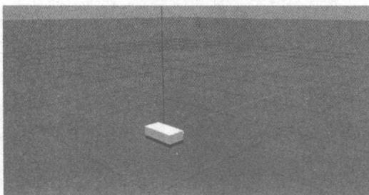

图 4-1 导入的白色盒子
{: .figure-caption }


（4）现在给机器人添加一个脚轮。脚轮是一个没有摩擦的球体。这种脚轮比添加带有关节的轮子更好，因为它对物理引擎设置了较少的约束，输入以下的内容：

```txt
?xml version = '1.0'?>
sdf version = '1.4'>
model name = "my_robot">
static > true /static>
link name = 'chassis'>
pose > 0 0 .1 0 0 0 /pose>
collision name = 'collision'>
geometry >
box >
size > .4 .2 .1 /size >
/box >
/geometry >
/collision>
```

```txt
visual name = 'visual'
geometry>
box>
size>.4.2.1 /size>
/box>
/geometry>
/visual>
collision name = 'caster_collision'>
pose>-0.15 0 - 0.05 0 0 0 /pose>
geometry>
sphere>
radius>.05 /radius>
/sphere>
/geometry>
surface>
friction>
ode>
mu>0 /mu>
mu2>0 /mu2>
slip1>1.0 /slip1>
slip2>1.0 /slip2>
/ode>
/friction>
/surface>
/collision>
visual name = 'caster_visual'>
pose>-0.15 0 - 0.05 0 0 0 /pose>
geometry>
sphere>
radius>.05 /radius>
/sphere>
/geometry>
/visual>
/link>
/model>
/sdf>
```

以上的内容能够显示用户的模型，以确保脚轮出现在机器人的末端。如图 4-2 所示，在 Gazebo 中将会生成相应模型（用户不需要重新启动 Gazebo，它会每次修改它后从磁盘重新加载用户的修改模型）。

（5）现在让我们添加一个左轮。将～/.Gazebo/models/my\_robot/model.sdf文件修改为以下内容：

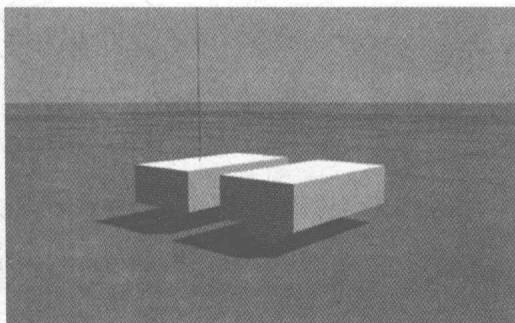

图4-2 添加了脚轮的模型
{: .figure-caption }


```xml
<?xml version = '1.0'?>
sdf version = '1.4'>
model name = "my_robot">
static> true /static>
link name = 'chassis'>
pose> 0 0 .1 0 0 0 /pose>
collision name = 'collision'>
geometry>
box>
size>.4 .2 .1 /size>
/box>
/geometry>
/collision>
visual name = 'visual'>
geometry>
box>
size>.4 .2 .1 /size>
/box>
/geometry>
/visual>
collision name = 'caster_collision'>
pose>- 0.15 0 - 0.05 0 0 0 /pose>
geometry>
sphere>
radius>.05 /radius>
/sphere>
/geometry>
surface>
friction>
ode>
    0°
    0°
slip1>1.0 /slip1>
slip2>1.0 /slip2>
/ode>
```

```hcl
/friction>
/surface>
/collision>
visual name = 'caster_visual'>
pose > -0.15 0 -0.05 0 0 0 /pose>
geometry>
sphere>
radius > .05 /radius>
/sphere>
/geometry>
/visual>
/link>
link name = "left_wheel">
pose > 0.1 0.13 0.1 0 1.5707 1.5707 /pose>
collision name = "collision">
geometry>
cylinder>
radius > .1 /radius>
length > .05 /length>
/cylinder>
/geometry>
/collision>
visual name = "visual">
geometry>
cylinder>
radius > .1 /radius>
length > .05 /length>
/cylinder>
/geometry>
/visual>
/link>
/model>
/sdf>
```

之后运行 Gazebo, 如图 4-3 所示, 插入用户的机器人模型, 并确保车轮已出现在正确的位置。

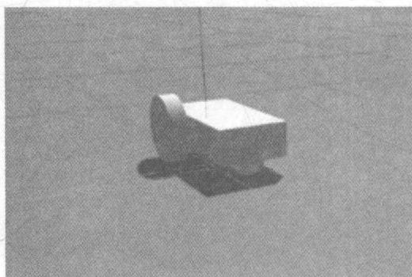

图4-3 添加了左轮的模型
{: .figure-caption }


(6) 我们可以通过复制左轮, 并调整轮连杆的姿势来制作右轮, 输入以下内容:

```xml
<?xml version = '1.0'?>
sdf version = '1.4'>
model name = "my_robot">
static > true /static>
link name = 'chassis'>
pose > 0 0 .1 0 0 0 /pose>
collision name = 'collision'>
geometry>
box>
size > .4 .2 .1 /size>
/box>
/geometry>
/collision>
visual name = 'visual'>
geometry>
box>
size > .4 .2 .1 /size>
/box>
/geometry>
/visual>
collision name = 'caster_collision'>
pose > -0.15 0 -0.05 0 0 0 /pose>
geometry>
sphere>
radius > .05 /radius>
/sphere>
/geometry>
surface>
friction>
ode>
    0°
    0°
slip1 > 1.0 /slip1 >
slip2 > 1.0 /slip2 >
/ode>
/friction>
/surface>
/collision>
visual name = 'caster_visual'>
pose > -0.15 0 -0.05 0 0 0 /pose>
geometry>
sphere>
radius > .05 /radius>
```

```txt
/sphere>
/geometry>
/visual>
/link>
link name = "left_wheel">
pose>0.1 0.13 0.1 0 1.5707 1.5707 /pose>
collision name = "collision">
geometry>
cylinder>
radius>.1 /radius>
length>.05 /length>
/cylinder>
/geometry>
/collision>
visual name = "visual">
geometry>
cylinder>
radius>.1 /radius>
length>.05 /length>
/cylinder>
/geometry>
/visual>
/link>
link name = "right_wheel">
pose>0.1 - 0.13 0.1 0 1.5707 1.5707 /pose>
collision name = "collision">
geometry>
cylinder>
radius>.1 /radius>
length>.05 /length>
/cylinder>
/geometry>
/collision>
visual name = "visual">
geometry>
cylinder>
radius>.1 /radius>
length>.05 /length>
/cylinder>
/geometry>
/visual>
/link>
/model>
/sdf>
```
如图 4-4 所示, 此时机器人应该有一个带有脚轮和两个轮子的底盘。

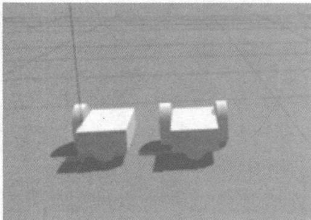

图 4-4 带有脚轮和两轮子的模型
{: .figure-caption }


(7) 通过设置<static>为 false, 使模型呈动态, 为左右轮添加两个铰连杆头。

```xml
<?xml version = '1.0'?>
sdf version = '1.4'>
model name = "my_robot">
static>false /static>
link name = 'chassis'>
pose>0 0 .1 0 0 0 /pose>
collision name = 'collision'>
geometry>
box>
size>.4 .2 .1 /size>
/box>
/geometry>
/collision>
visual name = 'visual'>
geometry>
box>
size>.4 .2 .1 /size>
/box>
/geometry>
/visual>
collision name = 'caster_collision'>
pose>-0.15 0 -0.05 0 0 0 /pose>
geometry>
sphere>
radius>.05 /radius>
/sphere>
/geometry>
surface>
friction>
ode>
```

```txt
0°
0°
slip1 > 1.0 /slip1>
slip2 > 1.0 /slip2>
/ode>
/friction>
/surface>
/collision>
visual name = 'caster_visual'>
pose > -0.15 0 -0.05 0 0 0 /pose>
geometry>
sphere>
radius > .05 /radius>
/sphere>
/geometry>
/visual>
/link>
link name = "left_wheel">
pose > 0.1 0.13 0.1 0 1.5707 1.5707 /pose>
collision name = "collision">
geometry>
cylinder>
radius > .1 /radius>
length > .05 /length>
/cylinder>
/geometry>
/collision>
visual name = "visual">
geometry>
cylinder>
radius > .1 /radius>
length > .05 /length>
/cylinder>
/geometry>
/visual>
/link>
link name = "right_wheel">
pose > 0.1 - 0.13 0.1 0 1.5707 1.5707 /pose>
collision name = "collision">
geometry>
cylinder>
radius > .1 /radius>
length > .05 /length>
/cylinder>
/geometry>
/collision>
```

```txt
visual name = "visual">
geometry>
cylinder>
radius > .1 /radius>
length > .05 /length>
/cylinder>
/geometry>
/visual>
/link>
joint type = "revolute" name = "left_wheel_hinge">
pose > 0 0 - 0.03 0 0 0 /pose>
child > left_wheel /child>
parent > chassis /parent>
axis>
xyz > 0 1 0 /xyz>
/axis>
/joint>
joint type = "revolute" name = "right_wheel_hinge">
pose > 0 0 0.03 0 0 0 /pose>
child > right_wheel /child>
parent > chassis /parent>
axis>
xyz > 0 1 0 /xyz>
/axis>
/joint>
/model>
/sdf>
```
其中，代码“<xyz>010</xyz>”的意思是两个关节绕Y轴旋转，并将每个轮连接到机箱。
(8) 启动 Gazebo, 然后插入用户的模型。单击屏幕右侧的点, 并将它们向左拖动。
（9）将出现一个新窗口，其中包含每个关节的各种控制器(注意：确保选择要控制的型号)。

（10）在 Force 标签页下，将施加到每个接头的力增加到约 $0.1 ~N \cdot m$ 。如图 4-5 所示，此时机器人应该四处移动。

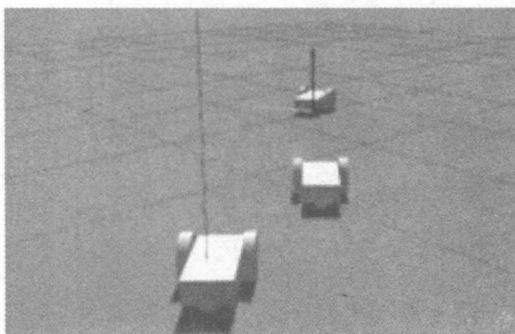

图4-5 可移动的机器人
{: .figure-caption }


### 4.3.5 导入网格

本部分内容介绍如何将 3D 网格导入 Gazebo。

#### 准备网格

Gazebo 使用右手坐标系, 其中 +Z 方向向上(垂直), +X 方向向前(进入屏幕), +Y 方向向左。

## 1）降低复杂性

与 V-REP 相似, 许多网格可能过于复杂。为了效率, 具有数千个三角形的网格应该被缩小或分割成单独的网格。

## 2）居中网格

设置居中网络,第一步是将网格居中在 $(0,0,0)$ ,并沿着X轴定向前面(可以是主观设定的)。

## 3）缩放网格

Gazebo 使用公制系统。许多网格(尤其是来自 3D 仓库的网格)使用英制单位。使用用户的 3D 编辑器将网格缩放到公制尺寸。

#### 导出网格

一旦网格已经准备好,将其导出为 Collada 文件。此格式将包含所有 3D 信息和材料。

#### 测试网格

测试网格的最简单的方法是创建一个简单的场景文件 my\_mesh.world 去加载网格。用以下的内容去替换文件名为 my\_mesh.dae 的网格。

```xml
<?xml version="1.0"?>
sdf version="1.4">
world name="default">
include>
uri>model://ground_plane /uri>
/include>
include>
uri>model://sun /uri>
/include>
model name="my_mesh">
pose>0 0 0 0 0 0 /pose>
static>true /static>
link name="body">
visual name="visual">
geometry>
mesh>uri>file://my_mesh.dae /uri>/mesh>
/geometry>
/visual>
/link>
```

```txt
/model>
/world>
/sdf>
```

然后只需在文件所在的目录中启动 Gazebo:

```txt
Gazebo my_mesh.world
```

#### 测试网格

用户可以使用文件名为 duck.dae 和 duck.png 的网格文件。将它们放在与场景文件相同的目录中。因为鸭子的模型被定义为 Y 轴为向上，用户可以在 sdf 中旋转，使其显示垂直，设置的内容如下：

```txt
visual name="visual">
    pose>0 0 0 1.5708 0 0 /pose>
    geometry>
    mesh>uri>file://duck.dae/uri>/mesh>
    /geometry>
    /visual>
```

生成的场景模型如图 4-6 所示。

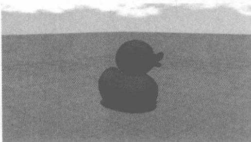

图 4-6 网格文件生成的鸭子模型
{: .figure-caption }


### 4.3.6 附加网格物体

#### 内容提要

网格最常见的作用是创建逼真的视觉效果,它可以为模型的视觉和传感器添加真实感。本部分内容演示了用户如何使用自定义网格来定义模型在仿真中的显示方式。

#### 将网格连接为视觉

(1) 切换到 my\_robot 目录, 输入以下命令:

```batch
cd ~/.Gazebo/models/my_robot
```

(2) 使用用户的编辑器打开 model.sdf 文件, 输入以下命令:

```txt
gedit ~/.Gazebo/models/my_robot/model.sdf
```

（3）我们将在箱子中添加一个网格。找到视觉效果 name=visual，格式如下：

```txt
visual name = 'visual'>
geometry>
box>
size>.4 .2 .1 /size>
/box>
/geometry>
/visual>
```

（4）网格可以来自磁盘上的文件，或来自另一个模型。在这个例子中，将使用pioneer2dx模型中的网格物体。保持文件的其余部分不变，将可视元素更改为以下内容：

```txt
visual name = 'visual'
geometry>
mesh>
uri> model://pioneer2dx/meshes/chassis.dae /uri>
/mesh>
/geometry>
/visual>
```

（5）查看用户的本地缓存模型数据库，看看用户是否有 pioneer2dx 上面的 <mesh> 块引用的模型，输入以下的命令：

```batch
ls -1 ~/.Gazebo/models/pioneer2dx/meshes/chassis.dae
```

如果网格文件不存在,通过在 Gazebo 中至少产生一次 Pioneer 2DX 模型,使可以 Gazebo 从模型数据库中提取模型。或者用户可以手动将模型文件下载到本地缓存,输入以下的命令:

```shell
cd ~/.Gazebo/models
wget -q -R * index.html *, *.tar.gz -- no -parent -r -x -nH http://models.Gazebosim.org/pioneer2dx/
```

（6）在 Gazebo 中，拖动 My Robot 场景中的模型。如图 4-7 所示，机箱的外观看起来像一个 pioneer2dx。

（7）显然，机箱对于机器人来说太大了，所以需要缩放视觉标签。利用以下的内容，修改 visual 标签以具有缩放因子。

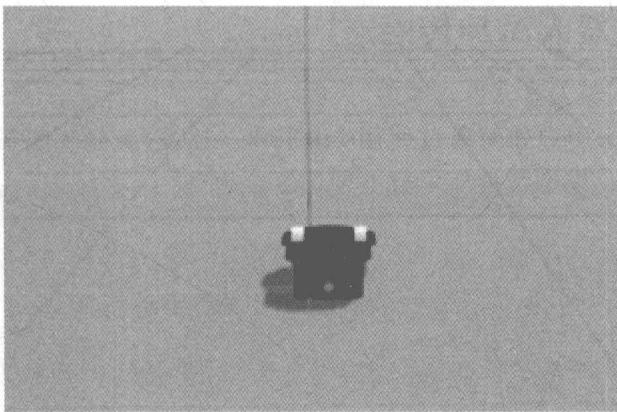

图 4-7 场景中的机箱模型
{: .figure-caption }


```txt
visual name = 'visual'>
geometry>
mesh>
uri> model: //pioneer2dx/meshes/chassis.dae /uri>
scale>0.9 0.5 0.5 /scale>

/mesh>
/geometry>
/visual>
```

（8）在 Z 轴上，机器人的外观视觉较低。输入以下的内容，可以通过指定视觉的姿态来提高一点：

```txt
visual name = 'visual'
pose>0 0 0.05 0 0 0 /pose>

geometry>
mesh>
uri> model: //pioneer2dx/meshes/chassis.dae /uri>
scale> 0.9 0.5 0.5 /scale>
/mesh>
/geometry>
/visual>
```

注意,在这一点上,我们只是简单地修改了机器人的<visual>元素,所以可以通过 GUI 和基于 GPU 的传感器(如相机、深度相机和 GPU 激光器)使机器人看起来像 pioneer2DX 模型的缩小版本。因为没有修改<collision>这个模型中的元素,所以其将仍然被物理引擎的动态碰撞,并且 GPU 的射线传感器是盒子形状的。

### 4.3.7 给机器人添加传感器

#### 内容提要

本部分内容演示了用户如何通过使用<include>标签和<joint>来连接复合模型中不同组件，直接从Gazebo模型数据库中模型创建复合模型。

#### 添加镭射器

向机器人或任何模型添加激光仅仅是将传感器包括在模型中。

(1) 进入用户的上一个部分内容的模型目录, 输入以下的命令:

```batch
cd ~/.Gazebo/models/my_robot
```

(2) 在编辑器中打开 model.sdf。

(3) 在文件末尾附近的</model>标记之前直接添加以下内容:

```txt
include>
uri>model://hokuyo /uri>
pose>0.2 0 0.2 0 0 0 /pose>
/include>
joint name="hokuyo_joint" type="revolute">
child>hokuyo::link /child>
parent>chassis /parent>
axis>
xyz>0 0 1 /xyz>
limit>
upper>0 /upper>
lower>0 /lower>
/limit>
/axis>
/joint>
```

上述内容的作用分别是：<include>块告诉Gazebo需要找到一个模型，并根据给定的<pose>值插入到相关的父模型中。在这种情况下，我们将hokuyo激光器放置在机器人的前方和上方。<uri>块告诉Gazebo在其模型数据库中找到模型（注意，用户可以在此处或在相应存储库查看该部分内容中用到的数据库列表uri）。新的<joint>将插入的hokuyo激光器连接到机器人的机箱。接头具有与<upper>和<lower>零限制，以防止其移动。

<child>的名称是从 hokuyo 模型的 SDF 派生,它开头部分的内容为:

```txt
?xml version = "1.0"?>
sdf version = "1.4">
model name = "hokuyo">
link name = "link">
```

当 hokuyo 模型被插入时, 进行 hokuyo 的连杆以其模型名称命名。在这种情况下, 模型名称为 hokuyo, 因此 hokuyo 模型中的每个连杆都以 hokuyo 开头。

（4）现在启动 Gazebo，并使用 GUI 上的“插入”选项卡将机器人添加到仿真中。如图 4-8 所示，用户应该看到带激光的机器人。

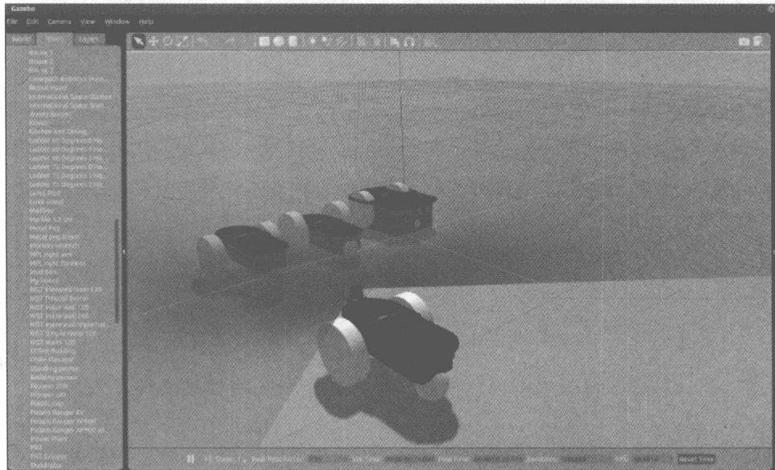

图 4-8 带激光的机器人
{: .figure-caption }


（5）尝试向机器人添加摄像头。相机的模型 URI 是 model://camera，它应该是本地缓存为用户，输入以下的命令：

```txt
ls ~/.Gazebo/models/camera/
```

### 4.3.8 做一个简单的夹持器

下面介绍如何通过编辑 SDF 文件做一个简单的两指夹持器。

1. 设置用户的模型目录

本部分内容参考模型数据库文件和 SDF 文件。

#### 制作模型

(1) 创建场景文件的目录, 输入以下命令:

```shell
mkdir ~/simple_gripper_tutorial; cd ~/simple_gripper_tutorial
```

(2) 我们将用一个简单的空场景作为开始。创建一个场景文件, 输入以下命令:

```txt
gedit ~/simple_gripper_tutorial/gripper.world
```

复制下面 SDF 的内容到名为“gripper.world”的文件中：

```txt
?xml version="1.0"?>
sdf version="1.4">
world name="default">
! -- A ground plane -->
include>
uri>model://ground_plane /uri>
/include>
! -- A global light source -->
include>
uri>model://sun /uri>
/include>
include>
uri>model://my_gripper /uri>
/include>
/world>
/sdf>
```

（3）在～/.Gazebo目录内部创建模型。输入以下命令将模型文件写入目录：

```shell
mkdir -p ~/.Gazebo/models/my_gripper
cd ~/.Gazebo/models/my_gripper
```

（4）让我们对夹持器的基本结构进行布局。做到这一点最简单的方法是做一个 static 模型，并将这些模型一个个添加到连杆上。静态模型意味着仿真器启动时的连杆不会移动。这将允许用户启动仿真器，并在增加关节前检查连杆位置。

(5) 创建 model.config 文件:

```txt
gedit model.config
```

(6) 复制下列内容:

```txt
?xml version="1.0"?>
model>
name>My Gripper /name>
version>1.0 /version>
sdf version='1.4'>simple_gripper.sdf /sdf>
author>
name>My Name /name>
email>me@my.email /email>
/author>
description>
My awesome robot.
```

```txt
/description>
/model>
```

(7) 同样地, 创建 simple\_gripper.sdf 文件:

```batch
gedit simple_gripper.sdf
```

(8) 将下面的代码复制到其中:

```xml
<?xml version="1.0"?>
sdf version="1.4">
model name="simple_gripper">
link name="riser">
pose>-0.15 0.0 0.5 0 0 0 /pose>
inertial>
pose>0 0 -0.5 0 0 0 /pose>
inertia>
ixx>0.01 /ixx>
ixy>0 /ixy>
ixz>0 /ixz>
iyy>0.01 /iyy>
iyz>0 /iyz>
izz>0.01 /izz>
/inertia>
mass>10.0 /mass>
/inertial>
collision name="collision">
geometry>
box>
size>0.2 0.2 1.0 /size>
/box>
/geometry>
/collision>
visual name="visual">
geometry>
box>
size>0.2 0.2 1.0 /size>
/box>
/geometry>
material>
script>Gazebo/Purple /script>
/material>
/visual>
/link>
link name="palm">
```

```xml
pose>0.0 0.0 0.05 0 0 0 /pose>
inertial>
inertia>
ixx>0.01 /ixx>
ixy>0 /ixy>
ixz>0 /ixz>
iyy>0.01 /iyy>
iyz>0 /iyz>
izz>0.01 /izz>
/inertia>
mass>0.5 /mass>
/inertial>
collision name="collision">
geometry>
box>
size>0.1 0.2 0.1 /size>
/box>
/geometry>
/collision>
visual name="visual">
geometry>
box>
size>0.1 0.2 0.1 /size>
/box>
/geometry>
material>
script>Gazebo/Red /script>
/material>
/visual>
/link>
link name="left_finger">
pose>0.1 0.2 0.05 0 0 - 0.78539 /pose>
inertial>
inertia>
ixx>0.01 /ixx>
ixy>0 /ixy>
ixz>0 /ixz>
iyy>0.01 /iyy>
iyz>0 /iyz>
izz>0.01 /izz>
/inertia>
mass>0.1 /mass>
/inertial>
collision name="collision">
geometry>
box>
```

```txt
size>0.1 0.3 0.1 /size>
/box>
/geometry>
/collision>
visual name="visual">
geometry>
box>
size>0.1 0.3 0.1 /size>
/box>
/geometry>
material>
script>Gazebo/Blue /script>
/material>
/visual>
/link>
link name="left_finger_tip">
pose>0.336 0.3 0.05 0 0 1.5707 /pose>
inertial>
inertia>
ixx>0.01 /ixx>
ixy>0 /ixy>
ixz>0 /ixz>
iyy>0.01 /iyy>
iyz>0 /iyz>
izz>0.01 /izz>
/inertia>
mass>0.1 /mass>
/inertial>
collision name="collision">
geometry>
box>
size>0.1 0.2 0.1 /size>
/box>
/geometry>
/collision>
visual name="visual">
geometry>
box>
size>0.1 0.2 0.1 /size>
/box>
/geometry>
material>
script>Gazebo/Blue /script>
/material>
/visual>
/link>
```

```xml
link name="right_finger">
    pose>0.1 - 0.2 0.05 0 0 .78539 /pose>
    inertial>
    inertia>
    ixx>0.01 /ixx>
    ixy>0 /ixy>
    ixz>0 /ixz>
    iyy>0.01 /iyy>
    iyz>0 /iyz>
    izz>0.01 /izz>
    /inertia>
    mass>0.1 /mass>
    /inertial>
    collision name="collision">
    geometry>
    box>
    size>0.1 0.3 0.1 /size>
    /box>
    /geometry>
    /collision>
    visual name="visual">
    geometry>
    box>
    size>0.1 0.3 0.1 /size>
    /box>
    /geometry>
    material>
    script>Gazebo/Green /script>
    /material>
    /visual>
    /link>
    link name="right_finger_tip">
    pose>0.336 - 0.3 0.05 0 0 1.5707 /pose>
    inertial>
    inertia>
    ixx>0.01 /ixx>
    ixy>0 /ixy>
    ixz>0 /ixz>
    iyy>0.01 /iyy>
    iyz>0 /iyz>
    izz>0.01 /izz>
    /inertia>
    mass>0.1 /mass>
    /inertial>
    collision name="collision">
    geography>
```

```txt
box>
size>0.1 0.2 0.1 /size>
/box>
/geometry>
/collision>
visual name="visual">
geometry>
box>
size>0.1 0.2 0.1 /size>
/box>
/geometry>
material>
script>Gazebo/Green /script>
/material>
/visual>
/link>
static>true /static>
/model>
/sdf>
```

(9) 运行场景文件可以看到已经创建的夹持器模型, 输入以下命令:

```txt
Gazebo ~/simple_gripper_tutorial/gripper.world
```

如图 4-9 所示, 用户将会看到创建的夹持器模型。

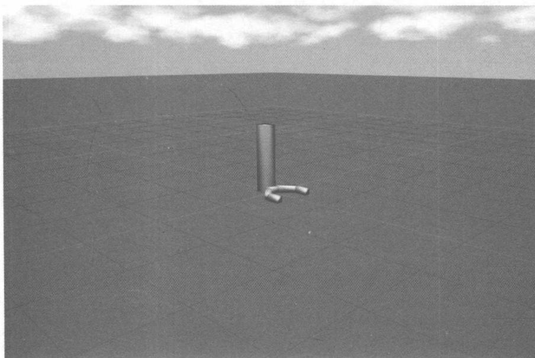

图 4-9 创建的夹持器模型
{: .figure-caption }


（10）经过以上步骤，我们成功地对连杆进行布局。下面我们可以通过对文件 simple\_gripper.sdf 的修改增加关节，在</model>行之前添加下列代码：

```xml
gedit ~/.Gazebo/models/my_gripper/simple_gripper.sdf
joint name="palm_left_finger" type="revolute">
pose>0 - 0.15 0 0 0 0 /pose>
child>left_finger /child>
parent>palm /parent>
axis>
limit>
lower>-0.4 /lower>
upper>0.4 /upper>
/limit>
xyz>0 0 1 /xyz>
/axis>
/joint>
joint name="left_finger_tip" type="revolute">
pose>0 0.1 0 0 0 0 /pose>
child>left_finger_tip /child>
parent>left_finger /parent>
axis>
limit>
lower>-0.4 /lower>
upper>0.4 /upper>
/limit>
xyz>0 0 1 /xyz>
/axis>
/joint>
joint name="palm_right_finger" type="revolute">
pose>0 0.15 0 0 0 0 /pose>
child>right_finger /child>
parent>palm /parent>
axis>
limit>
lower>-0.4 /lower>
upper>0.4 /upper>
/limit>
xyz>0 0 1 /xyz>
/axis>
/joint>
joint name="right_finger_tip" type="revolute">
pose>0 0.1 0 0 0 0 /pose>
child>right_finger_tip /child>
parent>right_finger /parent>
axis>
```

```txt
...
static>false /static>
...
```

```txt
limit>
lower > -0.4 /lower>
upper > 0.4 /upper>
/limit>
xyz > 0 0 1 /xyz>
/axis>
/joint>
joint name = "palm_riser" type = "prismatic">
child > palm /child>
parent > riser /parent>
axis>
limit>
lower > 0 /lower>
upper > 0.9 /upper>
/limit>
xyz > 0 0 1 /xyz>
/axis>
/joint>
```

并且使模型非静态：

(11) 再次启动 Gazebo, 输入以下命令:

```txt
Gazebo ~/simple_gripper_tutorial/gripper.world
```

（12）在模型上单击鼠标右键，依次选择“查看”“关节”和“查看”“线框”。如图4-9所示，新创建的关节模型将显示在场景中。

（13）用户还可以使用的关节控制部件控制每个关节的力量。单击抓取器模型。然后通过单击GUI右侧的垂直手柄，将其拖动到左侧扩大这个小程序。该插件展示了一系列滑块的列表，其中每一项代表一个关节。选中动力标签可以使用滑块将力施加于每一个关节，然后我们可以看到夹持器在力的作用下运动。例如，设置在palm\_riser的为10（单位为牛顿），如图4-11所示，将会看到夹持器在力的作用下运动。

### 4.3.9 在机器人上构建夹持器

接下来说明如何从现有机器人部分,即移动机器人和夹取器的基础上,创建带夹持器的简单复合机器人。

#### 机器人组件

启动 Gazebo，并确保用户可以从前面两个部分内容加载模型。

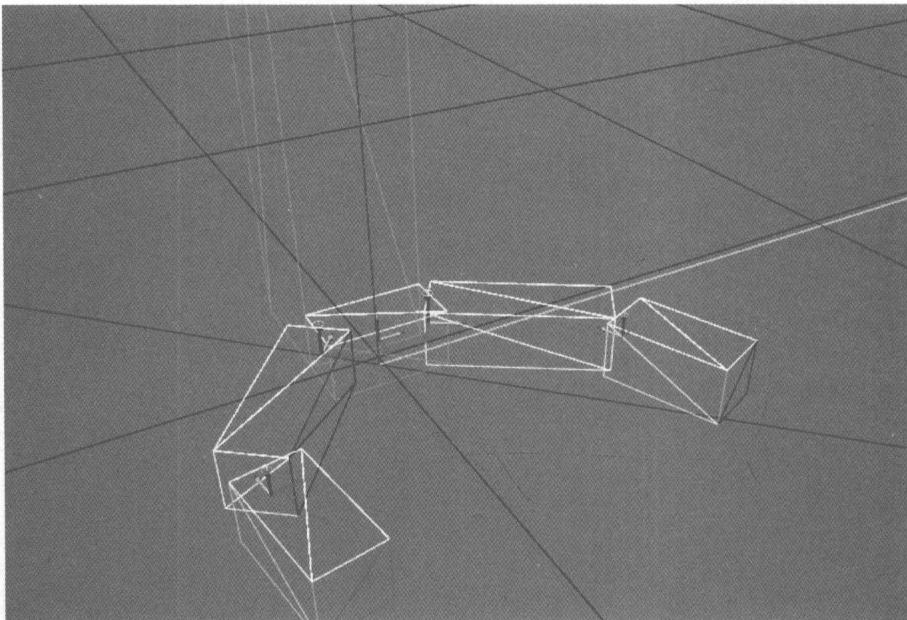

图 4-10 关节模型
{: .figure-caption }


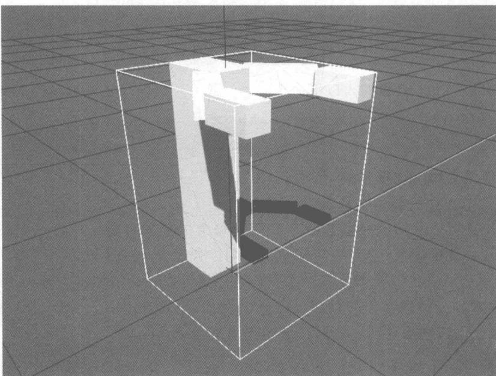

图 4-11 运动的夹持器
{: .figure-caption }


## 1）移动基座

（1）如图 4-12 所示，在完成制作移动机器人部分内容中的每条命令后，在用户的 disposal 上将会产生带基座的移动机器人。

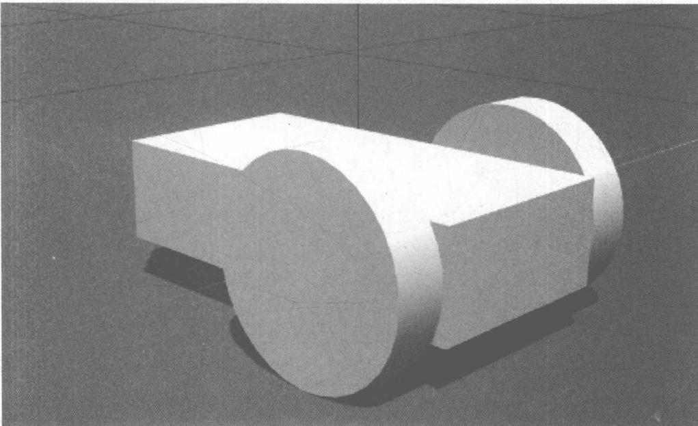

图 4-12 带基座的移动机器人
{: .figure-caption }


（2）通过修改～/.Gazebo/models/my\_robot/model.sdf，可以使模型更大，这将可以容纳我们需要在该模型上添加的夹持器，输入以下命令：

```txt
gedit ~/.Gazebo/models/my_robot/model.sdf
```

接下来需要更新内容,使模型的大小改变。输入以下内容重新定位车轮信息:

```txt
?xml version='1.0'?>
sdf version='1.5'>
model name="mobile_base">
link name='chassis'>
pose>0 0 .25 0 0 0 /pose>
inertial>
mass>20.0 /mass>
pose>-0.1 0 -0.1 0 0 0 /pose>
inertia>
ixx>0.5 /ixx>
iyy>1.0 /iyy>
izz>0.1 /izz>
/inertia>
/inertial>
collision name='collision'>
geometry>
```

```xml
box>
size>2 1 0.3 /size>
/box>
/geometry>
/collision>
visual name='visual'>
geometry>
box>
size>2 1 0.3 /size>
/box>
/geometry>
/visual>
collision name='caster_collision'>
pose>-0.8 0 -0.125 0 0 0 /pose>
geometry>
sphere>
radius>.125 /radius>
/sphere>
/geometry>
surface>
friction>
ode>
mu>0 /mu>
mu2>0 /mu2>
/ode>
/friction>
/surface>
/collision>
visual name='caster_visual'>
pose>-0.8 0 -0.125 0 0 0 /pose>
geometry>
sphere>
radius>.125 /radius>
/sphere>
/geometry>
/visual>
/link>
link name="left_wheel">
pose>0.8 0.6 0.125 0 1.5707 1.5707 /pose>
collision name="collision">
geometry>
cylinder>
radius>.125 /radius>
length>.05 /length>
/cylinder>
/geometry>
```

```xml
/collision>
visual name="visual">
geometry>
cylinder>
radius>.125 /radius>
length>.05 /length>
/cylinder>
/geometry>
/visual>
/link>
link name="right_wheel">
pose>0.8 - 0.6 0.125 0 1.5707 1.5707 /pose>
collision name="collision">
geometry>
cylinder>
radius>.125 /radius>
length>.05 /length>
/cylinder>
/geometry>
/collision>
visual name="visual">
geometry>
cylinder>
radius>.125 /radius>
length>.05 /length>
/cylinder>
/geometry>
/visual>
/link>
joint type="revolute" name="left_wheel_hinge">
pose>0 0 - 0.03 0 0 0 /pose>
child>left_wheel /child>
parent>chassis /parent>
axis>
xyz>0 1 0 /xyz>
/axis>
/joint>
joint type="revolute" name="right_wheel_hinge">
pose>0 0 0.03 0 0 0 /pose>
child>right_wheel /child>
parent>chassis /parent>
axis>
xyz>0 1 0 /xyz>
/axis>
/joint>
/model>
/sdf>
```

## 2）组装复合机器人

（1）要创建一个附带了一个简单夹钳的移动机器人，需要创建一个新的模型目录，输入以下命令：

```txt
mkdir ~/.Gazebo/models/simple_mobile_manipulator
```

接下来编辑模型的配置文件,输入以下命令:

```txt
gedit ~/.Gazebo/models/simple_mobile_manipulator/model.config
```

加载如下内容：

```xml
?xml version="1.0"?>
model>
name>Simple Mobile Manipulator /name>
version>1.0 /version>
sdf version='1.5'> manipulator.sdf /sdf>
author>
name>My Name /name>
email>me@my.email /email>
/author>
description>
My simple mobile manipulator
/description>
/model>
```

(2) 接下来, 创建模型 SDF 文件, 输入以下命令:

```batch
gedit ~/.Gazebo/models/simple_mobile_manipulator/manipulator.sdf
```

加载如下内容：

```txt
?xml version="1.0"?>
sdf version="1.5">
model name="simple_mobile_manipulator">
include>
uri>model://my_gripper/uri>
pose>1:3 0 0.1 0 0 0 /pose>
/include>
include>
uri>model://my_robot/uri>
pose>0 0 0 0 0 0 /pose>
/include>
joint name="arm_gripper_joint" type="fixed">
```

```txt
parent>mobile_base::chassis /parent>
child>simple_gripper::riser /child>
/joint>
! -- attach sensor to the gripper -->
include>
uri>model://hokuyo /uri>
pose>1.3 0 0.3 0 0 0 /pose>
/include>
joint name="hokuyo_joint" type="fixed">
child>hokuyo::link /child>
parent>simple_gripper::palm /parent>
/joint>
/model>
/sdf>
```

（3）确保 model.config 与 manipulator.sdf 已经保存，启动 Gazebo 和通过插入选项卡来产生模型，选择简单的移动机器人模型来重新加载以上模型。如图 4-13 所示，用户可以看到组装得到的移动机器人模型。

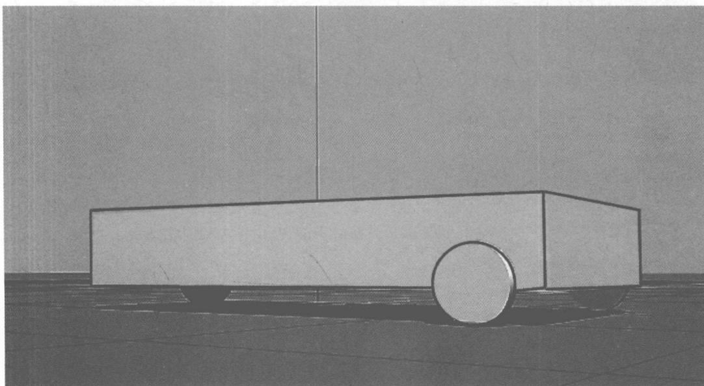

图 4-13 组装得到的移动机器人模型
{: .figure-caption }


### 4.3.10 嵌套模型

本部分内容将介绍如何将模型嵌入另一个模型中，以创建模型的集合。

#### 嵌套模型

在“制作模型”部分内容中可以看到，一个模型 SDF 是由连杆(links)和关节(joints)集合组成的。从 SDF 1.5 开始，SDF 的 <model> 元素已经扩展为支持自引用，这意味着允许元素 <model> 嵌套。在 Gazebo 7 中添加了加载嵌套 <model> 元素的支持。

下面是嵌套模型SDF的一个基本示例：

```xml
sdf version="1.6">
    model name="model_00">
    pose>0 0 0.5 0 0 0 /pose>
    link name="link_00">
    pose>0.0 0 0 0 0 0 /pose>
    collision name="collision_00">
    geometry>
    sphere>
    radius>0.5 /radius>
    /sphere>
    /geometry>
    /collision>
    visual name="visual_00">
    geometry>
    sphere>
    radius>0.5 /radius>
    /sphere>
    /geometry>
    /visual>
    /link>
    model name="model_01">
    pose>1.0 0 0.0 0 0 0 /pose>
    link name="link_01">
    pose>0.25 0 0.0 0 0 0 /pose>
    collision name="collision_01">
    geometry>
    box>
    size>1 1 1 /size>
    /box>
    /geometry>
    /collision>
    visual name="visual_01">
    geometry>
    box>
    size>1 1 1 /size>
    /box>
    /geometry>
    /visual>
    /link>
    /model>
    /model>
    /sdf>
```

此模型 SDF 由两个连杆(link\_00、link\_01)和一个嵌套模型(model\_01)组成。由于Gazebo中的模型只是一个可以容纳多个物体的抽象容器，因此在Gazebo中加载此模型将导致在物理引擎中只创建两个刚体，一个用于球形连杆，另一个用于嵌套方形连杆。默认情况下，它们不会像同一模型中的其他连杆一样发生自冲突。在GUI客户端上，用户将看到一个球体和一个盒子并排放置，并且不会发现嵌套模型和连杆之间的任何视觉差异。

#### 关节

在嵌套模型中,在连杆之间创建关节也是可行的。这是一个可以添加到上面的模型SDF的关节的示例:

```xml
joint name="joint_00" type="revolute">
parent>link_00 /parent>
child>model_01::link_01 /child>
pose>0.0 0.0 0.0 0.0 0.0 0.0 /pose>
axis>
xyz>1.0 0.0 0.0 /xyz>
/axis>
/joint>
```

这个关节 SDF 元素可以添加到最高层元素或嵌套 <model> 元素。然后在球形和箱形连杆之间将会形成旋转关节。注意 <parent> 和 <child> 名称的范围；除了顶级模型 prefix 外，嵌套模型的连杆的参考均需要被设定范围。

#### 关于包含 SDF 元素的注意事项

嵌入模型可以使用<include>元素的用法。

该<include>元素通过从包括的模型中取得所有连杆，并将它们嵌入到父模型中来工作。这种方法的缺点是在模型显示过程中被修改，即保存场景文件时将导致一个模型<model>元素的所有连杆结合在一起而没有保存<include>标签。这是嵌套<model>元素设计来解决的缺点之一。

另一方面，<include>元素是一个简单有效的解决方案，只需要一个SDF文件的引用来创建模型组合即可。未来的工作将考虑<model>使用此功能扩展嵌套的SDF元素。

### 4.3.11 模型编辑器

本部分内容介绍使用模型编辑器创建模型的过程。

(1) 打开模型编辑器。

启动 Gazebo，在 Edit 菜单上，转到 Model Editor 或单击 Ctrl+M 组合键打开编辑器。

(2) 图形用户界面。

该编辑器由以下2部分组成：

左侧的选项板有两个选项卡。该 Insert 选项卡允许用户将零件(连杆和其他模型)插入场景中以构建模型。该 Model 选项卡显示构成用户正在构建的模型的所有零件的列表。

右侧的 3D 视图中, 用户可以看到模型的预览, 并与能够编辑其属性和连杆之间创建关节。顶部工具栏上的 GUI 工具可用于操作 3D 视图中的关节和连杆。

#### 添加连杆

## 1）添加简单的形状

模型编辑器有 3 个简单的原始几何体, 用户可以插入到 3D 视图中以创建模型的连杆。

（1）在调色板上，单击在简单形状下的 boxes、phere 或 cylinder 图标。

（2）将鼠标光标移动到 3D 视图上以查看视觉效果，然后在任何位置单击/释放将其添加到模型中。

注意：用户可以按 Esc 键取消添加附加到鼠标光标的当前连杆。

## 2）添加网格物体

添加网格文件的操作如图 4-14 所示, 它的具体步骤为:

（1）单击自定义形状 Add 下的按钮，将弹出一个对话框，让用户从中找到要添加的网格。

（2）单击 Browse 按钮，使用文件浏览器在本地计算机上查找网格文件。如果用户知道网格文件的路径，用户可以直接在 Browse 按钮旁边的文本字段框中输入。Note Gazebo 目前仅支持导入 COLLADA(dae)、STereoLithography(stl) 和 Scalable Vector Graphics(svg) 文件。

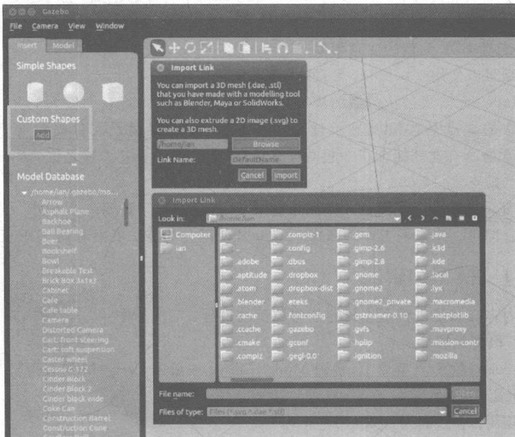

图 4-14 添加网格文件操作
{: .figure-caption }


（3）单击 Import 以加载网格文件。然后，将其添加到 3D 视图。

#### 创建关节

模型编辑器支持在正在编辑的模型中的连杆之间创建多种类型的关节。过程如下：

（1）单击 joint 工具栏上的图标。这将弹出创建关节的对话框，用户可以指定要创建的关节的不同属性。正如在对话框中看到的，默认的关节类型是 Revolute 关节。

（2）将鼠标移动到用户要创建关节的连杆上，这时它将会变亮，单击选中它。这个连杆将是关节的父连杆。

（3）然后，将鼠标移动到用户要成为关节的子连杆的连杆。如图 4-15 所示，单击它可以看到连接两个连杆的彩色线和附加到子连杆的关节视图。

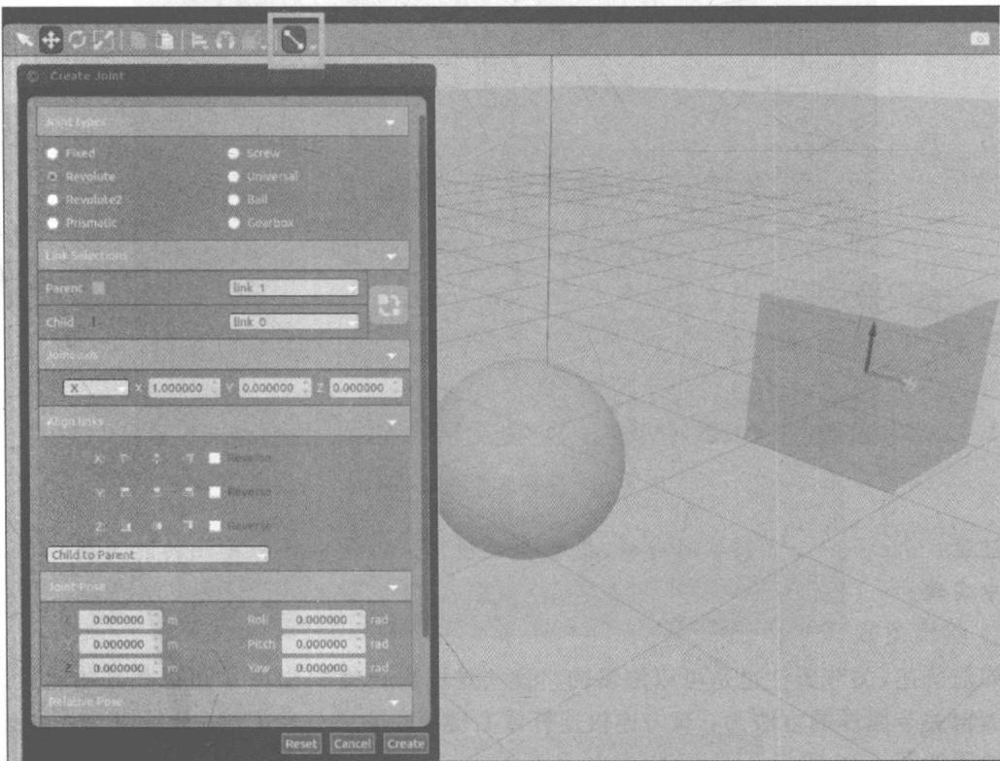

图 4-15 关节视图
{: .figure-caption }


用来表示关节的线是彩色编码的,不同的关节类型对应着不同的颜色。关节的视觉信息由 RGB 轴组成,这有助于给出关节的坐标框架的想法。黄色箭头表示接头的主轴。例如,在旋转接头的情况下,这是旋转轴线。

（4）在“关节创建”对话框中指定所有所需的关节属性后，单击 Create 按钮完成关节创建。

注意：用户可以按 Esc 键在任意时间取消创建过程。

#### 编辑模型

编辑模型时要小心：编辑器目前无法撤销用户的操作；所有测量均以米为单位。

## 1）编辑连杆

模型编辑器支持编辑连杆，并能在 SDF 中找到这些属性。

编辑连杆的属性的方法为：双击连杆或右键单击并选择 Open Link Inspector。将出现一个对话框窗口，如图 4-16 所示，其中包含 Link、Visual 和 Collision 属性选项卡。例如，尝试更改连杆姿势和颜色。完成后，单击 OK 按钮关闭检查器。

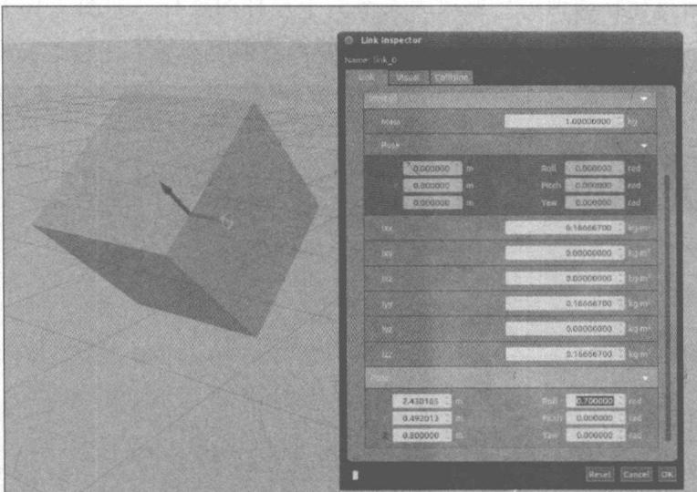

图 4-16 连杆属性设置对话框
{: .figure-caption }


注意：Gazebo 6+支持编辑连杆、视觉和碰撞。编辑传感器和插件的能力将在以后的版本中实现。

## 2）编辑关节

如前所述,关节属性也是可以编辑的。这些是用户在关节 SDF 中可以找到的属性。

编辑关节属性的方法为：双击连接连杆或右键单击它并选择 Open Joint Inspector。关节编辑器如图 4-17 所示。例如，尝试更改关节姿势和关节类型。完成后，单击 OK 按钮关闭检查器。

#### 保存模型

保存将为用户的模型创建一个目录，SDF 和配置文件。这里以一个简单的例子作为说明：创建一个简单的汽车，并保存。如图 4-18 所示，汽车将有一个盒底盘和四个可以滚动的轮子，每个滚轮将通过旋转接头连接到底盘。

如果用户对所创建的模型感到满意,请转到 Model 左侧面板中的标签,并为其命名。保存模型,请选择 File 菜单,然后单击顶部菜单中的 Save As(按钮或单击 Ctrl+S 键)。如图 4-19 所示,将出现一个对话框,用户可以在其中选择模型的位置。

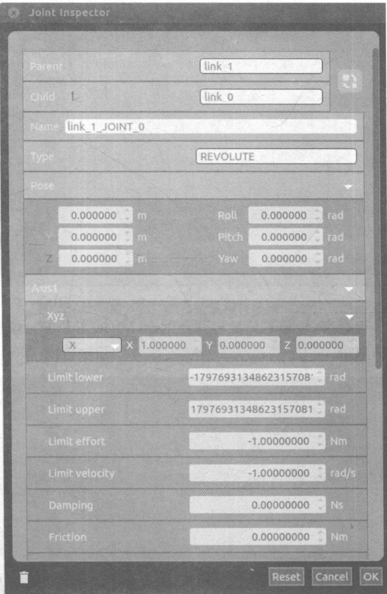

图4-17 关节对话框
{: .figure-caption }


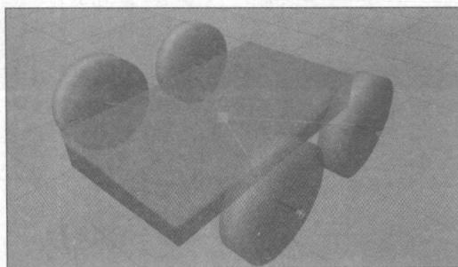

图 4-18 汽车模型
{: .figure-caption }


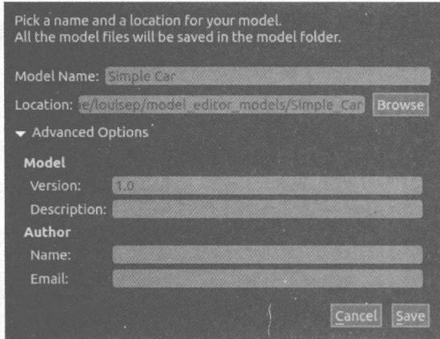

图 4-19 模型设置对话框
{: .figure-caption }


#### 退出

完成创建模型并保存后,转到 File 然后选择 Exit Model Editor。如图 4-20 所示,用户的模型将显示在主窗口中。

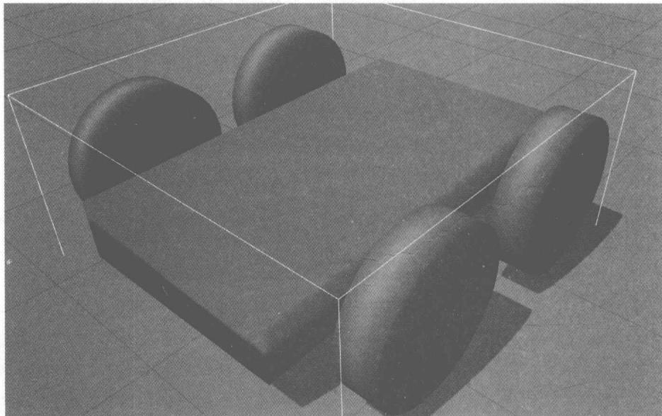

图 4-20 主窗口中的汽车模型
{: .figure-caption }


#### 编辑现有模型

如果用户不需要重新创建一个模型,那么用户可以在仿真中编辑模型的属性。

编辑当前模型的方法为：确保用户已保存创建的模型，并退出模型编辑器。或者，从一个新的Gazebo实例开始。从Insert左侧的选项卡插入模型。例如，让我们插入一个SimpleArm。右键单击刚刚插入的模型，并选择EditModel。生成模型如图4-21所示。现在用户在模型编辑器中,用户可以向模型中添加新连杆或编辑现有连杆。

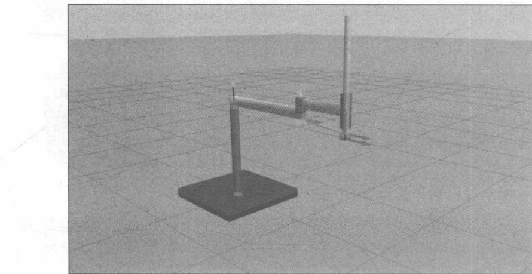

图 4-21 简单的机械臂模型
{: .figure-caption }


### 4.3.12 盒子的动画

本部分内容创建一个仿真场景,一个简单的盒子,在重复循环 10s 的动画,使它在地面上滑动。本部分内容还演示了使用 Gazebo 可执行文件或用户自己的自定义可执行文件查看,访问和与仿真交互的几种不同方法。仿真的盒子传输自己的位姿,并且创建回调来接收姿势并打印出盒子的位置和时间戳。

#### 建立

创建工作目录,输入以下的命令:

```txt
mkdir ~/Gazebo_animatedbox_tutorial
cd ~/Gazebo_animatedbox_tutorial
```

#### 动画框代码

（1）将animated\_box.cc, independent\_listener.cc, integrated\_main.cc, CMakeLists.txt和animated\_box.world复制到当前目录中。

(2) 在 OS X 系统的 Gazebo 上, 用户可以替换 wget 为 curl -OL。

```txt
wget http://bitbucket.org/osrf/Gazebo/raw/Gazebo8/examples/stand_alone/animated_box/
animated_box.cc
wget http://bitbucket.org/osrf/Gazebo/raw/Gazebo8/examples/stand_alone/animated_box/
independent_listener.cc
wget http://bitbucket.org/osrf/Gazebo/raw/Gazebo8/examples/stand_alone/animated_box/
integrated_main.cc
wget http://bitbucket.org/osrf/Gazebo/raw/Gazebo8/examples/stand_alone/animated_box/
CMakeLists.txt
```

```txt
wget http://bitbucket.org/osrf/Gazebo/raw/Gazebo8/examples/stand_alone/animated_box/animated_box.world
```

(3) 构建插件, 输入以下命令:

```batch
mkdir build
cd build
cmake ../
make
```

(4) 确保 Gazebo 可以稍后加载插件, 输入以下命令:

```txt
exportGAZEBO_PLUGIN_PATH = 'pwd': $ GAZEBO_PLUGIN_PATH
```

#### 用 Gazebo 仿真

此示例演示如何运行使用插件的 Gazebo 可执行文件, 输入以下命令:

```txt
cd ~/Gazebo_animatebox_tutorial
Gazebo animated_box.world
```

在另一个终端中,使用“gz topic”用户界面查看姿势,输入以下命令:

```txt
gz topic - v /Gazebo/animated_box_world/pose/info
```

用户应该会看到一个图形界面,显示盒子的姿势。

#### 连接自己的可执行文件到仿真器

首先是确保 Gazebo 没有运行；然后如上所述，启动 Gazebo，最后运行连接到 Gazebo 的独立侦听器可执行文件。独立侦听器接收盒子的位置和时间戳，并打印出来，运行以下命令：

```batch
cd ~/Gazebo_animatebox_tutorial
Gazebo animated_box.world & ./build/independent_listener
```

#### 运行仿真并连接自己的可执行文件

同样地,需要确保 Gazebo 没有运行。

integrated\_main 示例演示了以下内容：

\- 开始盒子仿真。

\- 将侦听器连接到仿真，作为同一可执行文件的一部分。

\- 侦听器获取时间戳和位置,然后打印出来。

运行 integrated\_main, 输入以下命令:

```txt
cd ~/Gazebo_animatebox_tutorial
./build/integrated_mainanimated_box.world
```

如需查看仿真,输入以下命令:

```txt
gzclient
```

#### 源代码

对源代码的说明如下：

```txt
independent_listener.cc
```

它是一个可执行文件,将连接到正在运行的仿真,从姿势信息主题接收更新,并打印对象位置。

```txt
integrated_main.cc
```

它是一个可执行文件将创建一个仿真，从姿势信息主题接收更新，并打印对象位置。

```txt
animated_box.cc
```

它是一个共享库插入定义仿真动画组件,用来移动了场景上的盒子。

```txt
animated_box.world
```

它是一个 XML 文件, 定义仿真物理场景空间和其中的单个盒子。

```batch
CMakeLists.txt
```

它是一个 CMake 构建脚本。

### 4.3.13 三角网格的惯性参数

一个准确的仿真需要物理上的合理惯性参数：质量、质心位置和所有连杆的惯性矩矩阵。如果用户有连杆组成的3D模型，本部分内容将指导用户完成获取和设置这些参数。假设均匀体（均匀质量密度），下面展示如何使用免费软件MeshLab获得惯性数据。用户还可以使用商业产品SolidWorks来计算这些信息。

#### 惯性参数说明

（1）质量最容易通过称重物体来测量。它是一个标量，在Gazebo中公斤(kg)为默认单位。对于3D均匀网格，通过计算几何体积并乘以密度来计算质量。

（2）质心是加权质量矩的和为零的点。对于一个均匀的物体，这相当于几何形心。此参数是一个长度为3的向量，具有位置的单位。

（3）转动惯量代表质量在刚性体的空间分布。它取决于具有单位为“质量\*长度 $^{2}$ ”的物体的质量、尺寸和形状。转动惯量可以表示为对称正定 $3\times3$ 矩阵的分量，具有3个对角元素和 3 个唯一的非对角元素。每个惯性矩阵的定义都和坐标系和坐标轴相关。将矩阵对角化将会产生其主要转动惯量(特征值)和其主轴的方向(特征向量)。

转动惯量与质量成比例,但是与大小成非线性关系。此外,对主要惯量的相对值存在约束,这通常使得估计转动惯量比估计质量或质量中心位置更难。这个困难促使使用软件工具来计算转动惯量。

#### 安装 MeshLab

用户从官方网站下载 MeshLab，并将其安装在用户的计算机上。安装后，用户可以在 MeshLab 中查看网格（支持 DAE 和 STL 格式，这是 Gazebo/ROS 支持的格式）。

#### 计算惯性参数

## (1) 计算球体惯性。

在 MeshLab 中打开网格文件。对于本示例，使用 sphere.dae 网格。要计算惯性参数，首先需要显示对话框 View->Show Layer Dialog。在窗口的右边部分打开一个面板，它分成两部分，我们感兴趣的是包含文本输出的部分。

接下来,用 MeshLab 计算惯性参数。从菜单中选择依次 Filters→Quality Measure and Computations→Compute Geometric Measures。对话框的下半部分将显示有关惯性测量的一些信息。球体给出以下输出:

```txt
Mesh Bounding Box Size 2.000000 2.000000 2.000000
Mesh Bounding Box Diag 3.464102
Mesh Volume is 4.094867
Mesh Surface is 12.425012
Thin shell barycenter -0.000000 -0.000000 -0.000000
Center of Mass is -0.000000 0.000000 -0.000000
Inertia Tensor is :
| 1.617916 -0.000000 0.000000 |
| -0.000000 1.604620 -0.000000 |
| 0.000000 -0.000000 1.617916 |
Principal axes are :
| 0.000000 1.000000 0.000000 |
| -0.711101 -0.000000 0.703089 |
| -0.703089 0.000000 -0.711101 |
axis momenta are :
| 1.604620 1.617916 1.617916 |()
```

(2) 半径: 球体的边界框是边长为 2.0 的立方体, 这意味着球体的半径为 1.0。

（3）体积：半径为1.0的球体应具有 $4 / 3*\mathrm{PI}(4.189)$ 的体积，其接近于计算值4.095。它不是精确值，因为它是三角形近似值。

(4) 表面积: 表面积应为 $4 * \mathrm{PI}(12.566)$ , 接近计算值 12.425。

(5) 质心：质心给定为原点 $(0,0,0)$ 。

(6) 惯性矩阵: 由于球体的半径为 1, 球体的惯性矩阵 (也称为惯性张量) 应该是对角的，其主要转动惯量为2/5质量。它没有在输出中明确说明，而是质量等于体积（默认密度为1），因此我们预计对角矩阵条目为 $8 / 15 * \mathrm{PI}(1.676)$ 。在给定精度下计算出的惯性张量将呈现对角线形式，主要惯量在[1.604,1.618]的范围内，接近预期值。

（7）复制曲面：复制曲面需要记住的一点是，网格内的复制曲面将影响体积和转动惯量的计算。例如，考虑另一个球形网格：ball.dae。Meshlab为此网格提供以下输出：

```txt
Mesh Bounding Box Size 1.923457 1.990389 1.967965
Mesh Bounding Box Diag 3.396207
Mesh Volume is 7.690343
Mesh Surface is 23.967396
Thin shell barycenter 0.000265 0.000185 0.000255
Center of Mass is 0.000257 0.000195 0.000292
Inertia Tensor is :
| 2.912301 0.001190 0.000026 |
| 0.001190 2.903731 0.002124 |
| 0.000026 0.002124 2.906963 |
Principal axes are :
| 0.108262 - 0.895479 0.431738 |
| - 0.120000 0.419343 0.899862 |
| 0.986853 0.149229 0.062058 |
axis momenta are :
| 2.902563 2.907949 2.912483 |
```

此网格大小大致相同,边界框尺寸在[1.92,1.99]范围内,但其计算差异近两倍:

\- 体积：对比7.69与4.09。

\- 主要惯量：对比[2.90,2.91]与[1.60,1.62]。

当用户查看顶点和面的数量(列在 MeshLab 窗口底部)时,不同点为:

\- sphere. dae: 382 个顶点,760 个面。

\- ball. dae: 362 个顶点, 1440 个面。

每个网格具有相似数量的顶点,但是 ball.dae 具有大约两倍的面。依次运行命令 Filters→Cleaning and Repairing→Remove Duplicate Faces 将面数减少 ball.dae 到 720,并为体积(3.84)和主转动惯量(1.45)提供更合理的值。有意义的是,这些值稍小,因为边界框也稍小。

(8) 缩放以提高数值精度。

Meshlab 当前打印具有 6 位固定精度的几何信息。如果网格太小, 这可能会大大限制惯性张量的精度, 例如:

```txt
Mesh Bounding Box Size 0.044000 0.221000 0.388410
Mesh Bounding Box Diag 0.449043
Mesh Volume is 0.001576
Mesh Surface is 0.136169
```

```txt
Thin shell barycenter -0.021954 0.008976 0.012835
Center of Mass is -0.021993 0.001259 0.001489
Inertia Tensor is :
| 0.000008 -0.000000 -0.000000 |
| -0.000000 0.000001 -0.000000 |
| -0.000000 -0.000000 0.000007 |
Principal axes are :
| 0.999999 0.000166 0.001241 |
| -0.000113 0.999104 -0.042310 |
| -0.001247 0.042310 0.999104 |
axis momenta are :
| 0.000008 0.000001 0.000007 |
```

似乎我们得到了寻找的东西。但是当用户仔细观察，用户不难发现一个漏洞：输出只写出最多6位的十进制数。因此，我们失去了惯性张量中的大部分有价值的信息。为了克服惯性传感器的精度不足，用户可以按比例放大模型，以增加惯性的大小。该模型可以使用缩放通过 Filters→Normals, Curvatures and Orientation→Transform: Scale。模型缩放比例设置对话框如图4-22所示，在对话框中输入缩放比例并单击Apply。

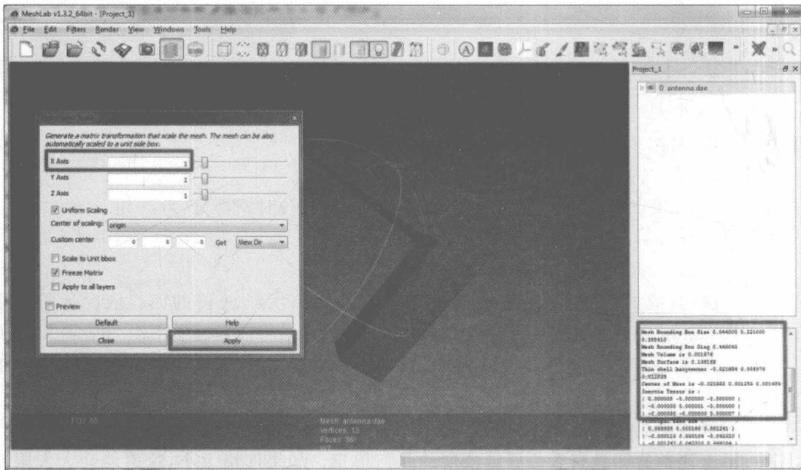

图 4-22 模型缩放比例的设置
{: .figure-caption }


对于如何选择缩放因子 s, MeshLab 使用体积替代质量, 其将作为 $s^{3}$ 变化。此外, 惯性对长度的平方具有附加依赖性, 因此惯性矩将根据 $s^{5}$ 而改变。由于 s 存在这样大的依赖性的, 因此缩放 10 倍或 100 倍可能就足够了。

## (9) 获得质量中心。

MeshLab 使用的长度单位并不总是用户想要的(Gazebo 为米)。但是,通过查看 Mesh Bounding Box Size 条目,用户可以轻松地知道 MeshLab 单位与所需单位的比率。例如用户可以以所需单位计算边界框大小,并与 MeshLab 的大小进行比较。

用 Center of Mass 乘以计算的比率, 用户将拥有网格质心的坐标。然而, 如果用户建模的连杆不是均匀的, 用户将不得不使用其他方法(最可能通过真实的实验) 计算质心。

## (10) 重新调整转动惯量值。

就像质心位置必须缩放到正确的单位一样,转动惯量也应该按比例缩放,尽管缩放因子应该平方再考虑转动惯量的长度的平方的变化。此外,惯量应乘以测量值 mass,并除以文本输出的计算体积。

## (11) 在 URDF 或 SDF 中填写标签。

下一步是将计算值记录到包含机器人的 URDF 或 SDF 文件（假设用户已经具有机器人模型；如果没有，请按照前面部分内容制作模型）。

在每个连杆中,用户应该有<inertial>标签。它应该具有如下内容(在 SDF 中):

```txt
link name = 'antenna'
inertial>
pose > -0.022 0.0203 0.02917 0 0 0 /pose>
mass > 0.56 /mass>
inertia>
ixx > 0.004878 /ixx>
ixy > -6.2341e-07 /ixy>
ixz > -7.4538e-07 /ixz>
iyy > 0.00090164 /iyy>
iyz > -0.00014394 /iyz>
izz > 0.0042946 /izz>
/inertia>
/inertial>
collision name = 'antenna_collision'>
...
/collision>
visual name = 'antenna_visual'>
...
/visual>
...
/link>
```

或者(在 URDF 中):

```txt
link name = "antenna">
inertial >
```

```xml
origin rpy="0 0 0" xyz="-0.022 0.0203 0.02917"/>
mass value="0.56"/>
inertia ixx="0.004878" ixy="-6.2341e-07" ixz="-7.4538e-07" iyy="0.00090164" iyz="-0.00014394" izz="0.0042946"/>
/inertial>
visual>
...
/visual>
collision>
...
/collision>
/link>
```

其中，<mass>应以千克为单位输入，用户需通过实验或者规定它的值。<origin>或<pose>用于输入质量中心的位置（相对于连杆的起点，尤其是与可视的连杆或碰撞起点无关）。旋转元件可以定义与转动惯量轴不同的坐标系。如果用户已经通过实验找到质心，请填写此值，否则填写由MeshLab计算的正确缩放的值。

<inertia>标记包含用户在上一步中计算的惯性张量。由于矩阵是对称的，只有6个数字就足以表示它。从MeshLab的输出的映射如下：

```txt
| ixx ixy ixz |
| ixy iyy iyz |
| ixz iyz izz |
```

为了快速检查矩阵是否正确,可以使用对角线条目应具有最大的正值并,并且非对角线数字应该或多或少接近零。

确切地说，矩阵必须是正定的（使用用户最喜欢的数学工具来验证）。其对角项也必须满足三角不等式，即， $i_{xx} + i_{yy} \geqslant i_{zz}, i_{xx} + i_{zz} \geqslant i_{yy}$ 和 $i_{yy} + i_{zz} \geqslant i_{xx}$ 。

(12) 在 Gazebo 上检查。

要检查一切是否正确,用户可以使用 Gazebo 的 GUI 客户端。

单独使用 Gazebo 时, 运行 Gazebo, 生成用户的机器人

```batch
gz model -f my_robot.sdf
```

使用 Gazebo 和 ROS 时, 首先运行 Gazebo:

```txt
roslaunchGazebo_ros empty_world.launch
```

生成用户的机器人(使用户的机器人的包/名称替换 my\_robot, my\_robot\_description, MyRobot):

SDF 模型为:

```shell
rosrunGazebo_ros spawn_model - sdf - file 'rospack find my_robot_description'/urdf/my_robot.sdf - model MyRobot
```

URDF型号为：

```txt
rosrunGazebo_ros spawn_model - urdf - file 'rospack find my_robot_description'/urdf/my_robot.urdf - model MyRobot
```

当模型加载后,暂停场景并删除 ground\_plane(这不是必需的,但它通常使调试更容易)。转到 Gazebo 菜单并依次选择 View→Inertia。每个连杆目前应显示一个带绿色轴的紫色框。每个盒子的中心与其连杆的指定质心对齐。箱的尺寸和方向对应于具有相同惯性行为单位质量的箱这可以作为它们对应的链接。虽然这对于调试惯性参数很有用,但是我们还可以做一件事来使调试更容易。

用户可以临时将所有连杆设置为质量为 1.0（通过编辑 URDF 或 SDF 文件）。然后所有的紫色框应该或多或少在形状与其连杆的边框相同。这种方式，用户可以很容易地检测问题，如错放的质心或错误旋转的惯性矩阵。当用户完成调试时，不要忘记输入正确的质量。

要修正错误旋转的惯性矩阵(常见错误), 只需交换模型文件中的 ixx、iyy 和 izz 条目, 直到紫色框与其连杆对齐。然后用户显然也必须适当地交换 ixy、ixz 和 iyz 值(当用户交换 ixx↔iyy 时, 用户应该取消 ixy 和交换 ixz↔iyz)。

#### 进一步改进

## 1）简化模型

MeshLab 仅计算闭合形状的正确惯性参数。如果用户的连杆是开放的，或者它是一个非常复杂或凹陷的形状。在计算惯性参数之前简化模型可能是一个好选择（例如在 Blender）。或者，如果用户的模型具有碰撞形状，请使用它们代替全分辨率模型。

## 2）非均质体

对于非常不均匀体,本部分内容可能不工作,涉及两个问题。第一个是 MeshLab 假设均匀密度的身体。另一个是 MeshLab 计算相对于计算质心的惯性传感器。然而,对于非常不均匀体,计算的质心将远离真实质心,因此计算的惯性张量可能是错误的。

一个解决方案是将用户的连杆细分为更均匀的部分,并使用固定关节连接它们,但这并非永远可行。唯一的其他解决方案是通过实验找出惯性张量,这肯定需要大量的时间和精力。

我们已经展示了为机器人模型获得正确惯性参数的过程,如何将它们输入到 URDF 或 SDF 文件中的方法,以及如何确保正确输入参数的方法。

### 4.3.14 图层可见性

使用 Gazebo 6, 可以向仿真中的视觉元素添加元数据。本部分内容解释如何向可视化添加图层元数据, 以便用户可以通过图形界面控制哪些图层可见。

#### 在 SDF 上分配图层

目前,图层由数字标识。在用户的模型 SDF 文件中,在每个<visual>标记下,用户可以添加<meta>标记来记录元信息,然后为<layer>层号添加标记如下:

```txt
visual name = 'visual_0'>
meta>
layer > 0 /layer>
/meta>
...
/visual>
```

没有分配图层的视觉效果不能进行可见性切换，并且始终可见。

#### 可视化图层

一个场景示例分布在 Gazebo 中。用户可以加载此场景，输入以下命令：

```txt
Gazebo worlds/shapes_layers.world
```

用户可以通过 Layers 左侧面板上的标签切换每个图层的可见性。如果仿真中的图层没有可视物，图层标签页就是空。

## 4.4 Gazebo 中的模型编辑器

该部分描述如何使用模型编辑器构建和修改机器人。

### 4.4.1 模型编辑器

该部分内容与构建机器人部分的模型编辑器内容相同。故不赘述。

### 4.4.2 SVG 文件

本部分内容描述了得到 SVG 文件(即 2D 图像)的过程,以便为 Gazebo 中的模型创建 3D 网格。此过程类似于在 Inkscape 或 Illustrator 这样的程序中设计模型的一部分。并将向用户介绍如何在 Inkscape 中将自定义滚轮制作为 .svg,并将其导入 Gazebo,以便将其附加到机器上。

Gazebo 中有许多 SVG 编辑器。本部分内容将使用开源 Inkscape 程序，这是本部分内容中使用的轮子的 SVG 文件。

#### 文件准备

启动 Inkscape。这将创建一个空白文档。如图 4-23 所示，首先让我们更改文档大小，以便更好地适应轮子：在 File→Document properties menu 下，选择 Page 标签，将文档大小更改为自定义大小 $100.0 \times 100.0$ 毫米。

如图 4-24 所示为另一个文件属性设置对话框。在同一对话框中，选择 Grids 选项卡，按 New 按钮创建自定义网格。最后，检查 Enabled, Visible 和 Snap to visible grid lines only 选项。更改 Spacing X 和 Spacing Y 为 10。

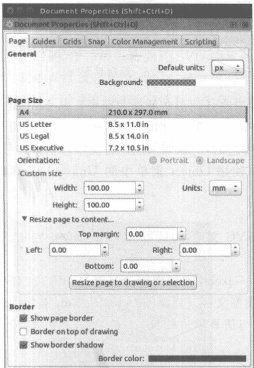

图 4-23 文件属性设置对话框一
{: .figure-caption }


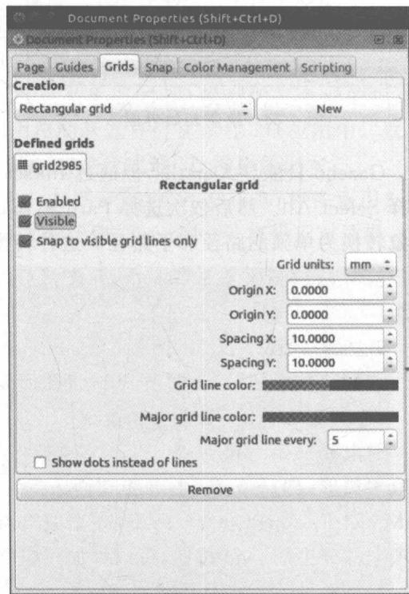

图 4-24 文件属性设置对话框二
{: .figure-caption }


上述操作完成后,如图 4-25 所示,用户应该得到一个绘制初始界面。

#### 绘制

用户可以使用不同的工具(例如笔、文本、星星和形状等)来创建几何体。在这个例子中,车轮是由圆形组成的(按下 Shift 键,用户可以从中心开始创建圆形,并使用 Ctrl 键允许保持形状的圆度)。用户可以将形状组合在一起,确保路径是封闭的,并且部件具有适当的厚度,绘制的效果如图 4-26 所示。

注意：一个棒形图或两个彼此接触的圆圈不会产生有效的Gazebo模型。SVG路径必须创建具有孔的封闭轮廓，其中孔不能接触轮廓或其他孔。孔内的孔被视为实心零件（也可以有孔）。

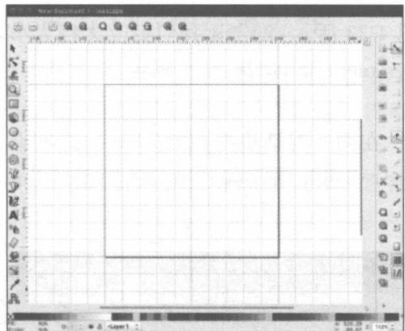

图 4-25 绘制初始界面
{: .figure-caption }


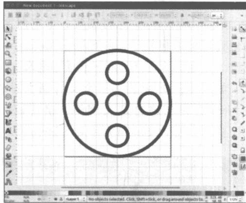

图4-26 绘制界面一
{: .figure-caption }


Gazebo 只能导入 paths, 但通过 Inkscape 很容易将任何形状转换为路径。从 Edit 菜单选择 Select All。然后依次选择 Path→Object to Path 菜单项。如图 4-27 所示, 这将把每个对象转换为单独的路径和子路径。这种转换是不可逆的, 所以如果用户将文本转换成路径, 用户将无法改变文本。Gazebo 不支持分组, 可以使用 Object 菜单中的 Ungroup 分离路径组。

#### 保存绘图

使用菜单中的 Save 选项 File, 将图形保存为 SVG 文件, 稍后可以在 Gazebo 中使用。

#### 创建 Gazebo 模型

SDF 格式不直接支持 SVG；它支持多线 2D。Gazebo 模型编辑器具有从 SVG 文件中提取多边形线的导入机制，并将它们保存为 SDF 模型文件。启动 Gazebo，从 Edit 菜单中选择 Model Editor 以进入 Gazebo 模型编辑器模式（与仿真模式相反）。如图 4-28 所示，按下选项卡部分中的 Add 按钮，可以添加相应的模型。

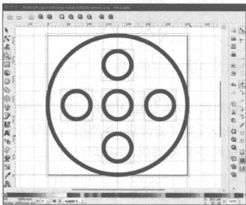

图 4-27 绘制初始界面二
{: .figure-caption }


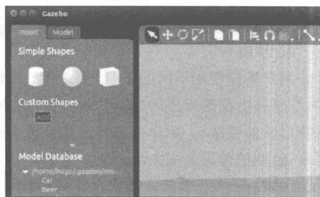

图4-28 模型的添加
{: .figure-caption }


Import Link 对话框如图 4-29 所示,从中用户可以通过按 Browse 按钮选择 SVG 文件。选择文件后,按 Import 按钮打开 Extrude Link 对话框。

该对话框允许用户设置模型的参数：

（1）厚度：连杆的粗细。这对应于 Z 轴中的模型高度。对于右侧所示的 SVG 路径，生成轴线从屏幕向外。

（2）分辨率：SVG 中像素点的个数是以米为单位来统计的。默认值(3543.3px/m)对应于 90dpi(每英寸点数)，这是多个编辑器(包括 Inkscape)的默认分辨率。当显示单位为米时，如果用户的模型在 Inkscape 中显示为用户所需的大小，则不应更改分辨率值。

（3）每个片段的样本：这表示 SVG 中的每个曲线路径将会有多少个片段。片段越多，用户的连杆就越复杂。它不会改变任何直线路径。

在右侧,用户可以看到从 SVG 提取的路径。红点是生成的 3D 模型的三角形的顶点。将车轮的厚度设置为 0.025m,然后按 OK 按钮。用户的新连杆应显示在 3D 视图中。这样就创建了一个新的连杆,它带有一个默认的碰撞形状,它是生成的 3D 网格的副本。

接下来,从 File 菜单中选择 Exit Model Editor。如图 4-30 所示,Gazebo 将注意用户将新模型保存到磁盘。按 Save and Exit 退出对话框上的按钮,Save Model 将出现对话框。

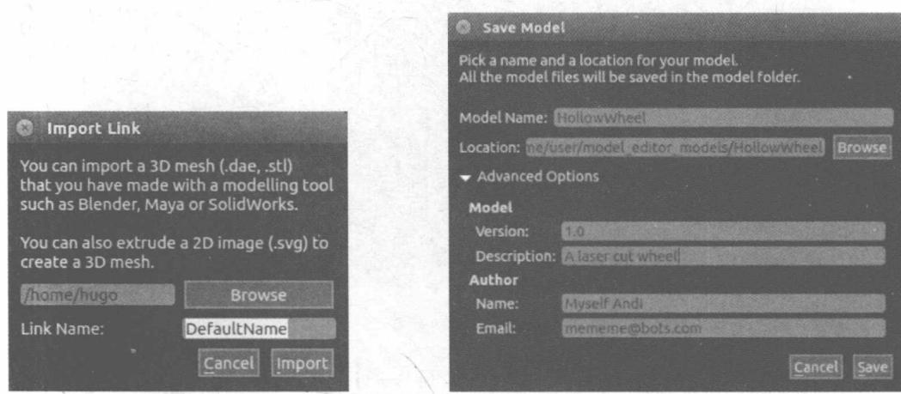

图4-29 Import Link对话框
{: .figure-caption }


图 4-30 “保存模型”对话框
{: .figure-caption }


将新模型的名称设置为“HollowWheel”，填写 Advanced Options 部分下的信息，并按 Save 按钮保存。

## 4.5 场景文件的创建

这部分内容描述如何创建一个可以仿真机器人的环境。

### 4.5.1 创建一个场景

接下来介绍创建包含静态和动态对象的场景的过程。

#### 术语

场景(world): 用于描述机器人和物体(如建筑物、桌子和灯光)的集合以及包括天空、环境光和物理属性的全局参数的术语。

静态：标记为静态的实体(<static>true</static>在 SDF 中具有元素的实体)是仅具有碰撞几何的对象。所有不打算移动的对象应该标记为静态，这是一种增强性能的方法。

动态：标记为动态的实体(在 SDF 中缺少<static>元素或<static>设置为 false)是具有惯性和碰撞几何结构的物体。

#### 添加对象

启动 Gazebo 时, 用户应该看到一个只有地板的场景。Gazebo 提供了两种将对象添加到 Gazebo 的机制。第一种是位于渲染窗口上方的一组简单形状, 如图 4-31 所示。

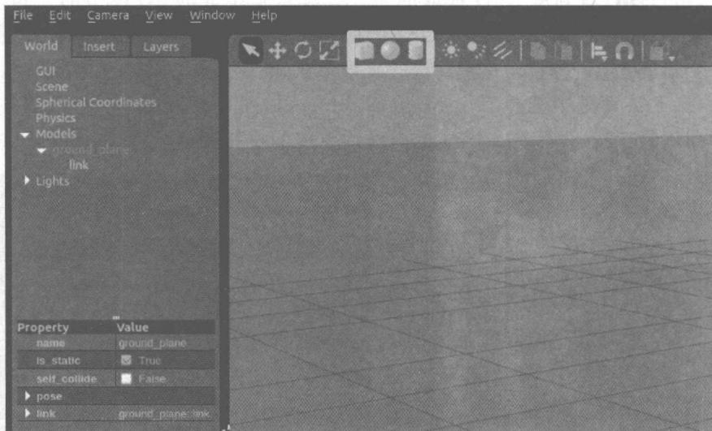

图 4-31 添加对象窗口一
{: .figure-caption }


第二种是通过模型数据库,如图 4-32 所示,可以通过选择左上角的 Insert 选项卡访问。

#### 添加简单形状

通过单击渲染窗口上方的相应图标,可以将立方体、球体和圆柱体添加到场景中。每个形状的单位大小如下:

\- 立方体： $1\mathrm{m}\times 1\mathrm{m}\times 1\mathrm{m}$

\- 球体：直径 $1\mathrm{m}$

\- 圆柱：直径 $1\mathrm{m}$ ，长 $1\mathrm{m}$

选择立方体图标,然后将鼠标移动到渲染窗口。用户将看到一个随鼠标移动的立方体。当用户对立方体的位置感到满意时,单击鼠标左键。

对球体和圆柱体重复相同的步骤。操作完成后，如图 4-33 所示，用户应该建立出一个类似这样的场景。

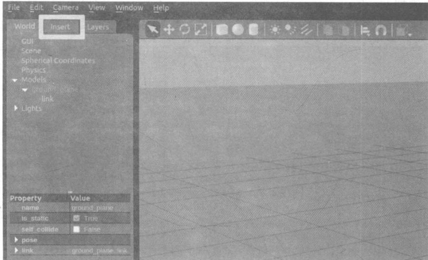

图 4-32 添加对象窗口二
{: .figure-caption }


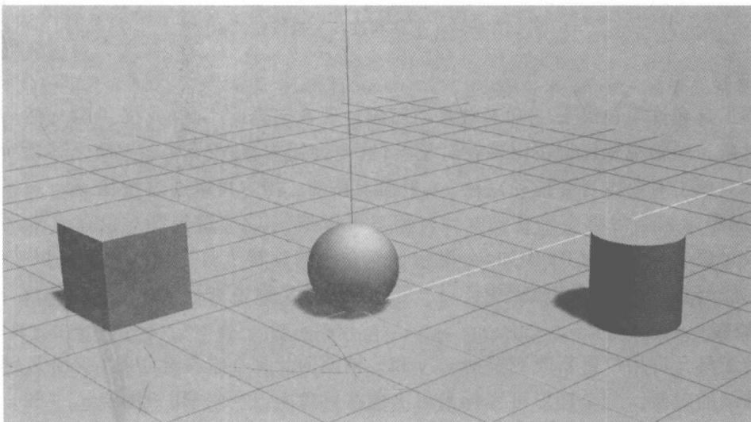

图4-33 添加了简单形状的场景
{: .figure-caption }


#### 从模型数据库添加模型

Gazebo 的模型数据库是所有类型模型的存储库,包括机器人、表格和建筑物。

(1) 选择左上角的 Insert 选项卡以访问模型数据库。

模型列表根据其当前位置分为几个部分。每个部分都标记有路径或 URI。选择位于远程服务器上的对象将会自动下载模型并存储到～/. gazebo/models。

(2) 尝试添加各种模型到场景。下载模型时要有耐心, 因为有些可能体积很大。

#### 位置模型

如图 4-34 所示, 可以通过平移和旋转工具改变每个模型的姿势。

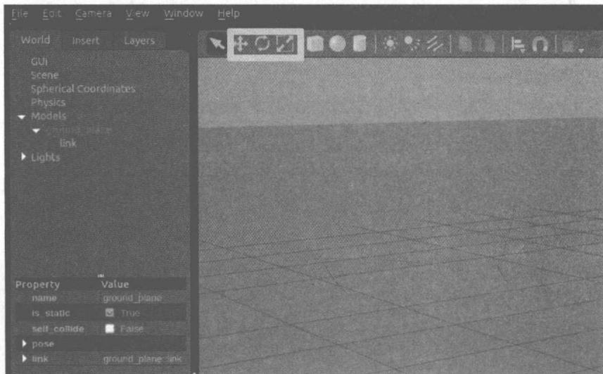

图 4-34 平移和旋转工具按钮
{: .figure-caption }


#### 平移

平移工具允许用户沿 x、y 和 z 轴移动对象。现在选择此工具(或按 T 键)，然后单击要移动的对象。三轴视觉标记将出现在对象上，这允许用户在 x、y 和 z 方向上移动对象。用户也可以只单击对象本身并拖动它在 xy 平面上移动。用户可以通过按住 x、y 或 z 键的同时，拖动对象来控制沿哪个轴移动物体。用户可以按住 Ctrl 键控制对象在 1 米网格上移动。如果对象未与场景对齐(例如，在使用下面介绍的旋转工具之后)，用户可以按住 Shift 键，使视觉标记显示与场景对齐，并且用户可以在场景坐标中进行平移。

#### 旋转

旋转工具允许用户重新改变模型 x、y 和 z 轴朝向。现在选择此工具（或按 R 键），然后单击要移动的对象。三个环形可视标记将出现在对象上，这允许用户围绕 x、y 和 z 轴旋转对象。用户也可以直接单击对象本身并按住 x、y 或 z 键，同时拖动它从而限制它在这些轴中的一个上移动。用户也可以按住 Ctrl 键以 45 度增量移动。如果对象未与场景对齐，则可以按住 Shift 键，以使可视标记显示与场景对齐，并且对象可以围绕场景轴旋转。

#### 缩放

缩放工具允许用户在 x、y 和 z 方向调整模型的大小。目前，缩放工具仅适用于简单的形状，即立方体、圆柱形和球形。选择此工具（或按 S 键），然后单击一个简单的形状。三轴视觉标记将出现在对象上，这允许用户缩放对象的 x、y 和 z 维度。用户也可以直接单击对象本身并按住 x、y 或 z 键，同时拖动它从而将缩放限制在这些轴中的一个。用户还可以按住 Ctrl 键以 1 米为增量缩放。

#### 删除模型

可以通过选择模型并单击 Delete 键,或通过右键单击模型并选择 Delete 来删除模型。请尝试删除几个模型。

#### 保存场景

一旦用户对一个场景很满意,它可以通过 File 菜单保存。选择 File 菜单,然后选择 Save World As,将出现一个弹出窗口,要求用户输入新的文件名。输入 my\_world.sdf 并单击 OK 按钮。

#### 载入场景

可以在命令行中加载保存的场景,输入以下命令:

gazebomy\_world.sdf

文件名必须位于当前工作目录中,或者必须指定完整路径。

### 4.5.2 修改场景

本部分内容介绍如何修改全局属性,包括场景和物理属性。

#### 场景属性

打开 Gazebo, 在 World 选项卡中, 选择 scene 项目, 如图 4-35 所示。场景属性列表将显示在下面的列表框中。单击三角形以展开属性。这些属性允许用户更改环境光。注意: 如果启用天空 (Sky), 背景颜色不会改变。

#### 物理属性

在 World 选项卡中,选择 physics 项目。物理属性列表将显示在下面的列表框中。

enable physics 复选框,可以用来禁用物理引擎同时允许插件和传感器继续运行。

real time update rate 参数以 Hz 为单位指定每秒尝试的物理更新数。如果此数字设置为零，它将尽可能快运行。注意，real time update rate 和的 max step size 乘积表示目标 real time factor，或仿真时间与实时的比率。

max step size 指定了在每个物理更新步骤的持续时间。

在重力板块：x, y 和 z 参数以 m/s^2 设置全局重力矢量分量。

在求解器板块中：

(1) iterations 参数指定用于迭代 LCP 求解器(由 ODE 和项目符号使用)的迭代次数。

(2) SOR 参数代表连续的过松弛, 可以用于尝试加速迭代方法的收敛。

约束块包含与求解约束相关的几个参数：CFM 与 ERP 参数分别代表约束力混合和减少错误参数，它们被 ODE 和 bullet 使用。CFM 和 ERP 参数可以与线性刚度和阻尼系数相关。max velocity 和 surface layer 参数被用来解决分流脉冲法的接触。任何穿透深度超过由 surface layer 指定的深度并具有小于 max velocity 的法向速度的接触将不会弹回。

在 SDF 的物理文件可以看到对这些参数的说明。

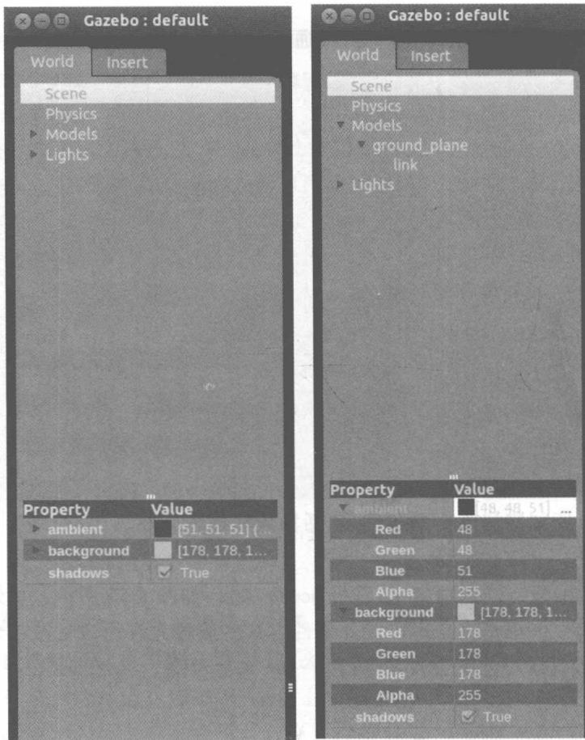

图 4-35 属性设置对话框
{: .figure-caption }


### 4.5.3 如何在Gazebo中使用DEM

数字高程模型(DEM)是地形表面的3D表示,不包括任何对象,如建筑物或植被。DEM通常结合传感器来创建,诸如LIDAR、雷达或照相机。对地面位置的地形海拔以规则的水平间隔进行采样。DEM仅仅是通用面值,而不是特定格式。事实上,DEM可以表示为海拔网格(光栅)或基于矢量的三角形不规则网络(TIN)。目前,Gazebo仅支持GDAL中支持的格式的栅格数据。

在 Gazebo 中支持 DEM 的主要动机是能够仿真逼真的地形。对于救援或农业应用方面感兴趣的用户可以使用与真实场景匹配的仿真地形来测试其机器人行为。

#### 令 Gazebo 支持 DEM

为了使用 DEM 文件, 用户应该安装 GDAL 库, 输入以下命令:

#### DEM 文件和定义转换为 SDF 格式

有几个组织提供海拔数据。例如，让我们下载在20世纪80年代圣海伦山的火山喷发之前或之后的DEM文件。这些文件用于公共领域，由USGS分发。

解压缩文件并将其重命名mtsthelens.dem，修改内容如下：

```batch
cd ~/Downloads
wget https://bitbucket.org/osrf/gazebo_tutorials/raw/default/dem/files/mtsthelens_before.zip
unzip ~/Downloads/mtsthelens_before.zip -d /tmp
mv /tmp/30.1.1.1282760.dem /tmp/mtsthelens.dem
```

通常, DEM 文件具有大分辨率, Gazebo 无法处理它, 因此调整 DEM 的分辨率是个好办法。下一个命令将地形缩放到 $129 \times 129$ , 并将它复制到 Gazebo media/dem/目录中, 输入以下命令:

```batch
mkdir -p /tmp/media/dem/
gdalwarp -ts 129 129 /tmp/mtsthelens.dem /tmp/media/dem/mtsthelens_129.dem
```

Gazebo 中的 DEM 文件以与加载高度图图像相同的方式加载。Gazebo 自动检测文件是普通图片还是 DEM 文件。创建文件 volcano.world 并复制以下的内容。将文件保存到用户想要保存的任何位置，例如 /tmp。

```xml
<?xml version="1.0"?>
sdf version="1.4">
world name="default">
! -- A global light source -->
include>
uri>model://sun /uri>
/include>
model name="heightmap">
static>true /static>
link name="link">
collision name="collision">
geometry>
heightmap>
uri>file://media/dem/mtsthelens_129.dem /uri>
size>150 150 50 /size>
pos>0 0 0 /pos>
/heightmap>
/geometry>
/collision>
```

```xml
visual name="visual_abcedf">
geometry>
heightmap>
texture>
diffuse>file://media/materials/textures/dirt_diffusespecular.png /diffuse>
normal>file://media/materials/textures/flat_normal.png /normal>
size>1 /size>
/texture>
texture>
diffuse>file://media/materials/textures/grass_diffusespecular.png /diffuse>
normal>file://media/materials/textures/flat_normal.png /normal>
size>1 /size>
/texture>
texture>
diffuse>file://media/materials/textures/fungus_diffusespecular.png /diffuse>
normal>file://media/materials/textures/flat_normal.png /normal>
size>1 /size>
/texture>
blend>
min_height>2 /min_height>
fade_dist>5 /fade_dist>
/blend>
blend>
min_height>4 /min_height>
fade_dist>5 /fade_dist>
/blend>
uri>file://media/dem/mtsthelens_129.dem /uri>
size>150 150 50 /size>
pos>0 0 0 /pos>
/heightmap>
/geometry>
/visual>

/link>
/model>

/world>
/sdf>
```

上面代码中的<heightmap><size>元素告诉Gazebo是否加载具有原始维度(当<size>不存在时)或缩放(当<size>存在时)的DEM。如果用户喜欢缩放DEM,<size>元素告诉Gazebo在仿真中以米为单位的地形的大小。如果要保持正确的宽高比,请务必正确计算宽度、高度和海拔(这是<size>中的第3个数字)。在示例中,DEM将缩放为150×150m的正方形,最大海拔为50m。

启动 Gazebo 并打开包含用户的 DEM 文件的场景, 用户应该看到火山。在示例中, 该文件位于 / tmp 目录中。

```shell
# Be sure of sourcing gazebo setup.sh in your own installation path
$ source /usr/share/gazebo/setup.sh
$ GAZEBO_RESOURCE_PATH = "$ GAZEBO_RESOURCE_PATH:/tmp" gazebo /tmp/volcano.world
```

#### 获得所需要区域的 DEM 文件

接下来将描述一种用于获得特定感兴趣区域的 DEM 文件的方法。

全球土地覆盖设施维护着地球的高分辨率数字地形数据库。转到其搜索和预览工具，用户会看到类似下面的图像。每个地形补丁都有一个唯一的路径和行，用户应该在使用该工具之前知道。我们将使用 QGIS 来发现感兴趣区域的路径/行。

QGIS 是一个跨平台的开源地理信息系统程序，提供数据查看、编辑和分析功能。按照 QGIS 网站上详细说明下载 QGIS。打开 QGIS，单击左栏图标标注 WMS/WMTS layer，单击 Add default servers，选择 Lizardtech server，然后，按下 connect 按钮。选择 MODIS 值并按下 Add 按钮。关闭弹出窗口。下一步是添加具有所有不同补丁的另一个层。下载此 shapefile，并在任意文件夹中解压缩。回到 QGIS 并按 Add Vector Layer（左栏图标）。按 Browse，然后选择以前未压缩的 wrs2 descending.shp 文件。在打开的窗口中按 Open。现在，用户将在主窗口中看到两个图层。改变 wrs2 降序层的透明度，以便能够同时看到两个图层。双击 wrs2\_descending 图层，然后将其透明度值修改为大约 85%。

使用滚动和左按钮导航到用户感兴趣的区域,然后单击顶部栏上标记的 Identify Features 图标。单击用户感兴趣的区域,该区域周围的所有地形块将突出显示。新的弹出窗口将显示每个突出显示的补丁的路径/行值。在下面的图片中,用户可以看到包含拉斯帕尔马斯的 DEM 修补程序的路径和行,这是西班牙加那利群岛的天堂之一。

使用 GLCF 搜索工具返回到浏览器，并在标记为 Start Path 和 Start Row 的列中写入路径/行值。然后单击 Submit Query；按 Preview and Download 查看用户的结果。选择用户的地形文件，然后按 Download。最后，选择扩展名为.gz 的文件，并在用户喜欢的文件夹中解压缩。全球土地覆盖设施文件是 GeoTiff 格式，是最常见的可用 DEM 文件格式之一。

#### 准备 DEM 数据以在 Gazebo 中使用

DEM 数据通常以非常高的分辨率创建。在 Gazebo 中使用它之前, 使用 gdalwarp 命令将地形分辨率降低到更适合管理的大小, 输入以下命令:

```txt
$ gdalwarp - ts width> height> srcDEM> targetDEM>
```

DEM 数据通常包含“holes”或“void”区域。这些部分对应于在创建 DEM 时无法收集数据的区域。在数据为“hole”的情况下，将为该孔分配该 DEM 中使用的数据类型的最小或最大值。

始终尝试下载已完成的 DEM 数据集的“完成”版本, 这其中“孔”已经被填充。如果用

户的 DEM 地形包含孔(也称为 NODATA 值),请尝试使用 gdal 工具手动修复它,例如

```txt
gdal_fillnodata.py
```

#### 在Gazebo中使用多个DEM

虽然Gazebo不直接支持多个DEM，但GDAL有一套用于将一组DEM合并成一个DEM的实用程序。第一步是下载要合并的DEM集合。注意，补丁甚至可以彼此重叠；GDAL将无缝地合并它们。假设当前目录包含一组可以合并的Geotiff文件，输入以下命令：

```txt
$ gdal_merge.py *.tif - o dem_merged.tif
```

现在，在场景文件中，你只能使用 dem\_merged.tif 场景，Gazebo 将加载地形与所有的补丁合并。如图 4-36 所示，用户可以看到合并加那利群岛周围四个地形补丁的结果。

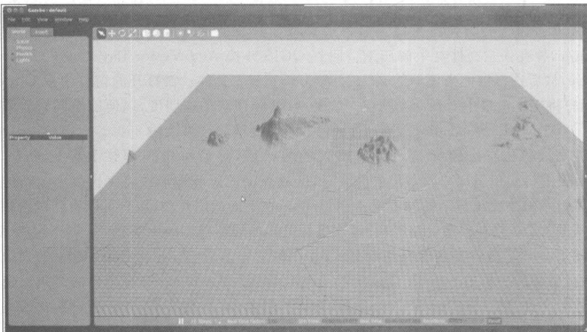

图 4-36 Gazebo 加载得到的地形
{: .figure-caption }


### 4.5.4 模型群

本部分内容演示了如何使用 SDF < population > 标记创建模型群。模型总体由相同模型的集合组成。添加模型总体是指定以下参数的问题：

① 模型(例如：table, coke\_can)。

② 作为总体一部分的对象数。

③ 其中将布置对象的容器的形状和尺寸(例如 box, cylinder)。

④ 群体容器的位置和方向。

```txt
⑤ 容器内对象的分布(例如：random, grid)。
```

作为参考,请检查 SDF 规范中<population>标记及其参数的完整规范。

#### 创建对象群

## 1）快速开始

（1）从为本部分内容创建一个目录开始，输入以下命令：

```txt
mkdir ~/tutorial_model_population
cd ~/tutorial_model_population
```

(2) 下载此文件：can\_population.world 进入当前目录。输入以下命令：

```txt
wget http://bitbucket.org/osrf/gazebo_tutorials/raw/default/model_population/files/canpopulation.world
```

用户应该得到这个场景文件,它的内容为:

```txt
<?xml version="1.0" ?>
sdf version="1.5">
world name="default">

! -- A global light source -->
include>
uri>model://sun /uri>
/include>

! -- A ground plane -->
include>
uri>model://ground_plane /uri>
/include>

! -- Testing the automatic population of objects -->
population name="can_population1">
model name="can1">
include>
static>true /static>
uri>model://coke_can /uri>
/include>
/model>
pose>0 0 0 0 0 0 /pose>
box>
size>2 2 0.01 /size>
/box>
model_count>10 /model_count>
distribution>
```

```txt
type>random /type>
/distribution>
/population>
/world>
/sdf>
```

(3) 打开 Gazebo, 输入以下命令:

```txt
gazebocan_population.world
```

用户应该看到一个苏打罐的模型群围绕场景的起点随机场景分布。罐被布置在尺寸为 $2\times2\times0.01$ 米的箱式容器中。

## 2）场景解释

进一步了解 can\_population.world 的不同元素,它的部分内容如下:

```txt
population name="can_population1">
    model name="can1">
    include>
    static>true /static>
    uri>model://coke_can /uri>
    /include>
    /model>
```

在这个片段中,可以看到如何通过使用<population>标签来指定一个总体元素。每个群体应该有一个唯一的名称,这是由 name 属性指定的。在 population 标记中,用户可以看到如何使用<model>标记来选择模型。群体的每个元素在仿真中将具有唯一名称地插入仿真,该唯一名称将通过以后缀\_clone\_i 附加到模型名称来创建,其中 i 是群体的第 i 个元素。如图 4-37 所示,用户可以看到在 Gazebo 场景中产生的模型列表。

最常见的群体类型包括无生命物体,如树木、岩石和建筑物。建议用户将<population>标记用于静态模型,并排除移动实体(例如机器人),这些移动实体通常需要更精确的展示位置,数量较少。

```txt
pose>0 0 0 0 0 0 /pose>
box>
size>2 2 0.01 /size>
/box>
```

上面的代码块指定了对象将被放置的区域。在这种情况下，所有对象都在具有 $2 \times 2 \times 0.01\mathrm{m}$ 以(0,0,0)为中心，具有朝向(0,0,0)的边的3D边界框内产生。作为<box>的替代，通过指定其半径和长度的< cylinder>区域也是允许的。（检查SDF规范以查看< cylinder >的参数的完整描述。)< pose>元素设置总体区域的参考框架。

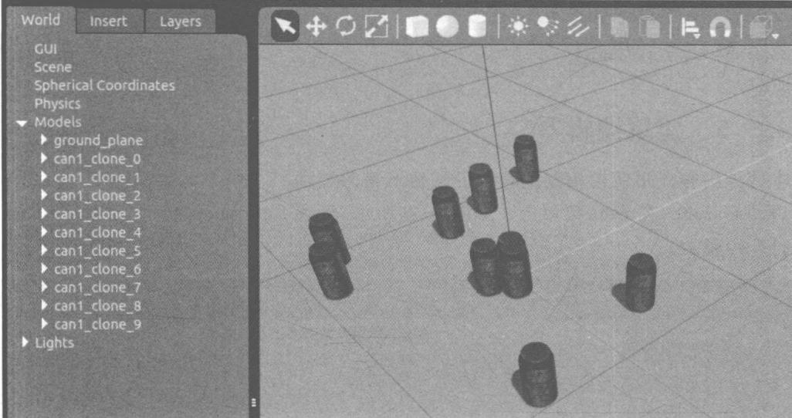

图 4-37 Gazebo 场景中产生的模型列表
{: .figure-caption }


```txt
model_count > 10 / model_count >
```

上面用户可以看到入口中的模型数量是如何确定的。任何正数都是允许的，但需考虑数字越高，性能可能受到的影响就越大。

```xml
distribution>
type>random /type>
/distribution>
```

<distribution>元素设置对象是如何放置的区域内。

## 3）分布类型

random: 随机放置的模型。请注意,对象可能会彼此冲突。

uniform: 模型放置在伪 2D 网格模式。使用 K-Means 近似解决方案，并找到区域内指定对象的数量。

grid: 模型均匀放置在 2D 网格图案中。此分布还需要指定行数，列数和每个元素之间的距离。请注意，元素 <model\_count> 在此分布中将被忽略。插入到仿真中的对象数量将等于行数乘以列数。

linear-x: 模型沿着全局 x 轴均匀放置为一行。

linear-y: 模型沿着全局 y 轴均匀放置在一行。

linear-z: 模型沿着全局 z 轴均匀放置在一行。

对于更高级的示例,用户可以检查使用 Gazebo 部署的 population.world 场景文件。

当然,用户可以进行测试,输入以下命令:

gazebo worlds/population.world

### 4.5.5 建筑编辑器

本部分内容介绍使用构建编辑器创建建筑物的过程。

启动 Gazebo, 在 Edit 菜单上。如图 4-38 所示, 转到 Building Editor 或单击 Ctrl+B 组合键打开编辑器。

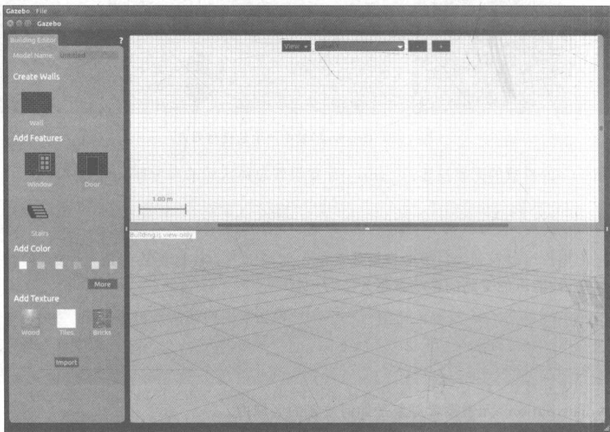

图 4-38 建筑编辑器的编辑界面
{: .figure-caption }


接下来进入图形用户界面。如图 4-39 所示, 编辑器由以下 3 个方面组成:

(1) 调色板, 在这里用户可以选择建筑的特征和材料。

(2) 在 2D 视图中, 用户可以导入平面图以跟踪(可选), 并插入墙壁、窗户、门和楼梯。

（3）在 3D 视图中，用户可以看到用户的建筑的预览。用户可以在这里给用户的建筑物的不同部分分配颜色和纹理。

#### 导入平面图

用户可以从头开始创建场景,也可以使用现有图像作为模板进行跟踪。例如,该图像可以是建筑物的 2D 激光扫描。

如图 4-40 所示, 单击这里获得平面图示例, 然后执行如下操作:

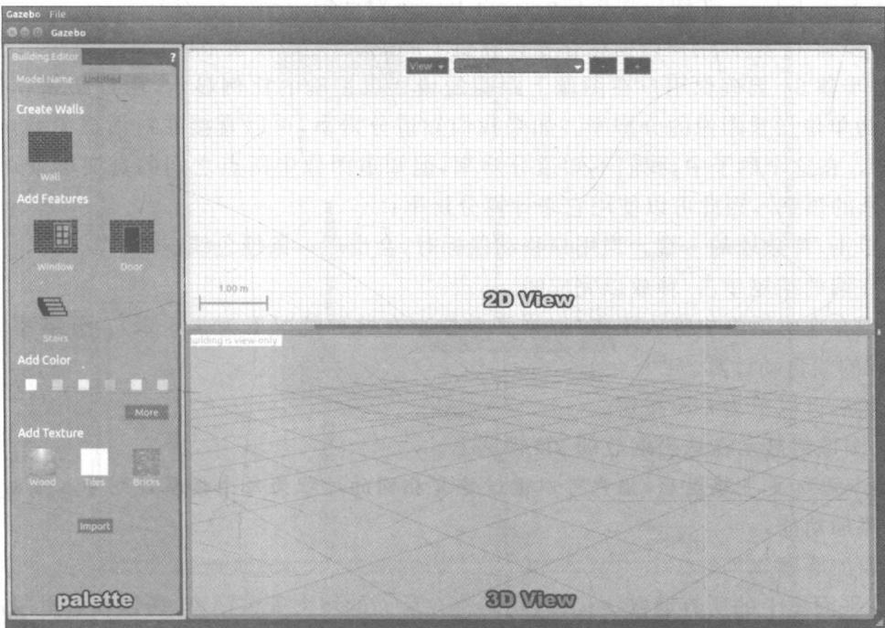

图 4-39 图形用户界面编辑器
{: .figure-caption }


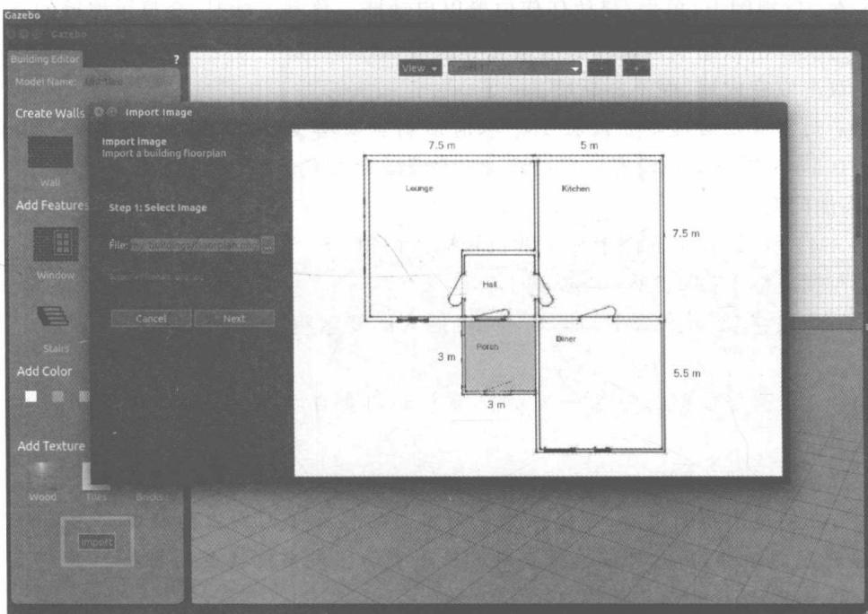

图4-40 导入平面图
{: .figure-caption }


（1）单击 Import 按钮。将出现 Import Image 对话框。

(2) 步骤 1: 选择用户以前保存在计算机上的图像, 然后单击 Next。

（3）步骤2：要确保用户在图像上跟踪的墙壁以正确的比例显示，用户必须以每像素 $(\mathrm{px} / \mathrm{m})$ 为单位设置图像的分辨率。如果我们知道分辨率，可以直接在对话框中键入，然后单击OK。在这个例子中，我们不知道分辨率，但知道图像中两点之间的真实场景距离（例如，7.5米的顶壁），因此可以使用它来计算分辨率：

① 单击/释放墙的一端。当用户移动鼠标时，会出现一条橙色线。

② 在墙的结尾单击/释放以完成线。

③ 现在在对话框中键入距离(以米为单位)(在这种情况下为7.5米)。分辨率将根据用户绘制的线自动计算。

④ 然后可以单击 OK 按钮。

（4）图像将显示在适当缩放的 2D 视图上。

注意：添加更多楼层后，用户可以通过重复相同的过程为每个楼层计划导入平面图。

#### 添加功能

## 1）添加墙壁

跟踪平面图上的所有墙壁。记住，我们将在后面的墙上安装门窗，所以在这里用户可以在他们的墙上画。不要担心太多，如果墙壁不完美，可以在以后编辑它们。

(1) 在调色板上, 单击 Wall。

(2) 在 2D 视图上, 单击/释放任何位置以启动墙。移动鼠标时, 会显示墙壁的长度。

（3）再次单击以结束当前墙并启动相邻的墙。

(4) 双击以完成墙,而不画新墙。

注意：用户可以右键单击或按 Esc 取消绘制当前墙壁段；默认情况下，墙壁 snap（捕捉） $15^{\circ}$ 和 0.25m 的增量和现有墙壁的终点；要覆盖此功能，请在绘图时按住 Shift。

## 2）添加门窗

如图 4-41 所示, 在平面图上显示的位置插入门窗。

(1) 在调色板上, 单击 Window 或 Door。

（2）当用户在 2D 视图中移动鼠标时，要插入的要素将随之移动，与 3D 视图中的对应物一样。

注意：当用户将鼠标悬停在窗户上时，窗口和门会自动捕捉到墙壁。移动时显示墙壁两端的距离。

（3）单击所需的位置以放置要素。

注意：在墙壁上绘制墙后，可能很难看到用户的楼面平面图上的特征。为了使它更容易，在2D视图的顶部，用户可以选择查看或隐藏平面图或当前楼层的特征。用户还可以使用热键切换可见性，F表示平面图，G表示特征。

## 3）添加楼梯

如图 4-42 所示, 在这个平面图上没有楼梯, 但我们将插入一个。

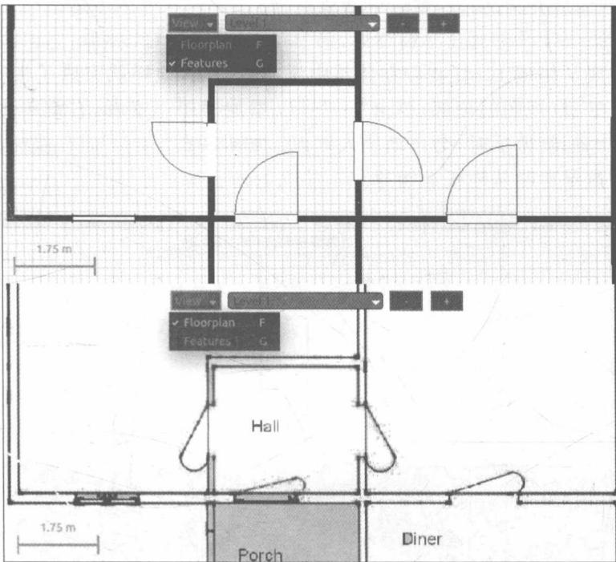

图 4-41 添加门窗后的地图
{: .figure-caption }


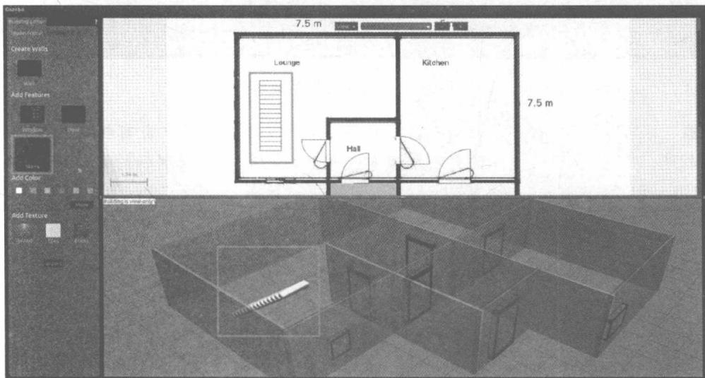

图4-42 添加了楼梯的地图
{: .figure-caption }


(1) 在调色板上, 单击 Stairs。

（2）当用户在 2D 视图中移动鼠标时，要插入的楼梯将随之移动，与 3D 视图中的对应物一样。

(3) 选择用户的楼梯的位置,然后单击放置它。

## 4）添加楼层

我们已经完成了楼层1。让我们在建筑中添加另一层，这样就完成了楼梯模型的搭建。如图4-43所示，在2D视图的顶部，单击“+”号以添加楼层。或者，右键单击2D视图并选择Add a level。添加新楼层时，会自动插入地板。如果在楼层的下面有楼梯，楼梯上方的一个洞将在建筑物被保存时从地板上切掉。

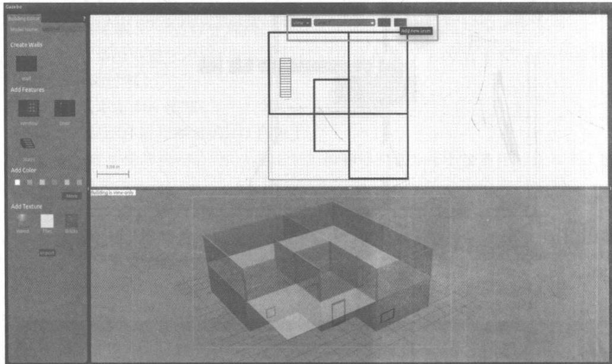

图4-43 添加了楼层的地图
{: .figure-caption }


注意：目前，所有楼层都是矩形；在添加楼层之前，请确保用户当前楼层上有墙，以便在其上创建；目前，下面的楼层的所有墙壁都使用默认材料被复制到新的楼层，不复制其他功能，用户可以手动删除不想要的墙。

#### 编辑用户的建筑物

注意：编辑建筑物时要小心；编辑器目前无法撤销用户的操作；所有测量均以米为单位。

## 1）更改楼层

由于我们添加了一个楼层，在2D视图中达到了新的水平面。用户可以通过从2D视图顶部的下拉列表中选择它来返回到楼层1。需要注意的是，在2D视图中当前选择的楼层将在3D视图中显示为半透明，并且其下方的所有楼层将显示为不透明。上面的楼层将被隐藏。需要记住的是，它们仍然是用户的建筑的一部分。

此外,也可以编辑一些楼层配置: 双击 2D 视图以打开具有楼层配置选项的检查器。或者,右键单击并选择 Open Level Inspector。

用户可能已经添加了用户不想要的楼层,或者可能觉得当前楼层混乱,并希望重新开始它。要删除当前楼层,请按2D视图顶部的-按钮,或右键单击并选择Delete Level。

## 2）编辑墙

在 2D 视图中, 单击要编辑的墙壁。

(1) 通过将墙面拖动到新位置来平移墙面。

(2) 通过拖动其中一个端点来调整墙的大小或旋转墙。

## 注意：

（1）默认情况下，墙壁以 $15^{\circ}$ 和 0.25m 为增量 snap。要覆盖此功能，请在绘图时按住 Shift。双击 2D 视图中的墙以打开具有配置选项的检查器。或者，右键单击并选择 Open Wall Inspector。编辑某些字段，然后按 Apply 以预览更改。

要删除墙，请在选中需要删除的墙时按 Delete 键，或右键单击 2D 视图中的墙并选择 Delete。

(2) 编辑墙会考虑附加的墙。

（3）删除墙会删除所有连接到它的门和窗户。

## 3）编辑门窗

正如在编辑墙壁时做的,我们可以以几种不同的方式更精确地操纵门窗。如图 4-44 所示,在 2D 视图中,单击要编辑的要素。

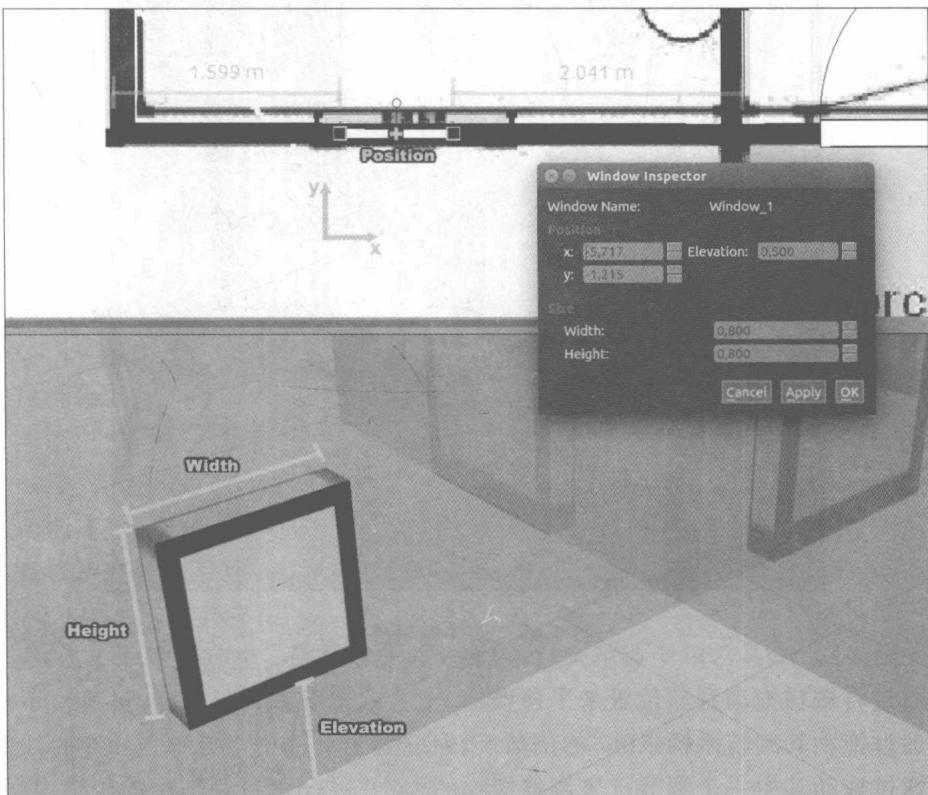

图 4-44 门窗编辑界面
{: .figure-caption }


（1）通过将要素拖动到新位置来平移它。记住，门和门自动地卡在墙上，把它们从任何墙上分离没有任何意义，因为它们代表在墙上的洞。

（2）通过拖动旋转手柄来旋转要素。目前，只要它们在墙上，它们的方向就没有什么区别。

（3）通过拖动其中一个端点来调整要素的宽度。双击2D视图中的要素以打开带有配置选项的检查器。或者，右键单击并选择Open Window/Door Inspector。要删除特征，在选中时按下Delete键，或在2D视图中右键单击它，然后选择Delete。

## 4）编辑楼梯

最后,编辑我们之前插入的楼梯。由于它不是在平面图上,我们可以根据所想有些创意和调整它的大小。如图 4-45 所示,在 2D 视图中,单击楼梯选择它。

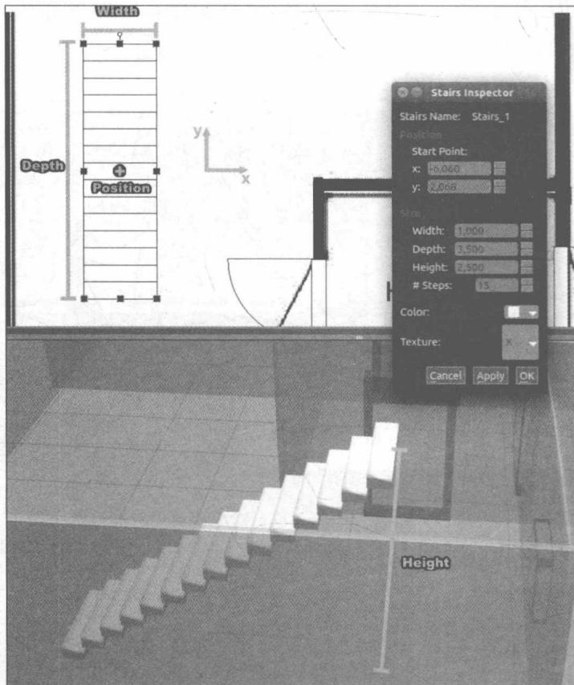

图 4-45 楼梯编辑界面
{: .figure-caption }


(1) 通过将楼梯拖动到新位置来平移楼梯。

(2) 通过拖动其旋转手柄以 $90^{\circ}$ 的倍数旋转楼梯。

（3）通过拖动其中一个端节点来调整楼梯的大小。双击2D视图中的楼梯，打开带有配置选项的检查器。或者，右键单击并选择Open Stairs Inspector。要删除楼梯，请在Delete选择时按键,或右键单击并选择 Delete。需要注意的是,在 2D 视图中,楼梯在开始和结束楼层都可见。

## 5）添加颜色和纹理

现在,一切都正确放置并具有大小,用户可以分配墙壁,地板和楼梯的颜色和纹理。记住,窗户和门只是墙上的洞,因此不能有材料。其中,默认颜色为白色,默认纹理为无。

## 6）通过检查器

如图 4-46 所示, 用户可以分别从 Wall Inspector、Stairs Inspector 和 Level Inspector 给墙壁、楼梯和地板添加颜色和质地。只需打开检查器, 选择用户的材料, 然后按 Apply。

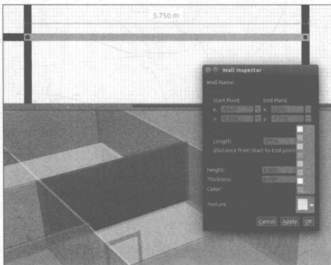

图 4-46 检查器设置对话框
{: .figure-caption }


## 7）通过调色板

可以从调色板中选择颜色和纹理,并通过在 3D 视图中单击它们将其分配给建筑物上的项目。

(1) 在调色板中单击颜色或纹理。

（2）当用户在 3D 视图中移动鼠标时，悬停选中的要素将高亮显示，显示所选材料的预览。

（3）单击高亮的特征会为其分配所选材料。用户可以根据需求任意选择特征。

（4）完成所选材质后，右键单击3D视图，或单击选中要素外的任何部位以离开材质模式。

Gazebo 5.1 中的新功能：要选择自定义颜色，在调色板上单击 More。如图 4-47 所示，将打开一个对话框，用户可在其中指定自定义颜色。

注意：每个地图项只能有一种颜色和一个纹理。将相同的材料分配给要素的所有面；目前，不能在建筑编辑器上分配自定义纹理。

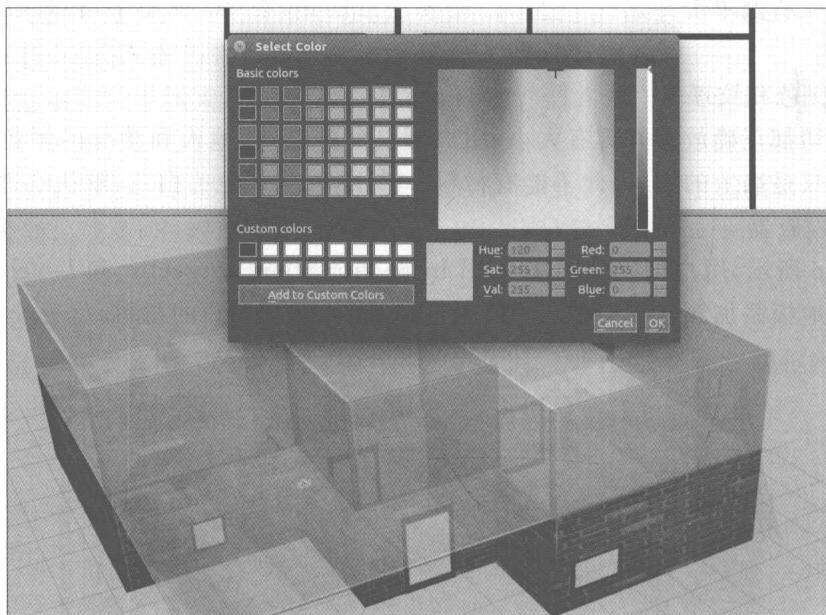

图4-47 调色板设置对话框
{: .figure-caption }


#### 保存用户的建筑物

保存将为用户的建筑物创建一个目录、SDF 和配置文件。如图 4-48 所示，保存之前，请在调色板上为用户的建筑命名。

在顶部菜单上,选择 File 菜单,然后单击 Save As 按钮(或按下 Ctrl+S 键)。如图 4-49 所示,将出现一个对话框,用户可以在其中选择模型的位置。需要注意的是,在 Advanced Options 选项下用户可以为用户的建筑设置一些元数据。

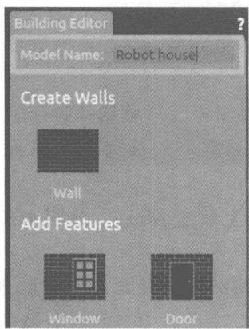

图4-48 建筑命名对话框
{: .figure-caption }


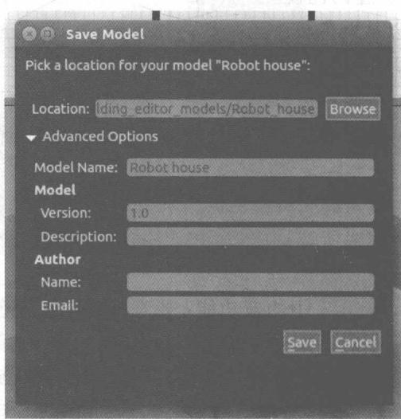

图4-49 保存模型对话框
{: .figure-caption }


#### 退出

当用户完成创建建筑物并保存之后，请转到 File 菜单，然后选择 Exit Building Editor 命令。需要注意的是，退出建筑编辑器后，用户的建筑物将不再可编辑。如图 4-50 所示，用户的建筑将显示在主窗口中。将来，用户可以在 Insert 标签中找到该建筑。

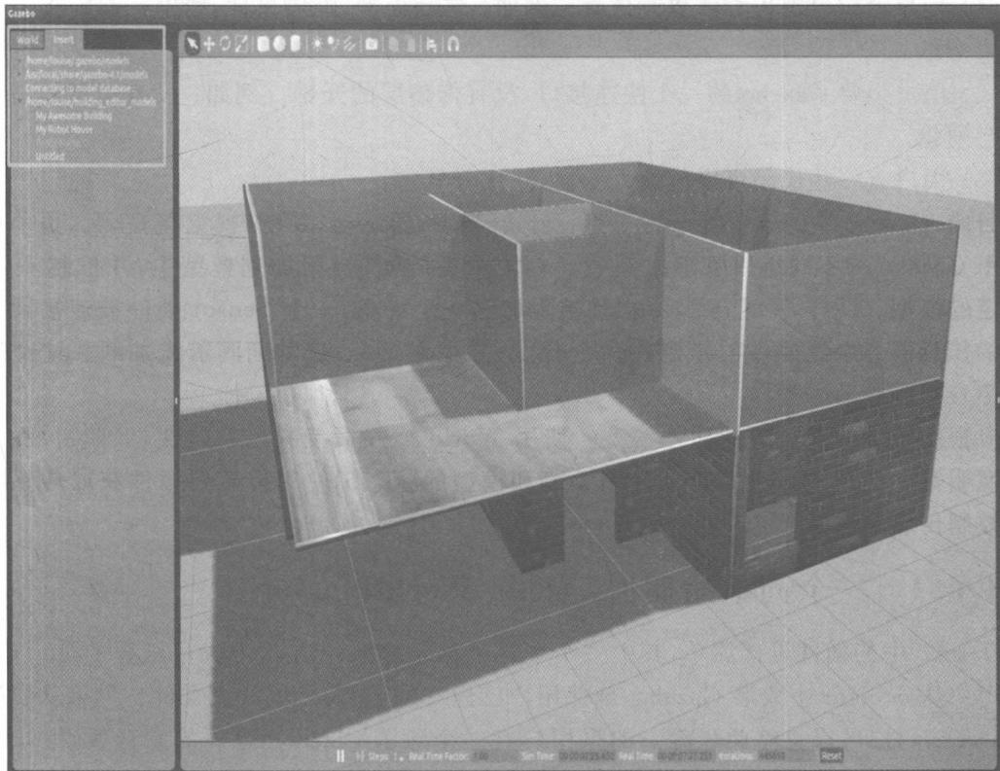

图 4-50 完成编辑后的建筑
{: .figure-caption }


## 4.6 插件的编写

插件允许用户控制模型,传感器,场景(world)属性,甚至Gazebo运行的方式。下面介绍如何为各种目的创建和加载插件。

插件是一段代码,它被编译为共享库,并插入到仿真中。插件可以通过标准的 C++ 类直接访问 Gazebo 的所有功能。

Gazebo 中的插件的功能有：

(1) 让开发人员几乎控制 Gazebo 的任何方面；

(2) 是易于共享的独立例程；

(3) 可以从正在运行的系统中插入和删除；

(4) 以前的 Gazebo 版本使用控制器。

它们表现方式与插件大致相同,但是被静态编译为 Gazebo。插件更加灵活,允许用户挑选和选择仿真中包含的功能。

Gazebo 中的插件的使用情景有：

（1）用户希望以编程方式更改仿真。例如：移动模型，响应事件，给定一组前提条件插入新模型。

（2）用户想要 Gazebo 的一个快速接口，没有传输层的开销。例如：没有消息的序列化和反序列化。

（3）用户有一些代码可以使他人受益，并想分享它。

目前，Gazebo 中的插件有 6 种类型：场景，模型，传感器，系统，视觉和 GUI。每个插件类型由 Gazebo 的不同组件管理。例如，一个 Model 插件被附加到模型中，并控制 Gazebo 中特定的模型。同样，一个 World 插件被附加到一个场景，一个 Sensor 插件被连接到一个特定的传感器。系统插件被指定在命令行上，并在 Gazebo 启动期间首先加载。这个插件使得用户控制启动过程。

应根据所需的功能选择插件类型。使用 World 插件来控制场景属性，例如物理引擎、环境照明等。使用 Model 插件来控制关节和模型的状态。使用传感器插件获取传感器信息并控制传感器属性。

### 4.6.1 一个简单的插件：Hello WorldPlugin!

Gazebo 中的插件设计简单,其中一个场景插件包含一个有几个成员函数的类。首先,如果用户从 debians 上安装 Gazebo,确保用户已经安装了 Gazebo 开发文件。如果从源端安装 Gazebo,用户可以忽略此步骤。如果用户有一个除了 gazebo6 之外的发行版,把 6 换成用户有的版本号,输入以下命令:

```txt
sudo apt-get install libgazebo6-dev
```

接下来,为新插件创建一个目录和一个.cc文件,输入以下内容:

```batch
mkdir ~/gazebo_plugin_tutorial
cd ~/gazebo_plugin_tutorial
gedit hello_world.cc
```

将以下内容复制到 hello\_world.cc 中, 输入以下内容:

```cpp
#include gazebo/gazebo.hh>
namespace gazebo
{
    class WorldPluginTutorial : public WorldPlugin
```

```cpp
{
    public: WorldPluginTutorial() : WorldPlugin()
    {
    printf("Hello World!\n");
    }

    public: void Load(physics::WorldPtr_world, sdf::ElementPtr_sdf)
    {
    }
};
GZ_REGISTER_WORLD_PLUGIN(WorldPluginTutorial)
```

上面的代码也位于 Gazebo 源码：examples/plugins/hello\_world/hello\_world.cc，以及一个合适的 CMakeLists.txt 文件。

要编译上面的插件,创建～/gazebo\_plugin\_tutorial/CMakeLists.txt,输入以下命令:

```batch
$ gedit ~/gazebo_plugin_tutorial/CMakeLists.txt
```

在 CMakeLists.txt 中复制以下内容：

```cmake
cmake_minimum_required(VERSION 2.8 FATAL_ERROR)
find_package(gazebo REQUIRED)
include_directories( ${GAZEBO_INCLUDE_DIRS})
link_directories( ${GAZEBO_LIBRARY_DIRS})
list(APPEND CMAKE_CXX_FLAGS " ${GAZEBO_CXX_FLAGS}")

add_library(hello_world SHARED hello_world.cc)
target_link_libraries(hello_world ${GAZEBO_LIBRARIES})
```

gazebo6 新增功能：现在，所有下游软件都需要使用 C++11 标志来编译 Gazebo。这是通过以下行来完成的：

```cmake
set(CMAKE_CXX_FLAGS " ${CMAKE_CXX_FLAGS} ${GAZEBO_CXX_FLAGS}")
```

创建构建目录,输入以下命令:

```txt
mkdir ~/gazebo_plugin_tutorial/build
cd ~/gazebo_plugin_tutorial/build
```

编译代码,输入以下命令:

```txt
$ cmake ../
$ make
```

编译将带来共享库，～/gazebo\_plugin\_tutorial/build/libhello\_world.so，它可以插入到Gazebo中。

最后,将库路径添加到 GAZEBO\_PLUGIN\_PATH,输入以下命令:

```shell
$ export GAZEBO_PLUGIN_PATH = ${GAZEBO_PLUGIN_PATH}:~/gazebo_plugin_tutorial/build
```

注意：这将更改当前 shell 的路径。如果用户想为用户打开的每一个新的 temrinal 使用用户的插件，将上面的行追加到～/.bashrc 文件中。

### 4.6.2 插件的使用

一旦用户有一个插件编译为共享库(见上文), 用户可以在 SDF 文件中将它附加到一个场景或模型(更多信息参见 SDF 文档)。在启动时, Gazebo 解析 SDF 文件, 定位插件, 并加载代码。重要的是 Gazebo 能够找到插件。指定插件的完整路径, 或者插件存在于 GAZEBO\_PLUGIN\_PATH 环境变量中的一个路径中。

创建一个场景文件，并将下面的代码复制到其中。示例场景文件也可以在 examples/plugins/hello\_world/hello.world 中找到。

```txt
$ gedit ~/gazebo_plugin_tutorial/hello.world
?xml version = "1.0"?>
sdf version = "1.4">
world name = "default">
plugin name = "hello_world" filename = "libhello_world.so"/>
/world>
/sdf>
```

现在用 gzserver 打开它, 输入以下命令:

```shell
$ gzserver ~/gazebo_plugin_tutorial/hello.world -- verbose
```

用户应该看到类似的输出：

```txt
Gazebo multi-robot simulator, version 6.1.0
Copyright (C) 2012-2015 Open Source Robotics Foundation.
Released under the Apache 2 License.
http://gazebosim.org

[Msg] Waiting for master.
```

```txt
[Msg] Connected to gazebo master @ http://127.0.0.1:11345
[Msg] Publicized address: 172.23.1.52
Hello World!
```

### 4.6.3 模型插件

#### 代码

插件允许完全访问模型及其基础元素(连杆,关节,碰撞对象)的物理属性。以下插件将线性速度应用到它的父模型,输入以下命令:

```txt
cd ~/gazebo_plugin_tutorial
gedit model_push.cc
```

插件代码为：

```cpp
#include boost/bind.hpp>
#include gazebo/gazebo.hh>
#include gazebo/physics/physics.hh>
#include gazebo/common/common.hh>
#include stdio.h>

namespace gazebo
{
    class ModelPush : public ModelPlugin
    {
    public: void Load(physics::ModelPtr_parent, sdf::ElementPtr / * _sdf */)
    {
    //Store the pointer to the model
    this->model = _parent;

    //Listen to the update event. This event is broadcast every
    //simulation iteration.
    this->updateConnection = event::Events::ConnectWorldUpdateBegin(
    boost::bind(&ModelPush::OnUpdate, this, _1));
    }

    //Called by the world update start event
    public: void OnUpdate(const common::UpdateInfo& /* _info */)
    {
    //Apply a small linear velocity to the model.
    this->model->SetLinearVel(math::Vector3(.03, 0, 0));
    }

    //Pointer to the model
```

```cpp
private: physics::ModelPtr model;
//Pointer to the update event connection
private: event::ConnectionPtrupdateConnection;
};
//Register this plugin with the simulator
GZ_REGISTER_MODEL_PLUGIN(ModelPush)
```

#### 编译插件

假设读者已经读过 Hello WorldPlugin 部分内容,那么现在所需做的是添加以下行到 $\sim$ /gazebo\_plugin\_tutorial/CMakeLists.txt 中,输入以下命令:

```cmake
add_library(model_push SHARED model_push.cc)
target_link_libraries(model_push ${GAZEBO_LIBRARIES} ${Boost_LIBRARIES})
```

编译此代码将得到一个共享库，～/gazebo\_plugin\_tutorial/build/libmodel\_push.so，它可以插入到Gazebo仿真中，输入以下命令：

```batch
cd ~/gazebo_plugin_tutorial/build
cmake ../
make
```

#### 运行插件

这个插件用在场景文件 examples/plugins/model\_push/model\_push.world 中, 它的内容为:

```txt
cd ~/gazebo_plugin_tutorial
geditmodel_push.world
?xml version="1.0"?>
sdf version="1.4">
world name="default">

!-- Ground Plane -->
include>
uri>model://ground_plane /uri>
/include>

include>
uri>model://sun /uri>
/include>

model name="box">
```

```xml
pose>0 0 0.5 0 0 0 /pose>
link name="link">
collision name="collision">
geometry>
box>
size>1 1 1 /size>
/box>
/geometry>
/collision>

visual name="visual">
geometry>
box>
size>1 1 1 /size>
/box>
/geometry>
/visual>
/link>

plugin name="model_push" filename="libmodel_push.so"/>
/model>
/world>
/sdf>
```

连接插件到模型的钩子(hook)由下列语句在模型元素块的结尾指定：

```txt
plugin name = "model_push" filename = "libmodel_push.so" />
```

将用户的库路径添加到 GAZEBO\_PLUGIN\_PATH, 输入以下命令:

```makefile
$ export GAZEBO_PLUGIN_PATH = $ HOME/gazebo_plugin_tutorial/build: $ GAZEBO_PLUGIN_PATH
```

要启动仿真,输入以下命令:

```batch
cd ~/gazebo_plugin_tutorial/
gzserver -u model_push.world
```

该-u选项可启动处于暂停状态的服务器。

在一个单独的终端,启动 gui,输入以下命令:

```txt
$ gzclient
```

单击 gui 中的 play 按钮启动仿真, 用户应该能看到立方体移动。

### 4.6.4 世界插件

#### 代码

源代码为：

```txt
gazebo / examples / plugins / factory
```

控制运行的仿真中有哪些模型以及何时插入它们可能是有用的。本部分内容演示如何将预定义和自定义模型插入到Gazebo中。

使用以前插件部分内容中的 gazebo\_plugin\_tutorial, 输入以下命令:

```txt
mkdir ~/gazebo_plugin_tutorial
cd ~/gazebo_plugin_tutorial
```

创建新的源文件,输入以下命令:

```txt
$ gedit factory.cc
```

将以下代码复制到 factory.cc 文件中：

```cpp
#include ignition/math/Pose3.hh>
#include "gazebo/physics/physics.hh"
#include "gazebo/common/common.hh"
#include "gazebo/gazebo.hh"

namespace gazebo
{
class Factory : public WorldPlugin
{
    public: void Load(physics::WorldPtr_parent, sdf::ElementPtr /*_sdf */)
    {
    //Option 1: Insert model from file via function call.
    //The filename must be in the GAZEBO_MODEL_PATH environment variable.
    _parent->InsertModelFile("model://box");

    //Option 2: Insert model from string via function call.
    //Insert a sphere model from string
sdf::SDF sphereSDF;
sphereSDF.SetFromString(
    " sdf version = '1.4'>\
    model name = 'sphere'>\
    pose>1 0 0 0 0 0 /pose>\
    link name = 'link'>\
```

```cpp
pose>0 0 .5 0 0 0 /pose>\
collision name = 'collision'>\
geometry>\
sphere> radius>0.5 /radius> /sphere>\
/geometry>\
/collision>\
visual name = 'visual'>\
geometry>\
sphere> radius>0.5 /radius> /sphere>\
/geometry>\
/visual>\
/link>\
/model>\
/sdf>");
//Demonstrate using a custom model name.
sdf::ElementPtr model = sphereSDF.Root()->GetElement("model");
model->GetAttribute("name") ->SetFromString("unique_sphere");
_parent->InsertModelSDF(sphereSDF);

//Option 3: Insert model from file via message passing.
{
    //Create a new transport node
    transport::NodePtr node(new transport::Node());
    //Initialize the node with the world name
    node->Init(_parent->GetName());
    //Create a publisher on the ~/factory topic
    transport::PublisherPtrfactoryPub =
    node->Advertise msgs::Factory>("~/factory");

    //Create the message
msgs::Factory msg;

    //Model file to load
msg.set_sdf_filename("model://cylinder");

    //Pose to initialize the model to
msgs::Set(msg.mutable_pose(),
    ignition::math::Pose3d(
    ignition::math::Vector3d(1, -2, 0),
    ignition::math::Quaterniond(0, 0, 0)));
    //Send the message
factoryPub->Publish(msg);
}
```

```lisp
};
//Register this plugin with the simulator
GZ_REGISTER_WORLD_PLUGIN(Factory)
}
```

#### 代码解释

代码的第一部分创建了一个 World 插件。

```cpp
#include ignition/math/Pose3.hh>
#include "gazebo/physics/physics.hh"
#include "gazebo/common/common.hh"
#include "gazebo/gazebo.hh"

namespace gazebo
{
class Factory : public WorldPlugin
{
public: void Load(physics::WorldPtr_parent, sdf::ElementPtr /*_sdf */)
```

在 Load 函数内有 3 种不同的模型插入方法。

第一种方法使用 World 方法根据 GAZEBO\_MODEL\_PATH 环境变量定义的资源路径中的文件加载模型。

```txt
//Option 1: Insert model from file via function call.
//The filename must be in the GAZEBO_MODEL_PATH environment variable.
_parent ->InsertModelFile("model://box");
```

第二种方法使用 World 方法基于字符串数据加载模型。

```txt
//Option 2: Insert model from string via function call.
//Insert a sphere model from string
sdf::SDF sphereSDF;
sphereSDF.SetFromString(
    " sdf version = '1.4'>\
    model name = 'sphere'>\
    pose > 1 0 0 0 0 0 /pose >
    link name = 'link'>\
    pose > 0 0 .5 0 0 0 /pose >
    collision name = 'collision'>\
    geometry >
    sphere> radius > 0.5 /radius > /sphere >
    /geometry >
```

```txt
/collision>\
visual name = 'visual'>\
geometry>
sphere> radius > 0.5 /radius> /sphere>\
/geometry>
/visual>
/link>
/model>
/sdf>");
//Demonstrate using a custom model name.
sdf::ElementPtr model = sphereSDF.Root() -> GetElement("model");
model -> GetAttribute("name") -> SetFromString("unique_sphere");
_parent->InsertModelSDF(sphereSDF);
```

第三种方法使用消息传递机制来插入模型。此方法对通过网络连接与Gazebo通信的独立应用程序最有用。

```cpp
//Option 3: Insert model from file via message passing.
{
    //Create a new transport node
    transport::NodePtr node(new transport::Node());
    //Initialize the node with the world name
    node->Init(_parent->GetName());
    //Create a publisher on the ~/factory topic
    transport::PublisherPtrfactoryPub =
    node->Advertise  msgs::Factory>("~/factory");
    //Create the message
    msgs::Factory msg;
    //Model file to load
    msg.set_sdf_filename("model://cylinder");
    //Pose to initialize the model to
    msgs::Set(msg.mutable_pose(),
    ignition::math::Pose3d(
    ignition::math::Vector3d(1, -2, 0),
    ignition::math::Quaterniond(0, 0, 0)));
    //Send the message
    factoryPub->Publish(msg);
```

#### 编译

假设读者已经读过插件内容提要部分内容,那么只需保存上面的代码为:

```txt
~/gazebo_plugin_tutorial/factory.cc
```

并添加到以下代码中：

```ignorefile
~/gazebo_plugin_tutorial/CMakeLists.txt
```

输入以下命令：

```cmake
add_library(factory SHARED factory.cc)
target_link_libraries(factory
    ${GAZEBO_LIBRARIES}
)
```

编译此代码将得到一个共享库～/gazebo\_plugin\_tutorial/build/libfactory.so, 它可以插入到 Gazebo 仿真中, 输入以下命令:

```shell
mkdir ~/gazebo_plugin_tutorial/build
cd ~/gazebo_plugin_tutorial/build
cmake ../
make
```

#### 例子：几何体的制作

编译包含立方体和圆柱体的模型目录,输入以下命令:

```shell
mkdir ~/gazebo_plugin_tutorial/models
cd ~/gazebo_plugin_tutorial/models
mkdir box cylinder
```

创建立方体模型,输入以下命令:

```txt
$ cd box
$ geditmodel.sdf
```

将以下内容复制并粘贴到 box/model.sdf 中：

```xml
?xml version='1.0'?>
sdf version='1.6'>
model name='box'>
pose>1 2 0 0 0 0 /pose>
link name='link'>
pose>0 0 .5 0 0 0 /pose>
collision name='collision'>
geometry>
```

```txt
box> size>111 /size> /box>
/geometry>
/collision>
visual name = 'visual'>
geometry>
box> size>111 /size> /box>
/geometry>
/visual>
/link>
/model>
/sdf>
```

创建 model.config 文件, 输入以下命令:

```txt
$ geditmodel.config
```

将以下内容复制到 model.config:

```xml
<?xml version='1.0'?>
model>
name>box /name>
version>1.0 /version>
sdf>model.sdf /sdf>

author>
name>me /name>
email>somebody@somewhere.com /email>
/author>

description>
A simple Box.
/description>
/model>
```

导航到圆柱体目录,并创建一个新 model.sdf 文件,输入以下命令:

```batch
cd ~/gazebo_plugin_tutorial/models/cylinder
geditmodel.sdf
```

将以下内容复制到 model.sdf:

```txt
?xml version='1.0'?>
sdf version='1.6'>
model name='cylinder'>
pose>120000 /pose>
link name='link'>
```

```txt
pose>0 0 .5 0 0 0 /pose>
collision name = 'collision'>
geometry>
cylinder> radius>0.5 /radius> length>1 /length> /cylinder>
/geometry>
/collision>
visual name='visual'>
geometry>
cylinder> radius>0.5 /radius> length>1 /length> /cylinder>
/geometry>
/visual>
/link>
/model>
/sdf>
```

创建一个 model.config 文件, 输入以下命令:

```txt
$ geditmodel.config
```

将以下内容复制到 model.config 中：

```xml
<?xml version='1.0'?>
model>
name>cylinder /name>
version>1.0 /version>
sdf>model.sdf /sdf>

author>
name>me /name>
email>somebody@somewhere.com /email>
/author>

description>
A simple cylinder.
/description>
/model>
```

运行代码,确保用户的\$ GAZEBO\_MODEL\_PATH 指的是用户的新模型目录,输入以下命令:

```powershell
$ export GAZEBO_MODEL_PATH = $ HOME/gazebo_plugin_tutorial/models: $ GAZEBO_MODEL_PATH
```

将用户的库路径添加到 GAZEBO\_PLUGIN\_PATH, 输入以下命令:

```makefile
$ export GAZEBO_PLUGIN_PATH = $ HOME/gazebo_plugin_tutorial/build: $ GAZEBO_PLUGIN_PATH
```

创建一个场景 SDF 文件, 命名为～/gazebo\_plugin\_tutorial/factory.world, 输入以下命令:

```shell
$ cd ~/gazebo_plugin_tutorial
$ geditfactory.world
```

将以下内容复制到场景中：

```xml
<?xml version="1.0"?>
sdf version="1.4">
world name="default">
include>
uri>model://ground_plane /uri>
/include>
include>
uri>model://sun /uri>
/include>
plugin name="factory" filename="libfactory.so"/>
/world>
/sdf>
```

运行 Gazebo, 输入以下命令:

```txt
$ gazebo ~/gazebo_plugin_tutorial/factory.world
```

Gazebo 窗口应显示这样一个场景：一个球体、立方体和一个圆柱体排列为一行。这个插件示例以编程方式修改重力。

### 4.6.5 程序化场景控制

#### 安装

使用以前的插件部分内容中的 gazebo\_plugin\_tutorial, 输入以下命令:

```txt
$ mkdir ~/gazebo_plugin_tutorial; cd ~/gazebo_plugin_tutorial
```

创建一个名为～/gazebo\_plugin\_tutorial/world\_edit.world 的文件，输入以下命令：

```txt
$ geditworld_edit.world
```

向其中添加以下内容：

```txt
?xml version = '1.0'?>
sdf version = '1.4'>
world name = 'default'>
include>
uri>model://ground_plane /uri>
/include>

include>
uri>model://sun /uri>
/include>

plugin filename = "libworld_edit.so" name = "world_edit"/>
/world>
/sdf>
```

#### 代码

创建一个名为～/gazebo\_plugin\_tutorial/world\_edit.cc 的文件，输入以下命令：

```txt
$ gedit world_edit.cc
```

向其中添加以下内容：

```cpp
#include sdf/sdf.hh>
#include ignition/math/Pose3.hh>
#include "gazebo/gazebo.hh"
#include "gazebo/common/Plugin.hh"
#include "gazebo/msg/msg.hh"
#include "gazebo/physics/physics.hh"
#include "gazebo/transport/transport.hh"

///\example examples/plugins/world_edit.cc
///This example creates a WorldPlugin, initializes the Transport system by
///creating a new Node, and publishes messages to alter gravity.
namespace gazebo
{
    class WorldEdit : public WorldPlugin
    {
    public: void Load(physics::WorldPtr_parent, sdf::ElementPtr_sdf)
    {
    //Create a new transport node
    transport::NodePtr node(new transport::Node());
    //Initialize the node with the world name
```

```txt
node->Init(_parent->GetName());
```

```cpp
//Create a publisher on the ~/physics topic
transport::PublisherPtrphysicsPub =
    node->Advertise  msgs::Physics>("~/physics");
```

```txt
msgs::Physics physicsMsg;
physicsMsg.set_type(msgs::Physics::ODE);
```

```txt
//Set the step time
physicsMsg.set_max_step_size(0.01);
```

```txt
//Change gravity
msgs::Set(physicsMsg.mutable_gravity(),
    ignition::math::Vector3d(0.01, 0, 0.1));
physicsPub->Publish(physicsMsg);
}
};
//Register this plugin with the simulator
GZ_REGISTER_WORLD_PLUGIN(WorldEdit)
}
```

代码解释如下：

```cpp
//Create a new transport node
transport::NodePtr node(new transport::Node());
//Initialize the node with the world name
node->Init(_parent->GetName());
```

我们创建一个新的节点指针，并将其初始化为使用场景名称。场景名称允许节点与一个特定场景通信。

```cpp
//Create a publisher on the ~/physics topic
transport::PublisherPtrphysicsPub =
    node->Advertise  msgs::Physics>("~/physics");
```

创建以“～/physics”主题发送物理消息的发布服务器(publisher)。

```rust
msgs::Physics physicsMsg;
physicsMsg.set_type(msgs::Physics::ODE);
//Set the step time
```

```cpp
physicsMsg.set_max_step_size(0.01); //Change gravity
msgs::Set(physicsMsg.mutable_gravity(),ignition::math::Vector3d(0.01,0,0.1)); physicsPub->Publish(physicsMsg);
```

创建物理消息，并改变步长时间和重力。然后将此消息发布到“～/physics”主题。

#### 构建

假设读者已经读过插件内容提要部分内容,那么只需保存上面的代码为:

```txt
~/gazebo_plugin_tutorial/world_edit.cc
```

并添加以下行到～/gazebo\_plugin\_tutorial/CMakeLists.txt中，输入以下命令：

```cmake
add_library(world_edit SHARED world_edit.cc)
target_link_libraries(world_edit ${GAZEBO_LIBRARIES})
```

编译此代码将得到一个共享库，～/gazebo\_plugin\_tutorial/build/libworld\_edit. so，它可以插入到Gazebo仿真中，输入以下命令：

```shell
mkdir ~/gazebo_plugin_tutorial/build
cd ~/gazebo_plugin_tutorial/build
cmake ../
make
```

#### 运行部分内容

首先需要将文件夹添加到 GAZEBO\_PLUGIN\_PATH 环境变量中, 输入以下命令:

```shell
export GAZEBO_PLUGIN_PATH = $ {GAZEBO_PLUGIN_PATH}:~/gazebo_plugin_tutorial/build/
```

然后在终端上输入下列命令,输入以下命令:

```txt
cd ~/gazebo_plugin_tutorial
gazebo world_edit.world
```

用户应该看到一个空场景。

现在使用位于渲染窗口上方的 Box 图标向场景中添加一个立方体。立方体应该会向上浮动，并远离相机。

### 4.6.6 系统插件

本部分内容将创建一个源文件,它是 gzclient 的系统插件,用于将图像保存到目录

```txt
/tmp/gazebo_frames 中。
```

我们将从源文件开始。使用以下内容创建一个名为 system\_gui.cc 的文件，输入以下命令：

```shell
cd ~/gazebo_plugin_tutorial
gedit system_gui.cc
```

将以下内容复制到 system\_gui.cc:

```cpp
#include gazebo/math/Rand.hh>
#include gazebo/gui/GuiIface.hh>
#include gazebo/rendering/rendering.hh>
#include gazebo/gazebo.hh>

namespace gazebo
{
    class SystemGUI : public SystemPlugin
    {
    /////////
    //\\brief Destructor
    public: virtual ~SystemGUI()
    {
    this->connections.clear();
    if (this->userCam)
    this->userCam->EnableSaveFrame(false);
    this->userCam.reset();
    }

    /////////
    //\\brief Called after the plugin has been constructed.
    public: void Load(int /* _argc */, char * * /* _argv */)
    {
    this->connections.push_back(
    event::Events::ConnectPreRender(
    boost::bind(&SystemGUI::Update, this)));
    }

    /////////
    //\\brief Called once after Load
    private: void Init()
    {
    }
    /////////
    //\\brief Called every PreRender event. See the Load function.
```

```cpp
private: void Update()
{
    if (!this->userCam)
    {
    //Get a pointer to the active user camera
    this->userCam = gui::get_active_camera();

    //Enable saving frames
    this->userCam->EnableSaveFrame(true);
    //Specify the path to save frames into
    this->userCam->SetSaveFramePathname("/tmp/gazebo_fram")
    }

    //Get scene pointer
    rendering::ScenePtr scene = rendering::get_scene();

    //Wait until the scene is initialized.
    if (!scene || !scene->Initialized())
    return;

    //Look for a specific visual by name.
    if (scene->GetVisual("ground_plane"))
    std::cout "Has ground plane visual\n";
    }

    //Pointer the user camera.
    private: rendering::UserCameraPtruserCam;

    //All the event connections.
    private: std::vector event::ConnectionPtr>connections;
};

//Register this plugin with the simulator
GZ_REGISTER_SYSTEM_PLUGIN(SystemGUI)
}
```

Load 和 Init 函数一定不能被限制。Load 和 Init 函数在启动时、Gazebo 加载之前被调用。第一次 Update 时，我们得到一个指向用户相机（图形界面中使用的相机）的指针，并启用帧保存。

## (1) 获取用户相机：

```cpp
this->userCam = gui::get_active_camera();
```

(2) 启用保存帧：

```javascript
this -> userCam -> EnableSaveFrame(true);
```

(3) 设置保存帧的位置:

```txt
this -> userCam -> SetSaveFramePathname("/tmp/gazebo_frames");
```

## 1）编译相机插件

假设读者已经读过 Hello WorldPlugin 部分内容,那么只需添加以下行到～/gazebo\_plugin\_tutorial/CMakeLists.txt 中。输入以下命令:

```cmake
add_library(system_gui SHARED system_gui.cc)
target_link_libraries(system_gui ${GAZEBO_LIBRARIES})
```

重建,用户最终应该得到一个 libsystem\_gui.so 库,输入以下命令:

```batch
cd ~/gazebo_plugin_tutorial/build
cmake ../
make
```

## 2）运行插件

首先，在后台启动 gzserver，输入以下命令：

```txt
$ gzserver&
```

使用插件运行客户端,输入以下命令:

```powershell
$ gzclient -g libsystem_gui.so
```

在/tmp/gazebo\_frames 里面,用户应该看到许多从当前插件保存的图像。

注意：记住还要在退出客户端后终止后台服务器进程。在同一终端，将进程带到前台，输入以下命令：

```txt
$ fg
```

并按 Ctrl+C 组合键中止该过程。或者，只需结束 gzserver 进程，输入以下命令：

```txt
$ killallgzserver
```

## 4.7 传感器

### 4.7.1 传感器噪声模型

Gazebo 提供许多常见传感器的型号。在现实世界中，传感器存在噪声，是因为它们能

完全反映实际。理想状态下，默认Gazebo的传感器能够完全反映实际(虽然不是IMU)。

为了呈现一个更现实的环境,尝试在其中加入感知代码,我们需要添加噪声到 Gazebo 的传感器生成的数据中。

Gazebo 可以给以下类型的传感器添加噪声：

\- 射线(例如,激光)

\- 摄像头

\- IMU

#### 镭射(激光)噪声

对于射线传感器,向每个射束的范围添加高斯噪声。用户可以设置采样噪声值的高斯分布的均值和标准偏差。每个波束独立地对噪声值进行采样。添加噪声后,结果会在传感器的最小和最大范围(包括)之间。

测试射线噪声模型：

(1) 创建模型目录, 输入以下命令:

```shell
mkdir -p ~/.gazebo/models/noisy_laser
```

(2) 创建模型配置文件, 输入以下命令:

```txt
gedit ~/.gazebo/models/noisy_laser/model.config
```

(3) 添加以下内容:

```perl
?xml version="1.0"?>
model>
name> Noisy laser /name>
version>1.0 /version>
sdf version='1.6'> model.sdf /sdf>

author>
name> My Name /name>
email> me@my.email /email>
/author>

description>
My noisy laser.
/description>
/model>
```

(4) 创建～/. gazebo/models/noisy\_laser/model.sdf 文件, 输入以下命令:

```txt
gedit ~/.gazebo/models/noisy_laser/model.sdf
```

（5）添加如下程序，这是一个加上噪声的标准 Hokuyo 模型的副本：

```xml
<?xml version="1.0" ?>
sdf version="1.6">
model name="hokuyo">
link name="link">
gravity>false /gravity>
inertial>
mass>0.1 /mass>
/inertial>
visual name="visual">
geometry>
mesh>
uri>model://hokuyo/meshes/hokuyo.dae /uri>
/mesh>
/geometry>
/visual>
sensor name="laser" type="ray">
pose>0.01 0 0.03 0 - 0 0 /pose>
ray>
scan>
horizontal>
samples>640 /samples>
resolution>1 /resolution>
min_angle>-2.26889 /min_angle>
max_angle>2.268899 /max_angle>
/horizontal>
/scan>
range>
min>0.08 /min>
max>10 /max>
resolution>0.01 /resolution>
/range>
noise>
type>gaussian /type>
mean>0.0 /mean>
stddev>0.01 /stddev>
/noise>
/ray>
plugin name="laser" filename="libRayPlugin.so" />
always_on>1 /always_on>
update_rate>30 /update_rate>
visualize>true /visualize>
/sensor>
/link>
/model>
/sdf>
```

（6）启动 Gazebo，插入带噪声的激光器，如图 4-51 所示，在左窗格中，选择“插入”选项卡，然后单击“噪声激光”按钮。将激光器放在场景中某个位置。

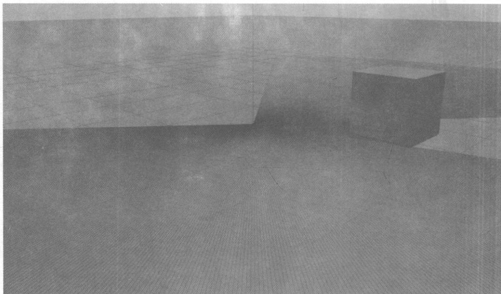

图 4-51 激光器的插入
{: .figure-caption }


（7）可视化带噪声的激光器：如图 4-52 所示，依次单击窗口、主题可视化按钮（或按下 Ctrl+T 组合键）以显示主题选择器。


图 4-52 主题选择器对话框
{: .figure-caption }


（8）找到名称为/gazebo/default/hokuyo/link/laser/scan的选项，单击它，然后单击“确定”按钮。如图4-53所示，用户会得到一个激光视图窗口，显示激光数据。


图 4-53 显示激光数据的窗口
{: .figure-caption }


用户可以看到,显示是带噪声的。为了调整噪声,只需使用 model.sdf 中的平均值和标准偏差值,其中单位为米。设置以下内容:

```txt
noise>
type>gaussian /type>
mean>0.0 /mean>
stddev>0.01 /stddev>
/noise>
```

这些是 Hokuyo 激光器的合理值。

#### 摄像头噪音

对于摄像头传感器,我们对输出放大器噪声进行建模,其对每个像素独立地添加高斯采样干扰。用户可以设置将被采样的噪声值的高斯分布的均值和标准偏差。针对每个像素独立地对噪声值进行采样,然后将该噪声值独立地添加到该像素的每个颜色通道。在添加噪声之后,所得到的颜色通道值被钳位在0.0和1.0之间;此浮点颜色值将在图像中作为无符号整数,通常在0和255之间(每个通道使用8位)。

这个噪声模型在 GLSL 着色器中实现,需要 GPU 运行。

测试摄像头噪声模型时：

(1) 创建模型目录, 输入以下命令:

```shell
mkdir -p ~/.gazebo/models/noisy_camera
```

(2) 创建模型配置文件, 输入以下命令:

```txt
gedit ~/.gazebo/models/noisy_camera/model.config
```

(3) 复制粘贴以下内容:

```xml
<?xml version="1.0"?>
model>
name> Noisy camera /name>
version>1.0 /version>
sdf version='1.6'>model.sdf /sdf>

author>
name>My Name /name>
email>me@my.email /email>
/author>

description>
My noisy camera.
/description>
/model>
```

(4) 创建～/. gazebo/models/noisy\_camera/model.sdf 文件, 输入以下命令:

```txt
gedit ~/.gazebo/models/noisy_camera/model.sdf
```

(5) 添加以下内容, 这是添加了噪声的标准摄像头型号的副本:

```xml
?xml version="1.0"?>
sdf version="1.6">
model name="camera">
link name="link">
gravity>false /gravity>
pose>0.05 0.05 0.05 0 0 0 /pose>
inertial>
mass>0.1 /mass>
/inertial>
```

```txt
visual name="visual">
geometry>
box>
size>0.1 0.1 0.1 /size>
/box>
/geometry>
/visual>
sensor name="camera" type="camera">
camera>
horizontal_fov>1.047 /horizontal_fov>
image>
width>1024 /width>
height>1024 /height>
/image>
clip>
near>0.1 /near>
far>100 /far>
/clip>
noise>
type>gaussian /type>
mean>0.0 /mean>
stddev>0.07 /stddev>
/noise>
/camera>
always_on>1 /always_on>
update_rate>30 /update_rate>
visualize>true /visualize>
/sensor>
/link>
/model>
/sdf>
```

（6）启动 Gazebo，然后插入带噪声的摄像头：在左窗格中，选择“插入”选项卡，然后单击“噪声摄像头”按钮。把用户的摄像头放在场景的某个地方。

（7）可视化带噪声的摄像头：依次单击窗口、主题可视化按钮（或按 Ctrl+T 组合键）以显示主题选择器。

（8）找到名称为“/gazebo/default/camera/link/camera/image”的选项，单击它，然后单击“确定”按钮。如图4-54所示，用户会得到一个图像视图窗口，显示图像数据。

不难发现,图像是有噪声的。要调整噪声,只需调整在 model.sdf 中的平均值和标准偏差值。这些是无单位的值;噪声将被添加到范围 $[0.0,1.0]$ 内的每个颜色通道。

上面的例子有很高的< stddev>。尝试减小此值，以下的设置参数为数字摄像头的合理值：


图 4-54 显示图像数据的窗口
{: .figure-caption }


```txt
noise>
type>gaussian /type>
mean>0.0 /mean>
stddev>0.007 /stddev>
/noise>
```

这些是数字摄像头的合理值。

#### IMU 噪声

对于 IMU 传感器,我们对两种对角速度和线性加速度的干扰进行仿真: 噪声和偏置。角速率和线性加速度单独考虑,引出该模型的 4 组参数: 速率噪声,速率偏差,加速度噪声和加速度偏差。没有噪声施加到 IMU 的方向数据,将其作为在坐标中的理想值来处理。

噪声是可加的,从高斯分布采样。用户可以设置高斯分布的平均值和标准偏差(一个用于速率,一个用于加速度),从中可以对噪声值进行采样。针对每个样本的每个分量(X,Y,Z)独立地对噪声值进行采样,并将其添加到该分量。

偏差也是可加的,但在仿真开始时,它被采样一次。用户可以设置高斯分布的平均值和标准偏差(一个用于速率,另一个用于加速度),从中可以对偏差值进行采样。偏置将根据提供的参数进行采样,然后以等概率进行否定;假设所提供的平均值指示偏差的幅度,并且它可能偏向任一方向。此后,偏差是固定值,加到每个样品的每个分量(X,Y,Z)。

注意：根据被仿真的系统和物理引擎的配置，可能发生仿真的 IMU 数据已经包含相当

的噪声,因为系统不是完全收敛。因此,根据用户的实际应用情况,可能不需要添加噪声。

接下来对 IMU 噪声模型进行测试。

(1) 创建模型目录, 输入以下命令:

```shell
mkdir -p ~/.gazebo/models/noisy_imu
```

(2) 创建模型配置文件, 输入以下命令:

```txt
gedit ~/.gazebo/models/noisy_imu/model.config
```

(3) 在文件中加入以下内容:

```xml
<?xml version="1.0"?>
model>
name>Noisy IMU /name>
version>1.0 /version>
sdf version='1.6'>model.sdf /sdf>

author>
name>My Name /name>
email>me@my.email /email>
/author>

description>
My noisy IMU.
/description>
/model>
```

（4）创建～/. gazebo/models/noisy\_imu/model.sdf 文件，输入以下命令：

```txt
gedit ~/.gazebo/models/noisy_imu/model.sdf
```

(5) 添加以下内容:

```xml
<?xml version="1.0"?>
sdf version="1.6">
model name="imu">
link name="link">
inertial>
mass>0.1 /mass>
/inertial>
visual name="visual">
geometry>
```

```txt
box>
size>0.1 0.1 0.1 /size>
/box>
/geometry>
/visual>
collision name="collision">
geometry>
box>
size>0.1 0.1 0.1 /size>
/box>
/geometry>
/collision>
sensor name="imu" type="imu">
imu>
angular_velocity>
x>
noise type="gaussian">
mean>0.0 /mean>
stddev>2e-4 /stddev>
bias_mean>0.0000075 /bias_mean>
bias_stddev>0.0000008 /bias_stddev>
/noise>
/x>
y>
noise type="gaussian">
mean>0.0 /mean>
stddev>2e-4 /stddev>
bias_mean>0.0000075 /bias_mean>
bias_stddev>0.0000008 /bias_stddev>
/noise>
/y>
z>
noise type="gaussian">
mean>0.0 /mean>
stddev>2e-4 /stddev>
bias_mean>0.0000075 /bias_mean>
bias_stddev>0.0000008 /bias_stddev>
/noise>
/z>
/angular_velocity>
linear_acceleration>
x>
noise type="gaussian">
mean>0.0 /mean>
stddev>1.7e-2 /stddev>
bias_mean>0.1 /bias_mean>
```

```txt
bias_stddev>0.001 /bias_stddev>
/noise>
/x>
y>
noise type="gaussian">
mean>0.0 /mean>
stddev>1.7e-2 /stddev>
bias_mean>0.1 /bias_mean>
bias_stddev>0.001 /bias_stddev>
/noise>
/y>
z>
noise type="gaussian">
mean>0.0 /mean>
stddev>1.7e-2 /stddev>
bias_mean>0.1 /bias_mean>
bias_stddev>0.001 /bias_stddev>
/noise>
/z>
/linear_acceleration>
/imu>
always_on>1 /always_on>
update_rate>1000 /update_rate>
/sensor>
/link>
/model>
/sdf>
```

（6）启动 Gazebo，然后插入带噪声的 IMU：在左窗格中，选择“插入”选项卡，然后单击“噪声 IMU”按钮。用户将 IMU 放在场景中的某个地方。

（7）可视化带噪声的 IMU：依次单击窗口、主题可视化按钮（或按 Ctrl+T 组合键）以显示主题选择器。

（8）找到名称为“/gazebo/default/imu/link/imu/imu”的选项，单击它，然后单击“确定”按钮。用户会得到一个文本视图窗口，显示用户的 IMU 数据。

在高速率的传感器上加入噪声是很难让人接受的，特别是在复杂系统中。用户应该能够在噪声和/或偏置参数中看到大的非零均值的影响。要调整噪声，只需调整在 model.sdf 中的平均值和标准偏差值。速率噪声和速率偏差的单位为 rad/s，加速度噪声和加速度偏移的单位为 $m/s^{2}$ 。以下的参数设置为高质量的 IMU 的合理值：

```txt
angular_velocity>
x>
noise type = "gaussian">
```

```sgml
mean>0.0 /mean>
stddev>2e-4 /stddev>
bias_mean>0.0000075 /bias_mean>
bias_stddev>0.0000008 /bias_stddev>
/noise>
/x>
y>
noise type="gaussian">
mean>0.0 /mean>
stddev>2e-4 /stddev>
bias_mean>0.0000075 /bias_mean>
bias_stddev>0.0000008 /bias_stddev>
/noise>
/y>
z>
noise type="gaussian">
mean>0.0 /mean>
stddev>2e-4 /stddev>
bias_mean>0.0000075 /bias_mean>
bias_stddev>0.0000008 /bias_stddev>
/noise>
/z>
/angular_velocity>
linear_acceleration>
x>
noise type="gaussian">
mean>0.0 /mean>
stddev>1.7e-2 /stddev>
bias_mean>0.1 /bias_mean>
bias_stddev>0.001 /bias_stddev>
/noise>
/x>
y>
noise type="gaussian">
mean>0.0 /mean>
stddev>1.7e-2 /stddev>
bias_mean>0.1 /bias_mean>
bias_stddev>0.001 /bias_stddev>
/noise>
/y>
z>
noise type="gaussian">
mean>0.0 /mean>
stddev>1.7e-2 /stddev>
bias_mean>0.1 /bias_mean>
bias_stddev>0.001 /bias_stddev>
```

```txt
/noise>
/z>
/linear_acceleration>
```

### 4.7.2 接触式传感器

本部分内容演示了创建传感器并通过插件或消息获取数据的过程。接触式传感器检测两个物体之间的碰撞并报告接触相关力的位置。

#### 安装部分内容

创建工作目录开始,输入以下命令:

```txt
mkdir ~/gazebo_contact_tutorial; cd ~/gazebo_contact_tutorial
```

接下来,创建包含接触式传感器的盒子的 SDF 世界文件,输入以下命令:

```txt
geditcontact.world
```

将以下代码复制到名为 contact.world 的文件中：

```xml
<?xml version="1.0"?>
sdf version="1.6">
world name="default">
include>
uri>model://ground_plane /uri>
/include>
include>
uri>model://sun /uri>
/include>
model name="box">
link name="link">
pose>0 0 0.5 0 0 0 /pose>
collision name="box_collision">
geometry>
box>
size>1 1 1 /size>
/box>
/geometry>
/collision>
visual name="visual">
```

```txt
geometry>
box>
size>1 1 1 /size>
/box>
/geometry>
/visual>

sensor name = 'my_contact' type = 'contact'>
contact>
collision>box_collision /collision>
/contact>
/sensor>
/link>
/model>
/world>
/sdf>
```

接触式传感器将装到到箱模型内的连杆上。它将检测到 box\_collision 对象与场景中任何其他对象之间的冲突。

#### 打印接触值

使用 Gazebo 运行 contact.world, 输入以下命令:

```txt
gazebocontact.world
```

在一个单独的终端列表中，由Gazebo产生的标题为：

```txt
gz topic - 1
```

输出应如下所示：

```ignorefile
/gazebo/default/pose/info
/gazebo/default/gui
/gazebo/default/log/status
/gazebo/default/response
/gazebo/default/world_stats
/gazebo/default/selection
/gazebo/default/model/info
/gazebo/default/light
/gazebo/default/physics/contacts
/gazebo/default/visual
/gazebo/default/request
/gazebo/default/joint
/gazebo/default/sensor
```

```ignorefile
/gazebo/default/box/link/my_contact
/gazebo/default/box/link/my_contact/contacts
/gazebo/world/modify
/gazebo/default/diagnostics
/gazebo/default/factory
/gazebo/default/model/modify
/gazebo/default/scene
/gazebo/default/physics
/gazebo/default/world_control
/gazebo/server/control
```

我们关注的标题是/gazebo/default/box/link/my\_contact。在这里，my\_contact 接触式传感器根据这个标题发布。

将接触式传感器的值打印到屏幕上,输入以下命令:

```shell
gz topic -e /gazebo/default/box/link/my_contact
```

上面的命令将所有的接触转储到终端。用户可以使用 Ctrl+C 组合键随时停止。

注意：如果该命令无效，用户可能需要在</contact>和</sensor>标签之间添加

```txt
update_rate>5 /update_rate>
```

以获得在终端上的输出。根据不同的场合，速率“5”可以改变为不同的频率。

#### 获取传感器数据插件

用户也可以为接触式传感器创建插件。这个插件可以获得操作碰撞数据，并将其输出接到任意目标(例如 ROS 主题)。

首先修改 contact.worldSDF 文件。在下面添加以下行：

```txt
sensor name = 'my_contact' type = 'contact':
geditcontact.world
    plugin name = "my_plugin" filename = "libcontact.so" />
```

这一行告诉 Gazebo 加载我们现在将定义的 libcontact.so 传感器插件。为插件创建一个头文件，命名为 ContactPlugin.hh：

```javascript
geditContactPlugin.hh
```

并粘贴以下内容：

```c
# ifndef_GAZEBO_CONTACT_PLUGIN_HH_
# define_GAZEBO_CONTACT_PLUGIN_HH_
```

```txt
gedit ContactPlugin.cc
并粘贴以下内容：
#include "ContactPlugin.hh"
using namespace gazebo;
GZ_REGISTER_SENSOR_PLUGIN(ContactPlugin)
```

```cpp
#include string>
#include gazebo/gazebo.hh>
#include gazebo/sensors/sensors.hh>

namespace gazebo
{
    ///\brief An example plugin for a contact sensor.
classContactPlugin : public SensorPlugin
    {
    ///\brief Constructor.
public: ContactPlugin();

    ///\brief Destructor.
public: virtual ~ContactPlugin();

    ///\brief Load the sensor plugin.
    ///\param[in] _sensor Pointer to the sensor that loaded this plugin.
    ///\param[in] _sdf SDF element that describes the plugin.
public: virtual void Load(sensors::SensorPtr _sensor, sdf::ElementPtr _sdf);

    ///\brief Callback that receives the contact sensor's update signal.
private: virtual void OnUpdate();

    ///\brief Pointer to the contact sensor.
private: sensors::ContactSensorPtrparentSensor;

    ///\brief Connection that maintains a link between the contact sensor's
    ///updated signal and the OnUpdate callback.
private: event::ConnectionPtrupdateConnection;
};
}

#endif
```

创建一个名为 ContactPlugin.cc 的源文件：

```txt
//
//
//
//
//
//
//
//
//
//
//
//
//
//
//
//
//
//
//
//
//
//
//
//
//
//
//
//
//
//
//
//
//
//
```

```cpp
std::cout j "Position:"
    contacts.contact(i).position(j).x() ""
    contacts.contact(i).position(j).y() ""
    contacts.contact(i).position(j).z() "\n";
std::cout " Normal:"
    contacts.contact(i).normal(j).x() ""
    contacts.contact(i).normal(j).y() ""
    contacts.contact(i).normal(j).z() "\n";
std::cout " Depth:" contacts.contact(i).depth(j) "\n";
}
```

#### 编译代码

(1) 创建 CMakeLists.txt 文件, 输入以下命令:

```batch
cd ~/gazebo_contact_tutorial; gedit CMakeLists.txt
```

(2) 复制以下代码并保存文件：

<div class="mineru-algorithm" style="white-space: pre-wrap; font-family:monospace;">
cmake_minimum_required(VERSION 2.8 FATAL_ERROR)
find_package(gazebo REQUIRED)
include_directories( ${GAZEBO_INCLUDE_DIRS}$)
link_directories( ${GAZEBO_LIBRARY_DIRS}$)
list(APPEND CMAKE_CXX_FLAGS " ${GAZEBO_CXX_FLAGS}")$
add_library(contact SHARED ContactPlugin.cc)
target_link_libraries(contact ${GAZEBO_libraries}$)
</div>

(3) 接下来, 创建一个构建目录并创建插件, 输入以下命令:

```batch
mkdir build; cd build; cmake ../; make
```

#### 运行代码

(1) 输入构建目录, 输入以下命令:

```batch
cd ~/gazebo_contact_tutorial/build
```

（2）运行 gzserver，首先修改用户 LD\_LIBRARY\_PATH 的库，以便库加载器可以找到用户的库（默认情况下它只会查看某些系统位置），输入以下命令：

```txt
export LD_LIBRARY_PATH = ~/gazebo_contact_tutorial/build: $ LD_LIBRARY_PATH gzserver ../contact.world
```

### 4.7.3 摄像头失真

摄像机镜头通常表现出一定程度的光学失真,这导致图像的翘曲。本部分内容示例是鱼眼摄像头,其通常用于机器人应用中,以获得用于物体识别或导航任务的环境的更宽视场。使用诸如 MATLAB 或 OpenCV 的摄像头校准工具,可以提取失真系数以及其他摄像头内在参数。使用这些失真系数,用户现在可以在 Gazebo 中创建失真的摄像头传感器。

#### 当前实施方案

Gazebo 目前支持基于布朗失真模型的摄像头仿真。该公司要求的 5 个畸变系数 (k1、k2、k3、p1、p2)，用户可以从摄像头校准工具获得。k 系数是畸变模型的径向分量，而 p 系数是切向分量。

需要考虑的当前实现有一些限制：

(1) 目前仅支持桶形畸变, 这通常具有负值 k1。

（2）失真应用于摄像头图像纹理。这意味着获取生成的图像数据并且只是使它变形。这需要注意的是，最终的图像（特别是在角落）比具有桶形畸变的真实摄像头镜头的视野更窄。补偿此效果的一种解决方法是增加Gazebo中摄像头传感器的视野。

#### 创建带有畸变的摄像头

要添加带畸变的摄像头型号：

(1) 创建模型目录, 输入以下命令:

```shell
mkdir -p ~/.gazebo/models/distorted_camera
```

(2) 创建模型配置文件, 输入以下命令:

```txt
gedit ~/.gazebo/models/distorted_camera/model.config
```

(3) 添加以下内容:

```txt
?xml version="1.0"?>
model>
name>Distorted Camera /name>
version>1.0 /version>
sdf version='1.5'>model.sdf /sdf>

author>
name>My Name /name>
```

```perl
email > me@my.email /email>
/author>

description>

My distorted camera.
/description>
/model>
```

（4）创建～/.gazebo/models/distorted\_camera/model.sdf文件。

```txt
gedit ~/.gazebo/models/distorted_camera/model.sdf
```

(5) 添加以下内容, 这是一个附加的失真的标准摄像头模型的副本:

```xml
<?xml version="1.0" ?>
sdf version="1.5">
model name="distorted_camera">
link name="link">
pose>0.05 0.05 0.05 0 0 0 /pose>
inertial>
mass>0.1 /mass>
inertia>
ixx>0.000166667 /ixx>
iyy>0.000166667 /iyy>
izz>0.000166667 /izz>
/inertia>
/inertial>
collision name="collision">
geometry>
box>
size>0.1 0.1 0.1 /size>
/box>
/geometry>
/collision>
visual name="visual">
geometry>
box>
size>0.1 0.1 0.1 /size>
/box>
/geometry>
/visual>
sensor name="camera" type="camera">
camera>
horizontal_fov>1.047 /horizontal_fov>
image>
```

```txt
width>320 /width>
height>240 /height>
/image>
clip>
near>0.1 /near>
far>100 /far>
/clip>
distortion>
k1>-0.25 /k1>
k2>0.12 /k2>
k3>0.0 /k3>
p1>-0.00028 /p1>
p2>-0.00005 /p2>
center>0.5 0.5 /center>
/distortion>
/camera>
always_on>1 /always_on>
update_rate>30 /update_rate>
visualize>true /visualize>
/sensor>
/link>
/model>
/sdf>
```

（6）启动 Gazebo，然后插入畸变的摄像头型号：在左窗格中，选择 Insert 选项卡，然后单击 Distorted Camera 按钮。把用户的摄像头放在场景的某个地方，并在它前面放一个盒子。

（7）观看摄像头图像：依次单击窗口、主题可视化按钮(或按 Ctrl+T 键)以显示主题选择器。

（8）找到标题为/gazebo/default/distorted\_camera/link/camera/image，单击它，然后单击 OK 按钮。用户会得到一个摄像机视图窗口，显示摄像机图像数据。

正如用户所看到的，从盒子弯曲的边缘可见，摄像机的图像是畸变的。要调整失真，只需调整 model.sdf 中 k1、k2、k3、p1、p1 失真系数。

## 4.8 Gazebo 的其他功能

### 4.8.1 数学库的使用

Gazebo 有一个自定义的数学库。这部分内容描述如何使用这些数学函数。

Gazebo 使用随机数发生器。默认情况下，种子设置为运行 Gazebo 的进程的 PID。也可以手动设置随机数种子。该特征的优点是获得随机数的确定性序列，这对于测试可重复性是有益的。

#### 命令行

Gazebo 可以使用命令行上的随机数种子来初始化, 使用--seed 参数:

```txt
gazebo -- seed integer>
```

#### 信息

要使用 Gazebo 监听～/world\_control 主题，则需要类型为 msgs::WorldControl 的消息。world 控制消息可能包含随机数种子。

### 4.8.2 用户输入

用户输入可以采取多种形式,包括来自图形界面和诸如操纵杆的硬件设备。

#### Razer Hydra

（1）Gazebo 支持 Razer Hydra 控制器。用户将能够使用此运动和方向检测控制器与 Gazebo 中的模型进行交互。

(2) Razer Hydra 配置。

打开终端(CTRL-ALT-T)，然后输入以下命令：

```txt
echo -e"ATTRS{idProduct} ==\ "0300",ATTRS{idVendor} ==\ "1532",ATTR{bInterfaceNumber} ==\ "00",TAG = \ "hydra - tracker"\nSUBSYSTEM == \ "hidraw",TAGS == \ "hydra - tracker",MODE = \ "0666",SYMLINK += \ "hydra\"">90 - hydra.rules
```

这将创建一个名为 90-hydra.rules 的文件。

我们能够访问控制器,无须 root 访问权限,需要访问控制器时输入以下命令:

```batch
sudocp 90 - hydra.rules /etc/udev/rules.d/sudoudevadm control -- reload - rules
```

(3) Razer Hydra 下编辑 Gazebo。

我们需要安装 libusb 的从属项, 输入以下命令:

```txt
sudo apt-get install libusb-1.0-0-dev
```

一旦 Hydra 配置成功并且满足附加从属关系,用户则能够在 Hydra 下编译 Gazebo。

按照此说明编译 Gazebo。在执行 cmake 命令期间，用户应该看到此确认找到 SDK 消息：

```txt
-- Looking for libusb-1.0 - found. Razer Hydra support enabled.
```

（4）在 Gazebo 内使用 Hydra。在 Gazebo 中使用 Hydra 需要两个步骤。第一步是将 Hydra 插件加载到用户的 world 文件中，输入以下内容：

```txt
! -- Load the plugin for Razer Hydra --> plugin name="hydra" filename="libHydraPlugin.so"> /plugin>
```

此插件将自动发布有关～/hydra 的消息。

第二步将使用 Hydra 的右操纵杆移动球体。可用 plugins 目录下的一个名为 HydraDemoPlugin 的插件上。

插件代码为：

```cpp
#include boost/bind.hpp>
#include gazebo/gazebo.hh>
#include gazebo/physics/physics.hh>
#include "gazebo/transport/transport.hh"
#include "HydraDemoPlugin.hh"

using namespace gazebo;

GZ_REGISTER_MODEL_PLUGIN(HydraDemoPlugin)

/////hydraDemoPlugin::HydraDemoPlugin()
{
}

/////hydraDemoPlugin::~HydraDemoPlugin()
{
}

/////voidHydraDemoPlugin::OnHydra(ConstHydraPtr&_msg)
{
boost::mutex::scoped_lock lock(this->msgMutex);
this->hydraMsgPtr = _msg;
}

/////voidHydraDemoPlugin::Load(physics::ModelPtr_parent, sdf::ElementPtr /*_sdf */)
{
    //Get the world name.
this->model = _parent;
this->world = this->model->GetWorld();

    //Subscribe to Hydra updates by registering OnHydra() callback.
this->node = transport::NodePtr(new transport::Node());
this->node->Init(this->world->GetName());this->hydraSub = this->node->Subscribe("~/hydra",&HydraDemoPlugin::OnHydra, this);

//Listen to the update event. This event is broadcast every
//simulation iteration.
this->updateConnection = event::Events::ConnectWorldUpdateBegin(
    boost::bind(&HydraDemoPlugin::Update, this, _1));
}

///////
voidHydraDemoPlugin::Update(const common::UpdateInfo& /* _info */)
{
boost::mutex::scoped_lock lock(this->msgMutex);

//Return if we don't have messages yet
if (!this->hydraMsgPtr)
return;

//Read the value of the right joystick.
doublejoyX = this->hydraMsgPtr->right().joy_x();
doublejoyY = this->hydraMsgPtr->right().joy_y();

//Move the sphere.
this->model->SetLinearVel(math::Vector3(-joyX * 0.2, joyY * 0.2, 0));

//Remove the message that has been processed.
this->hydraMsgPtr.reset();
}
```

在启动 Gazebo 之前,需要将模型插件包含在 world 文件中。这里是部分内容里一个完整的 World 文件:

```txt
?xml version="1.0"?>
sdf version="1.4">
world name="default">
! -- A ground plane -->
include>
uri>model://ground_plane /uri>
/include>
! -- A global light source -->
include>
uri>model://sun /uri>
/include>
```

```txt
! -- Load the plugin for Razer Hydra -->
plugin name = "hydra" filename = "libHydraPlugin.so">
pivot > 0.04 0 0 / pivot >
grab > 0.12 0 0 / grab >
/plugin>

! -- A sphere controlled by Hydra -->
model name = "sphere">
pose > 0 0 0 0 0 0 / pose >
link name = "link">
collision name = "collision">
geometry>
sphere>
radius > 0.5 / radius >
/sphere>
/geometry>
/collision>
visual name = "visual">
geometry>
sphere>
radius > 0.5 / radius >
/sphere>
/geometry>
/visual >
/link>

plugin name = 'sphere_ctroller' filename = 'libHydraDemoPlugin.so'> / plugin>

/model>

/world >
/sdf>
```

可以运行 Gazebo 并使用 Hydra 的右操纵杆移动球体了。不要忘记插入 Hydra，然后：

```txt
gazebo worlds/hydra_demo.world
```

#### GUI 覆盖

Gazebo GUI 覆盖可以被认为是位于渲染窗口顶部的透明 2D 层。QT 小部件可以通过插件界面添加到此层。用户可以通过单击 Gazebo 主菜单栏 View 命令，选择 GUI Overlays 上显示或隐藏所有 GUI 覆盖层。下面介绍如何创建和使用 GUI 覆盖插件来为 Gazebo 创建自定义界面。

两个示例将用于演示 GUI 叠加功能。第一个示例创建一个生成球体的按钮，第二个示例显示当前的仿真时间。这两个例子展示如何发送数据到 Gazebo 和从 Gazebo 接收数据。

1) 示例 1: 产生球的模型

步骤如下。

安装开发 debian, 输入以下命令:

```txt
sudo apt-get install libgazebo7-dev
```

从创建工作目录开始,输入以下命令:

```txt
mkdir ~/gazebo_gui_spawn
cd ~/gazebo_gui_spawn
```

下载 GUI 覆盖插件的源代码, 输入以下命令:

```shell
wget https://bitbucket.org/osrf/gazebo/raw/gazebo7/examples/plugins/gui_overlay_plugin_spawn/GUIExampleSpawnWidget.hh
wget https://bitbucket.org/osrf/gazebo/raw/gazebo7/examples/plugins/gui_overlay_plugin_spawn/GUIExampleSpawnWidget.cc
wget https://bitbucket.org/osrf/gazebo/raw/gazebo7/examples/plugins/gui_overlay_plugin.spawn/CMakeLists.txt
```

查看头文件：

```txt
geditGUIExampleSpawnWidget.hh
```

GUI 覆盖插件必须从 GUIPlugin 类继承, 并使用 Qt 的 Q\_OBJECT 宏:

```txt
class GAZEBO_VISIBLE GUIExampleSpawnWidget : public GUIPlugin
{
    Q_OBJECT
```

插件的其余部分可能包含使插件满足用户的需要的任何代码。本示例使用 QT 插槽接收按钮如下：

```swift
///\brief Callback triggered when the button is pressed.
protected slots: void OnButton()
```

我们还将使用 Gazebo 的 factory 功能将 SDF 产生的消息发送到 gzserver:

```txt
///\brief Node used to establish communication with gzserver.
private: transport::NodePtr node;
///\brief Publisher of factory messages.
private: transport::PublisherPtrfactoryPub;
```

查看源文件,输入以下命令:

```batch
gedit GUIExampleSpawnWidget.cc
```

此文件中的构造函数使用 QT 创建一个按钮并将其放到 OnButton 回调：

```javascript
//Create a push button, and connect it to the OnButton function QPushButton *button = new QPushButton(tr("Spawn Sphere"));
connect(button, SIGNAL(clicked()), this, SLOT(OnButton()));
```

构造函数还连接到Gazebo的传输机制，并创建一个factory publisher:

```txt
//Create a node for transportation
this->node = transport::NodePtr(new transport::Node());
this->node->Init();
this->factoryPub = this->node->Advertise  msgs::Factory>("~/factory");
```

OnButton 可以回调创建一个新的球面 SDF 字符串：

```rust
std::ostringstreamnewModelStr;
newModelStr " sdf version = '" SDF_VERSION ' >"
    msgs::ModelToSDF(model) -> ToString("")
    "/sdf>";
```

并将字符串发送到 Gazebo:

```rust
msgs::Factorymsg;
msg.set_sdf(newModelStr.str());
this->factoryPub->Publish(msg);
}
```

编译插件,输入以下命令:

```batch
cd ~/gazebo_gui_spawn
mkdir build
cd build
cmake ../
make
```

现在我们需要确保 Gazebo 可以找到插件。用户可以通过将 build 目录附加到 GAZEBO\_PLUGIN\_PATH 环境变量来实现：

```shell
cd ~/gazebo_gui_spawn/build
export GAZEBO_PLUGIN_PATH = 'pwd': $ GAZEBO_PLUGIN_PATH
```

注意；上面的命令只适用于当前 shell。为了确保插件在打开新终端时可以正常工作，请将插件安装到公共搜索路径中，例如/usr/local/lib，或者 GAZEBO\_PLUGIN\_PATH 库中指定的路径。

我们还需要让 Gazebo 加载 overlay 插件。有两种方法来实现这一点。

(1) SDFworld 文件：修改 worldworldSDF 文件以包含 GUI 插件。例如：

```txt
?xml version="1.0"?>
sdf version="1.5">
world name="default">
gui>
plugin name="sample" filename="libgui_example_spawn_widget.so"/>
/gui>
!-- A global light source -->
include>
uri>model://sun /uri>
/include>
!-- A ground plane -->
include>
uri>model://ground_plane /uri>
/include>
/world>
/sdf>
```

注意：下载上面的 worldworld 文件，输入以下命令：

```shell
cd ~/gazebo_gui_spawn
wget https://bitbucket.org/osrf/gazebo/raw/gazebo7/examples/plugins/gui_overlay_plugin
spawn/spawn_widget_example.world
```

（2）GUI INI 文件：修改～/.gazebo/gui.ini 文件，以便每次运行 Gazebo 时加载插件，输入以下命令：

```batch
gedit ~/.gazebo/gui.ini
```

添加以下行,输入以下命令:

```ini
[overlay_plugins]
filenames = libgui_example_spawn_widget.so
```

现在当 Gazebo 运行时,一个按钮应该出现在渲染窗口的左上角。如果用户需要使用 GUI 插件创建自定义 SDFworld 文件,输入以下命令:

```txt
gazebospawn_widget_example.world
```

或者如果用户修改～/. gazebo/gui.ini。最后运行 Gazebo，如图 4-55 所示，单击按钮生成球体。


图 4-55 球体生成场景
{: .figure-caption }


## 2）示例2：显示仿真时间

步骤如下。

首先,创建工作目录,输入以下命令:

```txt
mkdir ~/gazebo_gui_time
cd ~/gazebo_gui_time
```

下载 GUI 覆盖插件的源代码, 输入以下命令:

```batch
wget https://bitbucket.org/osrf/gazebo/raw/gazebo7/examples/plugins/gui_overlay_plugin_time/GUIExampleTimeWidget.hh
wget https://bitbucket.org/osrf/gazebo/raw/gazebo7/examples/plugins/gui_overlay_plugin_time/GUIExampleTimeWidget.cc
wget https://bitbucket.org/osrf/gazebo/raw/gazebo7/examples/plugins/gui_overlay_plugin_time/CMakeLists.txt
```

看看头文件,输入以下命令:

```txt
geditGUIExampleTimeWidget.hh
```

和第一个例子一样,这个插件继承自 GUIPlugin 类,并且使用 Qt 的 Q\_OBJECT 宏。

```objectivec
class GAZEBO_VISIBLE GUIExampleTimeWidget : public GUIPlugin
{
    Q_OBJECT
```

我们使用 SetSimTime 信号作为线程安全机制来更新显示的仿真时间：

```c
///\brief A signal used to set the sim time line edit.
///\param[in] _string String representation of sim time.
signals: void SetSimTime(QString_string);
```

一个 OnStats 回调用于从 Gazebo 接收信息：

```txt
///\brief Callback that received world statistics messages.
///\param[in] _msg World statistics message that is received.
protected: void OnStats(ConstWorldStatisticsPtr&_msg);
```

我们还将使用 Gazebo 的传输机制来接收来自 Gazebo 的消息：

```txt
///\brief Node used to establish communication with gzserver.
private: transport::NodePtr node;
///\brief Subscriber to world statistics messages.
private: transport::SubscriberPtrstatsSub;
```

看看源文件,输入以下命令:

```txt
gedit GUIExampleTimeWidget.cc
```

在构造函数中,创建一个 QLabel 来显示时间,并将其连接到 SetSimeTime 信号。

```cpp
//Create a time label
QLabel *timeLabel = new QLabel(tr("00:00:00.00"));
//Add the label to the frame's layout
frameLayout->addWidget(label);
frameLayout->addWidget(timeLabel);
connect(this, SIGNAL(SetSimTime(QString)),
timeLabel, SLOT.setText(QString)), Qt::QueuedConnection);
```

将构造函数连接到Gazebo的～/world\_stats:

```rust
//Create a node for transportation
this->node = transport::NodePtr(new transport::Node());
```

```cpp
this->node->Init("default");
this->statsSub = this->node->Subscribe("~/world_stats", &GUIExampleTimeWidget::OnStats, this);
```

当接收到消息时，OnStats 调用该函数并更新显示的时间：

```cpp
void GUIExampleTimeWidget::OnStats(ConstWorldStatisticsPtr&_msg)
{
    this->SetSimTime(QString::fromStdString(
    this->FormatTime(_msg->sim_time()));
```

按照与上一个部分内容相同的步骤编译插件,告诉 Gazebo 在哪里找到它,并通过 gui.ini SDFworld 文件加载它。

用户可以按如下所示添加两个插件,输入以下命令:

```batch
gedit ~/.gazebo/gui.ini
```

将[overlay\_plugins]部分更改为：

```ini
[overlay_plugins]
filenames = libgui_example_spawn_widget.so:libgui_example_time_widget.so
```

这将加载前一个示例的 spawn 插件和本示例中的时间插件。
运行 Gazebo 时, 按钮右侧的新文本框应显示仿真时间, 见图 4-56。


图 4-56 显示仿真时间的窗口
{: .figure-caption }


```txt
cd; mkdir gazebo_position2d; cd gazebo_position2d

将下面的配置脚本复制到 position2d.cfg 文件中：

driver
(
name "gazebo"
provides ["simulation:0"]
plugin "libgazebo_player"
# The name of a running Gazebo world, specified in a .world file
world_name "default"
)

driver
(
name "gazebo"
provides ["position2d:0"]
# This name must match the name of a model in the "default" world
model_name "pioneer2dx"
)

输入以下命令运行 Gazebo:

gazebo worlds/pioneer2dx.world

输入以下命令运行 Player:

player position2d.cfg

输入以下命令运行 playerv:

playerv
```

### 4.8.3 连接到 Player

Player 是一个机器人控制框架, 下面介绍如何将 position2d Player 接口连接到 Gazebo。

创建工作目录,输入以下命令:

完成以上的步骤后,现在用户可以使用 playerv 驱动 pioneer2dx。

创建工作目录,输入以下命令:

```txt
cd; mkdirgazebo_camera; cd gazebo_camera
```

将下面的配置脚本复制到 camera.cfg 文件中：

```txt
driver
(
name "gazebo"
provides ["simulation:0"]
plugin "libgazebo_player"

# The name of a running Gazebo world, specified in a .world file
world_name "default"
)

driver
(
name "gazebo"
provides ["camera:0"]

# This name must match a scoped name of a sensor in the "default" world
# The format of a scoped name is "model_name::link_name::sensor_name"
camera_name "pioneer2dx::camera::link::camera"
)
```

输入以下命令运行 Gazebo:

```txt
gazebo worlds/pioneer2dx_camera.world
```

输入以下命令运行 Player:

```txt
playercamera.cfg
```

输入以下的命令运行 playerv:

```txt
playerv
```

完成以上的步骤后,现在用户可以在 playerv 中可看到相机。

## 本章小结

本章介绍了机器人仿真软件 Gazebo 的应用,重点部分在于如何使用 Gazebo 创建机器人和场景文件的创建。在 Gazebo 的学习中,应该注意与 V-REP 之间的差别,以及如何与机器人操作系统进行结合。

## 参考文献

[1] <http://www.gazebosim.org/>.

[2] Koenig N, Howard A. Design and use paradigms for Gazebo, an open-source multi-robot simulator [C]//Ieee/rsj International Conference on Intelligent Robots and Systems. IEEE Xplore, 2004: 2149-2154 vol. 3.

[3] Hoffman E M, Traversaro S, Rocchi A, et al. Yarp Based Plugins for Gazebo Simulator[J]. 2014.

[4] Meyer J, Sendobry A, Kohlbrecher S, et al. Comprehensive Simulation of Quadrotor UAVs Using ROS and Gazebo[J]. Lecture Notes in Computer Science, 2012, 7628: 400-411.
