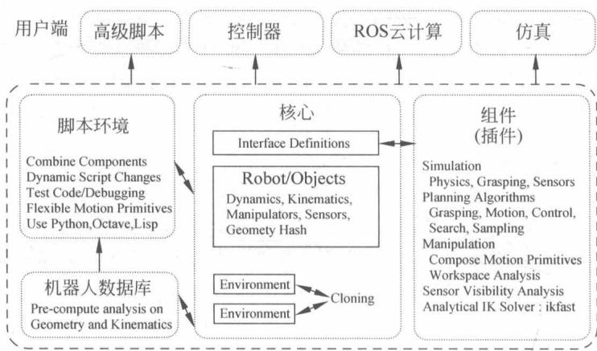
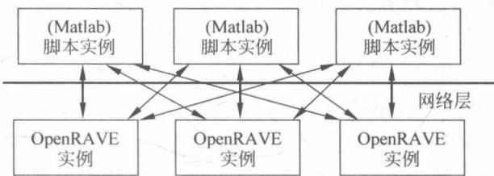

# 第5章 OpenRAVE 在机器人仿真中的应用

## 5.1 OpenRAVE 简介

### 5.1.1 OpenRAVE的应用

OpenRAVE(英文全称为 Open Robotics Automation Virtual Environment)是一款开源的机器人仿真软件。OpenRAVE 提供了机器人的测试环境，它的主要功能是运动规划运动学和几何信息的模拟和分析。在应用方面，OpenRAVE 主要用于开发和部署机器人的运动规划算法，而这些算法能够应用于实际中的机器人。由于 OpenRAVE 具备有独立运行的性质，这些算法可以很容易地集成到现有的机器人系统。它为机器人开发者和机器人提供了许多命令行工具，核心运行时足够小，因此可用于内部控制器和更大的框架。

OpenRAVE 是一个开放源码跨平台软件架构，即开放的机器人和动画虚拟环境。OpenRAVE 针对真实世界自动机器人应用程序，包括 3-D 模拟、可视化、规划、脚本和控制的无缝集成。它的插件架构允许用户轻松地编写自定义的控制器和进行扩展功能。通过使用 OpenRAVE 插件，任何设计的算法、机器人控制器或感测子系统都可以在运行时进行分布和动态加载，从而使开发人员免于使用单片代码库。这样 OpenRAVE 的用户可以专注于问题的规划和脚本方面的开发，而无须明确管理机器人运动学和动力学、碰撞检测、世界更新和机器人控制的细节。OpenRAVE 架构也提供了一个灵活的接口，可以与其他流行的机器人软件包（如 Player 和 ROS）结合使用，因为它专注于自动运动规划和高级脚本，而不是低级控制和信息协议。OpenRAVE 还支持强大的网络脚本环境，使得在运行时控制和监视机器人以及更改执行流程变得更加简单。开放组件架构的一个关键优势是它们使机器人研究团体能够轻松地共享和比较算法。

下文将主要对 OpenRAVE 的原理以及运用进行简单介绍。

### 5.1.2 OpenRAVE 的特性

OpenRAVE 具有许多功能用于分析机器人场景的几何结构,然后把它们用于在整个工作区中使机器人运动。

OpenRAVE 在两方面上具有良好的应用：

（1）对于每个机器人，使用 IKFast 能够针对某种机器人的结构专门地生成逆运动学程序。这允许所有奇点配置和除以零条件的处理。而且，这种处理的速度特别快，生成大多数解决方法只需运行 $5 \mu s$ 。

（2）可以很容易地结合多个约束条件，例如避免碰撞、把握对象、保持传感器能见度。然后，在这些约束条件下把一个机器人的初始和目标配置连接在一起。

OpenRAVE 是一个开放机器人和 3-D 动画虚拟环境。相比于其他仿真工具，OpenRAVE 具有它的独特优势：

(1) 能用于机器人的实时控制和执行监控的集成设计。

(2) 提供运动学操作和物理模拟的核心功能。

（3）有允许诸如 Octave 和 MATLAB 之类的解释性脚本语言与其进行交互的网络协议（当然还支持其他脚本语言，例如 Python 和 Perl 是计划开发的）。

（4）内置核心工具和插件界面，用于机器人的操作规划和抓取。

（5）标准插件，允许测试不同的规划算法和传感系统，而只需做最少的代码修改。

OpenRAVE 架构模块化了机器人系统的执行和计划层，使自主系统的开发变得更容易，组件变得更可重用于其他项目。一个基本做法是在特定组件的实现与从其他组件的使用这个特定组件之间创建一个接口层。许多以前的架构已经为基本级别组件做到这一点。

### 5.1.3 OpenRAVE的下载与安装

OpenRAVE 提供了可以用于 Ubuntu 和 Windows 的版本。下面介绍在 Ubuntu 上安装 OpenRAVE 的步骤。

#### 安装依赖库

首先保证已安装了下面的项目,从命令行输入:

```batch
01. sudo apt - get install cmake g++ git qt4 - dev - tools zlib - bin
02. sudo apt - get install ipython python - dev python - h5py python - numpy python - scipy python - sympy
```

安装依赖库：

```txt
01. sudo apt - get install libassimp - dev libavcodec - dev libavformat - dev libavformat - dev libboost - all - dev libboost - date - time - dev libbullet - dev libfaac - dev libglew - dev libgsm1 - dev liblapack - dev libmpfr - dev libode - dev libogg - dev libopenscenagraph - dev libpcre3 - dev libpcrecpp0 libghull - dev libqt4 - dev libsoqt - dev - common libsoqt4 - dev libswscale - dev libswscale - dev libvorbis - dev libx264 - dev libxml2 - dev libxvidcore - dev
```

唯一从 OpenRAVE ppa 上可以安装的包是 collada-dom:

```txt
01. sudo add - apt - repository ppa:OpenRAVE/release
```

```shell
02. sudo sh - c 'echo "deb - src http://ppa.launchpad.net/OpenRAVE/release/ubuntu 'lsb_release - cs'main" >> /etc/apt/sources.list.d/OpenRAVE-release-'lsb_release - cs'.list'
03. sudo apt - get update
04. sudo apt - get install collada - dom - dev
```

#### 从源文件安装

从命令行输入：

```txt
01. git clone https://github.com/rdiankov/OpenRAVE.git
```

编译：

```batch
01.cd OpenRAVE
02.mkdir build
03.cd build
04.cmake ..
05.make
06.sudo make install
```

将 OpenRAVE 的 bash 文件添加到系统环境：

```txt
01.vim.bashrc
```

最后一行加入以下路径代码：

```txt
01. view plain copy print? source /usr/local/share/OpenRAVE - 0.9/OpenRAVE.bash
```

运行实例如下：

```txt
01.html] view plain copy print? OpenRAVE0.9.py -- example Hanoi
```

## 5.2 OpenRAVE 概观

### 5.2.1 OpenRAVE 基本架构

OpenRAVE 的 4 个主要部件如图 5-1 所示。

#### 核心层

它的核心是由一组定义了插件如何共享信息的基本接口类组成，并提供了一个环境接口，来维持一个主要状态，作为通过 OpenRAVE 提供的所有功能的关卡，它是全局 OpenRAVE 状态管理加载的插件，有多个独立空间和日志记录。同时，这个环境将碰撞检查器、观察器、物理引擎、运动学世界及其所有接口组合成一致的机器人世界状态。



图 5-1 OpenRAVE 的基本架构
{: .figure-caption }


#### 插件层

OpenRAVE 设计为基于插件的架构, 其中插件提供了动态加载到环境中的基本接口类的实现。插件可以与其他机器人库连接, 允许 OpenRAVE 扩展其功能, 或者可以向另一个机器人系统提供 OpenRAVE 服务。在它的启动过程中, OpenRAVE 将会解析 OPENRAVE\_PLUGIN 环境变量并加载其找到的所有插件。

#### 脚本层

OpenRAVE 为 Python 和 Octave/MATLAB 提供了脚本环境。Python 与核心层通过内存调用直接通信，使得通信速度变得极快。另一方面，Octave/MATLAB 脚本协议通过 TCP/IP 发送命令，一个插件在 OpenRAVE 核心端提供一个文本服务器。脚本允许在不需要关闭的前提下实时修改环境的任何方面，使其成为测试新算法的理想选择。Python 脚本是如此强大，使得大多数的 OpenRAVE 示例和演示代码通过它提供。事实上，用户应该将脚本语言看作整个系统的一个组成部分，而不是作为 C++ API 的替代。

#### 机器人数据库层

实现规划知识库，并为其访问和生成参数提供简单的界面。数据库本身主要包括机器人和任务的运动学、准静态、动态和几何分析。如果机器人被正确定义，那么所有这些功能都应该能被直接调用。

所有基本规划器和模块应适用于任何的机器人结构。与其他规划包相比，OpenRAVE的一个优点是能够在 OpenRAVE 中应用算法到任何机器人，而只需很少的修改。最近，已经引入了允许计算（如凸包分解，抓取集，可达性图，分析逆运动学等）属性的规划数据库结构。如果机器人被正确定义，那么所有这些功能都应该能够被直接调用。

主要的 API 是 Dawes 等人使用 Boost C++ 库在 C++ 中编码的，并且作为低级管理和存储结构的真正坚实的基础。Boost 的共享指针的风格允许在大量多线程环境中安全地引用对象指针。共享指针还允许将句柄和接口传递给用户，而不必担心用户调用无效对象或卸载共享对象。此外，OpenRAVE 使用通常在更高级语言中看到的函数和其他抽象对象来指定用于采样分布、事件回调、设置机器人配置状态等的函数指针。启用Boost的设计使得C++ API真正安全可靠，同时减少了用户在结尾处进行统计的麻烦。此外，它允许资源获取初始化(RAII)设计模式被完全利用，允许用户忽略多线程资源管理的复杂性。

如图 5-2 所示, 客户端与服务端模型允许任何脚本或 GUI 实例同时与多个运行中的 OpenRAVE 主要例程通信; 并且主要例程可以彼此通信, 从而周期性地同步它们的世界的内部视图。



图 5-2 脚本实例与 OpenRAVE 实例之间的通信
{: .figure-caption }


### 5.2.2 关于 OpenRAVE 中的一些说明

#### 环境概念

所有 OpenRAVE 的服务都是通过所在的环境提供的。例如，通过 RaveCreatePlanner() 请求称为“BiRRT”的计划程序接口。环境支持：

\- 管理与沟通的插件；

\- 碰撞检测；

\- 加载场景与对象；

\- 管理对象和三角测量；

\- drawing 和 plotting。

每当写入或读取环境中的对象时，用户必须锁定 mutex 环境：mutexGetMutex()。这防止了任何其他进程在用户工作时修改环境。因为环境使用递归互斥，它允许互斥锁在同一线程内根据需要被锁定多次。这样就允许所有需要锁定的环境函数始终保证互斥锁被锁定，而不管用户是否锁定了互斥锁。（注意，这仅适用于环境函数，而不适用于接口函数。）

## 1）锁定

因为 OpenRAVE 是一个高度多线程的环境,所以可以同时访问诸如主体和加载的接口的环境状态。为了安全地处于写或读状态,用户必须锁定环境,这防止任何其他进程在用户工作时修改环境。通过使用递归锁,它允许锁在同一线程内当变换状态改变函数调用另一状态改变函数时根据需要被锁定许多次,从而极大地减少了锁管理。此安全措施帮助用户在调用全局级环境功能(例如创建新实体或加载场景)时始终保证环境被锁定,而不管用户是否记得锁定。

## 2）仿真线程

每个环境都有一个内部时间和一个直接连接到物理引擎的仿真线程。线程总是在后台运行，并且通过物理引擎和所有启用仿真的接口的小增量来周期性地对仿真时间进行处理。默认情况下，线程总是在运行，并且总是潜在地修改环境状态。因此，只要使用内部状态，如通过设置联合值或链接转换修改主体，用户总是需要明确地锁定环境。如有不慎，控制器或物理引擎将覆盖它们。默认情况下，仿真线程仅根据其控制器输入来设置对象位置，但可以通过附加物理引擎集成速度、加速度、力和力矩。

模拟线程最初令人感觉很麻烦,但是它将机器人控制划分为控制输入计算和执行,大大有助于用户只关注给机器人的进给命令,而不必担心模拟循环。它还允许环境更新发生在一个离散时间轴上。

## 3）复制

OpenRAVE 的优势之一是允许多个环境在同一个进程中同时工作。环境复制允许 OpenRAVE 通过在它们之上管理多个环境并运行同步计划程序来实现真正的并行运行。因为复制和原始环境之间没有共享状态，所以不可能使用从另一个环境中的一个环境创建的接口。例如，如果在一个环境中创建计划程序，则它只应由该环境中的对象使用。能设置计划器来计划属于不同环境的对象。这是因为将锁定环境，并期望它控制的对象完全在其控制之下。

创建复制很简单,在 C++ 中只需键入:

EnvironmentBasePtrpNewEnvironment = GetEnv() -> CloneSelf(Clone\_Bodies)

用以创建复制所有现有主体(带附件和抓取主体)及其当前状态的复制。基本上,复制可以执行和使用原始环境完成的任何操作。

因为环境状态非常复杂,所以复制过程可以控制其中有多少传输到新复制。例如,可以复制所有现有的机构和机器人,也可以复制它们附接的控制器,可以复制它们附接的查看器,也可以复制碰撞检查器状态,并且可以复制仿真状态。基本上,复制应该能够执行可以在原始环境中完成的任何操作,而无须对输入参数进行任何修改。

当复制真实的机器人时,OpenRAVE 复制提供的一个非常重要的特性是能够保持传感器不断更新新信息的环境的实时视图。当计划器被实例化时,它可以制作其可以独占控制而不干扰更新操作的环境的副本。此外,现实世界环境可能具有连接到真实机器人的机器人控制器,复制具有给出设置仿真控制器的能力,保证机器人在规划时的安全。来自复制环境的命令不会意外地向真实机器人发送命令。

## 4）验证插件

每个插件需要导出几个函数来通知核心它有什么接口和实例化接口。当插件首次加载时，它由环境验证，并查询其接口信息，以便核心可以注册名称。

在验证过程中有许多机制来防止旧的插件被核加载。OpenRAVE 经常更新，所有用户插件不一定在 OpenRAVE API 更改时重新编译。因此，我们会遇到很多情况，当插件导出正确的函数时，却没有实现正确的 API。使用不匹配编译的插件使用接口 API 可能导致非常难以调试的意外崩溃，因此绝对需要检测此情况。一个可能的解决方案是向 API 添加版本号，以在接口从插件返回到环境之前执行检查，但是这种方法很脆弱。它强制跟踪每个接口的版本号以及全局版本号。此外，即使是一个小的变化，每个开发人员都必须记住增加版本，但这很容易被遗忘，并在后来导致严重的错误。

我们通过计算接口函数和成员的唯一 hash 来解决接口验证问题, 这是通过 C++ lexer 运行每个接口, 收集影响 C++ 代码结构的标志, 然后创建一个 128 位的唯一 MD5hash。我们为每个接口定义和环境创建一个 hash。散列被硬编码到 C++ 头文件中, 并且可以通过两种方法来查询: 返回调用函数的程序的静态函数的散列, 以及返回编译接口的虚函数的散列。只有当其虚拟 hash 等同于核心环境的静态 hash 时, 接口才有效。为了正确加载插件, 首先环境 hash 必须匹配。检查单个接口, 只有匹配的接口才会返回到核心, 并从那里分派到其他插件。这种一致性检查, 确保过期插件将永远不会被加载。

## 5）并行执行

能够在多线程中执行计划程序对于需要速度和解决方案质量的应用程序非常重要。由于解决方案质量和计算时间之间总是存在折中，一些应用程序（如工业机器人）需要最快、最平滑地抵达其目的地。幸运的是，环境复制允许规划者为每个线程创建一个独立的环境，这使得他们可以调用每个相应线程中的运动学和碰撞函数，而不用担心数据损坏。在多线程环境中生长RRT树只需要维护kd-tree结构的一个副本。查询操作主要使用配置空间上的欧式距离，所以这样会更快。此外，添加新点需要O(log)时间，当然与冲突检查相比，它不应该是搜索过程中的瓶颈。最后，环境锁定允许线程获得对环境的独占访问。最好的方法是属于或添加到环境的任何接口在调用其任何方法之前都需要进行环境锁定。

#### 双模拟/控制性质

OpenRAVE 可以用作模拟、控制器，或同时用作两者。有几点需要注意：

（1）它可以通过附加物理引擎来设置扭矩到关节和施加力到连杆来用作模拟器。

(2) 物理引擎直接反映 OpenRAVE 的内部状态。

（3）可以设置每个时间段都向物理引擎设置扭矩、速度、位置的控制器。如果模拟设置为 true(默认)，物理仿真的时间周期会在内部“OpenRAVE 线程”中不断调用。

（4）默认物理引擎不接触 OpenRAVE 状态，也不模拟速度或动力学。

(5) 默认控制器只是在指定的时间设置位置。

这就是为什么每当内部为 OpenRAVE 状态, 如设置联合值或链接转换(例如在规划者)时, 用户都需要明确地锁定环境互斥, 否则, 控制器或物理引擎将覆盖它们。

#### 异常处理

通过使用 C++ 标准和 Boost 库, OpenRAVE 可以从用户可以碰到的几乎所有错误中恢复, 而不会导致程序在现场关闭。无效指针和超范围访问是非常危险的, 因为它们可以修改不相关的内存, 这导致程序在与问题的根本原因完全无关的地方崩溃。避免这样的问题一直是设计的最高优先级之一。核心总是包含着来自插件和回调的 try/catch 块的任何用户代码, 这允许核心正确处理错误并通知用户一个问题, 而不会破坏环境。因为异常处理很慢, 所以函数应该返回错误代码以及它应该抛出异常的细微问题处。在 OpenRAVE 中, 在程序的正常操作中不应该发生异常,它们应该只是程序的意外事件。例如,计划程序失败是取决于当前环境的预期事件,因此计划程序应返回具有失败原因的错误代码,而不是抛出异常。换句话说,异常传达应该指向代码中由用户固定的位置的程序的结构性错误。下面给出在 OpenRAVE 会报错的一些情况:

\- 无效的插件或接口 hash 值；

\- 无效的命令发送到接口；

\- 无效的参数传递给函数；

\- 无效指针或超出范围列表份被访问；

\- 当环境需要被锁定时没有被锁定时；

\- 数学运算与其他环境不一致；

\- 不保持环境命名约束；

\- 给出了无法识别的枚举类型；

\- 不保持实例化顺序。

任何类型的 boost 错误或空指针访问都会抛出一个 OpenRAVE 异常报错。这大大减少了人们做错误检查代码的数量。例如，C 代码通常有这样的模式：

```txt
boolsomefun(KinBodyPtrpbody)
{
    if(!pbody)
    returnfalse;
    pbody->GetTransform();
    ...
}
```

或者

```txt
boolsomefun(KinBodyPtrpbody)
{
assert( ! ! pbody );
pbody -> GetTransform();
...
}
```

如果这些检查都没有做,代码段将报错。然而,这些能够真正检查混乱的代码。在OpenRAVE,它能安全地通过下面的方式跳出:

```txt
boolsomefun(KinBodyPtrpbody)
{
    pbody->GetTransform();
}
```

对于处理错误(例如,在最顶层的脚本),可以这样:

```txt
try {
...
somefun(pbody)
...
}
catch(constOpenRAVE_exception& ex) {
RAVELOG_WARN("exception caught: %s\n",ex.what());
if(ex.GetCode() == ORE_EnvironmentNotLocked) {
RAVELOG_WARN("user forgot to lock environment!\n");
}
...
}
```

当在 python 中使用 OpenRAVEpy 时, 这种未处理的 C++ 错误会抛出一个 python 异常, 它可以被安全地捕获和处理。

#### 物体结构的 hash 值

OpenRAVE 的一个新概念是创建一个身体结构的独特散列。每个机构都有一个在线状态,包括:

\- 身体的名称,其链接,其关节;

\- 连杆变换,它的速度和加速度;

\- 连接体。

所有其他信息独立于环境,可以分为运动学、几何学和主体的动力学。此外,机器人具有用于连杆的传感器和操纵器的类别。规划知识库存储关于身体和机器人的所有缓存的信息,因此它需要以一致的方式索引此信息。通过机器人名称索引是不可靠的,因为每次更改主体结构时都非常难以提醒用户更改名称。因此,OpenRAVE提供了序列化主体的不同类别并创建128位MD5hash的功能。规划知识库中的每个模型都依赖于机器人的不同类别。例如:

（1）逆运动学生成仅使用由机械手和抓握坐标系限定的机器人的子链的运动学；

(2) 运动学可达性关心机器人几何问题,因为它隐式存储自我碰撞的结果;

（3）逆可达性进一步使用基机器人连杆连接到基座操纵器连杆的链路；

（4）抓握关心目标体的几何形状以及夹具的运动学和几何形状；

(5) 凸分解只关心链路的几何形状；

(6) 逆动力学只关心每一个环节和运动学的动态性能。

在所有操作系统和编译器中开发一致的索引有几个挑战,因为浮点值在标准化浮点值时会出现浮点错误。然而,这样的索引的想法可以极大地帮助开发世界各地的机器人数据库,任何人都可以使用。

#### 资源文件格式

OpenRAVE 定义了自己的 OpenRAVE XML 格式, 允许实例化任何 OpenRAVE 接口

和快速建立机器人和运动结构。刚体几何资源几乎可以由任何 3D 文件格式指定。

例如：

\- iv, vrml, wrl, stl, blend, 3ds, ase, obj, ply, dxf, lwo, lxo, ac, ms3d, x, mesh.xml, irrmesh, irr, nff, off, raw。这些文件可以在<geom>标记内部使用，或者可以直接读入任何环境中的 ReadRobotX 和 ReadKinBodyX 方法来创建单个事件机构。

OpenRAVE 还支持关于 3D 几何和建模的 COLLADA 国际标准。COLLADA 通过这些 OpenRAVE 机器人特定的扩展而得到扩展。

### 5.2.3 OpenRAVE公约与准则

#### 几何约定

（1）内部矩阵是按列顺序的行主格式，这意味着仿射矩阵表示使用标准数学方法。所有矩阵以列主格式序列化，这是为了使 Octave/MATLAB 在矩阵之间转换更简单。注意，python 使用行主矩阵的格式，当传递到两个接口时需要转置。

（2）四元数，表示旋转的优选方式，用标量值定义为第一分量。例如[w x y z]或[cos sin \* axis]。

（3）姿态是指定为四元数和平移的仿射变换。将它序列化为7个值，前4个是四元数。

（4）两个旋转之间的距离是 $\cos^{-1}|q_{1}\cdot q_{2}|$ ，其中每个旋转表示为四元数。对于彼此接近的旋转，这有时近似为： $\min(|q_{1}-q_{2}|,|q_{1}+q_{2}|)$ 。

(5) 联合轴旋转定义为逆时针旋转。

#### 机器人约定

(1) 机器人的上方向在正 z 轴上, 前进方向是正 x 轴。

(2) 移动操纵在 XY 平面上进行。

（3）机器人的原点应该被定义为使得其基部完美地重叠在 z=0 处的平面上，并且当基部形成自然的就地转弯时，z 轴为旋转的中心轴。

（4）默认环境尺度的所有物体、机器人应以米为单位。有许多默认阈值和参数符合这个约定，而如果不遵循它会导致计算爆炸。更一般的约定是，应该选择单位元，使得机器人的臂长最接近1。

（5）机器人、kinbody 中的每个链接、操纵器、传感器、关节都应该有一个名称，以区别于其他。

(6) 首次加载到场景中时机器人的初始配置不能处于自我碰撞状态。

#### 环境公约

添加到环境中的每个机构应该有一个唯一的名称。

### 5.2.4 OpenRAVE 中机器人概述

OpenRAVE 支持用于指定机器人的 COLLADA 文件格式, 并添加了其自己的一组机器人专用扩展。COLLADA 格式可用于指定所有机器人和场景相关信息。COLLADA 文件保存为 dae 的是存储原始 XML 文件的，文件存储为 zae 的存储压缩的 XML 文件的。为了节省空间，OpenRAVE 中的大多数机器人都存储为 zae。

以下是属性可以传递给环境载入和读出的方法：

```hcl
skipgeometry = "true" / "false"
```

是否跳过几何形状。

```python
scalegeometry = "10 10 10"
```

缩放所有物品的所有几何尺寸。

```powershell
PREFIX = "newname_"
```

添加前缀到所有链接、关节、传感器等。

```txt
OpenRAVEscheme = "X1 X2"
```

用于\$ OPENRAVE\_DATA 路径的外部引用的方案使用 x1: /或 x2: /指定。如果有管理者权限,请使用 x1: //authority。这些方案都是 OpenRAVE 数据库的别名。

```txt
uripassword = "URI password"
```

为要在加密存档时对添加条目使用的 URI/密钥键。

以下是属性可以传递给环境的保存和写入方法：

```txt
externalref = "bodyname1 bodyname2"
```

如果写入 collada, 请指定应通过外部引用导出的名称。如果为 \* , 则使用外部引用导出身体部位。因为用户可能对机器人参数进行了本地修改, 所以导出的内容取决于 forcewirte。

```txt
ignoreexternaluri = "URI"
```

一组 URI 到文档,这些文档永远不会被正在保存的当前文档外部引用。用于标记临时 URI。

```txt
skipwrite = "option1 option2"
```

跳过写这些属性。支持的选项有：\*geometry - 任何<geometry>对象 \* 可读。

```txt
- From .Interface.GetReadableInterfaces * sensor * manipulator * physics * visual <node> hierarchy * link_collision_state
```

跳过写入链接的碰撞状态。

```python
forcewrite = "option1 option2"
```

如果使用外部引用,则强制写入这些属性。这些属性可以在运行时由用户设置,并且是更具体的应用程序而不是限定于机器人。如果为\*,然后强制写所有支持的选项。默认情况下,这些值将被假定为包含在外部参考中。选项是:

```txt
* manipulator * sensor * jointlimit - position, velocity, accel * jointweight - weights, resolution * readable
```

通过可读接口的参数 \* link\_collision\_state 来写链接冲突状态。

```python
OpenRAVEscheme = "customscheme"
```

写外部引用的方案。写程序将尝试将本地系统 URI(file:/)转换为相对于\$OPENRAVE\_DATA路径的相对路径,并使用customscheme作为方案。

```toml
unit = "1.0"
```

在一个距离单元中有多少真实世界中的米。例如，unit = “0.001” 表示毫米。

```txt
reusesimilar = "true" / "false"
```

如果为 true, 则尝试重用类似的网格和结构以减小大小。

```txt
password = "????"
```

任何属性都可以通过

```batch
collada-dom DAE :: getIOPlugin :: setOption
```

来设置。

因为 COLLADA 可能有点难以手动编辑, OpenRAVE 还定义了自己的格式, 以帮助用户快速将机器人带入环境。可以使用以下命令将这些自定义 robot 转换为 COLLADA:

```txt
OpenRAVE - save myrobot.zae myrobot.xml
```

### 5.2.5 插件与接口说明

#### 编写插件与接口

每个插件需要导出几个函数,如插件导出函数中定义,以通知 OpenRAVE 它有什么接口。当插件首次加载时,它由环境验证,并且它的 OpenRAVEGetPluginAttributes 函数将被调用,以便 OpenRAVE 核心可以注册其提供的接口的名称。插件本身可以通过环境的接口查询功能查询其他插件提供的功能。

## 1）制作一个简单的接口

下面的示例 plugincpp.cpp 是创建一个名为 MyModule 的 OpenRAVE::ModuleBase 接口，并提供两个命令：numbodies 和 load。编译器看到的第一个 #include 必须是 OpenRAVE/OpenRAVE.h。然后对于主要的 C++ 文件，包括 OpenRAVE/plugin.h 的几个帮助函数。

```cpp
#include OpenRAVE/OpenRAVE.h>
#include OpenRAVE/plugin.h>
#include boost/bind.hpp>

using namespace std;
using namespace OpenRAVE;
namespacecppexamples {
classMyModule :publicModuleBase
{
```

现在注册模块的两个命令。boost::bind 是指定成员函数作为回调所必需的：

```cpp
MyModule(EnvironmentBasePtrpenv) : ModuleBase(penv)
{
    __description = "A very simple plugin.";
    RegisterCommand("numbodies", boost::bind(&MyModule::NumBodies, this, _1, _2), "returns bodies");
    RegisterCommand("load", boost::bind(&MyModule::Load, this, _1, _2), "loads a given file");
}
```

提供成员函数的实现：

```txt
boolNumBodies(ostream&sout, istream&sinput)
{
    vector KinBodyPtr > vbodies;
    GetEnv() -> GetBodies(vbodies);
    sout vbodies.size(); // publish the results
    returntrue;
}
```

```cpp
bool Load(ostream&sout, istream&sinput)
{
    string filename;
    sinput >> filename;
    boolbSuccess = GetEnv()->Load(filename.c_str()); // load the file
    returnbSuccess;
}
};
```

建议插件作者在其主要的 C++ 文件中包含 OpenRAVE/plugin.h，这将提供导出函数的实现，并要求用户提供一组新的函数 Create Interface Validated 和 Get Plugin Attributes Validated。

提供 MyModule 会看起来像：

```cpp
InterfaceBasePtrCreateInterfaceValidated(InterfaceType type, conststd::string&interfacename, std::istream&input, EnvironmentBasePtrpenv)
{
    if( type == PT_Module&&interfacename == "mymodule" ) {
    returnInterfaceBasePtr(newcppexamples::MyModule(penv));
    }
}
```

为了告诉 OpenRAVE 我们提供了什么, 必须定义:

```txt
voidGetPluginAttributesValidated(PLUGININFO& info)
{
    info.interfacenames[PT_Module].push_back("MyModule");
}
```

## 2）制作插件

OpenRAVE 的主构建系统是 cmake, FindOpenRAVE.cmake 可用于查找 OpenRAVE 安装。使用 FindOpenRAVE.cmake 编译插件的 CMakeLists.txt 文件示例如下：

```cmake
cmake_minimum_required (VERSION 2.6)
project (plugincpp)
find_package(OpenRAVE REQUIRED)
include_directories( \( {OpenRAVE_INCLUDE_DIRS} \))
link_directories( \( {OpenRAVE_LIBRARY_DIRS} \))
add_library(Oplgincpp SHARED plugincpp.cpp)
set_target_properties(Oplgincpp PROPERTIES COMPILE_FLAGS " \( {OpenRAVE_CXX_FLAGS}" LINK FLAGS " \( {OpenRAVE_LINK_FLAGS}")\)
target_link_libraries(Oplgincpp \( {OpenRAVE_LIBRARIES})\)
```

如果不使用 CMake,那么开发文件的组织方式如下: Linux 用户根据 OpenRAVE 的安装位置,应在\$ OPENRAVE\_INSTALL/bin 目录中创建 OpenRAVE-config。可以调用 OpenRAVE-config-cflags 来获取正确的路径和标志,以包含在 gcc 中以链接到 libOpenRAVE.so 中。

## 3）使用插件

有几种方法来加载生成的插件。最简单的方法是将其安装目录添加到 OPENRAVE\_PLUGIN。OpenRAVE 将在启动时自动加载它。用户可以使用以下方法确认：

```txt
OpenRAVE -- listplugins
```

更明确的方法是使用以下任何一种方法从命令行加载它：

```shell
OpenRAVE -- loadplugin $ SOMEPATH/libplugincpp
OpenRAVE -- loadplugin $ SOMEPATH/libplugincpp.so
OpenRAVE -- loadplugin ./libplugincpp.so
```

其中，\$ SOMEPATH 是共享对象的绝对/相对路径。

另一种方法是从 $\mathrm{C}++/\mathrm{Python}/\mathrm{API}$ 加载它：

使用 $\mathrm{C}++$ 语言时：

```javascript
RaveLoadPlugin(env, "plugincpp");
```

使用Python语言时：

```txt
RaveLoadPlugin('plugincpp')
```

使用Octave语言时：

```javascript
orEnvLoadPlugin('plugincpp');
```

一旦插件被加载,我们可以创建接口并调用其命令来加载环境并返回主体数量:使用 C++ 语言时:

```txt
ModuleBasePtrprob = RaveCreateModule(env, "MyModule");
env->AddModule(prob, "");
stringstreamsinput, sout;
//input the load command
sinput "load data/lab1.env.xml";
if(!prob->SendCommand(sout, sinput)) {
RAVELOG_WARN("command failed!\n");
}
else {
```

```txt
sinput.str(""); // have to reset the stream from the previous command
sinput "numbodies"; // input the numbodies command
prob->SendCommand(sout, sinput);
intnumbodies;
sout >> numbodies;
RAVELOG_INFO("number of bodies are: %d\n", numbodies);
}
```

使用 Python 语言时：

```txt
prob = RaveCreateModule(env, 'MyModule')
env.AddModule(prob, args = '')
cmdout = prob.SendCommand('load data/lab1.env.xml')
if cmdout is None:
raveLogWarn('command failed!')
else:
cmdout = prob.SendCommand('numbodies')
print 'number of bodies are: ', cmdout
```

使用Octave语言时：

```matlab
prob = orEnvCreateProblem('MyModule');
orProblemSendCommand('load data/lab1.env.xml', prob);
numbodies = orProblemSendCommand('numbodies', prob);
disp(['number of bodies are: ' num2str(numbodies)])
```

## 4）记录接口

所有接口文档的格式是广泛采用的标准 reStructuredText。接口的描述和关于它的使用的所有信息应该由两个地方提供：

## (1) OpenRAVE :: InterfaceBase :: GetDescription()

返回接口描述的完整文档。如果打开新的部分，不要使用“-”。

reStructuredText 格式的接口文档。“多线程安全”定义在文件 interface.h（也就是上面的代码）的第 84 行。

代码段链接网址为：<http://www.OpenRAVE.org/docs/latest_stable/coreapihtml/interface_8h_source.html>。

## (2) OpenRAVE :: InterfaceBase :: RegisterCommand()

在每个命令注册的帮助字符串。如果打开新的部分，不要使用“-”，“=”和“～”。

```txt
voidOpenRAVE::InterfaceBase::RegisterCommand(conststd: &cmdname
InterfaceBace::InterfaceCommandFnfncmd
conststd::string & strhelp
```

其中，cmdname 为命令名称，转换为小写；fncmd 函数为命令执行；strhelp 为 reStructuredText 中的帮助字符串。在文件 interface.cpp 的第 121 行定义。

代码段链接网址为：<http://www.OpenRAVE.org/docs/latest_stable/coreapihtml/interface_8cpp_source.html>。

## 5）加载插件

已经设置了许多机制以防止由核加载到不匹配的或者旧的插件。使用旧的插件的界面可能导致意外的崩溃，这很难调试。可以通过 C++ 的 lexer 运行每个接口，然后创建一个 128 位的唯一的 md5hash，自动地得到接口函数和成员的唯一 hash。为了保护使用不同版本编译的插件，OpenRAVE 使用 cpp-gen-md5 从每个接口类定义创建一个 md5hash，并将它们存储在 OpenRAVE/interfacehashes.h 中。可以使用 OpenRAVE :: RaveGetInterfaceHash 检索接口 hash。对于要成功加载的接口，插件必须检查核心使用的 hash 是否与使用插件编译的 hash 匹配。这些类型的检查确保永远不会加载过时的插件；辅助函数在 OpenRAVE/plugin.h 中提供，作者应该使用所有插件。

#### 基本接口的概念

新接口由插件提供，并动态加载到 OpenRAVE 中。所有接口派生自 OpenRAVE :: InterfaceBase 类，并包含基本信息，如类型、拥有环境、设置用户数据、复制以及允许发送自定义字符串命令。每个实例化接口仅属于一个环境。可以使用 OpenRAVE :: InterfaceBase :: Clone 复制接口。每个接口都可以有自己的自定义命令。发送帮助将返回接口支持的所有命令的列表（认为它是向接口发送命令的命令行方式）。GetDescription() 返回一个简要说明功能，作者和插件许可证的字符串。能够注册自定义 xml 阅读器接口。

#### OpenRAVE 目前主要接口

OpenRAVE 标识可以由插件实现的特定接口类别。目前主要的接口类型有：

## 1）规划器

规划是机器人为了在保持某些约束(例如保持动态平衡或避免与障碍物的碰撞)的同时,从其初始状态到目标状态必须遵循的轨迹或策略。规划器从初始条件产生计划。

在 OpenRAVE 中具体的规划器使用参见网址：<http://www.OpenRAVE.org/docs/latest_stable/coreapihtml/arch_planner.html>。

## 2）控制器

每个机器人都要连接到控制器中,用于在其所在环境(模拟或实际)中移动它。控制器提供获取或设置轨迹,并查询机器人当前状态的功能。

在 OpenRAVE 中具体的控制器使用参见网址：<http://www.OpenRAVE.org/docs/latest_stable/coreapihtml/arch_controller.html>。

## 3）传感器

传感器(如测距仪或相机)收集有关环境中的信息,并以标准格式返回。传感器可以连接到机器人的任何部分。

在 OpenRAVE 中具体的传感器使用参见网址：<http://www.OpenRAVE.org/docs/>

latest\_stable/coreapihtml/arch\_sensor.html。

## 4）传感器系统

可以根据某些外部输入设备(如运动捕捉系统、视觉相机或激光测距数据)，从而任意更新对象姿态估计数据的系统。

在 OpenRAVE 中具体的传感器系统使用参见网址：<http://www.OpenRAVE.org/docs/latest_stable/coreapihtml/arch_sensorsystem.html>。

## 5）问题实例

每个问题实例类似于嵌入 OpenRAVE 中的小程序。创建后，通过 SendMessage 函数向主仿真循环和 OpenRAVE 网络服务器注册问题实例。问题实例可以提供操作或导航的特殊功能，并且可以轻松扩展 OpenRAVE 的网络功能。

## 6）机器人

OpenRAVE 支持具有独特功能的机器人的各种不同的运动结构。例如，用于类人机器人的接口明显不同于轮式移动机器人的接口。提供各种类型的机器人的实现使客户能够更好地利用其结构。

在 OpenRAVE 中具体的机器人使用参见网址：<http://www.OpenRAVE.org/docs/latest_stable/coreapihtml/arch_robot.html>。

## 7）反向运动学求解器

可以指定 IK(Inverse Kinematics Solvers)求解器,并返回封闭解或数值解,可用作操作规划器的输入。每个 IK 解算器可以附加到机器人的链接的子集。

在 OpenRAVE 中具体的 OpenRAVE :: IkSolverBase 类参见网址：<http://www.OpenRAVE.org/docs/latest_stable/coreapihtml/classOpenRAVE_1_1IkSolverBase.html>。

## 8）物理引擎

OpenRAVE 提供了通过插件使用任何自定义仿真系统库的能力,而无须任何其他插件,也无须了解库的细节或如何链接。

在 OpenRAVE 中具体的物理引擎使用参见网址：<http://www.OpenRAVE.org/docs/latest_stable/coreapihtml/arch_physicsengine.html>。

当前 OpenRAVE 模型会加载同一主要进程中的所有插件。在兼容性方面，这比将每个插件作为独立过程与另一层通信的灵活性要小。然而，此设计决策的原因是，可能需要以高频率（例如每秒秒数千次）调用一些消息和函数调用，例如碰撞查询。例如，运动计划器可以在搜索期间针对每个候选机器人对 CheckCollision 函数进行调用。虽然可以使用网络协议来执行这些查询，但是跳转到存储器地址比通过共享存储器使用 TCP/IP 要高效得多。类似地，在紧密循环中执行的复杂运动学或物理仿真的查询需要从调用者中抽象实现，并且查询本身又要尽可能快。鉴于这些考虑，在主要进程中加载所有插件的设计决策就不像最初看起来那样严格。计划程序和其他功能仍然能够在多个线程上运行，并且插件可以根据需要通过网络或共享内存连接到其他系统。此外，可以存在多个主要进程，每个实例加载其自己的一组插件并运行其自己的一组计划器。

### 5.2.6 网络协议和脚本

简要总结了 OpenRAVE 网络服务器, 可用的命令提供了以下服务:

\- 与机器人控制器通信。

\- 读取场景对象,机器人关节值,链接转换和链接几何的状态估计。

\- 设置对象姿势和机器人关节角度值。

\- 执行对象到对象或物体到对象的碰撞查询。

\- 创建或销毁任何机器人、对象、环境或问题实例。

\- 向问题实例发送命令并获取结果。

\- 在 OpenRAVE 3D 环境可视化 GUI 中绘制点云、线和其他基元。

\- 加载和重新加载插件。

\- 设置调试模式,调整规划,仿真和 GUI 参数。

在当前实现中，网络命令通过 TCP/IP 发送并且是基于文本的。基于文本的命令允许对数据进行简单的解释，并使支持的脚本语言变得直接，并且协议不限于网络和 TCP/IP 连接。在将来，我们计划通过类似于 ROS [3] 的 XML-RPC 实现仲裁层，可以决定在脚本、GUI 和 Core 层之间传输数据的最佳格式和方法。例如，在本地运行到主要进程的脚本时应该自动利用共享内在两个进程之间进行通信。OpenRAVE 目前支持通过网络套接字进行通信的 Octave 和 MATLAB 脚本环境。与 OpenRAVE 功能的交互是无缝的。用户只需设置运行 OpenRAVE 的主机的 IP 地址，所有其他详细信息将自动被处理。

## 5.3 OpenRAVE 的基础

### 5.3.1 开始使用 OpenRAVE

OpenRAVEpy 软件包允许 Python 无缝使用 C++ API。绑定是使用 Boost. Python 库开发的，而且因为 OpenRAVEpy 是直接链接到 OpenRAVE 而不是通过网络连接，它允许更自然地进行设置，并有着更短的执行时间。事实上，大多数 python 绑定与精确的 C++ 头文件完全匹配。

这里的主要组成部分是：

\- OpenRAVEpy\_int——提供 C++ 内部绑定, 是使用 Boost Python 生成的。

\- OpenRAVEpy\_ext——OpenRAVEpy\_ext 提供有用的函数/类以供其余类使用。

有3个主要组件：

\- 数据库软件包——数据库发电机。

\- 示例包——可运行的例子。

\- 接口封装——通过 OpenRAVE 插件提供的绑定接口。

在 Windows 上, 可以在 C:\Program Files\OpenRAVE\share\OpenRAVE 到

OpenRAVEpy。对于基于 Unix 的系统,后续的命令可用于检索路径:

```txt
OpenRAVE - config -- python - dir
```

当直接导入 OpenRAVEpy 时, 此路径需要被加入到 PYTHONPATH 的环境变量中。对于基于 Unix 的系统, 它看起来像:

```txt
exportPYTHONPATH = $ PYTHONPATH: 'OpenRAVE - config -- python - dir'
```

所有的例子都存储在 OpenRAVEpy/examples。例如，最简单的规划示例可以在 OpenRAVEpy/examples/hanoi.py 找到，并执行，通过命令：

```txt
OpenRAVE.py -- example hanoi
```

每个函数和类的文档字符串会自动从 C++ 编译文件。只需在 Python 解释器键入：

```txt
helpenv.CloneSelf# env is an instance of Environment()
helpKinBoby.GetChain# KinBody is a class
helpRobot.Manipulator.FindIKSolution# Robot.Manipulator is a sub-class
```

#### 异常情况

OpenRAVE C++ 异常以 OpenRAVE\_exception 类的形式自动转换为 python 中的 OpenRAVE\_exception 类。OpenRAVE 异常可以通过以下方式捕获：

```python
try:
env = Environment()
env.Load('robots/barrettwam.robot.xml')
env.GetRobots()[0].SetDOFValues([])
exceptOpenRAVE_exception, e:
print e
```

#### 锁定与线程安全机制

当执行繁重的操作时,应始终锁定环境以防止其他用户更改它。所有环境都是多线程安全的,但是如果文档没有说多线程安全,那么任何其他方法对 kinbodies、机器人、控制器、规划器等而言都不是线程安全的!千万不要尝试没有锁定环境的方法!

锁定是使用 Environment. Lock(dolock) 完成的。范围锁定可以使用 try/finally 块或在 python 中通过下面语句实现：

```python
env = Environment()
# initialization code
withenv:
# environment is now locked
env.CheckCollision(...)
```

类似地，在结构和机器人上使用类似的声明来锁定环境并保持它们的状态：

```txt
with robot:
robot.SetTransform(newtrans)
robot.SetActiveDOFs(...)
# do work
# robot now has its previous state restored
```

对于那些想减少环境锁数量的人, 可以使用新的 KinBodyStateSaver 和 RobotStateSaver 类:

```python
withenv:
# environment locked at this point
withKinBodyStateSaver(body):
# body state now preserved
withRobotStateSaver(robot):
# robot state now preserved
```

#### 初始化

RaveInitialize()初始化 OpenRAVE 运行，并提供了许多配置选项。选项包括在启动时加载的插件。如果在创建 Environment 时未运行初始化时，系统则会自动调用 RaveInitialize()。

以下示例显示如何启动运行并仅加载一个插件：

```python
try:
RaveInitialize(load_all_plugins = False)
success = RaveLoadPlugin('libbasemanipulation')
# do work
finally:
    RaveDestroy() # destroy the runtime
```

#### 销毁

由于与内部 OpenRAVE 资源的循环依赖关系, 环境实例必须使用 Environment. Destroy 进行破坏。为了保证它总是被调用, 建议用户使用 try/finally:

```python
try:
env = Environment()
# do work
finally:
env.Destroy()
```

此外，当用户关闭程序时，必须使用 RaveDestroy() 显式地销毁管理插件资源和环境。

它会破坏所有环境并卸载所有插件：

```python
try:
    env1 = Environment()
    env2 = Environment()
RaveLoadPlugin('myplugin')
# do work
finally:
    RaveDestroy() # destroys all environments and loaded plugins
```

#### 加载不同版本

如果安装了多个 OpenRAVE 版本, 则可以在导入任何内容之前通过将 OpenRAVEpy\_version 变量设置为所需的版本来选择 OpenRAVEpy 的版本。例如:

```python
__ builtins __. OpenRAVEpy_version = '0.4'
importOpenRAVEpy
```

#### 记录

可以使用 DebugLevel 逐个设置内部 OpenRAVE 的日志记录级别：

```txt
RaveSetDebugLevel(DebugLevel.Verbose)
```

很多 OpenRAVE Python 绑定直接使用 python 日志模块。为了使用正确的输出句式，初始化它，并使其与内部 OpenRAVE 日志记录级别同步，请使用以下命令：

```txt
fromOpenRAVEpy.miscimportInitOpenRAVELogging
InitOpenRAVELogging()
```

### 5.3.2 OpenRAVE 的命令行工具

#### OpenRAVE.py

OpenRAVE.py 脚本试图使 OpenRAVE 的命令行参数更容易使用。它是原始 OpenRAVE 程序提供的函数的超集，它除了支持许多其他有趣的功能，并为所有 OpenRAVEpy 函数提供一个窗口，它还可以自动添加 OpenRAVEpy 到 PYTHONPATH，使其更简单。这里有一些它支持的功能。

在加载指定的特定文件后使用-i选项打开文件现在会放入ipython解释器。例如：

```txt
OpenRAVE.py -i data/lab1.env.xml
```

输出为：

```txt
[OpenRAVEpy_int.cpp:2679] viewer qtcoin successfully attached OpenRAVE Dropping into IPython
In [1]:
```

场景中的第一个机器人自动加载到“robot”变量中，因此可以立即用于脚本操作：

```txt
In [1]: robot.GetJoints()
Out[1]:
[ env.GetKinBody('BarrettWAM').GetJoint('Shoulder_Yaw')>,
    env.GetKinBody('BarrettWAM').GetJoint('Shoulder_Pitch')>, ...]
```

可以启动数据库生成过程：

```batch
OpenRAVE.py -- database inversekinematics -- robot = robots/pa10.robot.xml
```

可以执行一个例子：

```txt
OpenRAVE.py -- example graspplanning
```

可以查询所有可执行数据库：

```txt
OpenRAVE.py - listdatabases
```

输出为：

```txt
No module named DatabaseGenerator
No module named OpenRAVEGlobalArguments
convexdecomposition
No module named getenv
grasping
No module named h5py
inversekinematics
inversereachability
kinematicreachability
linkstatistics
No module named log
No module named logging
No module named makedirs
No module named metaclass
No module named OpenRAVEpy_int
No module named os
No module named pickle
No module named time
No module named version_info
visibilitymodel
```

```txt
No module named with_statement
```

可以设置自定义碰撞,物理状态和查看器:

```txt
OpenRAVE.py -- collision = pqp -- viewer = qtcoin -- physics = ode data/lab1.env.xml
```

可以设置调试方式：

```erb
OpenRAVE.py -- level = verbose data/lab1.env.xml
```

可以执行任意 python 代码：

```txt
OpenRAVE.py -p "print 'robot manipulators: ',robot.GetManipulators() " robots/pr2 - beta sim.robot.xml
```

可以执行任意 python 代码, 并进入 ipython 解释器:

```batch
OpenRAVE.py -p "manip = robot.GetActiveManipulator() " -i robots/pr2-beta-sim.robot.xml
```

可以执行任意 python 代码并退出：

```txt
OpenRAVE.py -p "print('links: ' + str(robot.GetLinks( ))); sys.exit(0)" robots/pr2 - beta sim.robot.xml
```

鉴于环境 xml 文件现在可以包含任何接口的标签, 可以在 XML 中设置所有使用的接口, 使用 OpenRAVE.py-i 打开它, 并立即开始对状态进行内部设定。

输入以下命令：

```txt
Usage: OpenRAVE.py [options] [loadable OpenRAVE xml/robot files...]

OpenRAVE 0.9.0

Options:
-- version show program's version number and exit
- h, -- help show this help message and exit
-- database If specified, the next arguments will be used to call
a database generator from the OpenRAVEpy.databases module. The first argument is used to find the database module. For example: OpenRAVE0.9.py
-- database grasping
-- robot = robots/pr2 - beta -
sim.robot.xml
-- example If specified, the next arguments will be used to call
```

```haskell
an example from the OpenRAVEpy.examples module. The first argument is used to find the example
moduel. For example: OpenRAVE0.9.py -- example graspplanning
    -- scene = data/lab1.env.xml
    - i, -- ipython if true will drop into the ipython interpreter rather
than spin
    - p PYTHONCMD, -- pythoncmd = PYTHONCMD
    Execute a python command after all loading is done and
before the drop to interpreter check. The variables available to use are: "env", "robots",
"robot". It is possible to quit the program after the command is executed by adding a "sys.exit(0)" at the end of the command.
    -- listinterfaces = LISTINTERFACES
    List the provided interfaces of a particular type from
all plugins. Possible values are: planner, robot, sensorsystem, controller, module, iksolver,
kinbody, physicsengine, sensor, collisionchecker, trajectory, viewer, spacesampler.
    -- listplugins List all plugins and the interfaces they provide.
    -- listdatabasesLists the available core database generators
    -- listexamplesLists the available examples.

OpenRAVE Environment Options:
    -- loadplugin = _LOADPLUGINS
    List all plugins and the interfaces they provide.
    -- collision = _COLLISION
    Default collision checker to use
    -- physics = _PHYSICS physics engine to use (default = none)
    -- viewer = _VIEWER viewer to use (default = qtcoin)
    -- server = _SERVER server to use (default = None).
    -- serverport = _SERVERPORT
port to load server on (default = 4765).
    -- module = _MODULES module to load, can specify multiple modules. Two
arguments are required: "name" "args".
    - l_LEVEL, -- level = _LEVEL, -- log_level = _LEVEL
    Debug level, one of
    (fatal, error, warn, info, debug, verbose, verifyplans)
```

#### OpenRAVE-robot.py

能查询有关 OpenRAVE 可装载的机器人的信息。允许尽可能快地查询机器人连杆、关节、操纵器、传感器的简单信息。例如，获取所有操纵器的信息，代码如下：

```txt
OpenRAVE - robot.py robots/pr2 - beta - static.zae -- info manipulators
```

或者可以只获取操纵器名称的列表：

```txt
OpenRAVE - robot.py robots/pr2 - beta - static.zae -- list manipulators
```

每个机器人可以根据被查询的信息保存几种不同类型的 hash 值。hash 值使用-hash 选项检索：

```txt
OpenRAVE - robot.py data/mug1.kinbody.xml -- hash body
OpenRAVE - robot.py robots/barrettsegway.robot.xml -- hash robot
OpenRAVE - robot.py robots/barrettsegway.robot.xml -- manipname = arm -- hash kinematics
```

## 输入以下命令行：

```txt
Usage: OpenRAVE - robot.py OpenRAVE - filename [options]
Queries information about OpenRAVE - loadable robots
Options:
- h, -- help show this help message and exit
-- list = DOLIST Lists the manipulators/sensors/links/joints names of the robot.
-- info = DOINFO Prints detailed information on manipulators/sensors/links/joints information of a robot.
-- hash = DOHASH If set, will output hashes of the loaded body depending if manipname or sensorname are set. Can be one of (body,kinematics,robot)
-- manipname = MANIPNAME
if manipulator name is specified will return the manipulator hash of the robot
-- sensorname = SENSORNAME
if manipulator name is specified will return the sensor hash of the robot
```

#### OpenRAVE-createplugin.py

用于设置项目目录和用于创建 OpenRAVE 插件和可执行文件的初始文件。下面这个命令行将创建一个插件，提供一个 MyNewModuleModuleBase:

```txt
OpenRAVE - createplugin.pymyplugin -- module MyNewModule
```

输入以下命令行：

```txt
Usage: OpenRAVE - createplugin.py pluginname [options]
Sets up a project directory and initial files for creating OpenRAVE plugins
```

```txt
and executables.

Options:
- h, -- help show this help message and exit
-- usecore If set, will create an executable that links to the
core instead of creating a plugin.
-- planner = PLANNER create a planner interface
-- robot = ROBOT create a robot interface
-- sensorsystem = SENSORSYSTEM
create a sensor system interface
-- controller = CONTROLLER
create a controller interface
-- module = MODULE create a module interface
-- iksolver = IKSOLVER create a iksolver interface
-- kinbody = KINBODY create a kinbody interface
-- physicsengine = PHYSICSENGINE
create a physicsengine interface
-- sensor = SENSOR create a sensor interface
-- collisionchecker = COLLISIONCHECKER
create a collisionchecker interface
-- trajectory = TRAJECTORY
create a trajectory interface
-- viewer = VIEWER create a viewer interface
-- spacesampler = SPACESAMPLER
create a spacesampler interface
```

#### OpenRAVE

能用 C++ 编写的可以启动 OpenRAVE 环境和加载模块的简单可执行文件。它提供简单的参数配置，便于测试。可以将机器人保存到其中：

```txt
[OpenRAVE.cpp:93] OpenRAVE Usage
-- nogui Run without a GUI (does not initialize the graphics engine nor communicate with any window manager)
-- hidegui Run with a hidden GUI, this allows 3D rendering and images to be captured
-- listplugins List all plugins and the interfaces they provide
-- loadplugin [path] load a plugin at the following path
-- serverport [port] start up the server on a specific port (default is 4765)
-- collision [name] Default collision checker to use
-- viewer [name] Default viewer to use
-- server [name] Default server to use
-- physics [name] Default physics engine to use
-d [debug-level] start up OpenRAVE with the specified debug level (higher numbers print more).
Default level is 2 for release builds, and 4 for debug builds.
```

```txt
- wdims [width] [height] start up the GUI window with these dimensions
- wpos x y set the position of the GUI window
-- module [modulename] [args] Start OpenRAVE with a module. If args involves spaces, surround it with double quotes. args is optional.
-- version Output the current OpenRAVE version
-f [scene] Load aOpenRAVE environment file
```

#### OpenRAVE-config

用于查找 OpenRAVE 安装目录,使用的库,标题和共享文件。

输入以下命令：

```txt
Usage:OpenRAVE - config [ -- prefix[ = DIR]] [ -- exec - prefix[ = DIR]] [ -- version] [ -- cflags] [ -- libs] [ -- libs - core] [ -- libs - only - 1] [ -- libs - only - L] [ -- cflags - only - I] [ -- shared - libs] [ -- python - dir] [ -- octave - dir] [ -- matlab - dir] [ -- share - dir] [ -- usage | -- help]
```

### 5.3.3 写 OpenRAVE 文档

#### 插件

创建 OpenRAVE 插件允许其他人通过 RaveCreateX 方法来连接接口, 从而看到和使用用户的工作。虽然强烈建议开始使用 Python/Octave, 但最终也是用户应该创建插件以通过它们提供相应的功能。

创建插件的最简单的方法是通过 OpenRAVE-createplugin.py 程序。

例如,以下命令将创建一个提供 MyNewModule Module 的插件:

```txt
OpenRAVE - createplugin.pymyplugin -- module MyNewModule
```

这将创建一个 myplugin 目录, 其中写入所有的文件。下面是为了编译和测试它:

```batch
cdmyplugin
make
python testplugin.py
```

默认情况下,新的插件/可执行文件存储在构建文件夹中。创建以下文件以帮助用户开始:

CMakeLists.txt——用于创建 Makefiles 和 Visual Studio 解决方案。

Makefile——对于 Unix 用户, 键入“make”来构建 CMake 项目。

myplugin.cpp——主要的C++文件。

testplugin.py——将加载 OpenRAVE 中的插件并调用其 SendCommand 功能。

scenes/robots——保存场景和机器人文件的目录。

#### 编程

也可以通过与 OpenRAVE-core 库链接来在程序中创建和使用 OpenRAVE。创建示例程序的最简单的方法是：

```txt
OpenRAVE - createplugin.pymyprogram -- usecore
```

这是创建一个 OpenRAVE 环境和加载场景的简单程序。创建环境时不附加任何查看器。

### 5.3.4 环境变量

#### OPENRAVE\_DATA

搜索路径/URL 用于加载 robot/environment/model 文件。使用 OpenRAVE 安装的机器人和场景将始终可访问，因此无须再次指定。

使用“：”分隔每个目录(Windows环境下使用“；”)。

#### OPENRAVE\_DATABASE

用于加载由 OpenRAVE 数据库系统创建的数据库文件的搜索路径。数据库用于存储有关机器人、目标对象和传感器的有用信息和统计信息,这些信息和统计信息需要很长时间才能预先计算或同步到真实数据。写入时,使用第一个有效目录。如果未设置环境变量,则使用 \$ OPENRAVE\_HOME。

使用“：”分隔每个目录(Windows环境下使用“；”)。

#### OPENRAVE\_HOME

用于设置 OpenRAVE 本地缓存和日志文件的目录。默认目录为 \$ HOME/.OpenRAVE。

#### OPENRAVE\_PLUGIN

在启动时,OpenRAVE 搜索这些目录中的每个共享对象 DLL 插件并加载它们。默认插件总是加载,因此不需要再次包含它们。

使用“：”分隔每个目录(Windows环境下使用“；”)。

## 5.4 OpenRAVE 运用与展望

### 5.4.1 OpenRAVE的运用项目举例

#### 与 ROS(Robot Operation System) 的应用

任何机器人系统都应该通过视觉反馈、传感器回路和更高层次的推理来处理自主操纵。

OpenRAVE 可以在许多不同的场景中使用。

（1）有一个 OpenRAVE 实例进行规划，用户想要所有的控制器和传感器馈送信息给它。我们称为 Master。

(2) 在 Master 之外, 有 OpenRAVE 实例, 它包装硬件和仿真控制器, 生成仿真的传感器数据。这些实例发布到 ROS 网络, 通常馈送到 MasterOpenRAVE。

## 1) OpenRAVE 插件连接到 ROS

有几个 OpenRAVE/ros 插件，在内部创建节点和发布和获取消息。这些包可以在 jsk-ros-pkg(<https://sourceforge.net/projects/jsk-ros-pkg/?source=navbar>) 中找到。

operaveros——可以通过 ROS 网络向 OpenRAVE 发送命令。在 operaveros tutorials 中有部分内容(<http://wiki.ros.org/OpenRAVEros_tutorials>)。

OpenRAVE sensors——获取 ROS 消息以传输传感器数据到 OpenRAVE(由 Master 加载的数据)。

operev robot control——用于通过 ROS 网络来控制机器人的简单回话窗口, operave 是底层的客户端, 注意在 lib 文件夹中有一个 librobot\_control. so OpenRAVE 插件, 是主控插件。

schunk motion controllers——连接到 Schunk 硬件接口并给出指令来控制机器人。

orrosplanning——额外插件，用来读取传感数据并把它展示在 OpenRAVE 中。例如，如果有一个节点 plublishingcheckerboard\_detector/ObjectDetection 消息，则可以使用 ObjectTransform OpenRAVESensorSystem 接口在环境中显示对象。

## 2）组件部分内容

ControllingRobots——通过 ROS 使用 OpenRAVE 控制机器人。

（参考链接：<http://OpenRAVE.programmingvision.com/wiki/index.php/ROS:ControllingRobots.）>

Sensors——通过 ROS 发布 OpenRAVE 传感器数据。

（参考链接：<http://OpenRAVE.programmingvision.com/wiki/index.php/ROS:sensors.）>

ROS: Object Detection——简单的对象检测和将对象插入到环境中。

（参考链接：<http://OpenRAVE.programmingvision.com/wiki/index.php/ROS:Object_Detection.）>

#### 其他

例如，在 Intel Research Pittsburgh 中的 Personal Robotics。

OpenGRASP——OpenGRASP 是一个用于抓取和灵活操作的开源仿真工具包。它支持创建和添加新功能以及集成了现有的和广泛使用的技术和标准。

Modular Robots——OpenMR 是一个 OpenRAVE 模块化机器人插件, 用于模拟模块化机器人的运动。

此外，还有：Constrained Manipulation Planning Suite (CoMPS)、Planning Arm System、RTC-OpenRAVE、Open Probabilistic Roadmap Planning、SmartSoft Toolchain、Fawkes Robotics、Arm Model-Based Hierarchical Planner、Box Packing Robot、Lego Project、MiniHubo。

### 5.4.2 OpenRAVE 的展望

OpenRAVE 中使用传感器反馈模拟 6 自由度机器人手臂的性能变得足以胜任，并且足够稳定地处理机器人模拟，包括对象抓取、求解逆运动学、运动规划等。

在 OpenRAVE 使用其物理引擎的帮助下, 可以在虚拟环境中模拟更多任务, 这与在真实世界使用其物理引擎非常相似(仿真度非常高)。利用传感器反馈, 模拟器可以执行复杂的动作, 例如以更高的成功率抓取不规则或复杂的物体。与对象抓取相关的研究可以使用 OpenRAVE 进一步研究。此外, OpenRAVE 会更加实用, 如果 OpenRAVE 中的轨迹规划器的计算结果可以把每个关节的命令输出给各种机器人, 让模拟器指导它在现实世界中执行任务。如果是这样, 许多机器人研究在 OpenRAVE 的帮助下将非常高效和简单。

目前,OpenRAVE 没有能力计算对象和机器人手之间的接触力。如果解决了判断接触力是否足够大以抓握物体,模拟器将会变得非常适合于对象抓取的机器人模拟研究。

OpenRAVE 为在现实世界的机器人应用中测试,开发和部署运动规划算法提供了一个环境。主要关注与运动规划相关的运动学和几何信息的模拟和分析。OpenRAVE 独立的性质允许轻松集成到现有的机器人系统中。它提供了许多命令行工具来使用机器人和规划器,并且运行时核心足够小,可以在控制器和更大的框架内使用。

## 本章小结

本章主要介绍 OpenRAVE 的基础知识和应用。OpenRAVE 主要应用于机器人的运动规划，在这里应当与前两个功能全面的机器人仿真软件区别开来，重点关注 OpenRAVE 的主要特性和用途。

## 参考文献

[1] <http://www.openrave.org/>.

[2] Diankov R, Kuffner J. OpenRAVE: A Planning Architecture for Autonomous Robotics[J]. Robotics Institute, 2011.

[3] Ivo Batistić, Jadranka Stojanovski. Simulation of work of a robotic system in openrave program environment[J]. 2013: 61.

[4] Hlupić S, Jerbić B. Robotic system simulation in OpenRAVE programming environment. [J]. 2013.

[5] Diankov R. Manipulation Planning for the JSK Kitchen Assistant Robot Using OpenRAVE[J].
