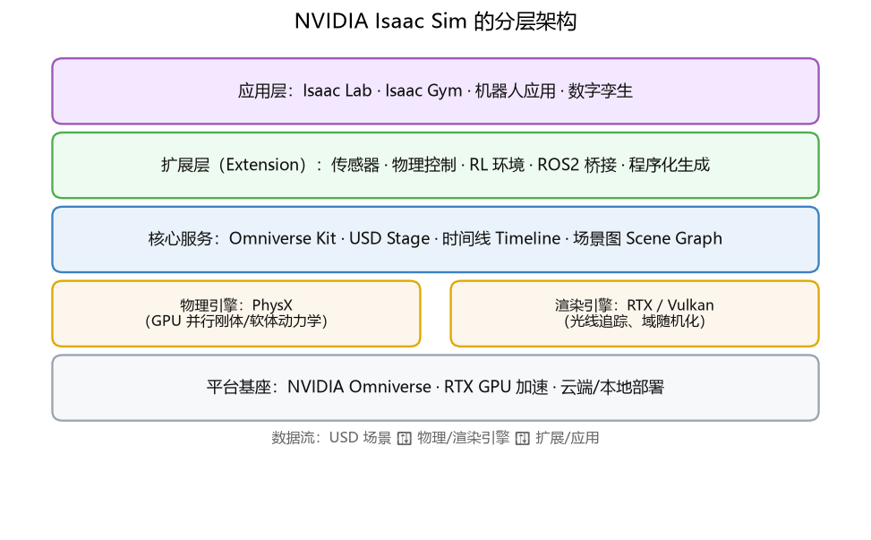
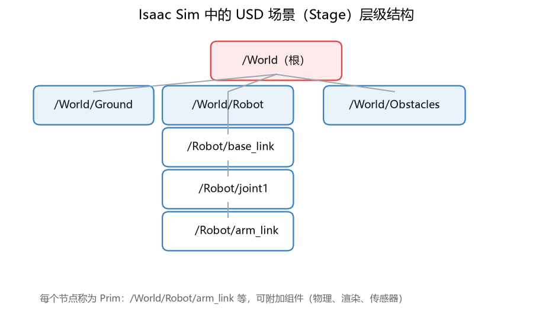
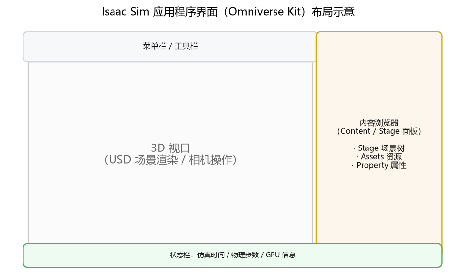
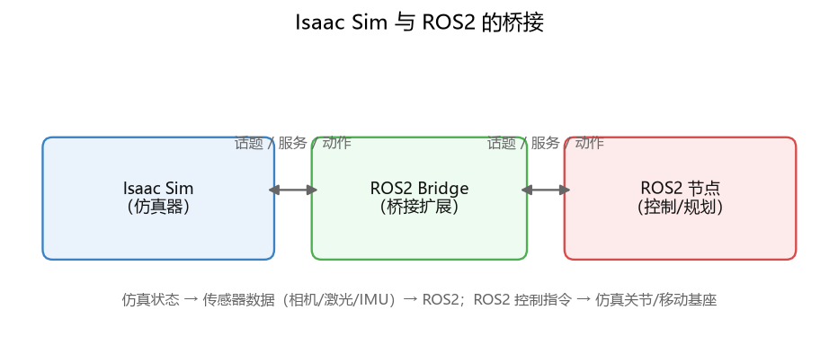
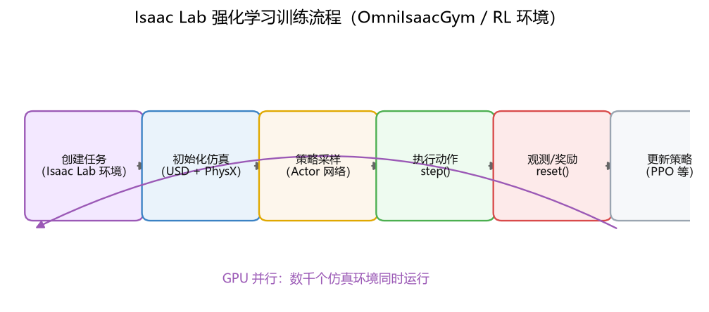
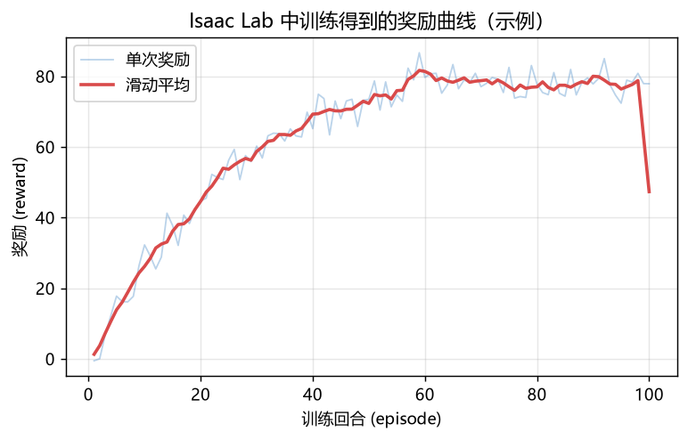

# 第 5 章 Isaac 在机器人仿真中的应用

Isaac（NVIDIA Isaac Sim / Isaac Lab）是 NVIDIA 推出的机器人仿真与合成数据生成平台，它建立在 Omniverse 之上，利用 RTX GPU 加速物理与渲染，支持 USD 通用场景描述、PhysX 物理引擎、域随机化、强化学习训练与 ROS2 桥接等功能。Isaac 已成为机器人研究、自动驾驶仿真、数字孪生与 "仿真到现实迁移（Sim2Real）" 的重要工具。本章围绕 Isaac 的简介、安装、概观、基础使用方法与运用展望展开介绍。

## 5.1 Isaac 简介

### 5.1.1 Isaac 的应用

Isaac 系列工具主要包括 **Isaac Sim**（通用仿真平台）与 **Isaac Lab**（面向强化学习的开源框架），可应用于：


* 机器人算法开发与验证：在仿真中快速迭代运动规划、控制与感知算法；

* 强化学习训练：利用 GPU 并行在数千个仿真环境中同时训练策略；

* 合成数据生成：为视觉模型生成带标注的仿真图像数据；

* 数字孪生：构建真实产线、仓储或家庭场景的数字化镜像；

* 自动驾驶与仓储物流仿真、机械臂操作、移动机器人导航等。

### 5.1.2 Isaac 的特性

Isaac 有以下几种主要的特性：

(1) **GPU 加速物理**：Isaac 基于 NVIDIA PhysX 物理引擎，刚体、软体、关节与碰撞检测均在 GPU 上并行计算，单卡即可并行运行数千个仿真环境。

（2）**光线追踪渲染**：基于 RTX 的实时渲染提供照片级真实感，并支持 RGB 相机、深度相机、分割相机、激光雷达等传感器仿真。

（3）**基于 USD 的场景描述**：场景由通用场景描述（Universal Scene Description, USD）文件组织，与 Pixar、Omniverse 生态无缝衔接，支持大规模场景与协作。

（4）**模块化扩展机制**：通过 Extension（扩展）体系，用户可以灵活地加载传感器、控制器、RL 环境、ROS2 桥接等模块，也可编写自定义扩展。

（5）**域随机化与 Sim2Real**：支持对材质、光照、物理参数、传感器噪声进行随机化，提升仿真策略向真实机器人迁移的鲁棒性。

### 5.1.3 Isaac 的下载与安装

Isaac Sim 的安装方式主要有以下几种：


1. **通过 Omniverse Launcher 安装**（推荐）：下载并安装 NVIDIA Omniverse Launcher，在 Launcher 的 "Exchange" 页面中找到 Isaac Sim，一键下载安装。安装完成后可以直接从 Launcher 启动。

2. **通过源码安装 Isaac Lab**：Isaac Lab 是开源框架，可以在已安装 Isaac Sim 的基础上克隆并安装：


```
# 克隆 Isaac Lab 仓库
git clone https://github.com/isaac-sim/IsaacLab.git
cd IsaacLab

# 创建并激活 conda 环境（需要 NVIDIA GPU 与 CUDA）
conda env create -f environment.yaml
conda activate isaaclab

# 安装 Isaac Lab 相关包
./isaaclab.sh --install
```


1. **通过 Docker 部署**：NVIDIA 提供 Isaac Sim 的 Docker 镜像，适合云端与服务器部署：


```
docker pull nvcr.io/nvidia/isaac-sim:latest
```

需要说明的是，Isaac 依赖 NVIDIA GPU（RTX 系列）、CUDA 与 Windows/Linux 系统，安装包体积较大（数十 GB 级），建议在配置足够的机器上安装使用。安装完成后，可以在命令行中运行一个最小的 Python 脚本验证安装：


```
from omni.isaac.kit import SimulationApp

# 以无头模式启动 Isaac Sim 应用
simulation_app = SimulationApp({"headless": True})
print("Isaac Sim 启动成功")
simulation_app.close()
```

## 5.2 Isaac 概观

### 5.2.1 Isaac 基本架构

Isaac Sim 的整体架构如图 5-1 所示，自下而上分为平台基座、物理 / 渲染引擎、核心服务、扩展层与应用层：




图 5-1 NVIDIA Isaac Sim 的分层架构

{: .figure-caption}

* **平台基座**：NVIDIA Omniverse 平台与 RTX GPU 加速，支持本地与云端部署；

* **物理 / 渲染引擎**：PhysX 物理引擎（GPU 并行刚体 / 软体动力学）与 RTX/Vulkan 渲染引擎（光线追踪、域随机化）；

* **核心服务**：Omniverse Kit 应用框架、USD Stage（场景）、Timeline（时间线）、Scene Graph（场景图）；

* **扩展层**：传感器、物理控制、RL 环境、ROS2 桥接、程序化生成等扩展模块；

* **应用层**：Isaac Lab、Isaac Gym、机器人应用与数字孪生等。

### 5.2.2 关于 Isaac 中的一些说明

在使用 Isaac 之前，需要理解几个核心概念：

1. **Stage（场景）与 Prim（图元）**：Isaac 中的一切对象（机器人、障碍物、灯光、相机）都是 USD 场景中的一个 "Prim"（图元），组织成层级化的树状结构，如图 5-2 所示。每个 Prim 可以有物理、渲染、传感器等 "属性"（Attribute）或组件。




图 5-2 USD 场景（Stage）的层级结构

{: .figure-caption}

1. **Timeline（时间线）**：Isaac 使用时间线管理仿真时间，`world.step()` 或 `simulation_app.update()` 每调用一次，时间线前进一帧。

2. **Articulation（关节机构）**：由多个刚体连杆与关节组成的机器人模型称为 Articulation，Isaac 提供关节角度 / 速度 / 力矩的读取与设置接口。

3. **物理与渲染分离**：物理步长（如 1/60 s）与渲染帧率相互独立，可以分别设置，适合高精度物理仿真与高帧率渲染。

4. **GPU 并行**：物理与渲染均在 GPU 上执行，通过 CUDA 图（CUDA Graphs）支持数千环境并行训练。

### 5.2.3 Isaac 公约与准则

在 Isaac 中建模与仿真时，通常遵循以下约定：

* **坐标系**：使用 USD 的右手坐标系，Z 轴向上（与 ROS 一致），单位通常为米（meter）。

* **关节约定**：关节角度使用弧度（radian）；通过 `ArticulationView` 的 `set_joint_positions` 等接口设置目标。

* **命名约定**：场景中的对象使用 `/World/xxx` 的绝对路径命名；机器人各连杆、关节名与 URDF/USD 中保持一致。

* **物理参数**：质量、惯性、摩擦、阻尼等参数在 USD 的物理属性中设置，或在加载 URDF/USD 后通过代码修改。

### 5.2.4 Isaac 中机器人概述

在 Isaac 中加载机器人模型有两种常用方式：加载 USD 文件，或加载 URDF（自动转换为 USD）。加载后，可以获取 Articulation 并控制关节。示例（以 Franka 机械臂为例）：

```
from omni.isaac.core import World
from omni.isaac.core.utils.stage import add_reference_to_stage
from omni.isaac.core.articulations import ArticulationView

# 创建仿真世界
world = World(stage_units_in_meters=1.0)

# 将机器人 USD 添加到场景
usd_path = "/path/to/franka.usd"          # 替换为实际 USD 路径
add_reference_to_stage(usd_path, "/World/Franka")

world.reset()

# 获取 ArticulationView 并读取关节信息
franka = ArticulationView(prim_paths_expr="/World/Franka", name="franka_view")
joint_names = franka.dof_names
print("关节名称：", joint_names)
```

运行结果（以 Franka Panda 为例）为：

```
关节名称： ['panda_joint1', 'panda_joint2', 'panda_joint3', 'panda_joint4', 'panda_joint5', 'panda_joint6', 'panda_joint7', 'panda_finger_joint1', 'panda_finger_joint2']
```

### 5.2.5 扩展与接口说明

Isaac 的功能通过扩展（Extension）组织，常用的扩展包括：

1. **omni.isaac.core**：核心 API，提供 World、Articulation、XFormPrim、传感器等基础接口；

2. **omni.isaac.sensor**：相机（RGB / 深度 / 分割）、IMU、激光雷达等传感器；

3. **omni.isaac.lab / isaaclab**：面向强化学习的任务与环境框架（原 omni.isaac.gym）；

4. **omni.isaac.ros2\_bridge**：ROS2 桥接扩展；

5. **omni.isaac.urdf**：URDF 导入扩展。

Isaac Sim 的应用程序界面（基于 Omniverse Kit）如图 5-3 所示，包含 3D 视口、Stage 面板、Content 资源面板与属性面板等。




图 5-3 Isaac Sim 应用程序界面（Omniverse Kit）布局示意

{: .figure-caption}

### 5.2.6 网络协议和脚本

Isaac 与外部系统通过多种方式通信：

1. **ROS2 桥接**：通过 `omni.isaac.ros2_bridge` 扩展，Isaac 可以将仿真状态、相机图像、激光点云等发布为 ROS2 话题，也可以订阅 ROS2 的速度 / 关节指令，实现 "仿真 ↔ 真实算法" 的无缝对接（详见 5.4.1 节）。

2. **OmniGraph**：基于节点图的程序化逻辑（Action Graph），可以在不写代码的情况下搭建感知 - 控制流程。

3. **Python 脚本**：所有功能均可通过 Python API 调用，便于自动化与批量实验。

## 5.3 Isaac 的基础

### 5.3.1 开始使用 Isaac

使用 Isaac 编写仿真程序的基本流程是：启动 SimulationApp → 创建 World → 加载场景 / 机器人 → 进入仿真循环（步进 + 读取状态）。下面是一个完整的示例：

```
from omni.isaac.kit import SimulationApp

# 1. 启动 Isaac Sim（headless=True 表示无窗口模式）
simulation_app = SimulationApp({"headless": True})

from omni.isaac.core import World
from omni.isaac.core.utils.stage import add_reference_to_stage

# 2. 创建仿真世界
world = World()

# 3. 加载机器人（以 USD 为例，路径需替换为实际文件）
add_reference_to_stage("/path/to/robot.usd", "/World/Robot")

# 4. 仿真主循环：步进 100 帧
for i in range(100):
    world.step(render=False)
    if i % 10 == 0:
        print("仿真帧：", i)

# 5. 关闭应用
simulation_app.close()
```

> **说明：**
>
> 上述代码需要在安装 Isaac Sim/Lab 的环境中运行，并需准备对应的 USD 模型文件。Isaac 官方提供大量示例（
>
> `/isaac-sim/standalone_examples/`
>
> ）可供参考。

### 5.3.2 Isaac 的命令行工具

Isaac Sim 提供了多种命令行工具：

```
# 启动 Isaac Sim 图形界面
./isaac-sim.sh

# 以无头模式运行 Python 脚本（服务器/训练场景）
./python.sh my_script.py

# 运行 Isaac Lab 的测试/训练
./isaaclab.sh --test
./isaaclab.sh --train

# 查看命令行帮助
./isaac-sim.sh --help
```

常用的启动参数包括 `--/app/launcher`（是否打开界面）、`--/log/level`（日志级别）等。通过 `python.sh` 可以直接执行独立的 Python 仿真脚本，方便批量实验与 CI 集成。

### 5.3.3 写 Isaac 文档

Isaac 的扩展都带有文档字符串与示例，可以使用 `help()` 在 Python 中查看：

```
from omni.isaac.core import World
help(World)                 # 查看 World 类的方法与说明
help(World.step)            # 查看 step 方法的说明
```

同时，Isaac Lab 提供了丰富的环境与任务示例（位于 `isaaclab_tasks` 目录），包括机械臂操作、四足行走、灵巧手操作等，可直接作为二次开发的模板。

### 5.3.4 环境变量

常用的环境变量包括：

| 环境变量         | 作用                                                         |
| ---------------- | ------------------------------------------------------------ |
| `ISAAC_SIM_PATH` | Isaac Sim 的安装路径                                         |
| `OMNI_KIT_ARGS`  | 传递给 Omniverse Kit 的附加参数                              |
| `PYTHONPATH`     | 加入 `site-packages` 与扩展路径，便于导入 `omni.isaac.*` 模块 |
| `ISAACLAB_PATH`  | Isaac Lab 的安装路径                                         |

在 Windows 下，可通过设置环境变量让 Python 找到 Isaac 模块：

```
set ISAAC_SIM_PATH=C:\Users\xxx\AppData\Local\ov\pkg\isaac_sim-2023.1.1
set PYTHONPATH=%ISAAC_SIM_PATH%\site-packages;%PYTHONPATH%
```

## 5.4 Isaac 运用与展望

### 5.4.1 Isaac 的运用项目举例

**（1）与 ROS2 的应用**

Isaac Sim 与 ROS2 的桥接是机器人开发中最常见的用法之一。通过 `omni.isaac.ros2_bridge` 扩展，可以在仿真中发布相机图像、激光点云、里程计等话题，并订阅 ROS2 的控制指令，使真实的 ROS2 导航 / 规划 / 控制代码直接在仿真中运行，如图 5-4 所示：




图 5-4 Isaac Sim 与 ROS2 的桥接示意

{: .figure-caption}

在启动脚本中加入桥接扩展即可启用：

```
from omni.isaac.kit import SimulationApp

simulation_app = SimulationApp({
    "headless": False,
    "enable_camera_pose": True,
})
# 在命令行或扩展配置中加载 ros2_bridge 扩展
# --enable omni.isaac.ros2_bridge
```

**（2）Isaac Lab 强化学习训练**

Isaac Lab 是 Isaac 面向强化学习的开源框架，其训练流程如图 5-5 所示：创建任务环境 → 初始化仿真（USD + PhysX）→ 策略采样 → 执行动作 → 获取观测 / 奖励 → 更新策略，并利用 GPU 并行同时运行数千个环境。




图 5-5 Isaac Lab 强化学习训练流程

{: .figure-caption}

一个典型的 Isaac Lab 环境构建代码如下：

```
from isaaclab.envs import ManagerBasedEnv
from isaaclab_tasks.manager_based.manipulation.lift import mdp_cfg

# 环境配置（简化示例，实际使用需引用完整的任务配置）
env_cfg = mdp_cfg.LiftEnvCfg()
env = ManagerBasedEnv(cfg=env_cfg)

obs, _ = env.reset()
for i in range(200):
    action = env.action_space.sample()   # 随机动作（训练时由策略输出）
    obs, reward, terminated, truncated, info = env.step(action)
print("观测维度：", obs.shape)
```

训练过程中记录的奖励曲线如图 5-6 所示（示例数据，实际结果因任务与超参数而异）：




图 5-6 强化学习训练过程中的奖励曲线（示例）

{: .figure-caption}

**（3）合成数据生成**

利用 Isaac 的 RTX 渲染与域随机化，可以批量生成带标注的图像数据（目标检测框、分割掩码、深度图、相机外参等），用于训练视觉模型。Isaac 的 `omni.replicator` 扩展提供了一套程序化合成数据管线。

### 5.4.2 Isaac 的展望

随着生成式人工智能与机器人技术的融合，Isaac 平台的发展方向包括：

1. **更高效的 Sim2Real**：通过域随机化、神经渲染与真实感物理，缩小仿真与现实的差距；

2. **大规模并行训练**：利用多 GPU 集群并行训练具身智能体，加速基础模型（VLA，视觉 - 语言 - 动作模型）的研发；

3. **云端机器人开发**：与 NVIDIA 云服务结合，实现仿真 - 训练 - 部署的一体化工作流；

4. **与 MuJoCo 等轻量引擎互补**：用 MuJoCo 快速迭代算法、用 Isaac 做高保真验证，形成多保真度仿真体系（见第 3 章）。

## 本章小结

本章系统介绍了 Isaac 在机器人仿真中的应用：首先说明了 Isaac Sim/Isaac Lab 的应用场景、特性与安装方法；其次介绍了 Isaac 的分层架构、USD 场景与核心概念、机器人加载与关节控制、扩展与接口、ROS2 桥接等概观内容；然后介绍了开始使用 Isaac 的基本流程、命令行工具、文档与环境变量；最后通过 ROS2 桥接、Isaac Lab 强化学习训练与合成数据生成等运用实例，展示了 Isaac 在机器人开发与具身智能研究中的重要作用，并展望了其发展方向。Isaac 与第 3 章介绍的 MuJoCo 形成了 "轻量快速 + 高保真" 互补的仿真技术体系，是机器人研究者值得掌握的两类关键仿真工具。

## 参考文献

\[1] NVIDIA. Isaac Sim Documentation. [https://docs.omniverse.nvidia.com/isaacsim/latest/overview.html](https://docs.omniverse.nvidia.com/isaacsim/latest/overview.html).

\[2] NVIDIA. Isaac Lab Documentation. [https://isaac-sim.github.io/IsaacLab/](https://isaac-sim.github.io/IsaacLab/).

\[3] NVIDIA. Isaac Sim ROS2 Bridge. [https://docs.omniverse.nvidia.com/isaacsim/latest/isaac\_ros.html](https://docs.omniverse.nvidia.com/isaacsim/latest/isaac_ros.html).

\[4] NVIDIA Omniverse. Universal Scene Description (USD) 简介. [https://docs.omniverse.nvidia.com/usd/latest/](https://docs.omniverse.nvidia.com/usd/latest/).

\[5] Mittal M, Yu C, Yu Q, et al. Orbit: A unified simulation framework for interactive robot learning environments\[J]. IEEE Robotics and Automation Letters, 2023.

***
