# 第6章 机器人操作系统的基础

## 6.1 ROS 的安装与测试

### 6.1.1 虚拟机与 Ubuntu 的安装

虚拟机(Virtual Machine)指通过软件仿真一个完整的计算机系统,它可以使用本机的硬件系统,但同时与主要的计算机系统完全隔离。本章节将展示如何在虚拟机中安装Ubuntu 14.04操作系统以及如何在Ubuntu中使用ROS,下面以虚拟机软件VMware Workstation 10为例向读者介绍。

（1）在 Ubuntu 的网站(<https://www.ubuntu.com/download>)下载后缀名为 iso 的 Ubuntu 镜像文件, 注意相应的版本和计算机位数。

（2）启动 VMware Workstation，并选择创建虚拟机，进入新建虚拟机向导界面，如图 6-1 所示。

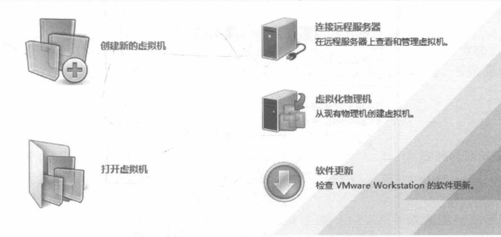

图 6-1 虚拟机向导界面
{: .figure-caption }


（3）如图 6-2 所示，选择“典型”的配置，安装来源选择，并选择“稍后安装操作系统”，然后选择“Linux”和相应的版本。

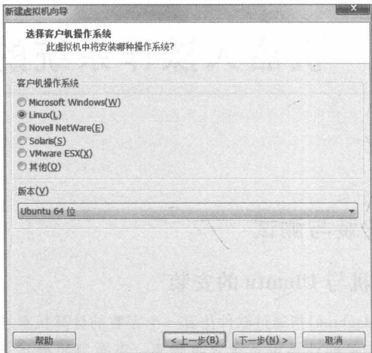

图 6-2 虚拟机安装界面一
{: .figure-caption }


（4）命名虚拟机的名称，并选择好相应的安装位置；如图 6-3 所示，然后根据自己的需求指定磁盘的容量，从而完成了虚拟机的创建。此时，在“我的计算机”一栏可以显示出我们已创建的虚拟机。

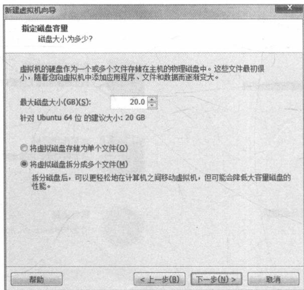

图 6-3 虚拟机安装界面二
{: .figure-caption }


（5）如图 6-4 所示, 虚拟机的设置, 在硬件的 CD/DVD 一栏中选择使用已下载的 ISO 文件。

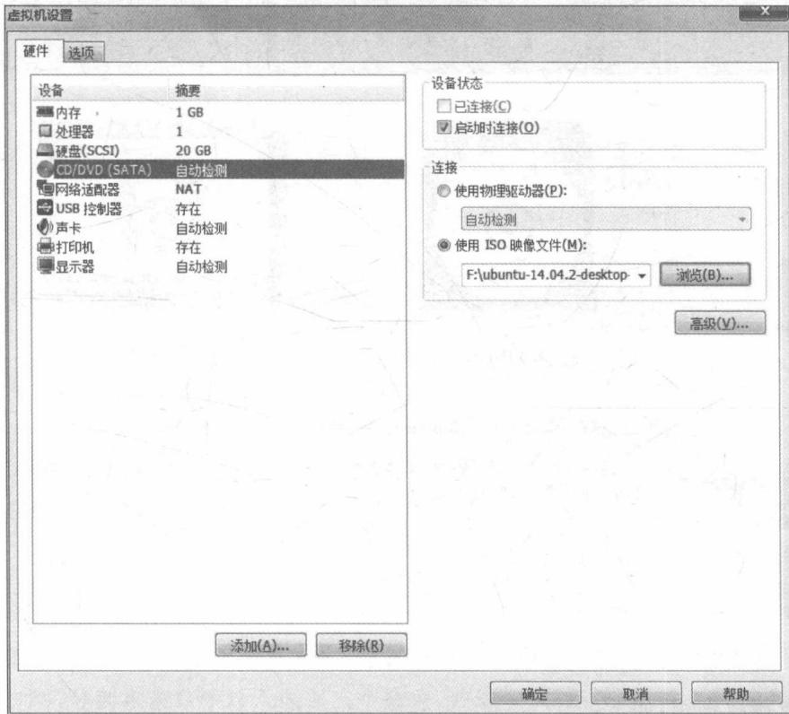

图 6-4 虚拟机安装界面三
{: .figure-caption }


（6）设置完开启虚拟机，从而进入 Ubuntu 的安装界面。如图 6-5 所示，根据自己的需求选择相应的安装设置，完成 Ubuntu 的安装。

需要说明的是,使用 VMware Workstation 安装 Ubuntu 不局限于以上的方法。使用这种方法的好处是在安装的过程中无须联网下载过多的系统更新,节省时间。安装完成后,在相应的系统安装位置生成了相应的虚拟机系统文件。

### 6.1.2 ROS 的安装

ROS 有三个版本, 下面只介绍 ROS 的 Indigo 版本在 Ubuntu 14.04 安装的详细步骤。

① 配置 Ubuntu 的存储库。使它允许“restricted”“universe”和“multiverse”。一般来说，它们已经被正确地配置，只需要确认以上的配置。

② 添加 ROS 的源列表。打开 Ubuntu 的终端窗口，输入以下指令添加 ROS 的源列表：

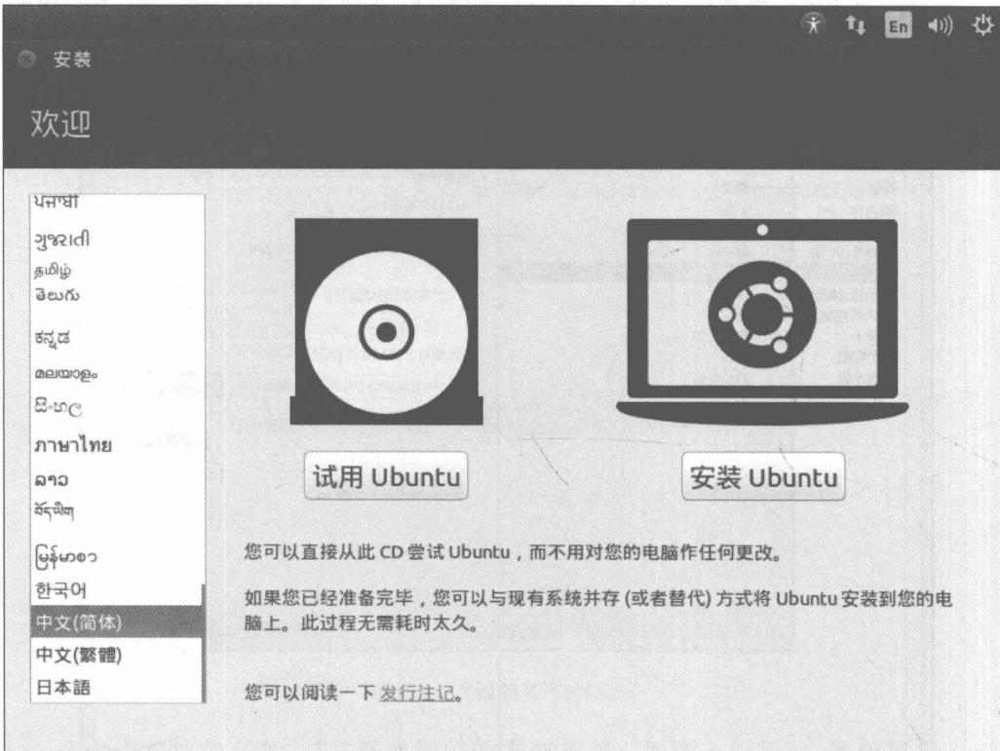

图6-5 Ubuntu的安装界面
{: .figure-caption }


③ 设置授权密钥, 如下:

```powershell
$ wget http://packages.ros.org/ros.key - 0 - | sudo apt - key add
```

④ 更新软件包,如下:

```txt
$ sudo apt-get update
```

⑤ 完整安装 ROS Indigo 版本, 如下:

```txt
$ sudo apt-get install ros-indigo-desktop-full
```

注：在安装的过程中可能会得到一个提示“hddtemp”，可以输入“No”，继续下一步的安装。

⑥ 初始化 rosdep 如下：

```shell
$ sudo rosdep init
$ rosdep update
```

⑦ 安装 roinstall 如下：

```shell
$ sudo apt-get install python-rosinstall
```

创建开发工作空间时的步骤如下：

① 创建 ROS 工作空间如下：

```txt
$ mkdir -p ~/ros_ws/src
```

② 设置 ROS 源如下：

```txt
$ source /opt/ros/indigo/setup.bash
```

③ 创建和安装如下：

```batch
cd ~/ros_ws
catkin_make
catkin_make install
```

### 6.1.3 turtlesim例子的测试

当安装好 ROS 时, 可使用 turtlesim 仿真器中一个简单的例子进行测试。首先打开三个不同的终端, 分别在窗口中输入以下三个命令, 并逐一执行:

对于终端一：

```txt
roscore
```

对于终端二：

```txt
rosrun turtlesim turtlesim_node
```

对于终端三：

```txt
rosrun turtlesim turtle_teleop_key
```

执行 3 个指令后, 将弹出以下的一个名为“TurtleSim”的仿真窗口, 在图像界面中有一个海龟。此时, 切换到终端三的界面中, 通过键盘的方向键可控制海龟进行运动。其中, “→”和“←”改变海龟的方向, “↑”和“↓”控制海龟的前进与后退。海龟在移动过程中, 背景界面会记录爬行的轨迹, 如图 6-6 所示。

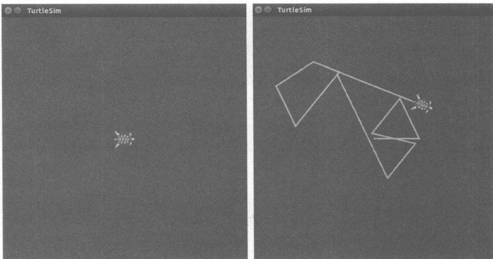

图 6-6 仿真实例：控制海龟移动
{: .figure-caption }


## 6.2 ROS 的基本概念与命令

### 6.2.1 程序包(packages)

程序包,简称为包,是 ROS 应用程序代码的组织单元。程序包中有一个重要的清单:Manifests 清单(package.xml)。它提供有关软件包的元数据,包括其名称、版本、描述、许可证信息、依赖关系和其他元信息(如导出的软件包)。

下面介绍程序包中常用的操作命令。

#### 查看软件包列表

rospack list

说明：运行该命令将会获取系统中已安装的所有 ROS 程序包，并以列表的形式呈现在窗口下面。

例如：输入命令：

rospack list

运行结果为：

```txt
actionlib_tutorials /opt/ros/indigo/share/actionlib_tutorials
```

其中，actionlib, actionlib\_msgs, actionlib\_tutorials 为程序包的名称，后面为程序包所在的目录。

#### 查找某程序包所在的目录

```txt
rospack find + package-name(程序包的名字)
```

说明：运行该命令能够获取某个程序包所在的目录。在这里，给读者们提供一个常用的小技巧，因为程序包的路径以及名称通常都比较冗长难记，因此，假如读者不能清楚记得某个程序包的名称时，可以通过 tab 命令补全的方法获取完整的程序包名称：即输入名称开头几个字母后，通过按下两次 Tab 键，便可获取所有以这些字母开头的程序包。

例如：（1）如查找程序包 camera\_calibration 的目录，输入命令：

```txt
rospack find actionlib
```

运行结果为：

```txt
/opt/ros/indigo/share/actionlib
```

（2）输入 rospack find actionlib 后，可以通过按两次 Tab 键，获取以“actionlib”开头的程序包，运行结果如下：

```txt
actionlib actionlib_msgs actionlib_tutorials
```

#### 查看程序包

```txt
rosls package - name
```

说明：运行该命令能够获取该程序包目录下的所有文件。

例如：通过前面的例子可以知道，actionlib 的目录为：opt/ros/indigo/share/actionlib，如图 6-7 所示，通过查找该目录可得到该目录下有以下 4 个文件（夹），用以下命令进行验证，输入命令。

```txt
rosls actionlib
```

运行结果为：

```batch
action cmake msg package.xml
```


图 6-7 程序包中的文件夹
{: .figure-caption }


#### 访问程序包

```txt
roscd package - name
```

说明：通过运行该命令可以访问某程序包的目录。

例如,输入如下命令:

```txt
roscd actionlib
```

运行结果为：

```txt
/opt/ros/indigo/share/actionlib$
```

它将当前的目录切换到 actionlib 的目录, 从而可以对该目录中的文件进行下一步操作。

### 6.2.2 节点(Nodes)和节点管理器(Master)

节点：节点是执行计算的进程。ROS设计为以节点为单位进行模块化；机器人控制系统通常包括许多节点。例如，一个节点控制激光测距仪，一个节点控制车轮电动机，一个节点执行定位，一个节点执行路径规划，一个节点提供系统的图形视图等。ROS的节点管理器提供名称注册和查找计算图形的其余部分。没有节点管理器，节点将无法找到彼此，执行交换消息或调用服务。

节点实质上是一个可执行文件,它可以通过 ROS 与其他节点进行通信。而在 ROS 中,实现节点与节点之间的关键部分为节点管理器。运行 ROS 的工作流程是:在一个终端中启动节点管理器,然后再打开其他终端运行其他程序。例如,前面的海龟仿真例子,先在一个终端中运行 roscore,然后在另外两个终端分别运行相关的程序。

#### 启动节点管理器

```txt
roscore
```

说明：当运行完所有与 ROS 相关的程序时，可通过 Ctrl+C 组合键停止节点管理器。

#### 启动节点

```txt
rosrun package - name executable - name
```

例如：海龟仿真在另外两个终端运行的命令为：

```txt
rosrun turtlesim turtlesim_node
```

```txt
rosrun turtlesim turtle_teleop_key
```

其中，turtlesim 为程序包名称，turtlesim\_node 和 turtle\_teleop\_key 为可执行文件名。

#### 查看节点列表

```txt
rosnode list
```

说明：运行该命令能够获取当前时间内正在运行的节点信息。

例如：运行海龟仿真时，可以看到3个节点的列表：

```ignorefile
/rosout
/teleop_turtle
/turtlesim
```

#### 查看节点

```txt
rosnode info node - name
```

说明：运行该命令能够获得某个节点的信息。

例如：查看 turtlesim 的信息，输入命令：

```txt
rosnode info turtlesim
```

## 运行结果为：

```txt
Node [/turtlesim]
Publications:
* /turtle1/color_sensor [turtlesim/Color]
* /rosout [rosgraph_msgs/Log]
* /turtle1/pose [turtlesim/Pose]
Subscriptions:
* /turtle1/cmd_vel [geometry_msgs/Twist]
Services:
* /turtle1/teleport_absolute
* /turtlesim/get_loggers
* /turtlesim/set_logger_level
* /reset
* /spawn
```

```txt
* /clear
* /turtle1/set_pen
* /turtle1/teleport_relative
* /kill
```

说明：能够获取的 3 种信息为 Publications、Subscriptions 和 Services。

5. 终止节点

```txt
rosnode kill node - name
```

说明：运行该命令能够终止某个节点，一般情况下对其他节点不会有影响。

例如，输入命令：

```txt
rosnode kill turtlesim
```

运行结果为：

```txt
killing /turtlesim
killed
```

### 6.2.3 消息 (Messages) 和主题 (Topics)

前文中提过,消息只是一个数据结构,包括类型字段。支持标准基本类型(整数、浮点、布尔等),以及原始类型数组。

主题：消息通过具有发布/订阅语义的传输系统进行交换。消息是 ROS 的一种数据类型，用于订阅或发布到一个主题。主题是用于标识消息内容的名称。节点通过将消息发布到给定主题来发出消息。对某种数据感兴趣的节点将订阅适当的主题。对于单个主题可以存在多个并发发布者和订阅者，单个节点也可以发布和订阅多个主题。

#### 获取主题列表

```txt
rostopic list
```

说明：运行该命令能够获取当前活跃的主题。

例如,运行海龟仿真的例子能够得到活跃的主题如下:

```ignorefile
/rosout
/rosout_agg
/turtle1/cmd_vel
/turtle1/color_sensor
/turtle1/pose
```

#### 打印消息内容

```txt
rostopic echo topic - name
```

说明：运行该指令某个主题上发布的消息。

例如，输入命令：

```txt
rostopic echo rosout
```

运行结果为：

```txt
header:
    seq: 1
    stamp:
    secs: 1481356969
    nsecs: 196580539
    frame_id: ''
level: 2
name: /turtlesim
msg: Spawning turtle [turtle1] at x = [5.544445], y = [5.544445], theta = [0.000000]
file: /tmp/binarydeb/ros-indigo-turtlesim-0.5.5/src/turtle_frame.cpp
function: string turtlesim::TurtleFrame::spawnTurtle
line: 182
topics: [/rosout', '/turtle1/pose', '/turtle1/color_sensor']
---
```

#### 测量发布频率

输出每秒发布的消息数量：

```txt
rostopic hz topic - name
```

说明：运行该指令能够获取每秒发布的消息数量。

输出每秒发布所占的字节量：

```txt
rostopic bw topic - name
```

说明：运行该指令能够获取每秒发布消息所占的字节量。

#### 查看主题信息

```txt
rostopic info topic - name
```

说明：能够获取消息类型、发布者和订阅者。

#### 查看消息类型

```txt
rosmsg show message - type - name
```

说明：运行该指令能够查看某种消息类型的信息。

#### 发布消息

```txt
rostopic pub - r rate - in - hz topic - name message - type message - content
```

说明：“rate”为指定的发布频率，用一个数值表示，后面的三项分别是主题名称、消息类型和信息内容。运行该指令能够手动地发布消息，重复地用指定的频率给指定的主题发布指定的消息。

例如,前面通过键盘控制海龟的速度和方向,通过发布消息的方法也可控制海龟移动。运行下面指令:

```csv
rostopic pub -r1 /turtle1/cmd_vel geometry_msgs/ Twist '[1,0,0]''[0,0,0]'
```

上面的指令中，发布频率为1，发布内容[1,0,0]表示线速度，[0,0,0]表示角速度。仿真效果为海龟沿着 $x$ 轴方向一直前进。

### 6.2.4 其他ROS的相关概念

(1) 元包(Stacks): Metapackages 是专门的包, 只用于表示一组相关的其他包。

（2）参数服务器(Parameter Server)：允许数据通过键存储在中央位置。它目前是节点管理器的一部分。

（3）服务(Services)：发布/订阅模型是一种非常灵活的通信范例，但是它的多对多，单向传输不适合请求/回复交互，这在分布式系统中通常是需要的。请求/应答通过服务完成，服务由一对消息结构定义：一个用于请求，另一个用于应答。

（4）包(Bags)：包是用于保存和播放 ROS 消息数据的格式。包是存储诸如传感器数据的数据的重要机制，其可能难以收集，但是对于开发和测试算法是必要的。

（5）分布(Distributions)：ROS 分布区是可以安装的版本化堆栈的集合。分布区对 Linux 发行版起着类似的作用：它们使得安装软件集合更容易，并且它们还在一组软件中保持一致的版本。

（6）存储库(Repositories)：ROS依赖于代码存储库的联合网络，其中不同的机构可以开发和发布自己的机器人软件组件。

（7）ROS wiki: ROS 社区 Wiki 是记录有关 ROS 的信息的主要论坛。任何人都可以注册一个账户，并提供自己的文档，提供更正或更新，写教程等等。

### 6.2.5 ROS的一些常用工具

#### rostopic

rostopic 是一个命令行工具,用于显示有关 ROS 主题的调试信息,包括发布者、订阅者、发布速率和 ROS 消息。

选项：

(1) rostopic echo [topic name]: 显示发布到主题的消息。

(2) rostopic list -v: 详细显示当前主题的列表。

（3）rostopic hz [topic name]：显示主题的发布速率。默认情况下报告的速率是rostopic已经运行的整个时间内的平均速率。

(4) rostopic pub [topic name] [msg type] [data]: 将数据发布到主题。

2. rqt\_console(a)

它提供了一个用于显示和过滤 ROS 消息的 GUI 插件。

3. rqt\_logger\_level(b)

它提供了一个用于配置 ROS 节点的记录器级别的 GUI 插件。

4. rqt graph

它提供了一个用于可视化 ROS 计算图的 GUI 插件。

## 6.3 ROS 的程序包的创建与编译

### 6.3.1 创建工作区和功能包

#### 创建工作区

ROS 的各类功能包都存放在工作区中,通过编译工作区来编写包含在它目录下的所有功能程序。同一网络中的功能包应该放在同一个工作区,以方便调试和交互。对于不相同或不相关的程序,应该避免放在同一个工作区中。这样可以区分不同的大型程序,也可以节省编译时间,以提高编译效率。

对于 ROS 程序的编写步骤,首先是创建一个能够容纳功能包的工作区,然后在这个工作区中创建相应的功能包。

（1）用一个 mkdir 命令创建一个新的文件夹作为工作区，例如创建的文件夹在 $\sim$ /home/yang/ros 中，运行下面的命令：

```txt
cd ~
mkdir - p yang/ros
```

（2）在目录创建新的文件夹后，需要将此新路径添加到 ROS\_PACKAGE\_PATH，只需要在～/. bashrc 文件的末尾添加一个新行：

```shell
echo "export ROS_PACKAGE_PATH = ~/yang/ros: ${ROS_PACKAGE_PATH} >>~/.bashrc
. ~/.bashrc
```

运行以上命令后,将完成在 ROS 中创建和配置新的工作区。

(3) 查看 ROS 正在使用的工作空间, 命令如下:

```powershell
$ echo $ ROS_PACKAGE_PATH
```

(4) 初始化工作区, 命令如下:

```shell
cd ~/yang/ros
catkin_init_workspace
```

(5) 编译工作区, 命令如下:

```txt
cd~/yang
catkin_make
```

#### 创建功能包

在新创建的工作区中创建一个 ROS 功能包：

```txt
catkin_create_pkg example1
```

如图 6-8 所示,为功能包成功创建时的界面。此时查看工作区发现多了两个文件: package.xml 和 CMakeLists.txt,都是与功能包相关的配置文件。其中,package.xml 是清单文件,前文已指出,清单文件定义了一个程序包,包括了包的名称、版本和依赖关系等内容。CMakeLists.txt 是一个 Cmake 脚本文件,包括了各种编译指令,例如与生成的可执行文件类型、源文件、头文件和链接库等相关的指令。

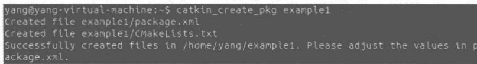

图 6-8 功能包创建成功界面
{: .figure-caption }


注意：CMake 是一个跨平台的编译工具，可以用简单的语句来描述所有平台的编译过程。

### 6.3.2 ROS 程序的编译过程

如图 6-9 所示, 使用 ROS 的 catkin 编译系统进行程序的编译有 4 个步骤。


图 6-9 编译系统的 4 个步骤
{: .figure-caption }


#### 依赖关系及依赖库的声明

## 1）一级依赖

之前在使用 catkin\_create\_pkg 命令时提供了几个程序包作为依赖包，现在可以使用 rospack 命令工具来查看一级依赖包。

```txt
$ rospack depends1 beginner_tutorials
• std_msgs
• rospy
• roscpp
```

rospack 列出了在运行 catkin\_create\_pkg 命令时作为参数的依赖包, 这些依赖包随后保存在 package.xml 文件中。

```xml
$ roscd beginner_tutorials
$ cat package.xml
    package>
    ...
    buildtool_depend>catkin /buildtool_depend>
    build_depend>roscpp /build_depend>
    build_depend>rospy /build_depend>
    build_depend>std_msgs /build_depend>
    ...
    /package>
```

## 2）间接依赖

在很多情况下，一个依赖包还会有它自己的依赖包，例如，rospy 还有其他依赖包。

```txt
$ rospack depends1 rospy
• genpy
• rosgraph
• rosgraph_msgs
• roslib
• std_msgs
```

一个程序包还可以有好几个间接的依赖包, 使用 rospack 可以递归检测出所有的依赖包。

```txt
$ rospack depends beginner_tutorials
cpp_common
rostime
roscpp_traits
roscpp_serialization
```

```ignorefile
genmsg
genpy
message_runtime
rosconsole
std_msgs
rosgraph_msgs
xmlrpcpp
roscpp
rosgraph
catkin
rospack
roslib
rospy
```

因此，对于一个 ROS 程序，需要声明程序所依赖的功能包，以让 catkin 定位编译程序包所需要的头文件和链接库。在程序包目录下相应的 CMakeLists.txt 文件有以下的命令行：

```cmake
find_package(catkin REQUIRED)
```

所依赖的其他包需添加到这一行的关键字 COMPONENTS 后面, 如下所示:

```cmake
find_package(catkin REQUIRED COMPONENTS package - names)
```

此外,还需在 package.xml 文件中列出依赖库,通过编译依赖和运行依赖两个关键字实现:

```txt
build_depend>package - name /build_depend>
run_depend>package - name /run_depend>
```

#### 声明可执行文件

对于程序包中的每一个可执行文件,需在 CMakeLists.txt 文件中添加两句命令,声明需要创建的可执行文件。第一行声明可执行文件的文件名,后面跟着相应的源文件列表。其中若包含多个源文件,则用空格分隔开:

```txt
add_executable(executable-name source-file1 source-file2 ... source-fileN)
```

第二行声明所需要的链接库：

```cmake
target_link_libraries(executable-name ${catkin_LIBRARIES})
```

#### 编译工作区

运行以下的命令可以编译包中的所有可执行文件：

```txt
catkin_make
```

#### 执行 setup.bash 脚本

运行以下命令可以执行名为 setup.bash 的脚本文件：

```txt
source devel/setup.bash
```

#### Hello World 程序的编译与执行

与其他基于计算机语言的程序一样，ROS 的程序也需要进行代码编写，代码编译与程序执行，才能够完成一定的功能。

对于一个简单的“Hello World”程序,它的代码如下:

```cpp
//ThisisaROSversionofthestandard"Hello,world"
//这是一个ROS版本的标准Hello World程序
//This header definesthe standard ROS classes.
//(这是ROS类头文件的声明)
#include ros/ros.h>
int main (int argc, char * * argv){
//Initialize the ROS system.
//对ROS系统进行初始化
ros::init (argc, argv, "hello_ros");
//Establish this program as a ROS node.
//将这个程序建立成ROS的一个节点
ros::NodeHandle nh;
//Send some output as a log message.
//发送一些日志消息
ROS_INFO_STREAM("Hello,world!");
}
```

编写完上面的代码后, 将文件保存为 HelloWorld.cpp 的名称。对上面的代码说明如下:

（1）函数 ros::init() 用于初始化 ROS 客户端库，需要在程序的起始处调用一次这个函数。ros::init() 函数最后的参数是一个包含节点默认名的字符串。

（2）函数 ros::NodeHandle(节点句柄)对象是程序用于和 ROS 系统交互的主要机制。创建此对象会将程序注册为 ROS 节点管理器的节点。最简单的方法就是在整个程序中只创建一个 NodeHandle 对象。ROS\_INFO\_STREAM 宏将生成一条消息，且这一消息被发送到不同的位置，包括控制台窗口。

完成代码的编写后,根据编译原理对 CMakeLists.txt 文件进行编辑,声明所需要的依赖库和可执行文件,并编译工作区。

```txt
1 # What version of CMake is needed? (说明所需要 CMake 的最小版本)
2 cmake_minimum_required (VERSION 2.8.3)
```

```cmake
3# Name of this package.
4 project (agitr)
5 # Find the catkin build system, and any other packages on
6 # which we depend.
7 find_pa cka ge (catkin REQUIRED COMPONENTS roscpp)
8# Declare our catkin package.
9catkin_package()
10# Specify locations of header files.
11include _directories(include ${catkin_INCLUDE_DIRS})
12 # Declare the executable, along with its sourcefiles. If there are multiple
13# executables, use multiple copies of this line.
14 add_executable(hello hello.cpp)
15# Specify libraries against which to link. Again, this line should be copied for each
16# distinct executable in the package.
17 target _link_ libraries (hello ${catkin_LIBRARIES})
```

当所有这些编译步骤完成后,要执行这个程序时,首先要启动 roscore: 一个程序就是一个节点,而一个节点需要一个节点管理器才可以正常运行。然后可使用指令 rosrun 来执行,输入以下命令:

```txt
rosrun agitrhello
```

这个程序会在终端打印类似于下面这样的输出：

```txt
[INFO] [1416432122.659693753]: Hello, world!
```

## 6.4 ROS 与 MATLAB 集成

第1章介绍了MATLAB拥有机器人原型设计和机器人仿真控制系统等强大的工具。然而，MATLAB与ROS之间的集成还存在着一定的难度。目前，MATLAB与ROS之间集成已经有多种解决方案，包括基于JavaScript对象符号的rosbridge(见<http://wiki.ros.org/rosbridge_suite)、>基于Java的ROS-MATLAB bridge和ROSlab-IPCbridge等。然而，这些集成都没有广泛应用，因为它们的安装比较困难，或者是在可用性和实用性上存在着一定的缺陷。

第 1 章介绍了 Robotics System Toolbox(RST) 工具箱具有的几个主要功能：路径规划、路径跟踪和地图表示算法，用于在不同旋转和平移表示之间转换的函数，与启用 ROS 的机器人进行双向通信。随着 MATLAB 2015a 的发布，MATLAB 与 ROS 之间集成有一个更好的选择。新的 MATLAB 版本引入新的机器人系统工具箱（Robotics System Toolbox）。

### 6.4.1 RST的ROS功能介绍

下面介绍 RST 为 MATLAB 与 ROS 之间提供通信的功能。RST 除了提供 MATLAB 和 Simulink 之间的接口，还提供了 MATLAB 与 ROS 之间的接口，使得 MATLAB 能够与 ROS 网络通信。

MATLAB与ROS的接口的功能有多种。首先是让用户能够进行交互式地探索机器人功能和可视化传感器数据。其次，用户可以启用可应用于ROS操作系统的机器人仿真器（如Gazebo和V-REP)，利用它们去设计开发机器人模型，并将仿真实验数据导入MATLAB，借助MATLAB强大的工具箱及数学工具去测试和验证用户的机器人算法和应用程序的性能。最后，用户还可以直接在MATLAB和Simulink中创建自包含ROS的网络，并导入ROS日志文件（rosbags）。借助MATLAB/Simulink对离线数据进行可视化、分析和后处理。这些功能允许用户在MATLAB和Simulink中开发机器人算法，同时使用户能够与ROS网络上的其他节点交换消息。此外，通过使用EmbeddedCoder，用户可以从Simulink模型生成 $\mathrm{C + + }$ 代码，因此MATLAB中编写的算法也可以在安装了ROS的任何Linux平台上运行独立的ROS应用程序。

总之，RST 的主要功能允许用户：

(1) 与 ROS 网络通信, 交互式探索机器人功能, 并可视化传感器数据;

(2) 直接从 MATLAB 和 Simulink 创建 ROS 节点、发布者和订阅者；

（3）从 MATLAB 和 Simulink 创建和发送 ROS 消息；

（4）从 MATLAB 和 Simulink 创建和发送 ROS 自定义消息；

(5) 调用并提供 ROS 服务；

(6) 导入 ROS 日志文件以可视化、分析和后处理记录的数据；

(7) 在任何(包括 Windows, Linux, Mac)平台上使用 ROS 功能;

(8) 使用 MATLAB 作为 ROS 主机；

（9）在启用 ROS 的机器人和机器人仿真器（如 Gazebo 和 V-REP）上测试和验证应用程序；

(10) 创建与 ROS 网络一起使用的 Simulink 模型；

(11) 从 Simulink 模型生成独立的 ROS C++ 节点。

### 6.4.2 MATLAB与ROS通信的介绍

#### 通信

简单介绍 MATLAB 与 ROS 进行通信的功能如下。

首先在安装有 ROS 的主机运行 ROS 系统,然后我们用 ROS 主机的 IP 地址和端口号来初始化 MATLAB ROS 子系统,运行下面的指令:

如果没有提供参数,那么 MATLAB 将创建一个 ROS 主服务器,然后会显示它的 URI,以便于被其他节点使用。

#### 发布主题

接下来要发布一个主题。在这里使用一个简单的例子进行说明。首先我们将创建一个标准字符串类型的消息对象，然后设置它的值，输入以下指令：

```txt
msg = rosmessage('std_msgs/String');
msg.Data = 'hello, MATLAB';
```

消息是一个对象,它的属性是分层的,并且匹配消息的字段。可以直接读取或写入属性,不必使用 setter 或 getter 方法。

然后进行发布,输入以下指令:

```javascript
rospublisher('/MyTopic', msg);
```

或者,可以创建一个发布者对象并可选择指定消息类型,输入以下指令:

```txt
pub = rospublisher('/MyTopic', 'std_msgs/String');
```

然后调用它的 send 方法, 输入以下指令:

```txt
pub. send(msg);
```

可以在构建时为发布方对象配置各种选项。

#### 接收主题

进行接收主题已比较简单。首先，为特定主题创建一个订阅者对象，并可选择指定消息类型，输入以下指令：

```txt
sub = rossubscriber('/MyTopic', 'std_msgs/String')
```

构造函数有各种选项来控制缓冲区大小,以及是否只返回最近的消息。阅读关于主题的下一条消息,输入以下指令:

```txt
msg = sub.receive()
```

这时,它将会处于阻塞状态,直到接收到消息才解除该状态。但是我们也可以指定超时间隔(以秒为单位)将解除该状态,输入以下指令:

```txt
msg = sub.receive(5)
```

对轮询消息的替代方法是建立回调,输入以下指令:

```txt
sub = rossubscriber('/MyTopic', std_msgs/String', @rxcallback)
```

对于函数：

```javascript
function rxcallback(src, msg) disp([char(msg.Data()), sprintf('\nMessage received: %s', datestr(now))]);
```

它在每个消息接收上被调用。

接下来,看一个更复杂的消息:

```python
msg = rosmessage('geometry_msgs/TwistStamped'),
```

我们可以看到它的定义,输入以下指令:

```txt
>> definition(msg)
```

或访问其中一个字段输入以下指令：

```txt
msg.Twist.Linear.X = 0;
```

ROS 参数可以通过返回的 ParameterTree 对象进行访问, 输入以下指令:

```python
ptree = rosparam,
```

此外,可以使用它来设置,获取,创建或删除 ROS 参数服务器中的参数,输入以下指令:

```python
ptree.get('rosversion')
ptree.set('myparameter', 23)
```

#### 访问和创建服务

同时,参数可以具有整数、逻辑、字符、双精度或单元格数组类型,还可以在 MATLAB 代码中访问和创建服务。在这里以一个简单的例子进行介绍,可以创建一个服务来添加两个整数。输入以下指令:

```javascript
sumserver = rossvcserver('/sum', rostype.roscpp_tutorials_TwoInts, @SumCallback),
```

实行一定的服务功能,输入以上指令:

```javascript
function resp = SumCallback(~,req,resp)resp.Sum = req.A + req.B;
```

现在,我们可以从任何 ROS 节点进行调用,输入以下指令:

```txt
$ rosservice call /sum2 12 sum: 3
```

或者,首先从 MATLAB 内部创建一个服务客户端,输入以下指令:

```txt
sumclient = rossvcclient('/sum'),
```

然后,创建带有要添加的号码的消息,输入以下指令:

```matlab
sumreq = rosmessage(sumclient);
sumreq.A = 2;
sumreq.B = 1,
```

最后输入以下指令,调用该服务:

```prolog
sumresp = call(sumclient, sumreq, 'Timeout', 3)
>> sumresp.Sum ans = 3.
```

#### 读写 ROS 包文件

首先,打开 bag 文件并列出可用的主题,输入以下指令:

```txt
bag = rosbag('quad-2014-06-13.bag')bag.AvailableTopics.
```

要提取主题/预览上的所有图像,使用 select 方法选择特定主题,使用 readMessages 提取 100 个消息的单元格数组,其类型为 sensormsgs/Image,然后将其转换为单元格数组的可以显示的图像。输入以下指令:

```txt
preview = bag.select('Topic', 'preview')
subset = preview.readMessages(500:599)
images = cellfun(@readImage, all, 'UniformOutput', false);
```

我们还可以提取惯性测量单元(IMU)数据,并且将 x 轴平移和 z 轴角速度放置到一个时间序列(Timeseries)对象中。它将会自动拾取消息的时间,并具有用于分析和显示的各种方法,输入以下指令:

```matlab
imu = bag.select('Topic', 'fcu/imu');
ts = imu.timeseries('LinearAcceleration.X', 'AngularVelocity.Z');
ts.plot
```

#### MATLAB 中的交互式命令

在 MATLAB 环境中有许多交互式命令, 它们模仿 ROS 命令行, 来查找消息、节点、主题、参数或服务, 例如, 以下指令:

```txt
>> rosmsg list
>> rosmsg show geometry_msgs/ TwistStamped
>> rosnode list
>> rostopic list
>> rosparam list
>> rosservice list
```

它们提供了在 MATLAB 中编写代码所需的所有编程工具, 可以完全参与基于 ROS 的机器人控制系统。MATLAB-ROS 的一个强大的优势是它的平台独立性。它的代码可以在 Mac、Windows 或 Linux 系统上工作。

#### ROS 与 Simulink

程序化实现的另一种方法是使用 Simulink 框图为环境建模。RST 提供了一个包含 Publish 和 Subscribe 的板块。例如，Subscribe 板块的 Msg 输出是总线类型，我们可以使用 Simulink 总线选择器来提取特定消息字段。使用触发子系统来确保仅在接收到消息之后才发布消息。通过适当的 Simulink 设置，此控制器可以“实时”运行，Scope 块允许我们方便地查看发生了什么。当然，我们可以将信号记录到工作空间变量，以供以后分析和图形显示。

最后,可以将生成的图用代码导出。这时,Simulink 将生成一个格式为.tgz 的文件。它包含在 Linux 系统上构建独立实时 ROS 节点所需的所有代码。

本节介绍了 MATLAB 与 ROS 之间通信的基本知识。随着需求加大和技术发展,我们相信,MATLAB 的 RST 工具箱将开发出更丰富更强大的功能,使得科研人员和工程师能够更方便、更有效地创建机器人控制系统,并利用大型和成熟的 ROS 代码库。关于 RST 实现 ROS 与 MATLAB/Simulink 之间的更多例子,可以参照网站:

<https://www.mathworks.com/hardware-support/robot-operating-system.html>

## 6.5 ROS 与 V-REP 之间的集成

在 V-REP 部分中提到，在 ROS 的工作机制中，V-REP 可以作为一个 ROS 节点，能够通过 3 种方式与其他 ROS 节点进行通信：V-REP 节点提供 ROS 服务；V-REP 节点作为 ROS 发布者；V-REP 节点作为 ROS 用户。其中，有 4 种插件用于 V-REP 与 ROS 之间的通信：RosInterface、RosPlugin、ROS skeleton 插件和 ROS V-Rep Bridge。其中，RosInterface 和 RosPlugin 是 V-REP 官方开发的插件。

### 6.5.1 V-REP 中的 ROS 程序包

V-REP 中的一般 ROS 功能通过两个不同的接口支持：RosInterface (libv\_repExtRosInterface.so) 和 RosPlugin(libv\_repExtRos.so)。其中，RosInterface 的使用更加方便简单,与 ROS 的 C/C++ API 相似,推荐使用。

V-REP 的 Linux 发行版应该已经在 V-REP/compiledRosPlugins 包括这些已经编译好的文件,但是它们首先需要复制到 V-REP 的主文件夹中,否则这些插件在 V-REP 运行时不会被加载。然而,当一切准备就绪后,也可能会遇到插件加载的问题,具体取决于系统的特定性。当 V-REP 启动时加载插件,确保始终检查 V-REP 的终端窗口有关插件加载操作的详细信息。如果 roscore 当时运行,则 ROS 插件将会成功加载并进行初始化。

如果无法加载插件,那么应该自己重新编译它们。它们是开源的,可以根据需要进行修改,以支持特定功能或扩展其功能。programming/ros\_packages 文件夹程序包含以下 8 个软件程序包:

(1) ros\_bubble\_rob: 这是一个机器人控制器的程序包, 通过 RosPlugin 连接到 V-REP。在下面的例子中, 该节点将负责控制演示场景 controlTypeExamples.ttt 中的暗红色机器人。

（2）ros\_bubble\_rob2：这是一个机器人控制器的程序包，通过 RosInterface 连接到 V-REP。在下面的例子中，该节点将负责控制示例场景 controlTypeExamples. ttt 中的亮红色机器人。

（3）vrep\_common：此程序包用于生成实现 RosPlugin 的 V-REP API 函数所需的服务和流消息。使服务和流消息在单独的程序包中允许其他应用使用它们，以便以方便的方式经由 RosPlugin 与 V-REP 通信。

（4）v\_repExtRosInterface：这个程序包是 RosInterface，将被编译为“.so”文件，并由 V-REP 使用。

（5）vrep\_plugin：这个程序包是将被编译为“.so”文件，并由V-REP使用的RosPlugin。

(6) vrep\_joy: 此软件程序包支持与操纵杆进行交互。

(7) vrep\_skeleton\_msg\_and\_srv: 这个程序包等效于 vrep\_common，并且可以用于为 V-REP 创建特定的 ROS 插件。例如，为特定机器人支持 ROS 消息。

(8) vrep\_plugin\_skeleton: 这个程序包等效于 vrep\_plugin, 也和上面的软件程序包相似, 可以用于为 V-REP 创建自己的特定 ROS 插件。

### 6.5.2 在 ROS 中安装 V-REP

在 ROS 中安装 V-REP 的具体步骤是：

① 在 V-REP 的官网下载相应版本的 V-REP;

② 在 ROS 的终端中通过以下指令转到 V-REP 所在的文件夹并要运行它：

## \~./vrep.sh;

③ 把 programming/ros\_packages 文件夹中的程序包复制到 catkin\_ws/src 文件夹中，确保 ROS 知道这些程序包，即可以切换到以上程序包文件夹。可以用以下命令：

```txt
$ roscd vrep_ros_interface
$ roscd vrep_plugin
$ roscd vrep_common
$ roscd vrep_joy
$ roscd ros_bubble_rob
$ roscd ros_bubble_rob2
$ roscd vrep_skeleton_msg_and_srv
$ roscd vrep_plugin_skeleton
```

### 6.5.3 在 ROS 中创建相关的 V-REP 程序包

（1）为了构建软件程序包，切换到 catkin\_ws 文件夹并键入：

```txt
$ export VREP_ROOT = ~/path/to/v_rep/folder
$ catkin build
```

（2）软件程序包应该已经生成并编译为可执行文件或库。将创建的文件复制并粘贴到V-REP安装文件夹中，插件即可以使用了。确保已安装所有必需的项目，使编译工作没有问题。例如，vrep\_joy程序包需要安装joystick驱动程序为：

```txt
$ sudo apt-get install ros-indigo-pr2-controllers ros-indigo-joystick-drivers
```

（3）V-REP 中的两个可用 ROS 插件(即 RosInterface 和 RosPlugin)可以并行操作,但是在这里我们将使用 RosInterface,因为它更灵活,并且还支持大多数标准 ROS 消息。接下来,我们将继续介绍基于 RosInterface 的方法。一旦有了 RosInterface 库,打开一个终端并启动:

```txt
ROS master: $ roscore
```

(4) 打开另一个终端, 移动到 V-REP 安装文件夹并启动 V-REP。运行下面的指令:

```txt
$ ./vrep.sh
License file 'v_rep':
    --->ok
Simulator launched.
Plugin 'BubbleRob': loading...
Plugin 'BubbleRob': load succeeded.
Plugin 'K3': loading...
Plugin 'K3': load succeeded.
Plugin 'RemoteApi': loading...
Plugin 'RemoteApi': load succeeded.
Plugin 'RosInterface': loading...
Plugin 'RosInterface': load succeeded.
```

(5) 成功地加载 Ros Interface 后, 检查可用的节点, 运行下列指令:

```shell
$ rosnode list
/rosout
/vrep_ros_interface
```

（6）在空的 V-REP 场景中，选择一个对象，然后依次选择菜单栏、添加、关联的子脚本、非线程，将非线程子脚本附加到它。打开该脚本的脚本编辑器，并将内容替换为以下内容：

```lua
function subscriber_callback(msg)
    -- This is the subscriber callback function
    simAddStatusBarMessage('subscriber receiver following Float32: '..msg.data)
end

function getTransformStamped(objHandle, name, relTo, relToName)
    -- This function retrieves the stamped transform for a specific object
    t = simGetSystemTime()
    p = simGetObjectPosition(objHandle, relTo)
    o = simGetObjectQuaternion(objHandle, relTo)
    return {
    header = {
    stamp = t,
    frame_id = relToName
    },
    child_frame_id = name,
    transform = {
    translation = {x = p[1], y = p[2], z = p[3]},
    rotation = {x = o[1], y = o[2], z = o[3], w = o[4]}
    }
    }
end

if (sim_call_type == sim_childscriptcall_initialization) then
    -- The child script initialization
    objectHandle = simGetObjectAssociatedWithScript(sim_handle_self)
    objectName = simGetObjectName(objectHandle)
    -- Check if the required RosInterface is there:
   名单Name = 0
    index = 0
    rosInterfacePresent = false
    while名单Name do
    moduleName = simGetModuleName(index)
    if (名单Name == 'RosInterface') then
    rosInterfacePresent = true
    end
```

```lua
index = index + 1
end

-- Prepare the float32 publisher and subscriber (we subscribe to the topic we advertise):
    if rosInterfacePresent then
    publisher = simExtRosInterface_advertise('/simulationTime', 'std_msgs/Float32')

subscriber = simExtRosInterface_subscribe('/simulationTime', 'std_msgs/Float32', 'subscriber_callback')
    end
end

if (sim_call_type == sim_childscriptcall_actuation) then
    -- Send an updated simulation time message, and send the transform of the object attached to this script:
    if rosInterfacePresent then
    simExtRosInterface_publish(publisher, {data = simGetSimulationTime()})

simExtRosInterface_sendTransform(getTransformStamped(objectHandle, objectName, -1, 'world'))
    -- To send several transforms at once, use simExtRosInterface_sendTransforms instead
    end
end

if (sim_call_type == sim_childscriptcall_cleanup) then
    -- Following not really needed in a simulation script (i.e. automatically shut down at simulation end):
    if rosInterfacePresent then
    simExtRosInterface_shutdownPublisher(publisher)
    simExtRosInterface_shutdownSubscriber(subscriber)
    end
end
```

（7）以上嵌入式子脚本将发布仿真的时间，并同时订阅相对的主题。它还将发布脚本附加到的对象的变换中。输入以下指令查看仿真时间主题：

```txt
$ rostopic list
```

如果想要查看消息内容,输入以下指令:

```txt
$ rostopic echo /simulationTime
```

### 6.5.4 使用 ROS 节点控制 V-REP 模型的例子

在 V-REP 中,加载演示场景“controlTypeExamples.ttt”,并运行仿真。如图 6-10 所示,该场景说明了 V-REP 目前支持的 6 种控制方法,可由嵌入的子脚本、插件、远程 API 客户端,RosInterface,RosPlugin 和定制的客户程序控制。其中,这 6 种方法彼此兼容,并且也可以组合,而且所有方法都与 V-REP 分布式控制架构兼容。本部分重点关注通过 RosInterface 控制的亮红色机器人。

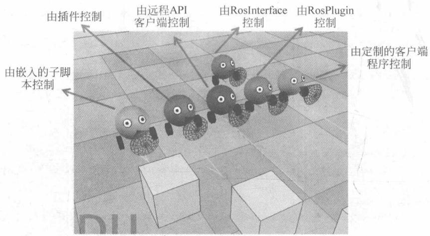

图 6-10 V-REP 提供的演示场景
{: .figure-caption }


子脚本附加到亮红色机器人，并以非线程方式运行，执行以下功能：

(1) 确定一些物体手柄(例如,马达关节手柄和接近传感器手柄);

(2) 验证是否加载了 RosInterface;

（3）添加场景中相关的标语信息；

(4) 启动与电机速度相关的订阅者；

(5) 启动与传感器发布者和仿真时间有关发布者；

（6）最终启动一个客户端应用程序。调用应用程序时使用一些主题名称作为参数，以便它知道要监听和订阅的主题。然后运行客户端应用程序（rosBubbleRob2），通过 ROS 接管亮红色机器人的控制。

现在停止仿真并打开一个新场景, 然后将以下模型拖入其中: Models/tools/rosInterface helper tool.ttm。此模型由提供以下主题发布者和订阅者的单个自定义脚本构成:

(1) startSimulation 主题: 可以用于通过发布此主题 std\_msgs::Bool 消息来启动仿真。

(2) pauseSimulation 主题: 可以用于通过发布一个 std\_msgs::Bool 消息来暂停仿真。

(3) stopSimulation 主题: 可以用于通过发布此主题 std\_msgs::Bool 消息来停止仿真。

（4）enableSyncMode 主题：通过发布关于此主题的 std\_msgs::Bool 消息，可以启用/禁用同步仿真模式。

(5) triggerNextStep 主题: 通过发布关于此主题的 std\_msgs::Bool 消息, 可以在同步仿真模式下触发下一个仿真步骤。

(6) simulationStepDone 主题: 类型 std\_msgs::Bool 的消息将在每个仿真传递结束时

发布。

(7) simulationState 主题: std\_msgs::Int32 类型的消息将定期发布。其中, 0 表示仿真停止, 1 表示仿真正在运行, 2 表示仿真已暂停。

(8) simulationTime 主题: std\_msgs::Float32 类型的消息将定期发布, 指示当前的仿真时间。

可以查看完全自定义的脚本内容。尝试从命令行生成主题消息，例如：

```powershell
$ rostopic pub / startSimulation std_msgs / Bool true -- once
$ rostopic pub / pauseSimulation std_msgs / Bool true -- once
$ rostopic pub / stopSimulation std_msgs / Bool true -- once
$ rostopic pub / enableSyncMode std_msgs / Bool true -- once
$ rostopic pub / startSimulation std_msgs / Bool true -- once
$ rostopic pub / triggerNextStep std_msgs / Bool true -- once
$ rostopic pub / triggerNextStep std_msgs / Bool true -- once
$ rostopic pub / triggerNextStep std_msgs / Bool true -- once
$ rostopic pub / stopSimulation std_msgs / Bool true -- once
```

为了显示当前的仿真时间,可以键入:

```txt
$ rostopic echo / simulationTime
```

### 6.5.5 V-REP ROS Bridge 的简介及安装

V-REP ROS Bridge 是由位于 Inria Rennes 的 Inria Lagadic 公司开发的 V-Reporter 的插件。插件的主要目的是提供 V-REP 和 ROS 之间的通信接口，让用户能够通过 ROS 消息和 ROS 服务在外部控制 V-REP 仿真。

这个插件是一个共享库，由 V-REP 的主要客户端应用程序在启动时自动加载。这一插件可以自动在场景中寻找已知的对象，以便管理它们。它创建 ROS 发布者发送仿真数据（例如场景中存在的对象的姿态和速度），接收（ROS 订阅者）消息，并动态地将命令应用到对象。请注意，vrep\_ros\_bridge 是一个元包，而 vrep\_ros\_plugin 是真正的主包。

ROS V-Rep Bridge 使用 pluginlib 包。Pluginlib 是一个 C++ 库，用于从 ROS 包中加载和卸载插件。插件是从运行时库（即共享对象、动态链接库）加载的动态可加载类。这样我们的处理程序实际上是一些依赖的插件。如果我们不需要一个处理程序，或者我们没有安装它的依赖，仍然能够建立桥梁（该插件将不可用）。例如，quadrotor\_tk\_handler 需要 Telekyb。如果我们不想安装 Telekyb，可以在 quadrotor\_tk\_handler 文件夹中添加一个名为 CATKIN\_IGNORE 的文件，其他处理程序将可用。

插件支持的对象有机器人和传感器：其中机器人包括臂型机器人和移动机器人(manipulator\_handler)，四旋翼飞行器（quadrotor\_handler）；传感器包括了视觉传感器(camera\_handler)和 IMU 传感器(imu\_handler)。

1. V-Rep ROS Bridge 的安装步骤

(1) 通过终端访问 catkin\_ws/src。

(2) 从 GIT 下载插件:

```txt
git clone https://github.com/lagadic/vrep_ros_bridge.git;
```

(3) 如果使用 ROS Indigo 或 ROS Jade, 请使用分支主机。

(4) 如果使用 Hydro:

```txt
git checkout hydro - devel
```

（5）可能不需要 vrep\_ros\_bridge 提供的所有子插件。一个常见的情况是，不需要使用 TeleKyb 框架。要忽略此子插件，需要在不需要的子插件文件夹中添加文件 CATKIN\_IGNORE（因为它在 quadrotor\_tk\_handler 中完成）。要做到这一点，通过在 sub-plugin 文件夹中的终端执行：

```c
touch CATKIN_IGNORE
```

(6) 打开文件 bashrc: gedit\~/.bashrc, 在文件末尾添加:

```typescript
export VREP_ROOT_DIR = / ChangeWithyourPathToVrep /
```

并且,如果要避免每次键入,使用以下命令:

```shell
export ROS_PACKAGE_PATH = $ {ROS_PACKAGE_PATH}: / path_to_catkin_ws / catkin_ws / src
source/opt/ros/indigo/setup.bash
source /path_to_catkin_ws/catkin_ws/devel/setup.bash
```

(7) 进入 catkin\_workspace, 并运行:

```txt
catkin_make
```

(8) 现在使用下一条指令再次构建 pkg:

```batch
catkin_make --pkg vrep_ros_bridge --cmake-args -DCMAKE_BUILD_TYPE = RelWithDebInfo
```

（9）在文件夹 catkin\_ws/devel/lib/中，将找到主库(libv\_repExtRosBridge.so)和其他库(libcamera\_handler.so, libmanipulator\_handler.so, libquadrotor\_handler.so, librigid\_body\_handler.so)。

(10) 文件 libv\_repExtRosBridge.so 必须在 V-Rep 安装文件夹中才能加载。要做的是

创建一个符号链接。通过终端进入 V-REP 的安装文件夹并输入：

```batch
ln -s /YOUR_CATKIN_WS_PATH/devel/lib/libv_repExtRosBridge.so
```

其中，/YOUR\_CATKIN\_WS\_PATH 是到达工作区的实际路径。

（11）如果使用的是新版本的 V-REP(V3\_3\_1\_64\_Linux)，需要一个额外的步骤。创建一个链接，指向 V-REP 根文件夹中的 compiledRosPlugins/libv\_repExtRos.so 文件。通过终端进入 V-REP 的安装文件夹并输入：

```txt
ln -s compiledRosPlugins / libv_repExtRos.so
```

#### 测试

完成以上步骤后,简单地测试是否安装成功:

在 ROS 系统的终端中键入 roscore, 然后通过终端运行 V-Rep。

在终端的窗口,将显示:

```txt
Add-on script 'vrepAddOnScript-addOnScriptDemo.lua' was loaded.
Simulator launched.
(...)
Plugin 'RosBridge': loading...
Plugin 'RosBridge': load succeeded.
(...)
```

这表明 V-REP ROS Bridge 已经正确安装。

关于 V-Rep ROS Bridge 的更多信息,有兴趣的读者可以查看以下网址: <https://github.com/lagadic/vrep_ros_bridge>。

## 6.6 ROS 与 Gazebo

ROS 是一个机器人控制框架。本节将讲述如何建立 Gazebo 和 ROS 的接口。

### 6.6.1 ROS 集成概述

ROS 可以通过 Gazebo\_ros\_pkgs（一组 ROS 包）实现独立的 Gazebo 包装器与独立运行的 Gazebo 的集成。这组 ROS 包利用 ROS 消息、服务和动态重新配置，向 Gazebo 中的仿真机器人提供必要的接口。

Gazebo\_ros\_pkgs 的一些功能如下：

\- 支持未与 ROS 绑定的 Gazebo 的独立系统；

\- 在 catkin 工作空间运行；

\- 支持 URDF 和 SDF 文件；

\- 减少 Gazebo 重复代码；

\- 改善了 ros\_control 对控制器支持服务；

\- 内置 DARPA 机器人挑战赛中的实时控制器优化内容；

\- 剔除一些旧版 ROS 和 Gazebo 代码。

升级 simulator\_Gazebo(ROS groovy 和更早版本)时,为了获得更好的 ROS 包的使用体验,以下是从 simulator\_Gazebo 获取 Gazebo 相关包对软件进行升级的方法。

启动文件时,最简便的方法是在 Gazebo 中获取帮助,使用 roslaunch 文件来生成模型。简而言之:

在 roslaunch 文件中, 将 pkg="Gazebo" 重命名为 pkg="Gazebo\_ros"。删除 Gazebo\_worlds 包。

由于大多数 world 文件很少使用,并且不支持 SDF XML 格式的变化。因此,所有的 world 文件(包括 empty.world)都集成在 Gazebo 项目中。

使用 Gazebo 启动文件的最佳方法是直接继承/声明 empty\_world 位于 Gazebo\_ros 包中的主启动文件。

#### CMakeLists.txt

删除 ROS 包装版本 Gazebo, 有利于 Gazebo 的系统安装。这可能需要重新配置 CMake 文件。下面是一个 CMakeLists.txt 示例：

```cmake
cmake_minimum_required(VERSION2.8.3)
project(YOURROBOT_Gazebo_plugins)

find_package(catkin REQUIRED COMPONENTS
Gazebo_ros
)

# Depend on system install of Gazebo
find_package(Gazebo REQUIRED)

include_directories(include ${catkin_INCLUDE_DIRS} ${GAZEBO_INCLUDE_DIRS} ${SDFormat_INCLUDE_DIRS})

# Build whatever you need here
add_library(...) # TODO

catkin_package(
    DEPENDS
Gazebo_ros
    CATKIN_DEPENDS
    INCLUDE_DIRS
    LIBRARIES
)
```

#### package.xml

在新 Gazebo\_ros 包上添加依赖关系：

```xml
build_depend>Gazebo_ros /build_depend>run_depend>Gazebo_ros /run_depend>
```

#### 运行 Gazebo

为了与 Gazebo 可执行文件名称一致,对启动 Gazebo 的 ROS 节点的名称作出细微的改变:

```txt
rosrun Gazebo_ros Gazebo 启动 Gazebo 服务器和 GUI。
rosrun Gazebo_ros gzclient 启动 Gazebo GUI。
rosrun Gazebo_ros gzserver 启动 Gazebo 服务器。
```

可运行节点：

```txt
rosrun Gazebo_ros Gazebo
rosrun Gazebo_ros gzserver
rosrun Gazebo_ros gzclient
rosrun Gazebo_ros spawn_model
rosrun Gazebo_ros perf
rosrun Gazebo_ros debug
```

### 6.6.2 安装 Gazebo\_ros\_pkgs

首先,需要安装 Gazebo。用户可以从源代码或从预构建 Ubuntu debians 安装 Gazebo。如果从源代码安装,请确保先构建 Gazebo\_X.Y 分支(X,Y 分别代表用户所需的版本)。

然后测试独立 Gazebo 工作状况。在安装 Gazebo\_ros\_pkgs 之前，需要确保独立的 Gazebo 在终端中运行。测试方法如下：单击左侧的“插入”选项卡，选择要添加的模型；然后在 simulation 上的目标位置上单击，确定模型位置。

最后测试 Gazebo 版本。确保 Gazebo 安装在正确的位置。请运行：

```txt
which gzserver
which gzclient
```

如果从 source 中安装到默认位置,会出现以下信息:

```txt
/usr/local/bin/gzserver
/usr/local/bin/gzclient
```

如果用户从 debian 安装,会出现:

```txt
/usr / bin / gzserver
/usr / bin / gzclient
```

#### 安装 Gazebo\_ros\_pkgs

安装 Gazebo\_ros\_pkgs 有两种方法, 用户可以自行选择一种合适的方法。从软件包安装的优点是过程便捷; 而从源代码安装的优点则是可以更方便地调试和修改。

## 1) 安装预构建的 Debian

可使用 Gazebo\_ros\_pkgs 软件包。安装指令如下：

对于 ROSKinetic 版本：

```txt
Sudoapt - get install ros - kinetic - Gazebo - ros - pkgsros - kinetic - Gazebo - ros - control
```

对于 ROS Jade 版本：

```txt
sudo apt-get install ros-jade-Gazebo-ros-pkgs
```

对于 ROS Indigo 版本：

```txt
sudo apt-get install ros-indigo-Gazebo-ros-pkgs ros-indigo-Gazebo-ros-control
```

如果安装成功,请跳到下面的“使用 ROS 集成测试 Gazebo”部分的内容。

## 2）从源代码安装(在 Ubuntu 上)

如果用户正在使用早期版本的 ROS(Groovy 或更早版本)，则需要选择从源代码安装的方式。若用户要开发新插件或提交修补程序，此方法也十分适用。安装步骤如下：

① 设置 Catkin 工作区。这些指令需要在 catkin 构建的系统下运行。如果没有 catkin 工作区设置，请尝试以下命令：

```shell
mkdir -p ~/catkin_ws/src
cd ~/catkin_ws/src
catkin_init_workspace
cd ~/catkin_ws
catkin_make
```

然后,添加源代码到.bashrc文件的安装脚本:

```shell
echo "source ~/catkin_ws/devel/setup.bash" >> ~/.bashrc
```

② 复制 Github 存储库。首先确保 git 安装在用户的 Ubuntu 计算机上，然后输入以下指令：

```txt
sudo apt-get install git
```

对于 ROSKinetic 版本：

```batch
sudo apt-get install -y libGazebo7-dev
```

从 Gazebo\_ros\_pkgsgithub 存储库下载源代码：

```shell
cd ~/catkin_ws/src
git clone https://github.com/ros-simulation/Gazebo_ros_pkgs.git - b kinetic - devel
```

使用 rosdep 检查是否有丢失的依赖关系：

```batch
rosdep update
rosdep check -- from - paths. -- ignore - src -- rosdistro kinetic
```

你可以使用 rosdep 通过 debian 安装自动安装时缺失的依赖关系：

```txt
rosdep install -- from-paths. -- ignore-src -- rosdistro kinetic -y
```

对于 ROSJade 版本：

Jade 使用 Gazebo 5.x 系列, 安装指令如下:

```shell
sudo apt - get install - y libGazebo5 - dev
cd ~/catkin_ws/src
git clone https://github.com/ros-simulation/Gazebo_ros_pkgs.git - b jade-devel
```

使用 rosdep 检查是否有丢失的依赖关系：

```shell
rosdep update
rosdep check -- from - paths. -- ignore - src -- rosdistro jade
```

你可以使用 rosdep, 然后通过 debian 安装自动安装缺失的依赖关系:

```txt
rosdep install -- from - paths . -- ignore - src -- rosdistro jade - y
```

注意：目前在 ROS Jade 中没有发布 ros-jade-Gazebo-ros-control 包。请检查 Gazebo\_ros\_control 跟踪器中的问题以查看进度。同时，需要禁用 Gazebo-ros-control：

```txt
touch Gazebo_ros_pkgs/Gazebo_ros_control/CATKIN_IGNORE
```

对于 ROS Indigo 版本：

Indigo 使用 Gazebo 2.x 系列, 安装指令如下:

```shell
sudo apt - get install - y Gazebo2
cd ~/catkin_ws/src
git clone https://github.com/ros-simulation/Gazebo_ros_pkgs.git - b indigo-devel
```

使用 rosdep 检查是否有丢失的依赖关系：

```txt
rosdep update
rosdep check -- from - paths. -- ignore - src -- rosdistro-indigo
```

你可以使用 rosdep, 通过 debian 安装自动安装缺失的依赖关系:

```batch
rosdep install -- from-paths. -- ignore-src -- rosdistro indigo -y
```

③ 构建 Gazebo\_ros\_pkgs。要构建 Gazebo ROS 集成软件包，请运行以下命令：

```batch
cd ~/catkin_ws/
catkin_make
```

#### 使用 ROS 集成测试 Gazebo

确保始终提供适当的 ROS 设置文件, 如对 Kinetic 应该输入以下指令:

```txt
source /opt/ros/kinetic/setup.bash
```

假设你的 ROS 和 Gazebo 环境已正确设置和构建。启动 roscore 后，你应该能够通过 rosrun 命令运行 Gazebo。如果它不在用户的.bashrc 里，请搜索 catkin setup.bash:

```txt
source ~/catkin_ws/devel/setup.bash
roscore&
rosrun Gazebo_ros Gazebo
```

Gazebo 用户界面中的窗口中不显示任何内容。

若要验证是否设置了正确的 ROS 连接,请运行以下指令查看可用的 ROS 主题:

```txt
rostopic list
```

用户应该在列表中看到以下主题：

```c
/ Gazebo / link_states
/ Gazebo / model_states
/ Gazebo / parameter_descriptions
/ Gazebo / parameter_updates
/ Gazebo / set_link_state
/ Gazebo / set_model_state
```

用户还可以验证Gazebo服务是否存在：

rosservice list

用户可以在列表中看到如下服务：

```c
/ Gazebo / apply_body_wrench
/ Gazebo / apply_joint_effort
/ Gazebo / clear_body_wrenches
/ Gazebo / clear_joint_forces
/ Gazebo / delete_model
/ Gazebo / get_joint_properties
/ Gazebo / get_link_properties
/ Gazebo / get_link_state
/ Gazebo / get_loggers
/ Gazebo / get_model_properties
/ Gazebo / get_model_state
/ Gazebo / get_physics_properties
/ Gazebo / get_world_properties
/ Gazebo / pause_physics
/ Gazebo / reset_simulation
/ Gazebo / reset_world
/ Gazebo / set_joint_properties
/ Gazebo / set_link_properties
/ Gazebo / set_link_state
/ Gazebo / set_logger_level
/ Gazebo / set_model_configuration
/ Gazebo / set_model_state
/ Gazebo / set_parameters
/ Gazebo / set_physics_properties
/ Gazebo / spawn_Gazebo_model
/ Gazebo / spawn_sdf_model
/ Gazebo / spawn_urdf_model
/ Gazebo / unpause_physics
/ rosout / get_loggers
/ rosout / set_logger_level
```


#### 其他 ROS 启动 Gazebo 方法

以下几个 rosrun 命令均可以启动 Gazebo。

(1) 同时启动服务器和客户端：

(2) 仅启动 Gazebo 服务器:

```txt
rosrun Gazebo_ros gzserver
```

(3) 仅启动 Gazebo 客户端:

```txt
rosrun Gazebo_ros gzclient
```

(4) 仅使用 GDB 在调试模式下启动 Gazebo 服务器:

```txt
rosrun Gazebo_ros debug
```

(5) 此外, 可以使用 Gazebo 启动 roslaunch:

```txt
roslaunch Gazebo_ros empty_world.launch
```

### 6.6.3 ROS/Gazebo 版本组合的选择

#### Gazebo 版本的选择

如果用户计划使用特定版本的 ROS，并且不需要使用特定版本的 Gazebo，那么可以参照网页（<http://gazebosim.org/tutorials?tut=ros_installing&cat=connect_ros）>安装 Gazebo\_ros\_pkgs 内容。本节将介绍如何安装 ROS 完全支持的 Gazebo 版本。

请注意,使用与 ROS 存储库提供的官方不同的 Gazebo 版本可能会导致 ROS 包的冲突或其他集成问题。

#### Gazebo 版本和 ROS 集成

Gazebo 是一个如 boostogre 或其他任意被 ROS 使用的独立项目。通常，在每个 ROS 版本发布时可用的最新版本的 Gazebo(例如 Gazebo5 对于 ROS Jade)会被选择为完全集成和支持该 ROS 版本的正式版本，并且将会在 ROS 的整个生命周期中得到服务支持。

Gazebo 开发不与 ROS 同步, 因此每个新版本的 Gazebo 必须在 ROS 发布使用之前被发布。

#### 安装 Gazebo

## 1) Gazebo Ubuntu 包

安装 Gazebo 的最简单的方法是使用软件包。以下是两个主要用来托管 Gazebo 软件包的软件库：packages. ros. org 与 packages. osrfoundation. org。

```txt
packages.ros.org
```

\- Indigo：主机Gazebo版本2.x包。

\- Jade: 主机 Gazebo 版 5.x 包。

\- Kinetic: 主机或使用 Gazebo 版本 7.x 包。

```go
packages.osrfoundation.org
```

\- Gazebo 5.x 系列(包名 Gazebo5)。

\- Gazebo 6.x 系列(包名 Gazebo6)。

\- Gazebo 7.x 系列(包名 Gazebo7)。

这说明包含 osrfoundation 存储库不是得到 Gazebo Ubuntu 包的必要条件。用户可以从 ros 存储库安装。

## 2）由源代码构建Gazebo

如果你从源码编译了 Gazebo 版本, 注意, 根据使用的存储库分支 (Gazebo6, Gazebo7 …), 只有当用户的本地分支存储库和 ROS 发行版中使用的 Gazebo 版本相匹配时, 用户的 Gazebo 才能是兼容二进制的 Gazebo\_ros\_pkgs。注意, 如果用户使用默认版本, 那么用户可能与其他一些发布的软件包不能兼容二进制, 所以用户需要一个 catkin 工作区来获得一个有效的 Gazebo\_ros\_pkgs。

#### 使用默认版本的 Gazebo

对于需要运行特定版本的 ROS 并想要使用所有 Gazebo ROS 相关软件包的用户, 推荐使用以下 ROS 版本:

## 1) Kinetic

ROS Kinetic 主机是使用 7.x 版本的 Gazebo。对于完全集成的 ROS 系统，建议使用 7.x 版本的 Gazebo。继续进程的方法就是使用 ROS 库（它会自动安装 Gazebo7），并且还没有使用 osrfoundation 库。

## 2) Jade

ROS Jade 托管 5.x 版本的 Gazebo。对于完全集成的 ROS 系统，建议使用 5.x 版本的 Gazebo。继续进程的方法就是使用 ROS 库（它会自动安装 Gazebo5），且禁止使用 osrfoundation 库。

## 3) Indigo

ROS Indigo 主机是 2.x 版本的 Gazebo。对于完全集成的 ROS 系统，建议使用 2.x 版本的 Gazebo。继续进程的方法就是使用 ROS 库（它会自动安装 Gazebo2），并禁止使用 osrfoundation 库。

#### 使用特定 Gazebo 版本

使用以下方法可以安装使用任何特定版本的 Gazebo 和 ROS。

## 1) Gazebo 7.x 系列

OSRF 存储库提供了建立在软件包顶部的-Gazebo7-ROS/Indigo 和 ROS/Jade Gazebo 包装器(Gazebo7\_ros\_pkgs)的 Gazebo7 版本。使用步骤如下：

\- 将 osrfoundation 存储库添加到源列表。

\- 从 osrfoundation 库中安装 ros-\$ ROS\_DISTRO-Gazebo7-ros-pkgs,本次操作将会

安装 Gazebo7 包。

\- 使用 catkin 工作区来编译从源代码得到的其余软件。

## 2) Gazebo 6.x 系列

OSRF 存储库提供了建立在软件包顶部的-Gazebo6-ROS/Indigo 和 ROS/Jade Gazebo 包装器(Gazebo6\_ros\_pkgs)的 Gazebo6 版本。使用步骤如下：

\- 将 osrfoundation 存储库添加到源列表。

\- 从 osrfoundation 库安装 ros-\$ ROS\_DISTRO-Gazebo6-ros-pkgs,本次操作将安装 Gazebo6 包。

\- 使用 catkin 工作区来编译从源代码得到的其余软件。

## 3) Gazebo 5.x 系列

OSRF 存储库提供了建立在软件包顶部的-Gazebo5-ROS/IndigoGazebo 包装器 (Gazebo5\_ros\_pkgs) 的 Gazebo5 版本。使用步骤如下：

\- 将 osrfoundation 存储库添加到源列表。

\- 从 osrfoundation 库安装 ros-indigo-Gazebo5-ros-pkgs, 本次操作将安装 Gazebo5 包。

\- 使用 catkin 工作区来编译从源代码得到的其余软件。

#### 几个问题

## (1) 如果不使用 ROS, 应该使用哪个版本?

如果用户不需要 ROS 支持, 推荐的版本是最新发布的版本, 可以参照网页 (<http://gazebosim.org/install>) 使用 osrfoundation repo 安装。

## (2) 如果想使用 bullet/simbody/dart 物理引擎, 应该使用哪个版本的 Gazebo?

Ubuntu 包内置 Gazebo4、bullet 和 simbody 服务支持。请按照上述 Gazebo4 说明与 ROS 组合使用。Dart 仍然需要从源(Gazebo3)安装 Gazebo，所以你可以使用 Gazebo3 或更高的版本，并按照上面的说明进行操作，使其与 ROS 兼容。

## （3）如果需要使用Gazebo5/Gazebo6/Gazebo7和ROSIndigo，应该怎么做？

如果用户需要使用一些只出现在 5.x 版、6.x 版或 7.x 版中的功能，可以参照如何使用 ROS 与 Gazebo4、Gazebo5 或 Gazebo6 的说明文档安装 Gazebo5、Gazebo6 或者 Gazebo7 和 ROSIndigo。

## (4) 如果需要使用 Gazebo6/Gazebo7 和 ROS Jade, 应该怎么做?

如果用户需要使用一些只存在于Gazebo版本6.x或7.x中的功能，其中一种方式是安装Gazebo6或Gazebo7ROSJade。请参照文档中关于如何使用ROS与Gazebo6软件包的说明。

## (5) 解决一些 ROS 包与 GazeboX ROS Wrappers 冲突问题。

按照官方的设计思路,每个 ROS 分布与特定版本的 Gazebo(Gazebo5 在 Jade 中)需要一起使用。当选择使用与 ROS 发行版中推荐的版本不同的 Gazebo 版本时,可能会出现问题,而且,其中一些问题可能无法解决。如果在尝试安装本文档中描述的某个版本之后发现依赖性冲突(例如使用 RVIZ),用户将需要从源代码安装 ROS 或 Gazebo。

### 6.6.4 使用 roslaunch

有很多方法都可以用来启动 Gazebo、打开 world 模型并将机器人模型生成到仿真环境中。本节将介绍两种方式：使用 rosrun 和 roslaunch。这包括将用户的 URDF 文件存储在 ROS 包中，并保持用户 ROS 工作区各种资源相对路径。

#### 使用 roslaunch 打开 world 模型

roslaunch 工具是 ROS 系统的标准方法, 可以用于启动新的 ROS 节点。只需运行该工具就可以启动一个类似于在 rosrun 上输入下列指令所产生的空的 Gazebo world:

```txt
roslaunch Gazebo_ros empty_world.launch
```

## 1) roslaunch 参数

用户可以将以下参数附加到启动文件以更改Gazebo的行为：

\- 暂停：启动 Gazebo 处于暂停状态(默认为 false)。

\- use\_sim\_time: 告诉 ROS 节点要求获得 Gazebo 发布的仿真时间, 通过 ROS 主题/时钟发布(默认为 true)。

\- gui: 启动 Gazebo 的用户界面窗口(默认为 true)。

\- headless: 禁用对仿真器渲染(Ogre)组件的任何函数调用。不使用 gui := true(默认为 false)。

\- debug：在调试模式下使用 gdb 启动 gzserver(Gazebo Server, 默认为 false)。

## 2）roslaunch命令示例

通常,这些参数的默认值都是用户需要调整的,以下仅作为示例:

```txt
roslaunch Gazebo_ros empty_world. launch paused := true use_sim_time := false gui := true throttled := false headless := false debug := true
```

## 3）启动其他演示 world 模型

Gazebo\_ros 软件包中已包含其他演示版本,其中包括:

```txt
roslaunch Gazebo_ros willowgarage_world.launch
roslaunch Gazebo_ros mud_world.launch
roslaunch Gazebo_ros shapes_world.launch
roslaunch Gazebo_ros rubble_world.launch
```

启动文件 mud\_world.launch 包含以下内容：

```erb
launch>
! -- We resume the logic in empty_world.launch, changing only the name of the world to be launched -->
include file = " $(find Gazebo_ros)/launch/empty_world.launch">
```

```xml
arg name = "world_name" value = "worlds/mud.world"/> ! -- Note: the world_name is with respect to GAZEBO_RESOURCE_PATH environmental variable -->
arg name = "paused" value = "false"/>
arg name = "use_sim_time" value = "true"/>
arg name = "gui" value = "true"/>
arg name = "headless" value = "false"/>
arg name = "debug" value = "false"/>
/include>
/launch>
```

在这个启动文件中,从 empty\_world.launch 继承了大部分必要的功能。需要改变的唯一参数是 world\_name 参数,其他参数设置为其默认值。

## 4) world 文件

接下来介绍 mud\_world.launch 文件。首先查看 mud.world 文件的内容，文件的前几个组件如下所示：

```txt
sdf version="1.4">
world name="default">
include>
uri>model://sun /uri>
/include>
include>
uri>model://ground_plane /uri>
/include>
include>
uri>model://double_pendulum_with_base /uri>
name>pendulum_thick_mud /name>
pose>-2.0 0 0 0 0 0 /pose>
/include>
...
/world>
/sdf>
```

在这个 world 文件片段中引用了 3 个模型, 可以在本地 Gazebo 模型数据库中搜索得到。如果搜索不到, 它们会自动从 Gazebo 的在线数据库中拉出。用户可以在网页 (<http://gazebosim.org/tutorials?cat=build_world>) 中了解有关 world 文件的更多信息。

## (1) 如何在计算机上查找 world 文件。

world 文件位于 Gazebo 资源路径的 /worlds 目录中。此路径的位置取决于用户如何安装 Gazebo 和用户的系统类型。可以使用以下命令查找 Gazebo 资源的位置：

```txt
env | grep GAZEBO_RESOURCE_PATH
```

典型的路径可能是类似于：/usr/local/share/Gazebo-1.9。在这个路径结尾添加/worlds，此目录包含了Gazebo使用的world文件，包括mud.world文件。

## (2) 如何创建自己的 Gazebo ROS 包。

在继续讲述如何将机器人模型生成到 Gazebo 之前,首先讨论使用 ROS 和 Gazebo 的文件层次结构标准。

现在, 将假设用户的 catkin 工作区被命名 catkin\_ws(用户也可以命名为其他名字)。用户的 catkin 工作区可能位于用户的计算机上, 如:

/home / user / catkin\_ws / src

关于机器人的模型和描述的所有内容,根据 ROS 标准,位于一个名为 /MYROBOT\_description 的包中,所有的 world 文件和 Gazebo 使用的启动文件位于一个名为 /MYROBOT\_Gazebo 的 ROS 包中。使用这两个包,用户的层次结构如下所示:

```asm
../catkin_ws/src
    /MYROBOT_description
    package.xml
    CMakeLists.txt
    /urdf
    MYROBOT.urdf
    /meshes
    mesh1.dae
    mesh2.dae
    ...
    /materials
    /cad
    /MYROBOT_Gazebo
    /launch
    MYROBOT.launch
    /worlds
    MYROBOT.world
    /models
    world_object1.dae
    world_object2.stl
    world_object3.urdf
    /materials
    /plugins
```
注意：命令 catkin\_create\_pkg 用于创建新包。
下面介绍如何自行设置并使用自定义的 world 文件。

## (3) 创建自定义 world 文件。

用户可以在自己的 ROS 包中创建特定的 world 文件以及其他的自定义文件。下面的例子将创建一个空地面、一个地面、一个太阳和一个加油站。假设：首先确保将 MYROBOT 替换为用户的机器人的名称，如果用户并没有用于测试的机器人，则只需将其

替换为类似“test”的东西：

① 创建一个使用约定 MYROBOT\_Gazebo 的 ROS 包。

② 在此包中，创建一个 launch 文件夹。

③ 在 launch 文件夹中创建一个具有以下内容(缺省参数排除)的 YOuroBOT.launch 文件：

```txt
launch>
! -- We resume the logic in empty_world.launch, changing only the name of the world to be launched -->
include file = "$(find Gazebo_ros)/launch/empty_world.launch">
arg name = "world_name" value = "$(find MYROBOT_Gazebo)/worlds/MYROBOT.world"/>
! -- more default parameters can be changed here -->
/include>
/launch>
```

④ 在同一个包中, 创建一个 worlds 文件夹, 并创建一个 MYROBOT.world 文件, 包含以下内容:

```xml
<?xml version="1.0"?>
sdf version="1.4">
world name="default">
include>
uri>model://ground_plane /uri>
/include>
include>
uri>model://sun /uri>
/include>
include>
uri>model://gas_station /uri>
name>gas_station /name>
pose>-2.0 7.0 0 0 0 0 /pose>
/include>
/world>
/sdf>
```

⑤ 现在,用户可以使用以下命令启动自定义 world(加油站)到 Gazebo:

```shell
.~/catkin_ws/devel/setup.bash
roslaunch MYROBOT_Gazebo MYROBOT.launch
```

如图 6-11 所示, 可以看到以下 world 模型(使用鼠标上的滚轮可以进行缩放操作):

(4) 在 Gazebo 中编辑 world 文件。

用户可以将其他模型插入到机器人的 world 文件中，并使用 File 菜单中的 SaveAs 命


图 6-11 world 模型
{: .figure-caption }


令将编辑的 world 模型导出到 ROS 包。

#### 使用 roslaunch 生成 URDF 机器人

使用 roslaunch 在 Gazebo 中启动基于 URDF 的机器人有以下两种方法。

（1）ROS 服务调用方法。这种方法的优点是使用户的机器人 ROS 包在计算机和存储库检查之间更加具有可移植性。它允许用户保持用户的机器人的位置相对于一个 ROS 包路径，但也需要用户使用一个小脚本进行 ROS 服务调用。

（2）模型数据库方法。这种方法的优点是允许用户将机器人包括在.world 文件中，这看起来更便捷，但需要通过设置环境变量将用户的机器人添加到 Gazebo 模型数据库。下文将分别讨论这两种方法，推荐使用“ROS 服务调用产生方法”。

## 1) “ROS 服务调用”机器人生成方法

这个方法使用一个小的 python 脚本 spawn\_model 来向 Gazebo\_rosROS 节点（在 rostopic 命名空间中简称为“Gazebo”）发出服务调用请求，并将自定义 URDF 添加到 Gazebo 中。

用户可以按以下方式使用此脚本：

```shell
rosrun Gazebo_ros spawn_model - file 'rospack find MYROBOT_description'/urdf/MYROBOT.urdf - urdf - x 0 - y 0 - z 1 - model MYROBOT
```

要查看所有可用的参数,包括 spawn\_model 命名空间、trimesh 属性、关节位置和 RPY

方向可运行以下指令：

```txt
rosrun Gazebo_ros spawn_model - h
```

2）URDF 示例与 Baxter 机器人

如果用户没有一个 URDF 来测试(如下例), 用户可以从 Rethink Robotics 的 Baxter 机器人\_common(网址为 <https://github.com/RethinkRobotics/Baxter> 机器人\_common)仓库下载 Baxter 机器人\_description 包。将此软件包放入 catkin 工作区中, 具体方法是运行指令:

```txt
git clone https://github.com/RethinkRobotics/Baxter 机器人_common.git
```

用户现在应该有一个名为 Baxter 机器人. urdf 位于 Baxter 机器人\_description/urdf/中的 URDF 文件, 用户可以运行:

```txt
rosrun Gazebo_ros spawn_model - file 'rospack find Baxter 机器人_description'/urdf/Baxter 机器人.urdf - urdf - z1 - model Baxter 机器人
```

如图 6-12 所示, 用户应该会看到 Baxter 机器人的模型。


图 6-12 Baxter 机器人虚拟模型
{: .figure-caption }


要将其直接集成到 ROS 启动文件中,需要重新打开该文件 MYROBOT\_Gazebo/launch/YOUROBOT.launch,并在</launch>之前添加以下内容:

```txt
! -- Spawn a robot into Gazebo --> node name = "spawn_urdf" pkg = "Gazebo_ros" type = "spawn_model" args = "-file $(find Baxter 机器人_description)/urdf/Baxter robot.urdf - urdf - z1 - model Baxterrobot" />
```

启动此文件,用户可以看到与使用 rosrun 时相同的结果。

## 3）运用PR2的XACRO示例

如果用户的 URDF 不是 XML 格式, 而是 XACRO 格式, 用户可以对启动文件进行类似的修改。用户可以通过安装此程序包来运行 PR2 示例:

```txt
ROSJade:
sudo apt-get install ros-jade-pr2-common
```

然后将其添加到用户在之前创建的启动文件：

```txt
! -- Convert an xacro and put on parameter server -->
param name = "robot_description" command = "$(find xacro)/xacro.py $(find pr2_description)/robots/pr2.urdf.xacro" />
! -- Spawn a robot into Gazebo -->
node name = "spawn_urdf" pkg = "Gazebo_ros" type = "spawn_model" args = " - param robot_description - urdf - model pr2" />
```

启动这个文件,可以看到在加油站的 PR2,如图 6-13 所示。


图 6-13 PR2 机器人虚拟模型
{: .figure-caption }


注意：在这个部分内容中，由于 Gazebo API 的变化，仍然有很多错误和警告从控制台输出，需要从 PR2 的 URDF 修正。

## 4) “模型数据库”机器人生成方法

该方法允许用户将机器人包括在.world 文件中, 这看起来更方便, 但需要通过设置环境变量将用户的机器人添加到 Gazebo 模型数据库。因为 ROS 依赖关系从 Gazebo 中分离出来, 所以这个环境变量是必需的。因为 Gazebo 没有 ROS 包的概念, 所以 URDF 包路径不能直接在.world 文件内使用。

要使用此方法,用户必须创建一个仅包含单个 robot 的新模型数据库。这不是将 URDF 加载到 Gazebo 中的最简便的方法,但是不必在用户的计算机上保留两个机器人 URDF 副本。

假设 ROS 工作空间文件层次结构按上述所述进行设置。唯一的区别是, 现在一个 model.config 文件添加到用户的 MYROBOT\_description 包:

```asm
../catkin_ws/src
    /MYROBOT_description
    package.xml
    CMakeLists.txt
    model.config
    /urdf
    MYROBOT.urdf
    /meshes
    mesh1.dae
    mesh2.dae
    ...
    /materials
    /plugins
    /cad
```

此层次结构特别适用于通过以下文件夹/文件用作Gazebo模型数据库：

\- /home/user/catkin\_workspace/src——Gazebo 模型数据库的位置；

\- /MYROBOT\_description——单个Gazebo模型文件夹；

\- model.config——Gazebo在其数据库中查找此模型所需的配置文件；

\- MYROBOT. urdf——用户的机器人描述文件，也被 Rviz, MoveIt! 等使用；

\- /meshes——.stl 或 .dae 文件放在此处，如同常规 URDF 一样。

5) model. config

每个模型必须在其根目录中有一个 model.config 文件, 其中包含有关模型的元信息。将其复制到一个 model.config 文件中, 将用户的文件名替换 model.urdf:

```txt
?xml version="1.0"?> model>
```

```xml
name>MYROBOT /name>
version>1.0 /version>
sdf>urdf/MYROBOT.urdf /sdf>
author>
name>My name /name>
email>name@email.address /email>
/author>
description>
A description of the model
/description>
/model >
```

与 SDF 不同, 当用于 URDFs 时, 不同版本不需要进行标记。有关详细信息请参阅 Gazebo 模型数据库文档。

## 6）环境变量

最后，用户需要向.bashrc文件添加一个环境变量，告诉Gazebo在哪里查找模型数据库。首先使用编辑器编辑“～/.bashrc”。然后检查用户是否已定义GAZEBO\_MODEL\_PATH。如果用户已经有一个，则再后边附加分号，否则添加新的定义。假设用户的Catkin工作区在～/catkin\_ws/用户的路径：

```shell
export GAZEBO_MODEL_PATH = /home/user/catkin_ws/src/
```

## 7）在Gazebo中手动观看

现在测试用户的新 Gazebo 模型数据库是否通过启动 Gazebo 正确配置：

```txt
Gazebo
```

然后单击左侧的“插入”标签。用户可能会看到几个不同的下拉列表，表示系统上可用的不同模型数据库（包括在线数据库）。找到与用户的机器人对应的数据库，打开子菜单，单击用户的机器人的名称，然后使用用户的鼠标在Gazebo中选择一个位置放置机器人。

## 8) 在 Gazebo 中查看-roslaunch 使用模型数据库

模型数据库方法的优点是：用户可以将机器人直接包含在 world 文件中，而无须使用 ROS 包路径。我们将使用“创建 world 文件”部分中相同的设置，但需要修改 world 文件。

在同一 MYROBOT\_description/launch 文件夹中, 使用以下内容编 MYROBOT.world 文件:

```xml
?xml version="1.0"?>
sdf version="1.4">
world name="default">
include>
```

```txt
uri>model://ground_plane /uri>
/include>
include>
uri>model://sun /uri>
/include>
include>
uri>model://gas_station /uri>
name>gas_station /name>
pose>-2.0 7.0 0 0 0 0 /pose>
/include>
include>
uri>model://MYROBOT /uri>
/include>
/world>
/sdf>
```

现在用户能够使用以下命令将加油站和机器人的自定义世界启动到 Gazebo 中：

```batch
roslaunch MYROBOT_Gazebo MYROBOT.launch
```

这种方法的缺点是,用户的打包 MYROBOT\_description,MYROBOT\_Gazebo 并不容易在计算机之间移植,用户必须先设置 GAZEBO\_MODEL\_PATH,才能使用这些 ROS 包。

从 package.xml 导出模型路径的语句如下：

```xml
export>
Gazebo_ros Gazebo_model_path = "${prefix}/models"/>
Gazebo_ros Gazebo_media_path = "${prefix}/models"/>
/export>
```

' $prefix$ '是用户不会立即知道的信息,但在这里是必要的。

还有一些有用的信息,例如:如何从 ROS 侧调试这些路径、用户可以使用指令 rospack plugins -- attrib="Gazebo\_media\_path" Gazebo\_ros 检查将被 Gazebo 使用的媒体路径。

现在用户知道如何创建 roslaunch 打开 Gazebo、world 文件和 URDF 模型的文件，现在用户可以使用 A URDF 在 Gazebo 创建自己的 Gazebo-ready URDF 模型。

### 6.6.5 ROS通信

Gazebo 提供了一组 ROS API, 用于修改和获取有关仿真世界各个方面的信息。本节将演示一些用于操作仿真世界和对象的实用程序。用户也可以在这里找到 ROS 消息和 Gazebo 服务的完整列表。

刚体对象的姿态和腕部被称为其“状态”。同时，对象具有内在的属性，例如质量和摩擦系数。在 Gazebo 中，“身体”是指刚性体，与 URDF 上下文中的“连杆”同义。Gazebo 中的“模型”是由“关节”连接的身体的集合。

封装于 Gazebo\_ros 的 Gazebo\_ros\_api\_plugin 插件用于初始化“Gazebo”ROS 节点。它集成了 ROS 回调程序(消息传递)与 Gazebo 的内部调度程序,提供了下面的 ROS 接口。此 ROS API 使用户能够通过 ROS 设置虚拟环境的各种属性。同时能够对环境中模型的状态进行生成和内省。

Gazebo\_ros 程序包中提供了一个名为 Gazebo\_ros\_paths\_plugin 的辅助插件，帮助 Gazebo 找到 ROS 资源，即解析 ROS 包路径名。这个插件加载了 gzserver 和 gzclient。

#### Gazebo 已发布参数

参数：/use\_sim\_time: Bool——通知 ROS 使用由 /clock 主题发布的 ROS 时间。

如果通过/use\_sim\_time 参数使用仿真时间,Gazebo 会通过 ROS 参数服务器通知其他应用程序,特别是 Rviz。用户启动 Gazebo\_ros 时,Gazebo 自动设置为 true。

如果 Gazebo\_ros 使用主题为 /clock 的 ROS 系统提供的仿真同步时间, 则 /use\_sim\_time 为 true。有关仿真时间的更多信息, 请参阅网页 (<http://www.ros.org/wiki/roscpp/Overview/Time>)。

要查看设置参数的指令为：rosparam get /use\_sim\_time。

#### Gazebo 订阅的主题

主题包括：

用于设置连杆的状态(姿势/腕部):

```yaml
~/set_link_state: Gazebo_msgs/LinkState
```

用于设置模型的状态(姿势/腕部):

```txt
~/set_model_state: Gazebo_msgs/ModelState
```

主题可用于快速设置模型的姿势和腕部,无须等待程序完成姿势动作设置。为此,我们需将所需的模型状态消息发布到/Gazebo/set\_model\_state 主题。例如,要通过主题设置测试姿势,可以通过从在线数据库中生成新模型并将焦点添加到模型中:

```txt
rosrun Gazebo_ros spawn_model - database coke_can - Gazebo - model coke_can - y 1
```

通过发布/Gazebo/set\_model\_state 主题设置可乐罐的姿势：

```yaml
rostopic pub - r 20 /Gazebo/set_model_state Gazebo_msgs/ModelState ' {model_name: coke_can, pose: { position: { x: 1, y: 0, z: 2 }, orientation: {x: 0, y: 0.491983115673, z: 0, w: 0.870604813099 } }, twist: { linear: { x: 0, y: 0, z: 0 }, angular: { x: 0, y: 0, z: 0 } }, reference_frame: world }'
```

如图 6-14 所示, 用户应该看到可乐可以悬停在 RRBot 前面。


图 6-14 RRBot 机器人与可乐瓶子
{: .figure-caption }


#### Gazebo 发布主题

主题包括：

用于发布仿真时间,与/use\_sim\_time 参数一起使用:

```txt
/clock: rosgraph_msgs/Clock
```

用于发布仿真中所有连杆的状态：

```txt
~/link_states: Gazebo_msgs/LinkStates
```

用于发布仿真中所有模型的状态：

```txt
~/model_states: Gazebo_msgs/ModelStates
```

Gazebo 发布/Gazebo/link\_states 和/Gazebo/model\_states 主题, 包含关于 Gazebo world 框架的仿真中对象的姿势和腕部信息。用户运行下面的以查看动作:

```batch
rostopic echo - n 1 /Gazebo/model_states
```

或者

```shell
rostopic echo -n 1 /Gazebo/link_states
```

注意：“连杆”是指具有给定的惯性、视觉和碰撞特性的刚体。而“模型”为连杆和关节的集合。“模型”的状态是其规范的“连杆”的状态。鉴于URDF强制实施树结构，模型的规范连杆由其根链路定义。

#### 服务：在模拟环境中创建和删除模型

这些服务允许用户在仿真中动态创建模型：

用于使用此服务创建通用机器人描述格式(URDF):

```txt
~/spawn_urdf_model: Gazebo_msgs/SpawnModel
```

用于使用此服务创建以 Gazebo 仿真描述格式(SDF)编写的模型：

```txt
~/spawn_sdf_model: Gazebo_msgs/SpawnModel
```

用于此服务允许用户从仿真中删除模型：

```txt
~/delete_model: Gazebo_msgs/DeleteModel
```

## 1）创建模型

我们提供了一个名为 spawn\_model 的帮助脚本，用于调用由 Gazebo\_ros 提供的模型创建服务。使用服务调用方法生成模型的最实用的方法是使用 roslaunch 文件。详细信息请查看网页（见 <http://gazebosim.org/tutorials/?tut=ros_roslaunch）>中关于使用 roslaunch 文件到生成模型部分内容。有很多方法可以利用 spawn\_model 向 Gazebo 添加 URDF 和 SDF。以下是一些典型示例。

（1）从文件生成 URDF。首先将. xacro 文件转换为. xml, 然后生成:

```shell
rosrun xacro xacro 'rospack find rrbot_description'/urdf/rrbot.xacro >> 'rospack find rrbot_description'/urdf/rrbot.xml
rosrun Gazebo_ros spawn_model - file 'rospack find rrbot_description'/urdf/rrbot.xml - urdf - y1 - model rrbot1 - robot_namespace rrbot1
```

(2) SDF 从本地模型数据库生成:

```shell
rosrun Gazebo_ros spawn_model - file 'echo $ GAZEBO_MODEL_PATH'/coke_can/model.sdf - sdf - model coke_can1 - y 0.2 - x - 0.3
```

(3) SDF 从在线模型数据库生成:

```shell
rosrun Gazebo_ros spawn_model - database coke_can - sdf - model coke_can3 - y 2.2 - x - 0.3
```

（4）要查看所有可用的参数，包括 spawn\_model 命名空间，trimesh 属性，关节位置和 RPY 方向运行：

```txt
rosrun Gazebo_ros spawn_model - h
```

## 2）删除模型

只需知道模型名称就可删除 Gazebo 中的模型。如果用户生成了一个名为“rrbot1”的

```txt
~/set_link_properties : Gazebo_msgs/SetLinkProperties。
~/set_physics_properties : Gazebo_msgs/SetPhysicsProperties。
~/set_model_state : Gazebo_msgs/SetModelState。
```

```txt
~/set_joint_properties : Gazebo_msgs / SetJointProperties。
~/set_link_state : Gazebo_msgs/SetLinkState。
~/set_link_state : Gazebo_msgs/LinkState。
~/set_model_state : Gazebo_msgs/ModelState。
```

rrbot, 用户可以通过以下语句删除:

```yaml
rosservice call Gazebo/delete_model ' {model_name: rrbot1}'
```

#### 服务：状态和属性设置

这些服务允许用户在仿真中设置关于仿真和对象的状态和属性信息：

\~/set\_model\_configuration: Gazebo\_msgs/SetModelConfiguration——此服务允许用户设置模型关节位置，而不需动态调用。

设置模型状态示例如下。用/Gazebo/set\_model\_state 服务在 RRBot 打一个可乐罐。如果用户还没有添加可乐罐到用户的仿真，运行以下语句：

```txt
rosrun Gazebo_ros spawn_model - database coke_can - Gazebo - model coke_can - y 1
```

这在 Gazebo 预包装或通过在线模型数据库。将可乐放在场景中的任何地方。现在调用服务请求将可乐移动到 RRBot 的位置：

```txt
rosservice call /Gazebo/set_model_state ' {model_state: { model_name: coke_can, pose: { position: { x: 0.3, y: 0.2, z: 0 }, orientation: {x: 0, y: 0.491983115673, z: 0, w: 0.870604813099 } }, twist: { linear: {x: 0.0, y: 0, z: 0 }, angular: {x: 0.0, y: 0, z: 0.0 } }, reference_frame: world } }'
```

用户会看到如图 6-15 所示的场景。

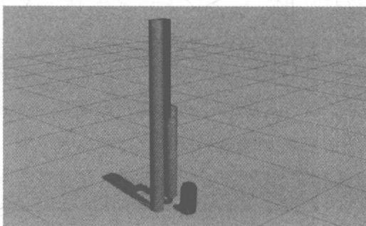

图 6-15 将可乐瓶子移动到 RRBot 机器人旁
{: .figure-caption }


使用以下命令让 RPBot 旋转：

```txt
rosservice call /Gazebo/set_model_state ' {model_state: { model_name: rrbot, pose: { position: { x: 1, y: 1, z: 10 }, orientation: {x: 0, y: 0.491983115673, z: 0, w: 0.870604813099 } }, twist: { linear: {x: 0.0, y: 0, z: 0 }, angular: {x: 0.0, y: 0, z: 0.0 } }, reference_frame: world } }'
```

如图 6-16 所示, RRBot 机器人会从可乐罐推出一定距离。如果失败, 用户可以再次尝试。


图 6-16 旋转的 RRBot 机器人
{: .figure-caption }


#### 服务：状态和属性获取

这些服务允许用户在仿真中检索关于仿真和对象的状态和属性信息：

\~/get\_model\_properties: Gazebo\_msgs/GetModelProperties——此服务返回仿真中的模型的属性。

\~/get\_model\_state: Gazebo\_msgs/Get Interstate——此服务返回仿真中的模型的状态。

\~/get\_world\_properties: Gazebo\_msgs/GetWorldProperties——此服务返回仿真world的属性。

\~/get\_joint\_properties: Gazebo\_msgs/GetJointProperties——此服务返回仿真中关节的属性。

\~/get\_link\_properties: Gazebo\_msgs/GetLinkProperties——此服务返回仿真中连杆的属性。

\~/get\_link\_state: Gazebo\_msgs/GetLinkState——此服务返回仿真中连杆的状态。

\~/get\_physics\_properties: Gazebo\_msgs/GetPhysicsProperties——此服务返回在仿真中使用的物理引擎的属性。

\~/link\_states: Gazebo\_msgs/LinkStates——在 world 框架中发布完整的连杆状态。

\~/model\_states: Gazebo\_msgs/ModelStates——在 world 框架中发布完整的模型状态。

注意：link\_names 是在 Gazebo 作用域的名称符号，[model\_name::body\_name]。

## 1）获取模型状态示例

现在已经可以“踢”可乐了，接下来用户会想知道它走了多远。进一步使用服务调用查询踢可乐时的姿势和腕部信息：

```txt
rosservice call Gazebo/get_model_state ' {model_name: coke_can}'
```

这取决于机器人的踢技能：

```yaml
pose:
position:
x: -10.3172263825
y: -1.95098702647
z: -0.00413857755159
orientation:
x: -0.0218349987011
y: -0.00515029763403
z: 0.545795377598
w: 0.83761811887
twist:
linear:
x: -0.000385525262354
y: -0.000344915539911
z: -0.00206406538336
angular:
x: -0.104256200218
y: 0.0370371098566
z: 0.0132837766211
success: True
```

## 2）检索仿真世界和对象属性

用户可以通过运行以下指令获取 world 上的模型列表 (ground\_plane, coke cane, rrbot):

```yaml
rosservice call Gazebo/get_world_properties
sim_time: 1013.366
model_names: ['ground_plane', 'rrbot', 'coke_can']
rendering_enabled: True
success: True
status_message: GetWorldProperties: got properties
```

利用以下命令并检索特定模型的详细信息：

```txt
rosservice call Gazebo/get_model_properties ' {model_name: rrbot}'
parent_model_name: ''
```

```yaml
canonical_body_name: ''
body_names: ['link1', 'link2', 'link3']
geom_names: ['link1_geom', 'link2_geom', 'link3_geom', 'link3_geom_camera_link', 'link3_geom_hokuyo_link']
joint_names: ['fixed', 'joint1', 'joint2']
child_model_names: []
is_static: False
success: True
status_message: GetModelProperties: got properties
```

#### 服务：力的控制

服务允许用户在仿真中向身体和关节施加角动量和力：

\~/apply\_body\_wrench: Gazebo\_msgs/ApplyBodyWrench——在仿真中将角动量应用到主体。所有应用于同一物体的活动角动量是累积的。

\~/apply\_joint\_effort: Gazebo\_msgs/ApplyJointEffort——在仿真中对一个关节施加作用力。对同一关节应用的所有作用力是累积的。

\~/clear\_joint\_forces: Gazebo\_msgs/JointRequest——明确应用于一个关节的作用力。

\~/clear\_body\_wrenches: Gazebo\_msgs/ClearBodyWrenches——清除应用角动量到身体。

## 1）将角动量应用于连杆

为了演示在 Gazebo 体上的角动量应用, 让我们生成一个没有重力的对象。首先确保可乐可以添加到仿真中:

```txt
rosrun Gazebo_ros spawn_model - database coke_can - Gazebo - model coke_can - y 1
```

然后发送服务呼叫：/Gazebo/set\_physics\_properties，关闭重力，便可使对象在任何轴都不受重力：

```yaml
rosservice call /Gazebo/set_physics_properties"
time_step: 0.001
max_update_rate: 1000.0
gravity:
x: 0.0
y: 0.0
z: 0.0
ode_config:
auto_disable_bodies: False
sor_pgs_precon_iters: 0
sor_pgs_iters: 50
```

```yaml
sor_pgs_w: 1.3
sor_pgs_rms_error_tol: 0.0
contact_surface_layer: 0.001
contact_max_correcting_vel: 100.0
cfm: 0.0
erp: 0.2
max_contacts: 20"
```

在可乐罐原点沿 x 方向施加 $0.01 ~N \cdot m$ 的扭矩, 持续时间为 1 秒, 调用该 /Gazebo/apply\_body\_wrench 服务, 用户应该看到可乐可以沿正 x 轴旋转:

```ruby
rosservice call /Gazebo/apply_body_wrench ' {body_name: "coke_can::link", wrench: { torque { x: 0.01, y: 0, z: 0 }} , start_time: 10000000000, duration: 1000000000 }'
```

如图 6-17 所示, 可乐罐可以旋转。


图 6-17 旋转的可乐瓶子
{: .figure-caption }


在可乐罐原点处施加反转 $-0.01N\cdot m$ 扭矩持续1秒，可乐罐应停止旋转：

```txt
rosservice call /Gazebo/apply_body_wrench ' {body_name: "coke_can::link", wrench: { torque: { x: -0.01, y: 0, z: 0 } }, start_time: 10000000000, duration: 1000000000 }'
```

当转矩的持续时间设置为负值时,其转矩将无限期地保持。要清除应用于身体的任何活动角动量,用户可以利用以下命令:

```ruby
rosservice call /Gazebo/clear_body_wrenches ' {body_name: "coke_can::link"}'
```

## 2）仿真在关节中施加作用力

调用/Gazebo/apply\_joint\_effort 在关节施加扭矩：

```yaml
rosservice call /Gazebo/apply_joint_effort "joint_name: 'joint2'
effort: 10.0
start_time:
secs: 0
nsecs: 0
duration:
secs: 10
nsecs: 0"
```

如图 6-18 所示, 连杆开始旋转。


图 6-18 旋转的连杆
{: .figure-caption }


获取特定关节的力,可调用以下命令:

```txt
rosservice call /Gazebo/clear_joint_forces ' {joint_name: joint2}'
```

#### 服务：仿真控制

以下服务允许用户在仿真中暂停和开启对象的物理学性质：

\~/pause\_physics: std\_srvs/Empty——暂停物理更新。

\~/unpause\_physics: std\_srvs/Empty——恢复物理更新。

\~/reset\_simulation: std\_srvs/Empty——重置包括时间的整个仿真。

\~/reset\_world: std\_srvs/Empty——重置模型的姿势。

假如用户想得到一张苏打水在空中飞舞的画面截图。用户可以调用暂停物理引擎：

```batch
rosservice call Gazebo/pause_physics
```

当仿真暂停时,仿真时间停止,对象变为静态。然而,Gazebo 的内部更新循环(例如自定义动态插件更新)仍然在运行,但考虑到仿真时间不变,任何由仿真时间节流的内容都不会更新。要恢复仿真,可以调用以下命令:

rosservice call Gazebo/unpause\_physics

### 6.6.6 Gazebo中的URDF

通用机器人描述格式(URDF)是用于描述机器人的所有元素的 XML 文件格式。要在 Gazebo 中使用 URDF 文件，必须添加一些额外的用于仿真的特定标签。本节将介绍在 Gazebo 中使用 URDF 的必要步骤，用户不必从头创建单独的 SDF 文件或复制描述格式。在 hood 下，Gazebo 会自动将 URDF 转换为 SDF。

虽然 URDF 是 ROS 中非常有用的标准化格式,但是随着机器人技术发展更新,它们缺少许多功能。URDF 只能指定单个机器人的运动和动态属性,并且不能在 world 中指定机器人本身的姿态。它不能指定关节环(平行连杆),并且缺乏摩擦和其他属性,所以并不是通用的描述格式。此外,它不能指定非机器人物体,例如灯光、高度图等。

通过创建一个名为仿真描述格式(Simulation Description Format, SDF)的新格式, 可以解决 GazeboURDF 的缺点。SDF 是从 world 级到机器人级的一切完整描述。它是可扩展的, 在其中添加和修改元素非常容易。SDF 格式本身是使用 XML 描述的, 可以通过简单的升级工具, 将旧版本升级到新版本。

#### Gazebo 概述

让 URDF 机器人在 Gazebo 中正确工作需要以下几个步骤, 概述如下。

1）要求

必须正确指定并配置在<inertia>元素内每一个<link>的元素。

2）选择

① <Gazebo>为每个添加一个元素<link>。

\- 将视觉颜色转换为 Gazebo 格式

\- 将stl文件转换为dae文件以获得更好的纹理

\- 添加传感器插件

② <Gazebo>为每个添加一个元素<joint>。

\- 设置适当的阻尼动力学参数

\- 添加执行器控制插件

③ 为<Gazebo>元素添加<robot>元素。

2. <Gazebo>元素

<Gazebo>元素的扩展允许用户在 SDF 格式(不包括 URDF)中指定建立的属性。可以不必设置<Gazebo>元素，因为它已自动设置了默认值。有 3 种不同类型的<Gazebo>元素，分别用于<robot>、<link>与<joint>的标记。我们将在<Gazebo>部分讨论每种类型

元素中的属性。

#### 先决条件

让用户的机器人在 Gazebo 中工作的第一步是从相应的 ROS URDF 中获得一个 URDF 文件(参照网页：<http://www.ros.org/wiki/urdf/Tutorials>)。在继续使用 Gazebo 配置机器人之前，通过在 Rviz 中查看来测试 URDF。

## 1) 在 Rviz 中查看

要检查一切是否正常，在 Rviz 中启动 RRBot:

```txt
roslunch rrbot_description rrbot_rviz.launch:
```

如果运行失败,尝试使用 killall roscore 指令或重新启动 RViz 以终止所有旧 roscore 进程。

用户还能够在“联合状态发布器”窗口中使用滑块来移动两个关节。

另外,当用户转换机器人到 Gazebo 中时,不需停止 Rviz 或其他 ROS 应用程序,这样用户可以很方便地在 Rviz 对机器人测试。

在前面的例子中，Rviz 中的 RRBot 机器人从一个假的 joint\_states\_publisher 节点（带有滑块条的窗口）得到/joint\_states。Gazebo\_ros\_control 部分将介绍如何使用 Rviz 直接通过/joint\_states 监控用户机器人的仿真状态。

## 2）检查RRBot URDF

以下指令可查看 rrbot.xacro 文件：

```txt
rosed rrbot_description rrbot.xacro
```

注意：使用 Xacro 可以使一些连杆的联合计算更容易。还包括了两个附加文件：

\- rrbot. Gazebo 是一个 Gazebo 特定的文件，包括大多数 Gazebo 特定的 XML 元素。

\- materials. xacro 是一个简单的 Rviz 颜色文件用于存储 rgba 值。

## 3）在Gazebo中观察

用户能够在 Gazebo 中启动 RRBot:

```batch
roslaunch rrbot_Gazebo rrbot_world.launch
```

在启动的 Gazebo 窗口中, 用户会看到直立的机器人。如图 6-19 所示, 尽管默认情况下在物理仿真器中没有干扰, 但是数字误差会开始累积, 导致双倒立摆在几秒钟之后下降。

最终,手臂会完全停止。我们鼓励用户继续调整和测试 URDF 的各个方面,以帮助用户了解有关仿真 URDF 机器人的更多信息。

#### URDF 文件的头文件

Gazebo 中已经有很多 API 更改了 URDF 格式,其中一个使得用户不再需要 Gazebo xml-schema 的命名空间。如果用户的 URDF 有类似下面程序中的语句:


图 6-19 RRBot 机器人
{: .figure-caption }


```txt
robot xmlns:sensor="http://playerstage.sourceforge.net/Gazebo/xmlschema/#sensor"
    xmlns: controller = "http://playerstage.sourceforge.net/Gazebo/xmlschema/#controller"
    xmlns:interface="http://playerstage.sourceforge.net/Gazebo/xmlschema/#interface"
    xmlns:xacro="http://playerstage.sourceforge.net/Gazebo/xmlschema/#xacro"
name="pr2">
```

用户可以删除它们。根元素标记中需要的所有内容都是机器人的名称,使用 xacro 的可选 xml 命名空间:

```html
robot name="rrbot" xmlns:xacro="http://www.ros.org/wiki/xacro">
```

#### <Gazebo>元素标签

如果使用没有 reference="" 属性的 <Gazebo> 元素，则该元素可用于整个机器人模型。标记 <robot> 内部的元素 <Gazebo> 如下：

<table><tr><td>名称</td><td>类型</td><td>描述</td></tr><tr><td>static</td><td>bool</td><td>如果设置为 true,则模型是不可移动的。否则,在动态引擎中仿真模型</td></tr></table>

<Gazebo>不在上表中的标记内的元素直接插入到生成的 SDF <model> 标记中。这对插件特别有用，如 ROS 电机和传感器插件部分中所述。

#### 刚性修复一个模型到 world

如果用户希望 URDF 模型永久地附加到 world 框架（地平面），则必须创建一个“world”连杆和一个连接，将其固定到模型的基座，如果用户有一个移动基地或移动机器人，则不需要连杆或关节。可用以下指令实现：

```hcl
! -- Used for fixing robot to Gazebo 'base_link' --> link name = "world" />
joint name = "fixed" type = "fixed">
parent link = "world" />
child link = "link1" />
/joint >
```

#### 连杆

以下是来自RRBot机器人的示例连杆：

```txt
! -- Base Link -->
link name="link1">
collision>
origin xyz="0 0 ${height1/2}" rpy="0 0 0"/>
geometry>
box size="${width} ${width} ${height1"/>
/geometry>
/collision>

visual>
origin xyz="0 0 ${height1/2}" rpy="0 0 0"/>
geometry>
box size="${width} ${width} ${height1"/>
/geometry>
material name="orange"/>
/visual>

inertial>
origin xyz="0 0 1" rpy="0 0 0"/>
mass value="1"/>
inertia
ixx="1.0" ixy="0.0" ixz="0.0"
iyy="1.0" iyz="0.0"
izz="1.0"/>
/inertial>
/link>
```

注意: 根据 ROS REP 103 标准测量单位和坐标约定, Gazebo 中的单位应以米和公斤

为单位。

```txt
1) <collision> 和 <visual> 元素
```

这些标签在Gazebo中和在Rviz中基本相同。但用户必须指定<visual>元素和<collision>元素，否则Gazebo不会调用。Gazebo会将用户的连杆视为“不可见”的，并进行碰撞检查。

为了提高性能,用户为碰撞几何创建简化的模型/网格。用于简化网格的开源工具是Blender。另外也有许多闭源工具可以简化网格物体,例如Maya和3DMax。

标准 URDF 可以使用 RRBot 中的标签来指定颜色：

```hcl
material name = "orange" />
```

如需单独使用橙色,则可在文件 materials. xacro 中:

```txt
material name = "orange">
    color rgba = "${255/255} ${108/255} ${10/255} 1.0"/>
/material>
```

但这种指定连杆颜色的方法在 Gazebo 中不起作用,因为它采用 OGRE 的材质脚本来着色和纹理化连杆。Gazebo 必须指定每个连杆的材料标签,例如:

```twig
Gazebo reference = "link1">
    material > Gazebo/Orange /material>
    /Gazebo >
```

如前所述，在RRBot示例中选择了将所有Gazebo特定的标记包含在名为rrbot.Gazebo的辅助文件中。用户可以在那里找到<link>和<material>元素。Gazebo中的默认可用材料可以在Gazebo源代码中的Gazebo/media/materials/scripts/Gazebo.material中找到。

对于更高级或自定义材质,用户可以创建自己的 OGRE 颜色或纹理。

像在 Rviz 一样, Gazebo 可以使用 STL 和 Collada 文件建议用户通常使用 Collada (.dae) 文件, 因为它们支持颜色和纹理, 而对于 STL 文件, 用户只能有一个彩色连杆。

## 2) <inertial>元件

为了使 Gazebo 物理引擎正常工作，<inertial>必须按照 URDF 连杆元素页（参照网页：<http://www.ros.org/wiki/urdf/XML/link）>上的文档规定的内容提供元素。对于在 Gazebo 中不被忽略的连杆，它们的质量必须大于零。此外，具有零主转动惯量的连杆可能导致在任何有限转矩作用下的会无限地加速。

为了在Gazebo中获得精确的物理环境，需要确定每个连杆的正确值。这可以通过测量机器人的零件，或通过使用类似于Solidworks的CAD软件来执行。

RRBot 机器人第一个连杆的惯性元素示例如下：

```xml
inertial>
origin xyz = "0 0 ${height1/2}" rpy = "0 0 0" />
mass value = "1" />
inertia
ixx = "1.0" ixy = "0.0" ixz = "0.0"
iyy = "1.0" iyz = "0.0"
izz = "1.0" />
/inertial>
```

原始标签表示此连杆的质心。通过将质心设置为 RRBot 的矩形连杆的高度的一半，可以将质心定在中间。用户可以通过单击 Gazebo 的“View”菜单，并选择“Wireframe”和“Mass of Mass”选项来检查 URDF 中 Gushbo 中的质心是否正确。在本示例机器人中，质量和惯性矩阵都由值组成，因为该机器人没有真实的物理模型。

## 3) $< \mathrm{Gazebo}>$ 连杆的元素

单独解析的元素列表如下：

<table><tr><td>名称</td><td>类型</td><td>描述</td></tr><tr><td>material</td><td>值</td><td>视觉元素</td></tr><tr><td>gravity</td><td>bool</td><td>施加重力</td></tr><tr><td>dampingFactor</td><td>double</td><td>链路速度的指数速度衰减系数取值并将上一个链路速度乘以(1-dampingFactor)</td></tr><tr><td>maxVel</td><td>double</td><td>最大接触修正速度截断项</td></tr><tr><td>minDepth</td><td>double</td><td>施加接触校正脉冲之前的最小允许深度</td></tr><tr><td>mul</td><td rowspan="2">double</td><td rowspan="2">由开放式动力学引擎(ODE)定义的接触面主要接触方向的摩擦系数 <span class="arithmatex">\(\mu\)</span> </td></tr><tr><td>mu2</td></tr><tr><td>fdir1</td><td>string</td><td>3元组指定碰撞局部参考系中mul的方向</td></tr><tr><td>kp</td><td rowspan="2">double</td><td rowspan="2">用于刚性体接触的接触刚度k_p和阻尼k_d</td></tr><tr><td>kd</td></tr><tr><td>selfCollide</td><td>bool</td><td>如果为true,则连杆可能与模型中的其他连杆发生冲突</td></tr><tr><td>maxContacts</td><td>int</td><td>两个实体之间允许的最大联系人数。此值将覆盖定义的max_contacts元素</td></tr><tr><td>laserRetro</td><td>double</td><td>激光传感器返回的强度值</td></tr></table>

## 4）RRBot 元件示例

在 RRBot 中, 可以指定两个非固定连接的摩擦系数。如果发生碰撞, 可以更准确地仿真接触的相互作用力。以下是连杆的 <Gazebo> 标记示例:

```txt
Gazebo reference = "link2">
mu1 > 0.2 /mu1>
mu2 > 0.2 /mu2>
material > Gazebo/Black /material>
/Gazebo>
```

#### 关节

所有为 URDF 关节记录的元素都适用于 Gazebo:

\- <origin>,<parent>和<child>标签是必需的。

\- <calibration>和< safety\_controller>可忽略。

\- 在<dynamics>标记中，只有 damping 属性可于 Gazebo4 和更早版本中使用。Gazebo5 及以上可使用 friction 属性。

\- <limit>标记中的所有属性都是可选的。

以下是RRBot中使用的一个关节的示例：

```txt
joint name="joint2" type="continuous">
parent link="link2"/>
child link="link3"/>
origin xyz="0 ${width} ${height2 - axel_offset * 2}" rpy="0 0 0"/>
axis xyz="0 1 0"/>
dynamics damping="0.7"/>
/joint>
```

通过测试不同的阻尼并观察摆动摆如何运动。阻尼参数默认值为 $0.7 ~N \cdot m \cdot s / rad$ ，请用户调整这一数值，以了解它对物理引擎的影响。

<Gazebo>接头的元素如下：

<table><tr><td>名称</td><td>类型</td><td>描述</td></tr><tr><td>stopCfm</td><td rowspan="2">double</td><td rowspan="2">ODE 使用的关节限制力混合(cfm)和误差减小参数(erp)</td></tr><tr><td>stopErp</td></tr><tr><td>provideFeedback</td><td>bool</td><td>允许接头通过 Gazebo 插件发布其数据(力-扭矩)</td></tr><tr><td>implicitSpringDamper</td><td rowspan="2">bool</td><td rowspan="2">如果此标志设置为 true,ODE 将使用 ERP 和 CFM 来仿真阻尼。这是一种比默认阻尼标签更稳定的阻尼数值方法。不推荐使用 cfmDamping 元素</td></tr><tr><td>cfmDamping</td></tr><tr><td>fudgeFactor</td><td>double</td><td>在关节限制下缩小关节运动量,其值应在 0 和 1 之间</td></tr></table>

#### 验证 Gazebo 模型工具

Gazebo 中的一个简单的工具可以检查用户的 URDF 是否正确转换为 SDF。运行：

```txt
# Gazebo2 and below
gzsdf print MODEL. urdf
# Gazebo3 and above
gz sdf - p MODEL. urdf
```

这将显示从输入 URDF 生成的 SDF 以及关于生成 SDF 缺少的所需信息。

注意：在Gazebo 1.9及更高版本中，一些调试信息已移至用户可以查看的日志文件：cat～/.Gazebo/gzsdf.log。

#### 在 Gazebo 中查看 URDF

前文已经介绍了如何在 Gazebo 中查看 RRBot。对于用户自定义的机器人，假设其 URDF 存在于 /urdf 子文件夹 MYROBOT\_descriptionROS 包中。

从该部分内容可知,用户有两个 ROS 包用于用户的自定义机器人:

```txt
MYROBOT_description
```

```txt
MYROBOT_Gazebo
```

要查看用户的机器人并在Gazebo中测试，运行：

```batch
roslaunch MYROBOT_Gazebo MYROBOT.launch
```

这会启动 Gazebo 服务器, 用户的机器人的接口界面客户端也会自动生成。

#### 调整用户的模型

如果用户的机器人模型在Gazebo中出现意外，可能因为用户的URDF需要进一步调整以准确地在Gazebo中表示其物理属性。Gazebo中各种属性可通过<Gazebo>标签在URDF中获得。

#### 分享用户的机器人

如果用户有一个通用的机器人,其他人可能也想在 Gazebo 中使用。用户可以添加 URDF 到 Gazebo 模型数据库,它是一个在线服务器。它的 Mercurial 存储库位于 Bitbucket。有关如何提交请求以将机器人模型添加到数据库中,请参阅 Gazebo 模型数据库文档(见以下网页:<http://gazebosim.org/tutorials?tut=model_contrib&cat=build_robot>)。

## 6.7 实时系统 ROS 2.0 的介绍

经过多年的发展,ROS1 已经积累了非常丰富且稳定的功能包集、各类工具和完备的教程。

ROS 主要具有以下特点：

\- 主要运行于单个机器人上；

\- 拥有工作站等级的计算资源；

\- 没有实时性的运算要求(实时性的运算要通过特殊的算法处理);

\- 优良的网络连接能力；

\- 广泛应用于学术研究；

\- 具有极大的开放性。

随着 ROS 在科研和工业的应用越来越广泛,人们对 ROS 的性能提出了更多的需求,这些需求都是现在的 ROS 无法满足的。

（1）多机器人协作：虽然使用 ROS 可以开发多机器人系统，但却没有标准的方法。这些方法都是基于 ROS 的单一主控制器的结构上。

（2）嵌入式平台开发：目标是小型计算机、单片机都能够直接地运行 ROS，而不需通过设备的驱动程序运行 ROS。

（3）实时系统：目标是 ROS 能够直接支持实时控制，而且一次控制周期内的控制命令可以包含进程之间和机器之间的通信。

（4）不理想的网络状况：目标是在网络连接不佳的情况下（如不良的无线网络信号灯），ROS还能有正常的表现。

（5）适用于产品开发：目标是基于 ROS 的实验室原型产品能够转化为适合在工业界等场景下使用的基于 ROS 的产品。

（6）构建系统的规范模式：目标是既保存 ROS 底层的高度灵活性，又能为一些功能（如生命周期管理和静态配置部署）提供清晰的模式和支持工具。

为了满足以上这些需求, ROS2 采用了数据分发服务 (Date Distribution Service, DDS) 通信协议, 它能够极大地提高系统的实时性。


图 6-20 简要说明了 ROS1 和 ROS2 的系统模型。在图 6-20 的左侧，ROS1 的实现包括通信系统 TCPROS/UDPROS。这种通信需要一个主进程（在分布式系统中是唯一的）。与此相反的是，ROS2 是基于 DDS 建立的，它包含一个 DDS 抽象层，如图 6-20 的右侧所示。由于这个抽象层，用户不需要知道 DDS API。这一层允许 ROS2 有高级别的配置和优化 DDS 的使用。此外，由于使用了 DDS，ROS2 不需要一个主进程。这在容错能力方面是一个导入点。同时，为了保持弹性，OSRF 的开发者们希望使用者可以自己选择底层所使用的 DDS 版本，不同的公司会提供不同的 DDS 实现版本。这使得在分开的进程进行通信时，不同的节点可以使用不同的供应商提供的 DDS。
{: .figure-caption }


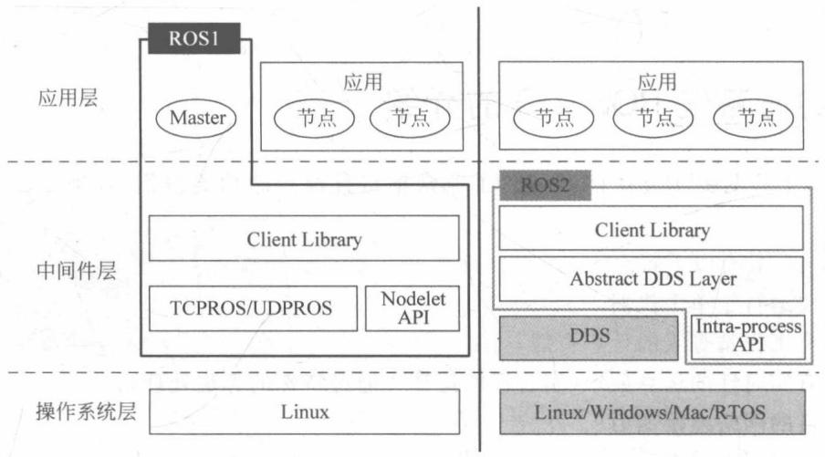

图6-20 ROS1和ROS2的结构
{: .figure-caption }


由于 DDS 具有各种传输配置(例如截止日期和容错能力)和可扩展性,DDS 适合于实时分布式嵌入式系统。DDS 满足分布式系统对于弹性、可伸缩性、容错和安全的要求。通过减少库大小和内存占用,DDS 可以为一些实时的环境和一些小型嵌入式系统提供解决方案。由不同的 DDS 供应商开发的几个实现已被应用于任务关键型环境中(例如火车、飞机、船只、堤坝和金融系统)。然而,ROS2 必须将数据转换为 DDS 和从用户提取 DDS,这将带来额外的开销。

DDS 规范描述了两个层次的接口。

（1）底层 DCPS 层：将正确的信息有效地传递给真正需要的接收者。

(2) 可选的高层 DLRL 层: 允许将服务简单地集成到应用层。

DDS 将分布式网络中传输的数据定义为主题, 将数据的产生和接收对象分别定义为发布者和订阅者, 从而构成数据的发布/订阅传输模型。DDS 的核心是以数据为中心的发布-订阅模型 (DCPS), 旨在为分布式异构平台之间提供高效的数据传输。DCPS 模型创建一个 “全局数据空间”, 可以由任何独立的应用程序访问。在 DDS 中, 发布或订阅数据的每个进程被称为一名参与者, 对应于 ROS 中的一个节点, 参与者可以使用类型化的接口读取和写入到全局数据空间。各个节点在逻辑上无主从关系, 点与点之间都是对等关系, 通信方式可以是点对点、点对多、多对多等, 在 QoS 的控制下建立连接, 自动发现和配置网络参数。

所有 DCPS 实体都具有 QoS 策略, 表示其数据传输行为。QoS 的配置文件定义了一系列方针, 包括耐久性、可靠性、队列深度和采样历史存储。基本的 QoS 配置文件包括以下方针的设置。

(1) 历史(History)。

\- 保留最后(Keep last): 只存储 N 个样本, 可以通过队列深度选项进行配置。

\- 保留所有(Keep all): 存储所有的样本, 受到 DDS 供应商已配置资源的限制。

(2) 深度(Depth)。

\- 队列大小：只和“保留最后”一起使用。

(3) 可靠性(Reliability)。

\- 最大努力(Best effort): 尝试投递样本, 但当网络不稳定时可能会丢失。

\- 可靠(Reliable): 保证样本成功投送,可以重试多次。

（4）持久性(Durability)。尝试保持几个样本使得它们可以被传送到潜在的后加入的数据读取器中。保存样本的数量由“历史(History)”决定。这个选项有几个值，例如VOLATILE和TRANSIENT\_LOCAL。

在 DDS, 有很多其他的 QoS 策略, ROS2 可支持来扩展其功能。鉴于为给定的情况选择正确的 QoS 设置的复杂性, ROS2 为常见的使用情况(例如传感器数据、实时等)提供一组预定义的 QoS 配置文件, 同时为最常见的实体提供了灵活的 QoS 控制策略。

由于 DDS 提供了丰富的服务策略, 支持数据一对多、多对多等传输模式, 因此采用基于 DDS 标准的中间件, 可以大大简化应用软件设计与开发的工作量, 提升系统的设计水平和

运行稳定性,保证数据传输质量。

下面通过实验来进行 ROS1 和 ROS2 的能力比较。如图 6-21 所示，在下列实验情况下的计算 ROS1 和 ROS2 的节点之间的各种通信情况。ROS1 用在 (1-a)、(1-b) 和 (1-c)，ROS2 用在 (2-a)、(2-b) 和 (2-c)。在 (3-a) 和 (3-b) 中，ROS1 和 ROS2 的节点共存。值得注意的是，由于 (2-c) 采用了内进程通信，即共享内存传输，因此不需要使用 DDS 技术，共享内存传输用于 (1-c) ROS1 nodelet 和 (2-c) ROS2 内进程情况。在实验中，节点之间的端到端延迟通过发送信息在同一台计算机上以便测量。

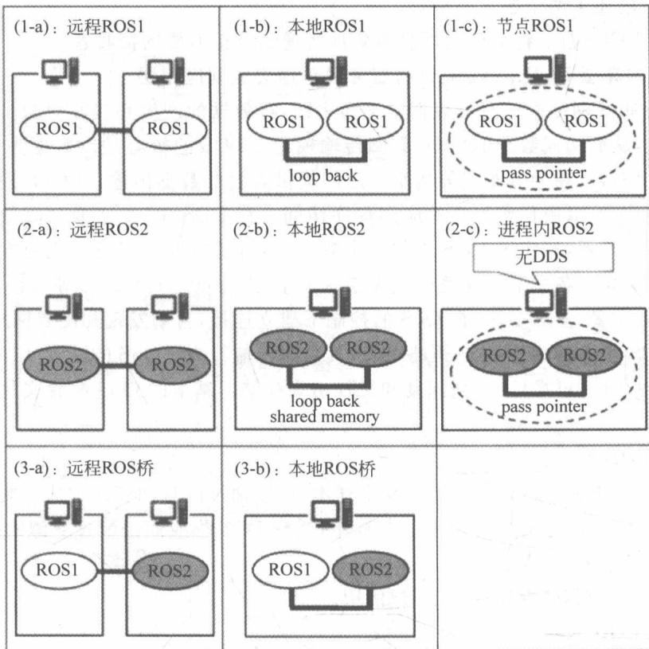

图6-21 ROS1和ROS2实验情况
{: .figure-caption }


图 6-21 中(3-a)和(3-b)是 ROS1 和 ROS2 之间的通信。由于 ROS1 历经多年的发展，已经积累了非常丰富且稳定的功能包集、各类工具和完备的教程，且广泛应用于各种机器人中。目前 ROS2 支持与 ROS1 进行通信。二者使用 ros\_bridge 进行通信，如图 6-22 所示，通过动态桥检查可用的主题，得到主题名字和主题类型来实现通信。应该注意的是，当使用 ros\_bridge 进行通信时只能使用最大努力 (Best effort) 策略，因为 ros\_bridge 不支持可靠 (Reliable) 策略。
{: .figure-caption }


通过 ROS2 和 ROS1 的实验对比可知, 在本地情况下, ROS2 的延迟开销并不小。延迟由两个数据转换为 DDS 和 DDS 事务引起。直到数据大小等于最大数据包大小 (64KB),

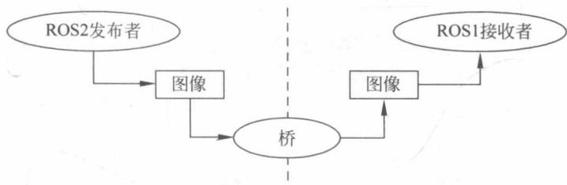

图 6-22 动态桥 (Dynamic Bridge)
{: .figure-caption }


DDS 端到端延迟都是恒定的。另一方面，当大信息被划分成多个数据包，延迟大幅增加。数据大小是否超过 64KB 不是重要的问题，尤其是在 DDS 中，因为 QoS 策略划分数据包的管理需要大量的处理时间 API。OpenSplice 利用多线程，处理比 Connext 更快。这就是为什么在本地情况底层 DDS 实现时使用 OpenSplice 的原因。在远程的情况下，延迟开销是微不足道的，必须考虑带宽的吞吐量，Connext 在这方面优于 OpenSplice。这种恒定吞吐量的消耗是可预见的，且无论数据多么小都存在。尤其是当多种类的主题被高频使用时，它有较大影响。因此，在远程情况下推荐使用 Connext。

DDS 使得 ROS2 能够保证实时性。DDS 具有优越的容错能力，因为在 QoS 策略下，它能够保存过去的数据，且不需要一个主节点。DDS 保证公平的延迟。此外，DDS 能够在多种平台运行。在 RTPS 协议下，任何 ROS2 节点彼此通信不需依赖它的平台。对于嵌入式系统，目前 FastRTPS 在线程和内存上是最好的 DDS 实现方式，但它并不适合小型嵌入式系统。

在 ROS2 中, DDS 将会作为中间件, 默认支持转换 DDS 供应商提供的文件。而且 ROS1 中的 .msg 文件将会继续在 ROS2 中被用于定义界面, 但在发布之前, 需将 .msg 类型的对象转换为 .idl 对象, 这样才可以使用 DDS 传输, 如图 6-23 所示。

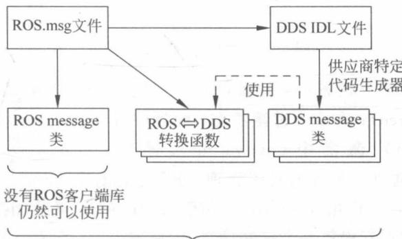
由ROS的客户端库使用

图 6-23 ROS 静态代码生成
{: .figure-caption }


另外，ROS2 还可实现节点生命周期的管理。节点之间的各种状态的相互转换关系，如图 6-24 所示。

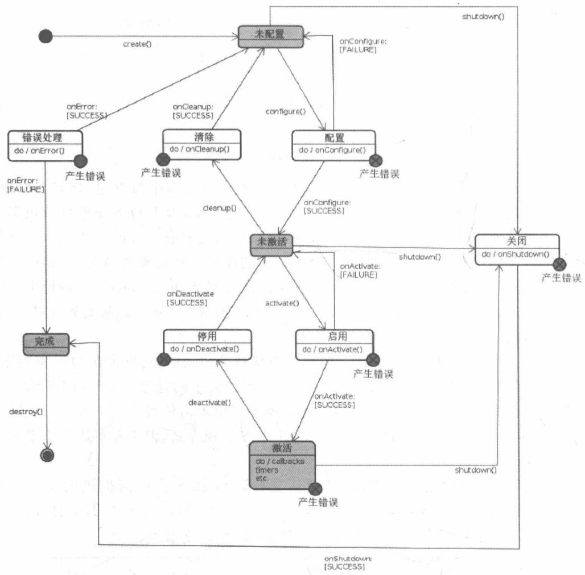

图 6-24 节点生命周期管理
{: .figure-caption }


ROS2 中的节点有 4 个状态：未配置的（unconfigured）、非活动的（inactive）、活跃的（active）、结束的（finalized）；有 6 个过渡状态：配置中（configuring）、清理中（cleaningup）、关闭中（shuttingdown）、激活中（activating）、停用中（deactivating）、错误处理中（errorprocessing）；它通过 7 个行为实现管理，分别是：创建（create）、配置（configure）、清除（cleanup）、激活（active）、停用（deactive）、关闭（shutdown）、摧毁（destroy）。

每一个被管理的节点都提供一个已知的界面,根据一个已知的生命周期状态来执行,同时还可视为一个黑箱。这给节点开发人员提供了生命周期管理的功能,同时方便于把管理节点所创建的工具应用于与之兼容的节点。

节点生命周期管理可以实现实时代码路径的明确分离；更好地控制 ROS 网络，以确保正确的启动顺序以及节点的在线重启动和转换；实现更好的监督。生命周期可以加强所有内部节点同步性，并且内部节点可以共享资源。

ROS1 提供了 nodelets，它旨在提供一种在单一的进程中对一台机器运行多个算法，且在进程内传递消息而不会增加成本的方法。nodelets 允许动态加载类到同一节点中，尽管在同一进程中，然而它们提供简单的单独命名空间，这使得 nodelets 就像一个单独的节点一样。值得注意的是 nodelets 有一些问题：节点和 nodelets 的应用程序编程接口是不同的；创建和运行 nodelets 也是复杂的。

ROS2 定义了非全局节点来解决这些问题,它没有跟踪在一个进程中的节点的全局状态,而是节点必须注册到系统来执行。“节点”和“nodelets”之间没有区别,事实上“nodelets”在 ROS2 中不会成为一个概念。在单一的进程中可以有多个节点,它们通过共享指针进行高效的通信。

另一个问题是：使用 nodelets 会很难去高效地使用一个共享线程池，这导致了线程池缺乏，如图 6-25 所示。

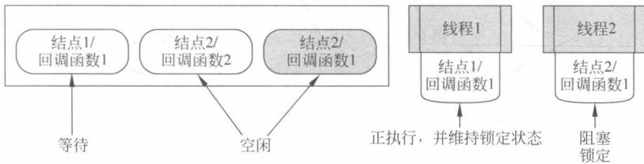

图 6-25 线程池缺乏
{: .figure-caption }


这不利于资源的有效利用,拥有很多的线程增加了内存印记,降低了环境转换的性能。在 ROS2 中,为了解决这个问题,引入了回调组(callback groups)。回调组是完全可选择的构造,但在默认情况下对用户隐藏。

可重入回调组(Reentrant Callback Groups)中的回调必须能够：

\- 作为它们自己的回调同时运行；

\- 作为它们组中的其他回调同时运行；

\- 作为其他组中的其他回调同时运行。

然而,相互排斥回调组(Mutually Exclusive Callback Groups)中的回调:

\- 不会同时运行多次；

\- 不会作为它们组中的其他回调同时运行；

\- 但必须作为其他组中的回调同时运行。

为了确保作用在共享资源上的回调不会在没有用户锁定的情况下同时运行,用户可以使用相互排斥回调组,如图 6-26 所示。此时 ROS2 是足够智能的,不会在同一时间执行“节点 1 的回调 1”的多个实例。这使得线程池中其他线程处理能够处理其他回调。


图 6-27 和图 6-28 分别展示了 ROS 的内进程和进程间发布/订阅模型。ROS 支持透明的内进程通信，这可以提升节点在自我通信（发布/订阅循环）和在同一进程中与其他节点通信两方面的性能。内进程通信使用高效的共享指针传输，可以避免序列化和并行运行，并且
{: .figure-caption }


避免网络堆叠和数据分包。

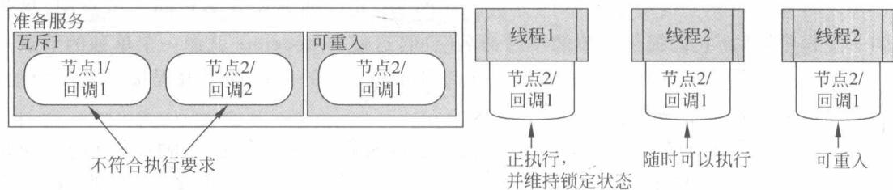

图 6-26 使用相互排斥回调组
{: .figure-caption }


图 6-27 内进程发布/订阅模型
{: .figure-caption }


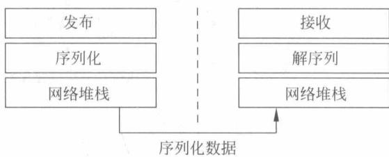

图 6-28 进程间发布/订阅模型
{: .figure-caption }


尽管 ROS1 的内进程通信已经具有不错的性能,但还是有隐藏的问题: 在使用共享指针传输信息时,订阅侧的回调函数实际上调用了内进程回调函数,这会得到错误的结果。在 ROS2 中,通过使用所用权语义来跟踪所有权,如 unique\_ptr,使得内进程通信更加安全。这种情况下,当分配一个 unique\_ptr 指针时,它们之间所有权是可以被跟踪的。ROS2 使用 unique\_ptr 指针可以以安全的方式避免重复。内进程回调函数在用户回调函数之外来处理,同时通过内进程支持更多的中间件 QoS 策略和排列行为,这使内进程通信和进程间通信的行为更一致。

ROS2 的设计目标是从一开始就具有实时能力,要在正确的时间内传输正确的计算结果——不能响应和错误的响应这两种情况一样糟糕。为了实现这一实时能力,需要使用一个相应的操作系统。

(1) Linux 变体的系统或者专属系统,例如 QNX、VxWorks。

(2) 优先考虑实时线程: 使用一个实时时间表方针, 如图 6-29 所示。

（3）在实时节点中避免非决定论的来源，主要有：内存分配和管理时，在非实时路径中预分配资源；网络通路，特别是 TCP/IP；非实时装置驱动；访问硬盘；页面错误（锁定地址空间，预错误堆叠）等。

对于 DDS, 大多数开发商将以透明方式使用共享内存优化消息流量(甚至进程之间),仅仅在离开本地主机时使用有线协议和 UDP 套接字, 这大大提高了 DDS 的性能。ROS2 还允许主题重分配(Topic Remapping)和别名使用(TopicAliasing)。

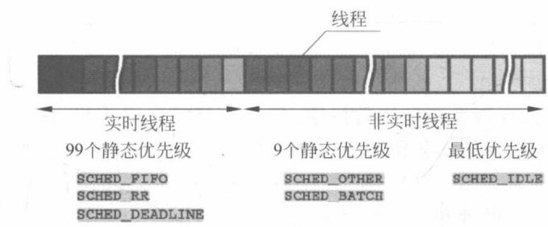

图6-29 实时线程
{: .figure-caption }


对于主题重分配：

\- 同时应用到发布器和订阅器；

\- 如果应用到发布器，订阅器将会失去连接；

\- 如果应用到订阅器，发布器将会失去连接，并且发布器的连接将会被确立。

对于主题别名使用：

\- 同时应用到发布器和订阅器；

\- 如果应用到发布器,连接也会建立到订阅器;

\- 如果应用到订阅器，连接也会建立到发布器。

为了在运行期间实现主题重分配和别名使用,发布器和订阅器的节点将自动创建一些内置服务:查询重分配和别名;通过名字重分配主题;通过名字添加一个别名;通过名字删除别名。这不仅使得开发人员使用功能更强大的运行库工具成为可能,而且支持像多机器人网络和可视化的动态情况。

ROS2 正处于发展阶段,具有很大的提升空间。

（1）ROS2 当前支持的 QoS 策略提供容错能力不足以实时处理。ROS2 必须扩大支持 QoS 策略的范围。

(2) 对于小的嵌入式系统, ROS2 需要一个最小的 DDS 实现和最低抽象层。

（3）需要可供选择的 API 来管理划分数据包，这是处理大量信息的关键。它将缩小 DDS 端到端延迟，改善 ROS2 大量数据方面的性能。

（4）DDS 支持 C、C++ 和 Java 等语言。然而，还没有支持 Python 的 DDS 版本。因此 ROS2 应提供一个最好的、功能完善的 C API。Python、Rudy 和 Lisp 等语言可以通过 CAPI 使用 DDS。

（5）在 ROS2 应用 unique\_ptr 实现内进程通信后，还应使内进程存储更智能，允许更好的内存分配控制和实时安全的测试。

（6）此外，ROS2 还有更多值得期待的地方，例如，更好地支持各种网络配置，复杂系统的确定性启动，预分配动态信息，添加或者删除节点和主题时的通知等。

## 本章小结

本章介绍了机器人操作系统环境的搭建，包括如何安装虚拟机、Linux系统和ROS系统。然后介绍了ROS的基础概念和命令，程序包的创建和编译。接下来分别介绍了ROS与MATLAB, ROS与V-REP, ROS与Gazebo之间如何集成的问题。最后介绍最新的ROS 2.0，对ROS 2.0的原理和应用作出了阐述。

## 参考文献

[1] 张建伟. 开源机器人操作系统——ROS[M]. 北京：科学出版社，2012.

[2] O'Kane J M. A Gentle Introduction to ROS[J].

[3] Martinez A, Fernndez E. Learning ROS for Robotics Programming[M]. Packet Publishing, 2013.

[4] Corke P. Integrating ROS and MATLAB[J]. IEEE Robotics & Automation Magazine, 2015, 22(2): 18-20.

[5] <http://www.gazebosim.org/>.

[6] <https://github.com/lagadic/vrep_ros_bridge>.

[7] Maruyama Y, Kato S, Azumi T. Exploring the performance of ROS2[C]//International Conference on Embedded Software. ACM, 2016: 5.
