# 第7章 机器人操作系统的应用

## 7.1 Baxter 机器人与 ROS

前文多次以 Baxter 机器人为例,介绍各种机器人仿真的事例。这里将简单地介绍 Baxter 机器人与 ROS 之间的关系。

### 7.1.1 Baxter 机器人

Baxter 机器人是美国初创公司 Rethink Robotics 开发的双臂机器人。它不仅可以用于工业的作业，也广泛被许多高校用于科学研究。

Baxter 机器人最重要的一个特点是安全可靠,不会轻易对周围的人造成伤害。这是因为在 Baxter 机器人的内部结构中采用了弹性元件,从而减小了与外部环境交互时可能产生的碰撞,因此 Baxter 机器人属于柔性的机器人。它具有弹簧的弹性特征,使得机器人与人或其他物体发生碰撞时,能够提供耐冲击性并减小危险。此外,它可以在有人类经过它旁边的时候减慢运行速度,从而避免对人类可能造成的伤害。

使用 Rethink Robotics 提供的 SDK, 研究人员可以对 Baxter 机器人的功能进行拓展。Baxter 常常应用于人机交互、人机协作、人机技能传递、末端执行器的轨迹规划等方面。

Baxter 机器人的外观如图 7-1 所示, 对各部分介绍如下。

1——360度头部超声波雷达：主要用于安全保护，可检测机器人工作空间内是否有人，防止发生意外。

2——头部摄像头：机器人头部视觉。

3——头部显示器：可显示工作状态、表情等。

4——7 自由度手臂：左右臂都是 7 自由度的机械臂，仿真人的手臂结构。

5——夹持器：位于手臂末端，可夹持物件。

6——手部摄像头及距离传感器：位于手臂末端，提

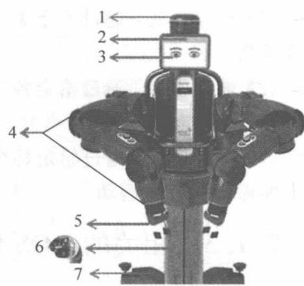

图 7-1 Baxter 机器人的外观
{: .figure-caption }


供手部视觉及手部与物件距离等信息。

7——可移动底座：可用于移动机器人、水平校准等。

### 7.1.2 Baxter 机器人的控制系统总体框架

Baxter 机器人的控制系统总体框架如图 7-2 所示, 所有的计算机和 Baxter 机器人都必须处于同一局域网内。Baxter 的服务器是一台装有 ROS 系统的电脑, 它可以跟 Baxter 机器人直接通信。个人计算机则通过特定格式的 UDP(User Datagram Protocol) 数据包与 Baxter 的服务器通信, 再由服务器将指令传输给机器人, 从而间接控制机器人。采用这种控制方案的好处在于: 利用网络通信的方式, 可以实现跨平台控制。充分发挥不同操作系统以及不同编程软件的长处。

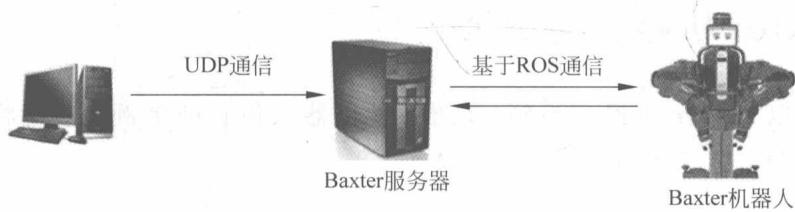

图 7-2 Baxter 机器人控制系统总体框架
{: .figure-caption }


服务器与 Baxter 机器人之间为基于 ROS 的通信, 包括了同步通信和异步通信。此外, 用户可以通过计算机与服务器进行通信, 这时使用了 UDP 通信。UDP 是一种无连接的协议, 运行在服务器和客户端的两个程序不用建立连接, 而是以收、发数据包作为通信方式, 数据包信息以分离的形式传送, 每个数据包有独立的源地址和目的地址。

Baxter 机器人的核心 SDK 由多个程序包组成, 具有分层功能, 在 ROS 系统中处于 catkin 工作区。用户能够使用 Python+ROS 进行编写。当需要通过某种控制算法去控制机器人时, 首先用户用 Python 进行算法编写 (也可以使用 MATLAB/Simulink), 然后用 Python 程序进行控制 Baxter 机器人。在控制模式上, Baxter 机器人提供了 3 种控制模式, 用户可以在顶层进行选择。这 3 种控制模式分别是:

（1）位置模式：通过给定关节的期望位置，Baxter 机器人通过运行自带的控制器，达到期望位置。

（2）速度模式：通过给定各个关节的期望速度，Baxter 机器人的各个关节便会以期望速度进行相应的运动。

（3）力矩模式：通过给定各个关节的力矩，Baxter 机器人的各个关节在对应力矩的作用下而做出相应的运动。

### 7.1.3 相关的ROS代码

在接下来的 3 个 ROS 应用例子中, 我们将通过按照 Baxter 机器人的控制框架, 对机器人进行遥操作。实验中, 使用一台计算机通过 UDP 与 Baxter 机器人服务器进行通信, 然后通过 ROS 对 Baxter 进行控制。对 Baxter 进行直接控制的 Python 程序, 它既可以实现对 Baxter 机器人的遥操作, 也可以实现机器人在运动过程中实现避障的效果。

由于 Python 的程序过长,我们将只介绍重要的代码模块。

## 7.2 基于神经网络实现对摇操作机器人进行高性能控制

下面介绍基于神经网络实现对摇操作机器人进行高性能控制的系统架构、编程与实现。

在过去十年中，遥操作机器人已经广泛应用于人类无法接近的工作场合，例如处理放射性物质和在危险环境下的搜索工作。与在结构确定性环境下工作的机械手相比，遥操作机器人可以在动态仿人环境下完成更多样化的操作任务。在大多数远程操作系统中，环境信息应该直接反馈给操作者，因此，操作者每次可以与机器人进行有效交互。当环境比较稳定时，操作者可以通过这种方式轻易地操纵远程机器人，但是在动态和不确定的环境中，这种方法可能对操作人员带来极大的工作负担。通常，远程机器人系统受到两种不确定性的影响：一个是机器人所处的外部环境，例如潜在的障碍物；另一个则是机器人内部的不确定性，如未知动力学关系和变化的负荷。对于外部不确定性，部分反馈给操作者的环境信息可能限制远程操作系统的应用范围，而全部反馈可能会分散操作者对工作任务的注意力。

在共享控制框架中，远程机器人的部分控制工作是自动完成的，可以辅助人类操作者的神经运动控制。为了减少操作员的工作量，考虑采用共享控制框架，并将自动避免碰撞机制嵌入到远程操作系统中，以使远程机器人能够安全地与动态环境进行交互。在这种控制策略下，操作者将能够集中精力于远程机器人末端执行器的操纵，并且通过使用冗余机制可以自动避障，而且对末端执行器只有很小的影响。在以前关于机械臂避障的研究中，通常使用机械臂的冗余自由度。在基座附近，剩余的自由度可能不足以使机械臂沿与障碍物的运动相反的方向移动。因此，机械臂可能遇到无法解决的动力学的问题。因此我们开发了一种降维方法来解决这个问题，以便更好地利用冗余机制。当障碍物远离机械臂时，将机械臂恢复到自然姿势。为此，我们基于运动学的远程机器人引入并行仿真系统。所提出的方法可以从运动学角度出发，在具有动态障碍的不确定环境中为机器人提供性能保证的遥操作。

内部不确定性主要受机器人动力学模型的精度影响。机器人机械臂的动态控制方法可以分为无模型控制和基于模型的控制。大多数无模型的方法可能不会产生良好的瞬态响应，而基于模型的控制方法通常产生更好的控制性能。事实上，控制性能在很大程度上取决于模型精度，但是机器人精确的动力学模型永远不可能预先获得。此外，未知或变化的载荷使得我们无法预先获得准确的动态模型。为了解决这些问题，研究者们已经开发了基于近似的控制方法，并且已经成功地应用于实际系统，例如编队控制、多智能体共同控制和机器人机械臂控制。这些近似的控制方法的理论基础是，当系统动力学满足某些条件时，不确定的非线性可以通过诸如神经网络、多项式方法、小波网络和模糊逻辑系统的工具逼近。

本节将自适应神经控制与误差变换技术相结合，以在运动学层面实现可靠的跟踪性能。在动力学水平上，确保可以避开障碍，并且在动态水平上实现基于神经网络的控制器设计与

运动学水平的控制器设计无缝集成。

所设计的系统框架图如图 7-3 所示。在运动学水平上是在关节空间中生成用于机械臂的末端夹持器的参考轨迹，以跟随操作者的指令同时实现避障功能；在动力学上是在存在不确定性条件下可以确保参考轨迹被跟踪并满足特定的性能要求。

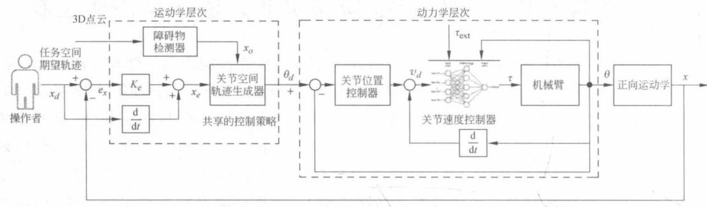

图 7-3 系统框架图
{: .figure-caption }


### 7.2.1 控制系统的架构

#### 系统组成

如图 7-4 所示为实验组件图, 操作人员通过使用连接到主计算机的全方位操纵杆, 采集操纵杆轨迹并发送到机器人服务器以远程操作机器人手臂。Baxter 机器人的其中一个机械臂被用作机械臂。它的全部 7 个关节都运用到了实验中。连接到下位机的机器人机械臂与 Kinect 传感器一起工作, 以检测周围环境中的障碍物。

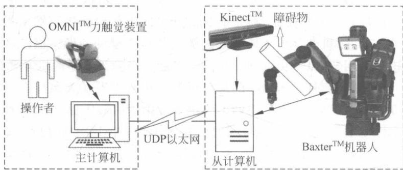

图 7-4 实验组件图
{: .figure-caption }


Kinect 传感器是由 Microsoft 开发的基于红色、绿色、蓝色加深度 (RGB-D) 的图像传感器, 如图 7-5(b) 所示, 它包含 RGB 相机和深度传感器。利用 RGB 彩色图像以及深度图像, 能够生成一个彩色的 3D 点云, 可以使用 Kinect 传感器来感知远程机器人的周围环境。

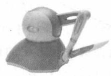
(a) 多方位操纵

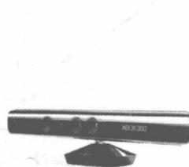
(b) Kinect传感器

图 7-5 遥控操作系统中使用的设备
{: .figure-caption }


六自由度 SensAble 多方位操纵杆, 如图 7-5(a) 所示。前三个关节决定了末端执行器的笛卡儿空间位置, 后三个关节决定它在笛卡儿空间中的方向。

#### 工作区间匹配

为了充分利用机械手工作区间,有必要建立机器人和多方位操纵杆相互匹配的工作区间,以使多方位操纵杆的缩放工作区间尽可能与远程机器人操作器的工作空间重叠。输入设备和机械臂的末端执行点的点云是基于蒙特卡罗方法创建的。

$$
\boldsymbol {x} _ {d} = \left[ \begin{array}{c c c} \cos \beta & - \sin \beta & 0 \\ \sin \beta & \cos \beta & 0 \\ 0 & 0 & 1 \end{array} \right] \times (\boldsymbol {S} _ {m} \boldsymbol {x} _ {m} + \boldsymbol {T} _ {m})\tag{7.1}
$$

其中， $x_{d}=[x_{d}\quad y_{d}\quad z_{d}]^{\mathrm{T}}$ 指的是机械臂末端执行器的笛卡儿位置，单位是米； $x_{m}=[x_{m}y_{m}\quad z_{m}]^{\mathrm{T}}$ 指的是多方位操纵杆尖端的笛卡儿位置，单位是毫米。旋转角 $\beta=\frac{\pi}{4}$ 是围绕机器人机械手基本框架的 Z 轴旋转。 $S_{m}=diag\{0.0041,0.0040,0.0041\}$ 是选择好的缩放因子，而 $T_{m}=[0.701,0.210,0.129]^{\mathrm{T}}$ 则为偏移量。

#### 坐标变换

如图 7-6 所示, Kinect 传感器被用来检测机器人机械臂周围的障碍物。为了实现障碍物的检测和避障, 在机器人机械臂和 Kinect 的坐标系之间建立变换矩阵 T 是必要的。T 矩阵可以通过校准方法获得。

首先,我们考虑4个非共线点,并在机器人坐标系和Kinect传感器坐标系下测量它们的坐标。指定XYZ为机器人的坐标系,而 $X^{\prime}$ $Y^{\prime}Z^{\prime}$ 为Kinect的坐标系。指定XYZ坐标系下4个非共线点的坐标为 $(x_{1},y_{1},z_{1}),(x_{2},y_{2},z_{2}),(x_{3},y_{3},z_{3}),(x_{4},y_{4},z_{4})$ ;而在 $X^{\prime}Y^{\prime}$

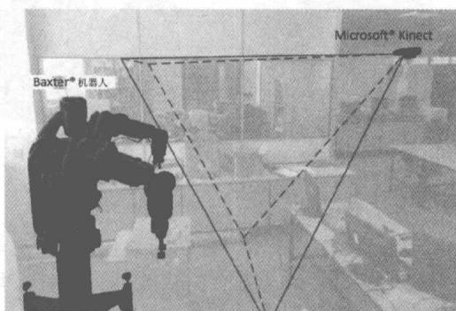

图 7-6 Kinect 传感器的设置
{: .figure-caption }


$Z'$ 坐标系下的坐标为 $(x_{1}', y_{1}', z_{1}')$ , $(x_{2}', y_{2}', z_{2}')$ , $(x_{3}', y_{3}', z_{3}')$ , $(x_{4}', y_{4}', z_{4}')$ 。基于这两个坐标系可以计算出转换矩阵 T

$$
\boldsymbol {T} = \left[ \begin{array}{c c c c} x _ {1} & x _ {2} & x _ {3} & x _ {4} \\ y _ {1} & y _ {2} & y _ {3} & y _ {4} \\ z _ {1} & z _ {2} & z _ {3} & z _ {4} \\ 1 & 1 & 1 & 1 \end{array} \right] \left[ \begin{array}{c c c c} x _ {1} ^ {\prime} & x _ {2} ^ {\prime} & x _ {3} ^ {\prime} & x _ {4} ^ {\prime} \\ y _ {1} ^ {\prime} & y _ {2} ^ {\prime} & y _ {3} ^ {\prime} & y _ {4} ^ {\prime} \\ z _ {1} ^ {\prime} & z _ {2} ^ {\prime} & z _ {3} ^ {\prime} & z _ {4} ^ {\prime} \\ 1 & 1 & 1 & 1 \end{array} \right] ^ {- 1}\tag{7.2}
$$

这两个坐标系之间的转换可以通过该式子获得

$$
[ x \quad y \quad z \quad 1 ] ^ {\mathrm{T}} = \mathbf {T} [ x ^ {\prime} \quad y ^ {\prime} \quad z ^ {\prime} \quad 1 ] ^ {\mathrm{T}}
$$

#### 碰撞点的识别

首先,连续 k 均值聚类方法用于将从 Kinect 传感器获得的点云分割成超像素。机器人上的超像素将通过其运动学构建的机器人骨架模型来识别。每个机器人机械臂的连接可以被视为3D空间中的一条线段，如图7-7所示。基于正向运动学，可以以下列方式计算每个关节的坐标，即每个节段的端点的笛卡儿位置：

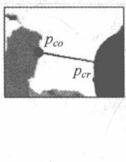

$$
{ } ^ { i } \boldsymbol { X } _ { o } = { } ^ { 0 } \boldsymbol { A } _ { 1 } { } ^ { 1 } \boldsymbol { A } _ { 2 } \dots { } ^ { n - 1 } \boldsymbol { A } _ { i } \boldsymbol { X } _ { i }\tag{7.3}
$$

其中， $^{i}X_{o}=[^{i}x_{o},^{n}y_{o},^{n}z_{o},1]^{\mathrm{T}}$ 和 $X_{i}=[x_{i},y_{i},z_{i},1]^{\mathrm{T}}$ 是笛卡儿空间中的增强位置矢量。矩阵 $^{j-1}A_{j}$ 是它们之间的齐次变换矩阵。基于分段点云可以轻松地实时生成机器人的3D模型，即图7-8(b)中的球体组成的红色3D模型。在点云中，3D模型周围的点可以视为障碍物。碰撞点 $p_{cr}$ 和 $p_{co}$ 如图7-7所示。这两个点中，前者在机器人上，后者在障碍物上，机器人机械臂和障碍物之间的最短距离为 d。图7-8中直接提供检测结果，其中图7-8(b)中的红色3D模型是机器人的3D模型，点云中的绿色点（见图7-8(a)左侧）表示障碍物，蓝色和红色点分别表示左臂和右臂上的碰撞点，黑线段（见图7-8(a)、(c)）表示机器人机械臂和障碍物之间的距离。

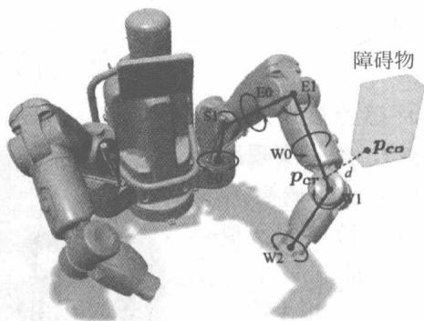

图 7-7 碰撞点 $p_{cr}$ 、 $p_{co}$ 与 Baxter 机器人关节示意图
{: .figure-caption }


(a)
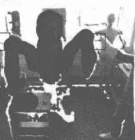
(b)

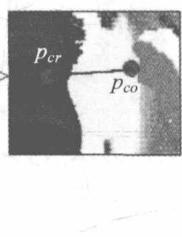
(c)

图 7-8 障碍物检测示意图
{: .figure-caption }


避障决策示意图见图7-9。满足 $\dot{x}_o' = J_o\dot{\theta}$ 和 $\dot{x}_o' - \dot{x}_o$ 落在 $\dot{x}_o$ 的法向平面 $N_{o}$ 上。

并行仿真系统见图 7-10。实际机械臂的骨架由实心黑线表示，虚线黑线表示在并行系统中仿真的人工机械臂。

未知系统动力学估计实验见图 7-11。

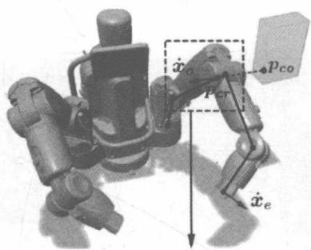
(a) 决策出来的瞬时避让速度 $\dot{x}_o$

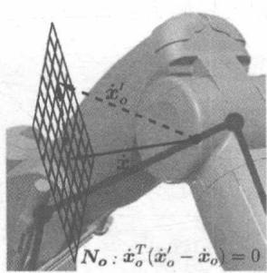
(b) 可选的避免速度 $\dot{x}_{o}^{\prime}$


图 7-9 避障决策示意图
{: .figure-caption }

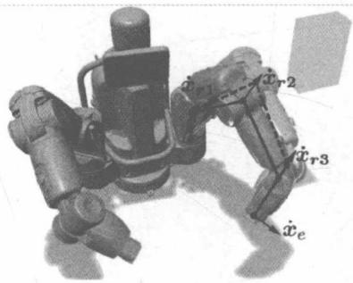

图 7-10 并行仿真系统
{: .figure-caption }


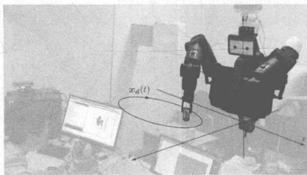

图 7-11 未知系统动力学估计实验
{: .figure-caption }


### 7.2.2 实验设计与实现

本书中的神经网络的实现是通过 Simulink 实现的, 下面列举实验中重要的 Simulink 模块。

#### 输入模块


图 7-12 为输入模块 Simulink 框图。
{: .figure-caption }


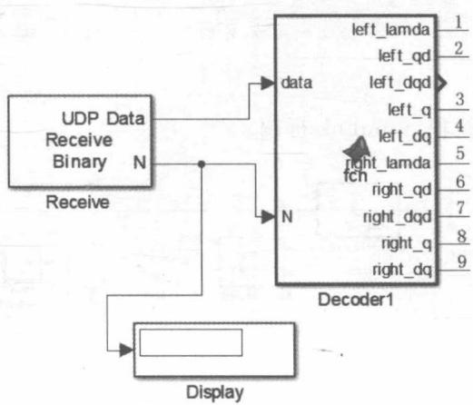

图 7-12 输入模块 Simulink 框图
{: .figure-caption }


Decoder1 的相关代码为：

```matlab
function [left_lamda, left_qd, left_dqd, left_q, left_dq, right_lamda, right_qd, right_dqd,
right_q, right_dq] = fcn(data, N)
persistent Data;
if isempty(Data)
    Data = single(data);
end
left_lamda = [0 0 0 0 0 0 0]';
left_qd = [0 0 0 0 0 0 0]';
left_dqd = [0 0 0 0 0 0 0]';
left_q = [0 0 0 0 0 0 0]';
left_dq = [0 0 0 0 0 0 0]';
right_lamda = [0 0 0 0 0 0 0]';
right_qd = [0 0 0 0 0 0 0]';
right_dqd = [0 0 0 0 0 0 0]';
right_q = [0 0 0 0 0 0 0]';
right_dq = [0 0 0 0 0 0 0]';
if N ~= 0
    Data = single(data);
end

for i = 0:6
    left_lamda(i+1) = (Data(1+2*i) + Data(2+2*i) *256)/1000.0;
    left_qd(i+1) = (Data(15+2*i) + Data(16+2*i) *256 - 32768)/10000.0;
    left_dqd(i+1) = (Data(29+2*i) + Data(30+2*i) *256 - 32768)/10000.0;
    left_q(i+1) = (Data(43+2*i) + Data(44+2*i) *256 - 32768)/10000.0;
    left_dq(i+1) = (Data(57+2*i) + Data(58+2*i) *256 - 32768)/10000.0;

    right_lamda(i+1) = (Data(71+2*i) + Data(72+2*i) *256)/1000.0;
    right_qd(i+1) = (Data(85+2*i) + Data(86+2*i) *256 - 32768)/10000.0;
    right_dqd(i+1) = (Data(99+2*i) + Data(100+2*i) *256 - 32768)/10000.0;
    right_q(i+1) = (Data(113+2*i) + Data(114+2*i) *256 - 32768)/10000.0;
    right_dq(i+1) = (Data(127+2*i) + Data(128+2*i) *256 - 32768)/10000.0;
end
```

#### 数据处理模块


图 7-13 为数据处理模块 Simulink 框图。
{: .figure-caption }


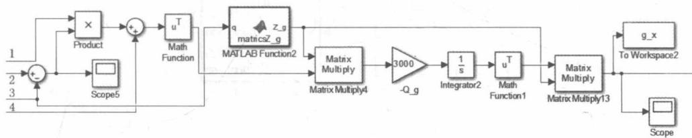

图 7-13 数据处理模块 Simulink 框图
{: .figure-caption }


其中，matricsZ\_g 的代码为：

```matlab
function Z_g = matricesZ_g(q)
n = 3;
persistent qlmt;
persistent qn;
if isempty(qlmt)
    qlmt = [-1.7 1.7; -2.14 1.05; -3.05 3.05; -0.05 2.61; -3.05 3.05; -1.57 2.09; -3.05 3.05];
    qn = zeros(7, n);
    for i = 1:7
    for j = 1:n
    qn(i, j) = qlmt(i, 1) + (qlmt(i, 2) - qlmt(i, 1)) / (n - 1) * (j - 1);
    end
    end
end
Zraw = zeros(1, n^7);
counter = 1;
for i1 = 1:n
    for i2 = 1:n
    for i3 = 1:n
    for i4 = 1:n
    for i5 = 1:n
    for i6 = 1:n
    for i7 = 1:n
c = [qn(1, i1), qn(2, i2), qn(3, i3), qn(4, i4), qn(5, i5), qn(6, i6), qn(7, i7)]';
    Zraw(1, counter) = RBF(q, c);
    counter = counter + 1;
    end
    end
    end
    end
    end
    end
end
end
Z_g = [Zraw Zraw Zraw Zraw Zraw Zraw Zraw]';
function out = RBF(x, c)
out = exp(-(x - c)'*(x - c)/0.5));
```

#### 输出模块


图 7-14 为输出模块 Simulink 框图。
{: .figure-caption }


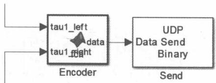

图 7-14 输出模块 Simulink 框图
{: .figure-caption }


Encoder 模块代码如下：

```matlab
function data = fcn(tau1_left, tau1_right)
data = uint8([0 0 0 0 0 0 0 0 0 0 0 0 0 0 0 0 0 0 0 0 0 0 0 0]);
dataraw = tau1_left;
dataraw = uint16(dataraw * 1000 + 32768);
data(1) = uint8(bitand(dataraw(1), hex2dec('FF00')) / 256);
data(2) = uint8(dataraw(1) - uint16(data(1)) * 256);
data(3) = uint8(bitand(dataraw(2), hex2dec('FF00')) / 256);
data(4) = uint8(dataraw(2) - uint16(data(3)) * 256);
data(5) = uint8(bitand(dataraw(3), hex2dec('FF00')) / 256);
data(6) = uint8(dataraw(3) - uint16(data(5)) * 256);
data(7) = uint8(bitand(dataraw(4), hex2dec('FF00')) / 256);
data(8) = uint8(dataraw(4) - uint16(data(7)) * 256);
data(9) = uint8(bitand(dataraw(5), hex2dec('FF00')) / 256);
data(10) = uint8(dataraw(5) - uint16(data(9)) * 256);
data(11) = uint8(bitand(dataraw(6), hex2dec('FF00')) / 256);
data(12) = uint8(dataraw(6) - uint16(data(11)) * 256);
data(13) = uint8(bitand(dataraw(7), hex2dec('FF00')) / 256);
data(14) = uint8(dataraw(7) - uint16(data(13)) * 256);

dataraw = tau1_right;
dataraw = uint16(dataraw * 1000 + 32768);
data(15) = uint8(bitand(dataraw(1), hex2dec('FF00')) / 256);
data(16) = uint8(dataraw(1) - uint16(data(15)) * 256);
data(17) = uint8(bitand(dataraw(2), hex2dec('FF00')) / 256);
data(18) = uint8(dataraw(2) - uint16(data(17)) * 256);
data(19) = uint8(bitand(dataraw(3), hex2dec('FF00')) / 256);
data(20) = uint8(dataraw(3) - uint16(data(19)) * 256);
data(21) = uint8(bitand(dataraw(4), hex2dec('FF00')) / 256);
data(22) = uint8(dataraw(4) - uint16(data(21)) * 256);
data(23) = uint8(bitand(dataraw(5), hex2dec('FF00')) / 256);
data(24) = uint8(dataraw(5) - uint16(data(23)) * 256);
data(25) = uint8(bitand(dataraw(6), hex2dec('FF00')) / 256);
data(26) = uint8(dataraw(6) - uint16(data(25)) * 256);
data(27) = uint8(bitand(dataraw(7), hex2dec('FF00')) / 256);
data(28) = uint8(dataraw(7) - uint16(data(27)) * 256);
```

### 7.2.3 实验及结果

#### 神经网络学习的性能测试

第一组实验主要测试由未知动力学和不确定载荷引起的效应的补偿效果。如图 7-11 所示，Baxter 右臂的末端执行器被控制沿着固定的轨迹移动。轨迹定义如下：

$$
\boldsymbol {x} _ {d} (t) = \left[ \begin{array}{c} 0. 6 + 0. 1 \sin (2 \pi t / 2. 5) \\ - 0. 4 + 0. 3 \cos (2 \pi t / 2. 5) \\ 0. 2 \end{array} \right]\tag{7.4}
$$

载荷是施加在夹具上的，夹具具有 $1.3\mathrm{kg}$ 的重量。为了高精度实现7-自由度F机器人动力学的近似，我们对于每个输入维度选择3个节点，并且采用 $l = 3^{7}$ 个节点的神经网络 $\hat{\pmb{M}} (\theta) = \hat{\pmb{W}}_{M}^{T}\pmb{Z}_{M}(\theta)$ 和 $\hat{\pmb{G}} (\theta) = \hat{\pmb{W}}_{G}^{T}\pmb{Z}_{G}(\theta)$ ，或2l个NN节点的神经网络 $\hat{\pmb{C}} (\theta) = \hat{\pmb{W}}_C^T\pmb{Z}_C(\theta)^T$ 和4l个NN节点的神经网络 $\hat{f} = \hat{\pmb{W}}_f^T\pmb{Z}_f(\theta ,\dot{\theta},v_d,\dot{v}_d)^{\mathrm{T}}$ 。NN权重矩阵的初始状态为 $\hat{\pmb{W}}_{M}(0) = \mathbf{0}\in$ $\mathbb{R}^{nl\times n},\hat{\pmb{W}}_{C}(0) = \mathbf{0}\in \mathbb{R}^{2nl\times n},\hat{\pmb{W}}_{G}(0) = \mathbf{0}\in \mathbb{R}^{nl\times n}$ 和 $\hat{\pmb{W}}_f(0) = \mathbf{0}\in \mathbb{R}^{4nl\times n}$ ，其中， $l = 2187,n = 7$ 。

本节将进行两个比较实验以验证我们提出的基于神经学习的控制器的性能。在第一个实验中，带有负载的机械手采用神经学习的控制器进行控制，而在第二个实验中，采用了我们提出的神经学习方法。

对于第一个实验,参考关节角度 $\theta_{d}$ 和实际关节角度 $\theta$ 如图7-15所示;关节角度误差 $e_{\theta}$ 如图7-16所示。我们看到:由于负载太大,关节角度误差相对较高。

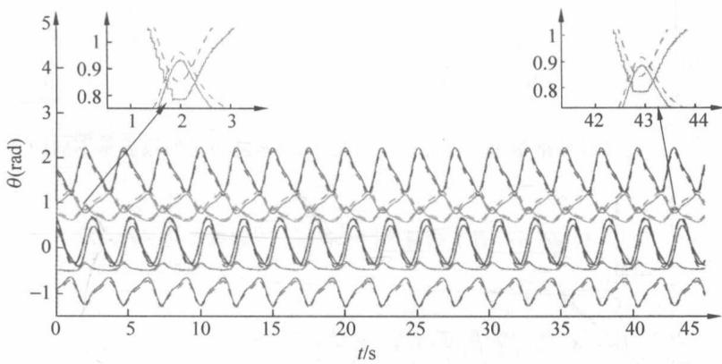

图 7-15 没有神经网络学习控制的参考关节角度 $\theta_{d}$ 和没有神经学习的实际关节角度 $\theta$ 注：虚线和实线分别表示参考和实际关节角度。不同颜色的线表示不同的关节。
{: .figure-caption }


提出的神经网络学习方法的实验结果如图 7-14～图 7-19，图 7-17 显示的是补偿转矩 $T_{NN} = \hat{M}\dot{v}_{d} + \hat{C}v_{d} + \hat{G}$ 。当负载附接到端部执行器时，其重力引起的不确定性比机器人机械手的动态不确定性更明显。所以在图 7-20 中特意展示了 NN 权重矩阵 $\hat{W}_{G}$ ，而图 7-18 显示了参考和实际关节角度，图 7-19 展示了关节的角度误差。可以看到，在开始时，补偿扭矩为零，关节角度误差与图7-16所示的结果相同。后来权重矩阵显示了收敛的趋势。在补偿扭矩 $T_{NN}$ 中可以找到与参考轨迹相同的周期性的变化。随着补偿扭矩的增加，关节角误差迅速减小，并在几个周期后得到足够小的效果，如图7-19所示。

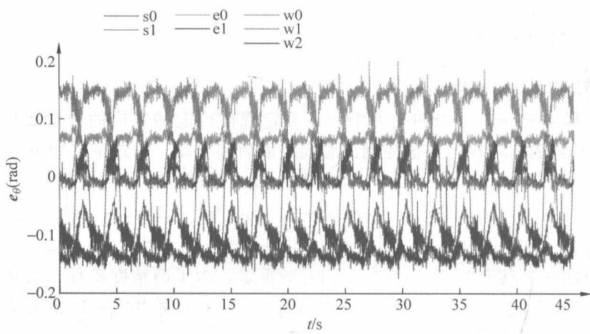

图 7-16 没有神经网络学习控制的关节角度偏差 $e_{\theta}$ (不同颜色的线代表不同的关节)
{: .figure-caption }


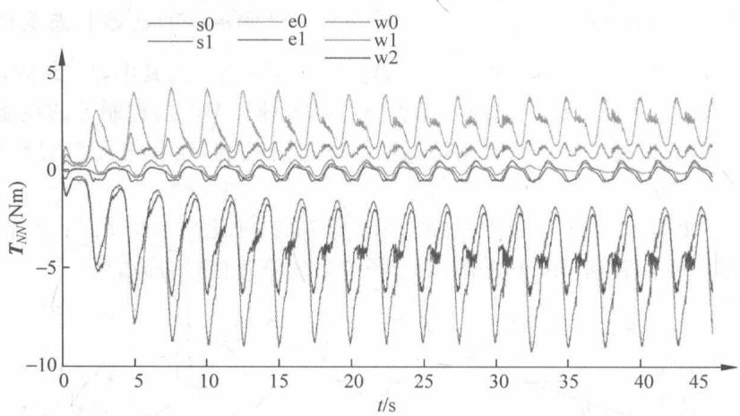


图 7-17 通过神经网络学习产生的补偿扭矩 $T_{NN}$ （不同颜色的线表示不同的关节）
{: .figure-caption }

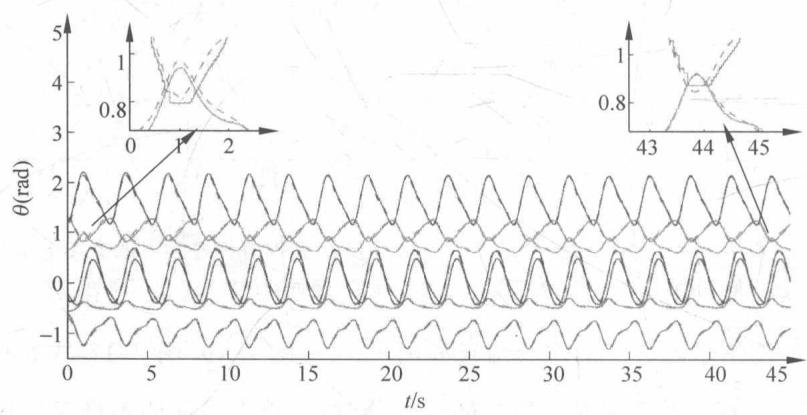

图 7-18 神经网络学习方法下的参考关节角度 $\theta_{d}$ 和实际关节角度 $\theta$ （虚线和实线分别表示参考和实际关节角度。不同颜色的线表示不同的关节）
{: .figure-caption }


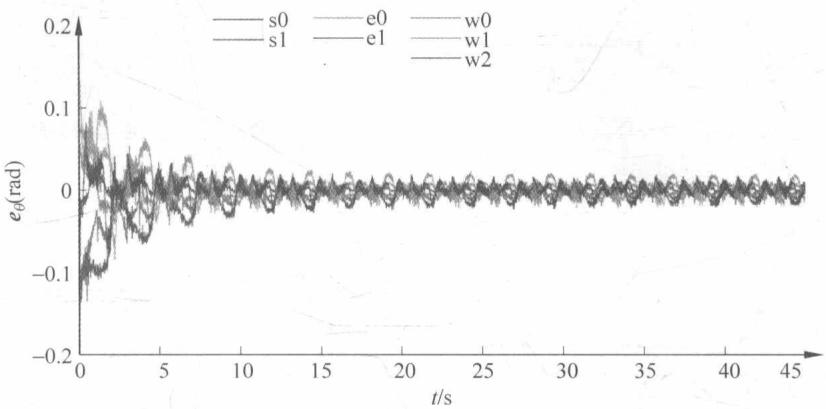

图 7-19 神经网络学习的关节角误差 $e_{\theta}$ (不同灰度的线表示不同的关节)
{: .figure-caption }


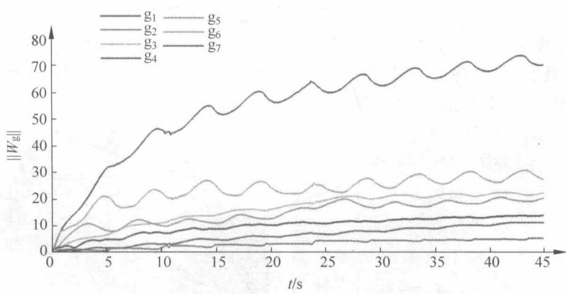

图 7-20 NN 权重矩阵 $\hat{W}_{G}$ 的每个列向量的范数，对应矩阵 $\hat{G}$ 的每一行
{: .figure-caption }


#### 跟踪性能测试

第二组实验主要集中在动态控制器的跟踪性能的测试。控制机械手的末端执行器沿着两个点 $P_{1}$ ：(0.6，-0.2,0.2)和 $P_{2}$ ：(0.6，-0.6,0.2)之间的直线移动。进行两个比较实验：采用误差变换方法和没有采用误差变换方法。没有采用误差变换方法的结果显示在图7-21(a)、(b)。而采用我们提出的误差变换方法的结果如图7-21(c)、(d)所示。图中显示的是其中一个关节的实验，其他关节的实验结果类似。为了比较这两个实验之间的性能，在图7-21(b)、(d)画出它们的性能函数 $\rho (t)$ 。在没有误差变换的情况下，超调要大得多，并且稳定时间比使用了误差变换的方法长得多。值得注意的是，我们提出的方法的关节角度误差在瞬态过程中从未超出性能要求，如图7-21(d)所示。这意味着瞬态性能满足要求。

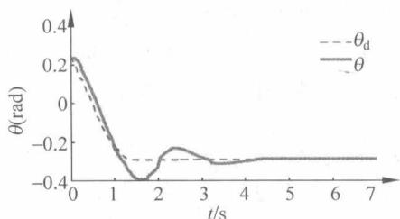
(a) 采用误差变换法的关节角度

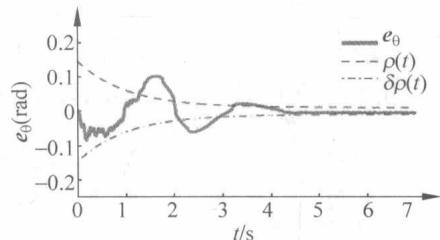
(b) 未采用误差变换法的误差

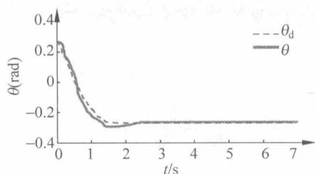
(c) 采用误差变换法的角度

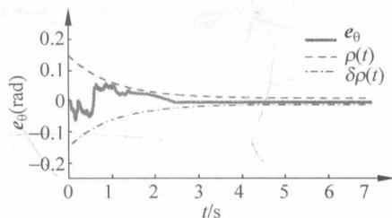
(d) 采用误差变换法的误差

图 7-21 跟踪性能测试的实验结果
{: .figure-caption }


#### 避障的测试

在该实验组中,我们测试了避障性能。操作者控制机械手在两个固定位置 A 和 B 之间

移动物体,如图 7-22 中的桌子上的两处十字叉,绿色盒子是操作对象。根据是否采用我们提出的避障方法,进行了两个实验。

实验结果如图 7-23 和图 7-24 所示。我们看到，当机器人的肘部靠近障碍物时，在没有避障控制策略下机械手与障碍物发生碰撞，不能完成任务。相比之下，在我们设计的避障控制模式下，机械手可以调整其姿势以避开障碍物并且能够完成任务。

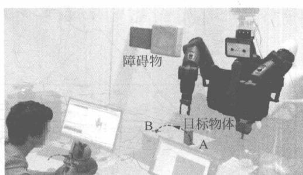

图 7-22 避障实验实物图
{: .figure-caption }


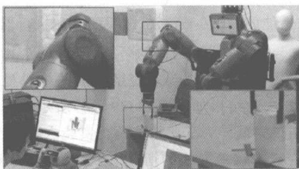
(a) 不避免碰撞

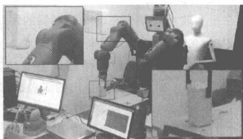
(b) 避免碰撞

图 7-23 避障实验的视频截图
{: .figure-caption }


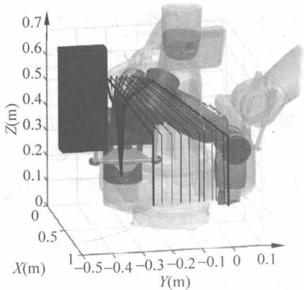
(a) 避障失败

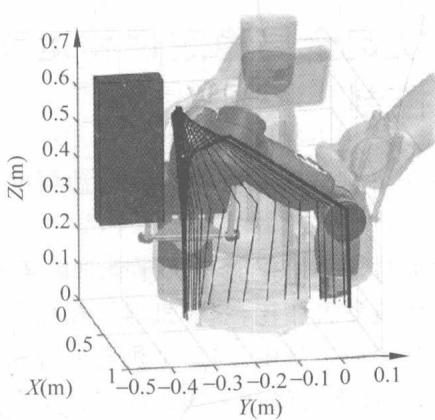
(b) 避障成功

图 7-24 机械手姿势的时间序列(黑线表示机械手,蓝色长方体表示障碍物)
{: .figure-caption }


#### 姿态恢复性能测试

最后的实验是测试恢复功能。为了便于测试，操作者静止地握住操纵杆，使得机械手的末端执行器保持在固定位置，同时障碍物以动态方式移动，测试结果如图7-25所示。在图中可以看到，当障碍物靠近机械手移动时，其肘部向下移动以避免可能存在的碰撞。注意到，在这个过程中，末端执行器几乎没有变化位置；当障碍物移开时，机械臂自动恢复到其原来的姿势。

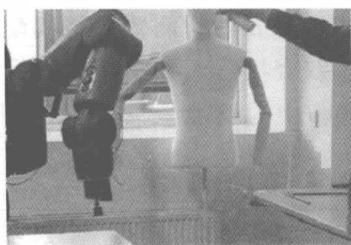
(a) t=36s

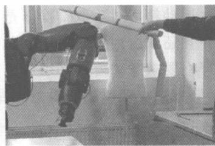
(b) t=38s

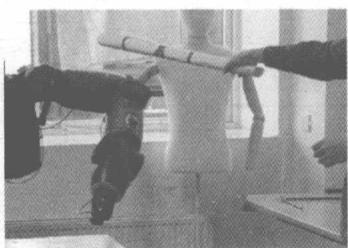
(c) t=39s

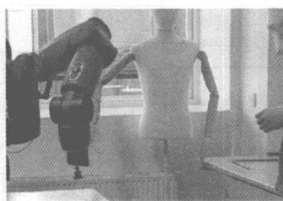
(d) t=43s

图 7-25 姿态恢复实验结果
{: .figure-caption }


## 7.3 规定全局稳定性和运动精度的双臂机器人的神经网络控制

本节介绍规定全局稳定性和运动精度的双臂机器人的神经网络控制的原理、编程与实现。

人类通过双手协作能够执行精细和复杂的操作，双臂协作是机器人领域的研究焦点之一。与单臂机器人相比，双臂机器人在操作和装载方面具有显著的优点。例如，在雕刻或螺纹连接的任务的工具中，与单个机器人臂相比，要将完成任务所需的运动和力的分配给两个机器臂上，这样大大降低了操作的复杂性和能量成本。概述图见图7-26。

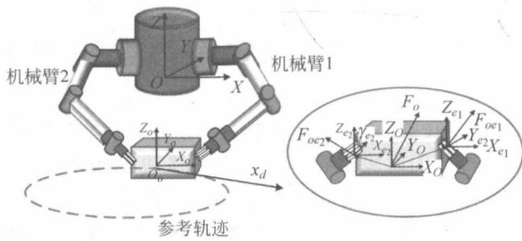

图 7-26 双臂机器人机械手操作同一个对象的概述图
{: .figure-caption }


应当强调的是,运动精度对于双臂操作是非常重要的。两臂的精确配合可以确保不会发生过大的内力,并且还减少内力的可能变化。双臂机器人控制器框图见图7-27。在这方面,对运动精度的严格要求意味着还必须考虑操作中的瞬时性能。因此,研究者们在控制领域已经做出了很多努力来实现期望的瞬态性能。

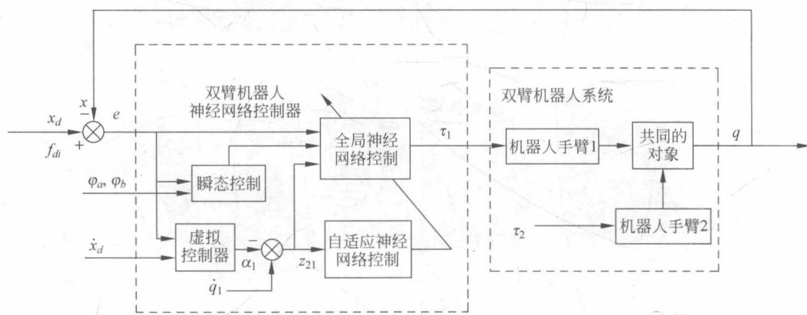

图 7-27 双臂机器人控制器框图
{: .figure-caption }


在实践中,机器人的运动学信息可以从制造商那里准确地获知,而动力学信息往往具有较大的不确定性。然而,我们可以利用机器人系统的输入-输出数据,并用它们来逼近机器人动力学参数,以便设计出具有令人满意的控制器。最成功的控制方法之一是基于神经网络的智能控制器,其利用神经网络的强大的通用近似能力来补偿未知的动力学。

应当注意,一般的神经网络控制方法仅确保闭环信号的最终有界意义上的稳定性,因为神经网络的近似仅保持在某个紧凑的集合(所谓的神经网络的近似域)上。因此,必须事先精确地识别状态变量的范围,特别是对于具有多输入和多输出的高度非线性复杂系统。因此,开发具有全局稳定性的神经网络控制器是非常重要的。然而,在大多数现有工作中仅考虑单输入单输出系统,并且很少同时考虑瞬态性能。

本节的目标是通过利用障碍 Lyapunov 函数 (BLFs) 实现事先规定的瞬态性能, 并且同时保证全局稳定性。基于 BLF 的控制器被开发用于控制具有关节空间约束的机器人机械臂。

注意,通过对状态或输出的行为构成约束,可以使用 BLF 的技术间接约束跟踪误差。由此,在本文中,BLF 技术是用来实现瞬态和稳态的目标跟踪性能。与稳态响应的调节相比,瞬态控制的调节要困难得多。通过构造规定的跟踪性能要求函数,为双臂机器人的控制器合成提出了适当的 BLF,使得可以确保瞬态和稳态跟踪性能。同时,在神经网络控制器设计中引入了切换机制,以确保全局稳定性,见图 7-28。与只保证 SGUUB 稳定性的传统神经网络控制器相比,我们提出的神经网络控制器保证了闭环系统的全局稳定性,见图 7-29。这更有利于实际的应用,因为神经网络输入的条件被极大地放宽。

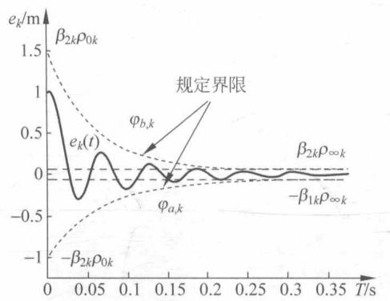

图 7-28 跟踪误差和性能函数之间的关系
{: .figure-caption }


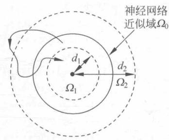

图 7-29 全局跟踪性能
{: .figure-caption }


### 7.3.1 实验设计与实现

#### Python 代码

以下关节空间控制器和 PID 控制器的定义有所不同,程序代码如下:

```python
class CJointController:
    def __init__(self, ArmName):
```

```python
self.name = ArmName
self.qd = np.mat([[0.0], [0.0], [0.0], [0.0], [0.0], [0.0]])
self.dotqd = np.mat([[0.0], [0.0], [0.0], [0.0], [0.0], [0.0]])
# self.qcmd = dict()
self.limb = baxter_interface.Limb(ArmName)
self.limb.set_joint_position_speed(1.0)self.limb.set_joint_position_speed(0.5)
self.torController0 = CPIDController(self.name + 'j0')CPIDController()
self.torController1 = CPIDController(self.name + 'j1')CPIDController()
self.torController2 = CPIDController(self.name + 'j2')CPIDController()
self.torController3 = CPIDController(self.name + 'j3')CPIDController()
self.torController4 = CPIDController(self.name + 'j4')CPIDController()
self.torController5 = CPIDController(self.name + 'j5')CPIDController()
self.torController6 = CPIDController(self.name + 'j6')CPIDController()
self.torController = [self.torController0, self.torController1,
self.torController2, self.torController3, self.torController4, self.torController5,
self.torController6]

self.krate = 1.0

self.torController[0].kp = 60.0
self.torController[0].kd = 6.0#21.0
# self.torController[0].ki = 0.01

self.torController[1].kp = 60
self.torController[1].kd = 6.0#24.0
# self.torController[1].ki = 0.01

self.torController[2].kp = 50.0
self.torController[2].kd = 5.0#18.0
# self.torController[2].ki = 0.01

self.torController[3].kp = 30.0
self.torController[3].kd = 3.0#15.0
# self.torController[3].ki = 0.01

self.torController[4].kp = 11.0
self.torController[4].kd = 1.1#5.4
# self.torController[4].ki = 0.01

self.torController[5].kp = 8.0
self.torController[5].kd = 0.8#4.5
# self.torController[5].ki = 0.01

self.torController[6].kp = 5.0
self.torController[6].kd = 0.5#7.5
# self.torController[6].ki = 0.002
```

```python
# # # # # # # # # # # # # # # class CPIDController:
    def __init__(self, name):__init__(self):
    self.kp = 1.0
    self.ki = 0.0
    self.kd = 0.0
    self.sum_max = 1000.0
    self.sum_min = -1000.0
    self.err_old = 0.0
    self.err_sum = 0.0
    self.derr_old = 0.0
    self.sumrate = 1.0
    self.rho = 0.1
    self.name = name

    timestr = time.strftime("%M%H-%d%m")
    self.file = open(timestr + self.name + ".csv", 'w')
    tempstr = "time,given,dotgiven,feedback,dotfeedback,err,derr,errtr,out\r\n"
    self.file.write(tempstr)

    def calculate_dot(self, given, dotgiven, feedback, dotfeedback):
    err = given - feedback
    derr = dotgiven - dotfeedback
    self.derr_old = (self.derr_old * 1.0 + derr) / 2.0
    self.err_old = given
    self.err_sum += err
    if self.err_sum > self.sum_max * self.sumrate:
    self.err_sum = self.sum_max * self.sumrate
    elif self.err_sum    self.sum_min * self.sumrate:
    self.err_sum = self.sum_min * self.sumrate
    #out = self.kp * err + self.kd * derr + self.ki * self.err_sum
    out = self.kp * err + self.kd * self.derr_old + self.ki * self.err_sum
    tempstr = str(rospy.get_time()) + ", " + str(given) + ", " + str(dotgiven) + ", " + str(feedback) + ", " + str(dotfeedback) + ", " + str(err) + ", " + str(derr) + ", " + str(err) + ", " + str(out) + ", \r\n"
    self.file.write(tempstr)
    return out

def calculate_dot_tr(self, given, dotgiven, feedback, dotfeedback):
    #tempstr = "time,given,dotgiven,feedback,dotfeedback,err,derr,errtr,out\r\n"
    err = given - feedback
```

```python
derr = dotgiven - dotfeedback
self.derr_old = (self.derr_old * 1.0 + derr) / 2.0
self.err_old = given
self.err_sum += err
errtemp = err
if errtemp > 0.99999 * self.rho:
    errtemp = 0.99999 * self.rho
if errtemp - 0.99999 * self.rho:
    errtemp = -0.99999 * self.rho
errtr = 0.5 * self.rho * np.log((errtemp / self.rho + 1.0) / (1.0 - errtemp / self.rho))
if errtr > 0.2:
    errtr = 0.2
if errtr - 0.2:
    errtr = -0.2
if self.err_sum > self.sum_max * self.sumrate:
    self.err_sum = self.sum_max * self.sumrate
elif self.err_sum    self.sum_min * self.sumrate:
    self.err_sum = self.sum_min * self.sumrate
#out = self.kp * err + self.kd * derr + self.ki * self.err_sum
out = self.kp * errtr + self.kd * self.derr_old + self.ki * self.err_sum
tempstr = str(rospy.get_time()) + ", " + str(given) + ", " + str(dotgiven) + ", " + str(feedback) + ", " + str(dotfeedback) + ", " + str(err) + ", " + str(derr) + ", " + str(errtr) + ", " + str(out) + ", \r\n"
self.file.write(tempstr)
return out
```

#### MATLAB 代码

以下 3 个 m 文件是共同工作的, 它们的作用是生成机器人的轨迹, 并转化为机器人末端执行器的轨迹, 其中定时器起到了控制时序作用。

## (1) 轨迹设置相关代码如下:

```matlab
clear all
close all
global t;
t = 0;
us = udp('192.168.1.100', 6101);
fopen(us);
ti = timer();
set(ti, 'BusyMode', 'drop', 'Period', 0.1, 'ExecutionMode', 'fixedRate')
set(ti, 'TimerFcn', {@timeChange, us})
start(ti);
t
```

(2) 轨迹空间转换代码如下:

```matlab
function baxterPos = moveBaxHand_twoarms(us, leftpos, rightpos, handName)
% 移动 baxter 的手臂到坐标 baxxyz。
% baxxyz 为在 baxter 坐标系中期望位置坐标, handName 为想要移动的手臂名称, 分别为 left, right 和 both
lftrpy = [pi 0 pi]';
rgtrpy = [pi 0 pi]';
% lftrpy = [-pi/2 0 0.1]';
% rgtrpy = [-pi/2 0 0]';
a1 = size(leftpos);
a = size(rightpos);

if a1(1) == 1 & a1(2) == 3 % 自动调整坐标为列向量, 因为下文中的 encoder 要求为列向量
    leftpos = leftpos';
elseif a1(1) == 3 & a1(2) == 1
    leftpos;
else
    display('baxxyz error')
    baxterPos = [0 0 0];
    return;
end

if a(1) == 1 & a(2) == 3 % 自动调整坐标为列向量, 因为下文中的 encoder 要求为列向量
    rightpos = rightpos';
elseif a(1) == 3 & a(2) == 1
    rightpos;
else
    display('baxxyz error')
    baxterPos = [0 0 0];
    return;
end

if isequal(handName, 'right') % 移动左手或右手或判断移动哪只手
    [data] = encoder1([0.5805 0.2625 0.2141]', rightpos, lftrpy, rgtrpy, [255 255]);
    fwrite(us, data);
elseif isequal(handName, 'left')
    [data] = encoder1(leftpos, [0.5735 - 0.224 0.2141]', lftrpy, rgtrpy, [255 255]);
    fwrite(us, data);
elseif isequal(handName, 'both')
    % [yz j] = theloop2(baxxyz);
    [data] = encoder1(leftpos, rightpos, lftrpy, rgtrpy, [0 255]);
    fwrite(us, data);
end
baxterPos = [0 0 0];

end
```

## (3) 定时器相关代码如下:

```matlab
function timeChange(obj, event, us)
% UNTITLED2 Summary of this function goes here
% Detailed explanation goes here
global t;
t = t + obj.Period;
length = 0.1;
tstep = 2.5;
r1 = 0.12;
r2 = 0.1;

xstartl = 0.65;
xstartr = 0.65;
ystartl = 0.2;
ystartr = -0.2;

% % circular trajectory
% experiment 1
leftpos = [r1 * sin(t * 1 * pi/tstep) + xstartl, r2 * cos(t * 1 * pi/tstep) + ystartl, 0.2];
rightpos = [r1 * sin(t * 1 * pi/tstep) + xstartr, r2 * cos(t * 1 * pi/tstep) + ystartr, 0.2];

% % set point
moveBaxHand_twoarms_3joints(us, leftpos, rightpos, 'both');

t
end
```

#### Simulink 模块

Decoder1 模块和 Decoder2 模块的作用是将 UDP 传输的数据转化为机器人左臂和右臂的关节角、角速度、角加速度、控制增益等，然后在通过其他 Simulink 模块实现设计的控制算法。

(1) Decoder1 模块的 m 代码如下:

```matlab
function [left_lamda, left_qd, left_dqd, left_q, left_dq, right_lamda, right_qd, right_dqd, right_q, right_dq, left_torque, right_torque, left_exforce, right_exforce] = fcn(data, N)
persistent Data;
if isempty(Data)
    Data = single(data);
end
left_lamda = [0 0 0 0 0 0 0]';
left_qd = [0 0 0 0 0 0 0]';
left_dqd = [0 0 0 0 0 0 0]';
left_q = [0 0 0 0 0 0 0]';
left_dq = [0 0 0 0 0 0 0]';
```

```matlab
right_lamda = [0 0 0 0 0 0 0]';
right_qd = [0 0 0 0 0 0 0]';
right_dqd = [0 0 0 0 0 0 0]';
right_q = [0 0 0 0 0 0 0]';
right_dq = [0 0 0 0 0 0 0]';
left_torque = [0 0 0 0 0 0 0]';
right_torque = [0 0 0 0 0 0 0]';
left_exforce = [0 0 0 0 0 0]';
right_exforce = [0 0 0 0 0 0]';
if N ~= 0
    Data = single(data);
end

for i = 0:6
    left_lamda(i + 1) = (Data(1 + 2 * i) + Data(2 + 2 * i) * 256)/1000.0;
    left_qd(i + 1) = (Data(15 + 2 * i) + Data(16 + 2 * i) * 256 - 32768)/10000.0;
    left_dqd(i + 1) = (Data(29 + 2 * i) + Data(30 + 2 * i) * 256 - 32768)/10000.0;
    left_q(i + 1) = (Data(43 + 2 * i) + Data(44 + 2 * i) * 256 - 32768)/10000.0;
    left_dq(i + 1) = (Data(57 + 2 * i) + Data(58 + 2 * i) * 256 - 32768)/10000.0;
    right_lamda(i + 1) = (Data(71 + 2 * i) + Data(72 + 2 * i) * 256)/1000.0;
    right_qd(i + 1) = (Data(85 + 2 * i) + Data(86 + 2 * i) * 256 - 32768)/10000.0;
    right_dqd(i + 1) = (Data(99 + 2 * i) + Data(100 + 2 * i) * 256 - 32768)/10000.0;
    right_q(i + 1) = (Data(113 + 2 * i) + Data(114 + 2 * i) * 256 - 32768)/10000.0;
    right_dq(i + 1) = (Data(127 + 2 * i) + Data(128 + 2 * i) * 256 - 32768)/10000.0;
end
for i = 0:6
    left_torque(i + 1) = (Data(141 + 2 * i) + Data(142 + 2 * i) * 256 - 32768)/1000.0;
    right_torque(i + 1) = (Data(155 + 2 * i) + Data(156 + 2 * i) * 256 - 32768)/1000.0;
end
for i = 0:5
    left_exforce(i + 1) = (Data(169 + 2 * i) + Data(170 + 2 * i) * 256 - 32768)/1000.0;
    right_exforce(i + 1) = (Data(181 + 2 * i) + Data(182 + 2 * i) * 256 - 32768)/1000.0;
end
```

## (2) Decoder2 模块的 m 代码如下:

```matlab
function [leftpos, rightpos, leftrpy, rightrpy, grippers, leftposd, rightposd, leftxyzd, rightxyzd] = fcn(data,N)
persistent Data;
if isempty(Data)
    Data = single(data);
end
leftpos = [0 0 0]';
rightpos = [0 0 0]';
```

```matlab
leftposd = [0 0 0]';
rightposd = [0 0 0]';
leftrpy = [0 0 0]';
rightprpy = [0 0 0]';
grippers = [0 0]';
leftxyzd = [0 0 0]';
rightxyzd = [0 0 0]';
Data = single(data);
for i = 0:2
    leftrpy(i + 1) = (Data(7 + 2 * i) + Data(8 + 2 * i) * 256 - 32768)/10000.0;
    leftpos(i + 1) = (Data(13 + 2 * i) + Data(14 + 2 * i) * 256 - 32768)/10000.0;
    rightprpy(i + 1) = (Data(25 + 2 * i) + Data(26 + 2 * i) * 256 - 32768)/10000.0;
    rightpos(i + 1) = (Data(31 + 2 * i) + Data(32 + 2 * i) * 256 - 32768)/10000.0;
    leftposd(i + 1) = (Data(45 + 2 * i) + Data(46 + 2 * i) * 256 - 32768)/10000.0;
    rightposd(i + 1) = (Data(51 + 2 * i) + Data(52 + 2 * i) * 256 - 32768)/10000.0;
    leftxyzd(i + 1) = (Data(57 + 2 * i) + Data(58 + 2 * i) * 256 - 32768)/10000.0;
    rightxyzd(i + 1) = (Data(63 + 2 * i) + Data(64 + 2 * i) * 256 - 32768)/10000.0;
end

grippers(1) = Data(37);
grippers(1) = Data(38);
```

### 7.3.2 实验结果

用于实验操作对象是 Baxter 双臂机器人, 如图 7-30 所示。它应用了两个 7 自由度机械

臂和先进的传感技术，包括位置、力和力矩传感器和控制，传感器安装在每个关节处。关节传感器的分辨率为14位，共360度（每刻度分辨率为0.022度），而可施加到关节的最大关节扭矩为 $50N\cdot m$ （前四个关节）和 $15N\cdot m$ （最后三个关节）。

在实验中,命令 Baxter 机器人通过使用两个机械臂来抓取物体,夹持器安装在末端执行器上的。对于每个机器臂,我们初始化关节的位置以使臂位于如图 7-30 所示的水平面中。在实验中,为了简单和不失普遍性,使

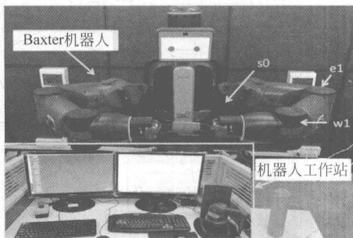

图 7-30 实验装备的插图
{: .figure-caption }


用每个臂上的3个平行旋转接头 $(s_{0},e_{1},w_{1})$ 来规划运动。被抓取的物体是由塑料制成的圆筒，重量为0.1kg，长度为0.1m，直径为0.06m。内力可以通过使用安装在每个关节的扭矩传感器以及重力补偿模型和公式来计算。

为了很好地近似机器人动力学和考虑到精度和计算效率, 将 RBFNN 的输入分为 2 组,一组包含 $[q_i^{\mathrm{T}},\dot{\alpha}_i^{\mathrm{T}}]^{\mathrm{T}}\in R^{6}$ 和另一组为 $[q_i^{\mathrm{T}},\dot{q}_i^{\mathrm{T}},\alpha_i^{\mathrm{T}}]^{\mathrm{T}}\in R^9$ ，并且对于神经网络的每个输入维度使用三个中心，最终每个神经网络总共具有 $l_{1} = 20412$ 个神经网络节点。神经网络节点的中心被均匀地间隔开，根据每个关节的运动范围和速度限制的上限和下限，如[-1.7,1.7]×[-1.05,2.61]×[-1.57,2.09]×[-1.5,1.5]×[-1.5,1.5]×[-1.5,1.5]∪[-1.7,1.7]×[-1.05,2.61]×[-1.57,2.09]×[-1.5,1.5]×[-1.5,1.5]×[-1.5,1.5]×[-1.5,1.5]×[-1.5,1.5]×[-1.5,1.5]×[-1.5,1.5]×[-1.5,1.5]×[-1.5,1.5]×[-1.5,1.5]。并且神经网络权重矩阵被初始化为 $\hat{W}_1(0) = 0\in \mathbb{R}^{3l_1\times 3}$ 和 $\hat{W}_2(0) = 0\in \mathbb{R}^{3l_2\times 3}$ 。神经网络自适应定律的增益选择为 $\Theta_{1} = \mathrm{diag}\{2\},\Theta_{2} = \mathrm{diag}\{2\}$ 。控制器的设计参数 $K_{1}$ 和 $K_{2i}$ 规定为 $K_{1} = \mathrm{diag}\{10,9,9\},K_{21} = K_{22} = \mathrm{diag}\{9,4.5,$ $1.2\}$ 。控制器中的参数 $\bar{\omega}$ 被选择为 $\bar{\omega} = 0.1$ 。

在实验中,夹持的物体需要在笛卡儿空间中跟踪以下轨迹

$$
\left( \begin{array}{c} x \\ y \\ \theta \end{array} \right) = \left[ \begin{array}{c} 0. 6 5 + 0. 1 \sin (2 \pi / 5 t) \\ 0. 1 2 \cos (2 \pi / 5 t) \\ 0 \end{array} \right]\tag{7.5}
$$

对象的初始坐标为(0.55,0.2,0.2)，初始速度设置为 $\dot{x}(0)=0,\dot{y}(0)=0,\dot{\theta}(0)=0$ 。所需的内力选择为 $f_{d1}=[0,3,0],f_{d2}=[0,-3,0]$ 。设计性能函数的参数为： $\rho_{01}=\rho_{02}=0.2,\rho_{03}=0.4,\rho_{\infty1}=\rho_{\infty2}=0.012,\rho_{\infty3}=0.025,\alpha_{k}=2.5,\beta_{1k}=\beta_{2k}=1,k=1,2,3$ 。

实验结果见图 7-31～图 7-34。被操纵对象在任务空间中跟踪性能如图 7-31 所示。其中观察到当遵循圆形轨迹时所提出的控制器具有良好的性能。x、y 和 $\theta$ 的轨迹见图 7-28(a)、(b)、(c)中给出。被操纵物体的跟踪误差示于图7-30(a)、(b)、(c)。如这些图所示，所抓取的对象非常好地遵循参考轨迹，跟踪误差收敛到零附近，而不违反预先规定的瞬态边界（即红色虚线“-”）。控制输入，内力误差，关节位置和神经网络权重范数的轨迹如图7-33和图7-34所示。从图中可以看出，闭环信号是有界的，并且内力误差收敛到零附近。

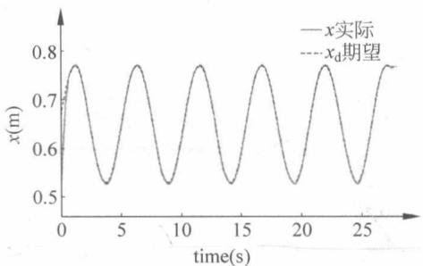

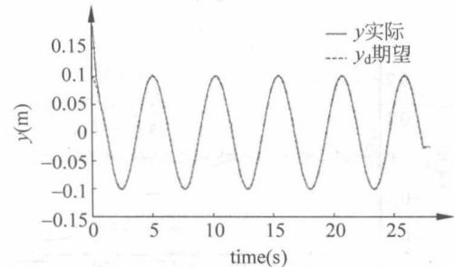

(a) $x$ 轨迹
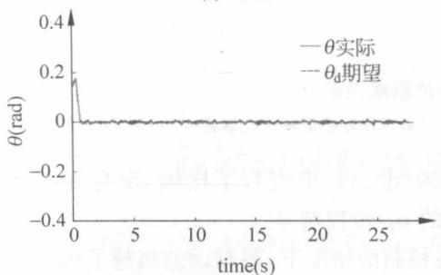
(c) $\theta$ 轨迹

(b) $y$ 轨迹
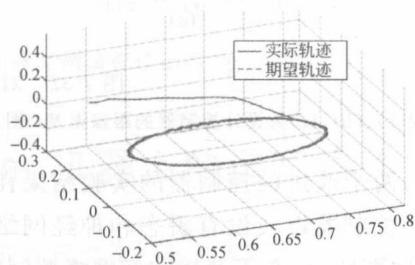
(d) 任务空间轨迹

图 7-31 被操纵对象的全局稳定跟踪性能
{: .figure-caption }


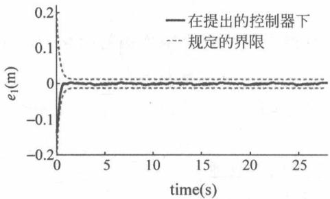
(a)

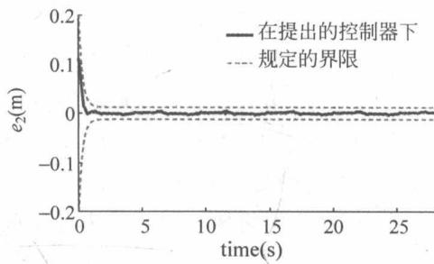
(b)

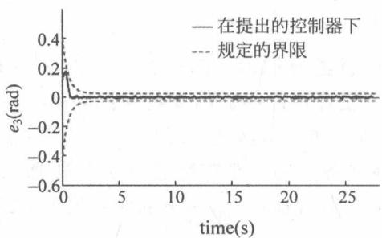
(c)

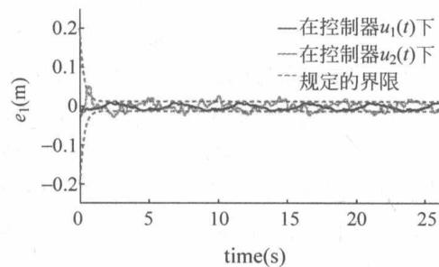


(e)

(d)

(f)

图 7-32 对象操作的跟踪误差
{: .figure-caption }


注：图7-32(a)、(b)、(c)为设计控制器的跟踪误差；图7-32(d)、(e)、(f)为修正后的控制器 $u_{1}(t)$ 和 $u_{2}(t)$ 的跟踪误差。

此外，两个改进的控制器的实验结果在图7-30(d)、(f)中进行了比较（没有神经网络适应的 $u_{1}(t)$ 控制器以及没有瞬态和神经网络控制的 $u_{2}(t)$ 控制器）。

如这些图所示,在不使用神经网络控制和瞬态控制的情况下,跟踪误差超越了规定的瞬态边界,而在不使用神经网络控制的情况下观察到相对较大的稳态误差。实验结果表明,我们提出的控制器可以成功地保证跟踪误差保留在预定义区域,并确保规定的瞬态边界从不超越。


(a) $\tau_{1}$


(b) $\tau_{2}$


(c) $\widetilde{f_{1}}=f_{1}-f_{d_{1}}$


(d) $\widetilde{f}_{2}=f_{2}-f_{d_{2}}$


图 7-33 Baxter 机器人的控制输入和内力误差
{: .figure-caption }


(a) 关节角度 $q_{ij}$


(b) 神经网络权值范数 $\|W_{ij}\|(i=1,2,j=1,2,3)$

图 7-34 九关节位置的轨迹和神经网络权值的收敛
{: .figure-caption }


## 7.4 基于人体运动捕获对 Baxter 机器人的远程操作控制

本节介绍基于人体运动捕获对 Baxter 机器人的远程操作控制的系统架构、编程与实现。

在过去几十年,机器人在制造业中的应用越来越广泛。机器人可以在特定环境中代替人类完成重复和危险的工作。但是用户需要通过外部设备才能对机器人进行操作,因此会增加操作的复杂度和给用户带来不便。如果机器人能够学会人类的技能和适应环境的能力,那么控制效率会大大提高。最直接的方法是让机器人实时跟踪人体的运动。

为了实现这一目标,首先需要捕获人体的运动。现阶段,最常用的方法是在人体上安装跟踪传感器。例如,传感器安装在人体的皮肤上,从而检测骨骼的运动和两相邻部分的相对运动。然而,这些设备不仅价格高昂,而且不便利的操作还会限制实际的使用效果。

如今，基于视觉的运动捕获系统提供了一类新的人体运动捕获方法。例如，摄像头可以代替可穿戴设备来对人体运动进行捕获，因而用户可以摆脱那些累赘的穿戴设备。基于视觉的运动捕获系统不仅功能强大，而且十分便利，已广泛应用于机器人之中。

在直角坐标系中，Kinect 传感器能够检测 25 个人体关节点。在直角坐标系中检测到人体关节数据之后，需要将其转换为关节坐标系中的数据。

在实际操作中,系统会存在几个不确定的参数。系统主要的不确定性在于未建模部分的动态性能,这会对控制效果造成影响。但是,基于准确模型的传统机器人控制方法并不能达到我们的控制要求。为了解决这个问题,我们提出一种基于函数逼近法(FAT)的近似控制方法。这种近似控制的方法利用FAT可以不断逼近系统动态,因而广泛应用在控制系统中。系统参数可以通过在线学习算法来估计,以保证期望的控制效果。

### 7.4.1 远程操作控制系统

#### 系统组成

本控制系统主要由关节角度位置的检测部分、数据传输通道和基于 FAT 的控制器组成。图 7-35 是本远程操作系统的流程图。由 Kinect V2 检测到的人体手臂关节状态作为参考输入；机器人为被控对象；其输出为反馈信号。可以通过控制器不断修正偏差。


图 7-35 远程操作系统流程图
{: .figure-caption }


#### Kinect

微软公司第二代用于 Windows 系统的产品 Kinect V2 功能强大而且价格低廉，已广泛应用于控制系统中，用以捕获三维运动数据。第二代 Kinect 传感器包含一个麦克风阵列、一个 RGB 摄像头以及一个深度传感器, 如图 7-36 所示。RGB 摄像头可以收集物体的光线并将其转换为数字信号; 深度传感器可以获取物体的深度图像。在遥操作控制系统中, 人体可以看作由 25 个关节点构成的骨架, 包括臀部、肩部以及肘部等。图 7-37 为人体关节的三维空间图。区别于传统的基于 RGB 数据的运动捕获系统, 该系统无须依靠复杂的编程技术。利用开源的软件开发包, 设备可以直接应用于遥操作控制系统当中。


图 7-36 Kinect V2 传感器外观图
{: .figure-caption }


图 7-37 人体关节的三维空间图
{: .figure-caption }


#### Kinect DevelopSoftware

许多软件都为 Kinect 传感器开发者提供开发平台。Kinect SDK 2.0 for Windows 就是一种由微软公司提供的开发工具。开发者可以使用 Kinect 软件开发包扩展 Kinect 传感器设备的应用。开发平台支持 Windows 8 以上的系统。

开发软件需要在 Windows 环境下工作，并且能与 Kinect 进行信息交互。而且要求能够计算从 Kinect 提取出来的骨骼运动数据，并将其发送到 Linux 平台的开发工作区间，来对 Baxter 机器人进行控制。因此，我们选择能满足以上开发要求的 Microsoft Visual C++。这款软件能够与 Kinect 进行交互，并检测人体骨骼信号。

#### 机器人操作系统 ROS 和 Rospy

ROS（机器人操作系统）是一款机器人软件平台，为用户提供一些标准的操作系统服务。ROS可以分为两层，下层为操作系统层，而上层则是为用户实现不同功能而配备的软件包，例如映射、动作规划、视觉和仿真等。Rospy是稳态ROS核心发行版的一部分，为程序员提供接口。

#### Baxter 机器人

Baster 机器人是 Robotics Rethink 公司生产的一款具有学习能力的工业机器人。它不需要专门的机器人专家或者复杂的用户程序来完成生产操作任务。这款机器人是针对一系列不同的简单工业任务而设计出来的。如图 7-38 所示，Baster 机器人高约 3 英尺，拥有双臂和卡通人物脸。机器人手臂拥有 7 个自由度（肩关节：sj0，sj1，sj2；肘部关节：ej0，ej1；手腕关节：wj0，wj1，wj2）。在扭矩-转角模式下，每个关节都能独立驱动和控制。


图 7-38 Baxter 机器人
{: .figure-caption }


D-H 人体手臂模型见图 7-39。


图 7-39 D-H 人体手臂模型
{: .figure-caption }


人体手臂模型参数列表见表 7-1。

表 7-1 人体手臂模型参数列表

<table><tr><td>i</td><td> <span class="arithmatex">\(\theta_i\)</span> </td><td> <span class="arithmatex">\(d_i\)</span> </td><td> <span class="arithmatex">\(\alpha_i\)</span> </td><td> <span class="arithmatex">\(a_i\)</span> </td></tr><tr><td>0</td><td> <span class="arithmatex">\(-\pi/2\)</span> </td><td>0</td><td>0</td><td> <span class="arithmatex">\(-\pi/2\)</span> </td></tr><tr><td>1</td><td> <span class="arithmatex">\(\varphi_1(\pi/2)\)</span> </td><td>0</td><td>0</td><td> <span class="arithmatex">\(-\pi/2\)</span> </td></tr><tr><td>2</td><td> <span class="arithmatex">\(\varphi_2(0)\)</span> </td><td>0</td><td>0</td><td> <span class="arithmatex">\(-\pi/2\)</span> </td></tr><tr><td>3</td><td> <span class="arithmatex">\(\varphi_3(\pi/2)\)</span> </td><td> <span class="arithmatex">\(d_3\)</span> </td><td>0</td><td> <span class="arithmatex">\(\pi/2\)</span> </td></tr><tr><td>4</td><td> <span class="arithmatex">\(\varphi_4(0)\)</span> </td><td>0</td><td>0</td><td> <span class="arithmatex">\(-\pi/2\)</span> </td></tr><tr><td>5</td><td> <span class="arithmatex">\(\varphi_5(-\pi/2)\)</span> </td><td> <span class="arithmatex">\(d_5\)</span> </td><td>0</td><td> <span class="arithmatex">\(-\pi/2\)</span> </td></tr><tr><td>6</td><td> <span class="arithmatex">\(\varphi_6(-\pi/2)\)</span> </td><td>0</td><td>0</td><td> <span class="arithmatex">\(-\pi/2\)</span> </td></tr><tr><td>7</td><td> <span class="arithmatex">\(\varphi_7(0)\)</span> </td><td>0</td><td>d7</td><td> <span class="arithmatex">\(\pi\)</span> </td></tr></table>

基于向量法的角度计算见图 7-40。


图 7-40 基于向量法的角度计算
{: .figure-caption }


### 7.4.2 实验的设计与实现

本节内容所设计的框架如图 7-41 所示, 其中 C++ 程序用于接收 Kinect 传感器传输的数据, 并进行处理, 生成关节角度 $q_{d}$ 。Python 程序主要是围绕主控制器而设计的, 对关节角度进行处理后输出力矩 $\tau$ , 而 MATLAB/Simulink 运用神经网络控制算法, 系统的未知项进行估计, 相当于前馈控制, 并生成了补偿力矩 $\tau_{c}$ 。


图 7-41 实验程序框架
{: .figure-caption }


#### Python 代码

该 Python 程序主要实现的功能是接收并处理 Kinect 发送的相关数据。它将接收到的字符串型数据改为浮点型数据，并将人体的关节空间映射到机器人运动的关节空间，已达到使用 Kinect 摇操作机器人的目的，程序代码如下：

```python
class CudptoFFAT:
    def __init__(self, leftarm, rightarm):
    self.HOST = '192.168.1.100'
    self.PORT = 6103
    self.BUFSIZE = 1024
    self.ADDR = (self.HOST, self.PORT)
    self.RemotePORT = 6103
    self.udpSock = socket.socket(socket.AF_INET, socket.SOCK_DGRAM)
    self.udpSock.settimeout(1)
    self.udpSock.bind(self.ADDR)
    self.connected = False
    self.t = threading.Thread(target=self.listenWorker)
    self.thread_stop = False
    self.leftarm = leftarm
    self.rightarm = rightarm
    self.PI = 3.14159267
    self.qd = np.mat([[0.0], [0.0], [0.0], [0.0], [0.0], [0.0]])
    self.errcounter = 0
    self.t.start()
def Decode(self, data):
    self.FATResultLeft[0, 0] = ((ord(data[0]) * 256 + ord(data[1])) - 32768.0) / 1000.0
    self.FATResultLeft[1, 0] = ((ord(data[2]) * 256 + ord(data[3])) - 32768.0) / 1000.0
```

```python
self.FATResultLeft[2,0] = ((ord(data[4]) * 256 + ord(data[5])) - 32768.0)/1000.0
self.FATResultLeft[3,0] = ((ord(data[6]) * 256 + ord(data[7])) - 32768.0)/1000.0
self.FATResultLeft[4,0] = ((ord(data[8]) * 256 + ord(data[9])) - 32768.0)/1000.0
self.FATResultLeft[5,0] = ((ord(data[10]) * 256 + ord(data[11])) - 32768.0)/1000.0
self.FATResultLeft[6,0] = ((ord(data[12]) * 256 + ord(data[13])) - 32768.0)/1000.0

self.FATResultRight[0,0] = ((ord(data[14]) * 256 + ord(data[15])) - 32768.0)/1000.0
self.FATResultRight[1,0] = ((ord(data[16]) * 256 + ord(data[17])) - 32768.0)/1000.0
self.FATResultRight[2,0] = ((ord(data[18]) * 256 + ord(data[19])) - 32768.0)/1000.0
self.FATResultRight[3,0] = ((ord(data[20]) * 256 + ord(data[21])) - 32768.0)/1000.0
self.FATResultRight[4,0] = ((ord(data[22]) * 256 + ord(data[23])) - 32768.0)/1000.0
self.FATResultRight[5,0] = ((ord(data[24]) * 256 + ord(data[25])) - 32768.0)/1000.0
self.FATResultRight[6,0] = ((ord(data[26]) * 256 + ord(data[27])) - 32768.0)/1000.0

def listenWorker(self):
    udp_rate = rospy.Rate(1000.0)
    while not self.thread_stop:
    try:
    data, addr = self.udpSock.recvfrom(self.BUFSIZE)
    self.connected = True
    # print data
    # self декode(data)
    qd = np.mat([ [ 0 . 0 ], [ 0 . 0 ], [ 0 . 0 ], [ 0 . 0 ], [ 0 . 0 ], [ 0 . 0 ]])
    qd[ 0 , 0 ] = float(data[ 0 : 8])
    qd[ 1 , 0 ] = float(data[ 9 : 17])
    qd[ 2 , 0 ] = float(data[ 18 : 26])
    qd[ 3 , 0 ] = float(data[ 27 : 35])
    qd[ 4 , 0 ] = float(data[ 36 : 44])
    qd[ 5 , 0 ] = float(data[ 45 : 53])
    qd[ 6 , 0 ] = float(data[ 54 : 62])

    qd[ 0 , 0 ] = -1.7 + qd[ 0 , 0 ] / self.PI * 1.7
    qd[ 1 , 0 ] = 1.05 - qd[ 1 , 0 ] / self.PI * 3.19 + 0.5
    qd[ 2 , 0 ] = -3.05 + qd[ 2 , 0 ] / self.PI * 3.05
    qd[ 3 , 0 ] = 2.61 - qd[ 3 , 0 ] / self.PI * 2.66
    qd[ 4 , 0 ] = qd[ 4 , 0 ]
    qd[ 5 , 0 ] = qd[ 5 , 0 ]
    qd[ 6 , 0 ] = qd[ 6 , 0 ]
```

```python
self.leftarm.qkinect = qd
except:
    self.errcounter += 1
    self.connected = False
    print "FFAT UDP time out. Counter = ", self.errcounter

udp_rate.sleep()

def stop(self):
    self.thread_stop = True
###
###
###
###
###
###
###
###
###
###
###
###
###
###
###
###
###
###
###
###
###
###
###
##
qd = self.qkinect
errqk = self.qkinect - qnow
print 'self.qkinect', self.qkinect, 'errqk = ', errqk
dotqd = self.poscontroller.calculate_mul_err(errqk)
for i in range(0, 7):
    if dotqd[i] > 0.2:
    dotqd[i] = 0.2
    if qnow[i] - 0.2:
    qnow[i] = 0.2

for i in range(0, 7):
    if qnow[i] > self.qmax[i]:
    qnow[i] = self.qmax[i]
    dotqd[i, 0] = 0
    if qnow[i] self.qmin[i]:
    qnow[i] = self.qmin[i]
    dotqd[i, 0] = 0
###
```

#### Kinect 捕捉人体骨骼

(1) 坐标点计算的代码如下:

```javascript
HipRight.x += joint[JointType_HipRight].Position.X;
HipRight.y += joint[JointType_HipRight].Position.Y;
HipRight.z += joint[JointType_HipRight].Position.Z;
HipLeft.x += joint[JointType_HipLeft].Position.X;
HipLeft.y += joint[JointType_HipLeft].Position.Y;
HipLeft.z += joint[JointType_HipLeft].Position.Z;
ShoulderRight.x += joint[JointType_ShoulderRight].Position.X;
ShoulderRight.y += joint[JointType_ShoulderRight].Position.Y;
```

```txt
ShoulderRight.z += joint[JointType_ShoulderRight].Position.Z;
ShoulderLeft.x += joint[JointType_ShoulderLeft].Position.X;
ShoulderLeft.y += joint[JointType_ShoulderLeft].Position.Y;
ShoulderLeft.z += joint[JointType_ShoulderLeft].Position.Z;
ElbowLeft.x += joint[JointType_ElbowLeft].Position.X;
ElbowLeft.y += joint[JointType_ElbowLeft].Position.Y;
ElbowLeft.z += joint[JointType_ElbowLeft].Position.Z;
WristLeft.x += joint[JointType_WristLeft].Position.X;
WristLeft.y += joint[JointType_WristLeft].Position.Y;
WristLeft.z += joint[JointType_WristLeft].Position.Z;
HandLeft.x += joint[JointType_HandLeft].Position.X;
HandLeft.y += joint[JointType_HandLeft].Position.Y;
HandLeft.z += joint[JointType_HandLeft].Position.Z;
ThumbLeft.x += joint[JointType_ThumbLeft].Position.X;
ThumbLeft.y += joint[JointType_ThumbLeft].Position.Y;
ThumbLeft.z += joint[JointType_ThumbLeft].Position.Z;
HandTipLeft.x += joint[JointType_HandTipLeft].Position.X;
HandTipLeft.y += joint[JointType_HandTipLeft].Position.Y;
HandTipLeft.z += joint[JointType_HandTipLeft].Position.Z;
ElbowRight.x += joint[JointType_ElbowRight].Position.X;
ElbowRight.y += joint[JointType_ElbowRight].Position.Y;
ElbowRight.z += joint[JointType_ElbowRight].Position.Z;
WristRight.x += joint[JointType_WristRight].Position.X;
WristRight.y += joint[JointType_WristRight].Position.Y;
WristRight.z += joint[JointType_WristRight].Position.Z;
HandRight.x += joint[JointType_HandRight].Position.X;
HandRight.y += joint[JointType_HandRight].Position.Y;
HandRight.z += joint[JointType_HandRight].Position.Z;
ThumbRight.x += joint[JointType_ThumbRight].Position.X;
ThumbRight.y += joint[JointType_ThumbRight].Position.Y;
ThumbRight.z += joint[JointType_ThumbRight].Position.Z;
HandTipRight.x += joint[JointType_HandTipRight].Position.X;
HandTipRight.y += joint[JointType_HandTipRight].Position.Y;
HandTipRight.z += joint[JointType_HandTipRight].Position.Z;
```

## (2) 向量和角度计算的代码如下:

```txt
//计算向量；
CvPoint3D32f CO, CD, CB, CE, CH, DC, DD1, DE, EC, ED, EH, EF, EG, L_X5, L_X7;
//LeftArm
CO = GetVector(ShoulderLeft, HipLeft);
CD = GetVector(ShoulderLeft, ElbowLeft);
CB = GetVector(ShoulderLeft, ShoulderRight);
CE = GetVector(ShoulderLeft, WristLeft);
CH = GetVector(ShoulderLeft, ThumbLeft);
DC = GetVector(ElbowLeft, ShoulderLeft);
DD1.x = 0; DD1.y = -1; DD1.z = 0;
DE = GetVector(ElbowLeft, WristLeft);
EC = GetVector(WristLeft, ShoulderLeft);
ED = GetVector(WristLeft, ElbowLeft);
EH = GetVector(WristLeft, ThumbLeft);
EF = GetVector(WristLeft, HandLeft);
EG = GetVector(HandLeft, HandTipLeft);
Left_k = -(EF.x * DE.x + EF.y * DE.y + EF.z * DE.z) / (EH.x * DE.x + EH.y * DE.y + EH.z * DE.z);
L_X5 = VectorPlus(VectorMultiply(Left_k, EH), EF);
L_X7 = CrossProduct(EF, CrossProduct(EF, EH));
//RightArm
CvPoint3D32f BA, BK, BC, BL, KB, KL, LK, LP, LN, LM, R_X5, R_X7;
BA = GetVector(ShoulderRight, HipRight);
BK = GetVector(ShoulderRight, ElbowRight);
BC = GetVector(ShoulderRight, ShoulderLeft);
BL = GetVector(ShoulderRight, WristRight);
KB = GetVector(ElbowRight, ShoulderRight);
KL = GetVector(ElbowRight, WristRight);
LK = GetVector(WristRight, ElbowRight);
LP = GetVector(WristRight, ThumbRight);
LN = GetVector(WristRight, HandTipRight);
LM = GetVector(WristRight, HandRight);
Right_k = -(LM.x * KL.x + LM.y * KL.y + LM.z * KL.z) / (LP.x * KL.x + LP.y * KL.y + LP.z * KL.z);
R_X5 = VectorPlus(VectorMultiply(Right_k, LP), LM);
R_X7 = CrossProduct(LM, CrossProduct(LM, LP));
//计算角度；
/LeftArm
Leftangle1 = PI - AngerOf(CrossProduct(CO, CD), CrossProduct(CB, CO));
Leftangle2 = AngerOf(CO, CD);
Leftangle3 = AngerOf(CrossProduct(CO, CD), CrossProduct(CD, CE));
Leftangle4 = AngerOf(DC, DE);
Leftangle5 = AngerOf(CrossProduct(DE, DD1), CrossProduct(ED, EH));
Leftangle6 = PI / 2 + AngerOf(CrossProduct(EH, EF), ED);
```

```txt
Leftangle7 = AngerOf(L_X5, L_X7);
//RightArm
Rightangle1 = PI - AngerOf(CrossProduct(BA, BK), CrossProduct(BC, BA));
Rightangle2 = AngerOf(BK, BA);
Rightangle3 = AngerOf(CrossProduct(BA, BK), CrossProduct(BK, BL));
Rightangle4 = AngerOf(KB, KL);
Rightangle5 = AngerOf(CrossProduct(KL, DD1), CrossProduct(LK, LP));
Rightangle6 = PI / 2 + AngerOf(CrossProduct(LP, LM), LK);
Rightangle7 = AngerOf(R_X5, R_X7);
```

## (3) 画出人体骨骼的代码如下:

```txt
void DrawBone(Mat& SkeletonImage, CvPoint pointSet[], const Joint * pJoints, int whichone, JointType joint0, JointType joint1),
{
    TrackingState joint0State = pJoints[joint0].TrackingState;
    TrackingState joint1State = pJoints[joint1].TrackingState;

    if ((joint0State == TrackingState_NotTracked) || (joint1State == TrackingState_NotTracked))
    {
    return;
    }

    if ((joint0State == TrackingState_Inferred) && (joint1State == TrackingState_Inferred))
    {
    return;
    }

    CvScalar color;
    switch (whichone) //跟踪不同的人显示不同的颜色
    {
    case 0:
    color = cvScalar(255);
    break;
    case 1:
    color = cvScalar(0, 255);
    break;
    case 2:
    color = cvScalar(0, 0, 255);
    break;
    case 3:
    color = cvScalar(255, 255, 0);
```

```c
break;
case 4:
    color = cvScalar(255, 0, 255);
    break;
case 5:
    color = cvScalar(0, 255, 255);
    break;
}
if ((joint0State == TrackingState_Tracked) && (joint1State == TrackingState_Tracked))
{
    line(SkeletonImage, pointSet[joint0], pointSet[joint1], color, 2);
}
else
{
    line(SkeletonImage, pointSet[joint0], pointSet[joint1], color, 2);
}
void drawSkeleton(Mat& SkeletonImage, CvPoint pointSet[], const Joint * pJoints, int whichone)
{
```

DrawBone(SkeletonImage, pointSet, pJoints, whichone, JointType\_Head, JointType\_Neck);
DrawBone(SkeletonImage, pointSet, pJoints, whichone, JointType\_Neck, JointType\_SpineShoulder);
DrawBone(SkeletonImage, pointSet, pJoints, whichone, JointType\_SpineShoulder, JointType\_SpineMid);
DrawBone(SkeletonImage, pointSet, pJoints, whichone, JointType\_SpineMid, JointType\_SpineBase);
DrawBone(SkeletonImage, pointSet, pJoints, whichone, JointType\_SpineShoulder, JointType\_ShoulderRight);
DrawBone(SkeletonImage, pointSet, pJoints, whichone, JointType\_SpineShoulder, JointType\_ShoulderLeft);
DrawBone(SkeletonImage, pointSet, pJoints, whichone, JointType\_SpineBase, JointType\_HipRight);
DrawBone(SkeletonImage, pointSet, pJoints, whichone, JointType\_SpineBase, JointType\_HipLeft);

DrawBone(SkeletonImage, pointSet, pJoints, whichone, JointType\_ShoulderRight, JointType\_ElbowRight);

DrawBone(SkeletonImage, pointSet, pJoints, whichone, JointType\_ElbowRight, JointType\_WristRight);

DrawBone(SkeletonImage, pointSet, pJoints, whichone, JointType\_WristRight, JointType\_HandRight);

```c
DrawBone(SkeletonImage, pointSet, pJoints, whichone, JointType_HandRight, JointType_HandTipRight);
DrawBone(SkeletonImage, pointSet, pJoints, whichone, JointType_WristRight, JointType_ThumbRight);
```

```c
//Left Arm
DrawBone(SkeletonImage, pointSet, pJoints, whichone, JointType_ShoulderLeft, JointType_ElbowLeft);
DrawBone(SkeletonImage, pointSet, pJoints, whichone, JointType_ElbowLeft, JointType_WristLeft);
DrawBone(SkeletonImage, pointSet, pJoints, whichone, JointType_WristLeft, JointType_HandLeft);
DrawBone(SkeletonImage, pointSet, pJoints, whichone, JointType_HandLeft, JointType_HandTipLeft);
DrawBone(SkeletonImage, pointSet, pJoints, whichone, JointType_WristLeft, JointType_ThumbLeft);
```

//Right Leg
DrawBone(SkeletonImage, pointSet, pJoints, whichone, JointType\_HipRight, JointType\_KneeRight);
DrawBone(SkeletonImage, pointSet, pJoints, whichone, JointType\_KneeRight, JointType\_AnkleRight);
DrawBone(SkeletonImage, pointSet, pJoints, whichone, JointType\_AnkleRight, JointType\_FootRight);

```c
//Left Leg
DrawBone(SkeletonImage, pointSet, pJoints, whichone, JointType_HipLeft, JointType_KneeLeft);
DrawBone(SkeletonImage, pointSet, pJoints, whichone, JointType_KneeLeft, JointType_AnkleLeft);
DrawBone(SkeletonImage, pointSet, pJoints, whichone, JointType_AnkleLeft, JointType_FootLeft);
}
```

## (4) 相关的计算如下:

```txt
//计算向量
CvPoint3D32f GetVector(CvPoint3D32f point1, CvPoint3D32f point2)
{
    CvPoint3D32f V;
    V.x = point2.x - point1.x;
    V.y = point2.y - point1.y;
    V.z = point2.z - point1.z;
    return V;
}
```

```lisp
//计算叉积
CvPoint3D32f CrossProduct(CvPoint3D32f V1, CvPoint3D32f V2)
{
    CvPoint3D32f V;
    V.x = V1.y * V2.z - V1.z * V2.y;
    V.y = V1.z * V2.x - V1.x * V2.z;
    V.z = V1.x * V2.y - V1.y * V2.x;
    return V;
}
//计算向量间的夹角
float AngerOf(CvPoint3D32f V1, CvPoint3D32f V2)
{
    float anger;
    anger = acos((V1.x * V2.x + V1.y * V2.y + V1.z * V2.z) / (sqrt(V1.x * V1.x + V1.y * V1.y + V1.z * V1.z) * sqrt(V2.x * V2.x + V2.y * V2.y + V2.z * V2.z)));
    return anger;
}
//函数，计算向量加法
CvPoint3D32f VectorPlus(CvPoint3D32f point1, CvPoint3D32f point2)
{
    CvPoint3D32f point;
    point.x = point2.x + point1.x;
    point.y = point2.y + point1.y;
    point.z = point2.z + point1.z;
    return point;
}
//函数，计算向量与数相乘
CvPoint3D32f VectorMultiply(float k, CvPoint3D32f point1)
{
    CvPoint3D32f point;
    point.x = k * point1.x;
    point.y = k * point1.y;
    point.z = k * point1.z;
    return point;
}
```

### 7.4.3 实验及结果

接下来设计实验去验证算法的效果。在第一个实验中，操作者保持一个静态的姿势。实验场景如图7-42和图7-43所示，得到人体关节角度值并送至MATLAB软件进行处理。实验表明，当操作者保持静态姿势，7个关节角的检测结果稳定地处于正确变化范围。其中存在的波动是由于Kinect检测的关节平面并非绝对平稳以及操作者自身无法保持绝对的静止而造成的少量偏差。虽然结果存在波动，但结果仍处于可接受范围。这表明7个关节角度计算方法可在静态动作中效果良好。


图 7-42 操作者静立于 Kinect 前面, 整只手臂水平放置
{: .figure-caption }


图 7-43 肘部旋转角度变化
{: .figure-caption }


第二个实验是当操作者处于动态时检测关节角度趋势。操作者保持身体静止，慢速地上下运动肘部，使其由指定的起点运动到指定的终点。如第一个实验的操作方法，将数据送至 MATLAB 处理肘部角度随着人体肘部的运动呈规律性变化。波形存在微小抖动的原因是由于操作者自身的微小抖动和传感器检测点的不确定性。总体来说，实验的结果与期望一致，可以证明该运动捕捉方法的正确性得到人体关节的角度数据后，下面的任务就是将数据进行变换再传送至机器人。

最后,由于 Baxter 机器人的坐标系和 Kinect 传感器的坐标系不同,因此需要用转换矩阵 T 和偏移矩阵 B 将人体关节角度转换为 Baxter 机器人的关节角度:

$$
\boldsymbol {\theta} _ {\mathrm{Baxter}} = \boldsymbol {T} \boldsymbol {\theta} _ {\mathrm{Kinect}} + \boldsymbol {B}\tag{7.6}
$$

其中

$$
\boldsymbol {T} = \operatorname{diag} \left(\frac {- 1 . 7}{\pi}, \frac {- 3 . 9}{\pi}, \frac {- 3 . 0 5}{\pi}, \frac {- 2 . 6 6}{\pi}, \frac {- 3 . 0 5}{\pi}, \frac {- 2 . 0 9}{\pi}, \frac {- 3 . 0 5}{\pi}\right)\tag{7.7}
$$

$$
\boldsymbol {B} = [ 1. 7, 1. 5 5, 3. 0 5, 2. 6 1, 0. 0 1, - 1. 7, - 0. 0 2 ] ^ {\mathrm{T}}\tag{7.8}
$$

由于人体的 7 个角度随操作者的动作平稳变化, 因此, 若不受外界干扰影响, Baxter 机器人对应的角度会作出相同的变化。

本章节设计实验去检验基于函数逼近法的控制器的控制效果。实验使用每个臂7自由度的双臂Baxter机器人。操作者采取匀速周期性运动。本次实验中选取4个主要的关节测试，分别为肩部偏移角、肩部转动角、肘部偏移角和肘部转动角。因此选择这4个关节数据检验结果。采用前面章节的实验方法获取人体关节数据，通过变换矩阵T和偏移矩阵B映射到机器人端。将关节角度送至Python代码后，使用转矩模式控制Baxter机器人。将人体关节看作参考信号，Baxter机器人角度则看作实际的反馈信号。

基于 FAT 的控制器实验结果如图 7-44～图 7-49 所示。图中的 q 表示实际的关节角度和 qd 参考的关节角度，分别代表肩部偏移角、肩部转动角、肘部偏移角和肘部转动角。图 7-48 展示了 FAT 中 4 个关节权矩阵 $\hat{G}$ 的收敛性。图 7-49 展示了由 FAT 获得的补偿转矩 $\tau_{c} = \hat{G} + \hat{M}\dot{v} + \hat{C}_{v}$ 。可知，补偿转矩不为 0。由图 7-48 和图 7-49 可知，关节角度误差逐渐变小，并且该神经网络权值收敛，这可以说明提出算法的有效性。


图 7-44 FAT 控制器下的关节角度 qd1 和实际角度 q1
{: .figure-caption }


图 7-45 FAT 控制器下的关节角度 qd2 和实际角度 q2
{: .figure-caption }


图 7-46 FAT 控制器下的关节角度 qd3 和实际角度 q3
{: .figure-caption }


图 7-47 FAT 控制器下的关节角度 qd4 和实际角度 q4
{: .figure-caption }


图 7-48 FAT 中四个关节的 G 权重矩阵的趋势
{: .figure-caption }


图7-49 FAT获取的补偿转矩 $T_{c}$
{: .figure-caption }


## 本章小结

本章介绍了机器人操作系统在 Baxter 机器人上的应用实例, 包括了如何使用 ROS 对机器人进行远程控制, 如何借助 ROS 在机器人上实现控制算法等课题。

## 参考文献

[1] C Yang, X Wang, L Cheng, et al. Neural-learning-based telerobot control with guaranteed performance[J]. IEEE Transactions on Cybernetics, vol 47, 2017.

[2] C Yang, Y Jiang, Z Li, et al. Neural control of bimanual robots with guaranteed global stability and motion precision[J]. IEEE Transactions on Industrial Informatics, vol 13, 2017.

[3] Peng G, Yang C, Jiang Y, et al. Teleoperation control of Baxter robot based on human motion capture[C]. Information and Automation (ICIA), 2016 IEEE International Conference on. IEEE, 2016: 1026-1031.
