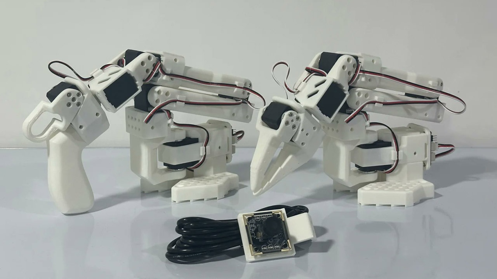
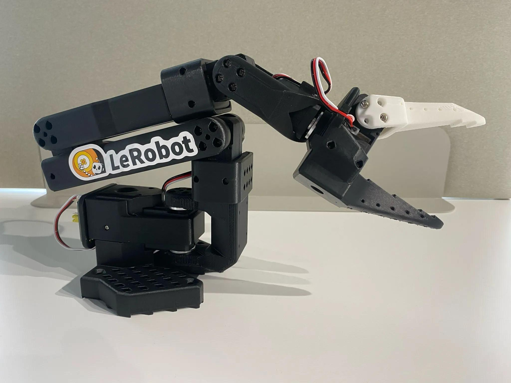
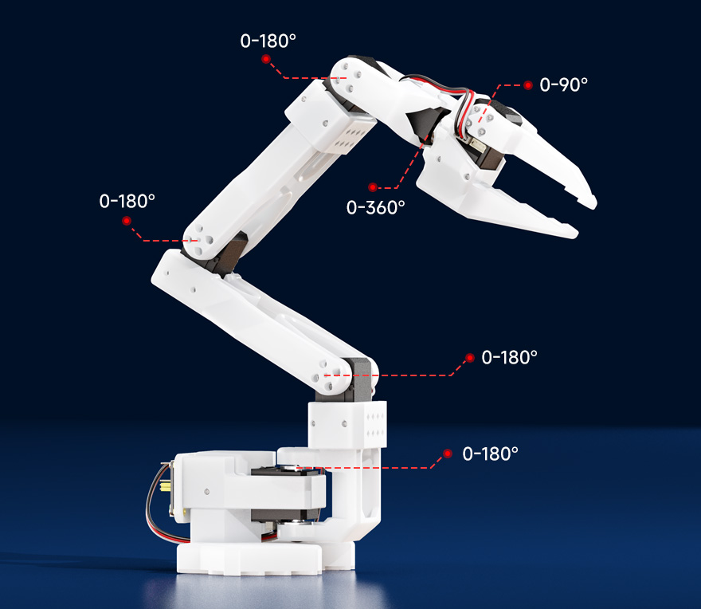
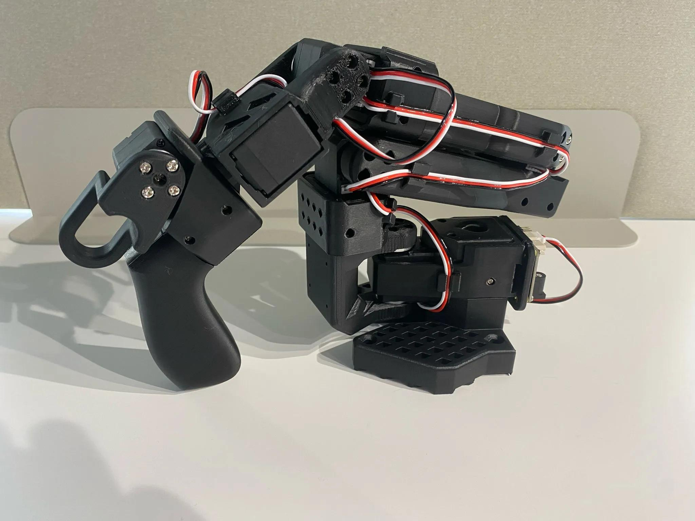

# 第 8 章 基于 LeRobot 的低成本机械臂 SO-101 的应用

前面章节介绍了 ROS 的基础概念与在 Baxter 机器人等平台上的应用。可以发现，传统的机器人平台（如 Baxter、V-REP 仿真、Gazebo 仿真）虽然功能强大，但硬件成本较高、装配复杂，而且往往依赖 CAN 总线、SocketCAN 驱动和内核模块，环境搭建门槛较高。近年来，随着模仿学习（Imitation Learning）与端到端（End-to-End）机器人学习方法的兴起，机器人研究逐渐从 "手工编写控制逻辑" 转向 "让机器人从人类演示数据中自主学习"。本章介绍 Hugging Face 团队推出的开源机器人学习库 LeRobot，以及与其原生配套的低成本机械臂 SO-101。SO-101 不需要 ROS 也能完成从数据采集、策略训练到自主部署的完整流程，为读者提供了一个上手机器人学习的最便捷入口。

## 8.1 LeRobot 与 SO-101 机械臂

### 8.1.1 LeRobot 概述

LeRobot 是 Hugging Face 推出的基于 PyTorch 的开源机器人学习库，其官方目标是 "让每个人都能负担得起机器人 AI，并让所有人都能共享数据集与预训练模型，从而为真实世界的机器人研究做出贡献"。LeRobot 的核心定位是提供**真实世界机器人**的端到端学习方法，重点关注两类机器学习范式：

（1）**模仿学习（Imitation Learning）**：从人类演示数据中学习 "观测 → 动作" 的映射，让机器人复现人类演示过的行为。这也是本章的核心内容。

（2）**强化学习（Reinforcement Learning）**：让机器人在仿真环境中通过与环境的交互自行探索最优策略。

LeRobot 已经内置了多种前沿策略模型，例如 ACT（Action Chunking with Transformers）、Diffusion Policy（扩散策略）、TDMPC、VQ-BeT 以及最新提出的视觉 - 语言 - 动作模型 SmolVLA 等，并提供了配套的仿真环境（如 PushT、Aloha、XArm、SimXArm）。同时，LeRobot 在 Hugging Face Hub 上托管了大量由社区采集的人类演示数据集和预训练策略，使用者可以直接下载使用，也可以把自己采集的数据集上传共享，形成 "数据越分享、社区越强大" 的正向循环。

LeRobot 的代码库托管在 [https://github.com/huggingface/lerobot](https://github.com/huggingface/lerobot)，数据集与预训练模型托管在 [https://huggingface.co/lerobot](https://huggingface.co/lerobot)。

### 8.1.2 SO-101 机械臂的硬件结构

SO-101 是 Hugging Face 在 SO-100 基础上改进升级得到的开源六自由度（6-DOF）桌面机械臂，也是 LeRobot 代码库中官方支持的首选参考平台之一。SO-101 的全部结构件都可以使用 PLA+ 等材料 3D 打印，单只手臂的成本约 114 欧元，是极具性价比的机器人学习入门平台。其外观如图 8-1 所示。




图 8-1 SO-101 主臂（左，握把式）与从臂（右，夹爪式）

{: .figure-caption}

SO-101 机械臂的主要硬件特点如下。

（1）**六自由度结构**：SO-101 包含肩部偏航（shoulder\_pan）、肩部俯仰（shoulder\_lift）、肘部弯曲（elbow\_flex）、腕部俯仰（wrist\_flex）、腕部滚动（wrist\_roll）以及末端夹爪（gripper）共 6 个关节，如图 8-2 所示，能够完成抓取、搬运等复杂的桌面操作任务。




图 8-2 SO-101 从臂（夹爪式末端执行器）

{: .figure-caption}

SO-101 的 6 个关节活动范围如图 8-3 所示。




图 8-3 SO-101 各关节的活动范围

{: .figure-caption}

（2）**串行总线舵机**：SO-101 采用 6 个 Feetech STS3215 串行总线舵机。与 CAN 总线电机不同，STS3215 舵机使用标准的 USB 串行总线通信，所有 6 个舵机以菊花链方式连接在一条 3 Mbps 的 USB 串行总线上，只需一根 USB 数据线即可连接计算机，无须安装 SocketCAN 驱动、内核模块或进行复杂的接口配置。这一特点使 SO-101 能够在 Windows、macOS、Linux 等主流操作系统上直接运行，对初学者十分友好。其代价是负载能力相对较低（约 250 g），更适合桌面抓取与模仿学习数据采集场景。

（3）**主臂与从臂**：SO-101 通常由两只结构相同但舵机减速比不同的手臂组成。其中，**从臂（Follower Arm）** 是执行实际任务的机械臂，其末端为夹爪式执行器；**主臂（Leader Arm）** 作为遥操作的输入设备，末端带有握把式手柄，操作者握住主臂运动，从臂便会实时跟随。主臂各关节采用了不同的减速比，以保证主臂既能支撑自身重量，又便于人手灵活推动。主臂各关节所需的舵机减速比见表 8-1。

表 8-1 主臂各关节舵机减速比

### 8.1.3 SO-101 与 ROS 的关系

需要特别说明的是，SO-101 与前面章节介绍的 Baxter、V-REP、Gazebo 平台在使用方式上有本质区别。SO-101 完全通过 LeRobot 提供的 Python 接口经 USB 串行总线控制，**不依赖 ROS** 也能完成校准、遥操作、数据采集与自主控制的全流程。这也是 SO-101 相比 CAN 总线机械臂对初学者更友好的重要原因：无须安装 Ubuntu、ROS 与内核驱动。

不过，SO-101 并不与 ROS 冲突。一方面，SO-101 的 6 个关节状态（joint position）与动作（goal position）本质上仍遵循 "位置、速度、力矩" 等机器人控制的基本概念；另一方面，社区也提供了将 SO-101 接入 ROS 2 的桥接方案（例如 lerobot\_ros 等第三方包），使得 SO-101 可以融入已有的 ROS 生态，与 Gazebo 仿真、RVIZ 可视化等工具协同使用。读者在掌握 LeRobot 原生工作流之后，可以根据需要将 SO-101 接入自己的 ROS 系统。

## 8.2 LeRobot 与 SO-101 的环境搭建

### 8.2.1 LeRobot 的安装

LeRobot 需要 Python 3.10 及以上版本。下面以使用 Miniconda 创建虚拟环境为例介绍安装步骤。

（1）下载并安装 Miniconda 后，创建名为 lerobot 的虚拟环境并激活：

```
conda create -y -n lerobot python=3.10
conda activate lerobot
```

（2）当使用 Miniconda 时，需要在环境中安装 ffmpeg，用于视频编码与解码：

```
conda install ffmpeg -c conda-forge
```

（3）克隆 LeRobot 源代码并安装。安装 SO-101 所需的 Feetech 舵机支持，使用 feetech 附加依赖：

```
git clone https://github.com/huggingface/lerobot.git
cd lerobot
pip install -e ".[feetech]"
```

如果编译过程中出现错误，可能需要先安装 cmake、build-essential 以及 ffmpeg 相关库。在 Linux 系统上可执行：

```
sudo apt-get install cmake build-essential python3-dev pkg-config \
  libavformat-dev libavcodec-dev libavdevice-dev libavutil-dev \
  libswscale-dev libswresample-dev libavfilter-dev
```

### 8.2.2 USB 端口检测与舵机配置

SO-101 的两只手臂各连接一个 USB 串行舵机控制器。在开始配置之前，需要确定每只手臂对应的 USB 端口。LeRobot 提供了检测脚本：

```
python lerobot/scripts/find_motors_bus_port.py
```

运行该脚本时，脚本会先列出当前检测到的所有可用端口，然后提示拔掉其中一只手臂的 USB 线并回车，从而确定该端口属于哪只手臂。在 macOS 上，端口名称通常形如 `/dev/tty.usbmodem575E0031751`；在 Linux 上通常为 `/dev/ttyACM0`、`/dev/ttyACM1` 等。Linux 系统下若出现权限问题，可先执行：

```
sudo chmod 666 /dev/ttyACM0
sudo chmod 666 /dev/ttyACM1
```

得到两只手臂的端口后，需要修改 LeRobot 配置文件中 `SO101RobotConfig` 的 `port` 默认值，将主臂（leader）与从臂（follower）的端口分别填写到对应的 `MotorsBusConfig` 中：

```
leader_arms: dict[str, MotorsBusConfig] = field(
    default_factory=lambda: {
        "main": FeetechMotorsBusConfig(
            port="{ADD YOUR LEADER PORT}",   # 修改为主臂端口
            motors={
                # name: (index, model)
                "shoulder_pan": [1, "sts3215"],
                "shoulder_lift": [2, "sts3215"],
                "elbow_flex": [3, "sts3215"],
                "wrist_flex": [4, "sts3215"],
                "wrist_roll": [5, "sts3215"],
                "gripper": [6, "sts3215"],
            },
        ),
    }
)

follower_arms: dict[str, MotorsBusConfig] = field(
    default_factory=lambda: {
        "main": FeetechMotorsBusConfig(
            port="{ADD YOUR FOLLOWER PORT}", # 修改为从臂端口
            motors={
                # name: (index, model)
                "shoulder_pan": [1, "sts3215"],
                "shoulder_lift": [2, "sts3215"],
                "elbow_flex": [3, "sts3215"],
                "wrist_flex": [4, "sts3215"],
                "wrist_roll": [5, "sts3215"],
                "gripper": [6, "sts3215"],
            },
        ),
    }
)
```

接下来需要为每个舵机设置 ID。将舵机单独插入舵机总线的其中一个端口，运行配置脚本将其 ID 设为 1：

```
python lerobot/scripts/configure_motor.py \
    --port /dev/tty.usbmodem58760432961 \
    --brand feetech \
    --model sts3215 \
    --baudrate 1000000 \
    --ID 1
```

然后拔出该舵机，插入第 2 个舵机并将其 ID 设为 2，依次操作直到 6 个舵机的 ID 均为 1～6。对主臂的 6 个舵机重复同样的操作（注意主臂与从臂若使用不同电压的电机，需要切换对应的电源）。

### 8.2.3 舵机标定

标定（Calibrate）的目的，是保证主臂与从臂处于相同物理位姿时，其关节位置读数也相同。这一点非常重要，因为它保证了在某一只 SO-101 上训练的神经网络策略，可以迁移到另一只 SO-101 上正常工作。

启动从臂的手动标定，运行以下命令：

```
python lerobot/scripts/control_robot.py \
    --robot.type=so101 \
    --robot.cameras='{}' \
    --control.type=calibrate \
    --control.arms='["main_follower"]'
```

随后需要按照提示，依次将机械臂移动到 "中间位置、零位、旋转位置、复位位置" 四个位姿，在每个位姿按下回车确认。其中，旋转位置位于机械臂的右侧，且需要将夹爪完全张开。对主臂进行标定时，将 `--control.arms` 参数改为 `'["main_leader"]'` 即可：

```
python lerobot/scripts/control_robot.py \
    --robot.type=so101 \
    --robot.cameras='{}' \
    --control.type=calibrate \
    --control.arms='["main_leader"]'
```

标定数据会保存在 `~/.cache/huggingface/lerobot/calibration/so101/` 目录下，并以机械臂的序列号命名。每次拆卸关节、更换舵机或发现关节位置读数漂移后，都需要重新标定。

## 8.3 基于 SO-101 的遥操作

### 8.3.1 主从臂遥操作原理

遥操作（Teleoperation）是指操作者通过某种输入设备远程控制机器人执行任务的过程。在 SO-101 平台上，遥操作采用 "主臂 - 从臂"（Leader-Follower）模式：操作者用手握住主臂并施加动作，主臂的关节角度被实时读取，LeRobot 将主臂的关节目标位置发送给从臂，使从臂实时复现主臂的运动，如图 8-4 所示。



图 8-4 SO-101 主臂（握把式手柄）

{: .figure-caption}

正是由于标定过程保证了主臂与从臂在相同位姿下读数一致，遥操作才能实现 "所见即所得" 的精确跟随。遥操作不仅用于实时控制机器人，更重要的用途是**采集训练数据集**—— 操作者通过遥操作演示任务，同时记录下机械臂的关节状态与摄像头图像，作为后续模仿学习训练的数据。

### 8.3.2 摄像头配置

在进行数据采集之前，需要为机器人配置摄像头，用于记录任务场景的视觉信息。LeRobot 的 `OpenCVCamera` 类支持绝大多数 USB 摄像头、笔记本电脑内置摄像头以及 RealSense 相机。首先运行以下脚本，检测当前计算机上可用的摄像头索引：

```
python lerobot/common/robot_devices/cameras/opencv.py \
    --images-dir outputs/images_from_opencv_cameras
```

运行后会在 `outputs/images_from_opencv_cameras` 目录下保存每个摄像头拍摄的若干帧图像，据此可以确认每个摄像头索引对应的物理摄像头（例如索引 0 对应 `camera_00`、索引 1 对应 `camera_01`）。然后，在机器人配置的 `cameras` 字段中填写实际的摄像头索引：

```
cameras: dict[str, CameraConfig] = field(
    default_factory=lambda: {
        "wrist": OpenCVCameraConfig(
            camera_index=0,   # 腕部摄像头索引
            fps=30,
            width=640,
            height=480,
        ),
        "base": OpenCVCameraConfig(
            camera_index=1,   # 基座摄像头索引
            fps=30,
            width=640,
            height=480,
        ),
    }
)
```

通常建议在机械臂基座上方安装一个俯视角摄像头，观察整个任务场景；如果条件允许，还可以在腕部安装一个摄像头（SO-101 社区提供了多种腕部摄像头支架的 3D 打印模型），以便从机械臂的视角观察被抓取对象。

### 8.3.3 遥操作测试

完成摄像头配置后，运行以下命令启动遥操作。若不希望连接并显示摄像头，可以将 `--robot.cameras` 设为 `'{}'`：

```
python lerobot/scripts/control_robot.py \
    --robot.type=so101 \
    --robot.cameras='{}' \
    --control.type=teleoperate
```

`teleoperate` 命令会自动完成两项工作：

（1）检查是否存在缺失的标定数据，若缺失则自动启动标定流程；

（2）连接机器人并开始遥操作，此时操作者握住主臂运动，从臂会实时跟随。

如果希望同时可视化摄像头画面与关节位置，可以增加 `--control.display_data=true` 参数：

```
python lerobot/scripts/control_robot.py \
    --robot.type=so101 \
    --control.type=teleoperate \
    --control.display_data=true
```

## 8.4 数据集采集与处理

### 8.4.1 录制数据集

遥操作功能熟悉之后，就可以录制第一个训练数据集了。录制前，需要先在 Hugging Face Hub 上登录，以获取上传数据集所需的写权限令牌。登录命令如下

```
huggingface-cli login --token ${HUGGINGFACE_TOKEN} --add-to-git-credential
```

然后，将 Hugging Face 用户名存入变量：

```
HF_USER=$(huggingface-cli whoami | head -n 1)
echo $HF_USER
```

录制一个包含 2 个演示片段的简单数据集并上传到 Hub，运行以下命令：

```
python lerobot/scripts/control_robot.py \
    --robot.type=so101 \
    --control.type=record \
    --control.fps=30 \
    --control.single_task="Grasp a lego block and put it in the bin." \
    --control.repo_id=${HF_USER}/so101_test \
    --control.tags='["so101","tutorial"]' \
    --control.warmup_time_s=5 \
    --control.episode_time_s=30 \
    --control.reset_time_s=30 \
    --control.num_episodes=2 \
    --control.display_data=true \
    --control.push_to_hub=true
```

上述命令中各参数的含义如下：

（1）`--control.fps=30`：数据采集帧率，即每秒钟记录 30 帧数据；

（2）`--control.single_task="..."`：描述当前任务的文本，用于给数据集添加语义标签；

（3）`--control.repo_id=${HF_USER}/so101_test`：数据集的仓库 ID，由用户名与仓库名组成；

（4）`--control.warmup_time_s=5`：正式开始记录前的预热时间，用于让摄像头与舵机完成同步；

（5）`--control.episode_time_s=30`：每个演示片段（Episode）的录制时长；

（6）`--control.reset_time_s=30`：每个片段结束后，复位环境所需的时间；

（7）`--control.num_episodes=2`：要录制的演示片段数量；

（8）`--control.push_to_hub=true`：录制完成后将数据集自动上传到 Hugging Face Hub。

在录制过程中，终端会不断输出类似下面的日志，反映各设备的数据处理频率：

```
INFO 2024-08-10 15:02:58 ol_robot.py:219 dt:33.34 (30.0hz) dtRlead: 5.06 (197.5hz) dtWfoll: 0.25 (3963.7hz) dtRfoll: 6.22 (160.7hz) dtRlaptop: 32.57 (30.7hz) dtRphone: 33.84 (29.5hz)
```

其中，`dt:33.34 (30.0hz)` 表示两次遥操作步进之间间隔 33.34 ms，即 30 Hz，与设定的 fps 一致；`dtRlead`、`dtRfoll` 分别表示读取主臂、从臂位置所花的时间；`dtRlaptop`、`dtRphone` 分别表示从笔记本摄像头、手机摄像头采集一帧图像所花的时间。

录制过程中还可以使用键盘控制录制流程：按右方向键可提前结束当前片段并进入复位阶段；按左方向键可提前结束并取消当前片段、重新录制；按 Esc 键可提前结束整个录制会话，直接进入视频编码与数据集上传阶段。

数据采集的质量直接决定了后续训练的效果。建议：录制任务时保持摄像头位置固定，抓取行为保持前后一致，并保证被抓取对象在摄像头画面中清晰可见。一个经验法则是 "仅凭摄像头画面你就能自己完成该任务"。作为起步任务，建议录制至少 50 个演示片段（例如在不同位置抓取积木并放入收纳盒），每个位置录制约 10 个片段。

### 8.4.2 LeRobotDataset 数据格式

LeRobot 将采集到的数据统一封装为 **LeRobotDataset** 格式，其核心特征可以理解为 "按时间顺序组织的、包含观测与动作的样本集合"。一个典型的数据集中，每个时间帧（frame）包含以下字段：

（1）`observation.images.cam_high` 等：摄像头图像，以 MP4 视频帧的方式存储以节省空间；

（2）`observation.state`：机械臂当前各关节的位置，用于描述状态；

（3）`action`：机械臂的目标关节位置（动作）；

（4）`episode_index` 与 `frame_index`：用于标识当前样本所属的演示片段及其在片段内的帧序号。

此外，LeRobotDataset 还通过 `stats` 保存每个特征的最大值、最小值、均值与标准差等统计信息，用于训练时的数据归一化。通过 `delta_timestamps` 机制，还可以按相对时间同时取出某个样本的前若干帧，例如 `delta_timestamps = {"observation.image": [-1, -0.5, -0.2, 0]}` 可以一次取出该样本前 1 秒、0.5 秒、0.2 秒以及当前帧共 4 帧图像，这对扩散策略等依赖历史帧的策略非常重要。

数据集在本地保存在 `~/.cache/huggingface/lerobot/{repo_id}` 目录下，例如 `data/cadene/so101_test`；上传到 Hub 后，可通过 `https://huggingface.co/datasets/${HF_USER}/so101_test` 访问。

### 8.4.3 数据集可视化与回放

录制完成后，可以在本地可视化数据集。运行以下命令会启动一个本地 Web 服务器（默认地址 `http://127.0.0.1:9090`），在浏览器中逐帧查看每个演示片段的摄像头图像与关节数据：

```
python lerobot/scripts/visualize_dataset_html.py \
    --repo-id ${HF_USER}/so101_test \
    --local-files-only 1
```

LeRobot 还提供了一个非常有用的 `replay`（回放）功能，它可以在真实机器人上重放数据集中任意一个演示片段，从而检验机器人动作的重复性，并评估策略在不同机器人之间的可迁移性。回放数据集的第 0 个片段，运行以下命令

```
python lerobot/scripts/control_robot.py \
    --robot.type=so101 \
    --control.type=replay \
    --control.fps=30 \
    --control.repo_id=${HF_USER}/so101_test \
    --control.episode=0
```

## 8.5 基于模仿学习的策略训练与部署

### 8.5.1 模仿学习与策略简介

有了包含人类演示的数据集之后，就可以训练一个神经网络策略，让机器人学会自主完成同样的任务。这种 "从演示中学习" 的方法称为**模仿学习（Behavior Cloning）**。其基本思想是：通过最小化策略输出动作与演示动作之间的差异，学习一个从观测 $o$ 到动作 $a$ 的映射 $\pi_\theta$，其优化目标可表示为

$\theta^{*} = \arg\min_{\theta} \; \mathbb{E}_{\tau \sim \mathcal{D}} \left[ \sum_{t} \left\| a_{t} - \pi_{\theta}(o_{t}) \right\|^{2} \right] \tag{8.1}$

其中，$\tau$ 表示数据集 $\mathcal{D}$ 中的一个演示轨迹（Episode），$o_{t}$ 与 $a_{t}$ 分别是第 $t$ 帧的观测与动作，$\theta$ 为策略网络的参数。

LeRobot 内置了多种在真实世界被验证有效的策略模型，常用的是以下两种。

（1）**ACT（Action Chunking with Transformers）**：基于 Transformer 的条件变分自编码器（CVAE）架构，一次预测一段（chunk）连续的关节动作序列，具有较强的多步预测与动作平滑能力，是目前 LeRobot 上训练成本较低、稳定性较好的默认选择。

（2）**Diffusion Policy（扩散策略）**：将动作生成建模为去噪扩散过程，通过学习逐步去噪来生成动作序列，能够表达多模态的动作分布，适合抓取点多样、动作存在歧义的任务。

### 8.5.2 训练策略

使用 `lerobot/scripts/train.py` 脚本即可训练策略。下面以 ACT 策略为例，使用上节录制的数据集训练：

```
python lerobot/scripts/train.py \
    --dataset.repo_id=${HF_USER}/so101_test \
    --policy.type=act \
    --output_dir=outputs/train/act_so101_test \
    --job_name=act_so101_test \
    --policy.device=cuda \
    --wandb.enable=true
```

上述命令中：

（1）`--dataset.repo_id=${HF_USER}/so101_test`：指定用于训练的数据集；

（2）`--policy.type=act`：选择 ACT 策略，LeRobot 会自动从 `configuration_act.py` 加载对应的默认配置，并自动适配数据集中记录的关节数量、动作维度与摄像头数量；

（3）`--policy.device=cuda`：使用 NVIDIA GPU 训练。若使用 Apple 芯片的 Mac 电脑，可将该参数改为 `--policy.device=mps`；

（4）`--wandb.enable=true`：启用 Weights and Biases 平台记录训练曲线（需要提前执行 `wandb login` 登录）。该参数为可选。

训练通常需要数小时。训练结束后，模型检查点保存在 `outputs/train/act_so101_test/checkpoints/` 目录下，其中 `checkpoints/last/pretrained_model/` 保存的是最后一个检查点，包含 `config.json`（策略配置）、`model.safetensors`（网络权重）与 `train_config.json`（训练配置）。

训练中断后，可以从最后一个检查点继续训练：

```
python lerobot/scripts/train.py \
    --config_path=outputs/train/act_so101_test/checkpoints/last/pretrained_model/train_config.json \
    --resume=true
```

如果希望使用扩散策略进行训练，只需将 `--policy.type` 参数改为 `diffusion` 即可，其余流程相同。

### 8.5.3 策略评估与自主部署

策略训练完成后，可以通过 "带策略录制" 的方式在真实机器人上评估其效果。其命令与录制训练数据非常相似，只是额外增加了一个 `--control.policy.path` 参数来指定策略检查点路径，并将数据集名称改为以 `eval` 开头以区分：

```
python lerobot/scripts/control_robot.py \
    --robot.type=so101 \
    --control.type=record \
    --control.fps=30 \
    --control.single_task="Grasp a lego block and put it in the bin." \
    --control.repo_id=${HF_USER}/eval_act_so101_test \
    --control.tags='["tutorial"]' \
    --control.warmup_time_s=5 \
    --control.episode_time_s=30 \
    --control.reset_time_s=30 \
    --control.num_episodes=10 \
    --control.push_to_hub=true \
    --control.policy.path=outputs/train/act_so101_test/checkpoints/last/pretrained_model
```

运行上述命令后，机器人不再由主臂控制，而是由训练好的神经网络策略自主生成动作来完成任务，每完成一个片段即视为一次评估。通过统计成功片段的比例，即可得到策略在该任务上的成功率。当策略达到可靠的成功率之后，SO-101 便实现了从 "人类演示" 到 "自主操作" 的完整闭环。

## 8.6 SO-101 的 Python 编程接口

除了上述命令行脚本，LeRobot 还提供了面向 Python 的编程接口，方便读者在自定义程序中直接控制 SO-101。

### 8.6.1 关节控制

下面的代码演示了如何连接 SO-101、读取当前关节位置并发送关节目标位置：

```
from lerobot.common.robot_devices.robots.so101 import SO101Robot
import torch

# 创建机器人对象并指定从臂端口
robot = SO101Robot(port="/dev/ttyUSB0")
robot.connect()

# 读取当前 6 个关节的位置
obs = robot.capture_observation()
print("Joint positions:", obs["observation.state"])

# 发送关节位置指令（所有关节归零）
action = torch.zeros(6)
robot.send_action(action)

robot.disconnect()
```

其中，`SO101Robot(port=...)` 用于创建机器人对象并指定 USB 端口；`connect()` 用于建立与舵机总线的连接；`capture_observation()` 返回包含 `observation.state`（关节位置）在内的观测字典；`send_action()` 用于向机器人发送目标关节位置。

### 8.6.2 力位（重力补偿）控制

SO-101 的舵机支持反向驱动，即可以在低力矩模式下用手自由推动机械臂。利用这一特性可以实现重力补偿（反驱）模式，使机械臂在断电时仍能轻松被推动。启用该模式的代码如下：

```
from lerobot.common.robot_devices.robots.so101 import SO101Robot
import time

robot = SO101Robot(port="/dev/ttyUSB0")
robot.connect()

# 启用反向驱动（重力补偿）模式，手臂可被手自由推动
robot.set_compliance_mode(True)

for _ in range(100):
    obs = robot.capture_observation()
    # 实时打印推动过程中的关节位置
    print(obs["observation.state"])
    time.sleep(0.02)

robot.disconnect()
```

## 本章小结

本章介绍了 Hugging Face 开源机器人学习库 LeRobot 及其原生配套的低成本六自由度机械臂 SO-101。SO-101 采用串行总线舵机与 USB 通信，无须 ROS 与内核驱动即可完成环境搭建，通过 LeRobot 提供了 "标定 — 遥操作 — 数据采集 — 策略训练 — 自主部署" 的完整端到端流程。读者通过本章可以掌握低成本机械臂的安装与配置、主从臂遥操作、LeRobotDataset 数据集的采集与处理，以及基于模仿学习（ACT、扩散策略）的任务策略训练与评估方法，从而快速进入机器人学习与具身智能研究的大门。
