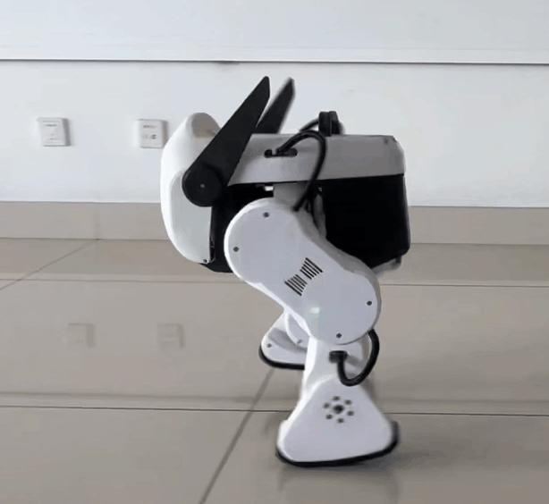
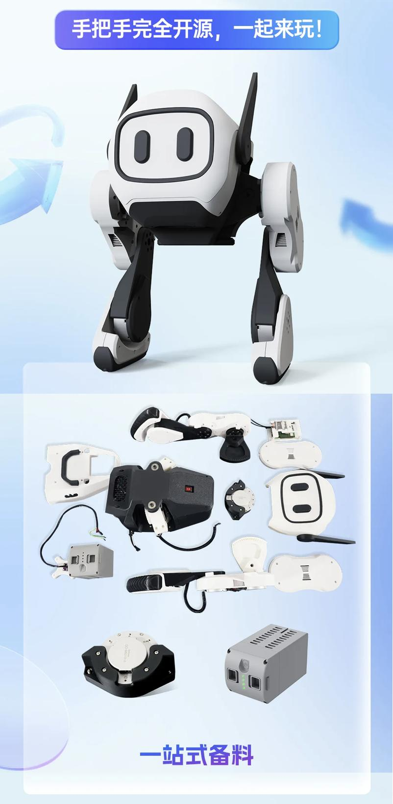
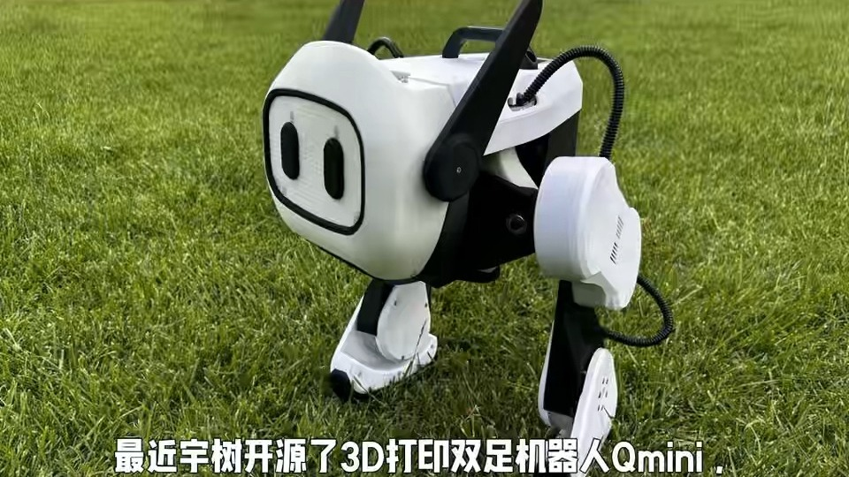

# 第 9 章 基于宇树开源的 Qmini 双足机器人

上一章介绍的 SO-101 是一款低成本机械臂，属于 "操作" 型机器人的入门平台。本章介绍另一类机器人 ——**移动双足机器人**的入门平台：宇树科技（Unitree）北京子公司开源的低成本双足机器人 Qmini。与 SO-101 相似，Qmini 也强调 "低成本、模块化、完全开源"，但它面向的是双足行走与运动控制这一更富挑战性的机器人方向。通过本章，读者可以了解 Qmini 的软硬件架构、制作流程，以及如何借助 URDF、ROS/Gazebo 和深度强化学习实现双足机器人的建模、仿真与运动控制。

## 9.1 Qmini 双足机器人概述

### 9.1.1 Qmini 的诞生与定位

Qmini 是宇树科技于 2025 年开源的低成本双足机器人项目，由宇树科技北京子公司 —— 北京灵翌科技有限公司发布。它是国内首个 "发布即开源" 的机器人产品：在推出产品的同时，宇树即公开了包含硬件、软件及算法在内的全部技术资料，打破了行业 "滞后开源" 的惯例。

Qmini 专为业余爱好者、教育工作者和研究人员设计，其核心理念是 "优秀工具应该易于使用"。开发者可以完全通过 3D 打印复刻 Qmini 的全部机械结构，并以类似乐高的模块化方式快速组装属于自己的双足机器人。Qmini 的定位是提供 "技术基座"，把场景创新交给开发者：加装显示屏可以实现表情互动与信息展示，加装麦克风和扬声器可以赋予机器人对话能力，甚至连接大模型升级为智能助手。Qmini 的整体外观如图 9-1 所示。



图 9-1 Qmini 双足机器人（室内站立状态）

{: .figure-caption}

Qmini 的主要特点可概括如下。

（1）**完全开源**：硬件、软件、算法、机械结构全部开源，开发者可依据开源资料独立复刻。

（2）**低成本**：整机总成本可控制在万元以内，相比动辄数万元的机器人开发平台，极大降低了入门门槛。

（3）**易于组装**：全部结构件可 3D 打印，几乎无须定制机加工，集齐零部件后 3\~5 小时即可完成组装。

（4）**模块化可扩展**：预留颈部电机等扩展接口，开发者可自由设计独特外形与功能。

### 9.1.2 Qmini 的软硬件开源内容

Qmini 的开源内容可分为硬件、机械结构、软件三个部分，具体如下。

（1）**硬件**：提供完整的物料清单（BOM）、电气系统连接框图以及 DIY 制作说明。

（2）**机械结构**：提供全部机械部件的 STEP 三维文件，以及装配标准操作程序（SOP）。其中，STEP（或 STP）是一种用于存储和传输三维、二维几何模型与零件设计数据的文件格式，是 CAD/CAM 软件的通用格式。

（3）**软件**：提供 URDF（Unified Robot Description Format）机器人模型文件、核心软件栈 RoboTamer4Qmini 以及推荐的算法。URDF 是一种用于描述机器人模型与外部环境的 XML 格式文件，在 ROS 中被广泛使用，例如在 RVIZ 可视化工具中显示机器人模型，或者在 Gazebo 仿真环境中进行动力学仿真。

### 9.1.3 Qmini 的主要应用场景

凭借低成本与高可扩展性，Qmini 适用于多种应用场景：

（1）**个人玩家**：可在家自行 3D 打印、组装与开发；

（2）**教育教学**：用于高校与中小学的课程实验、竞赛及教学实践，宇树还为在校学生提供了教育优惠方案；

（3）**科研机构**：用于实验室研发，进行动态步态、运动控制与行走算法的测试验证；

（4）**互动娱乐**：可应用于动漫表演、展会演示等文化娱乐场景。

## 9.2 Qmini 的硬件结构

### 9.2.1 整体结构与自由度

Qmini 采用白黑配色，拥有拟人化的头部与机械四肢。其身体由若干 3D 打印结构件拼装而成，腿部各关节设计了镂空纹理与散热孔洞，结构简洁紧凑。Qmini 的整机与零部件套件如图 9-2 所示。



图 9-2 Qmini 整机与开源零部件套件

{: .figure-caption}

与常见工业机械臂不同，双足机器人的自由度（Degrees of Freedom, DOF）分布在双腿上，用于实现行走、转向与站立等运动。Qmini 通过多个关节的协调运动来完成步态，属于典型的欠驱动、多刚体系统，其稳定行走依赖于实时运动控制算法。

### 9.2.2 电机系统

Qmini 集成了 **11 个宇树 8010 电机**。8010 电机是宇树经过多种商业机器人平台验证的成熟执行器，具有高功率密度、高可靠性的特点。这 11 个电机的分配如下：

（1）**10 个电机**用于驱动机器人的主要运动系统，实现行走、扭动等基础功能；

（2）**1 个电机**安装在机器人顶部（颈部），作为定制的扩展预留接口，方便开发者设计并制作自己的扩展原型，增强机器人的功能、美观性或交互性。

### 9.2.3 电气连接与控制系统

Qmini 以 **树莓派 4 Model B（Raspberry Pi 4 Model B）** 作为默认参考主控制器。同时，Qmini 平台支持一系列经济实惠的控制板，开发者可以根据具体需求或项目自由选型搭配其他主控方案（例如泰山派 3M-RK3576 等）。

Qmini 的电气连接关系为：电机通信线由树莓派主板的 USB3.0 接口出发，经过 Type-A 转 Type-C 转接线，接入 485 转接板，再通过 485 总线与各 8010 电机通信。这种 "主控板 + 串行总线转接板 + 总线电机" 的电气架构与上一章 SO-101 的 "USB 串行总线 + 舵机" 架构思路类似，都是通过总线方式简化布线，便于模块化组装。

## 9.3 Qmini 的制作流程

灵翌科技将 Qmini 的开发流程简化为四个步骤，普通开发者即可轻松制作属于自己的双足机器人。

### 9.3.1 开源素材下载

开发者首先登录开发者社区，下载 Qmini 的全套开源素材，包括：结构件 STEP 三维文件、电气系统连接框图、装配操作手册（SOP），以及基础软件包（含 URDF 模型、推荐算法）等。

### 9.3.2 零部件采购

开发者根据物料清单（BOM）采购核心部件。其中，动力系统所使用的高可靠性电机（8010 电机）和标准电池组可通过官方商城便捷采购；主控板部分则由开发者根据开源建议自由选型搭配，支持市面上常见的控制板方案。

### 9.3.3 3D 打印结构件

开发者根据 STEP 三维结构文件，直接使用家用或工业级 3D 打印机完成所有结构件的制作，无须复杂的机加工环节。Qmini 主要结构件的推荐打印参数见表 9-1。

表 9-1 Qmini 主要结构件 3D 打印参数

### 9.3.4 整机装配与调试

集齐所有零部件后，开发者按照开源手册的指引进行组装。使用宇树高可靠性的 8010 电机和标准电池组，通常仅需 **3\~5 小时**即可完成所有部件的组装。组装完成后，通过配套的调试软件快速校准机器人，即可获得一台运动灵活的双足机器人。Qmini 在户外场地行走的场景如图 9-3 所示。



图 9-3 Qmini 双足机器人户外场景

{: .figure-caption}

## 9.4 Qmini 的软件系统

### 9.4.1 软件栈与 URDF 模型

Qmini 的软件系统以 URDF 模型为机器人描述的基础，并围绕核心软件栈 RoboTamer4Qmini 展开。URDF 使用 XML 格式描述机器人的连杆（link）、关节（joint）以及各部件之间的运动学关系与质量 / 惯量属性。一个简化的 URDF 关节描述如下：


```
<link name="hip_link">
    <inertial>
        <mass value="0.5"/>
        <inertia ixx="0.001" ixy="0" ixz="0"
                 iyy="0.001" iyz="0"
                 izz="0.001"/>
    </inertial>
</link>

<joint name="hip_joint" type="revolute">
    <parent link="base_link"/>
    <child link="hip_link"/>
    <origin xyz="0 0 0.15" rpy="0 0 0"/>
    <axis xyz="0 1 0"/>
    <limit lower="-1.57" upper="1.57" effort="10" velocity="3"/>
</joint>
```

URDF 模型的价值在于：它提供了机器人运动学与动力学描述的**统一标准**，使得同一个机器人模型既可以在 RVIZ 中可视化，又可以在 Gazebo 中仿真，还能被运动控制算法直接读取。这体现了与本书前几章一致的思想 —— 把机器人描述与算法实现解耦，提高代码的可复用性。

### 9.4.2 与 ROS 的关系

Qmini 软件与 ROS 生态有着良好的兼容性。宇树官方开源了 **unitree\_ros** 软件包，其中包含所有宇树机器人的 URDF 文件，开发者可以通过该包获取机器人的质量、惯量矩等参数信息。同时，unitree\_ros 提供的 `unitree_controller` 与 `unitree_gazebo` 软件包，允许开发者快速在 Gazebo 仿真器中搭建仿真验证程序。

借助 Gazebo 仿真，开发者可以在不损伤真实机器人的前提下，安全地测试步态与控制算法，再通过 "仿真到现实（Sim-to-Real）" 迁移将训练好的策略部署到真实 Qmini 上。这与第 6 章介绍的 ROS 与 Gazebo 集成思想一脉相承。

### 9.4.3 运动控制与步态

双足行走的核心难题在于**动态平衡**。与四足或多足机器人不同，双足机器人在行走的大部分时间里处于静态或动态失稳状态，需要控制器持续调节身体姿态与落脚点，才能维持稳定。

在双足行走控制中，一个经典的分析工具是**零力矩点（Zero Moment Point, ZMP）**。当机器人处于单腿支撑阶段时，只要 ZMP 落在支撑脚与地面构成的支撑多边形（Support Polygon）内，机器人就能保持稳定。在简化的线性倒立摆模型（LIPM）下，质心在水平方向的位置 $x$ 与 ZMP 位置 $p_x$ 满足

$p_x = x - \frac{z_c}{g}\,\ddot{x} \tag{9.1}$

其中，$z_c$ 为质心的高度，$g$ 为重力加速度，$\ddot{x}$ 为质心的水平加速度。式（9.1）表明，通过合理规划质心的运动轨迹，可以控制 ZMP 始终处于支撑多边形内，从而保证行走的稳定性。

在工程实现上，Qmini 的步态控制采用 **深度强化学习（Deep Reinforcement Learning, DRL）** 方法：其运动控制解决方案基于 NVIDIA 的 Isaac Gym 仿真环境，利用深度强化学习让机器人学习稳健的步态技能，包括在不平坦地形上行走。为了平滑实现从仿真到现实的迁移（Sim-to-Real），训练过程中采用了随机化动力学参数、随机化环境扰动等关键技术，使在仿真中训练出的策略能够直接部署到真实机器人上。

从强化学习的角度，策略训练的目标是最大化累计回报

$J(\theta) = \mathbb{E}_{\tau \sim \pi_{\theta}} \left[ \sum_{t=0}^{T} \gamma^{t} r(s_{t}, a_{t}) \right] \tag{9.2}$

其中，$s_{t}$ 为第 $t$ 步的机器人状态（关节角度、角速度、姿态等），$a_{t}$ 为策略 $\pi_{\theta}$ 输出的关节力矩指令，$r(s_{t}, a_{t})$ 为奖励函数（例如鼓励前进速度、抑制躯干倾斜与能耗），$\gamma$ 为折扣因子。通过在 Isaac Gym 中并行仿真大量机器人，深度强化学习算法能够高效地探索出稳健的双足步态策略。

### 9.4.4 基于 unitree\_sdk2 的二次开发

宇树提供了 **unitree\_sdk2**（含 Python 接口 unitree\_sdk2\_python）作为机器人的二次开发工具。unitree\_sdk2 是对 DDS（Data Distribution Service）的一层封装，通过发布 / 订阅（Publish/Subscribe）和请求 / 响应（Request/Response）的方式，实现上位机与机器人内部 / 外部进程之间的数据通信。

下面给出一个基于 unitree\_sdk2 Python 接口、通过底层数据通道读取并控制关节的示例程序。注意，Qmini 的具体主题（Topic）名称与通道配置请以宇树官方 Qmini 开发者文档为准，以下代码展示的是 unitree\_sdk2 人形 / 双足机器人底层接口的通用模式。

```
import numpy as np
from unitree_sdk2py.core.channel import ChannelFactoryInitialize, ChannelPublisher, ChannelSubscriber
from unitree_sdk2py.idl.unitree_hg.msg.dds_ import LowCmd_, LowState_

# 初始化 DDS 通道（0 为默认域，eth0 为网卡名）
ChannelFactoryInitialize(0, "eth0")

# 定义低层状态回调：读取机器人各关节角度与角速度
def low_state_handler(msg):
    for i in range(msg.motor_state_size):   # 遍历各关节
        q  = msg.motor_state[i].q            # 关节角度
        dq = msg.motor_state[i].dq           # 关节角速度
        tau_est = msg.motor_state[i].tau_est # 估计力矩
        print(f"joint {i}: q={q:.3f} dq={dq:.3f}")

# 订阅低层状态主题
state_sub = ChannelSubscriber("rt/lowstate", LowState_)
state_sub.Init(low_state_handler, 10)

# 发布低层控制指令主题
cmd_pub = ChannelPublisher("rt/lowcmd", LowCmd_)
cmd_pub.Init()

cmd = LowCmd_()
cmd.motor_cmd_size = cmd.motor_state_size  # 与电机数量一致

# 循环发送关节力矩/位置指令
for step in range(1000):
    for i in range(cmd.motor_cmd_size):
        cmd.motor_cmd[i].tau    = 0.0                 # 期望力矩
        cmd.motor_cmd[i].q      = np.sin(step * 0.01) # 期望关节位置
        cmd.motor_cmd[i].dq     = 0.0                 # 期望关节角速度
        cmd.motor_cmd[i].kp     = 20.0                # 位置增益
        cmd.motor_cmd[i].kd     = 1.0                 # 速度增益
    cmd_pub.Write(cmd)
```

上述代码中，`LowState_` 与 `LowCmd_` 分别是底层状态消息与底层控制指令消息的数据类型。开发者读取 `rt/lowstate` 主题获取当前关节状态，并向 `rt/lowcmd` 主题发布期望的关节位置、力矩与增益，即可对 Qmini 的各个电机进行底层控制。在更高层级，还可以使用宇树提供的运动服务接口，通过高层指令直接控制机器人行走、站立或转向，而无须逐关节规划。

## 9.5 Qmini 的扩展与应用

### 9.5.1 模块化扩展

得益于预留的顶部颈部电机接口，Qmini 具备丰富的模块化扩展能力：

（1）**显示屏扩展**：在顶部加装显示屏，可实现表情互动、信息展示等功能；

（2）**语音扩展**：加装麦克风和扬声器，Qmini 可实现对话能力，进一步连接大模型后可以升级为智能助手；

（3）**感知扩展**：加装摄像头、传感器等模块，可用于环境感知与自主导航。

这些扩展功能宇树有意未做预装，而是将场景创新交给开发者与生态伙伴，体现了 "提供技术基座、专注场景落地" 的开放理念。

### 9.5.2 应用案例

基于低成本优势与开放的生态，Qmini 可广泛应用于：

（1）**高校人工智能实验室建设**：作为教学实验平台，帮助学生理解机器人运动学、动力学与强化学习算法；

（2）**科研与竞赛**：用于动态步态控制、多地形行走等算法的研发与验证；

（3）**服务与交互**：结合大模型与语音模块，演变为面向特定场景的智能服务机器人；

（4）**文化娱乐**：融入动漫表演、展会演示等场景，展示机器人的运动能力与趣味性。

## 本章小结

本章介绍了宇树科技开源的低成本双足机器人 Qmini。Qmini 以完全开源、低成本、模块化为特色，通过 3D 打印与标准件采购即可复刻，总成本可控制在万元以内。本章详细阐述了 Qmini 的软硬件架构（树莓派主控、8010 电机、485 总线电气连接）、四步制作流程、基于 URDF 与 ROS/Gazebo 的建模与仿真方法，以及基于零力矩点和深度强化学习的双足运动控制原理，并给出了基于 unitree\_sdk2 的二次开发示例。与上一章的 SO-101 机械臂相呼应，Qmini 为读者提供了从 "操作型" 到 "移动型" 的低成本机器人学习完整路径，也为后续深入研究具身智能与机器人运动控制奠定了平台基础。
