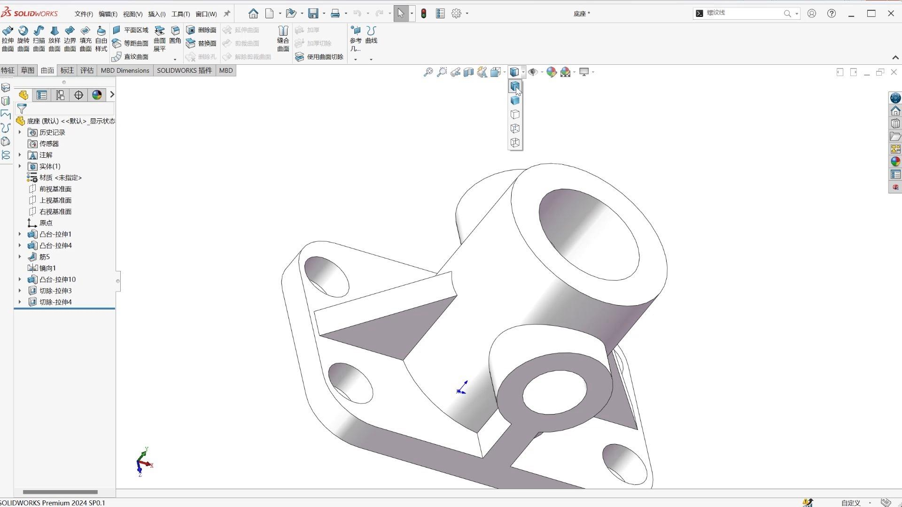
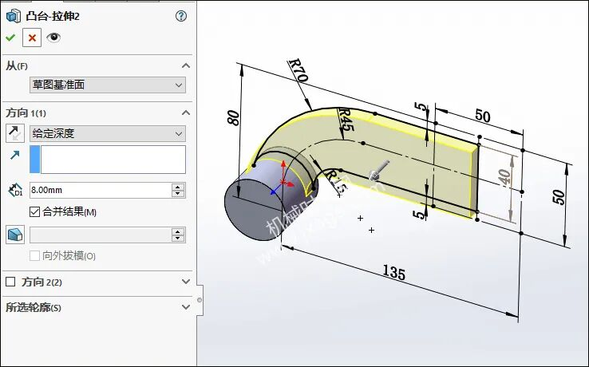
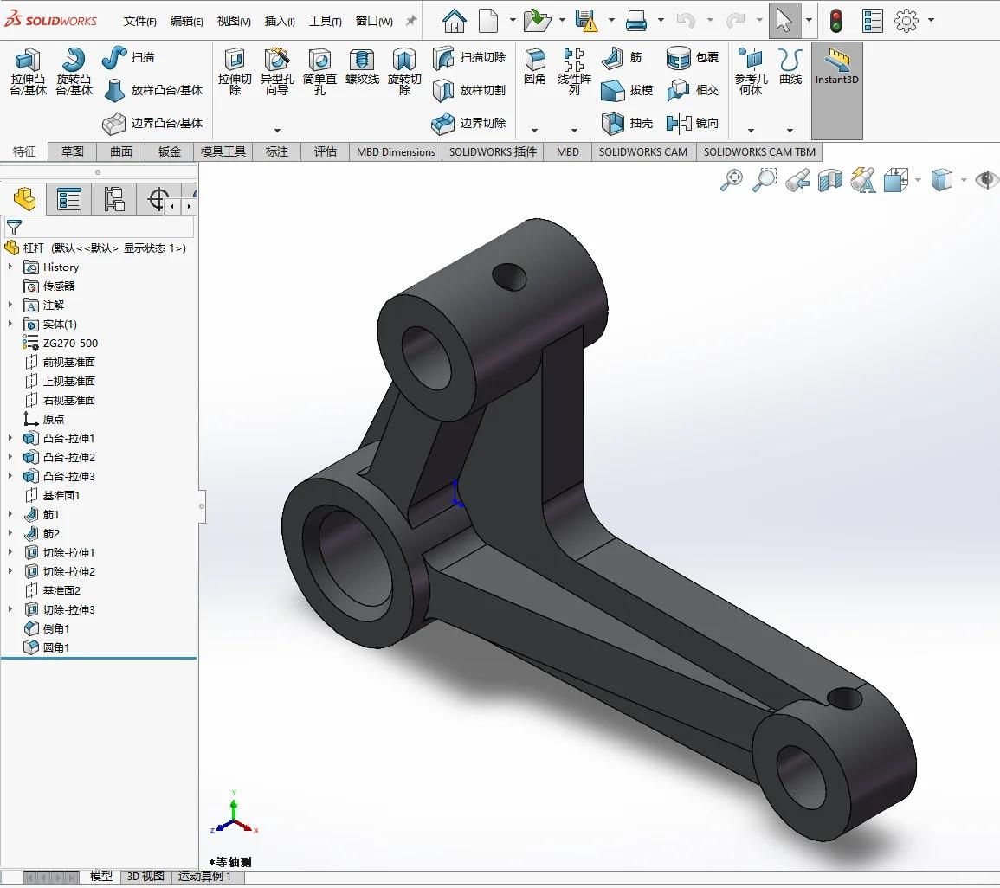
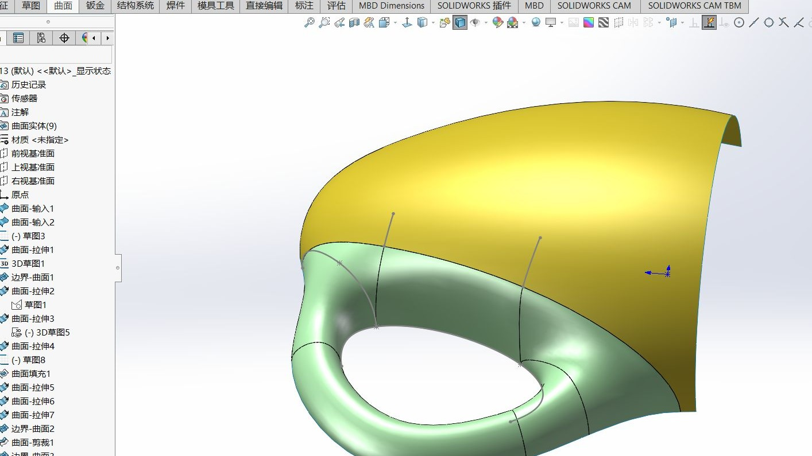
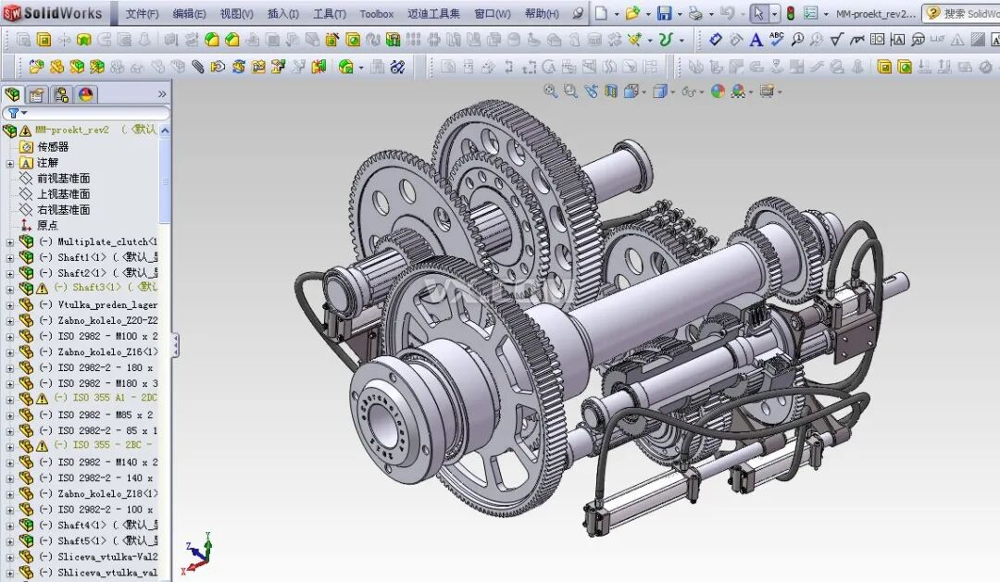
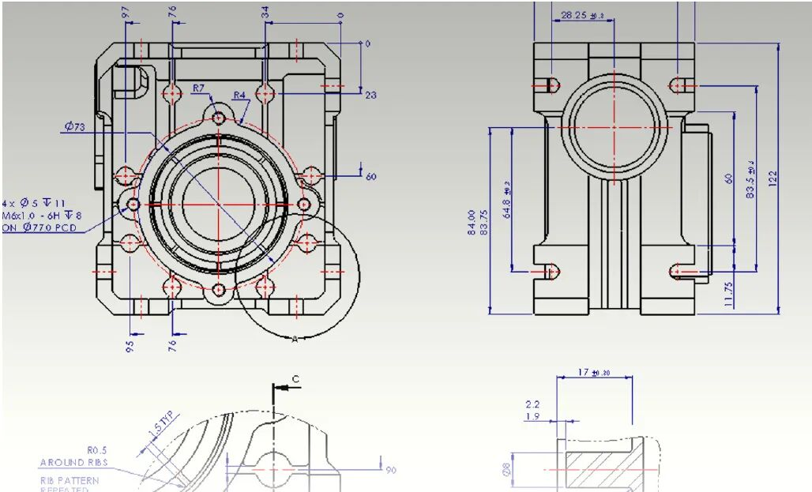
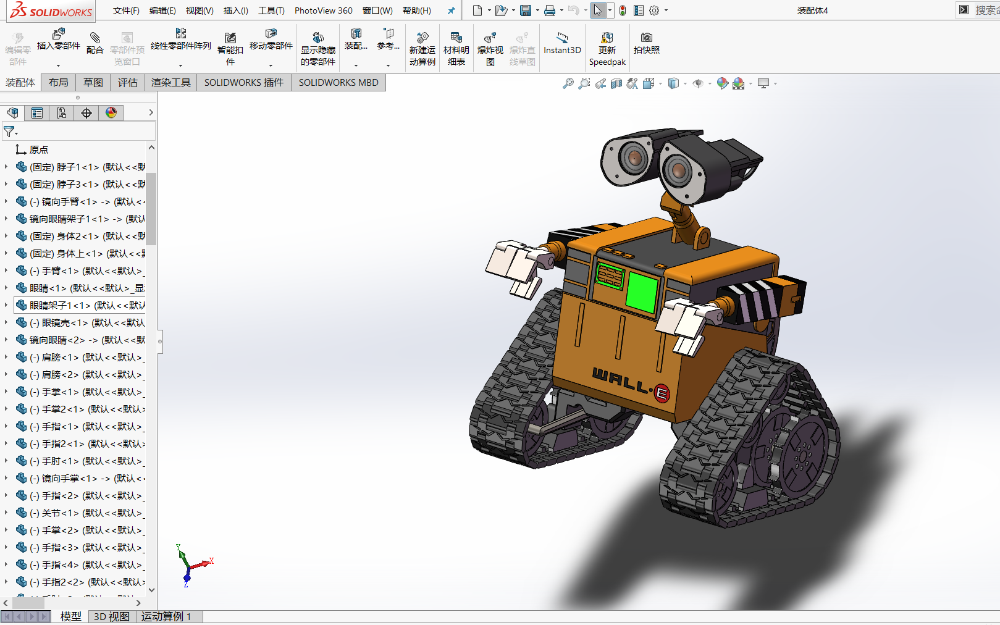
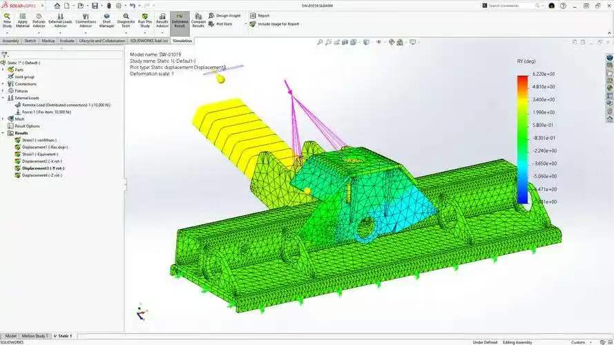
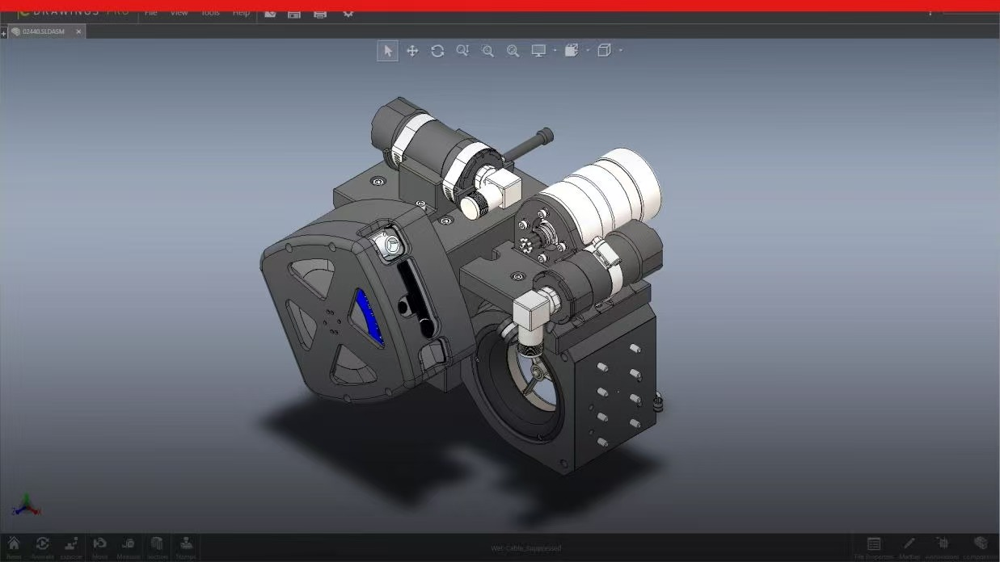
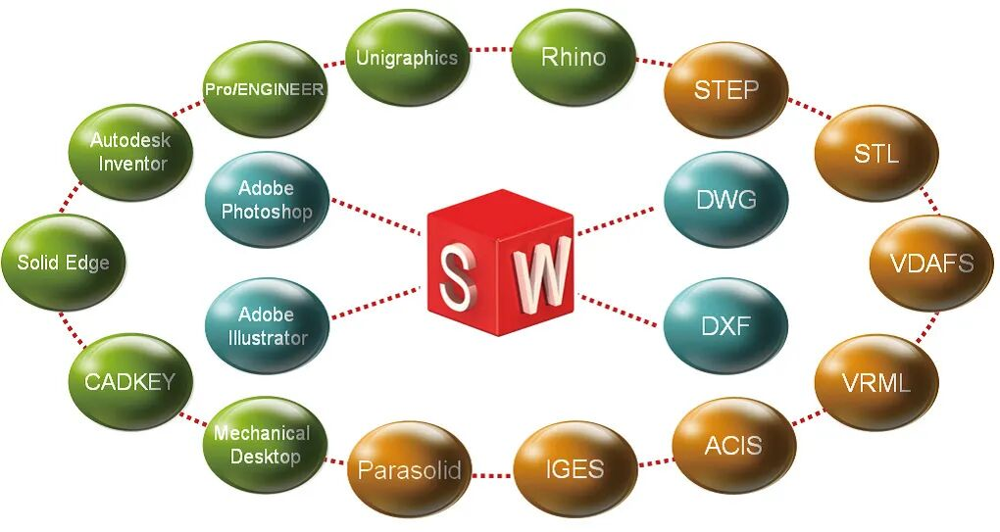

# 第2章 软件功能概述

> 主编：何志鹏、龙东平、马文悦、邓越平  
> 湖南科技大学机电工程学院 · 2026年10月

## 2.1 SolidWorks 是什么

SolidWorks 是由法国达索系统（Dassault Systèmes）推出的一款**基于特征和参数化的三维机械 CAD 软件**，运行于 Windows 平台。它的内核采用 Cambridge 提供的 **Parasolid** 几何建模引擎，该引擎也是世界上经过长期生产验证的三维几何组件之一。SolidWorks 在用户数量、满意度和操作效率方面长期位居主流三维设计软件前列，尤其以**三维模型向二维工程图的转换能力**见长。

从定位上看，达索体系中的 CATIA 面向汽车、航空等中高端市场，曲面设计能力更强；SolidWorks 则面向更广泛的中小企业机械设计场景，在保持功能完整性的同时降低了学习和部署的门槛。

下图展示了 SolidWorks 软件启动后的整体界面布局，左侧为特征管理树（FeatureManager），中间为图形区域，上方为命令管理器（CommandManager）：

## 2.2 核心功能模块

SolidWorks 的功能体系围绕“**零件 → 装配体 → 工程图**”这条主线展开，并在此基础上延伸出仿真、渲染、动画、数据管理等外围模块。

### 2.2.1 草图绘制

任何三维特征都始于二维草图。在选定的基准面（前视、上视、右视）上，使用直线、圆、矩形、多边形、样条曲线等工具绘制闭合或开放的轮廓，并通过**尺寸标注**和**几何关系**（水平、竖直、相切、相等、同心等）使草图达到“完全定义”状态。完全定义的草图在后续修改尺寸时行为可预测，是参数化建模的基础。

下图是一个完全定义的草图示例，草图中的所有线条均已变为黑色（完全定义状态），尺寸和几何关系在左侧属性管理器中可见：

### 2.2.2 实体建模

在草图基础上，通过**拉伸凸台/基体、旋转凸台/基体、扫描、放样**等特征操作将二维轮廓转化为三维实体。拉伸适用于棱柱类几何，旋转适用于轴对称零件，扫描沿指定路径延伸轮廓，放样则在多个轮廓之间过渡生成复杂曲面形体。此外，**圆角、倒角、抽壳、筋、拔模**等工程特征用于对基础实体进行细节加工。

下图展示了一个由拉伸特征生成的基础实体，以及在其上添加圆角和倒角后的效果对比：

### 2.2.3 曲面设计

对于汽车外壳、叶轮叶片、消费电子产品外观等流线型或不规则几何，实体特征往往难以直接构建。SolidWorks 提供**边界曲面、放样曲面、扫描曲面、填充曲面**等工具，先创建曲面片体，再通过**缝合、加厚、曲面切除**等操作将其整合为实体或用于分割实体。曲面设计与实体建模的配合，是复杂工业产品建模的关键能力。

下图是一个由多个曲面片体缝合而成的流线型外壳模型：

### 2.2.4 装配体设计

装配体将多个零件按照真实的配合关系组织在一起，是验证设计意图的核心环节。SolidWorks 支持**自底向上**（先建零件再装配）和**自顶向下**（在装配体中直接设计零件）两种流程。常用的配合类型包括**重合、平行、垂直、同心、距离、角度**以及**齿轮、凸轮、齿条小齿轮**等机械配合。装配完成后，可以使用**干涉检查**发现零件之间不应存在的体积重叠，使用**间隙验证**检查运动件之间的安全距离。

下图是一个多零件装配体的示例，左侧设计树中可以看到零件列表和配合组，图形区域中装配体处于某一工作姿态：

### 2.2.5 工程图

由三维模型自动生成二维工程图，是 SolidWorks 区别于纯建模工具的重要能力。工程图与三维模型保持**双向关联**：修改模型后，工程图中的视图、尺寸和标注会自动更新。可以创建**标准三视图、剖视图、局部放大视图、轴测图、爆炸视图**等，并添加尺寸公差、几何公差、表面粗糙度、焊接符号等制造信息。输出格式支持 PDF、DWG、DXF 等，便于与制造环节对接。

下图是一张由装配体生成的工程图，包含主视图、俯视图、剖视图和明细栏：

### 2.2.6 动画与渲染

SolidWorks 内置**动画制作**功能，可以生成装配体的拆装动画、运动机构的轨迹动画以及产品的展示动画。**PhotoView 360**（或 RealView 图形）提供材质、布光和场景设置，将三维模型渲染为接近照片质量的图像，用于产品宣传、方案汇报和设计评审。

## 2.3 仿真与验证

SolidWorks 的仿真能力通过**套件**的形式提供，覆盖结构、流体、注塑和运动等多个物理领域。

**SolidWorks Simulation** 是结构仿真套件，支持**静态应力分析、频率分析、屈曲分析、热分析、疲劳分析、非线性分析和跌落测试**等。设计工程师可以在产品加工之前，在虚拟环境中评估零件或装配体在实际载荷下的强度、刚度和寿命。

**SolidWorks Flow Simulation** 是计算流体力学（CFD）套件，用于分析内部流动（管道、阀门、散热器）和外部流动（空气动力学、风载），支持液体、气体和热传导场景。

**SolidWorks Plastics** 面向注塑成型仿真，可以预测充填时间、熔接痕位置、气穴、翘曲变形等注塑缺陷，帮助模具设计师在开模之前优化浇口位置和工艺参数。

**SolidWorks Motion** 在装配体配合的基础上添加运动学或动力学驱动，可以计算机构的速度、加速度、作用力和反作用力，验证凸轮、连杆、齿轮系等机构的运动可行性。

下图展示了 Simulation 模块中一个零件的应力云图，高应力区域以暖色标示：

## 2.4 数据管理与协作

对于多人协作或产品数据量较大的项目，**SolidWorks PDM**（Product Data Management）提供版本控制、权限管理、流程审批和文件检入/检出功能，避免多人同时修改同一文件导致的覆盖和混乱。此外，**eDrawings** 允许将模型导出为轻量化的可交互文件，非 CAD 用户（如采购、市场、客户）无需安装 SolidWorks 即可查看、旋转、剖切模型并添加批注。

下图是 eDrawings 查看器中的模型展示，工具栏提供了旋转、剖切和测量等交互工具：

## 2.5 套件体系一览

| 套件 | 定位 |
|---|---|
| **SolidWorks Standard** | 基础三维建模与工程图 |
| **SolidWorks Professional** | 增加设计库、文件管理、成本估算、渲染等 |
| **SolidWorks Premium** | 增加管路布线、电气设计、高级曲面、逆向工程等 |
| **SolidWorks Simulation** | 结构、热、疲劳、非线性仿真 |
| **SolidWorks Flow Simulation** | 流体与热力学仿真 |
| **SolidWorks Plastics** | 注塑成型仿真 |
| **SolidWorks PDM** | 产品数据管理与协作 |

下图示意了从设计、仿真到数据管理的套件协作关系：

## 2.6 小结

SolidWorks 的核心价值在于**将几何设计、工程验证和制造准备串联在同一条数据链上**。零件、装配体和工程图三者之间的关联关系确保了设计变更能够自动传递，Simulation 和 Motion 让工程师在物理样机之前就能发现强度和运动问题，PDM 则将个体设计行为纳入团队协作的轨道。对于智能机器人这类涉及机械结构、传感器布局和执行器配合的系统而言，SolidWorks 提供的正是从“构型想法”到“可制造、可验证的几何定义”的那一层基础能力。
