# 第3章 软件基本操作

> 主编：何志鹏、龙东平、马文悦、邓越平  
> 湖南科技大学机电工程学院 · 2026年10月

入门前首先要熟悉 SolidWorks 的一些基本操作，包括文件操作、界面布局、鼠标操作等。只有把这些基础操作搞明白，才能学好、学透这款软件。

## 3.1 入口界面介绍

打开软件后，新安装的软件默认会弹出欢迎界面，界面中列出了三个基本模块：**零件、装配体、工程图**。这是所有三维软件共有的三个基本功能，点击相应按钮即可进入对应模块开始工作。

下图是 SolidWorks 启动后的欢迎界面，三个基本模块以图标形式并列展示：

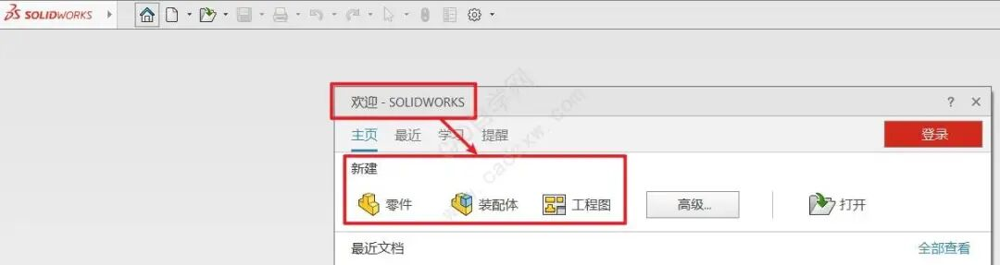

如果软件使用久了之后不再自动弹出欢迎界面，可以点击标题栏的“新建文件”按钮，同样会弹出包含这三个模块的界面供选择。

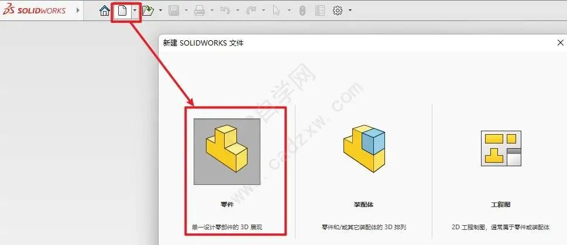

在软件名称右侧有一个三角符号，其中隐藏了一些基本菜单。右侧还有一个钉子符号，点击后可以将这些菜单固定在标题栏中，方便建模或装配过程中随时调用。

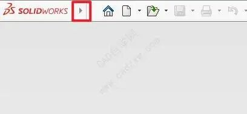

下图展示了标题栏右侧的菜单展开状态与钉子固定符号：

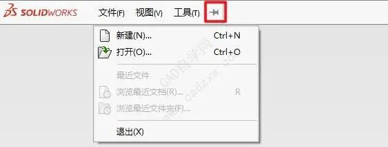

## 3.2 建模模块环境介绍

选择“零件”并确定后，进入建模环境。标题栏下方会显示多个选项卡，每个选项卡中包含相应的命令。

### 3.2.1 工具选项卡

- **特征**：绝大多数实体建模命令集中在此，使用时直接点击即可。
- **草图**：用于绘制截面图形（平面图）的命令。
- **直接编辑**：基于实体以面的形式修改模型。
- **评估**：测量实体体积、面积等属性的工具。

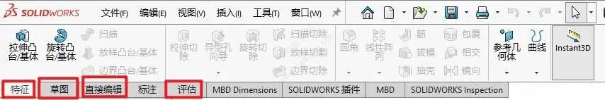

“直接编辑”选项卡默认不显示，需要在空白处右键，在右键菜单的“选项卡”中勾选才会调出。

下图是零件模块中展开的选项卡栏，特征、草图、评估等选项卡并列显示：

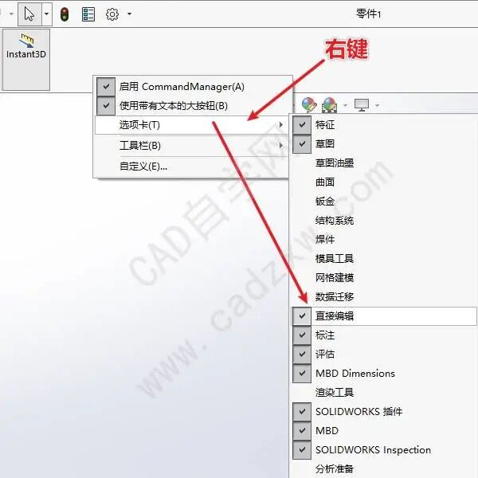

### 3.2.2 模型树

建模的第一步通常是选择一个平面绘制草图。不需要在上方工具栏中切换到“草图”选项卡，直接在**模型树**（设计树）中选择相应的基准面即可。选中基准面后，光标右上角会弹出快捷按钮，其中包含“草图”按钮，点击即可直接进入草图绘制，同时绘图区也会给出基准面位置提示。

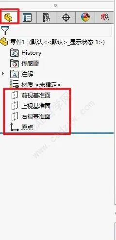

下图展示了在模型树中单击基准面后，光标附近弹出的快捷菜单与“草图”按钮：

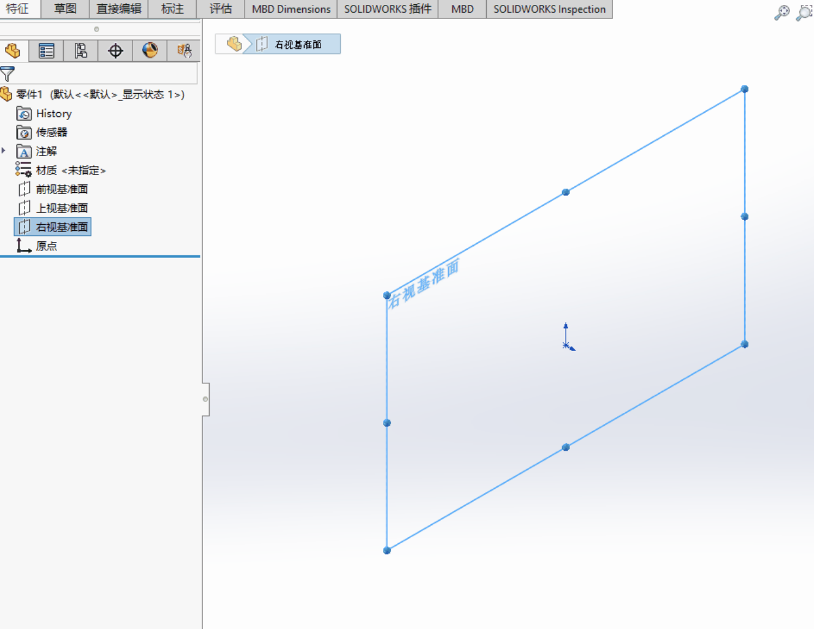

在参考现有图纸造型时，为了方便读数和后续建模，一般会选择与图纸实体方向一致的平面来绘制草图。例如下图中对称的实体轮廓，选择“前视基准面”绘制草图，视角与图纸一致，读数更方便。

下图是对称实体轮廓在前视基准面上的草图绘制示例：

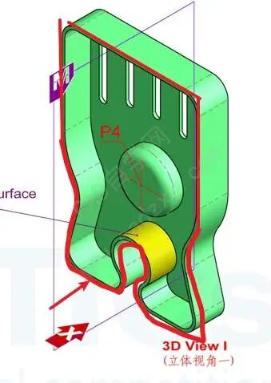

### 3.2.3 绘图区与快捷工具

**（1）绘图区**

绘图区中有两个箭头和一个交点，代表**绝对坐标系**，这是建模或草图的起点位置。务必将坐标原点与所绘平面图形的基准位置重合，以便后续建模。如果图形是对称的，应将基准放在中间，这样镜像时可以直接选择基准面作为镜像轴。

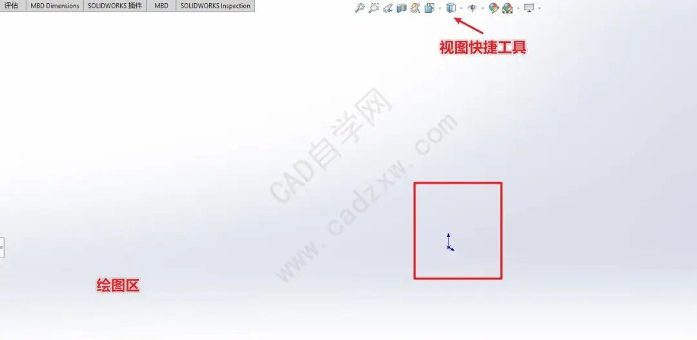

下图是绘图区左下角的坐标系指示器：

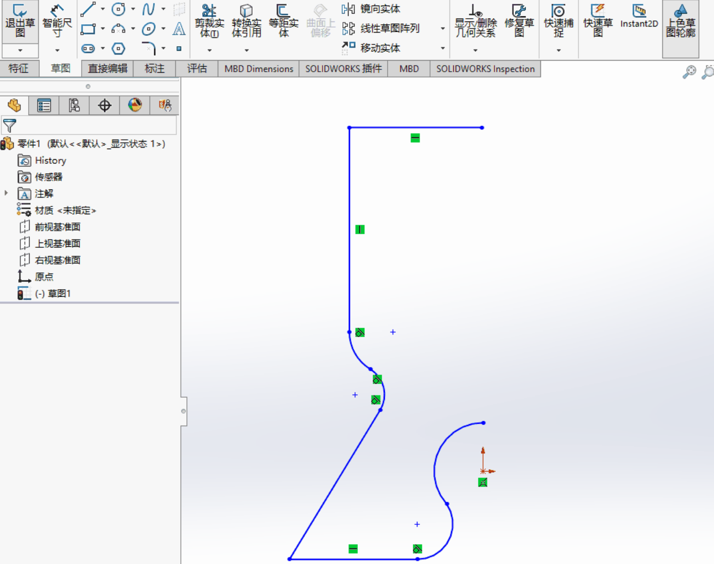

**（2）实体着色方式**

默认使用“带边着色”，便于看清实体的棱边，利用棱边造型时更方便。另一种常用模式是“线框”，当多个实体存在时，内部隐藏的实体可以通过线框模型查看。

下图对比了带边着色（左）与线框（右）两种显示模式：

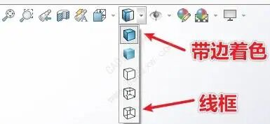

**（3）实体方向**

默认视图方向为**等轴测**。旋转实体进行其他操作后，可以在执行下一个造型命令之前，用该工具将实体恢复为等轴测状态，使最终完成时的摆放角度清晰、自然。

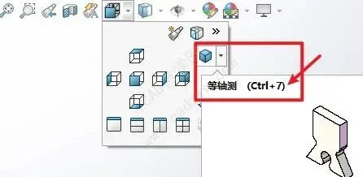

中间的俯视图、仰视图等按钮，功能是让实体的某个方向与屏幕平行，鼠标悬停时右下角会出现提示。但这种方式切换视角较慢，更高效的做法是使用 **“正视于”** 命令：直接选择某个面，鼠标附近会出现“正视于”按钮，点击后所选面即与屏幕平行。

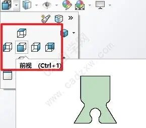

“视图定向”工具也可以通过按**空格键**快速调出，比点击屏幕上方按钮更高效。

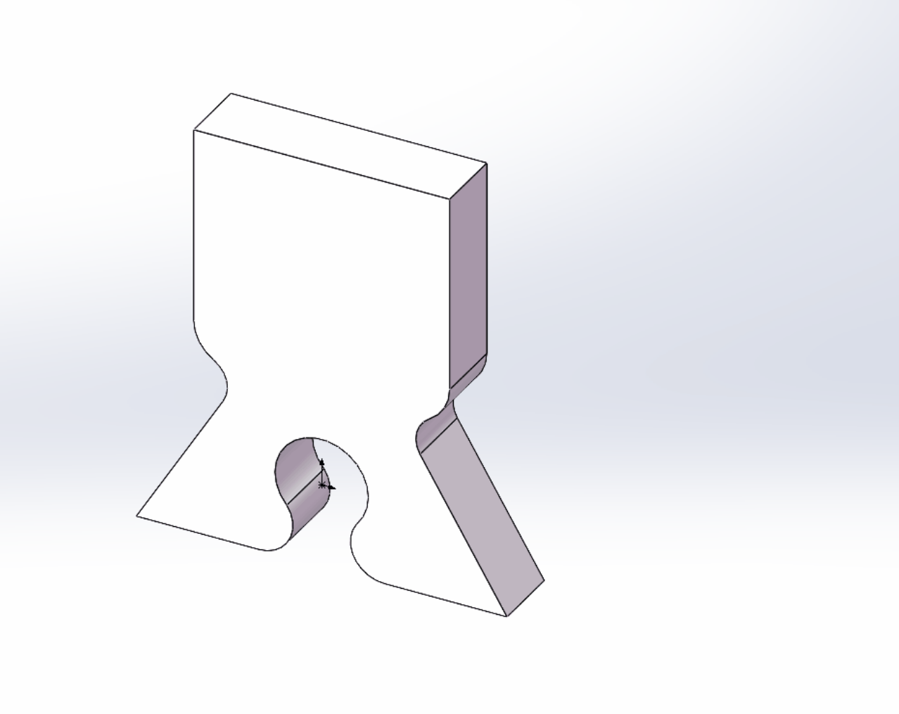

下图是按下空格键后弹出的“视图定向”快捷菜单：

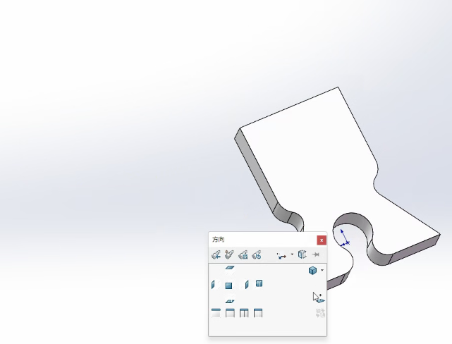

### 3.2.4 鼠标滚轮的视图控制作用

很多初学者在放大或缩小图形后，容易迷失视图方向。鼠标滚轮除了缩放之外，还承担着以下关键操作：

- **旋转视图**：按住鼠标中键（滚轮）并拖动，可以自由旋转模型。
- **平移视图**：按住 `Ctrl` 和鼠标中键拖动，可以平移视图。

熟练掌握滚轮的“缩放—旋转—平移”组合操作，是保持建模过程中空间方向感的基础。

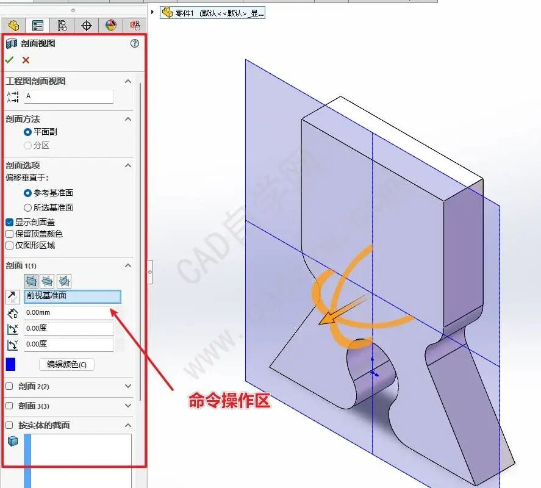
