# 第5章 智能小车几何建模

本章以一台轮式智能小车为对象，完成从车轮、车身到整车的完整建模流程。车轮部分以麦克纳姆轮左旋轮为例，练习旋转拉伸、转换实体引用和圆周阵列等操作；车身部分以炮车车身为对象，练习多基准面草图、放样、镜像和切除的综合运用；装配与爆炸视图则将前序零件组织为可运动、可拆解的完整装配体。

## 5.1 车轮建模：麦克纳姆轮左旋轮

麦克纳姆轮是实现全向移动的核心部件，其轮毂上沿圆周方向布置了一圈呈 45° 夹角的辊子，依靠辊子的被动旋转合成任意方向的速度矢量。左旋轮与右旋轮的辊子旋向相反，建模时需要注意方向。

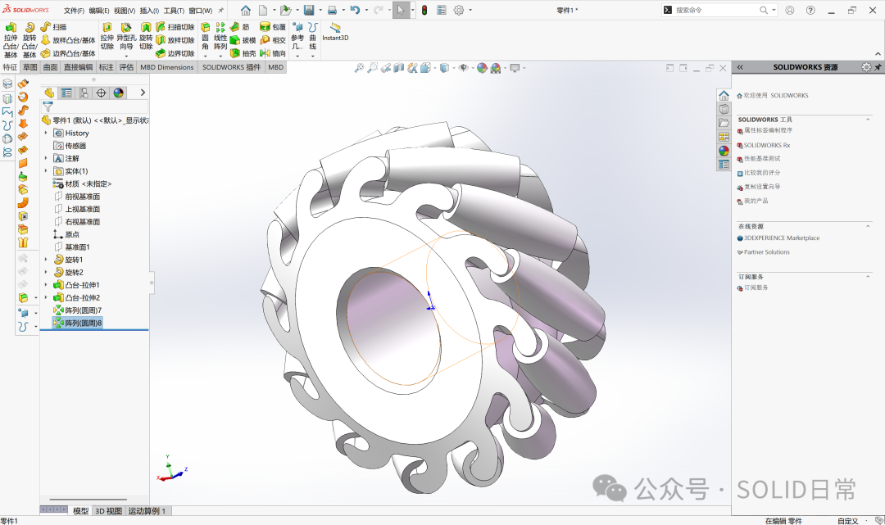

### 5.1.1 新建基准面

首先建立一个新基准面，参考面选择**上视基准面**，偏移距离设为 **52.5 mm**。该基准面用于绘制轮毂中与 45° 辊子轴线相关的辅助几何。

下图展示了新建基准面的参数设置，参考面为上视基准面，距离为 52.5 mm：

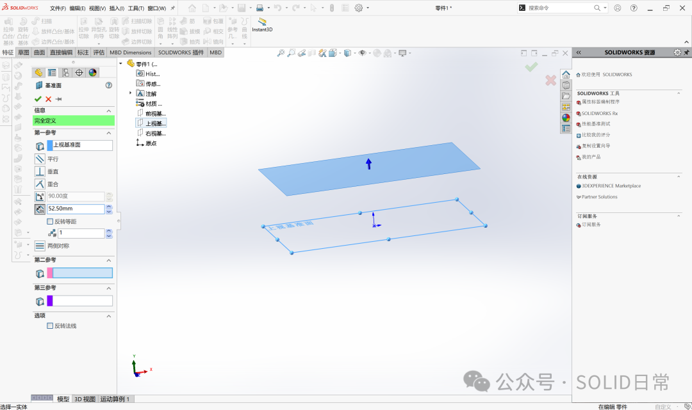

### 5.1.2 绘制三条构造线

在新基准面上编辑草图，绘制三条直线，长度分别为 **44 mm、122 mm、172.53 mm**。最短的 44 mm 直线的**中点与原点重合**，并且该直线与“前视基准面和新建基准面的交线”之间的夹角为 **45°**。这三条构造线确定了辊子轴线的空间方向。

下图是三条构造线的几何关系与尺寸标注，注意 44 mm 直线的中点位于原点，且与交线成 45°：

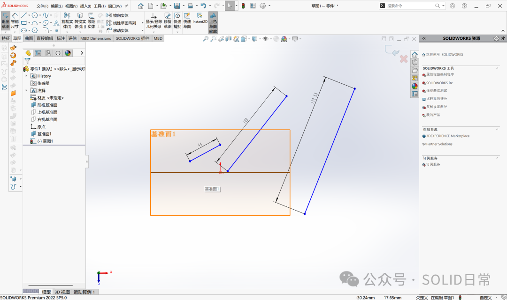

### 5.1.3 绘制辊子轮廓并旋转拉伸

在两条构造线的交点处绘制**椭圆**，作为辊子的截面轮廓。在 44 mm 直线上绘制两条与椭圆相交的直线，并确保这两条直线与 44 mm 直线**垂直**。裁剪掉多余部分后，执行**旋转拉伸凸台**，旋转轴选择构造线方向，生成单个辊子。

下图是椭圆截面与垂直直线的几何关系，以及旋转拉伸后的单个辊子实体：

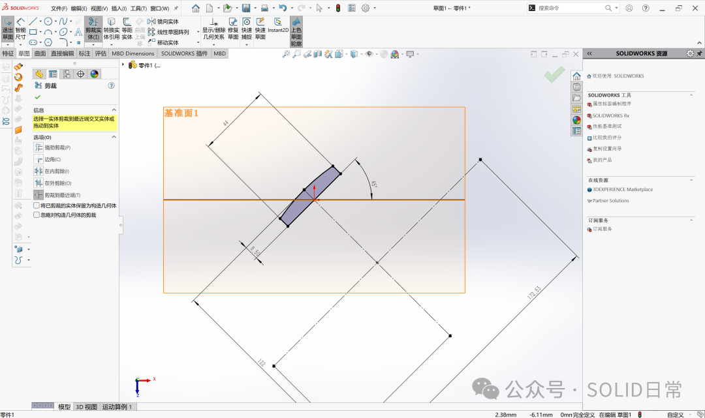

### 5.1.4 轮毂主体的旋转拉伸

回到**上视基准面**编辑草图。为了便于绘制对称结构，可以先画出构造线作为镜像轴，利用**镜像**功能完成轮毂主体轮廓，然后执行**旋转拉伸**。轮毂主体为后续的辊子阵列提供圆周基准。

下图是上视基准面上的轮毂主体草图与旋转拉伸后的结果：

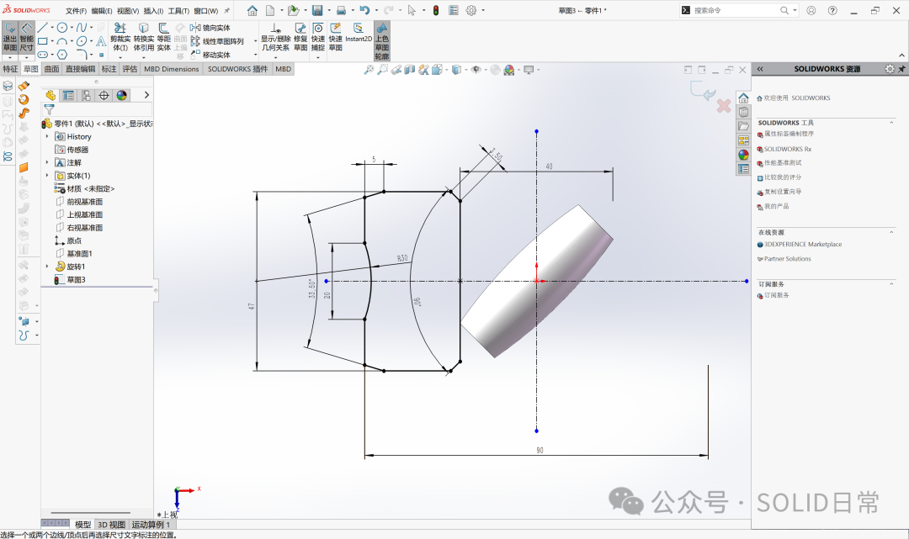

### 5.1.5 转换实体引用与圆弧相切

在轮毂的侧面上编辑草图，使用**“转换实体引用”**引用该面的圆边，得到一条与圆边重合的草图圆。然后在这条圆的基础上绘制 **5 段圆弧**：每一段圆弧与相邻圆弧**相切**，且与转换实体引用得到的圆相接的圆弧也与该圆**相切**。这是辊子安装槽的轮廓基础。

下图展示了 5 段相切圆弧与转换实体引用圆的几何关系：

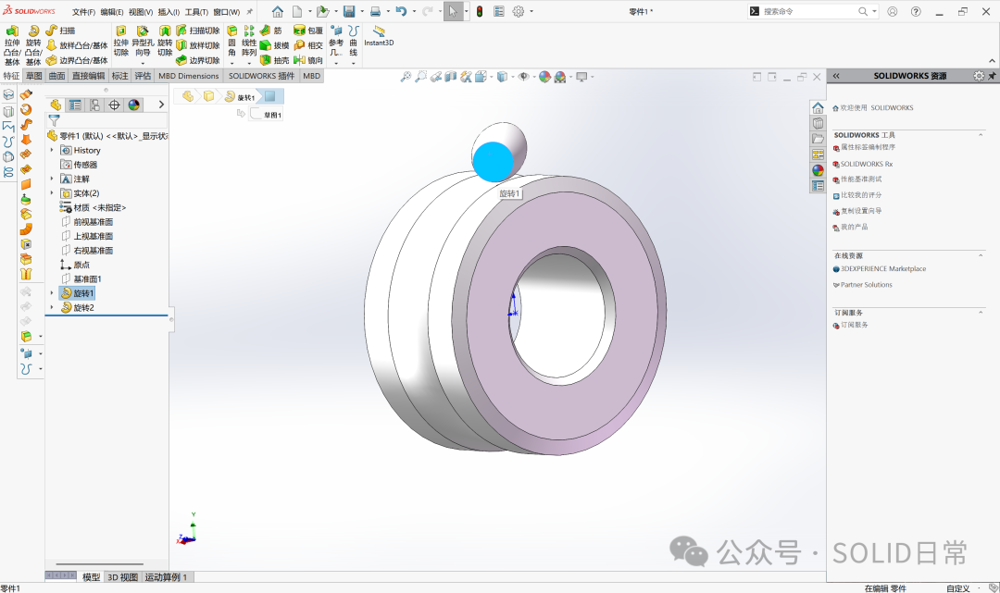

### 5.1.6 拉伸凸台（成型到下一面）

完成圆弧草图后，执行**拉伸凸台**，结束条件选择 **“成型到下一面”**，目标面选择轮毂上对应的配合面。这一步生成辊子安装结构的一部分。

下图是拉伸凸台设置为“成型到下一面”时的面选择示意：

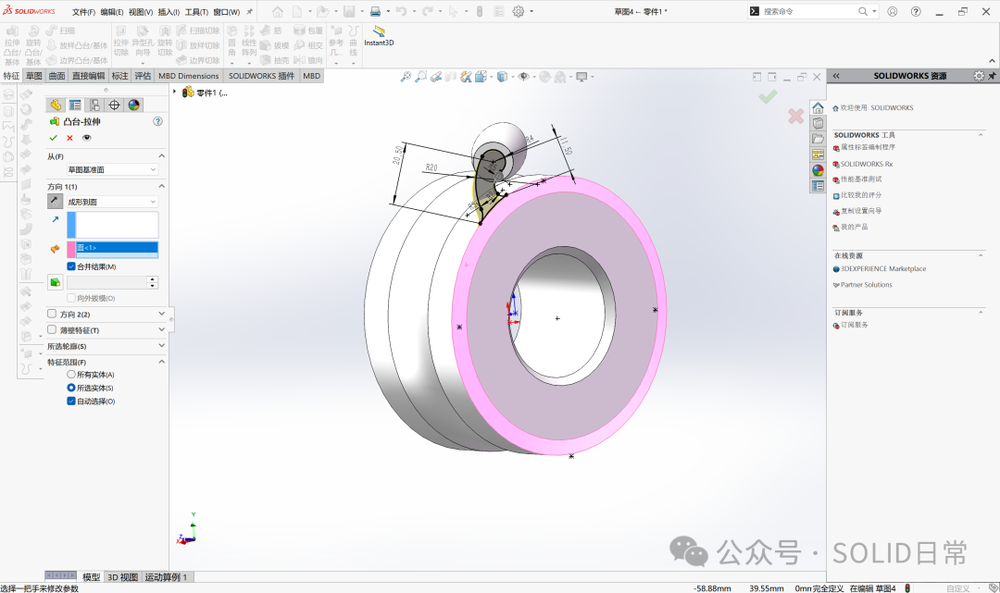

### 5.1.7 另一侧面的切除处理

转到轮毂的另一侧面编辑草图。使用**“转换实体引用”**引用该面的圆边，并新建一条**垂直构造线**。再次转换实体引用时，**不要勾选“复制”**选项，使引用的几何与原实体保持关联。然后使用**裁剪**功能将大圆中不需要的部分切除，形成辊子安装槽在另一侧的开口。

下图是垂直构造线的位置以及裁剪后保留的草图区域：

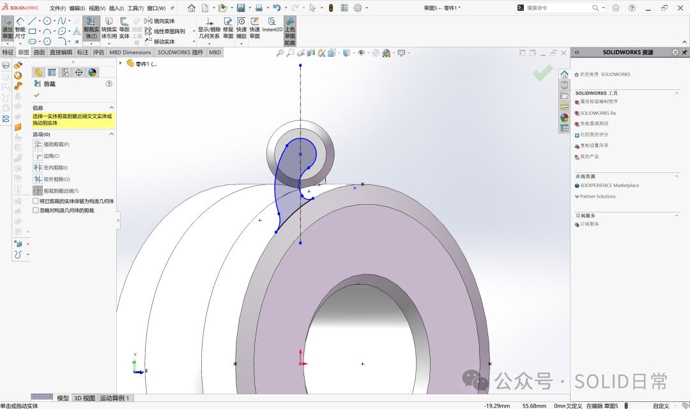

### 5.1.8 圆周阵列生成全部辊子

最后执行**圆周阵列**。阵列方向选择轮毂上的**圆线**作为参考，阵列特征选择前面生成的辊子及安装结构（共三个特征），设置实例数量与角度范围，使辊子沿轮毂圆周均匀分布，完成左旋轮的建模。

下图是圆周阵列的参数设置与完成的麦克纳姆轮左旋轮模型：

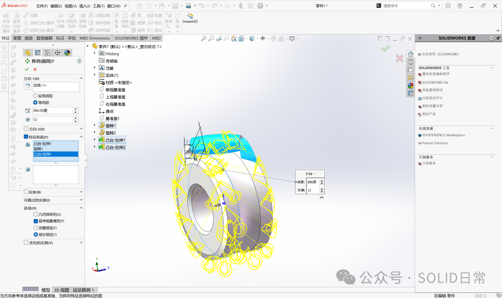

## 5.2 车身建模：炮车车身

车身包含主体轮廓、内部切除、三角形斜面、放样特征、车轮毂、侧边梯形与倒角等多个几何要素，综合练习拉伸、切除、放样、镜像等操作。

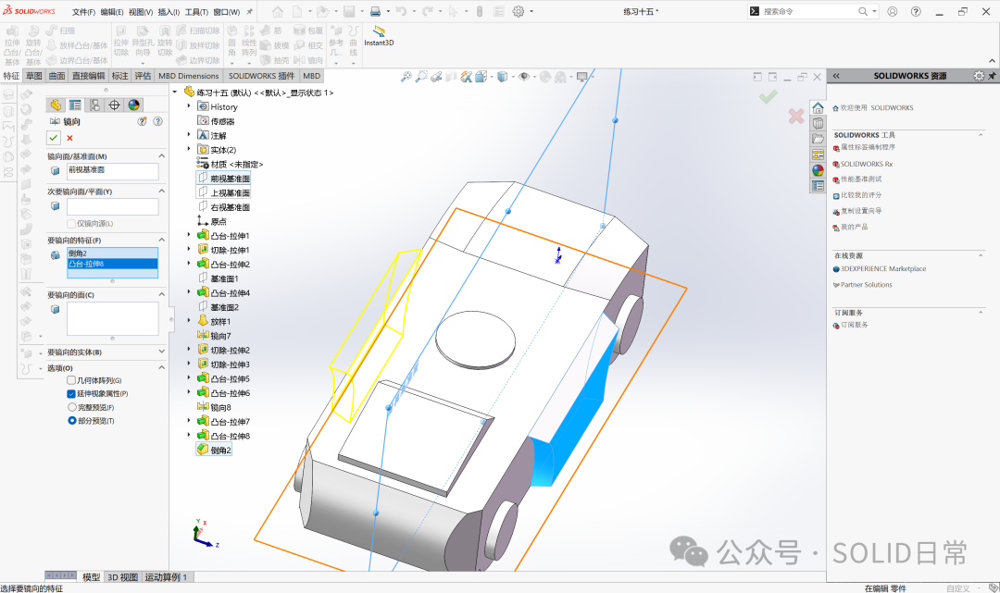

### 5.2.1 前视基准面主体轮廓拉伸

在**前视基准面**上编辑草图，绘制车身主体的外轮廓。尺寸标注较多，需要仔细约束每一条线段的长度、角度以及线段之间的几何关系，确保草图完全定义。完成后执行**拉伸凸台**，方向选择 **“两侧对称”**，总宽度为 **130 mm**。

下图是前视基准面上的车身主体轮廓草图与两侧对称拉伸后的实体：

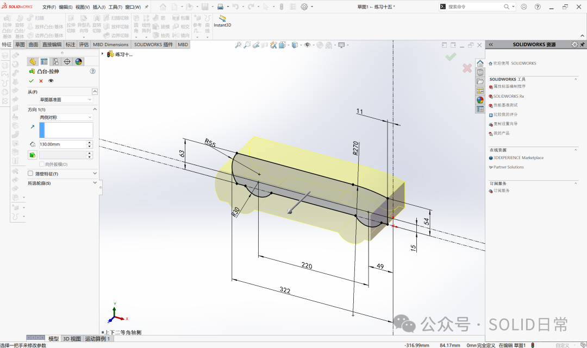

### 5.2.2 侧面切除

选择车身的一个侧面作为草图平面，绘制需要切除的轮廓（参数依据图纸），然后执行**拉伸切除**，在车身侧壁上形成开口或凹陷结构。

下图是侧面切除草图的轮廓与切除后的效果：

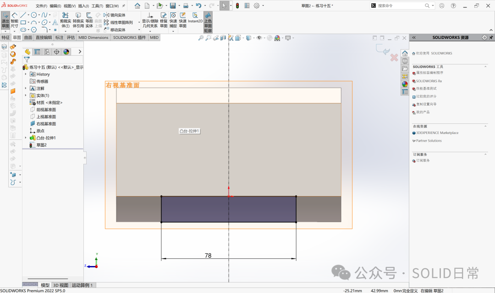

### 5.2.3 前视基准面二次拉伸

回到**前视基准面**编辑新的草图，绘制另一组轮廓，执行**拉伸凸台**，方向同样为 **“两侧对称”**，宽度参数为 **72 mm**。该特征在车身主体之上增加一层结构。

下图是二次拉伸的草图与拉伸后的模型状态：

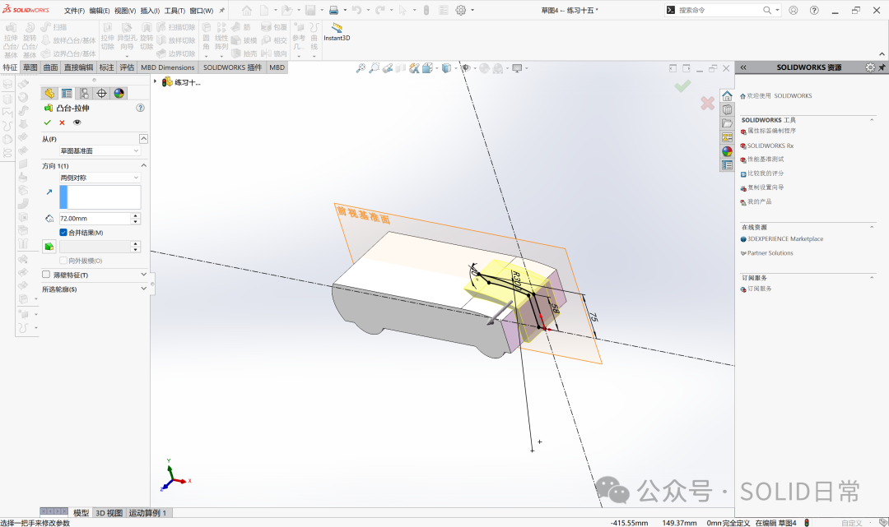

### 5.2.4 三点基准面与三角形拉伸（成型到面）

通过**三个参考点**建立一个新的基准面。然后切换到**上视基准面**编辑草图，绘制一个**三角形**轮廓。执行**拉伸凸台**，结束条件选择 **“成形到面”**，目标面选择前面新建的基准面。**注意：不要勾选“合并结果”**，否则后续镜像操作可能出错。

下图是三点基准面的定义以及三角形拉伸“成形到面”的设置：

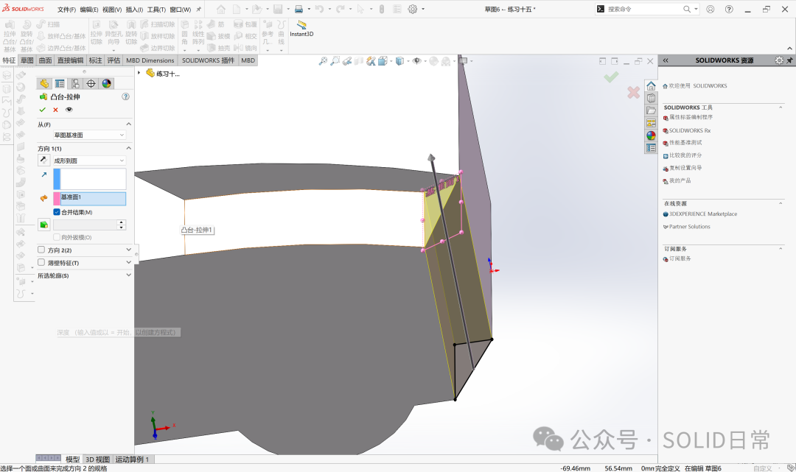

### 5.2.5 放样凸台

再次通过**三个参考点**建立第二个新基准面。在该基准面上编辑草图，绘制一个以这三个参考点为顶点的**三角形**。退出草图后，使用 **“放样凸台/基体”** 命令，选择适当的轮廓和引导线（参考面和引导线依据图纸设定）。同样，**不要勾选“合并结果”**。

下图是放样凸台的轮廓、引导线选择以及放样后的几何形态：

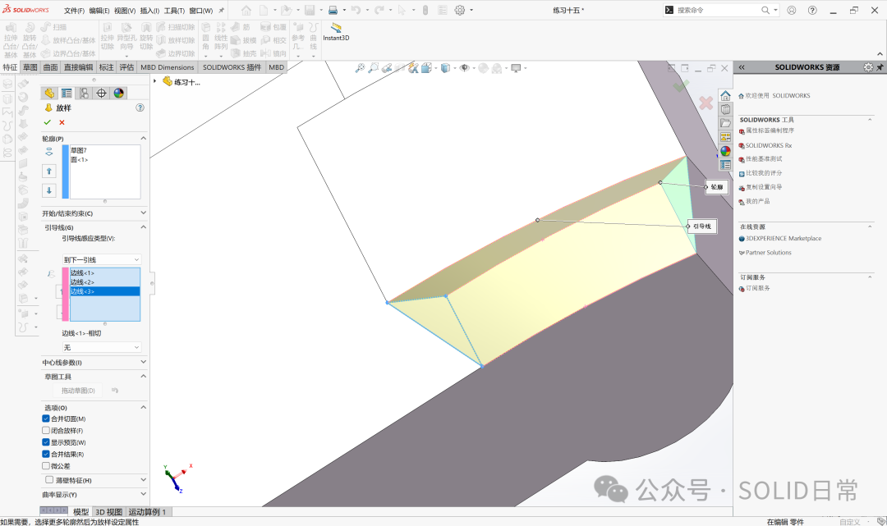

### 5.2.6 镜像

使用 **“镜像”** 命令，镜像面选择 **前视基准面**，将前面生成的三角形拉伸和放样特征镜像到另一侧，使车身左右对称。

下图是以前视基准面为镜像面的设置与镜像完成后的对称结构：

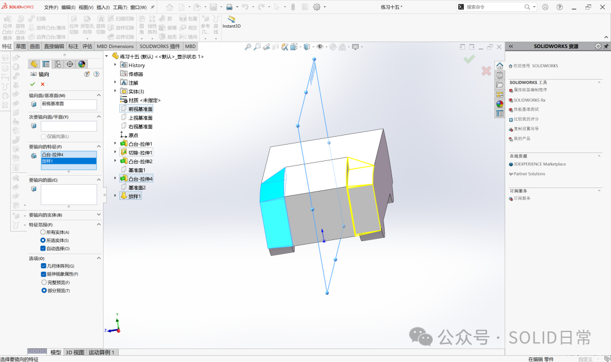

### 5.2.7 前视基准面与顶面切除

回到**前视基准面**编辑草图，绘制一个**三角形**轮廓，执行**拉伸切除**。然后切换到车身**顶面**编辑草图，同样绘制一个**三角形**轮廓，执行**拉伸切除**。这两处切除用于形成车身上的斜面开口或减重结构。

下图是前视基准面三角形切除与顶面三角形切除的草图及结果：

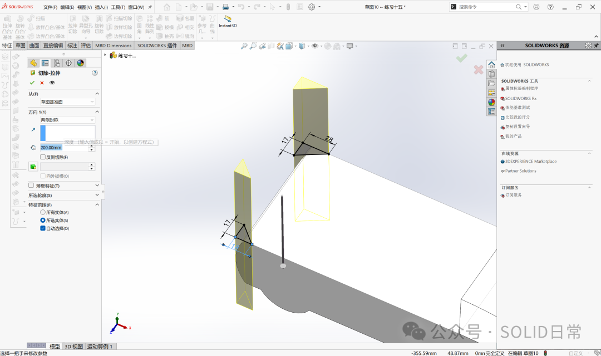

### 5.2.8 顶面圆拉伸与车轮毂

在车身**顶面**编辑草图，绘制一个**圆**，执行**拉伸凸台**，拉伸高度为 **5 mm**。接着在车身**侧面**绘制两个**车轮毂**的轮廓，参数依据图纸，然后使用**镜像**功能将车轮毂对称到车身的另一侧。

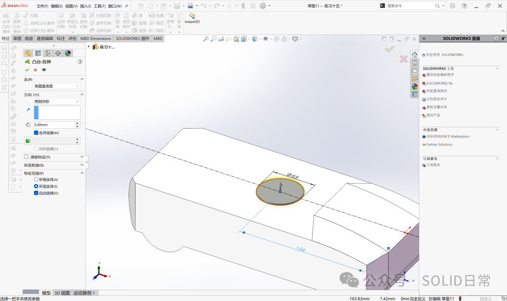

下图是顶面圆拉伸后的凸台以及侧面车轮毂的镜像布局：

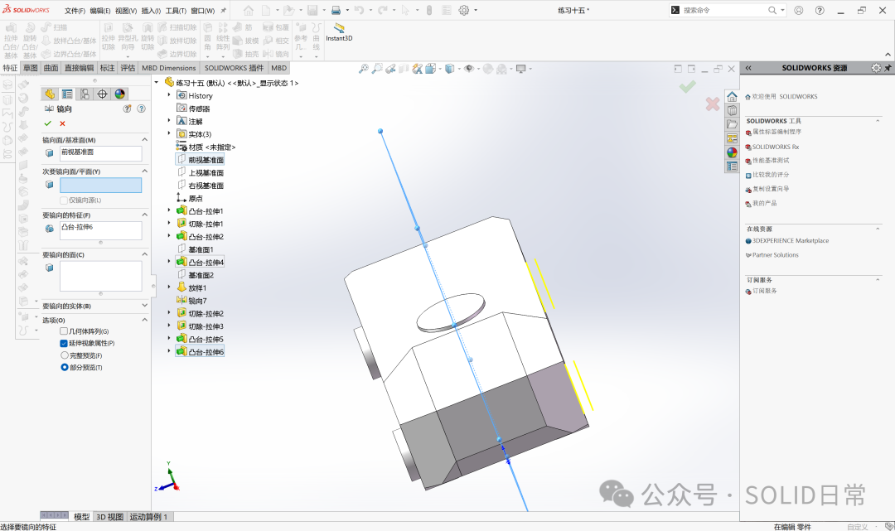

### 5.2.9 前视基准面拉伸（78 mm）与侧边梯形倒角

在**前视基准面**上编辑草图，绘制相应轮廓，执行**拉伸凸台**，方向为 **“两侧对称”**，参数为 **78 mm**。最后绘制**侧边的梯形**轮廓，执行拉伸后进行**倒角**。倒角参数**不是对称的**，需要仔细核对图纸中两个方向的倒角距离。倒角完成后，使用**镜像**将侧边结构对称到另一侧，完成炮车车身的建模。

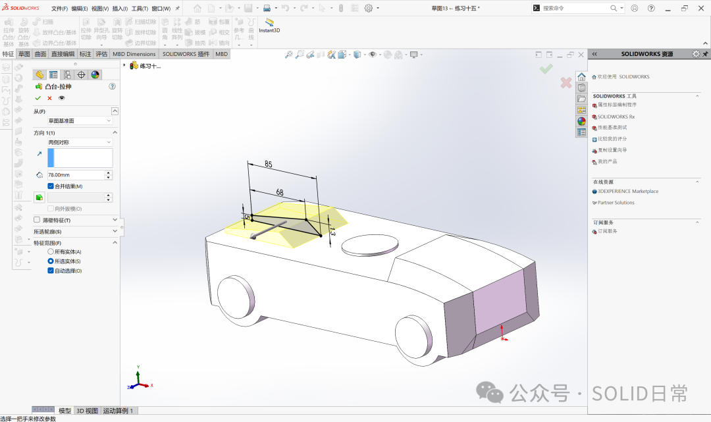

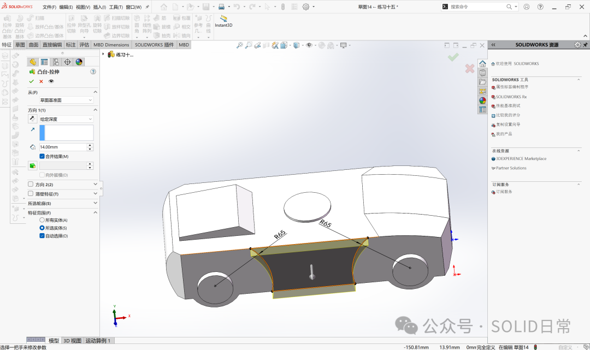

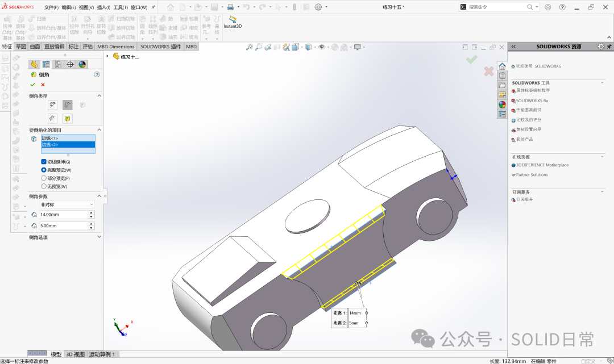

下图是侧边梯形拉伸后的倒角参数设置与最终的炮车车身模型：

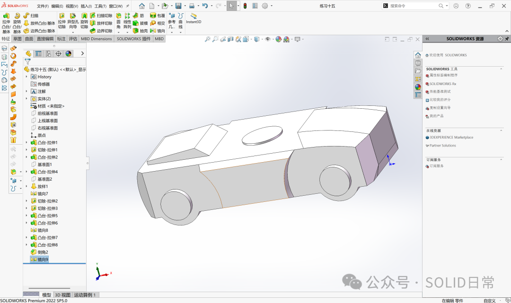

## 5.3 装配：智能小车整车

装配体将前几节完成的车轮、炮架、炮塔和车身组织为一个可运动的整体。装配的核心原则是：**第一个导入的零件作为固定基准**，后续零件通过配合关系逐步定位。

### 5.3.1 导入车身作为固定基准

新建装配体文件后，**第一个插入的零件必须是“车身”**。SolidWorks 会将第一个导入的零件默认固定，后续所有配合都以它为参照。如果先导入其他零件，后续的定位和配合会变得复杂且不稳定。

下图是装配体中车身作为第一个零件被固定（零件名称前显示“(固定)”）：

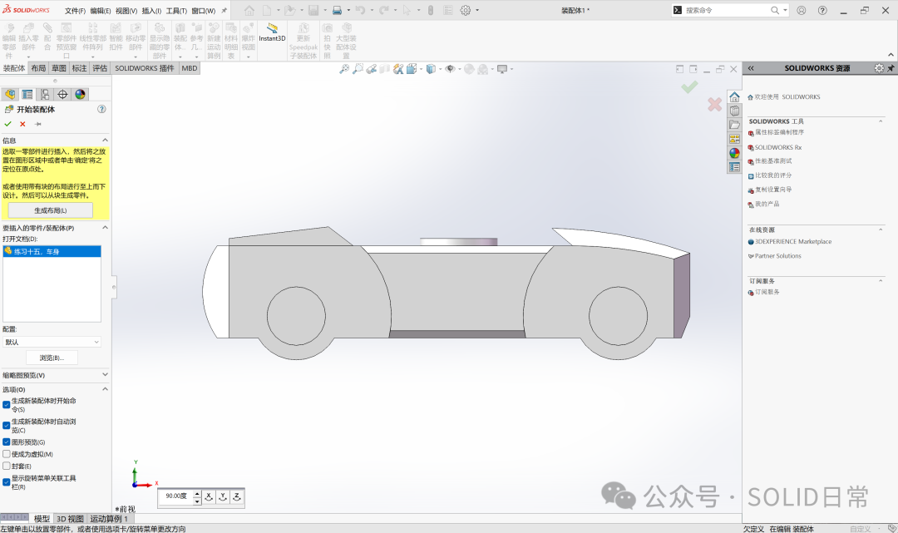

### 5.3.2 插入炮架、车轮与炮塔

依次插入**炮架、车轮（区分左轮和右轮）和炮塔**。车轮可以通过 **`Ctrl+C` 复制、`Ctrl+V` 粘贴**的方式快速生成另一侧，右轮同理。

下图是装配体中已插入的全部零件，设计树中可以看到车身、炮架、左右车轮和炮塔：

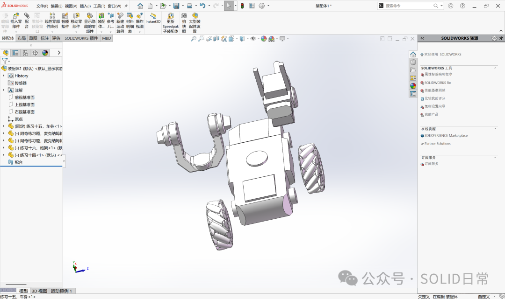

### 5.3.3 炮架与车身的配合

按住 `Ctrl`，选择**炮架底部的圆边线**和**车身顶部的圆边线**，添加 **“同心轴”** 配合，点击确定。然后按住 `Ctrl`，选择**炮架底面**和**车身顶部圆的面**，添加 **“重合”** 配合。两步配合共同约束炮架在车身顶部的径向位置和轴向位置。

下图是炮架与车身之间“同心轴”配合的边线选择：

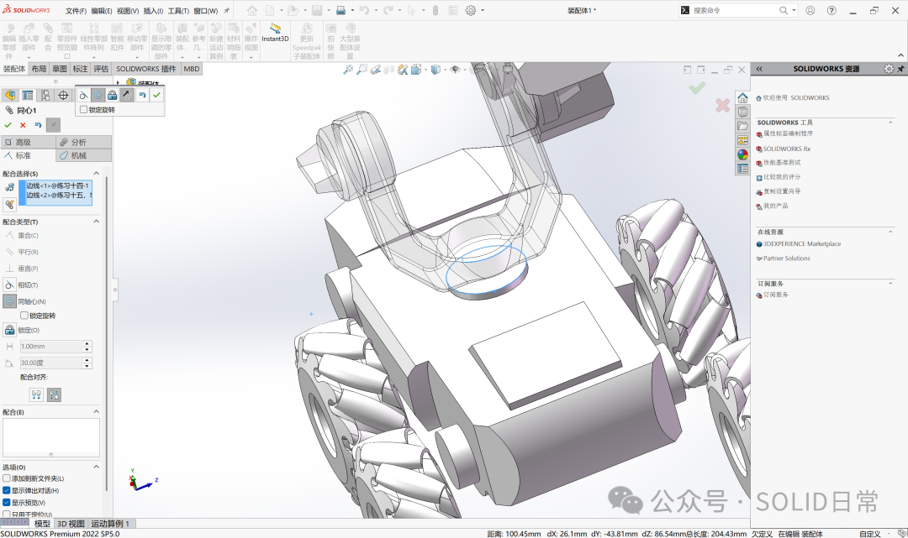

下图是炮架底面与车身顶面“重合”配合的面选择：

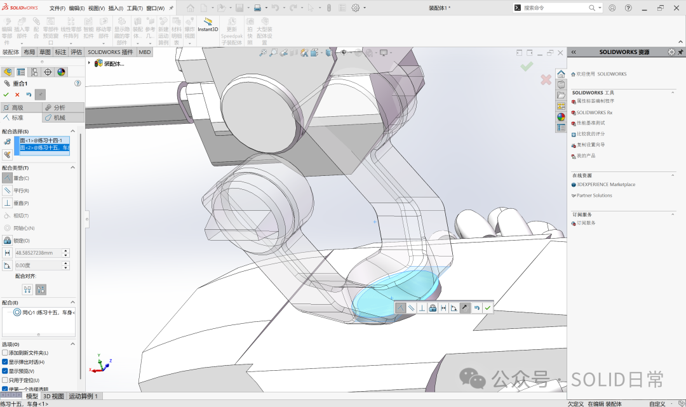

### 5.3.4 炮塔与炮架的配合

按住 `Ctrl`，选择**炮塔侧面的圆边线**和**炮架内侧的圆边线**，添加 **“同心轴”** 配合。然后选择**炮塔侧面**和**炮架内侧面**，注意炮塔应位于炮架内部，添加 **“重合”** 配合。

下图是炮塔与炮架“同心轴”配合的边线选择以及炮塔嵌入炮架内部的位置关系：

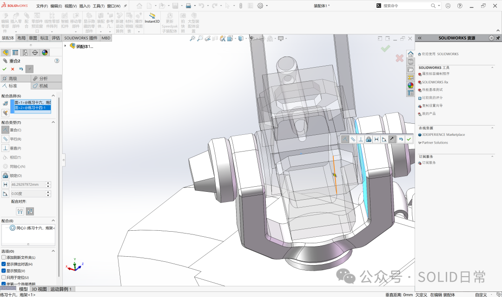

### 5.3.5 四个车轮与车身的配合

对于每一个车轮：按住 `Ctrl`，选择**车轮内侧圆边线**和**车身轮毂的圆边线**，添加 **“同心轴”** 配合。然后选择**车轮内侧面**和**车身侧面**，添加 **“距离”** 配合，距离设为 **2 mm**（不要求完全贴合，保留微小间隙即可）。依次完成剩余三个车轮的配合。

下图是车轮“同心轴”配合的边线选择与“距离”配合的参数设置：

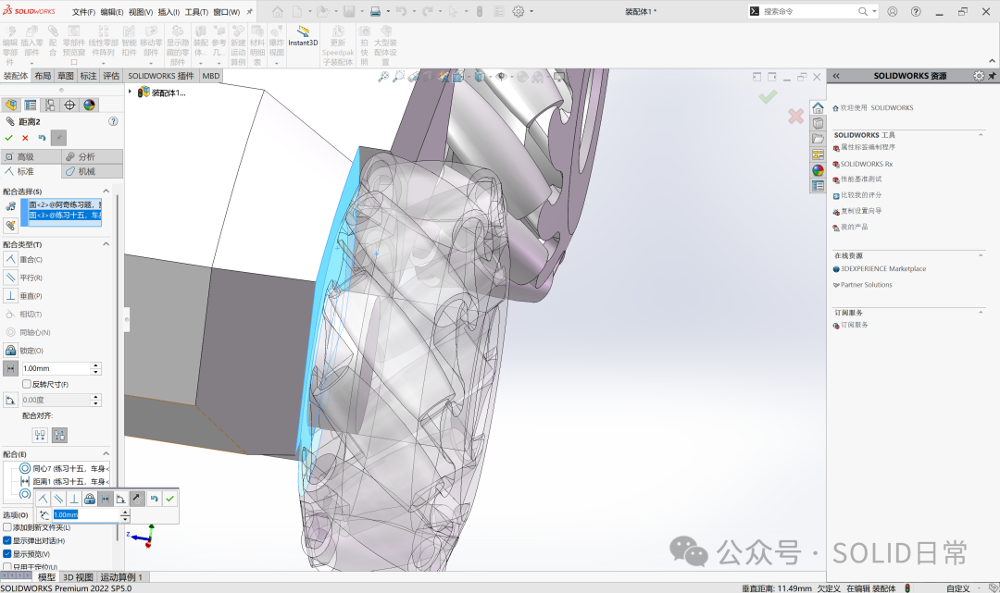

### 5.3.6 装配完成

所有配合添加完成后，炮车的车轮、炮架和炮塔均保持可运动状态。可以在图形区域拖动车轮或炮塔，检查运动是否受约束、是否存在不应有的干涉。最终的炮车装配体如图所示。

下图是装配完成的炮车整车，车轮、炮架和炮塔均可相对车身运动：

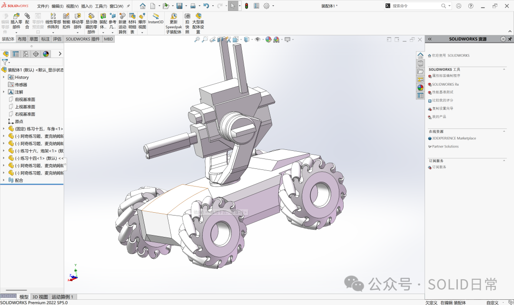

## 5.4 爆炸图

爆炸视图用于将装配体中的零件按设定的方向和距离“拆开”，以动画或静态视图的形式展示装配结构和零件层级。SolidWorks 的爆炸视图提供**两种模式**：常规步骤（平移和旋转）和径向步骤。

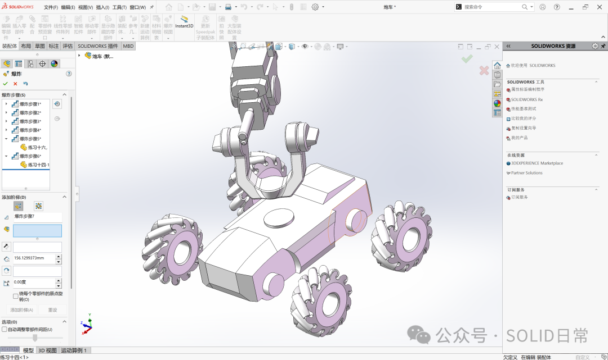

### 5.4.1 爆炸视图的两种模式

**常规步骤（平移和旋转）**：选中零件后，通过三重轴的直线箭头控制沿 X、Y、Z 方向的平移，通过旋转圆环调整绕轴线的角度。适用于沿直线方向拆解、无圆周分布规律的零件，是最基础、最通用的模式。

**径向步骤**：针对呈圆周或放射状分布的零件。需要先指定一根中心轴线，再选择要爆炸的零件，使其沿径向向外散开。适合螺栓、轴承、轮辐等环形排布的零部件，可以一次性完成一圈零件的均匀放射状爆炸。

下图是爆炸视图中“常规步骤”与“径向步骤”两个模式图标在命令管理器中的位置：

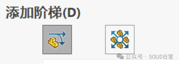

### 5.4.2 常规步骤爆炸：以炮车为例

打开炮车装配体，点击 **“爆炸视图”** 命令。在常规步骤模式下，选择需要移动的零件，拖动三重轴将其移动到目标位置。**每完成一个零件的移动，点击“完成”**（注意：点击“完成”而不是“√”；“完成”的对象是当前步骤，“√”的对象是所有步骤）。继续选择下一个零件，重复移动和“完成”的操作。所有零件移动完毕后，点击 **“√”** 结束爆炸视图的创建。

下图是炮车爆炸视图的创建界面，设计树中列出了各个爆炸步骤：

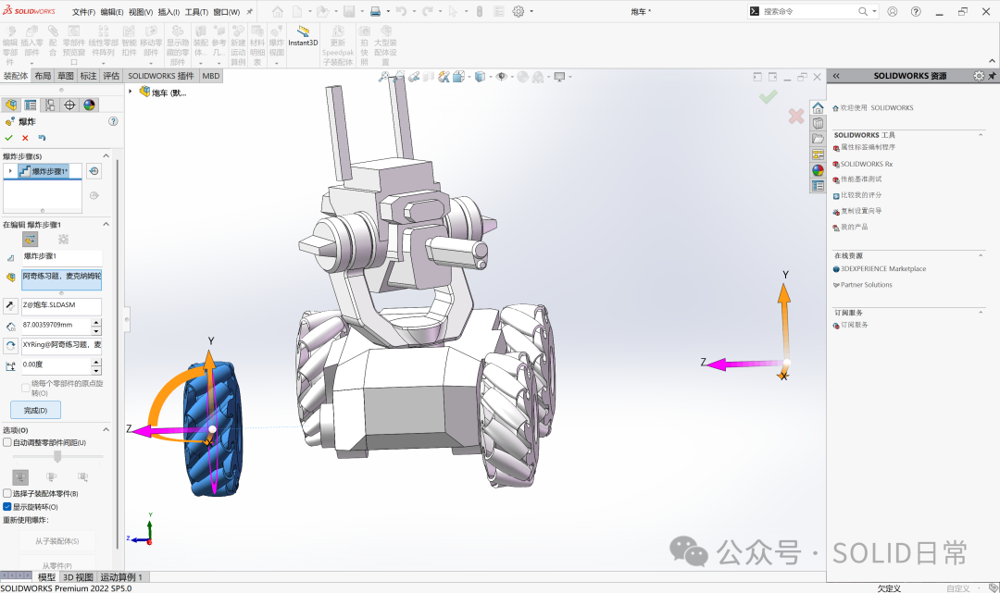

下图是常规步骤下选中零件后通过三重轴沿指定方向平移的示意：

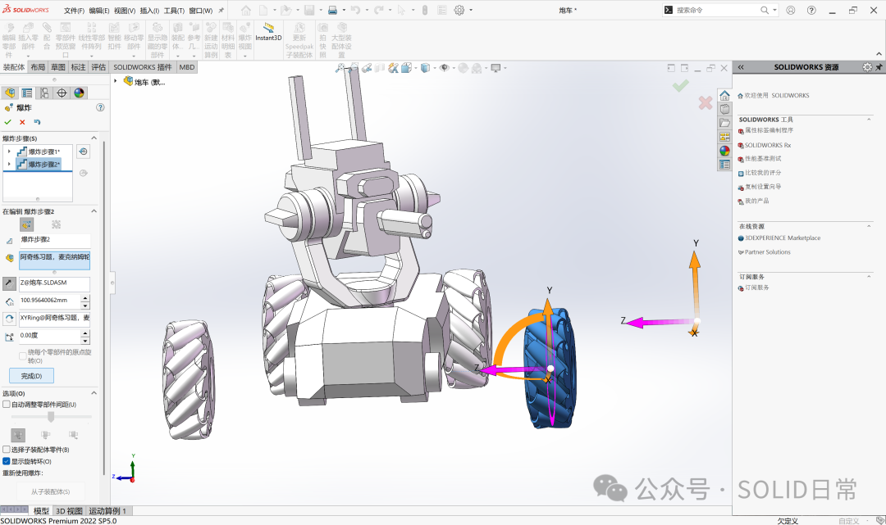

### 5.4.3 径向步骤爆炸

如果需要将圆周分布的零件沿径向散开，点击“爆炸视图”后选择第二个图标（**径向步骤**），选择所有需要爆炸移动的零件，方向选择某一个**面或轴**作为中心参考（例如炮架底部的侧面或中心轴），然后点击 **“√”** 完成。径向步骤可以快速生成环形零件组的放射状爆炸，但爆炸方向和方式相对固定，不如常规步骤灵活。

下图是径向步骤中选择中心参考面/轴以及零件沿径向散开的效果：

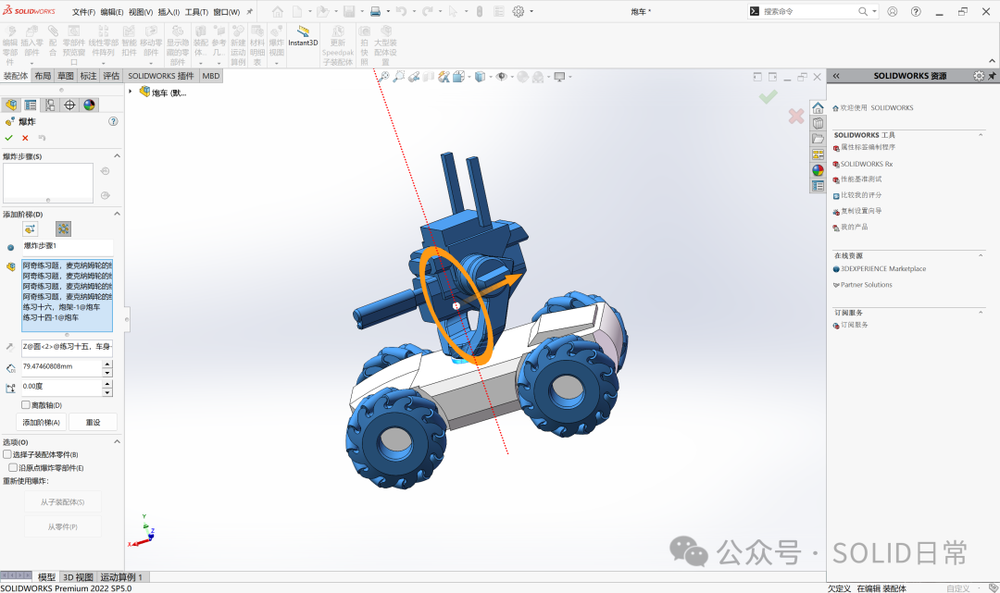

### 5.4.4 运动算例中的爆炸与解除爆炸动画

爆炸步骤完成后，切换到 **“运动算例”**（界面左下角）。选择 **“动画导向”**，在类型中选择 **“爆炸”**，起始时间设为 0 秒，运行时长根据需要设定（例如 6 秒，以动画节奏舒适为准）。

完成第一段爆炸动画后，将**暂停线**放置在爆炸结束的时间点（如 6 秒处），在暂停线上**右击**，选择 **“放置键码”**。单击该键码，选择 **“动画导向”** → **“解除爆炸”**，起始时间设为 6 秒（与上一段爆炸的结束时间衔接），运行时长同样设为 6 秒。

下图是运动算例中“爆炸”动画导向的类型选择与时长设置：

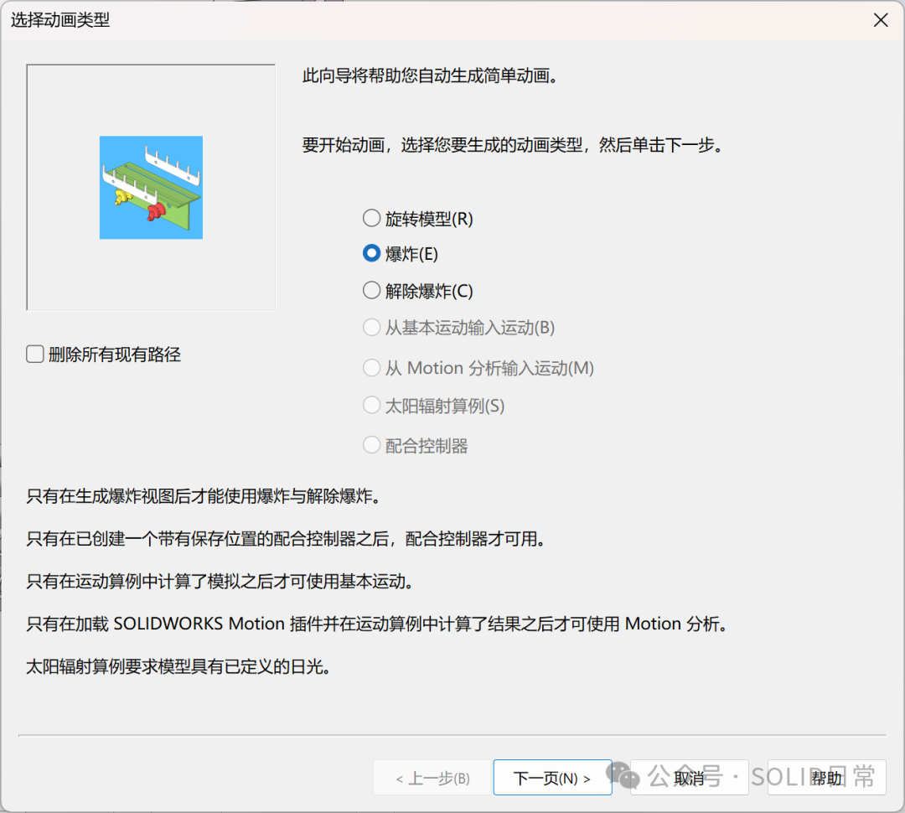

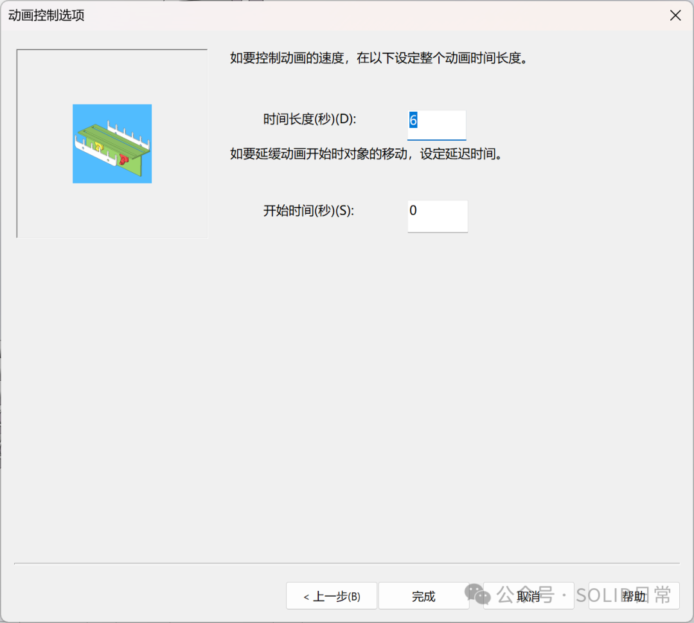

下图是在暂停线上右击“放置键码”以及键码上“解除爆炸”的设置：

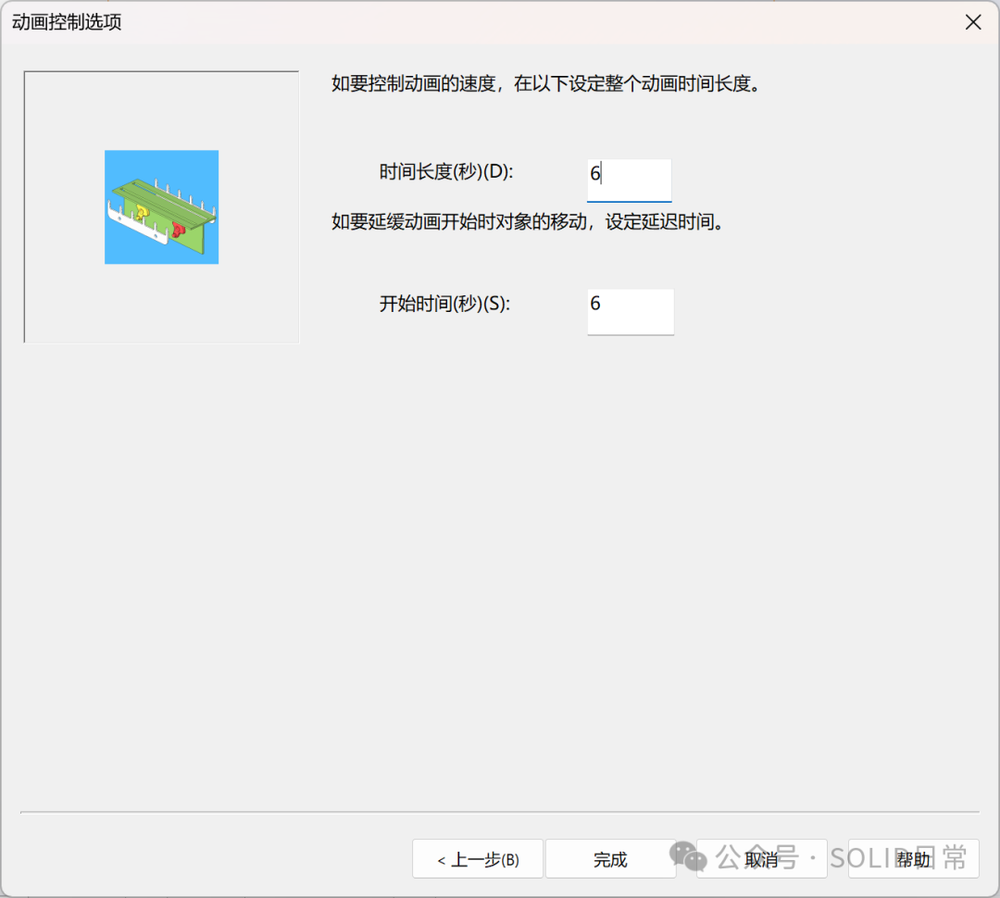

完成键码设置后，点击**播放**，即可看到炮车先爆炸展开、再解除爆炸装回的完整动画。

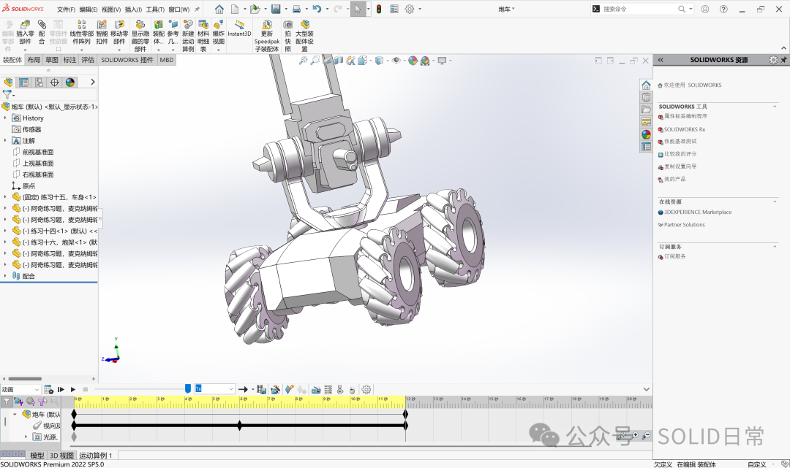
