# 第6章 智能机械手爪几何建模

本章以一台**五爪夹持机构**为对象，完成从单个零件建模到整体装配的完整流程。五爪夹持机构是一种典型的欠驱动或联动式末端执行器，多个手指沿圆周分布，通过连接件与底座、腕关节的配合实现同步开合。零件数量较多，但单个零件的几何复杂度有限，重点在于**草图构造线的运用、圆周阵列的节奏、以及装配体中配合关系的建立逻辑**。

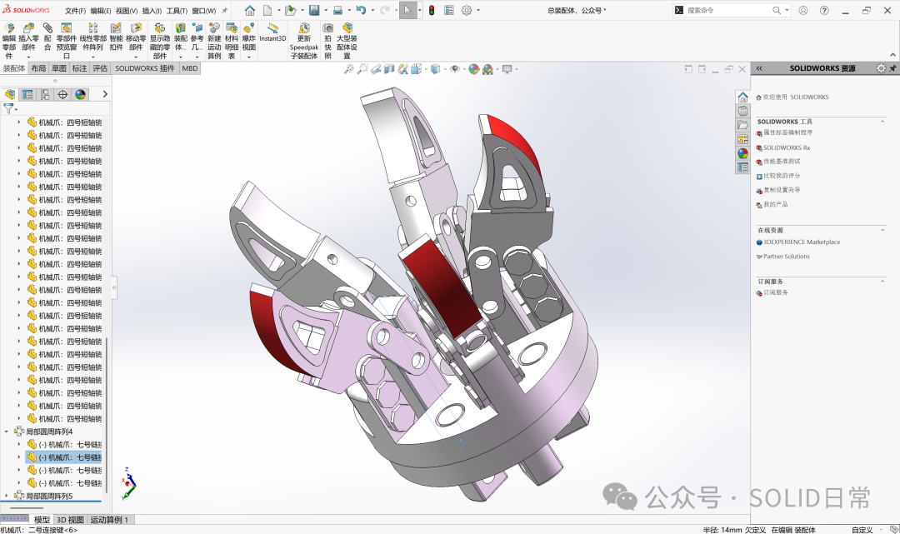

## 6.1 手爪建模

五爪夹持机构共涉及底座、抓式底座、夹具、支撑盖（左/右）、腕关节、固定销、1号连接键、2号连接键、定位销、短轴销、连接腕等零件。以下按建模顺序逐一展开。

### 6.1.1 底座

底座建模的难点在于**中间切除部分的草图绘制**。进入草图后，首先绘制**水平和垂直两条构造线**，将花瓣区域划分为可对称操作的单元。花瓣部分先绘制一侧，**先标注几何关系（圆弧之间均为相切），再标注尺寸**，完成一侧后镜像到另一侧，最后使用**圆周阵列**生成全部花瓣轮廓。轮廓完成后执行拉伸和切除，得到底座实体。

下图是底座中间切除部分的草图，水平与垂直构造线已经绘制，花瓣轮廓的一侧正在标注几何关系：

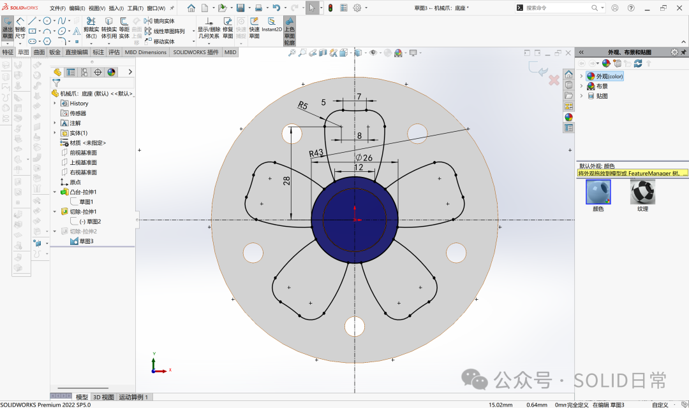

### 6.1.2 抓式底座

抓式底座的建模从**旋转拉伸**开始。先绘制构造线，再画出旋转截面轮廓，执行旋转拉伸得到主体。随后切换到**中间凹面**编辑草图：绘制一条构造线，从圆心点指向下端点，以该构造线为基准**圆周阵列 5 条构造线**。在相邻构造线之间绘制切除轮廓，执行**圆周阵列切除**，得到 5 个均布的凹槽。继续在该面上编辑，按照图纸切除剩余材料。

下图是抓式底座在中间凹面上以构造线为基准进行圆周阵列切除的示意：

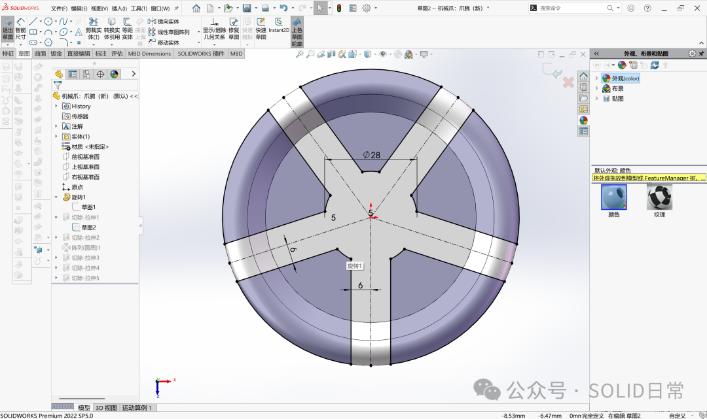

### 6.1.3 夹具

夹具的建模从拉伸开始：编辑草图绘制夹具的截面轮廓，拉伸为实体。然后对该零件执行**拉伸切除**，形成夹持面与安装结构。夹具上存在**圆角特征，半径为 2 mm**，在切除完成后添加。

下图是夹具拉伸完成后的实体与切除轮廓的相对位置：

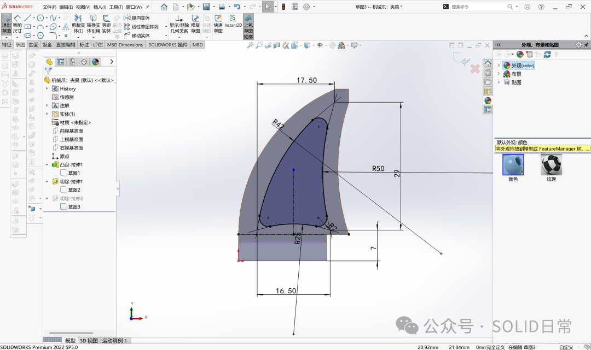

### 6.1.4 支撑盖（右）

支撑盖与夹具配合，需要左右各一件。**先完成右盖，再通过镜像得到左盖**。建模时使用 **“等距实体”** 功能：先绘制中间部分，**外部边缘的等距距离为 1 mm，内部等距距离为 2 mm**。拉伸时，**中间部分深度为 7.4 mm，外边缘部分在同方向拉伸 1 mm**。

圆角的添加顺序需要特别注意：**先画内部圆角（半径 2 mm），再画边缘圆角（半径 3 mm）**。顺序颠倒会导致圆角特征报错，无法生成。

下图是支撑盖的等距实体草图，内外等距距离分别为 1 mm 和 2 mm：

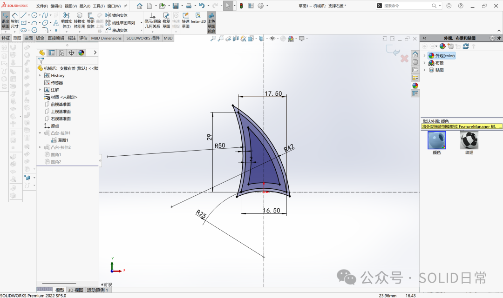

### 6.1.5 腕关节

腕关节与夹具配合，主要操作是**拉伸切除**。先编辑草图并拉伸主体，然后转到另一面进行多级切除。切除时注意三个区域的深度不同：**内部小圆完全贯穿切除，大圆切除深度为 3 mm，梯形区域切除深度为 23 mm**。最后将侧边材料切除，完成腕关节。

下图是腕关节在第二面上进行多级深度切除时的草图与深度参数设置：

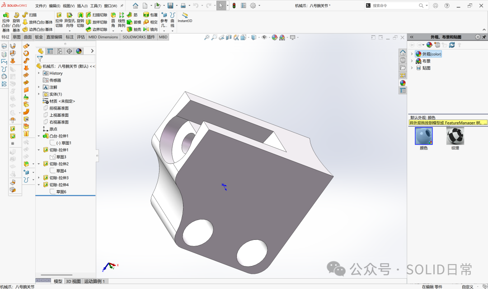

### 6.1.6 固定销

固定销穿入腕关节的小圆切除部分，与腕关节配合。主要几何为圆柱体，**圆角半径为 0.5 mm**。

下图是固定销的几何形态与圆角位置：

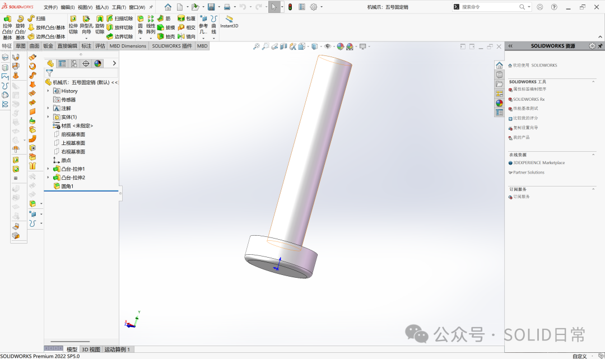

### 6.1.7 1号连接键与2号连接键

1号连接键和2号连接键的几何难度较低，按照图纸绘制草图并拉伸即可。二者在装配体中分别承担不同的连接功能，建模时注意保留与销轴、圆孔配合的圆柱面。

下图是1号连接键与2号连接键的三维模型：

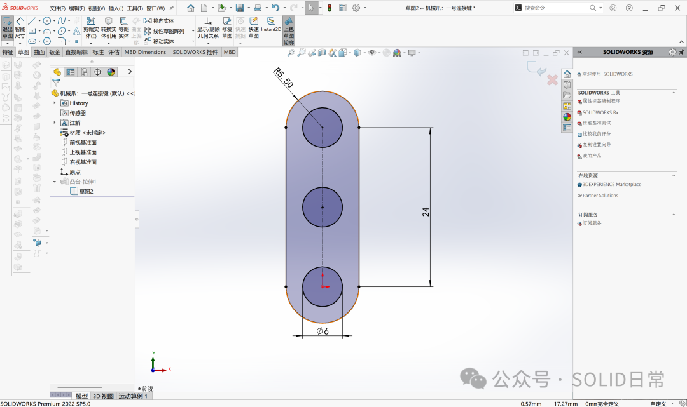

### 6.1.8 定位销与短轴销

**定位销**与两个底座配合，**短轴销**用于连接件与底座之间的铰接。两者的几何均为简单的圆柱或阶梯圆柱，按图纸尺寸建模即可。

下图是定位销与短轴销的模型：

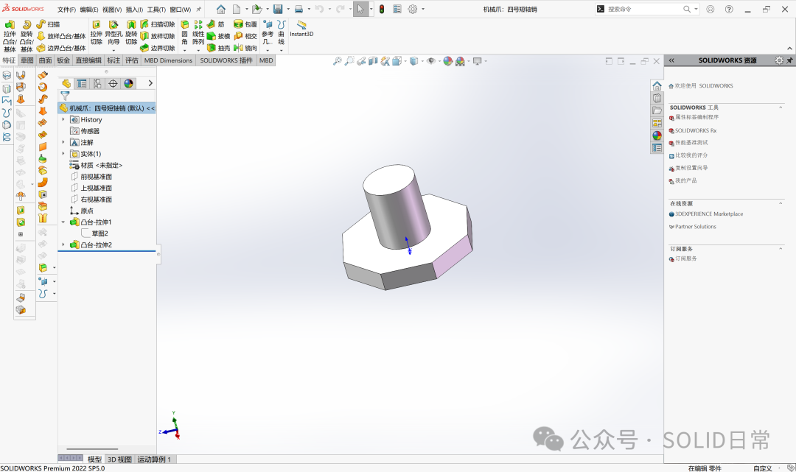

### 6.1.9 连接腕

连接腕连接底座与爪子装配体。建模时**先绘制两条构造线**，然后在左右两侧画直线、上下两侧画圆弧，**保持左右对称、上下对称**，拉伸为实体。侧边两个圆孔的位置需要特别注意：**绘制水平构造线时，应选择两边的中点作为参考，而不是原点**，因为连接腕是凹凸结构，原点并不在侧面中点位置。**两侧深度为 75 mm，两圆心距离为 60 mm**。

下图是连接腕的对称草图与侧边圆孔的位置关系，水平构造线经过两侧中点而非原点：

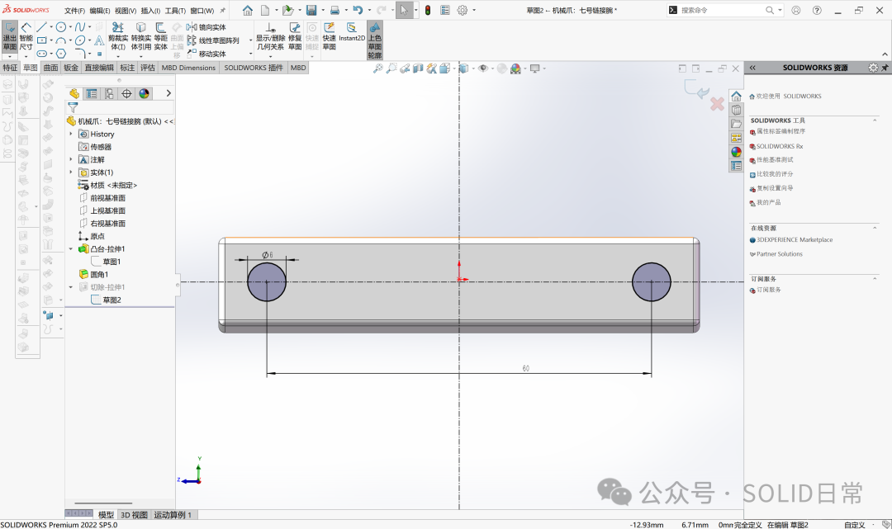

## 6.2 手爪装配

装配体的配合逻辑遵循一条原则：**先导入的零件作为固定基准，后续零件通过重合、同轴心等配合逐步定位；对于沿圆周均布的零件，优先使用“圆周阵列”复制配合关系，而不是逐一添加配合**。

### 6.2.1 导入底座与抓式底座

新建装配体文件，**第一个导入的零件是底座**。底座作为固定基准，后续所有配合以它为参照。

第二个导入**抓式底座**。添加两组配合：**抓式底座底面与底座顶面“重合”**；**两个底座的中心圆“同轴心”**，同时**5个小圆也分别“同轴心”**。如果零件之间的角度导致配合困难，可以使用 **“运动零件”中的“旋转零件”** 功能调整姿态后再添加配合。

下图是抓式底座与底座之间中心圆及小圆的同轴心配合选择：

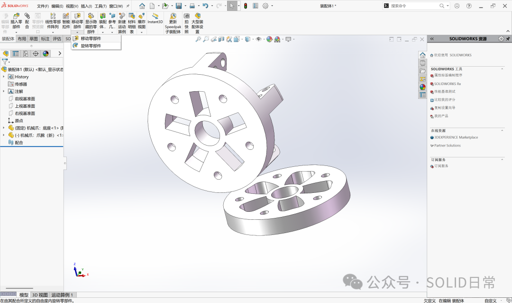

### 6.2.2 定位销与圆周阵列

导入**定位销**。将定位销的圆柱与底座上的小圆添加 **“同轴心”** 配合，再添加面与面的 **“重合”** 配合。完成一个定位销的配合后，使用**圆周阵列**复制到其余位置：**阵列方向选择底座的圆边线，实例数量为 5**。本次装配体中多处圆周阵列都以底座的圆边线作为方向参考。

下图是定位销与底座小圆的同轴心配合及圆周阵列参数：

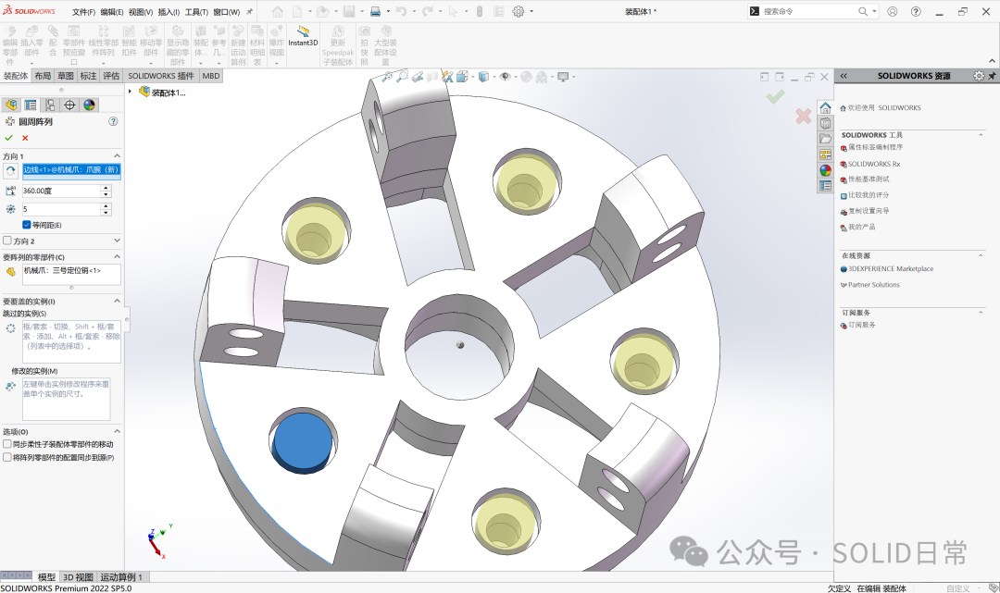

### 6.2.3 1号连接件

导入**1号连接件**。先复制一个并旋转方向，然后添加配合：连接件的两个圆与底座的两个圆分别 **“同轴心”**，连接件与底座之间添加面 **“重合”**。完成一组配合后，同样使用**圆周阵列**（方向仍为底座圆边线）生成全部连接件。

下图是1号连接件与底座圆孔的同轴心配合以及圆周阵列后的布局：

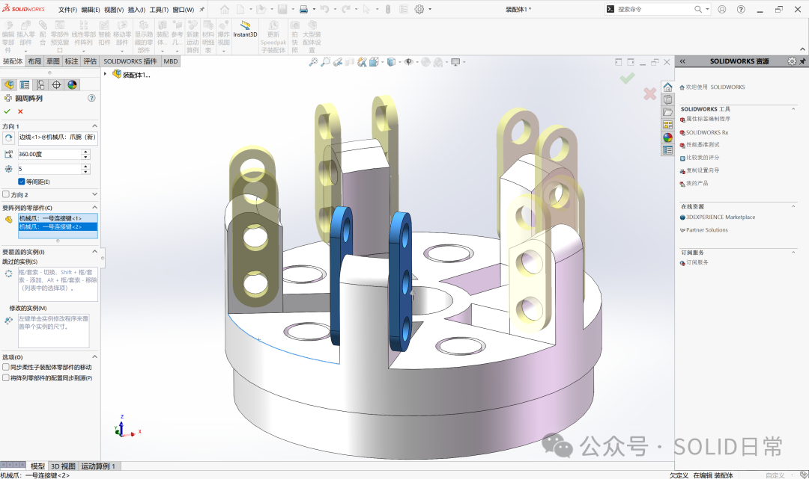

### 6.2.4 短轴销

导入**短轴销**并复制。这一步需要**逐一为每个短轴销添加配合**，因为短轴销的姿态约束较为特殊：**圆柱与1号连接件的圆孔“同心轴”**，**内侧面与1号连接件侧面“重合”**，并且**短轴销六边形柱体的一个侧面与底座顶面“平行”**。最后一条“平行”配合是确定短轴销角向姿态的关键。全部短轴销配合完成后，执行**圆周阵列**。

下图是短轴销与连接件圆孔的同轴心配合以及六边形侧面与底座顶面的平行配合：

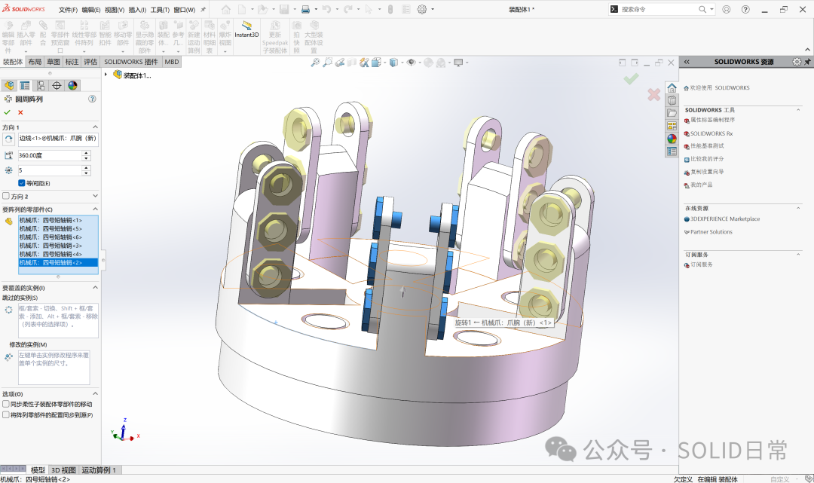

### 6.2.5 连接腕

导入**连接腕**。连接腕的**凹面与底座上的圆“同轴心”**，连接腕的**两个侧面与底座的内侧面“重合”**。配合完成后，同样进行**圆周阵列**，使连接腕沿圆周均布。

下图是连接腕凹面与底座圆的同轴心配合，以及侧面与底座内侧面的重合配合：

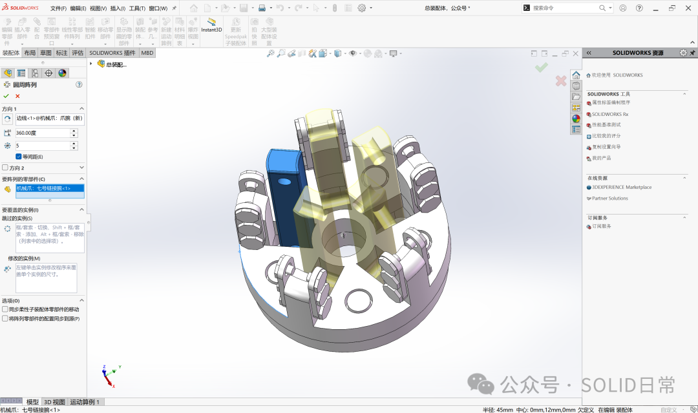

### 6.2.6 爪子装配体与2号连接件

最后导入**爪子装配体**（由6.1节中的夹具、支撑盖、腕关节和固定销组成）和**2号连接件**。2号连接件与爪子装配体之间的配合较为直接，按圆孔同轴心和侧面重合处理。**2号连接件与连接腕之间**添加圆孔的 **“同轴心”** 配合和侧面的 **“重合”** 配合；**爪子的另一个圆孔与短轴销的圆柱**添加 **“重合”** 配合。完成一组后，执行**圆周阵列**。

下图是爪子装配体、2号连接件与连接腕、短轴销之间的配合关系，以及最终的圆周阵列布局：

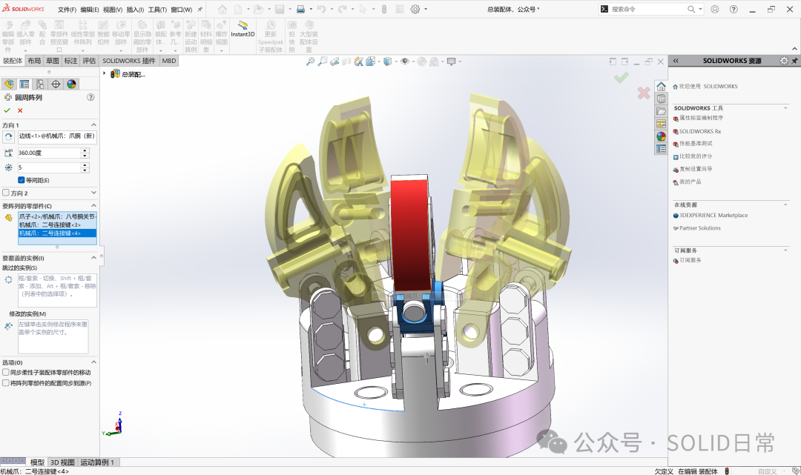

### 6.2.7 装配完成与运动验证

总装配体完成后，**拖动连接腕**，爪子应随之产生联动开合动作。如果运动不顺畅或出现干涉，需要回到装配体中检查配合面的方向和阵列实例的姿态是否一致。五爪夹持机构的最终装配体如图所示。

下图是装配完成的五爪夹持机构整体模型，拖动连接腕即可观察爪子的联动行为：

