# 第7章 智能机械臂几何建模

本章以一台六自由度串联机械臂为例，包含五个手臂关节和一个独立夹爪关节。它的几何结构清晰、零件数量适中，是理解串联连杆、关节轴线与工作空间之间关系的理想建模对象。本章按照从单个零件到整体装配的顺序，逐步完成智能机械臂的几何建模。

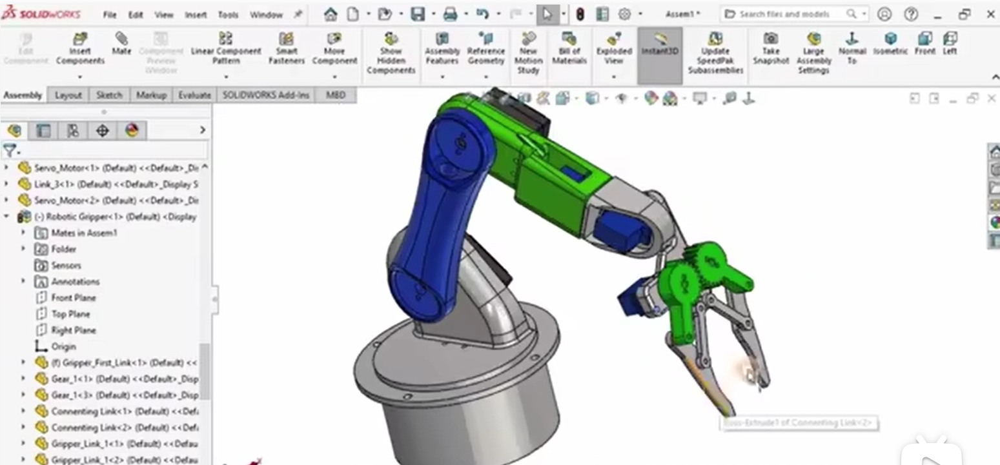

## 7.1 底座零件建模

单击播放本节教学视频：
[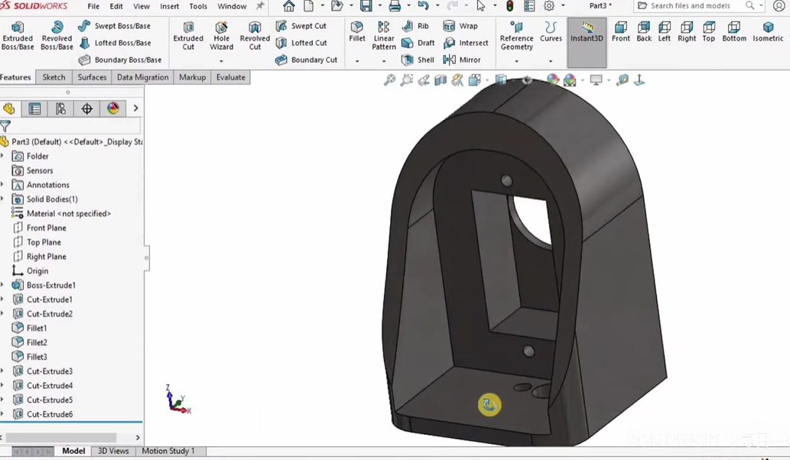](https://www.bilibili.com/video/BV1y4Hx6KEVv/?p=1)

底座是整台机械臂与桌面或安装面的连接基准，其建模在微专业课程中承担着建立“基准—配合—承载”设计意识的作用，外形轮廓、安装孔阵列与顶部旋转支撑结构都要为后续关节轴线提供稳定起点。

建模时先在上视基准面绘制俯视轮廓，用中心矩形或圆确定外形并拉伸成凸台，再在上表面布置安装孔和中心轴承孔，借助拉伸切除或异型孔向导成形，最后对边缘倒圆角以消除尖角并改善安装面的过渡。

完成后应得到安装接口完整、旋转支撑面明确的底座实体，其孔位与配合尺寸能够和肩部零件形成确定的装配关系，使整机串联链从固定端开始就具备可靠的几何约束。

## 7.2 肩部关节零件建模

单击播放本节教学视频：
[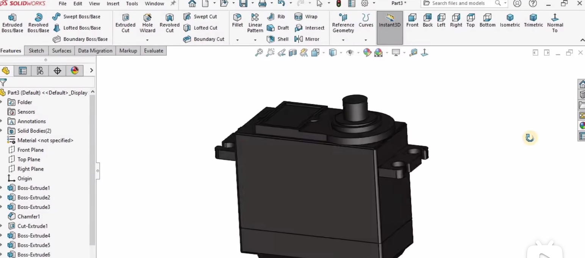](https://www.bilibili.com/video/BV1y4Hx6KEVv/?p=2)

肩部是机械臂的第一个运动关节，承担水平转向和竖直抬臂的双重动作，其建模质量直接影响底座旋转中心与手臂抬升轴线能否在装配后保持一致，因此不能只停留在外形拉伸，而要把配合圆柱面和铰接孔当作运动副的几何载体来对待。

可在前视或右视基准面绘制肩部侧面轮廓，把与底座轴承配合的圆柱面、与肘部连杆连接的铰接孔以及电机安装法兰面一并纳入草图，拉伸成主体后再切除减重槽或走线孔，并在关节配合面处添加必要的圆角。

预期得到的是带有旋转配合圆柱面、电机安装面和肘部铰接孔的肩部零件，其几何轴线与底座旋转中心对齐，从而为后续大臂的摆动提供一个方向明确、定位可靠的转动副。

## 7.3 大臂连杆建模

单击播放本节教学视频：
[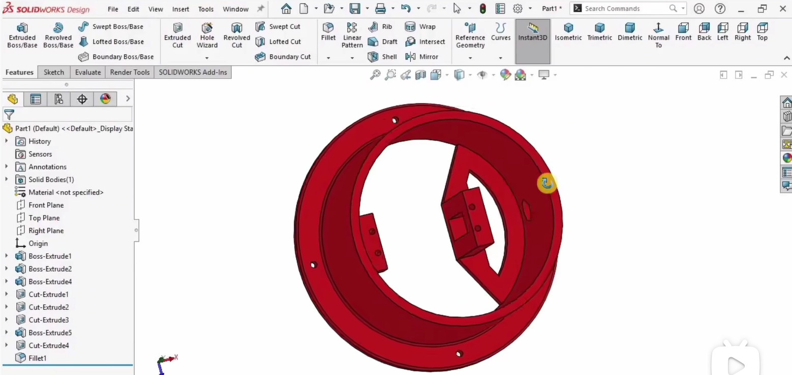](https://www.bilibili.com/video/BV1y4Hx6KEVv/?p=3)

大臂连接肩部与肘部，其长度和两端孔心距直接决定机械臂的伸展范围与可达工作空间，因此在微专业的建模训练中，这一零件要把运动学尺寸和结构承载放在同一张草图上权衡，而不是孤立地画一根连杆。

建模时先绘制大臂侧面轮廓，两端分别布置与肩部铰接孔和肘部铰接孔配合的圆环结构，中间采用等截面或变截面连杆，拉伸成主体后通过拉伸切除或异型孔向导加工精确铰接孔，并校核两孔中心距是否符合设计参数，必要时添加加强筋或减重孔。

完成后应得到一根两端铰接孔精确、孔心距与肩部—肘部运动学尺寸匹配的大臂连杆，使装配后的摆动范围与设计工作空间一致，也为后续小臂和腕部的位姿传递奠定长度基准。

## 7.4 肘部关节零件建模

单击播放本节教学视频：
[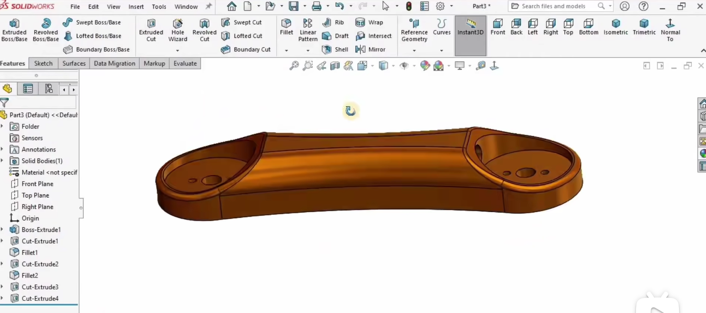](https://www.bilibili.com/video/BV1y4Hx6KEVv/?p=4)

肘部位于大臂与小臂之间，是决定手臂伸展和收拢动作的转动关节，其建模需要把轴向定位、配合间隙和限位关系预先考虑清楚，否则装配后容易出现轴线偏移或端面摩擦。

绘制肘部轮廓时，应把与大臂铰接孔配合的圆柱凸台或凹槽、与小臂连接的铰接孔以及可能的限位结构一并表达，拉伸成主体后再对配合面进行精加工切除，使大臂和小臂在轴向定位上各得其所。

最终得到的肘部零件应能在大臂和小臂之间形成确定的转动副，配合面处的几何精度满足装配要求，并为后续运动验证提供可控的转角边界。

## 7.5 小臂连杆建模

单击播放本节教学视频：
[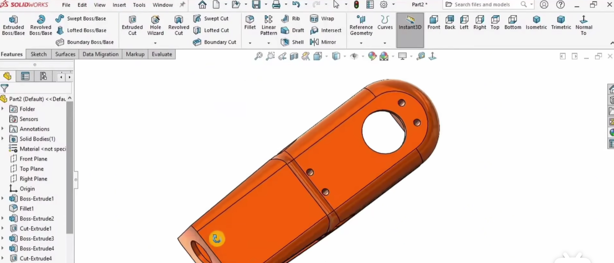](https://www.bilibili.com/video/BV1y4Hx6KEVv/?p=5)

小臂连接肘部与腕部，是手臂末段的主要承载结构，虽然建模思路与大臂相近，但两端接口的形状和尺寸往往并不对称，因此在微专业训练中要特别关注腕部端接口与肘部端接口的差异，不能简单复制大臂。

可参照大臂的建模顺序绘制小臂侧面轮廓，两端分别设计肘部铰接孔和腕部配合结构，拉伸后完成铰接孔切除，并对受力较大的过渡处和配合面添加圆角，使小臂在满足孔心距要求的同时具备合理的刚度过渡。

完成后应得到一根两端铰接孔中心距精确的小臂连杆，其几何形态与肘部和腕部的配合面一致，从而保证末段姿态调整时运动链不发生附加偏转。

## 7.6 腕部关节零件建模

单击播放本节教学视频：
[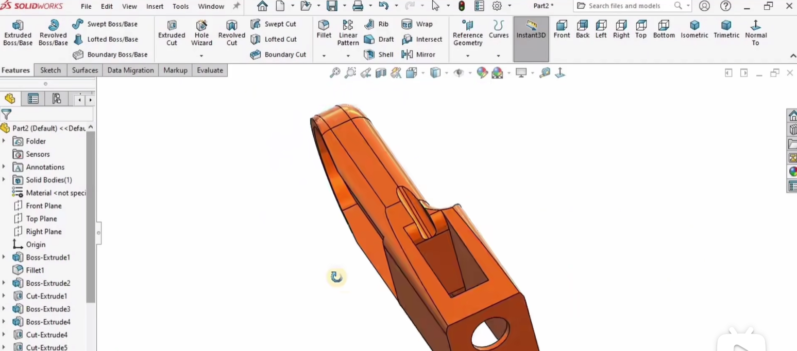](https://www.bilibili.com/video/BV1y4Hx6KEVv/?p=6)

腕部承担末端姿态调整功能，在SO101的五手臂关节中通常提供俯仰或旋转方向的姿态调节，其建模要把轴承孔、轴向定位结构和末端安装面统一到同一条设计轴线上，避免姿态调整时产生偏心。

绘制腕部轮廓时，应把与小臂铰接的配合面、与末端法兰或夹爪基座连接的安装面一并考虑，若包含旋转自由度，还需设计相应的轴承孔和轴向定位结构，拉伸主体后对配合面进行精加工，以控制旋转轴线的几何精度。

预期得到的是具有确定俯仰或旋转配合面的腕部零件，其轴线方向与设计位姿一致，能够为末端法兰和夹爪提供稳定的姿态输入。

## 7.7 末端法兰零件建模

单击播放本节教学视频：
[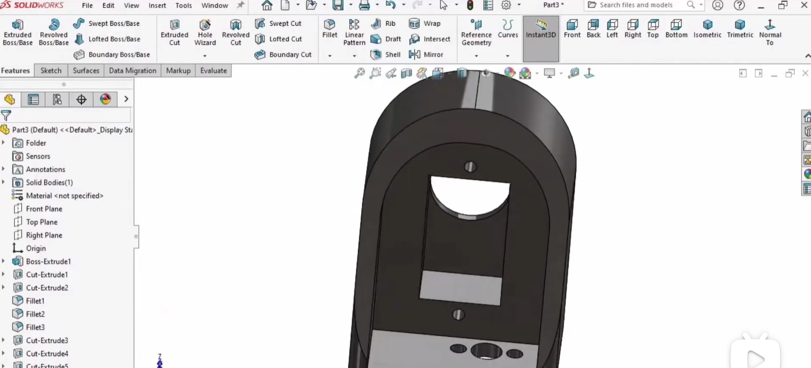](https://www.bilibili.com/video/BV1y4Hx6KEVv/?p=7)

末端法兰是腕部与夹爪之间的过渡接口，其几何设计决定了夹爪的安装姿态和可更换性，因此在微专业的接口建模中要把中心定位孔与四周安装孔阵列视为一组相互约束的尺寸链，而不是孤立的孔。

可先绘制法兰的圆形或方形轮廓，中心布置与腕部输出轴配合的孔，四周按圆周阵列安排夹爪安装孔，拉伸后通过异型孔向导或拉伸切除生成螺栓孔，并使法兰厚度和安装孔位与夹爪基座严格匹配。

完成后应得到一个具有标准安装孔阵列的末端法兰，能够以确定的方向与夹爪基座对接，为后续夹爪的快速更换和姿态复现提供几何接口。

## 7.8 夹爪基座建模

单击播放本节教学视频：
[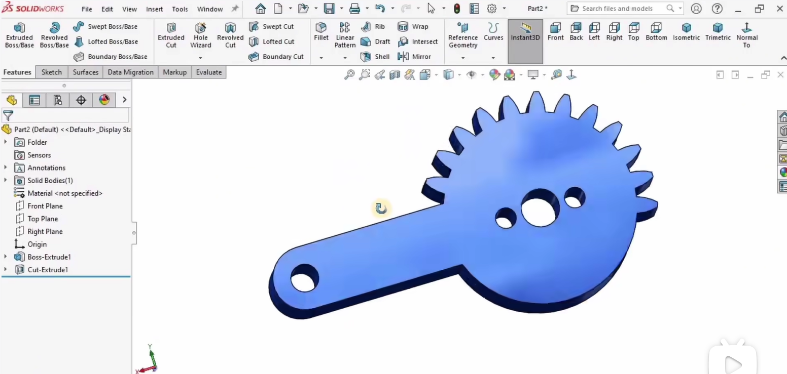](https://www.bilibili.com/video/BV1y4Hx6KEVv/?p=8)

夹爪基座是夹爪机构的主体承载零件，手指传动机构和驱动元件通常都安装在它上面，其建模既要保证与末端法兰的对接孔位，又要为内部传动留出足够的运动空间，因此内部腔体与外部接口需要同步构思。

绘制基座外轮廓时，应把与末端法兰对接的安装面和容纳传动机构的内腔一起考虑，拉伸主体后通过拉伸切除或抽壳形成内部空间，再在侧壁或底部生成手指滑轨或铰接孔的安装结构，并补全与法兰孔对应的螺栓孔。

最终得到的夹爪基座应内部具有传动机构安装空间、外部与末端法兰孔位匹配，使夹爪的驱动与执行部分能够在同一基准下完成装配。

## 7.9 手指零件建模

单击播放本节教学视频：
[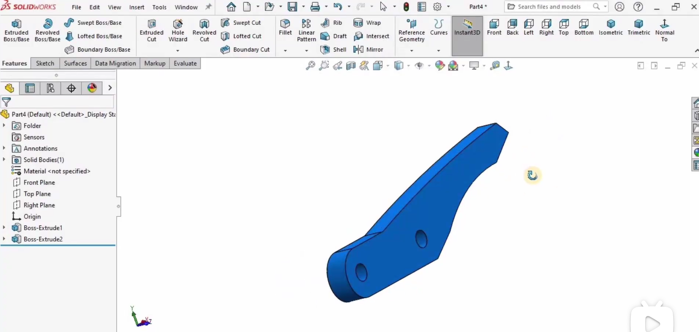](https://www.bilibili.com/video/BV1y4Hx6KEVv/?p=9)

手指是机械臂直接接触物体的零件，指面形状和开口行程决定抓取能力，其建模在微专业训练中要把铰接孔位置、指面接触区域和对称关系放在一起考虑，不能只画出一个外形再补孔。

绘制手指侧面轮廓时，应包含与基座铰接的圆孔、指部本体以及末端接触面，拉伸后对接触面进行倒角或圆角处理以减小抓取时的应力集中，若需要对称两指，可在完成一侧后通过镜像生成另一侧。

完成后应得到一对或一个可镜像的手指零件，其铰接孔位置与基座安装孔对应，指面几何能够为后续夹持力和抓取稳定性分析提供明确的接触边界。

## 7.10 传动连杆/齿轮零件建模

单击播放本节教学视频：
[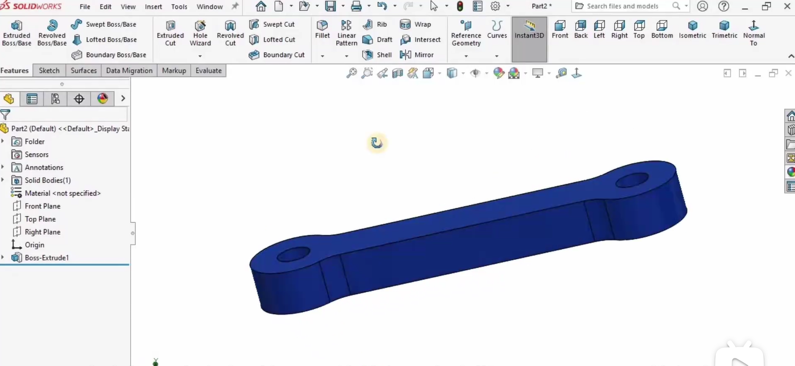](https://www.bilibili.com/video/BV1y4Hx6KEVv/?p=10)

夹爪的同步开合依赖传动连杆或齿轮，通常采用连杆或齿轮传动使两指保持运动协调，这一零件的关键几何是孔心距或节圆直径，建模时必须把传动比和安装中心距作为设计约束，而不是等装配时再临时调整。

若采用连杆，可绘制两端带铰接孔的杆状轮廓，拉伸后精加工孔位；若采用齿轮，可借助SolidWorks的Toolbox齿轮生成工具或草图绘制齿形轮廓后拉伸，并校核孔心距或节圆直径与基座、手指的配合尺寸是否一致。

预期得到能够与基座和手指正确配合的传动零件，装配后两指的开合运动关系符合设计，使夹爪在运动学上保持同步，也为后续运动算例中的齿轮配合或角度配合提供几何基础。

## 7.11 销轴/紧固件建模

单击播放本节教学视频：
[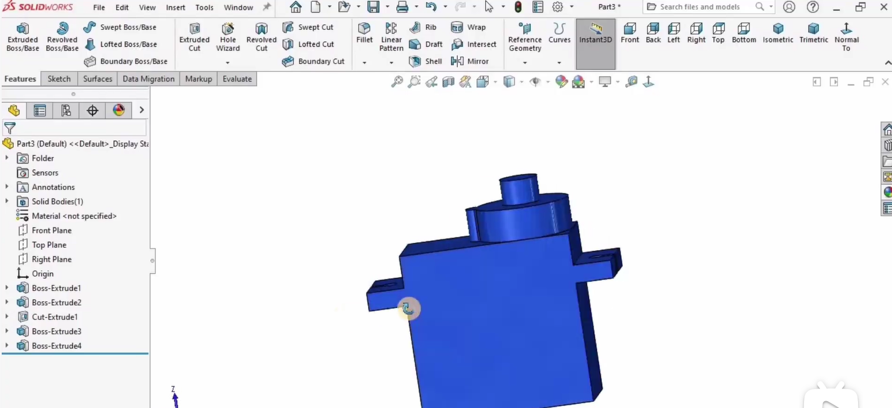](https://www.bilibili.com/video/BV1y4Hx6KEVv/?p=11)

销轴类连接件用于各关节铰接孔和手指传动机构的铰接，是装配体中实现转动副的标准件，其建模看似简单，但轴径、轴肩和倒角的尺寸选择会直接影响转动配合的可靠性和装拆便利性。

可使用旋转凸台/基体命令绘制销轴截面轮廓，把轴肩、轴颈和倒角一并表达，绕中心线旋转生成，再根据配合孔的实际尺寸确定轴径和长度，轴肩用于轴向定位；对于标准件，也可以直接从SolidWorks Toolbox中调用。

完成后应得到一组尺寸与各铰接孔匹配的销轴，能够在装配体中实现可靠的转动配合，并为关节运动提供可重复的轴线定位。

## 7.12 电机/舵机安装座建模

单击播放本节教学视频：
[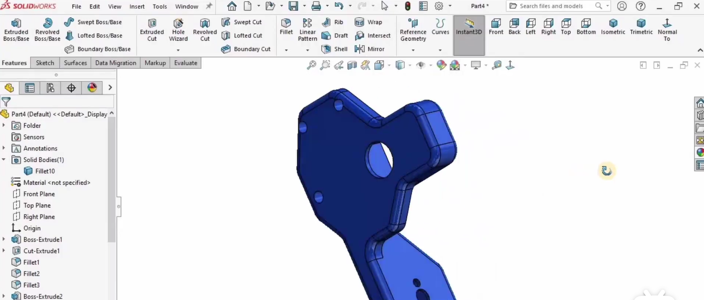](https://www.bilibili.com/video/BV1y4Hx6KEVv/?p=12)

各关节的驱动元件需要通过安装座固定在连杆或关节零件上，安装座的建模要把电机外形、安装孔距和配合间隙统一起来，在微专业课程中这是连接驱动与执行、理解“机电接口”几何约束的重要环节。

根据所选电机或舵机的外形尺寸和安装孔距绘制安装座轮廓，通常包含与电机圆柱面或法兰配合的套筒或凹槽，以及用于螺栓固定的耳片，拉伸后通过拉伸切除或异型孔向导生成安装孔，并使套筒内径与电机外径之间保留合理的配合间隙。

最终得到的安装座应能牢固固定驱动元件，安装孔位与目标零件对应，使电机或舵机在装配后不产生附加偏载，为关节的稳定驱动提供结构保障。

## 7.13 机械臂整体装配

单击播放本节教学视频：
[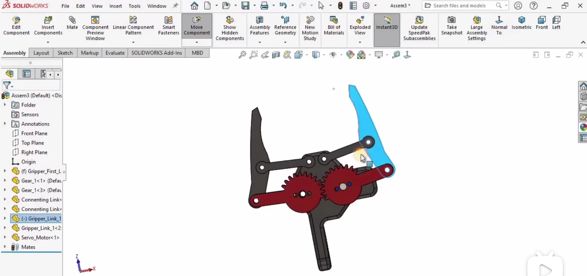](https://www.bilibili.com/video/BV1y4Hx6KEVv/?p=13)

整体装配是把7.1至7.12的零件组织成完整机械臂的关键环节，在微专业课程中它不只是把零件拖进装配体，而是通过配合关系把设计意图转化为可运动的串联机构，因此底座应作为固定基准首先导入。

新建装配体后，依次导入肩部、大臂、肘部、小臂、腕部、末端法兰和夹爪，用同心轴配合约束各关节旋转轴线，用重合或距离配合控制轴向位置；对于夹爪的手指和传动件，用齿轮配合或角度配合建立同步运动关系，全部配合完成后拖动各连杆检查运动范围。

预期得到一个可运动的装配体，各关节绕设计轴线旋转，夹爪手指能够同步开合，且不存在不应有的干涉，为后续运动验证和实物制造提供完整的装配模型。

## 7.14 运动验证与工作空间检查

单击播放本节教学视频：

运动验证与工作空间检查是几何建模收尾阶段的重要环节，在微专业课程中它承担着把“看起来能装”推进到“实际能动”的验证任务，通过运动算例和干涉检查确认装配体的运动可行性与几何设计的一致性。

打开运动算例，为各关节添加旋转马达并设定不同角度驱动，观察末端参考点的运动轨迹，同时使用干涉检查确认在整个运动范围内连杆之间、夹爪与腕部之间没有不应发生的体积重叠；若发现干涉，应回到零件中调整尺寸或修改配合的极限角度。

最终应确认装配体在预期工作范围内运动顺畅，末端可达范围与设计目标一致，从而为后续控制编程和实物制造提供一个经过几何验证的模型基础，也完成微专业训练中从零件建模到整机运动验证的闭环。
