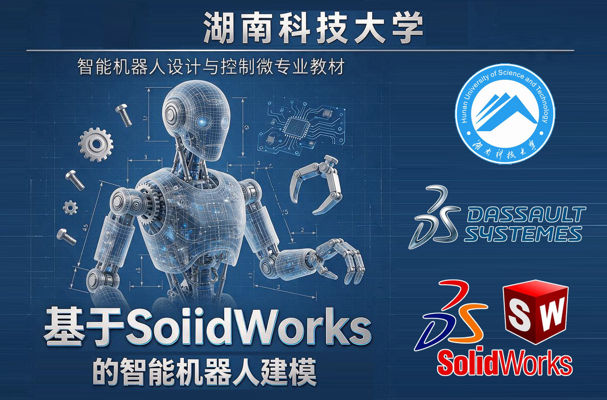
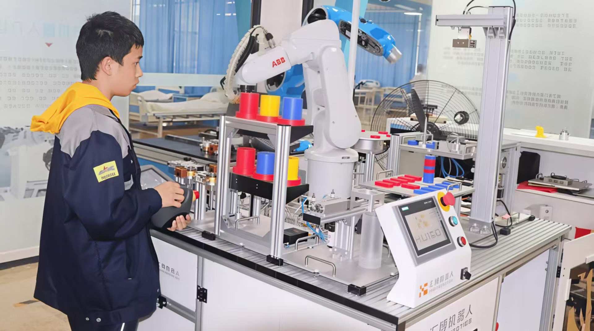
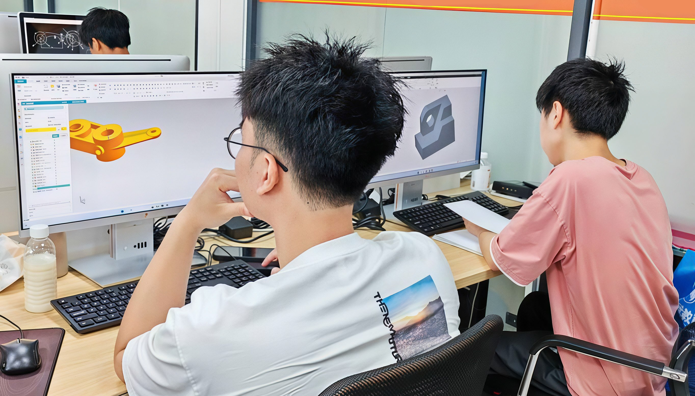
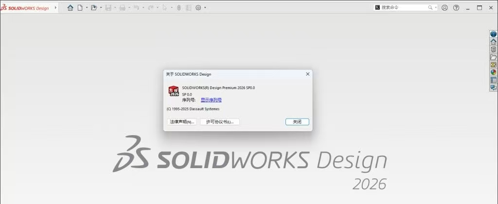
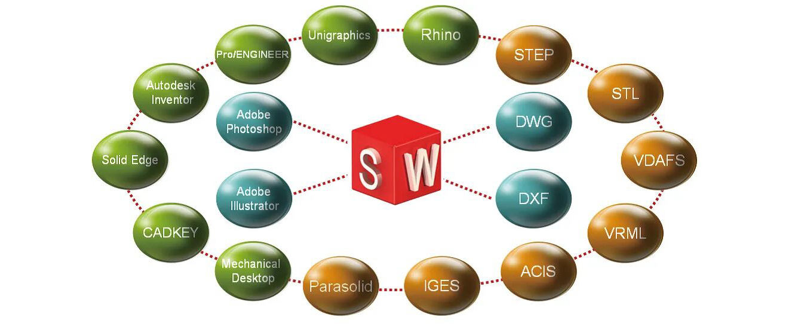
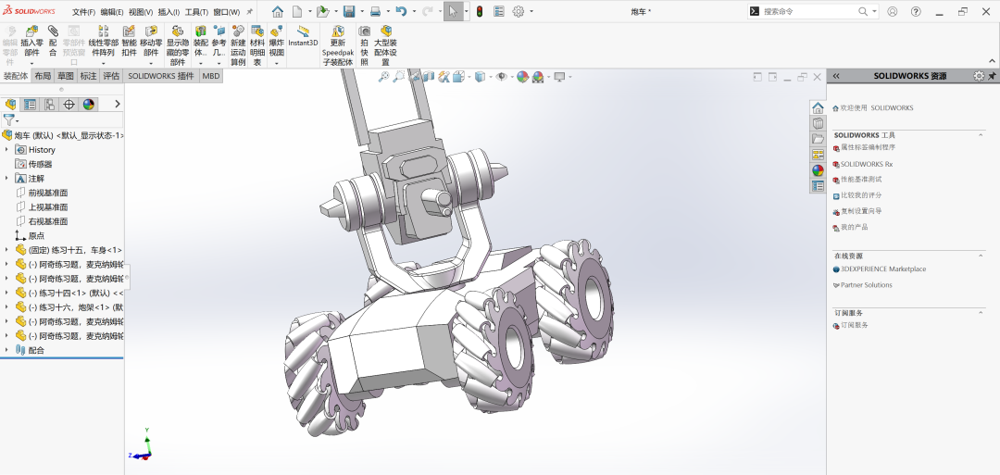
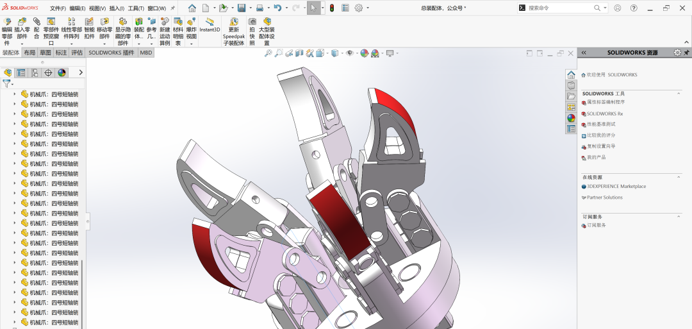

# 基于 SolidWorks 的智能机器人建模

> 主编：何志鹏、龙东平、马文悦、邓越平  
> 湖南科技大学机电工程学院 · 2026年10月

[开始学习：第1章](1_installation_and_activation_of_solidworks2026/1_installation_and_activation_of_solidworks2026.md) · [查看目录与资源](#/resources/solidworks-robot-modeling)

## 引言

编写这本教材的起点，是一个朴素却尖锐的问题：在一个以“智能机器人设计与控制”为名的微专业里，为什么需要一本专门讲SolidWorks几何建模的书？

这个问题不能回避。智能机器人的“智能”固然引人注目——运动规划、视觉感知、学习控制，这些词汇占据着大部分学术讨论和产业叙事的中心。但任何一个走下展台、进入真实物理世界的机器人，首先必须被“造出来”。造，意味着零件有确定的尺寸、关节有确定的配合、重心有确定的位置、末端执行器有确定的行程。没有这些确定的几何事实，再精巧的算法也只能停留在仿真环境的理想假设之中。几何建模，正是把“智能”从概念变成实体的第一道工程工序。

湖南科技大学“智能机器人设计与控制”微专业的设立，本身就包含着对这一工程逻辑的自觉回应。作为学校新工科改革的重点项目，该微专业由机电工程学院牵头，汇聚计算机、信息等多学院师资，联合宇树科技、英伟达等企业共同建设，被明确界定为“学科交叉型”微专业。它的目标不是培养某一狭窄方向的专才，而是让来自机械、电子、计算机、自动化乃至其他理工科背景的学生，在一年之内获得一种跨越学科边界、贯通“设计—控制—集成”的复合能力。微专业的“微”，不是内容的稀释，而是结构的聚焦：它从传统机器人工程专业庞大的课程体系中提炼出最不可替代的核心环节，以项目式学习为主线，让学生在“做”中建立对智能机器人系统的整体理解。在这一培养逻辑中，几何建模并非可有可无的前置技能，而是跨学科对话得以发生的共同语言。当一个计算机背景的学生能够读懂一个关节零件的装配约束，当一个自动化背景的学生能够理解手爪闭合行程与抓取稳定性的几何关联，跨学科协作才不至于退化为各说各话。SolidWorks之所以被选为这一环节的载体，正在于它在机械设计领域不可替代的普及度与工程完整性：它既是工业界广泛使用的设计平台，也是教育场景中连接“构型”与“功能”、“零件”与“系统”、“设计”与“制造”的最直接桥梁。WPI等高校的机器人教学实践已经表明，SolidWorks不仅能够支撑三维建模，其集成的运动、分析与可视化工具还可以让学生在虚拟环境中检验设计意图，从而在真正加工之前就建立起对机器人行为的预判能力。

但这本教材的定位，需要比“软件教程”更明确。市面上并不缺少SolidWorks的操作手册，也不缺少以工业机器人工作站为案例的三维建模教材。那些教材各有其价值，但其组织逻辑往往服务于特定的离线编程或仿真实训场景，其模型对象也多集中于码垛、焊接、搬运等工业现场装备。本书面对的是一个不同的教学对象和不同的培养节奏。微专业的学生来自多元的专业背景，他们在几何建模方面的起点参差不齐；他们的学习时间被压缩在一年之内，不可能像机械工程专业的学生那样经历完整的长周期训练；而他们最终需要理解的，不是某一种特定工业工作站的建模流程，而是**智能机器人这一类对象的几何构成逻辑**——移动平台如何承载传感器与执行器，末端执行器如何在有限自由度中实现确定的操作功能，串联机械臂如何通过关节的几何排布获得三维空间中的可达性与方向能力。因此，本书的章节设计遵循的是一条从“工具入门”到“对象建模”的递进路径：先让学生获得操作SolidWorks的基本能力，再通过复杂三维零件建模建立对几何构型的一般性理解，最后将这种理解落实到三类具有代表性的智能机器人对象之上——智能小车、智能机械手爪和SO101机械臂。每一类对象都对应着智能机器人系统中一个不可跳过的设计维度：移动底盘的承载与布局，末端执行器的功能几何，以及串联臂的空间运动学几何基础。

更深一层说，学习几何建模，学的并不只是“画出一个零件”。一个能够在工程意义上成立的几何模型，同时承载着功能意图、制造约束和后续集成的接口约定。一个手爪的指部形状，决定了它能抓取什么、以多大的接触面积抓取、在什么姿态下可能失效；一个机械臂连杆的长度比例与关节轴线方向，先于任何控制算法而决定了工作空间的基本形状和逆运动学解的存在条件。当一个学生亲手在SolidWorks中调整一个关节的配合关系、检查一个装配体的干涉、修改一个零件的尺寸并观察其对整体构型的影响时，他实际上是在经历一种设计判断的训练：什么样的几何是“可用的”，什么样的几何是“可制造的”，什么样的几何是“可以与控制系统对接的”。这种判断力，恰恰是“复合型”工程人才区别于单一技能操作者的核心所在。当前智能机器人产业所短缺的，并不是会使用某一种软件的人，而是能够在机械、控制与系统集成之间建立有效连接的人。几何建模作为设计与制造、机械与电控之间的第一个交汇点，其教学价值正在于此。

本教材的编写，也试图与微专业“项目分组教学”和“小组导师制”的培养模式形成配合。书中的建模案例不是孤立的练习，而是后续控制实现、仿真验证乃至实物制造可以共同引用的几何基础。学生在建模阶段建立的零件与装配体，应当能够在微专业的项目链条中被继续使用、修改和集成，而不是完成作业后即被搁置。第八章设置“学习资料”而非传统的“总结”，也是出于同样的考虑：几何建模的能力养成依赖于持续的自主实践，一本教材所能做的，是为这种实践提供一个足够清晰、足够可靠的起点，以及一套在离开课堂之后仍然可以延续的学习路径。

几何建模从来不是智能机器人中最耀眼的部分。但它是沉默的根基——每一个被算法驱动的关节运动，每一次被规划器调用的碰撞检测，每一件被夹爪成功抓取的物体，都以一个被认真对待过的几何模型为前提。如果这本教材能够帮助一个来自非机械背景的学生在SolidWorks的坐标系中第一次“看见”一个机器人是如何被精确地构造出来的，并由此获得一种跨越设计与控制之边界的信心，那么它便完成了自己在微专业培养链条中应当完成的那一小步。

全书共八章，结构如下。

## [**第一章 SolidWorks 2026的安装与激活**](1_installation_and_activation_of_solidworks2026/1_installation_and_activation_of_solidworks2026.md)

本章解决的是“先让软件跑起来”这一最基础也最容易出问题的环节。内容从安装包的解压与目录识别开始，依次完成许可服务配置、安装管理程序启动、产品组件选择、安装路径与Toolbox数据位置修改、条款确认与正式安装，最后到启动验证与安装后检查。本章并不只是罗列点击步骤，而是把每一步背后的工程习惯讲清楚：为什么要以管理员身份运行，为什么安装路径要避开中文和过长目录，为什么许可服务要先于主程序配置，为什么安装完成后要检查快捷方式、许可状态和首次启动界面。对于来自非机械背景的学生而言，这一章是进入SolidWorks环境的第一道门槛，也是建立“软件环境同样需要规划”这一意识的起点。

## [**第二章 软件功能概述**](2_software_features_overview/2_software_features_overview.md)

本章从整体上回答“SolidWorks到底能做什么、这些功能在机器人设计中处于什么位置”。内容以“零件—装配体—工程图”为主线，先说明SolidWorks作为基于特征和参数化的三维机械CAD软件的定位，再依次介绍草图绘制、实体建模、曲面设计、装配体设计、工程图、动画与渲染等核心模块，并延伸到Simulation、Flow Simulation、Plastics、Motion、PDM和eDrawings等仿真与协作工具。本章的重点不是让读者立刻掌握每一个命令，而是建立一张功能地图：知道遇到一个设计任务时应当调用哪一类工具，知道几何模型在后续仿真、出图和 data 管理中会以什么方式被继续使用。对于智能机器人这类涉及结构、传感器布局和执行器配合的系统而言，这张功能地图是后续章节能够“按需深入”的前提。

## [**第三章 软件基本操作**](3_basic_software_operations/3_basic_software_operations.md)

本章把读者从“知道软件有什么功能”推进到“能够稳定地操作软件”。内容从启动界面和三个基本模块讲起，进入零件建模环境后，依次介绍工具选项卡、模型树、绘图区绝对坐标系、实体着色方式、视图定向与“正视于”命令，以及鼠标滚轮在缩放、旋转和平移中的组合用法。本章特别强调操作习惯的养成：草图基准面如何选择，坐标原点为什么要与图形基准重合，带边着色和线框模式各自适用于什么场景，为什么用空格键调出视图定向比反复点击按钮更高效。这些看似细碎的操作，实际上决定了后续建模过程中空间方向感是否稳定、特征选择是否准确、修改尺寸时是否能够快速回到正确的视图。本章是全书操作训练的地基。

## [**第四章 复杂三维零件建模**](4_complex_3d_part_modeling/4_complex_3d_part_modeling.md)

本章以一个包含底座、弯管、法兰、凸台、槽结构和安装孔的典型零件为对象，把前几章分散的命令组织成一条完整的建模链路。内容从二维工程图纸的识读开始，依次完成底座主体拉伸、弯管扫描、上法兰拉伸、扫描切除生成中空通道、上部小凸台与阶梯孔、底部凸台与中空结构、底部槽切除、异型孔向导创建安装孔与定位孔、法兰螺纹孔圆周阵列、旋转切除密封圈槽，最后添加圆角与倒角。本章真正训练的不是“会用多少个命令”，而是特征顺序的安排、草图约束的完整性、成型到面与合并结果等选项的判断，以及修改一个尺寸时能否预判哪些几何会随之更新。完成本章后，读者应当具备把一个中等复杂度零件从图纸转化为可制造几何模型的基本能力。

## [**第五章 智能小车几何建模**](5_geometric_modeling_of_intelligent_vehicle/5_geometric_modeling_of_intelligent_vehicle.md)

本章把建模对象从抽象零件推进到具有明确功能的移动机器人平台。内容分为车轮、车身、装配和爆炸图四个部分：车轮部分以麦克纳姆轮左旋轮为例，练习新建基准面、构造线定位、椭圆截面旋转拉伸、转换实体引用、相切圆弧和圆周阵列；车身部分以炮车车身为对象，综合运用前视基准面轮廓拉伸、侧面切除、三点基准面、成型到面、放样、镜像、顶面切除、车轮毂和侧边梯形倒角；装配部分强调第一个导入零件作为固定基准，通过同心轴、重合和距离配合把车轮、炮架、炮塔与车身组织为可运动整体；爆炸图部分则介绍常规步骤与径向步骤两种模式，以及运动算例中爆炸与解除爆炸动画的设置。本章的核心是让读者理解移动平台的承载、驱动、传感与转向如何在几何层面相互约束。

## [**第六章 智能机械手爪几何建模**](6_geometric_modeling_of_intelligent_robotic_gripper/6_geometric_modeling_of_intelligent_robotic_gripper.md)

本章以五爪夹持机构为对象，训练“多零件—多配合—联动运动”这一类末端执行器的建模与装配能力。零件建模部分依次完成底座、抓式底座、夹具、支撑盖、腕关节、固定销、1号与2号连接键、定位销、短轴销和连接腕，重点在于构造线划分对称区域、先几何关系后尺寸标注、等距实体与圆角顺序、多级深度切除以及侧边圆孔参考中点的选择。装配部分则按照“底座固定—抓式底座同轴—定位销圆周阵列—连接件阵列—短轴销姿态约束—连接腕阵列—爪子装配体与2号连接件”的顺序展开，反复使用同轴心、重合、平行和圆周阵列来复制配合关系。完成本章后，读者应当能够理解手爪指部构型、传动约束和开口行程如何在几何模型中落实，并能够通过拖动连接腕验证五爪的联动开合。

## [**第七章 智能机械臂几何建模**](7_geometric_modeling_of_robotic_arm/7_geometric_modeling_of_robotic_arm.md)

本章以六自由度串联机械臂为对象，把前面章节的零件建模和装配能力组织成一条完整的机械臂设计链。内容按14个教学视频展开：从底座、肩部关节、大臂连杆、肘部关节、小臂连杆、腕部关节，到末端法兰、夹爪基座、手指、传动连杆或齿轮、销轴与紧固件、电机或舵机安装座，最后完成整体装配和运动验证与工作空间检查。本章的重点不是单个零件画得多复杂，而是让读者在建模过程中始终意识到关节轴线、连杆长度、孔心距和安装面之间的运动学关系：底座决定固定端，肩部和肘部决定伸展方向，腕部决定末端姿态，末端法兰和夹爪决定操作接口。完成本章后，读者应当能够把一个串联机械臂的几何模型从零件级推进到可运动、可检查干涉的装配体级，并为后续URDF导出和控制仿真打下基础。

## [**第八章 学习资料**](8_learning_resources/8_learning_resources.md)

本章不是传统意义上的“总结”，而是一份可以在课程结束后继续使用的学习路线图。内容分为六个板块：官方学习平台与认证体系介绍MySolidWorks、CSWA和CSWP；系统化视频课程给出从软件操作到机械臂建模的跟随式学习资源；机器人建模专项资源直接对应本教材第五至七章的智能小车、五爪手爪和SO101机械臂；开源项目与模型库把几何建模与真实机器人研发链条连接起来；URDF导出与ROS衔接部分说明SolidWorks装配体如何成为控制算法可用的模型；竞赛与设计案例则展示SolidWorks在机器人工程实践中的真实用法。最后给出按目标优先级排列的学习路径建议，帮助不同基础的读者在巩固建模、参加竞赛或转向控制仿真之间做出选择。
